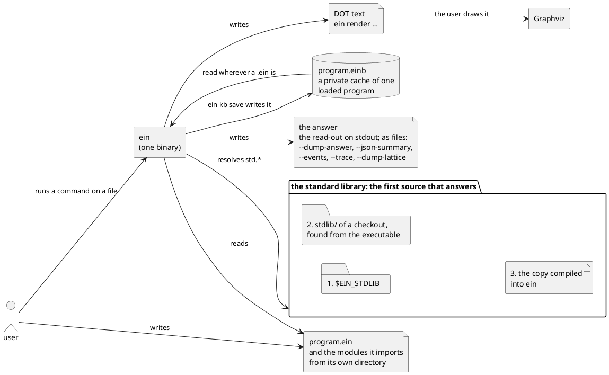
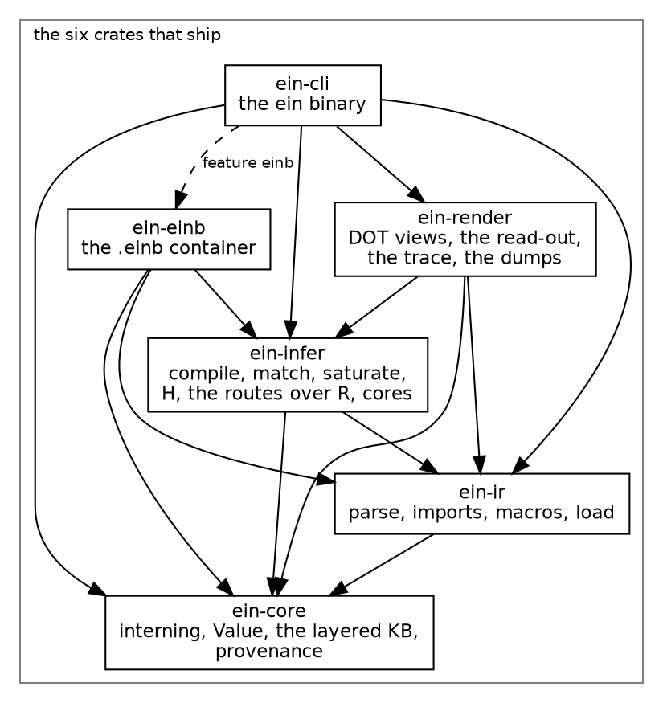
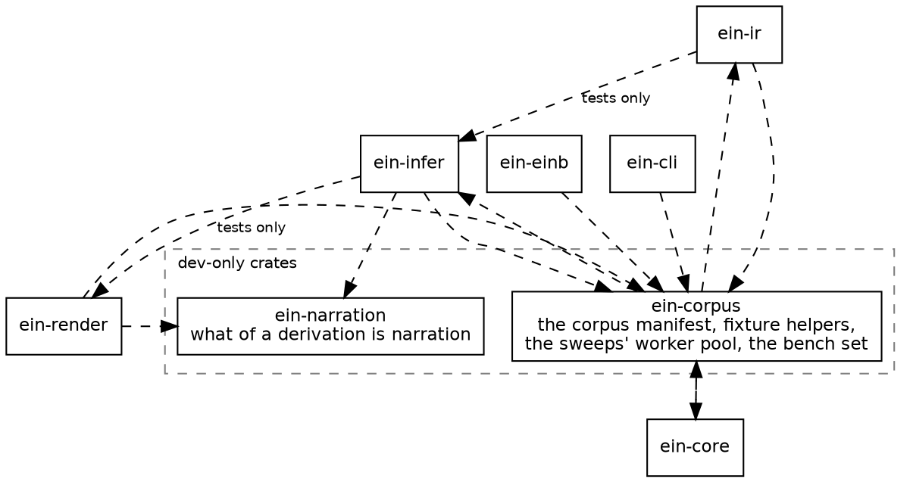
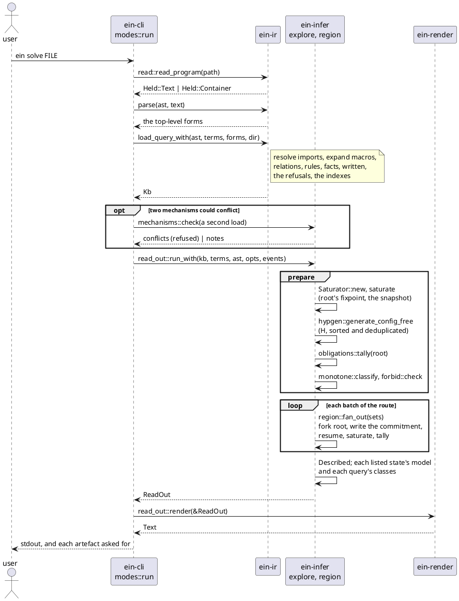
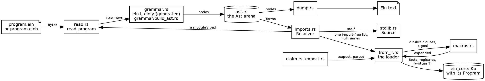
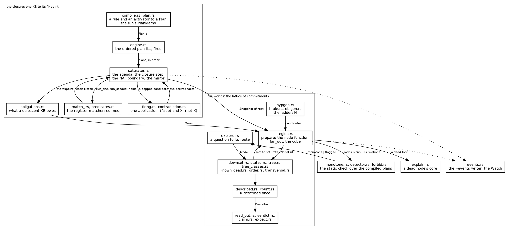
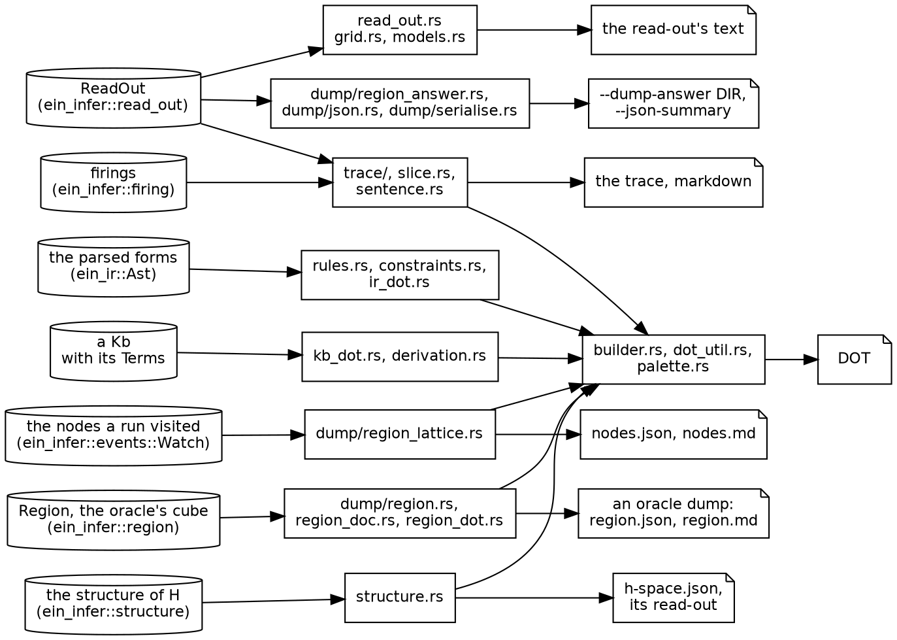

# Architecture

The structural map of `ein.rs`: the crates and how they stack, the path of one `ein solve` from a file to its
read-out, every module of the shipped crates and what it owns, and where each part of the language lives in code.
The contracts behind the modules are the [design pages](03-design/README.md); the build, the features and the
dependency policy are [`03-design/10-toolchain-and-layout.md`](03-design/10-toolchain-and-layout.md).

## 1. The crates

### 1.1 The system in its context

`ein` is one binary, and everything it works on is a file. It starts no other program and opens no connection: the
standard library is read from the first of three places that holds it
([`03-design/02-shared-assets.md`](03-design/02-shared-assets.md#3-resolution)), and a drawing leaves `ein` as DOT
text, which the reader hands to Graphviz.

### 1.2 The eight crates

An arrow runs from a crate to a crate it names under `[dependencies]` in its `Cargo.toml`; every edge of the
manifests is drawn. The six shipped crates stack linearly up to `ein-infer` and fork there; a crate depends on the
crates below it and on nothing above. `ein-cli` takes `ein-einb` under its `einb` feature.

Two crates are dev-only (`publish = false`), `ein-corpus` and `ein-narration`, and neither library depends on a
crate of the workspace. No shipped crate names one under `[dependencies]`; the edges below are every
`[dev-dependencies]` edge between two crates that is not a `[dependencies]` edge already, the ones a test or a
bench build adds. Two of them run against the stack, a lower crate's tests reading a higher crate: `ein-ir`'s tests
compile and saturate with `ein-infer`, and `ein-infer`'s tests render with `ein-render`.

The last three edges are `ein-corpus`'s own `[dev-dependencies]`, for its bench set
(`ein-corpus/benches/engine.rs`): its library depends on none of the three.

- **`ein-core`** depends on no other crate of the workspace: interning, `Value` and `FactId`, the layered
  copy-on-write KB, provenance and its walks, the value printers, and `:why` template substitution, which the
  obligation pass needs below the renderers ([`03-design/03-data-model.md`](03-design/03-data-model.md)).
- **`ein-ir`** parses, expands macros, resolves imports and loads: it builds the KB itself rather than handing an AST
  to a separate loader, which is why it sits above the store ([`03-design/04-ir-frontend.md`](03-design/04-ir-frontend.md)).
- **`ein-infer`** is the only writer of derived facts: compile, match, saturate, the boundary, the obligation pass,
  hypothesis generation, the routes over `R`, the cores
  ([`03-design/05-matcher.md`](03-design/05-matcher.md), [`03-design/06-saturation.md`](03-design/06-saturation.md),
  [`03-design/07-search.md`](03-design/07-search.md)).
- **`ein-einb`** writes and maps the `.einb` container ([`03-design/09-binary-format.md`](03-design/09-binary-format.md)).
- **`ein-render`** owns every rendering: the DOT views, the read-out's text, the markdown trace, the answer and
  lattice dumps, the JSON summary, the hypothesis space's document and graphs.
- **`ein-cli`** orchestrates: six subcommands, `ein {oracle,render,saturate,show,solve,test}`, plus `ein kb` under
  the `einb` feature. Every command reads a program by one path, `common::read_program`, `.ein` or `.einb` alike.
  **`ein render` draws and `ein show` lists**: `render` writes DOT, `show` writes Ein text a `.ein` file could hold.

`stdlib/` is Ein *data* that `ein-ir` resolves and embeds ([`03-design/02-shared-assets.md`](03-design/02-shared-assets.md)).

## 2. One `ein solve`, from file to read-out

| step | what happens | where |
|---|---|---|
| read | the file's bytes, `.ein` text or a `.einb` container by its magic | `ein-cli/src/common.rs` (`read_program`), `ein-ir/src/read.rs` |
| parse | text to the AST arena, by the parser generated from `ein.l` and `ein.y` | `ein_ir::grammar` |
| resolve, expand | imports read, each module once, names to full names; macros rewritten | `ein_ir::imports`, `ein_ir::macros` |
| load | the AST to the KB: registries, written facts, `(written T)`, the loader's refusals | `ein_ir::from_ir` |
| judge the mechanisms | where two hypothesis mechanisms could conflict, a second load is saturated and they are read together on root's fixpoint | `ein-cli/src/common.rs` (`load_held`), `ein_infer::mechanisms` |
| compile | each rule, per activator, to a plan, memoised for the run | `ein_infer::{compile, plan, engine}` |
| saturate root | the closure and the boundary, to root's fixpoint | `ein_infer::{saturator, match_, firing, contradiction}` |
| build H | the generation ladder at root | `ein_infer::{hypgen, hrule, oblgen}` |
| check | what root owes, the static monotonicity check, forbid | `ein_infer::{obligations, monotone, forbid}` |
| answer | the question's route over `R`, each node through the node function | `ein_infer::{explore, tree, tree_classes, states, downset, region}` |
| read | `R` described once; each listed state's model and each query's projection | `ein_infer::{described, read_out, verdict}` |
| print | the read-out, and whatever artefact was asked for | `ein_render::{read_out, trace, dump}`, `ein-cli/src/{solve, modes, summary}.rs` |

The same run as the calls one crate makes into the next. `prepare` is `ein_infer::region::prepare_with`, which every
question starts with; the loop is the route's, and its body is the node function of
[`03-design/07-search.md` § 2](03-design/07-search.md#2-the-node).

`ein oracle` runs the same load and root, then route 2, the whole cube. `ein test` loads a file, asks it the least
question that decides its claims, and checks them (`ein-cli/src/test.rs`, `ein_infer::claim`). `ein saturate` stops
after root.

## 3. The modules

### 3.1 `ein-core`

| module | owns |
|---|---|
| `intern.rs`, `terms.rs` | the symbol table and the two intern tables, lent to workers during a fan-out |
| `value.rs`, `facts.rs` | `Value`, four bytes; the fact store, interned rows and their ids |
| `kb.rs` | the KB: immutable layers and one writable top, the indexes, the extent counts, the fork |
| `bitset.rs` | dense sets of ids |
| `prov.rs`, `walks.rs` | derivation records and their arena; the premise closure, the derivation DAG, the unsat-core walk |
| `entities.rs`, `program.rs` | the typed views of relations, rules and macros; the program's registries |
| `config.rs`, `numparse.rs` | the typed view of `(config …)`, and the coercion of its values |
| `text.rs`, `repr.rs`, `printable.rs`, `numfmt.rs` | the one printer of Ein text, the value renderer, its escapes, number formats |
| `why.rs` | `:why` template substitution |
| `counters.rs` | the work counters, compiled in by `counters` |
| `shape.rs` | the KB's shape as one text, a test instrument |

### 3.2 `ein-ir`

| module | owns |
|---|---|
| `grammar.rs`, `grammar/build_ast.rs`, `ein.l`, `ein.y` | the generated lexer and parser, and the builder its actions call |
| `ast.rs` | the AST arena and its side table of positions |
| `macros.rs` | pattern macros, a load-time rewrite of the AST |
| `imports.rs` | import resolution, full names and short names |
| `stdlib.rs` | where `std.*` comes from: the override, the checkout, the embedded copy |
| `read.rs` | the one read of a program's text from a path |
| `from_ir.rs` | the loader |
| `dump.rs` | the canonical IR printer |
| `claim.rs`, `expect.rs` | the parsed forms of a `(solve … :expect …)` region claim and a query's `:expect` |

The modules as the path a program's bytes take through them; an arrow is what one hands the next
([`03-design/04-ir-frontend.md`](03-design/04-ir-frontend.md#2-the-load-path)).

### 3.3 `ein-infer`

| module | owns |
|---|---|
| `compile.rs`, `plan.rs`, `engine.rs`, `shape.rs` | the per-activator compiler, the plan, the engine's compile cache and its order, every plan as one text |
| `match_.rs`, `predicates.rs` | the register matcher; `eq` and `neq` |
| `saturator.rs`, `firing.rs`, `contradiction.rs` | the two-phase loop and the agenda; a rule application; the contradiction check |
| `obligations.rs` | the obligation pass over a quiescent KB |
| `naf_deps.rs`, `strata.rs` | the static map of what reads an `absent` over what; the rule dependency graph and its strata |
| `hypgen.rs`, `hrule.rs`, `oblgen.rs`, `mechanisms.rs`, `invariant.rs`, `scope.rs`, `relation_names.rs`, `types_as_objects.rs` | the generation ladder and its rungs; the mechanisms read together; the alive-set invariant; what the universe leaves out; a relation or a type bound as an object |
| `monotone.rs`, `detector.rs`, `forbid.rs` | the static check, the detector, the refusal of a refutation resting on an extendable `absent` |
| `region.rs` | the node function, the fan-out, the cube (route 2, the oracle) |
| `explore.rs` | every question about `R` and its route; the licences |
| `downset.rs`, `states.rs`, `tree.rs`, `tree_classes.rs`, `order.rs`, `known_dead.rs`, `transversal.rs`, `unheld.rs` | route 1, the state route, the obligation tree, the tree and the classes, the tree's order, the known-dead memory, transversals, licence L9 |
| `described.rs`, `count.rs`, `read_out.rs`, `verdict.rs`, `claim.rs`, `expect.rs` | `R` described once; exact counts; the read-out's data; a query projected over a state; claims checked against `R` |
| `canon.rs`, `explain.rs` | a state's identity; the minimal explanation search |
| `structure.rs`, `structure/` | the structure of H, read from the program's rules |
| `events.rs`, `error.rs`, `build.rs`, `mt19937.rs` | the `--events` writer; why a question was not answered; what the build compiled in; the seeded generator tests draw from (no command takes a seed) |

The modules by what each computes for the next: plans for the matcher, matches for the saturator, a fixpoint for
the node function, nodes for the routes, `R` for the read-out. The static check and the cores stand beside the
line: one reads the compiled plans, the other a dead node's derivations.

### 3.4 `ein-einb`, `ein-render`, `ein-cli`

| crate | modules |
|---|---|
| `ein-einb` | `header.rs` (the header and the section table), `sections.rs`, `tables.rs` (ids across the boundary), `meta.rs` (what a file was made from), `solutions.rs`, `wire.rs`, `cast.rs` (the audited zero-copy casts) |
| `ein-render` | `read_out.rs` (the read-out as text), `trace/` (the trace: its AST, its steps, relevance, the region trace), `dump/` (the answer, the lattice, the oracle's cube, `--json-summary`), `rules.rs`, `constraints.rs`, `ir_dot.rs`, `kb_dot.rs`, `derivation.rs`, `slice.rs`, `region_dot.rs`, `region_doc.rs` (the views), `structure.rs` (the hypothesis space written out), `grid.rs`, `models.rs`, `sentence.rs` (a fact in English), `shape.rs` |
| `ein-cli` | `cmdline.rs` (the argument surface), `common.rs`, one module per command (`solve.rs` and `modes.rs`, `oracle.rs`, `test.rs`, `render.rs`, `show.rs`, `saturate.rs`, `kb.rs`), `summary.rs`, `factdump.rs`, `printers.rs`, `version.rs`, `help_shape.rs` |

`ein-render` by what each module is handed and what it writes. A view is DOT text and the read-out is text, both
returned to the caller, and a dump is files in a directory the caller names; no module of the crate writes to
stdout, which is `ein-cli`'s.

## 4. Where the language lives

| concept | parsed | loaded | compiled | run |
|---|---|---|---|---|
| a fact | `ein.y` | `from_ir` writes it, with `source` provenance, and states `(written T)` for each fact nested in it | — | read by every plan through the indexes |
| a rule | `ein.y` | `from_ir` registers it (`entities`) | `compile::compile_rule`, once per activator, to a `Plan` | the matcher finds its matches; the saturator fires them |
| `(absent …)` | `ein.y` | — | lifted to a NAF guard (`split_naf`), or a nested step | judged at the boundary, on a quiescent KB |
| `(open ?R)` | `ein.y` | an obligation rule | compiled like any rule | the obligation pass, after the fixpoint |
| an hrule | `ein.y` | registered | a plan whose match proposes | `hrule`, the ladder's first rung |
| a macro | `ein.y` | expanded away before the load (`macros`) | — | — |
| an import | `ein.y` | resolved before the load (`imports`) | — | — |
| `(query …)`, `(solve …)` | `ein.y` | registered on the program | a goal compiles under `#query` | the routes; `verdict` projects a goal over a state |
| `(config …)` | `ein.y` | `SolverConfig` | — | read by the saturator and the routes; no field changes `R` |

## 5. The closure and the worlds

Two layers meet at one seam. **The closure** is monotone: the saturator fires the positive plans to quiescence,
and nothing it derives is ever retracted (`saturator`, `match_`, `firing`). **The worlds** are the nodes of the
search: each a fork of root with a commitment written in, saturated on its own, never written back to root (`region`'s
node function, and the routes above it). Negation as failure sits on the seam: an `(absent …)` is answered only at
the boundary, against a quiescent KB, one admission a round ([`03-design/06-saturation.md`](03-design/06-saturation.md)); a
commitment can change what a guard reads only by being a different node, which the static check reads off the plans
([`03-design/07-search.md`](03-design/07-search.md)). A state's identity, `canon::state_key`, is where the two layers' results
are compared.

## 6. One artefact, one owner

A semantic artefact that exists in two places is unified, compared by a test, or annotated at both sites with the
reason it must differ. Examples in the code: the model count and the verdict are read off one `Described`, never
recomputed per surface; the event schema and its emitters are held equal by `events_reference.rs`; the printer's
list of the grammar's reserved words is the grammar's, held by a test in `ein_ir::grammar`; and the language's
`ein_core::terms::RESERVED`, the names a declaration may not bind, is a different set from the grammar's
reserved words, so it has a different name, each documented with what the other is. The test of which case holds:
would an edit to one side be wrong not to make to the other? If so it is one artefact.
