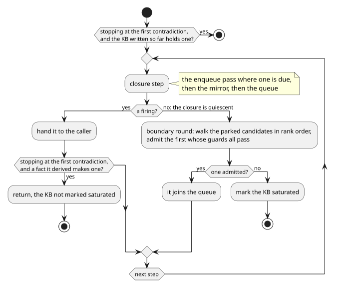
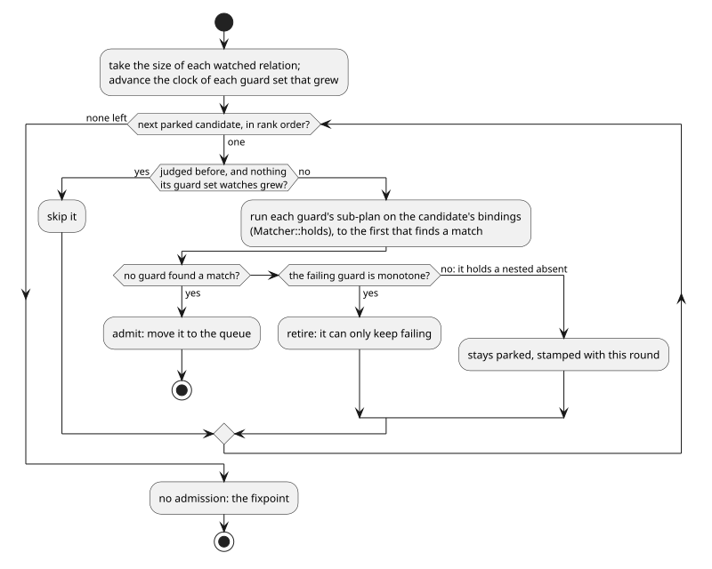
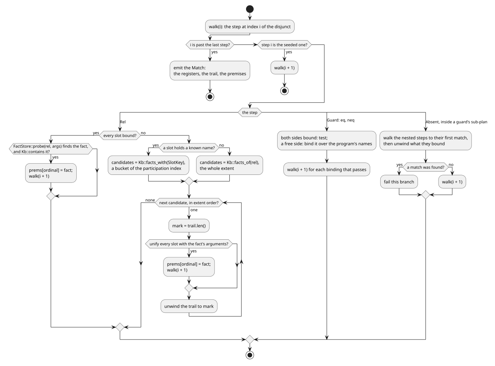
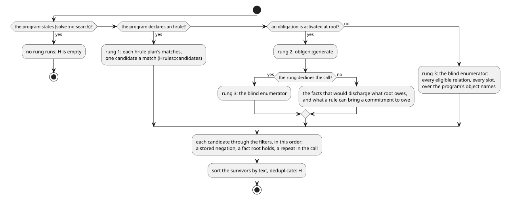
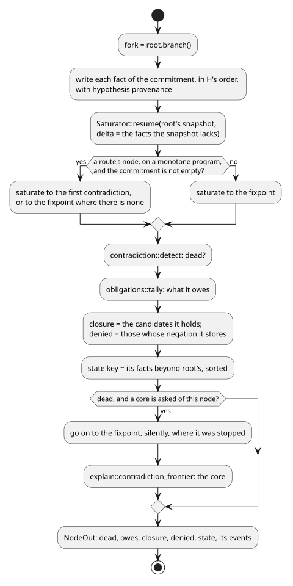
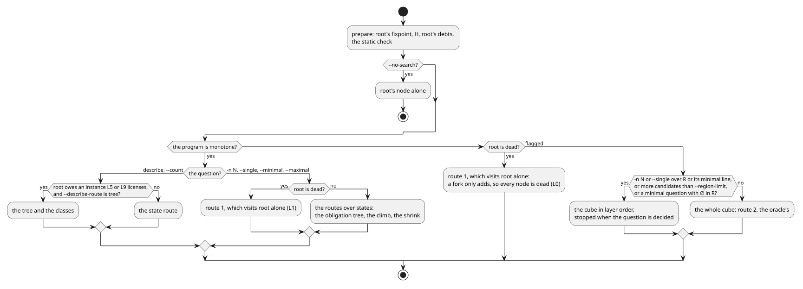
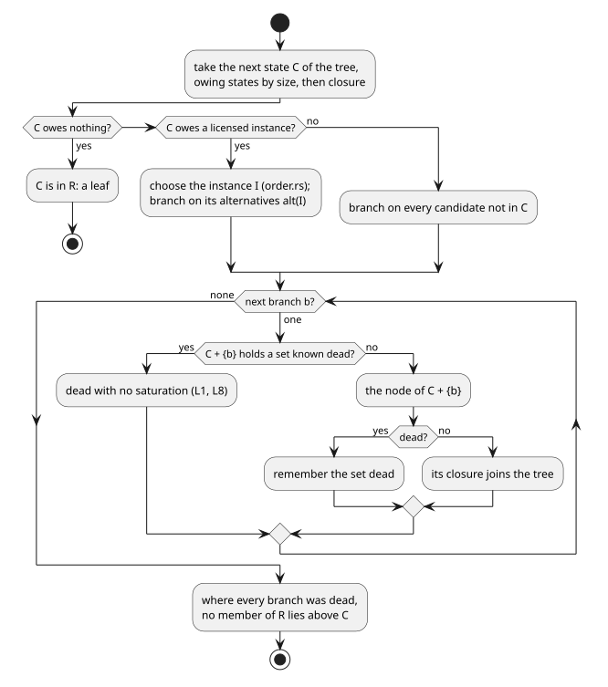
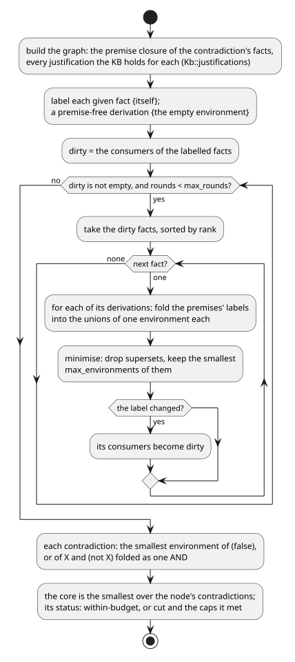
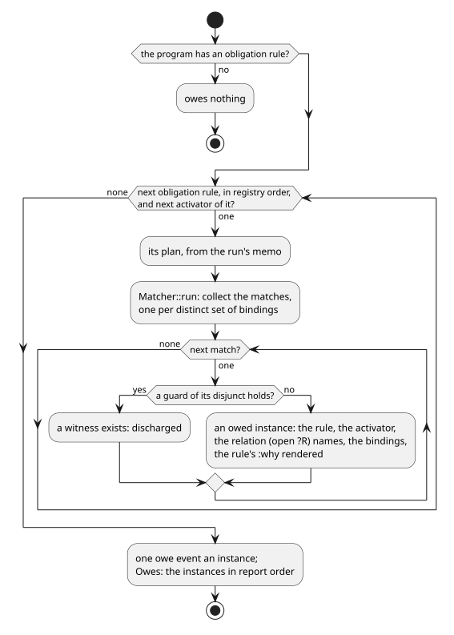

# Algorithms

Which algorithm `ein.rs` uses for each operation the engine performs, where that places it among the known ones,
the levers that change how it computes and never what, and then each algorithm as the code runs it: its flow as a
diagram, and pseudocode where the order of the steps is the point (§ 4 to § 10). The operations themselves, and the
paradigms they come from (forward chaining to a fixpoint, negation as failure, a search over assumptions), are
defined independently of this code; this page is the choices `ein.rs` makes for them, and each section links the
design page that is its contract.

## 1. The operations, and the choice for each

| operation | what `ein.rs` does | the family | where |
|---|---|---|---|
| **join**: every match of a rule's premises | a register machine over a fixed join order, with candidates narrowed by an index on argument positions (one level inside a nested argument) and a fully bound premise answered by one interned lookup | nested-loop join over alpha memories, in the RETE family, with no beta memories; not a worst-case-optimal join, whose reordering would change the firing order | [`03-design/05-matcher.md`](03-design/05-matcher.md) |
| **saturation**: the fixpoint | forward chaining, semi-naive: after a firing, only the delta is matched, each plan seeded at the premise a new fact plays; plans compiled once per run | the Datalog ladder: naive, then semi-naive with a seeded delta join | [`03-design/06-saturation.md`](03-design/06-saturation.md) |
| **negation as failure** | the boundary: a guard is judged only on a quiescent KB, one admission a round, a parked candidate judged again only where the held extent of a relation it watches grew | stratification computed by the run rather than in advance; a refutation resting on an `absent` a commitment could extend is refused | [`03-design/06-saturation.md`](03-design/06-saturation.md), [`03-design/07-search.md`](03-design/07-search.md) |
| **equality** | none: `eq` is name identity, computed, never stored, and names are never merged ([Q1](../../decisions/language/Q1-the-knowledge-base-is-a-hypergraph-of-atoms.md)) | no congruence closure | [`03-design/03-data-model.md`](03-design/03-data-model.md) |
| **contradiction** | two bit tests per new fact, `(false)` and a pair `X`, `(not X)`; the agenda fires first what can make one, and a route's node stops at its first | incremental clash detection | [`03-design/06-saturation.md`](03-design/06-saturation.md) |
| **provenance and cores** | every derivation recorded as an OR over AND-nodes, alternatives kept by premise count and smallest closure; a core is the smallest frontier, by an ATMS label search with a budget | ATMS labels; a minimum-cardinality frontier rather than a subset-minimal unsatisfiable subset | [`03-design/03-data-model.md`](03-design/03-data-model.md), [`03-design/07-search.md`](03-design/07-search.md) |
| **hypotheses**: the candidates H | a ladder: the program's hrules, else what the obligations owe, else blind enumeration, every guessable atom in every slot of every eligible relation | rule-driven, obligation-driven and generate-and-test generation | [`03-design/07-search.md`](03-design/07-search.md) |
| **the search**: the region `R` | routes over the lattice of commitments, each the least work its question needs: the state route (each alive state once), the obligation tree, the climb and the shrink, the alive down-set, the cube | monotone, upward-closed pruning (a dead node's supersets are dead), minimal transversals for the dead sets and the minimal generators, branching on an owed instance's exhaustive alternatives | [`03-design/07-search.md`](03-design/07-search.md) |
| **canonicalisation** | a state is its sorted fact set, compared whole, never by hash | canonical forms rather than isomorphism | [`03-design/07-search.md`](03-design/07-search.md) |

No problem is handed to an external solver: every operation above is the engine's own
([Q2](../../decisions/engine/Q2-ein-hands-no-problem-to-an-external-solver.md)). Arithmetic is a theory in the
standard library, computed by these same operations.

## 2. What it is shaped against

The engine is dominated by the join inside saturation; the choices above are each a way of asking the join less. The
alpha index reaching inside a nested argument, the ground-premise lookup, the plan memo shared by every node, a node
resumed from root's snapshot rather than saturated from scratch, a dead node stopped at its first contradiction, and
the state route visiting states rather than commitments each remove work without changing a match, a firing order or
an answer. Each is held to that by the invariance tests ([`03-design/01-determinism-and-order.md`](03-design/01-determinism-and-order.md)).

## 3. The levers

A lever changes how the engine computes, never what it answers: **no configuration field, option or environment name
changes `R`** ([Q-M1e2.30](../../decisions/answer/Q-M1e2.30-no-configuration-option-lever-or-flag-changes-r.md)),
held for every mode under every lever by `ein-cli/tests/lever_invariance.rs`.

| lever | what it changes |
|---|---|
| `--jobs N` | the nodes of a batch computed on `N` threads; nothing a run prints ([`03-design/08-parallelism.md`](03-design/08-parallelism.md)) |
| `--region-budget F` | how far a run goes before it stops and says what it established |
| `--region-limit N` | how large a flagged program's cube a run computes whole |
| `--describe-route tree\|states` | which of describe's two routes runs on a monotone program |
| `-T S` | a deadline, past which the run is an error |
| `--no-search` | the question: root alone, `R` not discovered |
| `(config :lattice-sanity-check true)`, `-y` | the parent-path spot check, read by the read-out |
| `(config :record-alternative-justifications false)` | alternatives not recorded; the one lever that may change a dead node's core, never `R` |

Every field the `(config …)` form accepts, every option and every `EIN_*` name is listed, with whether it changes the
answer, in the configuration reference (today [`docs/ein/user/04-reference/06-config.md`](../user/04-reference/06-config.md)); a
field that is retired is refused at load with the reason (`ein_core::config::RETIRED`).

## 4. Saturation: the two-phase loop and the agenda

`Saturator::saturate` brings one KB to its fixpoint, one firing a step. The closure is purely positive; negation
as failure is consulted only between two closures, on a quiescent KB, and admits at most one candidate each time.
The contract is [`03-design/06-saturation.md`](03-design/06-saturation.md).



**The closure step** (`Saturator::closure_step`) yields at most one firing:

```text
closure_step():
    if needs_enqueue:
        enqueue_pass(delta.take())          # None: a full pass
    while the queue is not empty:
        entry = queue.pop()                 # least rank: the agenda's half, then the tiebreaker
        if entry.key in fired: continue
        fired.insert(entry.key)
        build every conclusion of the plan's :assert against entry's registers
        if none is built: continue          # no :assert, or only eq and neq that hold
        if every conclusion is in the KB:   # a redundant firing
            record the derivation as an alternative, where the fact accepts one
            return the firing, redundant
        write the new facts with one derivation record
        delta += the new facts; needs_enqueue = true
        return the firing
    return None                             # quiescent
```

**The enqueue pass** (`Saturator::enqueue_pass`) is where the closure is semi-naive. It first compiles a plan for
every activator the KB has gained (`Engine::compile_all`), then matches:

```text
enqueue_pass(delta):
    compile_all()                           # a derived activator gets its plan here
    if delta is None:                       # the first pass, or facts written outside step
        for plan in the engine's list: full_match(plan)
        return
    for plan never matched yet: full_match(plan)
    for fact in delta, in order:
        for plan in pos_index[relation of fact], in list order:
            seed_match(plan, fact)          # run_seeded: the fact bound at each step it can play

each match:
    key = (rule, activator, registers); guards = the disjunct's guard set
    if (key, guards) in seen: drop it
    seen.insert((key, guards)); if key in fired: drop it
    tiebreaker += 1
    rank = tiebreaker, with the bit LATE where the plan's rule is not in the agenda's first half
    the disjunct has guards ? parked.insert(rank, entry) : queue.push(rank, entry)
```

**The agenda** is the rank. The first half holds the candidates of a rule whose conclusion a contradiction can be
made of, the second the rest; within a half the order is the tiebreaker's, the order of arrival
([Q-M1f.313](../../decisions/engine/Q-M1f.313-the-agenda-fires-first-what-leads-to-false.md)). The queue is a binary
heap over `(rank, entry)` and the parked set a `BTreeSet` of the same keys, so the closure pops, and the boundary
walks, in one order.

**The boundary round** (`Saturator::admit_from_boundary`) judges a parked candidate only where its verdict can have
moved: the sizes of the watched relations' held extents are taken once a round, and a candidate judged before is
skipped unless one of them grew.



A node of the search does not start this loop from nothing: `Saturator::resume` continues root's snapshot over a
fork, with the commitment as its first delta (§ 7).

## 5. The matcher: a plan run as a register machine

A rule is compiled once per activator to a `Plan`: flat arrays of steps and slots, one register per variable. The
matcher runs it as nested loops over the KB's indexes, with a register file, a trail and a premise array, and hands
each match to a callback without copying it. The contract is
[`03-design/05-matcher.md`](03-design/05-matcher.md).



**Unifying a slot** is the machine's one instruction (`Matcher::unify_slot`): a `Const` slot is a `u32` equality; a
`Reg` slot binds an unbound register, pushing it on the trail, or compares a bound one; a `Nested` slot requires a
fact, compares its relation, then unifies its arguments. Unbinding pops the trail back to a mark. The three
candidate sources yield in the held extent's order and every slot is re-checked, so the source chosen changes how
many facts are offered and never the sequence of matches.

**The entry points** differ in what is bound before the walk: `run` and `run_one` start each disjunct from the
activator's seed registers; `run_seeded` binds one step to a new fact first, at every step whose relation is the
fact's; `holds` runs a lifted guard's sub-plan in its own register space, seeded from the parent's registers, and
stops at the first match.

## 6. Hypothesis generation: the ladder

H is built once, at root's fixpoint, by `hypgen::generate_config_free`. Which rung proposes is decided by one
function, `hypgen::rung`, before any rung runs; every rung feeds one filter pipeline, and the survivors are sorted
by text and deduplicated into H. The contract is
[`03-design/07-search.md` § 1](03-design/07-search.md#1-hypothesis-generation).



Rung 2 declines, and the blind enumerator runs, where an obligation's guard scans a relation the rung itself
proposes, or reads one a commitment can change (`oblgen::Mode::Declined`); a state that owes only relations the
program scopes out proposes nothing and says so (`Mode::Stuck`). The filter that drops a candidate is named on its
`hyp` event, and the generator's statistics assert that nothing is lost between the two counts:

$$
\operatorname{raw} = \operatorname{emitted} + \sum_{f \in \text{filters}} \operatorname{dropped}_f
$$

## 7. The node function

Every route, and the oracle, reads a commitment through `region`'s node function: a fork of root with the
commitment written in, root's saturation resumed over it, and both verdicts read off the result. The contract is
[`03-design/07-search.md` § 2](03-design/07-search.md#2-the-node).



A batch of nodes goes through `region::fan_out`, which computes them on the worker pool where one is built and
returns them in the batch's order ([`03-design/08-parallelism.md`](03-design/08-parallelism.md)).

## 8. The routes over R

`explore::run_with` prepares root (its fixpoint, H, what it owes, the static check) and then sends the question to
the route that needs the least work. A route skips a node only under a licence the static check proves for the
program's class ([`03-design/07-search.md` § 3](03-design/07-search.md#3-the-licences)).



### 8.1 The state route

Describe's route where the tree has nothing to branch on, and under `--describe-route states`
(`states.rs`). On a monotone program a commitment's state is its closure's (L3), so the route walks closed sets,
smallest first, and saturates only one-fact extensions:

```text
states = { cl({}) }                         # root's state
for size in increasing order:               # one layer per size
    for S in the alive states of this size:
        for b in H, b not in S:
            if S + {b} holds a set known dead: skip      # L1, L8: the one memory
            if S + {b} is a state already met: skip      # L3
            saturate S + {b} once, whichever state asks  # the node function
            dead  : remember it dead
            alive : its closure is a state, new or met before
describe R off the states met: the lines, the generators, N, k_s, k_c
```

`N`, the minimal dead sets, is read off the alive side: the minimal transversals of the complements of the
maximal alive states (`transversal.rs`). The commitments over a state $T$ are counted without visiting them:

$$
f(T) = 2^{|T|} - \sum_{S \subsetneq T,\; S \text{ alive}} f(S)
$$

### 8.2 The obligation tree, and the lines

The other questions on a monotone program walk the same lattice of states and take only what they need
(`tree.rs`). At an owing state the tree branches on the alternatives of **one** owed instance where L5 or L9
licenses it, since every member of `R` above the state holds one of them; an owing state with no licensed instance
branches on every extension.



| question | what it does with the tree |
|---|---|
| `-n N` | the tree's leaves in its own order; when it runs out, the states of `R` above its leaves, each extended once (L2). Where ∅ is in `R`, root's state first, then the states above it |
| `--single` | where ∅ is in `R`, root's extensions until one is alive; otherwise the tree, stopped at its second state of `R`, and with exactly one, that state's extensions until one is alive (L4) |
| `--minimal` | each leaf's commitment shrunk while it stays discharged; for the whole line, the alive minimal transversals of the complements of the maximal owing states |
| `--maximal` | a first state of `R` climbed to a maximal one, then dualise and advance above each minimal state: each minimal transversal of the complements of the maximal states found is saturated with the seed, and an alive one is climbed |

**Which instance a state branches on** decides the work and never the answer. The order is `order.rs`'s, by three
keys in turn: the instance closest to closing a coupling, once the couplings are read
([`08-reasoning-in-code/03-hypotheses-and-the-answer.md` § 2.2](08-reasoning-in-code/03-hypotheses-and-the-answer.md#22-what-it-costs));
the fewest alternatives not known dead; the first by rendered text. The owing state of the smallest closure is
branched next. The `route` row says in words which order a run took.

**`--single`**, *is `R` one state?*, as a procedure:

```text
if the empty commitment is in R:   s = cl(empty)                 root's own state
else:   run the tree; stop at the second distinct leaf            not one state
        if no leaf                                                R is empty
        if exactly one leaf state s                               every state of R holds s    (L5)

then:   for each candidate b outside s:
            if s + b is alive                                     it is in R (L2), another state: not one state
        all dead                                                  every proper superset of s is dead (L1):
                                                                  one state, proved                        (L4)
```

**The tree and the classes** (`tree_classes.rs`), describe's default route where root owes a licensed instance,
finds `R`'s states by that tree with no bound on their number, then each state's class, its commitments and
minimal generators, by dualise and advance inside the state:

```text
R's states   = the leaves of the obligation tree, exhausted, and every alive state above them   (L5, L9, L2, L3)
dead alone   = the candidates b with cl(empty) + b dead
for each state s of R, its class, the commitments C inside s with cl(C) = s:
    M(s)          = the maximal closed proper subsets of s      dualise and advance inside 2^s, cl the oracle
    generators(s) = the minimal transversals of the sets s - m, m in M(s)
    |class(s)|    = the number of subsets of s that meet every s - m
k_c = the sum of |class(s)| over the states of R
the minimal line = the minimal sets among every state's generators       (the empty one where root is in R)
the maximal line = the states of R every extension of which is dead      (L4)
```

Dualise and advance inside `s` asks each minimal transversal `T` of the complements known: where `cl(T) = s` it is a
generator, and otherwise `cl(T)` is climbed inside `s` to a new maximal closed proper subset and the transversals are
taken again; when every transversal generates `s`, `M(s)` is every maximal closed proper subset. Its seed is the
closed subsets of `s` the run met, and where every one of them was extended by every candidate it is complete and
nothing is asked. **It does not compute `N`**, the border of *alive*, nor an empty `R`'s owing frontier, the maximal
alive sets: where root owes, that border can be far larger than the alive states the state route reads it off. The
read-out says so, with the members met: the candidates dead alone, and the owing states met with every extension
dead.

### 8.3 Route 1, the cube, and the oracle

**Route 1** (`downset.rs`) walks a monotone program's alive down-set layer by layer from ∅: a commitment of size
$k + 1$ is visited only when each of its $k$-subsets is alive, so it saturates the alive commitments and the
minimal dead sets, $|\operatorname{alive}| + |N|$ nodes. **Route 2**, the cube (`region::compute_prepared`), saturates all $2^n$ commitments over $n$ candidates and reads the
topology off the status array; it is the only route a flagged program has, and `ein oracle` is that route asked
for on any program, every node to quiescence. Every mode is held to it (`ein-infer/tests/explore.rs`).

```text
for every subset C of H:                   2^n nodes, n = |H|
    compute node(C) to quiescence
    read dead(C), owes(C), cl(C), and its core if dead
R = the C that are alive and owe nothing
```

It refuses a universe past its limit, `--region-limit`, 16 by default as `ein oracle --help` prints, and says how
many saturations the region would have taken.

## 9. Core extraction

A dead node's core is the smallest set of given facts, written or committed, from which one of its contradictions
follows. Provenance is an AND/OR graph, a fact an OR over its recorded derivations and each derivation an AND over
its premises, and `explain.rs` computes a label per fact, its subset-minimal environments, by a least-fixpoint
propagation with a budget. The contract is
[`03-design/07-search.md` § 6](03-design/07-search.md#6-cores-and-explanations).



Dropping a superset loses nothing, since union is monotone; only the caps lose environments, and a search they
stopped reports a real frontier that may not be the smallest, with a status that says so. A premise closure past
`ExplanationBudget::max_facts` is not searched: the frontier of the recorded derivations is returned in its place,
and the status says it was cut. A core is taken only where a surface prints one (`region::Cores`).

## 10. The obligation pass

A rule whose `:assert` is `(open ?R)` is in no agenda. `obligations::tally` runs once over a KB after its
saturation returns and reports what the KB still owes; nothing it reports is stored
([`03-design/06-saturation.md` § 6.2](03-design/06-saturation.md#62-obligations)).



The rule matches while the witness is missing and stops matching once it has arrived, so the pass asks no second
question to learn whether a debt was paid. A node's kind is read off the two verdicts: dead where its fixpoint is
contradictory, owing where it is alive and `Owes` is not empty, in `R` otherwise.
