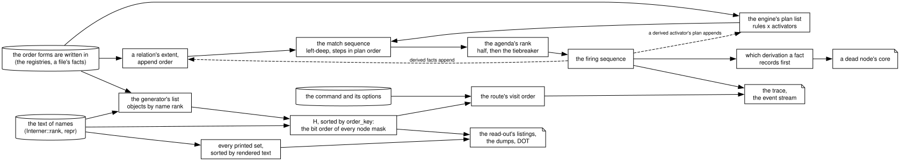

# Determinism and order

What a run of `ein` may depend on and what it may not, and, for every place where an iteration order is
observable, the structure that fixes it. The orders live in `ein-core` (the interner's rank table,
`entities::Registry`, the layered `Kb`, `repr`), `ein-infer` (the saturator's agenda, the engine's plan list, the
matcher, the order of H, `canon`, the fan-out) and `ein-render` (the DOT builder, the hashed node ids, the palette).
The tests that hold the contract are listed in [§ 9](#9-the-tests-that-hold-it).

## 1. The contract

### 1.1 What a run's output depends on

A run's output, stdout, stderr, the exit code and every artefact file, is a function of:

- the program's text and the text of every module it imports;
- the stdlib as resolved ([`02-shared-assets.md`](02-shared-assets.md#3-resolution));
- the command, its options and its budgets;
- the engine build: its version, and its features where a feature adds or removes a surface (`ein kb`, `.einb`
  input; [`10-toolchain-and-layout.md`](10-toolchain-and-layout.md#4-feature-flags)).

That a monotone program's fixpoint, and so R, do not depend on the order rules fire in is a property of the
semantics, not of this code. Everything else a run prints, the trace, the event stream, which derivation of a fact
is recorded first, the core of a dead node, the order of every listing, does depend on order, so reproducible output
is the problem of fixing every observable order.

### 1.2 What it may not depend on

| input | held by |
|---|---|
| the order ids were assigned in (interner symbols, `FactId`s) | `id_order_invariance`: every rendering, byte for byte |
| the job count, and how threads were scheduled | `jobs_invariance`: every rendering a job count reaches, byte for byte ([Q-M1a.7](../../../decisions/engine/Q-M1a.7-a-job-count-moves-nothing-a-run-prints.md)) |
| a hash seed | no hash container is iterated into an output ([§ 2.3](#23-hash-containers)) |
| the order a directory lists its files in | every listing of files is sorted ([§ 4.3](#43-output-bytes)) |
| a `(config …)` flag, a lever, an option that is not a question | `lever_invariance`: R and every line of every mode ([Q-M1e2.30](../../../decisions/answer/Q-M1e2.30-no-configuration-option-lever-or-flag-changes-r.md)) |
| the import form | `import_invariance`: the answer once prefixes are taken off ([Q-M1f.249](../../../decisions/imports/Q-M1f.249-the-answer-does-not-depend-on-the-import-form.md)) |
| `.ein` or `.einb` | `einb_cli`: a container's solve is its source's, byte for byte ([Q-M1a.22](../../../decisions/cli/Q-M1a.22-a-containers-solve-is-its-sources-byte-for-byte.md)) |

### 1.3 What varies, and why it may

- **Clock readings.** The `wall` row `--stats` adds, the per-file `ms` of `ein test`'s JSON report, and the
  `## Cost` line of an oracle dump's `region.md`, which says on the page that it differs between two runs. A
  wall-clock budget (`--max-time`) stops a run where the clock says, and the run reports the stop.
- **Paths** a run echoes: the file it was given, and `ein --version`'s resolved stdlib directory.
- **A core under another written or agenda order.** A core is an explanation
  ([Q-M1f.6](../../../decisions/answer/Q-M1f.6-a-core-is-an-explanation.md)): it may change when the rules are
  written in another order or the agenda is switched; it does not change with ids, threads or hashes.
- **A container opened into a populated interner.** A library caller that opens a `.einb` into a `Terms` already
  holding other names gets the same answer and may get other narration
  ([Q-M1a.22](../../../decisions/cli/Q-M1a.22-a-containers-solve-is-its-sources-byte-for-byte.md)); every `ein`
  process opens one container into a fresh table and takes the identity path.

## 2. The rules the code keeps

### 2.1 Ids are not an output order

A `Symbol` is the number of distinct names seen when it arrived, and a `FactId` the number of facts interned before
it: both are assignment-ordered, so their numeric order is the order the loader walked the file and the search
derived facts. `Symbol` has no `Ord`; `Value` has no `Ord` and offers `Value::cmp_identity` by name; `FactId`'s
derived `Ord` is assignment order. These three serve identity only ([§ 5](#5-where-order-does-not-matter)). An
observable order is a content order ([§ 2.2](#22-content-order)).

### 2.2 Content order

Names sort by Unicode code point, which is what `Ord for str` gives, since UTF-8 byte order is code-point order.
`Interner::rank` turns that into a `u32`: the rank table is built on first use, dropped when a name is interned, and
makes every later sort by name an integer sort. `Terms::cmp_semantic` orders two objects by content (a `Value` is
the code's word for an object, an atom or a fact,
[Q-M1f.379](../../../decisions/language/Q-M1f.379-an-object-is-a-node-of-the-knowledge-base-graph.md)): two names by
rank, two facts by `Terms::cmp_fact_semantic` (relation name, then arguments element-wise, a prefix first), and a
name before a nested fact, by a tag order `tag_order` fixes rather than the encoding's bits. Held by
`ein-core/tests/values_semantics.rs`: `the_rank_table_orders_names_by_code_point`, against `Vec<String>::sort` over
a generated corpus.

### 2.3 Hash containers

The engine crates hash with `rustc_hash` (`FxHashMap`, `FxHashSet`): no per-process seed, so two runs of one build
hash alike. That is not enough, because an `FxHashMap`'s iteration order is still a function of hash values and
insertion history rather than of the program. So every hash container is read in one of four ways:

- **membership or lookup only** (`Saturator::seen`, `Engine::fired`, `Registry`'s index, `ein-ir`'s string table,
  `ein-render`'s DOT `Builder` index);
- **a sum, an `any`, or an independent rewrite of each value**, which no order reaches;
- **a set closed to a fixpoint**, whose result is the same in any visit order;
- **collected and sorted** before anything reads it.

Where code iterates a hash container, the line carries a `// determinism-ok: <reason>` comment naming which of
these it is. Where a hash map would decide an order, the code keeps a push order beside it instead:
`ProvArena::promote` copies a fork's derivation records in the fork's own push order, not in the order of the
KB's justification maps, so which ids a promotion assigns is a function of what the fork derived.

### 2.4 Stable sorts

An observable sort either sorts distinct keys (a rank, a rendered text that cannot repeat), where stability is
moot and `sort_unstable` is used, or is stable (`sort_by`, `sort_by_key`), so ties keep their input order, which is
itself one of the fixed orders below.

## 3. Ordered containers

| container | order | structure |
|---|---|---|
| the registries: relations, rules, hrules, obligations, macros | declaration order | `entities::Registry<V>`: `Vec<(Symbol, V)>` and an `FxHashMap<Symbol, u32>` index |
| the KB's fact list, `Kb::facts` | append order, layers read oldest first | `Layer::facts: Vec<FactId>` per layer |
| a relation's held extent, `Kb::facts_of` | append order | `Layer::by_rel`, one `Vec<FactId>` per relation |
| a participation bucket `(relation, slot, value)` | append order | `Layer::by_rel_slot_val`, keyed by `SlotKey` |
| `Kb::names` | first-seen order, which no consumer relies on: each sorts | a bitset dedup over each layer's name registry |
| an engine's plan list | compilation order: each rule with each of its activators, each engine its own list over the shared memo | `Engine::plans: Vec<PlanId>` with `by_key` |
| plans by premise relation | plan-list order | `Saturator::pos_index`, built by walking the plan list |
| a match's bindings, `Prov::bindings` | bind order, the matcher's trail | `Box<[(Symbol, Value)]>` |
| a match's premises, `Prov::premises` | plan-step order, a seeded fact at its own step | `Box<[FactId]>` |
| the agenda and the parked set | rank ([§ 3.1](#31-the-agendas-key-is-total)) | `BinaryHeap<Reverse<(u64, u32)>>`, `BTreeSet<(u64, u32)>` |
| the symmetric mirror's queue | a stack, popped last in first out | `Saturator::mirror_queue: Vec<FactId>` |
| the hypothesis set H | content order ([§ 4.2](#42-the-hypothesis-set-and-the-search)) | `Vec<Candidate>`, bit `i` of every node mask |
| derivation records | push order | `ProvArena` |

### 3.1 The agenda's key is total

A queued or parked candidate is an entry in a side arena, and the heap holds `(rank, entry)`. The rank is a
per-saturator tiebreaker, incremented on every enqueue, with the bit `LATE` set for a candidate whose rule is not
among the agenda's first half ([Q-M1f.313](../../../decisions/engine/Q-M1f.313-the-agenda-fires-first-what-leads-to-false.md),
`saturator::AGENDA`). The tiebreaker is unique, so no two entries compare equal on the rank and the comparison
never reaches the payload: pop order is a total function of the enqueue sequence, and any correct priority queue
gives it. The parked set is a `BTreeSet` of the same keys, walked in order by the boundary. A resumed saturation
(`Saturator::resume`, [Q-M1a.18](../../../decisions/engine/Q-M1a.18-a-node-resumes-roots-saturation.md))
continues the tiebreaker from its snapshot's high-water mark, so its own candidates follow the inherited ones
within each half, and re-ranks what it inherits under its own agenda. The mechanism is
[`06-saturation.md`](06-saturation.md).

## 4. Order-sensitive sites

Every observable order is derived from the program's text by a chain of the structures below, and no link of a
chain reads an id's number or a hash's order. An arrow reads *fixes the order of*; the three sources on the left are
orders the program's text gives, and the notes on the right are what a run prints.

### 4.1 The firing sequence

What fires first decides the trace, the event stream, which derivation of a fact is recorded first, and so the
core of a dead node.

| site | the structure that fixes its order |
|---|---|
| candidate selection, `Matcher` | the bucket of the first slot, left to right, holding a usable object (`plan.probes`, checked against `candidates_scan` in debug builds); a bucket yields in the held extent's order, so narrowing changes no match sequence: `match_.rs`' `narrowing_never_changes_the_match_sequence` |
| the join | left-deep, steps in plan order; no join is reordered ([`05-matcher.md`](05-matcher.md)) |
| a seeded match | the delta fact at each matching step, in step order, at its own premise position |
| compilation, `Engine` | each rule with each of its activators, in registry and append order; the memo shares plans, never the order |
| the enqueue pass | a full pass walks the plan list; a delta pass walks the delta facts in order, then `pos_index[rel]` |
| the closure step | the symmetric mirror before rule firings, its queue a stack |
| the mirror's seed | the relations marked `(__symmetric__ R)` sorted by name, each held extent in store order: `saturator.rs`' `the_mirror_seeds_its_relations_in_name_order` |
| the boundary | parked candidates in rank order; the first whose guards pass is admitted, one per round |
| a resumed node's delta | the facts the snapshot lacks in the order the KB holds them, which is the order the caller wrote them (`Snapshot::new_facts_of`); every route writes a commitment in H's order |

### 4.2 The hypothesis set and the search

- **The generator** (`hypgen`): the atoms it guesses about sorted by name rank; its focal order by descending
  participation, then name, stably; relations in declaration order, slots ascending. The order of its filters
  decides which counter a dropped candidate is attributed to, and those counters are printed.
- **H** is the generator's list sorted by `region::order_key`, a candidate's s-expression with every name as its raw
  text and a nested fact rendered recursively, stably, and deduplicated. The key is defined for every argument
  shape, a name or a nested fact, so H's order is a content order whatever a hypothesis holds; between two
  candidates of one key, the generator's order, itself a content order, decides. H's order is the bit order of every
  node mask, the oracle's cube included, so no node, edge or listing depends on ids.
- **The tree's order** (`ein_infer::order`): which owed instance a state branches on and which state next. No key
  reads an interner id; the last key is rendered text or, on the minimal line and under `-n N`, the order the
  obligation pass reports, which is the program's written order ([`07-search.md`](07-search.md)).
- **Listings of states and commitments** sort by size, then by candidate indices in H's order.

### 4.3 Output bytes

- **Every set a surface prints is sorted by text**: a core's facts, a state's facts beyond root, binding rows (each
  by variable, then the rows), the stale facts of a flagged program. The trace slice's edges into `⊥` sort the core
  by `repr`. The JSON summary builds its per-relation maps as `BTreeMap`s, and `HypGenStats`' counter keys are in
  sorted order by construction.
- **The explanation**: `explain` ranks the facts of a justification graph by the `repr` of their `(relation_name,
  args)` tuple, and `recorded_fallback` keys a candidate core on its size and its facts' sorted `repr`s.
- **DOT**: `Builder` emits nodes in first-declaration order and keeps a node's position when its attributes are
  refined; the KB view sorts the names it draws as a type and as an instance, the two ends of an `is-a` fact; node
  ids and colours are digests ([§ 8](#8-hashes-that-reach-the-output)).
- **`--dump-config`** prints `SolverConfig`'s fields in `config::FIELDS` order, a fixed array in declaration order
  (`config::rendered_fields`).
- **`ein --version`**'s feature line is sorted and deduplicated.
- **Files**: `stdlib::Source::modules` sorts the module list, since a directory's listing order is the filesystem's.
- **The event stream** writes facts as s-expressions and no internal id, and numbers its lines on the thread that
  writes them ([§ 6](#6-order-across-worker-threads)); [`05-events.md`](../05-events.md).
- **`.einb`**: a save holds no clock, so two saves of one program are one file
  ([Q-M1f.110](../../../decisions/engine/Q-M1f.110-a-container-saved-again-is-the-same-container.md),
  [`09-binary-format.md`](09-binary-format.md)).

### 4.4 A refused file's report

The parser is generated by grmtools, and its error recovery is the vendored `lrpar`'s
([Q-M1e2.25](../../../decisions/engine/Q-M1e2.25-the-parser-is-generated-from-the-grammar.md)): equal repairs keep
the order the search found them in, the sort is stable, and recovery stops at a count of search steps,
`lrpar::RECOVERY_STEP_BUDGET`, over the whole parse rather than at a wall-clock time. A report cut at the budget says
so. A refused file therefore reports the same errors on every run and every machine
([`04-ir-frontend.md`](04-ir-frontend.md), [`10-toolchain-and-layout.md`](10-toolchain-and-layout.md#6-the-vendored-parser-runtime)).

## 5. Where order does not matter

Stated so that the engine does not constrain itself where nothing is observable:

- **State identity.** `canon::state_key` is a KB's facts as a sorted `FactId` vector, and identity is that vector
  itself, never a hash of it. For identity any total order gives the same equivalence classes, so the key sorts by
  `FactId`, a `u32` sort with a `memcmp` equality, and needs no content order; where a state is displayed it is
  rendered and sorted by text. `Value::cmp_identity` and `FactId`'s derived `Ord` exist for exactly these keys.
- **Binding keys**: `fired` and `seen` are hashed and compared, never iterated.
- **Membership sets**: root's facts, the candidate set and the hypothesised relations a node is read against
  (`region::Axes`), the KB's belief and negation bitsets.
- **Fixpoints over sets**: the explanation's derivability closure and the monotonicity detector's sets close to the
  same set in any visit order.
- **Index layout**: a layered KB read oldest-first gives every ordered list in the order a single copied-then-appended
  list would (`Kb::materialise` is held to it), so the indexes are a function of the fact list's order.

## 6. Order across worker threads

`--jobs N` reaches one place, a route's fan-out (`region::fan_out`, built by `region::pool_of`), and its output is
the sequential one byte for byte
([Q-M1a.7](../../../decisions/engine/Q-M1a.7-a-job-count-moves-nothing-a-run-prints.md)). The order is restored, not
hoped for:

- **Workers share nothing they write**
  ([Q-M1e.23](../../../decisions/engine/Q-M1e.23-a-routes-workers-share-nothing-they-write.md)). Each reads root and
  root's saturation snapshot by shared reference and writes only its own fork, so what a worker can observe during
  the step is root, which does not change. No store is shared between workers: a route's node is a fork of root
  that no other node reads.
- **The intern tables are lent, not shared for writing.** `Terms::lend` returns a `Lent` guard that hands workers
  a `&Terms` view; a lookup answers, an assignment fails with `Overflow::Shared`, and the guard takes the tables back
  when it drops, a panic included. A node that would have to number a new fact or name is handed back and computed
  after the parallel pass, on the calling thread, in the step's order. Speculated nodes assign no id and handed-back
  nodes assign ids in step order, so the id sequence is `--jobs 1`'s.
- **Results are taken in order.** The pool collects into a vector indexed by the step's sets, and the calling thread
  reads it in that order.
- **Narration is numbered on replay.** A worker narrates into its own `Events` buffer, each line with a hole where
  its ordinal goes; `Events::replay` fills the holes as the calling thread takes the node, so the stream's lines and
  numbers are the sequential run's. Each worker keeps its own derivation records.

A build without the `parallel` feature has no pool: `pool_of` returns `None` and every node runs on the calling
thread. The mechanism is [`08-parallelism.md`](08-parallelism.md).

## 7. The value renderer

`ein_core::repr` renders an object, or a list of them, in one fixed textual form. Sort keys that must be total over
every argument shape go through it, so a name and a nested fact can never collide, and some messages quote names
with it (`repr::repr_str`). It covers the three shapes `ReprValue` reachable from a fact argument:

| shape | `repr` |
|---|---|
| a name, `Str` | quoted in `'`, or in `"` when the text holds a `'` and no `"`; the chosen quote and `\` backslash-escaped; tab, newline and carriage return as `\t` `\n` `\r`; any other C0 control and DEL as `\xNN`; any other non-printable code point as `\xNN` below U+0100, `\uNNNN` below U+10000, `\UNNNNNNNN` above, lower-case hex; everything else as itself |
| a tuple | `(a, b)`, items separated by `, `; one item `(a,)`; none `()` |
| a fact | `Fact(relation_name='p', args=('A',))`: the relation name as a name and the arguments as a tuple, a nested fact recursively |

Printability is `ein_core::printable`'s table. `Terms::repr_value` and `Terms::repr_fact` build a `ReprValue` from
an interned `Value`. The format is specified by tables: `ein-core/tests/format_tables.rs` holds every shape
(`golden/repr_values.txt`) and every code point where printability turns over (`golden/repr_escapes.txt`), so a
change to the format is a re-blessed golden, never a silent one. `repr` is a sort key and a quoting rule, never the
form a fact is shown to a reader in; that is the s-expression.

`ein_core::numfmt` formats a float under a `[[fill]align][sign][0][width][.precision]f` spec, which is how
`ein saturate` prints its phase and step timings (`8.2f`): `precision` digits after the point, six when none is
given, rounded from the exact binary value with ties to even; NaN prints `nan` and never carries a `-`, an infinity
prints `inf` with its sign; a spec without the `f`, an empty one included, or with any other presentation type, is
refused rather than guessed. `format_tables.rs` holds it over a seeded set of doubles and specs
(`golden/float_format.txt`).

## 8. Hashes that reach the output

| function | what it is | reaches |
|---|---|---|
| `dot_util::hashed_id(prefix, seed, quoted)` | `prefix` and the first ten hex digits of the MD5 of `seed`'s UTF-8 bytes | DOT node ids |
| `palette::hash_color(name)` | `PALETTE[sha1(name) mod 10]`, the digest folded byte by byte under the modulus, which gives the residue of the whole 160-bit number | DOT colours |
| `canon::state_digest(key)` | an `FxHasher` digest of a state key | no command; display and logging only |

The two DOT digests are stable digests, not salted hashes, so a node id and a colour are the same in every process
and every build. The caller owns `hashed_id`'s seed: `dot_util::fact_key`'s flat `rel|arg,arg` and the trace slice's
recursive key are each part of the id they make. A colour reaches a view as an attribute and never as an id, so a
mismatch would be visible rather than structural. Pinned by `dot_util`'s
`the_node_id_is_the_first_ten_hex_digits_of_the_md5`, `palette`'s `the_palette_index_is_the_whole_digest_mod_ten`,
and the DOT goldens under `ein-render/tests/golden/dot/` (`ein-render/tests/golden_dot.rs`). `state_digest` is never
identity: distinct states may share one, and nothing reads it back.

Two content digests are written into artefacts, each a digest of bytes the run read: `ein --version`'s SHA-256 of
the stdlib manifest ([`02-shared-assets.md`](02-shared-assets.md#4-drift)) and the BLAKE3 digests of a `.einb` header,
its sources and its stdlib ([`09-binary-format.md`](09-binary-format.md)).

## 9. The tests that hold it

Re-running a build cannot find an order leak: `FxHashMap` hashes the same way every run, so two runs agree whether
or not an output reads a hash order. The tests ask instead whether anything moves when an order that should not
matter is changed.

| test | what moves, and what must not |
|---|---|
| [`ein-render/tests/id_order_invariance.rs`](../../../../ein.rs/crates/ein-render/tests/id_order_invariance.rs) | every rendering of every corpus program is digested against `golden/corpus_shapes.md5`, then the program is run again from a `Terms` into which every name and fact the first run interned was interned in a shuffled order, behind junk facts that offset every `FactId` (`tests/id_permutation`); every byte must agree, narration included (`every_rendering_reproduces_its_digest_and_none_depends_on_the_id_order`). `an_id_order_that_reaches_an_output_is_caught` is its control. `EIN_ID_FILES=<dir>` points it at generated programs |
| [`ein-render/tests/jobs_invariance.rs`](../../../../ein.rs/crates/ein-render/tests/jobs_invariance.rs) | every output a job count reaches, at one job count and at several, byte for byte (`jobs_does_not_move_any_observable`); the other outputs ignore it (`an_op_outside_the_predicate_ignores_jobs`); a leak is caught (`a_job_count_that_reaches_an_output_is_caught`); a build with no fan-out fails (`the_sweep_is_not_vacuous`) ([Q-M1e.14](../../../decisions/engine/Q-M1e.14-a-jobs-sweep-compares-what-a-job-count-reaches.md)) |
| `ein-infer/tests/worker_view.rs` | a lent table answers lookups and refuses assignments; reclaiming under a live view panics; a panic inside the lend window gives the tables back |
| `ein-infer/tests/region.rs`, `explore.rs`; `ein-cli/tests/region_modes.rs` | `jobs_change_nothing`; `every_mode_at_four_jobs_is_every_mode_at_one`; `the_event_stream_is_the_runs_and_jobs_move_no_line` |
| `ein-infer/tests/structure_invariance.rs` | the structure of H under permuted ids and under every import form |
| `ein-infer/tests/agenda.rs` | every question and claim of every monotone corpus program alike under the agenda and under the written order alone (`saturator::fifo`) |
| `ein-infer/tests/order.rs` | `every_order_gives_one_answer`: every order of the obligation tree |
| `ein-cli/tests/lever_invariance.rs`, `import_invariance.rs` | every lever and `(config …)` flag; every import form |
| `ein-cli/tests/einb_cli.rs` | `a_solve_of_a_container_is_byte_identical_to_a_solve_of_its_source`, `a_container_saved_again_is_the_container` |
| `ein-ir/tests/generated_parser.rs`, `fuzz_properties.rs` | `a_report_is_the_same_twice`; `a_generated_refusal_is_the_same_twice_and_within_its_budget` |
| unit tests | `the_mirror_seeds_its_relations_in_name_order`, `narrowing_never_changes_the_match_sequence`, the two digest tests of § 8; `ein-core/tests/values_semantics.rs`, `format_tables.rs` |

### 9.1 The seeded generator

`ein_infer::mt19937::Mt19937` is the Mersenne Twister with the standard `init_by_array` seeding, over the seed's
absolute value split into 32-bit words least significant first (so `-5` and `5` are one generator), and `shuffle`
is a downward Fisher–Yates that swaps element `i` with `randbelow(i + 1)` for `i` from the last index down to 1,
`randbelow` drawing by rejection from `getrandbits`. One generator carries its state across shuffles. Its own tests
pin the first draws of four seeds and two consecutive shuffles (`the_first_draws_match_the_known_vectors`,
`shuffle_matches_the_known_permutations_and_carries_state`).

No command takes a seed: `-z/--shuffle` and `-d/--seed` are refused with the reason that each route's order is part
of its definition. The generator is the instruments': the id permutation of `id_order_invariance` and
`structure_invariance` draws from it, and so do the matcher's narrowing test and the structure module's clique test.
The obligation tree's pseudo-random order, `order::Choice::Shuffled`, which only tests select, mixes its seed with a
candidate's rank by a fixed integer hash rather than drawing from a generator, so it depends on no draw sequence.
