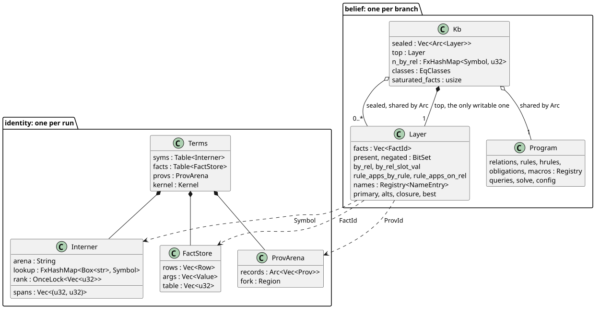
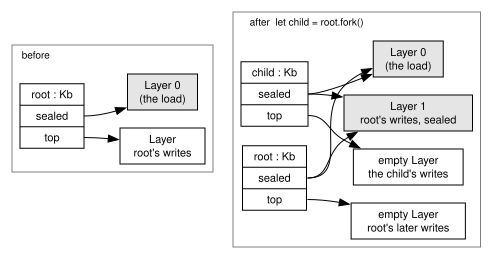
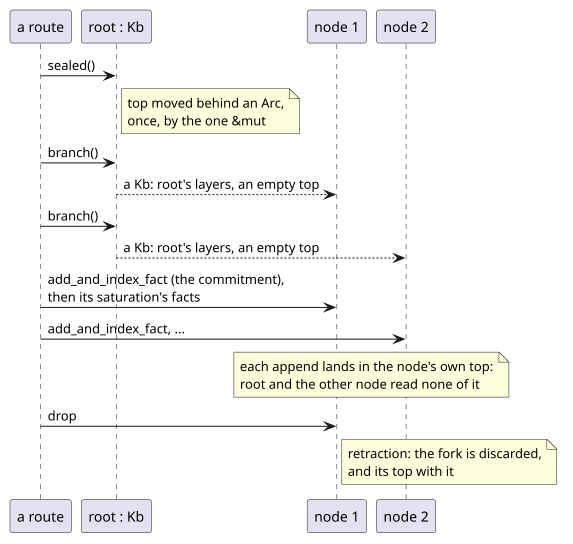
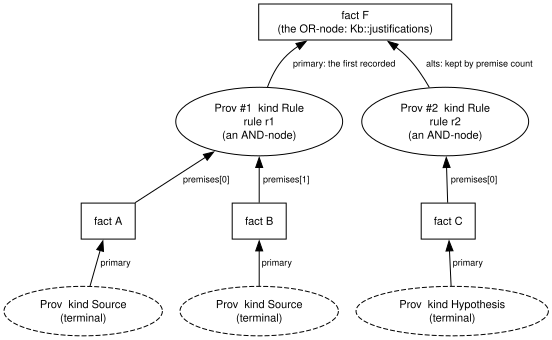

# Data model

This page specifies how `ein.rs` holds what it reasons about: names, objects and facts as integers, the knowledge
base as a stack of copy-on-write layers, its indexes, its provenance records and the records of the program's
registries. All of it is `ein-core`: [`intern.rs`](../../../../ein.rs/crates/ein-core/src/intern.rs),
[`terms.rs`](../../../../ein.rs/crates/ein-core/src/terms.rs),
[`value.rs`](../../../../ein.rs/crates/ein-core/src/value.rs),
[`facts.rs`](../../../../ein.rs/crates/ein-core/src/facts.rs),
[`kb.rs`](../../../../ein.rs/crates/ein-core/src/kb.rs),
[`bitset.rs`](../../../../ein.rs/crates/ein-core/src/bitset.rs),
[`prov.rs`](../../../../ein.rs/crates/ein-core/src/prov.rs),
[`walks.rs`](../../../../ein.rs/crates/ein-core/src/walks.rs),
[`entities.rs`](../../../../ein.rs/crates/ein-core/src/entities.rs),
[`program.rs`](../../../../ein.rs/crates/ein-core/src/program.rs) and
[`shape.rs`](../../../../ein.rs/crates/ein-core/src/shape.rs). The crate depends on nothing in the workspace and is
`#![forbid(unsafe_code)]`; how it sits among the other crates is [`01-architecture.md`](../01-architecture.md).

## 1. Identity and what it costs

A fact is a relation and a tuple of arguments, each argument an atom or a fact, and its identity is exactly those
two things ([Q-M1f.380](../../../decisions/language/Q-M1f.380-an-objects-identity-is-its-name-or-its-tuple.md),
[Q40](../../../decisions/language/Q40-a-fact-may-hold-a-fact-as-an-argument.md),
[Q-M1f.113](../../../decisions/language/Q-M1f.113-an-object-is-an-atom-or-a-fact-a-state-could.md)): provenance,
source position and everything else take no part in it. In `ein.rs` every identity is a `u32`:

| thing | type | equality | hash |
|---|---|---|---|
| an atom, by its name | `Symbol(u32)` | integer compare | the integer |
| a proposition | `FactId(u32)` | integer compare | the integer |
| an object, as an argument | `Value(u32)`, a 2-bit tag beside a 30-bit payload | integer compare | the integer |
| a nested fact argument | a `Value` whose payload is a `FactId` | integer compare | the integer |

So unifying two arguments starts with a tag test, the matcher's registers hold `Value`s, and the keys of every
per-fact table (belief, provenance, the alive set) are dense integers usable as a `Vec` or bit-set
index.

**The code's words.** `Value` is the code's word for an **object**, a node of the knowledge-base graph: an atom,
held as the `Symbol` of its name, or a fact, held as a `FactId`
([Q-M1f.379](../../../decisions/language/Q-M1f.379-an-object-is-a-node-of-the-knowledge-base-graph.md)). A `FactId`
is a fact whether or not any KB holds it, which is why the table calls it a proposition. A KB's facts of one
relation are that relation's **held extent**
([Q-M1f.381](../../../decisions/language/Q-M1f.381-a-relation-is-the-atom-under-a-facts-first-arrow.md)), and the
code calls them its extent: `Kb::facts_of`, `n_by_rel`, `check_extent_counts`. Where a section below says *extent*
of a KB, it is the held extent.

**Interning is not belief.** The intern tables say that a name or a proposition has a number; whether a KB holds the
proposition is a bit in that KB (§ 5). A fork may intern freely without its parent ever seeing the proposition, which
is what makes an $O(1)$ fork correct as well as cheap.

The two halves, and what one holds of the other. `Terms` is identity, one per run and append-only: it numbers
names, propositions and derivation records. A `Kb` is belief, one per branch of the search: which of those numbers
it holds, in layers. A layer names facts and records by id and holds no text and no argument list.



**Ids are process-local and assignment-ordered.** A `Symbol` or `FactId` is the position its first interning took,
so its numeric order is first-seen order. No answer and no rendering depends on it: observable orders go through
the rank table (§ 2.1) and the semantic comparators (§ 3), and
[`01-determinism-and-order.md`](01-determinism-and-order.md) is the contract that keeps it so. The one place ids cross a
process boundary is the `.einb` container, which re-interns and remaps
([`09-binary-format.md` § 3](09-binary-format.md#3-ids-across-the-boundary)).

## 2. Symbols and the interner

`ein_core::intern::Symbol(pub u32)` is 4 bytes, `Copy`, `Eq`, `Hash`, and deliberately not `Ord`: using its number
as a sort key would make an output depend on the order the loader walked the file.

`ein_core::intern::Interner` holds:

| field | type | holds |
|---|---|---|
| `arena` | `String` | all symbol text, one allocation family |
| `spans` | `Vec<(u32, u32)>` | for each `Symbol`, its `(start, len)` in the arena |
| `lookup` | `FxHashMap<Box<str>, Symbol>` | the reverse map; it owns a second copy of each string, because a map keyed by slices of `arena` would be a self-referential borrow and need `unsafe` |
| `rank` | `OnceLock<Vec<u32>>` | for each `Symbol`, its position in the sorted symbol list, built on demand (§ 2.1) |

What interns here: the names of relations, rules, variables and keywords, and every name that reaches a fact
argument. A run of digits is a name like any other, so `7` and `07` are two symbols
([Q-M1e2.24](../../../decisions/language/Q-M1e2.24-ein-has-no-numbers-and-no-ranges.md); `terms.rs`'s
`a_name_is_its_texts_one_value`, `values_semantics.rs`'s `a_run_of_digits_is_a_name_as_written`). `Interner::intern`
assigns or returns an id, `Interner::get` only looks one up, and `Interner::text` borrows the text from the arena.

**Two limits, both a `Result`.** `intern::CAPACITY = 1 << 30` bounds how many ids one space holds, because a
`Value` payload is 30 bits; `intern::ARENA_CAPACITY = 1 << 32` bounds an arena addressed by a `u32` offset, the
interner's text (in bytes) and the fact store's overflow arguments (in `Value`s). The two are independent, because
nothing bounds a symbol's length. Every site that assigns an id or writes an offset returns
`ein_core::intern::Overflow` rather than panicking: `Symbols`, `Facts`, `SymbolText`, `FactArgs`, `FactArity` (a
fact with more arguments than `Row`'s `u16` arity counts) and `Shared` (a table lent to workers cannot grow, § 2.2).
Held by `intern.rs`'s `the_arena_bound_is_the_byte_bound_and_not_the_id_bound` and `facts.rs`'s
`a_fact_wider_than_the_arity_field_is_refused_and_one_narrower_is_not`.

### 2.1 The rank table

`Interner::rank(sym)` is the symbol's position in the list of all symbols sorted by text, compared as UTF-8 bytes,
which is code-point order. An observable sort by name becomes a `u32` sort over ranks (`Interner::cmp_text`). The
table is built on first use and dropped by any interning that grows the symbol list, to be rebuilt on the next use.
That costs little because the symbol table is frozen once a program is loaded: rules cannot fabricate names, the
loader interns every name a rule can produce (`ein_ir::from_ir::intern_program_names`) and the engine's own names
(`terms::ENGINE`) up front, so saturation and search add facts and no symbols (`ein-infer/tests/interning.rs`:
`the_search_interns_no_names`, `a_rule_only_constant_is_interned_at_load`). Held by `intern.rs`'s
`rank_is_lexicographic_while_ids_are_first_seen`, `growth_invalidates_the_rank_table`,
`rank_orders_by_code_point_not_by_locale`, and `values_semantics.rs`'s `the_rank_table_orders_names_by_code_point`.

### 2.2 The intern tables together

`ein_core::terms::Terms` is what a load produces beside the KB, and every accessor takes it explicitly (`&Terms`, and
`&Kb` where belief matters): no record holds a back-pointer to it.

| field | type | role |
|---|---|---|
| `syms` | `Table<Interner>` | the symbols |
| `facts` | `Table<FactStore>` | the propositions (§ 4) |
| `provs` | `ProvArena` | the derivation records (§ 8.2) |
| `kernel` | `Kernel` | the kernel's own names (`not`, `relation`, `rule`, `and`, `absent`, `false`, `open`, the engine's writeback names, …), interned first by `Terms::new` in a fixed order, so a comparison against one is an integer compare |
| `refused` | `AtomicBool` | set when an interning call met a lent table |

`Table<T>` is `Own(T)` or `Shared(Arc<T>)`. A lent table is read by `&` from any thread and grown from none:
`Terms::lend` returns a `Lent` guard that shares both tables and takes them back when dropped, `Terms::worker` hands
a worker a view, and interning a new name or fact on a lent table returns `Overflow::Shared` and sets `refused`, so
the work is redone on the owning thread ([`08-parallelism.md`](08-parallelism.md)). `Terms` is `Send + Sync`, asserted by
`terms.rs`'s `the_intern_tables_stay_shareable_across_threads` and widened to everything a worker holds by
[`ein-infer/tests/shareable.rs`](../../../../ein.rs/crates/ein-infer/tests/shareable.rs). `Terms::clone` is an owned
copy that interns from where the original stood, so it hands out the ids the original would.

## 3. Values and fact ids

`ein_core::value::Value(u32)` packs `[tag:2][payload:30]`:

| tag bits | shape | payload |
|---|---|---|
| `0b00` | `Tag::Sym` | a `Symbol` |
| `0b10` | `Tag::Fact` | a `FactId`: a fact as an argument, held or not |
| `0b01` | no value | `Value::from_bits` returns `None`; no constructor builds it, and a `.einb` value with these bits is refused |
| `0b11` | `Value::UNBOUND` alone (`u32::MAX`) | the register file's *nothing bound yet*; `is_unbound` is one compare, and `as_sym` / `as_fact` return `None` on it |

`size_of::<Value>() == 4` and `size_of::<Option<Value>>() == 8`, held by `value.rs`'s `a_value_is_four_bytes`. The
nested shape is what makes `(not (color-loc Red House-1))` one fact whose single argument is a `FactId`, so the
negation index is a bit set over `FactId` (§ 6).

`Value` has no `Ord`, so `.sort()` cannot reach for the wrong order. `Value::cmp_identity` is a total order over
bits, correct where any total order is (a sorted state key, a canonical form). `Terms::cmp_semantic` is the
observable order: two names by rank, two facts by `Terms::cmp_fact_semantic` (relation rank, then arguments
element-wise, then arity), and `Sym` before `Fact` across shapes. `Terms::display` is the one printer of a `Value`
as Ein text.

`ein_core::facts::FactId(pub u32)` is dense, so it indexes a `Vec` or a bit set directly. It derives `Ord`, and that
order is assignment order, legitimate only where any total order is equivalent.

## 4. Facts as interned rows

`ein_core::facts::FactStore` holds every proposition once:

```rust
pub struct Row {
    pub rel: Symbol,
    args_at: u32,                  // where the arguments start in `args`, when arity > INLINE_ARGS
    arity: u16,
    _pad: u16,
    inline: [Value; INLINE_ARGS],  // the arguments, when arity <= INLINE_ARGS
}
pub const INLINE_ARGS: usize = 2;

pub struct FactStore {
    rows: Vec<Row>,     // indexed by FactId
    args: Vec<Value>,   // the overflow arena, for rows wider than INLINE_ARGS
    table: Vec<u32>,    // open addressing over FactId + 1; 0 is the empty slot
}
```

A row is 20 bytes, held by `facts.rs`'s `a_row_is_twenty_bytes_and_holds_two_arguments`. A fact of at most two
arguments, which covers `(not X)` and every binary relation, keeps them in the row, so reading its arguments is one
load and not two dependent ones; `FactStore::row` and `FactStore::args_of` let a reader take the relation and the
arguments from that one load, which is how the matcher's nested-pattern step reads a candidate
([`05-matcher.md`](05-matcher.md)). A wider fact keeps its arguments contiguous in `args`.

The lookup is a hand-rolled open-addressing table, sized to a power of two, probed linearly, grown at three quarters
full and never deleted from, because the store is append-only. `hash_row` is an `FxHasher` over the relation, the arity
and each argument's bits. A probe compares against the rows and the arena, so the store holds exactly one copy of
every argument list: a map keyed by an owned argument list would hold a second, and one keyed by a slice of the arena
would need `unsafe`. `FactStore::probe` answers *which id has `(rel, args)`* without assigning one, which lets the
hypothesis generator reject a candidate before creating anything; `FactStore::intern` assigns.

Argument order, arity and nested structure are all identity, and identity recurses into a nested fact through its
`FactId`. Held by `facts.rs`'s `interning_is_injective_and_stable`, `arity_is_part_of_identity`,
`nested_identity_cascades_through_the_inner_fact`, `interning_a_nested_fact_says_nothing_about_belief` and
`growth_preserves_every_identity`.

## 5. The layered KB

`ein_core::kb::Kb` is a stack of immutable layers and one writable top:

```rust
pub struct Kb {
    program: Arc<Program>,                              // the registries, § 9
    sealed: Vec<Arc<Layer>>,                            // oldest first, immutable once sealed
    top: Layer,                                         // the only writable layer
    rules_by_relation: Arc<Registry<Box<[Symbol]>>>,    // § 6
    n_by_rel: FxHashMap<Symbol, u32>,                   // § 7
    classes: EqClasses,                                 // § 10
    saturated_facts: usize,                             // the clean mark
    ended: Vec<ProvId>,                                 // the firings of :ein inconsistent that ended it
    open: Layer,                                        // the state's open facts, which no fork inherits, § 5.1
}
```

A `Layer` holds the facts added at one point in the KB's history and every index over them: `facts`
(`Vec<FactId>`, insertion order), `present` (a bit set), `by_rel`, `by_rel_slot_val` and its Bloom
filter `slot_bloom`, `rule_apps_by_rule`, the count `rule_apps`, `rule_apps_on_rel`, `names` (§ 6), and the four
provenance tables `primary`, `alts`, `closure`, `best` (§ 8.3).

- **A read walks the layers.** An ordered list is the concatenation of each layer's list, oldest first, which is the
  order a copy-then-append fork would give. A last-wins map (the provenance tables) is read newest first and the
  first layer that has the key answers.
- **A write appends to `top`.** A sealed layer is never mutated, so it is shared by `Arc` across forks and threads
  with no lock.
- **The clean mark.** `saturated_facts` is `Kb::n_facts` as of the last saturation; `Kb::written_since_saturation`
  compares the two and `Kb::mark_saturated` sets it. A count serves because a KB's fact list only grows.
  `Kb::facts_from(n)` reads the facts from insertion ordinal `n` on, skipping whole layers below it, so a per-fork
  check costs the fork's own writes.
- **What ended the state.** `ended` is the record of every firing of a rule that states `:ein inconsistent`, in the
  order they fired (`Kb::end` appends one, `Kb::ended` reads them); a KB with one is inconsistent
  (`Kb::is_inconsistent`) and its state dead. No fact stands for it, the list only grows, and a fork inherits it.
- **The state's `open` facts are a layer of their own**, `open`: what the state owes, `(open R)`, and its
  hypotheses, `(open F)`
  ([Q-M1f.566](../../../decisions/hypotheses/Q-M1f.566-what-a-state-owes-is-open-r-a-fact-and-open-f.md)).
  `Kb::write_open` writes them: the pass of `ein_infer::open` at root's fixpoint and at a state above root that is
  printed or saved or that reads them, every state under `--in-flight` ([Q-M1f.655](../../../decisions/engine/Q-M1f.655-open-facts-are-written-at-root-and-where-a-state.md), [Q-M1f.656](../../../decisions/cli/Q-M1f.656-a-flag-runs-the-pass-at-every-state-and-checks.md)), and the loader the
  ones the program writes, at root. A read walks the layer
  after the stack, so a state holds, lists and counts them with its facts ([Q-M1f.572](../../../decisions/read-out/Q-M1f.572-a-states-open-facts-are-part-of-it-listed-drawn.md));
  `Kb::open_facts` reads it alone. `Kb::materialise` concatenates the stack and `n_by_rel` counts it, the layer
  aside, and `Kb::n_facts_of` adds the layer's own count (§ 7).

Two write paths exist. `Kb::add_fact` is the loader's: append if new, no indexing, first occurrence keeps its
provenance, and one `Kb::rebuild_indexes` at the end. `Kb::add_and_index_fact` is saturation's: a fact already
believed is not appended or indexed again, and the arriving derivation is offered to the provenance tables as an
alternative. Held by `kb.rs`'s `the_loader_path_keeps_the_first_occurrence_and_does_not_index` and
`a_re_derived_fact_is_indexed_once`.

### 5.1 The fork

`Kb::fork(&mut self)` seals the parent's top (`Kb::seal_top`) and returns `Kb::branch()`. `Kb::branch(&self)`
asserts the top is empty, in every build, and builds the child:

| part | in the child |
|---|---|
| `program`, `rules_by_relation` | shared: one `Arc` clone each |
| the sealed layers | shared: the `Vec` of `Arc`s is cloned, one refcount per layer |
| `top` | a fresh empty layer |
| `n_by_rel` | copied: one `u32` per relation with facts |
| `classes` | copied (§ 10) |
| `saturated_facts` | inherited less the parent's `open` facts, so a branch of a saturated root starts clean |
| `open` | a fresh empty layer: a fork drops every `open` fact, a written one among them, and the pass writes the child's at the child's own fixpoint, where it runs there |

A fork in the two steps it is made of. Before it, root's writes since the last seal are in its `top`. `seal_top`
moves that layer behind an `Arc`; `branch` then copies the vector of `Arc`s. Afterwards the two KBs share every
layer that existed and each writes a top of its own, which the other never reads.



A route makes many children of one root, and from several threads: it seals root once, through `&mut`, and every
node then branches through `&`.



Because sealing is the half that mutates, a layer of the search seals once and then branches from many threads
through `&` ([`07-search.md`](07-search.md), [`08-parallelism.md`](08-parallelism.md)). After a fork the parent's later appends
land in a new top its child never sees (`kb.rs`: `a_fork_reads_base_then_delta_and_the_two_histories_diverge`).
`Kb::snapshot` is a fork that keeps the state's `open` facts, an archive of the state as it stands. The registries
cannot change once a fork shares them: `Kb::program_mut` panics on a shared `Arc`
(`the_registries_cannot_be_edited_once_a_branch_exists`). That a fork drops every `open` fact, a written one among
them, is held by
[`ein-infer/tests/open_facts.rs`](../../../../ein.rs/crates/ein-infer/tests/open_facts.rs)'s
`a_fork_drops_every_open_fact_a_written_one_among_them`.

**A fork costs the same at any KB size.** Its allocations and bytes do not grow with the facts below it, only with
the depth of the stack it clones, held with a counting allocator by
[`ein-core/tests/fork_cost.rs`](../../../../ein.rs/crates/ein-core/tests/fork_cost.rs):
`a_fork_costs_the_same_at_ten_facts_and_at_ten_thousand`,
`a_deep_branch_pays_for_its_depth_and_not_for_the_facts_below_it`.

**The stack is not flattened during a run.** `Kb::depth` is the sealed layers plus one, and a read that aggregates
over layers is $O(\operatorname{depth})$. The engine keeps the stack rather than materialising each fork, because a fork then shares
its parent's index vectors with every sibling instead of holding a private copy. `Kb::flatten` collapses a KB into one
layer and is content- and order-neutral; no engine path calls it. `Kb::rebuild_indexes` collapses the stack as it
rebuilds, which the loader does once.

`Kb::clone` is a different operation from a fork: it seals nothing, shares the sealed layers, copies the top and the
registries, and is for a caller that loads once and runs several things over one load, each on its own copy.

### 5.2 Why layering is sound

The KB is append-only within a run: nothing removes a fact, and retraction is discarding a fork. A layer that only
adds, over layers that never change, cannot disagree with a copy mutated in place. `Kb::materialise` builds that copy
by concatenating the layers; `Kb::check_layering` compares it field by field with the indexes recomputed from the
fact list (`rebuild_layer`) and then checks the extent counts (§ 7). Held by
[`ein-ir/tests/load_semantics.rs`](../../../../ein.rs/crates/ein-ir/tests/load_semantics.rs)'s
`layering_holds_after_every_load` over every corpus file that loads, and by `kb.rs`'s
`the_layered_view_is_what_a_rebuild_would_have_produced` and `incremental_indexing_and_a_rebuild_agree`.

## 6. The indexes

| index | where | keyed on | holds | read by |
|---|---|---|---|---|
| `present` | per layer | `FactId` | a bit set: believed here | `Kb::contains` |
| `by_rel` | per layer | relation `Symbol` | the held extent, append order | `Kb::facts_of` |
| `by_rel_slot_val` | per layer | `SlotKey` (§ 6.1) | the facts with that object at that position, or a fact of that relation | `Kb::facts_with` |
| `rule_apps_by_rule` | per layer | a rule's name | the facts headed by it: its activators | `Kb::rule_apps_by_rule` |
| `rule_apps_on_rel` | per layer | a relation's name | rule-application facts naming it as an argument, `(symmetric co-located)` | `Kb::rule_apps_on_relation` |
| `names` | per layer | any name | `NameEntry { as_head, as_arg }`, direct arguments only | `Kb::names`, `Kb::participation`, the hypothesis generator |
| `rules_by_relation` | one per KB, shared by `Arc` | a relation's name | the rules naming it in a pattern or through a property fact, sorted by rule name's rank | `Kb::rules_of_relation` |

A fact heads `rule_apps_by_rule` when its head names a saturation rule, an obligation rule or a rule that
concludes a hypothesis: every rule's activators come from the store. `names` counts a name where it heads a fact or is a direct
argument; a nested fact is its own entry, so the names inside it are counted there and not again on the outer fact.
`rules_by_relation` is computed by `Kb::rebuild_indexes` and then shared, never maintained incrementally, so a
property fact derived during saturation does not extend it. Each layer also counts `rule_apps`, the facts it added
that activate a rule, so `Kb::n_rule_apps` is a version counter the plan compiler skips its walk on
([`06-saturation.md`](06-saturation.md)).

`Kb::index_fact` is the incremental half and `rebuild_layer` the batch half, and the two must agree exactly
(`check_layering`). `rebuild_indexes` also unions every declared relation, rule and obligation name into `names`, so
a relation with no facts yet has an entry. `Kb::all_facts` returns a `FactView`, an eager list of fact ids with lazy
filters (`relation`, `about`, `by_source`, `by_rule`).

### 6.1 The participation key

```rust
pub struct SlotKey { pub rel: Symbol, pub slot: u16, pub inner: u16, pub value: Value }
impl SlotKey { pub const DIRECT: u16 = u16::MAX; pub const RELATION: u16 = u16::MAX - 1; }
```

Its four fields make 12 bytes, which does not pack into a `u64` (the symbol and the value need 32 bits each), so it
stays a struct key. A name in argument `slot` is keyed `(rel, slot, DIRECT, value)`. A nested fact in argument
`slot` has no single name to key on, so the key reaches **one level inside** it instead: each name at position
`inner` of the nested fact is keyed `(rel, slot, inner, value)`, and the nested fact's relation `R` is keyed
`(rel, slot, RELATION, R)`, the context and the relation. A premise `(not (R ?a ?b))` with `?a` bound is then a
bucket lookup rather than a scan of the held extent of `not`, and with nothing bound a walk of the negations of `R`
alone. One level only. That serves a premise over a stored negation and one over a context whose fact holds names,
`(says ?w (owns ?p ?x))` with `?p` bound. What is nested deeper is not keyed: a numeral of the standard library and a
tag nest to any depth, and a premise whose only bound slots hold facts walks the held extent of its relation
([05-matcher.md § 5.2](05-matcher.md#52-a-probe-into-the-participation-index)). A fact may have as many arguments as
a `u16` counts, so a position inside one can be `RELATION`'s number; such a position is not keyed
(`SlotKey::keys_inner`), and a position's key and a relation's never share a bucket.

The saturator reads the same key to hand a new fact to the plans that can match it: a plan whose every premise of a
relation holds a fact of a known relation is listed under that relation's key, so a new `(not (R …))` reaches the
plans that read a negation of `R` and those whose premise leaves the relation open, and no other
([06-saturation.md § 3](06-saturation.md#3-the-queue-the-delta-and-the-parked-set)).

The index is a narrowing. The matcher re-checks every slot of every candidate, so a key changes which facts are
offered and never which ones match; buckets are appended in insertion order, so the facts that survive come in the
extent's order and the firing sequence is the same with or without it. `Kb::index_sizes`, which `ein saturate`'s
snapshot prints, counts the `DIRECT` postings only, so the report describes the knowledge base rather than how
`ein.rs` indexes it. Held by `kb.rs`'s `the_participation_index_keys_the_join_types_and_one_level_in`, the relation's
key among them.

### 6.2 The per-layer Bloom filter

Each layer keeps `slot_bloom: [u64; BLOOM_WORDS]`, a Bloom filter of `BLOOM_BITS = 2048` bits (256 bytes) over its
`by_rel_slot_val` keys. `bloom_at` hashes a key once with `FxHasher` and splits the hash: the low six bits pick the bit
and the next bits the word. `Kb::facts_with` hashes its key once and tests one bit per layer, skipping a layer that
certainly lacks the key, so a deep fork does not hash the same key once per layer. The filter is derived state: it is
written wherever the map is, OR-ed together by `Kb::materialise`, and read for nothing but skipping. A miss is never
reported for a key a layer holds, which `facts_with` asserts in debug builds.

### 6.3 Bit sets

`ein_core::bitset::BitSet` is a `Vec<u64>` with `insert`, `remove`, `contains`, `len` and `iter`, hand-rolled because
that is its whole surface. Equality is over contents, so a set that grew and one that did not compare equal when they
hold the same ids, which the materialise-against-rebuild check needs. It holds belief here, and
the alive set and dense-id dedups elsewhere in the engine.

## 7. Per-relation extent counts

`Kb::n_by_rel` maps each relation to the size of its held extent across every layer. It is KB-wide rather than per
layer, maintained by `Kb::index_fact` wherever `by_rel` is written, recomputed by `Kb::rebuild_indexes`, and copied
per fork. `Kb::n_facts_of(rel)` is one map lookup at any depth, where a fold over the layers would grow with the
stack; the negation-as-failure boundary asks it once per watched relation ([`06-saturation.md`](06-saturation.md)).
`Kb::check_extent_counts` compares the map with a walk of the layers and is part of `check_layering`. Held by
`kb.rs`'s `n_facts_of_costs_one_probe_at_any_depth`, which counts probes forty forks deep under `--features
counters`, and `a_rebuild_reconstructs_the_extent_counts`. The other aggregate reads (`n_facts`, `n_rule_apps`,
`contains`) stay $O(\operatorname{depth})$.

## 8. Provenance

Every fact a KB holds records how it came to be there, and a fact is an OR over its recorded derivations, each an AND
over its premises ([Q18](../../../decisions/engine/Q18-provenance-is-per-fact-an-or-of-derivations-over.md)). In
`ein.rs` the records live in one arena beside the fact store, and which record justifies which fact is a per-KB
table.

One fact's provenance in one KB, with two derivations recorded: the fact is the OR-node, each record an AND-node
over its premises. The records live in the arena and the KB's tables say which of them this fact cites; a premise is
itself a fact with records of its own, down to the facts the program wrote.



### 8.1 The derivation record

| field of `ein_core::prov::Prov` | type | holds |
|---|---|---|
| `kind` | `ProvKind` | `Source` (written by the program), `Rule` (a firing), `Hypothesis` (a commitment), `Rejected` |
| `source` | `Option<Symbol>` | a `Source` record's `:source` id; `None` for an unannotated given |
| `rule` | `Option<Symbol>` | the firing's rule, or an engine writeback's name |
| `premises` | `Box<[FactId]>` | the positive premises, in plan-step order |
| `bindings` | `Box<[(Symbol, Value)]>` | variable bindings in bind order |
| `absent` | `Box<[NafRef]>` | the `(absent …)` queries that had to fail: relation and argument pattern, `NafArg::Free` where the query ranged free |
| `branch` | `Option<u32>` | a hypothesis's branch |
| `loc` | `Option<Loc>` | a source position |
| `activator` | `Option<FactId>` | the fact the firing's plan was compiled from |
| `universal` | `Box<[FactId]>` | the facts each universal guard of the firing read, in the order its walk found them |

Bindings are kept as `Value`s and rendered only where a surface prints them (`Terms::display`,
`ein_infer::firing::rendered_bindings`), so the redundant-firing path never builds a string. `Prov::is_terminal` is
true for a record that is not a firing and for a firing with no premises, an engine writeback whose contract is that
walks ground out on it. `Prov::same_justification` compares `(rule, premises, activator)`; bindings and `universal`
are not identity (`prov.rs`: `justification_identity_ignores_bindings`). A dead node's core follows an activator only
where a node derived or committed it
([Q-M1e2.12](../../../decisions/answer/Q-M1e2.12-a-dead-nodes-core-follows-an-activator-only.md)) and folds in each
fact a universal read ([Q-M1e2.15](../../../decisions/answer/Q-M1e2.15-a-derivation-through-a-forall-rests-on-each-fact.md)).
`absent` is read by the non-monotone detector, not by the derivation walks. A `.einb` stores every field but
`activator` ([`09-binary-format.md` § 2.3](09-binary-format.md#23-the-sections)).

### 8.2 The record arena and the fork region

`ProvId(pub u32)` indexes `ein_core::prov::ProvArena`. The arena is global, like the fact store: creating a record
says nothing about whether any KB cites it, and a `ProvId` means the same thing in every branch. There is no
hash-consing: two firings over the same premises push two records, and the dedup that matters is the KB's
(§ 8.3).

```rust
pub struct ProvArena {
    records: Arc<Vec<Prov>>,  // the arena proper, append-only, never reclaimed
    fork: Region,             // the records of the fork in hand, and the sequence number they start at
    promoted: u32,            // how many records a promotion copied out of a region
    forking: bool,            // does `push` belong to the region?
}
```

Bit 31 of a `ProvId` is the fork tag (`ProvId::is_fork`): set, the low 31 bits are a position in the fork sequence;
clear, an index into the arena proper. A search opens a region around each node it enters (`ProvArena::open_fork`),
every record that node derives lands there, `ProvArena::close_fork` stops the routing while leaving the records
readable, and `ProvArena::discard_fork` reclaims them. The region's base only advances, so an id from a finished fork
falls below the live base, and `ProvArena::get` panics on it in every build rather than resolving it to another
record. A route reads a node's KB inside its region and drops it with the region, so no KB that outlives a region
cites one of its records. `Kb::promote_provenance` is the operation for a caller that would keep such a KB: it copies
every fork record the KB still cites into the arena proper, in the fork's push order, and rewrites the citations,
cloning only a layer that cites one; nothing in the engine calls it. A worker's arena (`ProvArena::share`) shares the records and has a region of its own,
handed back with its result (`take_fork`, `swap_fork`; [`08-parallelism.md`](08-parallelism.md)). Held by `prov.rs`'s
`a_forks_records_do_not_reach_the_arena`, `closing_the_region_stops_the_routing_and_not_the_reads`,
`a_stale_fork_id_is_not_the_next_forks_record` and `promotion_follows_the_forks_push_order`.

### 8.3 Which records a KB cites

Each layer holds four tables, last layer wins:

| table | type | holds |
|---|---|---|
| `primary` | `FxHashMap<FactId, ProvId>` | the first derivation recorded for the fact; never replaced |
| `alts` | `FxHashMap<FactId, Box<[ProvId]>>` | the alternative derivations, whole list copy-on-write: a layer that changes a fact's list holds the complete list, because an arrival can land in the middle and the cap evicts from the end |
| `closure` | `FxHashMap<FactId, u32>` | the smallest closure the fact's derivations have shown: 1 for a leaf (no entry), 0 for a writeback, a derivation's the saturating sum of its premises' |
| `best` | `FxHashMap<FactId, ProvId>` | the arrival that last lowered `closure`, kept whether or not the list took it |

`Kb::record_justification` is the policy. A terminal record is never an alternative, and a fact whose primary is
terminal takes none: a given stays given. A derivation the fact already holds, in the list or as `best`, is not
recorded twice. The list is capped at `kb::MAX_ALT_JUSTIFICATIONS = 32` and kept sorted by premise count, so at the
cap an arrival with fewer premises evicts the longest; an arrival whose `Kb::closure_of` is below the fact's
`Kb::closure` is kept as `best` whatever the list does. `Kb::accepts_justification` answers the same question without
building a record, which is how the saturator's redundant-firing path skips the work. `Kb::justifications(fact)` is
the OR-node: the primary, the alternatives, and `best` where the list does not hold it. The saturator's share of the
recording is gated by the `(config …)` flag `:record-alternative-justifications`, the one option that may change a
core ([Q-M1e2.11](../../../decisions/answer/Q-M1e2.11-a-core-is-the-smallest-over-every-derivation.md)).

These tables are a record of what the engine attempted, not a projection of the fact list, so `Kb::rebuild_indexes`
carries them over rather than recomputing them. They follow the facts' copy contract: a fork's writes land in its own
layer, because a derivation recorded inside a hypothesis fork can name premises root never assumed. Held by `kb.rs`'s
`only_a_real_firing_is_recorded_as_an_alternative`, `a_terminal_primary_takes_no_alternatives_at_all`,
`the_cap_keeps_the_shortest_derivations`, `a_full_list_keeps_the_smallest_closure_beside_it` and
`a_forks_alternatives_do_not_leak_into_its_parent`, and by
[`ein-infer/tests/explain_semantics.rs`](../../../../ein.rs/crates/ein-infer/tests/explain_semantics.rs)'s
`a_rebuild_preserves_the_alternative_justifications` and
`a_full_list_keeps_the_smallest_closure_and_the_pair_report_one_core`.

### 8.4 Derivation walks

`ein_core::walks` answers *what does this fact rest on*: `walk_premises` (the premise closure, following each step's
premises, the activator a node derived or committed (`node_activator`) and its universals' facts), `unsat_core` (the
frontier a set of conflicting facts rests on), `build_derivation_dag` (a `DerivationDag` with one AND-node per
justification, which `ein-render`'s [`derivation.rs`](../../../../ein.rs/crates/ein-render/src/derivation.rs) draws),
`is_frontier`, and `detect_provenance_cycles`, the load-time refusal of a circular `:using` chain in what a program
writes. Each walk takes `Justifications::Primary` (the primary alone, every call site's default) or
`Justifications::All` (the whole OR-node, a soundness envelope rather than an explanation). Engine-recorded
provenance is legitimately cyclic, because a symmetric relation's two facts justify each other, so a walk breaks at a
revisit instead of refusing. The minimum-cardinality core search over the same graph is `ein-infer`'s
[`explain.rs`](../../../../ein.rs/crates/ein-infer/src/explain.rs).

## 9. Record shapes

### 9.1 The program's registries

`ein_core::program::Program` is everything a load produces that facts do not. It is immutable once the loader
finishes and shared by every fork as `Arc<Program>`.

| field | type | holds |
|---|---|---|
| `relations` | `Registry<Relation>` | every relation of the program ([Q-M1f.522](../../../decisions/language/Q-M1f.522-a-relation-of-the-program-is-any-atom-it-writes.md)): the declared ones, then each atom the program writes first in a tuple, open-world, a stated fact's in the order of the facts and every other in the order of its text; the kernel's words are none |
| `rules` | `Registry<Rule>` | the saturation rules, the only registry the saturator walks |
| `obligations` | `Registry<Rule>` | rules whose `:assert` is `(open R)` or `(open ?R)`; read once per quiescent KB, never on the agenda |
| `hypotheses` | `Registry<Rule>` | rules that conclude `(open F)`, a hypothesis, each with its whole `:assert`; read by the pass that writes a state's `open` facts and by the hypothesis generator, never on the agenda; the facts such a rule concludes beside its hypotheses are in `rules` under the same name. `Program::every_rule` reads each rule once, whole |
| `macros` | `Registry<Macro>` | kept for inspection; expansion happens at load |
| `queries` | `Vec<Query>` | every `(query …)` block, in source order |
| `active_query` | `usize` | which of `queries` this load answers (`Program::query`) |
| `solve` | `Option<Solve>` | the `(solve …)` block, at most one |
| `config` | `Option<SolverConfig>` | the `(config …)` block, last one wins |
| `domain` | `OnceLock<Box<[Value]>>` | the program's names sorted by text, what an unbound guard variable ranges over; computed once, cleared by `Kb::program_mut` |
| `relations_of` | `Box<[Symbol]>` | the relations a goal and a claim may name, in the order of their text: every atom the program writes first in a tuple, the kernel's words it writes among them, and `eq` and `neq` ([Q-M1f.119](../../../decisions/language/Q-M1f.119-a-goal-and-a-claim-ask-only-about-relations.md)); what a goal given beside the program is held to (`ein_ir::read_goal`) and the facts about relations are read by (`ein_infer::slice`, [Q-M1f.523](../../../decisions/cli/Q-M1f.523-the-facts-about-relations-are-every-fact.md)) |

`Registry<V>` is an insertion-ordered `Vec<(Symbol, V)>` with an `FxHashMap<Symbol, u32>` index, because its order is
observable (the hypothesis generator and the plan compiler iterate it). `Registry::insert_new` keeps the first
declaration of a name; `Registry::replace` overwrites in place, keeping the position, which is how
`Program::add_relation` upgrades an open-world relation to a declared one. Every rule shares one name-space,
whichever registry holds it.

### 9.2 Entity records

Every record is identified by its name, and none holds a pointer back to a KB or to `Terms`: an accessor takes them
explicitly, so a record shared between a root and its forks cannot answer for one with the other's facts.

| record | fields |
|---|---|
| `Relation` | `name: Symbol`, `signature: Box<[Symbol]>` (the declaration's labels, by name; empty is legal and makes no hypothesis target), `declared: bool` (false for a head auto-created for an undeclared fact), `why: Option<Symbol>`, `loc: Option<Loc>` |
| `Rule` | `name`, `params: Box<[Symbol]>`, `match_: Option<Pattern>`, `assert_: Option<Pattern>`, `why`, `loc` |
| `Pattern` | `expr: ExprRef`, `variables: Box<[Symbol]>`, `relation_names: Box<[Symbol]>` (the relations a clause names literally, which feed `rules_by_relation`) |
| `Macro` | `name`, `params`, `body: ExprRef`, `loc` |
| `Query` | `kw_pairs: Box<[ExprRef]>`, `goal_written: Option<ExprRef>` (the `:goal` as written, where a macro call in it was expanded) |
| `Solve` | `kw_pairs: Box<[ExprRef]>` |
| `Loc` | `file: u32`, `line: u32`, `col: u32` |
| `ExprRef` | `u32`, an opaque node of the program's syntax arena: the KB holds a clause without knowing syntax, and the compiler lowers it ([`05-matcher.md`](05-matcher.md)) |
| `NameEntry` | `as_head: Vec<FactId>`, `as_arg: Vec<FactId>` |

There is no type or instance record: a program's membership facts are ordinary facts. `Program::categorise` gives
each name a `NameCategory`: `Relation` for the kernel's `relation` and `rule` and for every registered
relation, `Rule` for a rule's name, whichever registry holds it, `Object` for everything else.
`Object` is the category's name in the code and no sort of node; the blind enumerator draws the guessable atoms from
`Object` names alone.

### 9.3 The KB shape dump

`ein_core::shape::shape(kb, terms)` renders a KB as one deterministic text: each fact by its position in the fact
list, the registries, the six indexes of § 6 (the participation index by its `DIRECT` keys), the primary
provenance and the alternative counts. `Value`s are written with `repr`, so a name and a nested fact cannot collide,
and every map is emitted in a sorted order of its own. It is the `load` operation of the corpus shape digests
([`ein-render/tests/golden/corpus_shapes.md5`](../../../../ein.rs/crates/ein-render/tests/golden/corpus_shapes.md5)),
and the comparator of a `.einb` opened into a crowded interner, where ids differ and the KB must not.

## 10. Equality classes

`ein_core::kb::EqClasses` is a union-find over `Symbol`s held in every `Kb`. Its parent map is an insertion-ordered
`Registry<Symbol>`; `EqClasses::find` compresses paths and is a lookup, so a name never recorded is its own root and is
not inserted; `EqClasses::union` merges by first argument, the first argument's root winning; `EqClasses::classes`
lists root and members in the map's insertion order. `Kb::classes()` is its one accessor.

What holds today ([Q1](../../../decisions/language/Q1-the-knowledge-base-is-a-hypergraph-of-atoms.md)): atoms are never
merged, and `eq` is identity of names.

- **Nothing writes it.** No rule, pass or loader step calls `union`; the only callers are tests.
- **No matcher reads it.** A scan for `(r C ?y)` does not match a stored `(r A B)` with `A` and `C` united, and an
  `(absent (r C ?y))` passes: [`ein-infer/tests/naf_semantics.rs`](../../../../ein.rs/crates/ein-infer/tests/naf_semantics.rs)'s
  `matching_does_not_resolve_equality_classes`.
- **A fork copies it.** `Kb::branch` clones the map, so a union in a parent is seen by every fork made afterwards and
  a union in a fork by no sibling; asking a question leaves the map unchanged. Held by `kb.rs`'s
  `equality_classes_are_copied_and_stay_inert` and `asking_a_question_does_not_move_the_answer`.
- **A `.einb` does not store it**: a container of a KB with classes would lose them, and nothing makes one.

## 11. What the store does not do

- **Delete a fact.** The store and every KB are append-only; the layering argument (§ 5.2), the clean mark and the
  extent counts rest on it. Retraction is a fork that is dropped, and the `open` layer is dropped whole at the fork
  (§ 5.1), never a fact of it.
- **Share arguments across facts.** A fact's arguments are its own; two facts with equal arguments do not share
  storage beyond the arena.
- **Hash-cons provenance.** Two firings make two records; the AND-node dedup is `Kb::record_justification`'s.
- **Change identity.** `(relation, args)`, provenance excluded, is the one rule for fact equality, insertion dedup,
  a state's key and *is this fact new relative to that KB*.
- **Hold a number.** `Value` has no numeric shape; a numeral is a name or a fact of names, computed by the standard
  library's rules ([Q-M1e2.24](../../../decisions/language/Q-M1e2.24-ein-has-no-numbers-and-no-ranges.md)).
