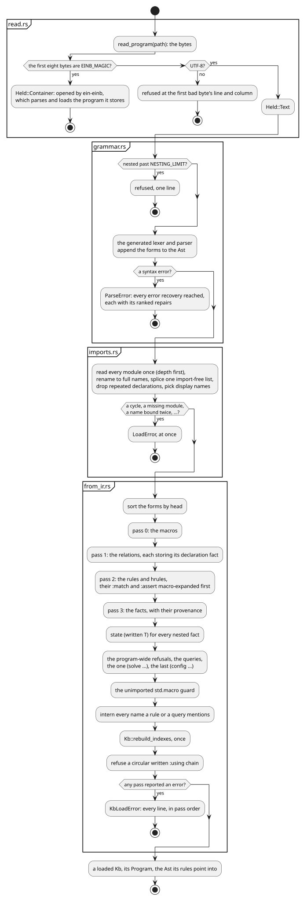
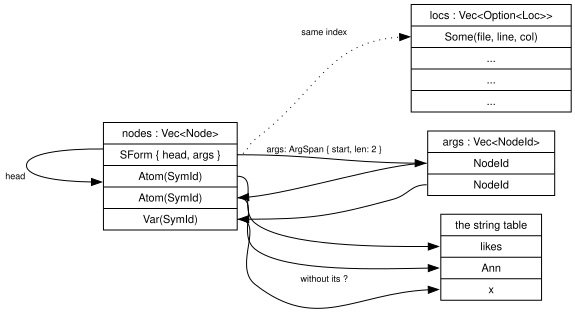

# The IR frontend

`ein-ir` takes a program from bytes to a loaded `ein_core::Kb`: it reads the file, parses it with a parser generated
from the grammar, resolves its imports by full name, expands its macros and loads the result, and it prints a parsed
program back as Ein text. This page specifies that path as `ein.rs` implements it, in
[`read.rs`](../../../../ein.rs/crates/ein-ir/src/read.rs),
[`grammar.rs`](../../../../ein.rs/crates/ein-ir/src/grammar.rs) with
[`grammar/build_ast.rs`](../../../../ein.rs/crates/ein-ir/src/grammar/build_ast.rs),
[`ein.l`](../../../../ein.rs/crates/ein-ir/src/ein.l), [`ein.y`](../../../../ein.rs/crates/ein-ir/src/ein.y) and
[`build.rs`](../../../../ein.rs/crates/ein-ir/build.rs), [`ast.rs`](../../../../ein.rs/crates/ein-ir/src/ast.rs),
[`imports.rs`](../../../../ein.rs/crates/ein-ir/src/imports.rs),
[`macros.rs`](../../../../ein.rs/crates/ein-ir/src/macros.rs),
[`from_ir.rs`](../../../../ein.rs/crates/ein-ir/src/from_ir.rs) and
[`dump.rs`](../../../../ein.rs/crates/ein-ir/src/dump.rs). Where the crate sits among the others is
[01-architecture.md](../01-architecture.md); the data a load produces is [03-data-model.md](03-data-model.md).

## 1. A pure function of its inputs

The frontend keeps no engine state. A loaded program is a function of three inputs: the program's text, the standard
library's text, and the program file's directory, from which every module that is not `std.*` is found. Every
artefact it produces is text, a dump, a refusal's lines, a loaded KB's shape, so each is held byte for byte by a
golden file in isolation from the engine above it (§ 11).

`ein-ir` holds the engine's **only filesystem access**: the read of a program (`read::read_program`), the reads of
the modules an import names (`imports::Resolver`), and the standard library's source (`stdlib::Source`:
`$EIN_STDLIB`, then a checkout's `stdlib/` carrying `MANIFEST.sha256`, then the copy compiled into the binary by
`include_dir!`; [02-shared-assets.md](02-shared-assets.md#3-resolution)). Any policy on what the engine may read is one seam. The
crate is `#![forbid(unsafe_code)]`.

The entry points, re-exported from `ein_ir`:

| entry | what it does |
|---|---|
| `parse(ast, text, filename)` | appends a text's top-level forms to an `Ast`, or returns a `ParseError` (§ 6) |
| `resolve_imports`, `Resolver::resolve_imports` | replaces every `(import …)` by the modules' forms under full names (§ 8) |
| `load`, `load_with`, `load_query`, `load_query_with` | resolves, validates and builds a `Kb` from parsed forms, about one `(query …)` (§ 9) |
| `load_file`, `load_file_with` | reads a `.ein` file as UTF-8 text, then parses and loads it |
| `dump_compact`, `dump_pretty`, `dump_canonical` | print nodes as Ein text (§ 10) |

`LoadOptions { require_why }` is the one load option: whether a relation, rule, hrule or macro with no `:why` is
refused. It is true by default (`--no-require-why` turns it off on every command) and it decides only whether a
program loads: a program it lets through loads to the same `Kb` either way.

## 2. The load path

Every `ein` command reads a program through `ein_ir::read::read_program` (behind `ein-cli`'s
`common::read_program`), which tells a `.einb` container from text by its first eight bytes (`read::EINB_MAGIC`),
gives an unreadable path the operating system's reason, and refuses a file that is not UTF-8 at its first bad byte's
line and column ([Q-M1f.95](../../../decisions/diagnostics/Q-M1f.95-a-file-is-refused-at-its-first-character-that-is.md)).
A text then goes through these phases, in this order:

| # | phase | where |
|---|---|---|
| 1 | refuse a text nested past the limit, then parse it into the arena | `grammar::parse` (§ 3, § 6) |
| 2 | read every module once, rename to full names, splice into one import-free list | `Resolver::resolve_imports` (§ 8) |
| 3 | sort the forms by head: `relation`, `rule`/`hrule`, `macro`, `query`, `solve`, `config`; `trace` is ignored; any other head is a fact | `from_ir::load_query_with` |
| 4 | pass 0, the macros | `ingest_macros` (§ 7) |
| 5 | pass 1, the relations, each storing its declaration fact | `ingest_relation` |
| 6 | pass 2, the rules and hrules, their `:match` and `:assert` macro-expanded first | `ingest_rules` |
| 7 | pass 3, the facts, with provenance from `:source`, `:rule` and `:using` | `ingest_fact` |
| 8 | the program-wide refusals, the queries (goals macro-expanded), the one `(solve …)`, the last `(config …)` | `expand_goal`, `validate_solve`, `validate_queries`, `config_from_kw_pairs` |
| 9 | the unimported-`std.macro` guard | `macros::unimported_macro_errors` (§ 7) |
| 10 | intern every name a rule or a query mentions | `intern_program_names` (§ 9.1) |
| 11 | build the KB's indexes, once | `ein_core::Kb::rebuild_indexes` |
| 12 | refuse a circular written `:using` chain | `ein_core::detect_provenance_cycles` |

The same path as a flow, with where a program is refused. A refusal of the parse or of import resolution ends the
load at once; the loader's own refusals accumulate through its passes and surface together (§ 9.1).



Above `ein-ir`, `ein-cli`'s `common::load_held` judges the hypothesis mechanisms on root's fixpoint
(`ein_infer::mechanisms::check`, over a second load) and opens a container by the program it stores, parsed again
with no import left to resolve ([09-binary-format.md](09-binary-format.md)).

Under the `counters` feature, `parse_call` and `parse_bytes` count each module text parsed and its bytes, and
`intern` and `intern_miss` count the AST's string table (`ein_core::counters`).
[`ein-infer/examples/frontend_cost.rs`](../../../../ein.rs/crates/ein-infer/examples/frontend_cost.rs) splits one
load into these phases and reports each one's allocations.

## 3. The grammar and the generated parser

### 3.1 Two files and a build script

The grammar is two files of `ein-ir`: `src/ein.l`, the tokens in lrlex's notation, and `src/ein.y`, the productions
in grmtools' yacc (`%start Program`). `build.rs` generates the parser from them with `lrlex::CTLexerBuilder` and an
lrpar configuration of `RecoveryKind::CPCTPlus`, so a conflict in the grammar, or a token no production uses and
`%expect-unused` does not name, fails the build
([Q-M1e2.25](../../../decisions/engine/Q-M1e2.25-the-parser-is-generated-from-the-grammar.md)). The language
reference's grammar page is read out of the same two files by `ein-ir/tests/grammar_pages.rs`.

`ein.y` has one production per position: what a fact's argument, a premise, a conclusion, a guard's argument, a
claim and each keyword's value may hold, each stated where it is used (`FactArg`, `Premise`, `Conclusion`, `Term`,
`Claim`, …), with no production shared between them. A shape no production lists is a parse error at its first
token, so the loader carries no line for it
([Q-M1f.9](../../../decisions/engine/Q-M1f.9-a-shape-the-grammar-refuses-is-a-loader.md)).

Every action is one call into the builder `grammar/build_ast.rs`, the module the grammar imports as `b`, which
appends nodes to the `Ast` (§ 5). The parser receives the builder as its `%parse-param`, in a `RefCell`.
`cfgrammar`, `lrlex` and `lrpar` are pinned at `=0.15.0` in `ein-ir/Cargo.toml`, because the generated code calls
into all three ([10-toolchain-and-layout.md](10-toolchain-and-layout.md)).

### 3.2 The patched lrpar

The lexer is the one `lrlex` generates, as published
([Q-M1f.8](../../../decisions/engine/Q-M1f.8-the-lexer-is-lrlexs-unpatched.md)). `lrpar` is a vendored copy,
[`ein.rs/vendor/lrpar/`](../../../../ein.rs/vendor/lrpar/), put in place of the published crate by
`[patch.crates-io]` in the workspace manifest. Its
[`ein.patch`](../../../../ein.rs/vendor/lrpar/ein.patch) is the whole difference, and the copy is changed only
through it ([10-toolchain-and-layout.md](10-toolchain-and-layout.md#6-the-vendored-parser-runtime)). The patch makes
recovery deterministic:

- **The ranking.** Duplicate repair sequences are dropped keeping the first of each in the order the search found
  them, and the sort is stable, so equal repairs keep the search's order.
- **The budget.** Recovery is bounded by `RECOVERY_STEP_BUDGET` search steps over the whole parse, a constant of the
  patch (30 000, re-exported as `ein_ir::grammar::RECOVERY_STEP_BUDGET`), and never by a clock, so a refused file
  reports the same errors on every machine and under any load.
- **The cut.** Each error carries the steps recovery had taken (`recovery_steps`) and whether the budget stopped it
  there (`recovery_cut`), so an error left without repairs by the budget reads differently from one that has none.

The recoverer is built at the first error, so a file that parses pays nothing for recovery.

### 3.3 The lexer

lrlex takes the longest match at the cursor and, of two matches of one length, the earlier rule. The tokenization
of a text is therefore fixed by the rules, and `ein.l` leans on that:

- **A reserved word is a whole token.** `not` is the word; `not-a`, `nota` and `neq-1` are longer, so they are names
  ([Q-M1e2.17](../../../decisions/language/Q-M1e2.17-a-reserved-word-is-a-keyword-only-as-a-whole.md)). The
  thirteen `grammar::RESERVED_WORDS` (`not`, `and`, `or`, `neq`, `rule`, `hrule`, `query`, `solve`, `config`,
  `trace`, `macro`, `import` and `open`) are never names. The ten
  `grammar::POSITION_WORDS` (`relation`, `step`, `eq`, `absent`, `false`, `true`, `model`, `region`, `merged`,
  `owing`) are tokens of their own that `ein.y`'s `Name` takes wherever a name goes.
- **A keyword a form takes is a token of its own**; any other `:word` is `KEYWORD`, which no production uses, so an
  unknown keyword is a parse error where it stands
  ([Q-M1e2.28](../../../decisions/language/Q-M1e2.28-each-form-takes-a-closed-list-of-keywords.md)).
- **Reserved tokens no production uses**: `UNDERSCORE` (`_`), `VARUNDERSCORE` (`?_`) and `WRITEBACK` (the engine's
  three writeback rule names), each refused where it stands.
- **A token runs to a separator**, whitespace, a paren, `;`, `#|` or the end. `BAD`, `BADTEXT` and `BADESCAPE` are
  the catch-alls that make it so: ASCII glued to a token makes one longer, bad token, never two tokens.
- **A name** (`NAME`) is a run of allow-listed ASCII characters: letters, digits, the connectors `_ - .`, the
  decorators `$ % ^ * + = < > ! & @ ~ /`, and `` ' ` [ ] { } ``. A run of digits is a name like any other
  ([Q-M1e2.24](../../../decisions/language/Q-M1e2.24-ein-has-no-numbers-and-no-ranges.md)). `VAR` is `?` and such a
  run, `KEYWORD` `:` and one. `grammar::is_one_name` is the name rule as the lexer applies it, and the printer's
  `ein_core::text::is_symbol` is held to it.
- **ASCII outside strings and comments.** A character that is not ASCII matches only inside a string (`TEXT`,
  `BADESCAPE`) or a comment; anywhere else no rule matches, the lexer stops, and the error names the character and
  its code point ([Q-M1f.65](../../../decisions/language/Q-M1f.65-a-comment-may-hold-any-character.md),
  [Q-M1f.96](../../../decisions/language/Q-M1f.96-a-byte-order-mark-is-refused-as-any-character.md)).
- **Whitespace and comments are one skip rule**: ASCII whitespace with `\x1c` to `\x1f`, `;` to the end of the line,
  and `#| … |#`, so a run of them is one position.

`ein.l` declares one exclusive start condition, `AFTER_WORD`, entered after every token but a paren. In it only
`(`, `)` and the skip rule are tried: after a word, any other match would have made the word longer. lrlex runs the
expression of every rule the state allows at every position, so after a word the state spares every other rule's
search, and it moves no token (`the_lexer_gives_the_tokens_its_plain_form_does` holds the tokens of every corpus file and of seeded mutants to those of the
same rules without the state and the skip rule).

The lexer definition is built once per process (a `OnceLock`) and cloned once per thread (the thread-local
`LEXER`): a clone shares the compiled expressions and owns its own search caches, so no thread takes another's lock
to lex.

### 3.4 The nesting limit

`grammar::NESTING_LIMIT` is 1 000 parentheses, a top-level form at depth 1. Before parsing, one pass over the tokens
counts depth, and a text whose first `(` past the limit exists is refused with one line naming it. The LR parser
survives any depth; the limit protects what recurses over the tree it builds, macro expansion, the loader and the
dumper ([Q-M1f.185](../../../decisions/engine/Q-M1f.185-a-state-file-nested-past-the-parsers-limit-does.md);
`generated_parser::the_nesting_limit`).

## 4. Positions and strings

A position is `ast::Loc { file, line, col }`: the **1-based** line and column of a token's first character. Lines
end at `\n` alone and columns count characters, not bytes. `build_ast::Lines` keeps the byte offset of each line's
start and, for a text that is not all ASCII, a table of the characters before each byte, so a byte offset becomes a
position by one binary search. `file` is a `FileId` into the arena's table of file names, one entry per file of an
import tree; a parse given no file name records `<string>`. A token recovery inserted has an empty span and is built
with empty text.

A string token (`TEXT`) holds any Unicode text and the escapes `\n`, `\t`, `\r`, `\"`, `\\` and `\u{…}`: one to six
hex digits naming a Unicode scalar value, the surrogates and every value past 10FFFF left out by the token's
regular expression itself. Any other escape lexes as `BADESCAPE`, refused with a note naming each bad escape and
where it is (`build_ast::bad_escapes`). `build_ast::text` stores the body unescaped and interned, a `Node::Str`. A
string is written only after `:why`, `:source` and `:goal-text` (`ein.y`'s `Text`;
[Q-M1e2.23](../../../decisions/language/Q-M1e2.23-a-string-is-natural-language-text-never.md)). A
variable is stored without its `?`, a keyword without its `:`.

## 5. The AST arena

`ast::Ast` holds a program as parallel arenas: `nodes: Vec<Node>`, `locs: Vec<Option<Loc>>`, and `args: Vec<NodeId>`,
in which a form's arguments are one contiguous `ArgSpan`; beside them a string table (`SymId`, indexed by an
`FxHashMap` that is never iterated, so its order reaches nothing) and the file table. Everything is a `u32` index: no
`Rc`, no recursive drop, and a subtree copy, which macro expansion and renaming make, is a walk over integers.

How a premise `(likes Ann ?x)` sits in the arenas. A node is an entry of `nodes`; its position, if it has one, is
the entry of `locs` at the same index; a form's arguments are one contiguous run of `args`, each a node's index;
and a name's text is in the string table once, whichever nodes spell it.



`ast::Node` is one of:

| node | holds |
|---|---|
| `Atom(SymId)` | a name |
| `Var(SymId)` | a variable, without its `?` |
| `Keyword(SymId)` | a keyword, without its `:`; only ever a `KwPair`'s key |
| `Str(SymId)` | a string's text, unescaped |
| `KwPair { key, value }` | `:key value`, a form's own clause and nothing else ([Q-M1f.14](../../../decisions/engine/Q-M1f.14-a-keyword-pair-is-only-ever-a-forms-clause.md)) |
| `SForm { head, args }` | `(head arg …)`; the head is an `Atom`, or a `Var` inside a pattern |

**Positions are a side table.** A `Node` carries none and derives no `PartialEq`, because comparing child ids would
answer *the same node of the tree* where every caller means *same shape*; `Ast::eq_nodes` compares shapes and
ignores positions. That is what makes `parse(dump(parse(x)))` equal to `parse(x)` by construction, and what lets
import resolution compare two declarations read from two files.

One `Ast` holds a whole program, every imported module in it. `Ast` is `Clone`, a copy of the whole arena, for a
caller that loads once and runs several things on copies. `Ast::conjuncts` is the one reading of an `(and …)`,
flattened at any depth in the order written; the compiler, the loader and every other reader of a conclusion call
it. A parse that fails rolls the node and argument arenas back to where it began (`Ast::mark`, `Ast::rollback`).

### 5.1 Synthetic heads and positions

The builder's conventions reach loader messages and dumps:

- A declarator and the connectives `and`, `or`, `not` and `neq` are built with a synthetic head atom and no position
  (`b::named`). Any other form inside a form takes its head's position (`b::list`); a top-level fact has none
  (`b::top`); a key pair takes its key's.
- `()` is a form headed `#empty`, a rule's or a macro's parameter list one headed `#params`, and a fact's `:using`
  list one headed `#list` (`ein_core::text::EMPTY_HEAD`, `PARAMS_HEAD`, `LIST_HEAD`). `#` is no name character, so
  no program can write one: every name the parser, the loader and the engine make up starts with it
  (`ein_core::text::INTERNAL_NAMES`;
  [Q-M1f.339](../../../decisions/language/Q-M1f.339-every-name-the-loader-makes-up-starts-with.md)). The dumper
  prints a `#`-headed form without its head.
- So a loader message about a top-level form ends `at None`, `ast::loc_repr` of no position, and one about a form
  inside another names `file:line:col`, as a parse error does
  ([Q-M1a.6](../../../decisions/diagnostics/Q-M1a.6-a-loader-message-about-a-top-level-form-names-no.md)).

## 6. Parse errors

A refused text is a `grammar::ParseError { file, errors, cut, recovery_steps }`, `errors` holding every error
recovery reached, in file order, each a `SyntaxError { line, col, what, notes, repairs, more_repairs }`
([Q-M1a.3](../../../decisions/diagnostics/Q-M1a.3-a-parse-error-names-its-position-and-its-token.md)):

- **`line`, `col`**: the start of the token the parse could not take; for the end of input, the position past the
  last character of the text.
- **`what`**: `unexpected X`, X being the token as written, in backticks and cut at 40 characters, followed by its
  `%epp` description where `ein.y` gives one (`a name`, `a variable`, `a keyword this form does not take`), or
  `unexpected end of input`; for a lexing error, the not-ASCII line (`grammar::not_ascii`) or `no token starts with
  …`.
- **`notes`**: where a decision says more than the token: a bare `_`, a string where an object goes, a lattice
  keyword written on a `(query …)`, a retired `(config …)` flag (`ein_core::config::RETIRED`), `open` outside a
  rule's `:assert`, `absent` heading no premise, `false` with an argument, an empty `(and)` or `(or)`.
- **`repairs`**: CPCT+'s ranked repairs, best first, the first being the one the parse went on with. Where a place
  takes a name, repairs that differ only in which of the `POSITION_WORDS` or which name they insert fold into one,
  `Insert a name`. `REPAIRS_SHOWN` (3) are listed and the rest counted in `more_repairs`.

`Display` writes one line per error, `file:line:col: what`, its notes and repairs indented under it, and, where
the budget cut recovery, a last line saying so; no source line is quoted and there is no trailing newline. From
`examples/broken/bare_top_level_atom.expected`, `{FILE}` standing for the fixture's path:

```text
{FILE}:4:1: unexpected `Norwegian`: a name
  repair: Delete `Norwegian`
```

A refused text stays refused: the repairs are advice and no repaired program is loaded. The report is the same on
every run and every machine (§ 3.2; [01-determinism-and-order.md](01-determinism-and-order.md#44-a-refused-files-report)).
A module's parse error passes through import resolution as itself, naming the module's file
(`From<ParseError> for imports::LoadError`).

## 7. Macro expansion

`(macro NAME (?p …) BODY :why "…")` is a load-time rewrite: a call `(NAME a …)` is replaced by a copy of BODY in
which each parameter variable is the call's argument node. `forall` and `unknown` are macros of `std.macro`
([`stdlib/macro.ein`](../../../../stdlib/macro.ein)), not compiler arms: by the time a rule is compiled they are
`(absent (and G (absent B)))` and `(and (absent P) (absent (not P)))`.

- **One reading of the table.** `macros::read_macros` reads every declaration, refusing a duplicate name and a
  reserved kernel name, and returns the problems beside what it could read, so a load reports all of them;
  `collect_macros` is the same reading as a `Result`.
- **Expansion** (`expand_macros`) walks the arena and rebuilds. A call's result is expanded again, because a body may
  call another macro, up to `MAX_EXPANSION_DEPTH` (50) levels, past which the call is refused as a macro that likely
  expands to itself. A call with another number of arguments is refused, `macro NAME/N invoked with M args at
  file:line:col`. Both are a `MacroError`, which the loader prefixes with the rule, `(rule NAME): `.
- **Substitution** (`substitute`) replaces a parameter in head position only where the argument is an atom or a
  variable, so a head stays one.
- **Where calls are expanded.** The loader expands a rule's and an hrule's `:match` and `:assert` before anything
  reads them (`expand_pair`), so a body that is an `(or …)` still lowers to one plan per disjunct, and a query's
  `:goal` (`expand_goal`), keeping the goal as written for the surfaces that print it
  ([Q-M1f.117](../../../decisions/language/Q-M1f.117-a-macro-call-in-a-goal-is-expanded-and-the-goal.md),
  [Q-M1f.130](../../../decisions/language/Q-M1f.130-a-macros-call-in-a-conclusion-is-expanded.md)). A claim is not
  expanded ([Q-M1f.118](../../../decisions/language/Q-M1f.118-a-claim-is-not-expanded-so-a-claim-headed.md)), and a
  call written as a fact is refused (`refuse_macro_facts`). `expand_rule_clauses` is the same expansion for the
  consumers that dump or draw a program without loading it.
- **The body is checked where it is called.** An unused macro loads whatever its body; what an expansion writes is
  held to the shapes the grammar gives a written rule, and a malformed primitive in it is refused at load
  ([Q-M1f.67](../../../decisions/language/Q-M1f.67-a-macros-body-is-checked-where-it-is-called.md),
  [Q-M1f.80](../../../decisions/language/Q-M1f.80-a-malformed-primitive-a-macros-expansion-writes.md)).
- **The unimported-macro guard.** A `:match` or a `:goal` that calls a `std.macro` macro the program does not import
  would match nothing, so it is refused, the line naming the import to add
  ([Q-M1f.132](../../../decisions/language/Q-M1f.132-a-std-macro-macro-the-program-does-not-import.md)). The names
  are read from `std.macro` itself through the resolver (`Resolver::stdlib_macro_names`), never listed in code.

## 8. Import resolution

`(import M)`, `(import M :as a)` and `(import M :symbols (…))` are resolved at the level of forms, before the loader
runs, into one import-free list. **Every import brings its module whole**, with the module's own imports to any
depth, one copy per program, every declared name under its full name; the three shapes differ only in the names a
file may write short ([Q-M1f.247](../../../decisions/imports/Q-M1f.247-every-import-brings-its-module-whole.md)).
So the answer does not depend on the import form
([Q-M1f.249](../../../decisions/imports/Q-M1f.249-the-answer-does-not-depend-on-the-import-form.md)).

### 8.1 Full names and short names

- **A module's name is its path.** `std.x.y` is the standard library's `x/y.ein`; any other module's name is a path
  from the program file's directory, a dot per directory, for a module's own imports too
  ([Q-M1f.235](../../../decisions/imports/Q-M1f.235-a-module-has-one-path-from-the-program-files.md)). A name with
  an empty segment or a `/`, and so `..`, is refused
  ([Q-M1f.252](../../../decisions/imports/Q-M1f.252-a-modules-name-has-no-empty-segment-and-no-slash.md)), as is a
  bare `std`; a `std.*` module imports only `std.*` modules, because the embedded copy has no directory to find any
  other from; a file-relative import needs the program's directory.
- **Full names.** Each name a module declares, a relation, a rule, an hrule or a macro (`DECLARATORS`), has the
  full name `module.name` (`File::full`), the same through every path
  ([Q-M1f.231](../../../decisions/imports/Q-M1f.231-every-name-a-module-declares-has-a-full-name.md)). The main
  file has no module name. A reserved kernel name is never renamed, so the loader refuses it under its own name. A
  module's declared name with a dot is refused
  ([Q-M1f.241](../../../decisions/imports/Q-M1f.241-a-modules-declared-name-holds-no-dot.md)).
- **Short names are local to a file**: its own declarations, the names an import's `:symbols` lists, and the prefix
  `:as a` gives (`a.add`); a bare import binds none, and nothing is re-exported. One short name bound to two full
  names in one file is refused
  ([Q-M1f.234](../../../decisions/imports/Q-M1f.234-one-short-name-bound-to-two-full-names-in-one.md)); a short
  name a file writes and binds through no import is its own
  ([Q-M1f.236](../../../decisions/imports/Q-M1f.236-a-short-name-a-file-writes-and-lists-from-no.md)). A prefixed
  or full name that names nothing its module declares is refused
  ([Q-M1f.251](../../../decisions/imports/Q-M1f.251-a-prefixed-name-that-names-nothing-its-module.md)), and so is a
  full name of a module no import brings, in a program with no import too (`refuse_unbrought`;
  [Q-M1f.238](../../../decisions/imports/Q-M1f.238-a-full-name-of-a-module-no-import-brings-is.md)).

### 8.2 One read per module

`Resolver::walk` reads the import graph depth first. Its map `by_name`, from a canonical module name to the
module's `File` (its name, its resolved path, its parsed forms, its imports, the names it declares and the relations
it states facts of), is the resolution's cache: a module reached by several edges, a diamond, is located, read and
parsed **once per resolution**, and its facts arrive once
([Q-M1f.143](../../../decisions/imports/Q-M1f.143-a-modules-fact-arrives-once-however-many-imports.md)). A module
met again while it is still on the chain being read is a cycle, refused with the chain of resolved paths.

A `File`'s identity is its canonicalised path, or `<embedded>/x/y.ein` for the embedded copy: what a cycle names
and what the module's positions name. Its forms are `NodeId`s in the arena the resolution builds, and renaming
builds new nodes (`rename_atoms`) instead of changing them, so the one parse serves every importer; a file cannot
change during its own load, so no content digest is kept. A module on disk is read through `read::read_program`, so
it is refused with the line its path would be refused with as a program
([Q-M1f.94](../../../decisions/diagnostics/Q-M1f.94-a-module-is-refused-with-the-line-its-path-gives.md)), and a
`.einb` container is refused as a module
([Q-M1f.91](../../../decisions/imports/Q-M1f.91-an-imported-module-is-ein-text-and-a-einb.md)).

### 8.3 The resolved list

1. `tables` builds every file's table of short names, a module's before its importers' (post-order over the acyclic
   graph), so a listed name a module states facts of is bound as that module's text reads it
   ([Q-M1f.250](../../../decisions/imports/Q-M1f.250-a-listed-name-a-module-states-facts-of-names.md)).
2. `name_map` renames each file's atoms, heads, arguments and key-pair values alike, to full names.
3. `emit` splices one list: the main file's forms, each module's in place of the first import that reaches it,
   its own imports at theirs. A module's `query`, `solve`, `config` and `trace` forms (`DIRECTIVES`) are left out:
   they are a program's own
   ([Q-M1f.215](../../../decisions/imports/Q-M1f.215-no-import-brings-a-modules-query-solve-config.md)).
4. `dedup_declarations` drops a repeated identical declaration, keyed by its kind and its name, keeping the first,
   and refuses a second one with another body.
5. `display_names` renames once more, each full name to the main file's spelling: a listed short name, else its
   first alias's, else the full name; a spelling another file already uses as a name is not taken
   ([Q-M1f.237](../../../decisions/imports/Q-M1f.237-a-name-prints-as-the-main-file-writes-it-else.md),
   [Q-M1f.253](../../../decisions/imports/Q-M1f.253-under-an-alias-a-name-prints-as-the-main-file.md)). The loader
   holds these names, so every surface prints the same spelling.

The result is what `--dump-answer` heads each file with and what a `.einb` stores, once printed (§ 10).
`Resolver::short_names` gives the main file's listed short names with their full names, which is how
`import_invariance.rs` writes a program with every import whole.

## 9. The loader

### 9.1 Passes and accumulated errors

`from_ir::load_query_with` sorts the import-free list by head and runs the passes of § 2 in their fixed order. Its
errors **accumulate** and surface as one `KbLoadError`, `; `-joined, so the text of each and the order they were found
in are both observable (`load_semantics::load_errors_accumulate_in_pass_order`). Import resolution is the exception:
its errors are fatal and returned at once, because a half-resolved program cannot be ingested.

The loader refuses what a context-free grammar cannot see: a form's count of arguments against its relation's
declaration, which keywords a form requires and that each appears once, a conclusion's variable no premise binds, a
relation written as a variable no parameter binds, a nested `(or …)`, a malformed primitive an expansion writes, a
`(solve …)` list naming what the program does not have, and a `:match` (with
the rule's parameters) or a `:goal` writing more than `MAX_MATCH_VARIABLES` (256) distinct variables
(`refuse_wide_matches`;
[Q-M1f.73](../../../decisions/engine/Q-M1f.73-a-rule-binds-at-most-256-variables-counted.md)), which bounds every
register file the compiler builds ([05-matcher.md](05-matcher.md)). Where its match on the tree's shape meets a shape the
grammar refuses, the arm is an `expect` or an `unreachable!` naming the production of `ein.y`
([Q-M1f.9](../../../decisions/engine/Q-M1f.9-a-shape-the-grammar-refuses-is-a-loader.md)).

What it builds, into `ein_core::Program`: the registries of relations, rules, hrules, obligations and macros; every
`(query …)`, in source order, `active_query` choosing the one a run asks; the one `(solve …)` a program may state;
and its last `(config …)`, taken whole into an `ein_core::config::SolverConfig` (`config_from_kw_pairs`; the flags
are `ein_core::config::FLAGS`, which `ein.y`'s `ConfigClause` shapes). A rule's `:match` and `:assert` stay as parsed
syntax, an `ein_core::entities::ExprRef` naming the node, until the compiler lowers them.

`intern_program_names` interns every name a rule or a query mentions, after expansion: a superset of what the
compiler reads, so that compiling a plan during a search interns nothing new and the interner, shared by the
search's threads, does not grow ([08-parallelism.md](08-parallelism.md)).

### 9.2 The KB as one text

A loaded KB has no command that prints all of it, so `ein_core::shape::shape` renders it as one deterministic text:
its registries, its indexes and its participation counts, facts named by their position in the fact list, `Value`s
by `repr`, every map in sorted order. It is the `load` operation of the corpus shape digest (§ 11), and the
compiler's output is rendered the same way ([05-matcher.md](05-matcher.md)).

## 10. The dumper

- **`dump_compact(ast, node)`** writes one line: `(head arg …)`; a `#`-headed form without its head, `()` and
  `(?a ?b)`; `?x`; `:key value`, a flag keyword (`dump::FLAGS`, `no-search`) without the `()` its pair holds; a
  string through `escape_string_literal`, which is `ein_core::text::quote`: `\\`, `\"`, `\n`, `\t` and `\r`, applied
  in that order, every other character written as itself.
- **`dump_pretty(ast, node, indent, width)`** writes the compact form where two spaces per indent level plus its
  length fit the width; otherwise a form with arguments puts its head on its own line, each argument one level
  deeper, and appends the `)` to the last. Lengths are counted in characters, not bytes. A key pair is not a form
  and never breaks, so a long `:why` stays on one line.
- **`dump_canonical(ast, nodes)`** writes every form pretty at `DEFAULT_WIDTH` (80), a blank line between two, and
  a trailing newline when there is anything.

Its bytes are observable: they are `ein-ir/tests/golden/zebra2.golden` and `zebra.golden`, the resolved program at
the head of each `--dump-answer` file, the program a `.einb` stores
([09-binary-format.md](09-binary-format.md#23-the-sections)), and the goal text `ein test` prints. Unescaping and escaping are inverse and positions are not compared, so
$\operatorname{parse} \circ \operatorname{dump}$ is a fixed point on every program the parser accepts.

## 11. The tests that hold it

| test | what it holds |
|---|---|
| [`ein-ir/tests/generated_parser.rs`](../../../../ein.rs/crates/ein-ir/tests/generated_parser.rs) | a report is the same twice (`a_report_is_the_same_twice`) and says where the budget cut it (`a_report_cut_at_the_budget_says_so`); the end of input is where the text ends; the string escapes; no name the loader makes up is a name; `the_nesting_limit`; the lexer's tokens with and without its start condition |
| [`ein-ir/tests/grammar_pages.rs`](../../../../ein.rs/crates/ein-ir/tests/grammar_pages.rs) | the grammar page's two regions and the sources of its diagrams are written from `ein.l` and `ein.y` (`the_pages_grammar_blocks_are_the_parsers`); the grammar's table, each row a shape refused at the parse with its line, banked in `tests/golden/grammar_table.txt`; the loader lines the grammar does not cover are still reached |
| [`ein-ir/tests/grammar_decisions.rs`](../../../../ein.rs/crates/ein-ir/tests/grammar_decisions.rs) | every `examples/broken/*.ein` against its `.expected` (`the_parse_negative_fixtures_reproduce_their_message`); a keyword is a whole word in every place |
| [`ein-ir/tests/ir_semantics.rs`](../../../../ein.rs/crates/ein-ir/tests/ir_semantics.rs) | the language as data: what parses and what does not, the node a text becomes, $\operatorname{dump} \circ \operatorname{parse}$ on every syntactic shape, macro expansion and the names a macro may not take |
| [`ein-ir/tests/fuzz_properties.rs`](../../../../ein.rs/crates/ein-ir/tests/fuzz_properties.rs) | over generated near-programs (`EIN_FUZZ_ITERS`, `EIN_FUZZ_SEED`) and the seeds and findings of `corpus/fuzz_findings/`: input is parsed or diagnosed, never a panic; what parses round-trips through the dumper; a refusal is the same twice and within its budget; no accepted program carries a keyword its form does not list; the compiler refuses nothing the loader accepts; no firing meets an unbound variable |
| [`ein-ir/tests/dump_goldens.rs`](../../../../ein.rs/crates/ein-ir/tests/dump_goldens.rs) | `zebra2.golden` and `zebra.golden`; `dump_then_parse_is_a_fixed_point` over the corpus |
| [`ein-ir/tests/load_semantics.rs`](../../../../ein.rs/crates/ein-ir/tests/load_semantics.rs) | every `examples/broken/load/` refusal against its `.expected`; the pass order of accumulated errors; `require_why` decides loading only |
| [`ein-ir/tests/imports_semantics.rs`](../../../../ein.rs/crates/ein-ir/tests/imports_semantics.rs), [`imports_full_names.rs`](../../../../ein.rs/crates/ein-ir/tests/imports_full_names.rs) | what each import form brings; one module under two spellings is one copy; a diamond yields each fact once; the file each module name reads (`tests/golden/module_paths.txt`); the refusals; what prints |
| [`ein-cli/tests/import_invariance.rs`](../../../../ein.rs/crates/ein-cli/tests/import_invariance.rs) | every corpus program that imports answers alike written selective, whole and aliased, module prefixes and aliases taken off |

The corpus shape digest, `ein-render/tests/golden/corpus_shapes.md5`, read by
[`ein-render/tests/id_order_invariance.rs`](../../../../ein.rs/crates/ein-render/tests/id_order_invariance.rs),
holds every corpus program's `ir[parse]`, `ir[resolve]`, `ir[expand]` and `ir[dump-compact]` texts and its `load`
shape (§ 9.2).
