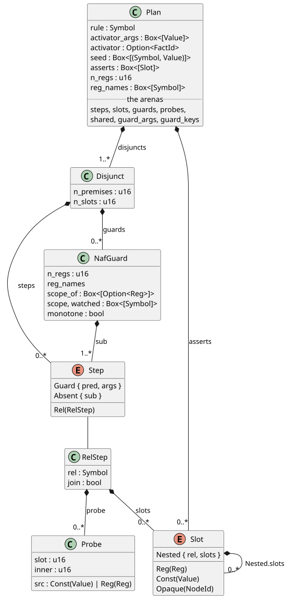
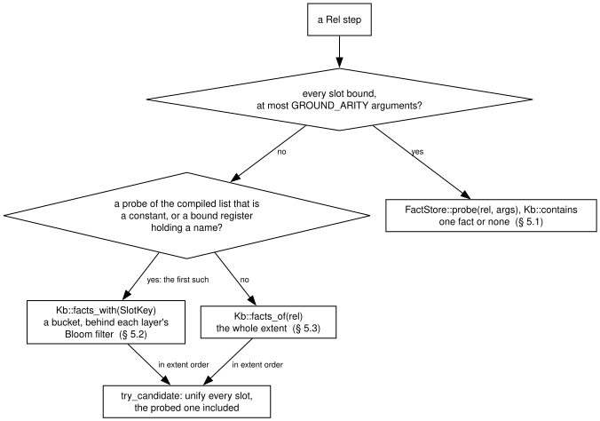
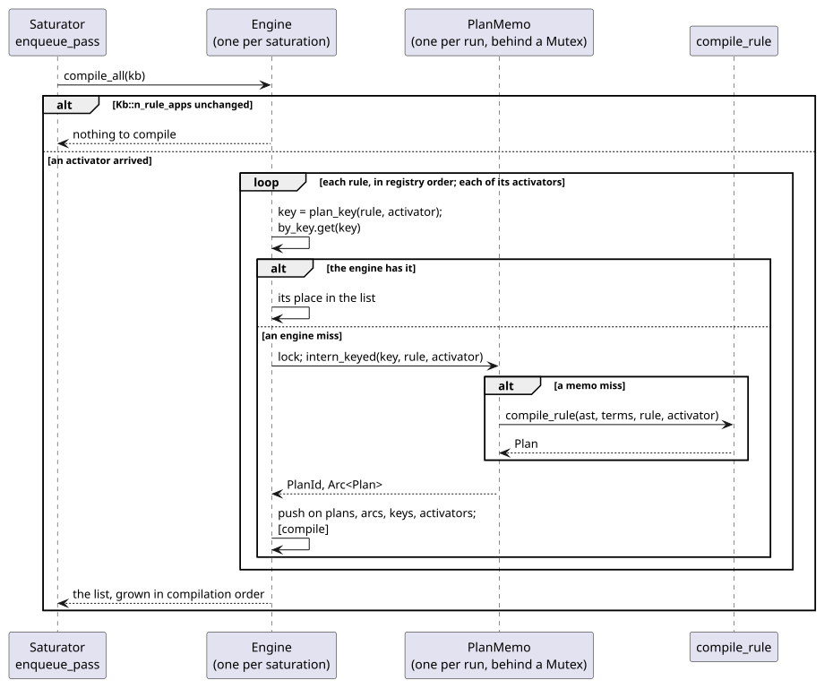

# The matcher

`ein-infer` does not interpret a rule: it compiles each rule, once per activator, to a plan, and runs the plan as a
register machine over the KB's indexes. This page specifies the compiler, the plan it builds, the matcher that runs
it and the cache that keeps one plan per pair, as implemented by
[`plan.rs`](../../../../ein.rs/crates/ein-infer/src/plan.rs),
[`compile.rs`](../../../../ein.rs/crates/ein-infer/src/compile.rs),
[`match_.rs`](../../../../ein.rs/crates/ein-infer/src/match_.rs),
[`predicates.rs`](../../../../ein.rs/crates/ein-infer/src/predicates.rs) and
[`engine.rs`](../../../../ein.rs/crates/ein-infer/src/engine.rs), over the indexes of `ein-core`'s
[`kb.rs`](../../../../ein.rs/crates/ein-core/src/kb.rs) and [`facts.rs`](../../../../ein.rs/crates/ein-core/src/facts.rs).
The caller, and what is done with a match, is [06-saturation.md](06-saturation.md); the orders the matcher owes are stated
for the whole engine in [01-determinism-and-order.md](01-determinism-and-order.md).

## 1. The costs it is shaped against

Matching is the inner loop of every saturation, and within it the work is offering a candidate fact to a premise
and unifying the two, so the matcher is shaped to make that unit cheap and to offer as few candidates as the
indexes allow. Each choice below removes a cost that would grow with the work, not with the program:

- **A binding is a register write**, not a copy of a binding environment, which would cost in proportion to the
  variables bound, per candidate, at every level of the join. Unbinding is popping a trail.
- **A comparison is one `u32` equality.** A `Value` is four bytes, a two-bit tag and a payload (`ein_core::Value`,
  its size held by a `size_of` assertion in `value.rs`), so two objects, atoms or nested facts, compare by identity
  and a comparison never asks which of the two either side is. `Value` is the code's word for an object
  ([Q-M1f.379](../../../decisions/language/Q-M1f.379-an-object-is-a-node-of-the-knowledge-base-graph.md)).
- **A match is not materialised.** It is handed to a callback that reads it in place, so a match the saturator turns
  out to have seen costs a key hash and nothing more.
- **A candidate comes from the narrowest index that answers the premise**: one lookup for a premise every slot of
  which is bound, a bucket of the participation index where what a slot holds is known or the relation of a fact it
  holds, the relation's whole held extent, which the code calls its extent, only where nothing is (§ 5).
- **A plan is compiled once per run** for each pair of a rule and an activator, and read without a lock (§ 7).

The inner loop allocates nothing: `ein-infer/tests/match_alloc.rs`' `the_inner_loop_does_not_allocate` runs one
plan over a KB and over a KB four times larger and asserts zero allocations in both, a counting allocator watching.

## 2. From a rule to a plan

A rule's `:match` and `:assert` stay in the KB as parsed syntax, an `ein_core::entities::ExprRef` naming a node of the
program's `Ast` ([04-ir-frontend.md](04-ir-frontend.md#9-the-loader)), until `compile::compile_rule` lowers them to a
`plan::Plan`.

### 2.1 The compile unit and its activator

The unit of compilation is a rule and **one activator**: a fact whose head is the rule's name and whose arguments
bind the rule's parameters, positionally, before any match. The compiler substitutes those arguments, so a relation
named by a parameter is a constant in the plan
([Q29](../../../decisions/engine/Q29-a-rule-compiles-once-per-activator.md)). A rule with no parameters has one
implicit activator, `None`, and one plan. `compile::activators_for` lists a rule's activators from the KB being
saturated (`Kb::rule_apps_by_rule`), so an activator a node derives gets its plan when it arrives, and drops one
whose argument count is not the rule's parameter count.

`Plan::activator_args` holds **every** argument of the activator fact, as `Value`s: the compile key's list, a nested
fact included, each binding its parameter. It is what the `enqueue`, `fire` and `owe` events print and what every
analysis keys a plan on ([Q-M1f.43](../../../decisions/engine/Q-M1f.43-a-plans-activator-is-every-argument.md)).
`Plan::activator` is the activator fact itself, which every firing records. A query's goal is compiled the same way,
as a rule with no parameters named `#query` (`ein_core::terms::QUERY_RULE`; `verdict::goal_matches`, whose rows
`verdict::goal_bindings` returns).

### 2.2 The plan's layout

A plan is a set of flat arenas indexed by `plan::Span` (a start and a length), so a plan is a few boxed slices and no
tree:

| type | what it is |
|---|---|
| `Plan` | the rule, `activator_args`, `activator`, `seed` (the activator binding, one register each), `disjuncts`, `asserts` (one conclusion template per conjunct of the `:assert`), `n_regs`, `reg_names`, and the arenas `steps`, `slots`, `guards`, `probes`, `shared`, `guard_args`, `guard_keys` |
| `Disjunct` | one branch of a top-level `(or …)`: its `steps`, its lifted `guards`, `n_premises` (the relation steps a match reports), `n_slots` (premise slots a run writes, nested queries included), `guard_key` (its guards encoded by value, for the saturator's `seen` set) |
| `Step` | `Rel(RelStep)`, a relation lookup; `Guard { pred, args }`, an `eq` or `neq` premise; `Absent { sub }`, an `(absent …)` nested inside a lifted guard's sub-plan |
| `RelStep` | `rel`, `slots`, `probe` (the candidate probes, § 5.2), `shared` (the variables an earlier premise mentioned, sorted) and `join`, true where `shared` is not empty; the unifier treats a scan and a join alike, and the flag is for the plan's text |
| `Slot` | `Reg(Reg)`, a free variable; `Const(Value)`, a name or an object the activator bound; `Nested { rel, slots }`, a pattern matched against an argument that is a fact; `Opaque(NodeId)`, a node kept for the plan's text, equal to no object, which no program the loader accepts puts in a `:match` |
| `NafGuard` | a top-level `(absent …)` lifted out of its disjunct: its sub-plan `sub`, its own register space (`n_regs`, `reg_names`), `scope_of` (the parent register each of its registers is projected from, or none), `scope` (the variables bound before it, the rule's parameters among them, sorted), `watched` (the relations it reads, sorted), and `monotone`, true unless its sub-plan holds a nested `(absent …)` |

The same types as a diagram. The plan owns its disjuncts and its conclusion templates as boxed slices; every
composition below a `Disjunct` is a `Span` into one of the plan's arenas, so a `Disjunct`, a `RelStep`, a nested
`Slot` and a `NafGuard` hold no pointer, only a start and a length. A lifted guard's sub-plan is steps of the same
arena, run in a register space of its own (§ 2.3).

A `:match` of `()` compiles to one empty disjunct, which the matcher accepts as one match: the rule fires once, or
once per activator, with only its parameters bound
([Q-M1e2.36](../../../decisions/language/Q-M1e2.36-an-empty-match-is-true-and-fires-once.md)). An `:assert` of `()`
compiles to no template. `ein_infer::shape::plan_shape` renders every plan of a KB as one deterministic text,
`Value`s by `repr` and sets sorted, without registers and probes, which change no behaviour.

### 2.3 Register spaces and the variable limit

A plan has **one register space**, shared by its disjuncts: registers `0 .. n_seed` hold the activator binding, and
every free variable takes the next register in the order the compiler first meets it. A match never spans two
disjuncts and the trail is unwound between them, so sharing is safe, and it lets the `:assert` templates compile
once and resolve against whichever disjunct matched. A lifted `NafGuard` has a space of its own, because the
boundary judges it on the parent's bindings restricted to its scope: a variable outside the scope starts free even
where a premise after the guard has bound it in the parent. A guard nested inside a guard shares the enclosing
sub-plan's space. Register numbers are an encoding and reach no output: the order of bindings is the trail's
(§ 3.2).

A register is a `plan::Reg` (`u16`), and a space holds at most **`plan::MAX_REGS` = 256** variables, the engine's one
compile-time bound. `MAX_REGS` is `ein_ir::MAX_MATCH_VARIABLES`: the loader counts every distinct variable a rule's
`:match` writes, with the rule's parameters, and every variable a query's `:goal` writes, and refuses a clause past
256 on every command. That count bounds every space the compiler builds for the clause, so the compiler's own check
is an `assert!` ([Q-M1f.73](../../../decisions/engine/Q-M1f.73-a-rule-binds-at-most-256-variables-counted.md);
`compile_limits::a_rule_at_the_ceiling_compiles`, `one_variable_past_the_ceiling_is_refused_at_load`). The bound
stays at 256 ([Q-M1f.173](../../../decisions/engine/Q-M1f.173-the-register-file-stays-256-wide.md)):
`the_corpus_is_nowhere_near_the_ceiling` holds every corpus rule to an eighth of it, but those of `std.math.num9`,
generated nine-digit arithmetic whose widest rule, `div9-start`, is held to its own count of 162.

### 2.4 Lowering a premise

| premise | compiles to |
|---|---|
| a pattern `(R a …)`, `R` a name or a parameter its activator binds to a name | a `Rel` step over `R`, one slot per argument |
| `(not P)` | a `Rel` step over the relation `not`, its one slot `Nested`: it matches a stored negation |
| `(and P …)` | its members as sibling premises of the same sequence, at any depth |
| a top-level `(or D …)` | one `Disjunct` per member, each with the same activator binding |
| a top-level `(absent P)` | a `NafGuard`, lifted out of the disjunct; its scope is what the positive premises written before it bound, seeded with the parameters, so `(and (absent (P ?x)) (Q ?x))` and `(and (Q ?x) (absent (P ?x)))` keep asking two questions |
| `(absent P)` inside a guard's sub-plan | an inline `Absent` step, judged in the enclosing sub-plan's environment |
| `(eq a b)`, `(neq a b)`, `(not …)` over either, and a pattern whose relation is a parameter its activator binds to `eq` | a `Guard` step; `(not (eq a b))` is `neq` and `(not (neq a b))` is `eq` ([Q-M1f.31](../../../decisions/language/Q-M1f.31-not-eq-x-y-is-neq-x-y-in-every-place.md)) |

`forall` and `unknown` are no arm here: the loader has expanded them to `absent`s before the compiler runs
([04-ir-frontend.md](04-ir-frontend.md#7-macro-expansion)).

**The relation steps keep the order written.** A guard's place is decided per conjunction (`compile::Seq`): a guard
whose variable a relation premise of the same conjunction binds is placed right after that premise, and one whose
variable nothing in the conjunction binds stays where it is written and binds the variable there, over the program's
names (§ 4). So a premise means the same in any order of its conjuncts, and an `(absent …)` written after a binding
guard reads its variable
([Q-M1e2.26](../../../decisions/language/Q-M1e2.26-eq-and-neq-are-the-relations-of-equality-and-non.md),
[Q-M1f.34](../../../decisions/language/Q-M1f.34-a-guard-that-binds-its-variable-binds-it-where.md)). A guard's
argument is resolved at compile time: a variable to its register (`GuardArgKind::Reg`), a name or a form that holds
no variable to the object it denotes (`GuardArgKind::Const`).

### 2.5 Compiler errors

`compile::CompileError` is a line in Ein's words: the rule, the clause and the form as the program writes them, a
form's place as `file:line:col` where it has one. The compiler refuses nothing the loader accepts
([Q-M1f.84](../../../decisions/engine/Q-M1f.84-a-compiler-arm-the-loader-covers-is-an-invariant.md)): its arms for
a nested `(or …)`, a clause past the register file, a goal's relation variable, `absent`'s and `eq`'s arities and a
premise that is no form are `assert!` or `unreachable!` naming the loader's check, and
`fuzz_properties::the_compiler_refuses_nothing_the_loader_accepts` compiles every plan of every accepted program.
What stays a `CompileError` is reached only by a direct caller of `compile_rule` with a tree or an activator the
loader would not let through
([Q-M1f.75](../../../decisions/engine/Q-M1f.75-the-compilers-errors-are-a-library-callers.md)): an activator whose
argument count is not the parameter count, a relation head its activator binds to a fact, a relation variable with
no activator to bind it, and a guard's argument that is a form holding a variable.

## 3. Executing a plan

### 3.1 Registers, trail and premise slots

`match_::Matcher` owns three buffers, reused across runs: `regs` (a `Vec<Value>`, the register file), `trail` (a
`Vec<Reg>`) and `prems` (a `Vec<FactId>`, the premise slots). Each entry point resets them through `reset`, which
grows them to the plan's size and never shrinks them, so a matcher allocates only when it first runs a plan wider
than any before. An unbound register holds `Value::UNBOUND`.

- **Binding** is `regs[r] = v` and `trail.push(r)`; **unbinding** pops the trail back to a mark, writing `UNBOUND`
  into each register popped. A candidate that fails leaves no binding behind
  (`match_alloc::backtracking_leaves_no_binding_behind`).
- **Unifying** a slot with an argument: `Const` is a `u32` equality; `Reg` binds an unbound register and compares a
  bound one; `Nested` requires a fact, reads its row once, compares the relation, and only then unifies the inner
  slots; `Opaque` never matches. A premise and a fact of different argument counts do not unify.
- **The walk** is a recursion over the step slice: `walk` dispatches the step at index `i`, `rel_step` tries each
  candidate (`try_candidate`), and each candidate that unifies walks on at `i + 1`. A level costs a stack frame and
  no heap allocation: the candidate iterator is a stack value and the steps are a borrowed slice. When `i` reaches
  the end, the match is handed to the callback.
- **Emission** is a callback, `match_::Emit`, an `FnMut(&Match) -> ControlFlow<()>`: `Break` ends the enumeration.
  A `Match` borrows the register file, the trail and the premise slots; it is not copied.

The walk itself, step by step, is drawn in [`02-algorithms.md` § 5](../02-algorithms.md#5-the-matcher-a-plan-run-as-a-register-machine).
What it keeps invariant is the life of one register: bound at most once on the way down, and unbound by the same
frame that bound it on the way back, so that when a candidate fails or the callback returns, the register file is
what it was before that candidate was tried.

### 3.2 The trail is the binding order

A firing's bindings are recorded in the order the matcher first bound each variable, and the trace prints them in
that order ([Q18](../../../decisions/engine/Q18-provenance-is-per-fact-an-or-of-derivations-over.md)). The trail
**is** that order: `Match::bindings` walks the trail, not the register file. The activator's seed bindings are pushed
onto the trail before any step runs, so they come first, then each body variable as it was first bound
(`compile`'s unit test `the_seed_takes_the_first_registers_in_binding_order`). A guard's projected registers are not
trailed: a guard produces no provenance, and a register that is not on the trail cannot be unwound by mistake.

### 3.3 Premises in step order

`Match::premises` lists the facts the relation steps matched, in plan-step order. Each relation step writes its fact
at its own ordinal, `prems[ordinal]`, so a seeded run (§ 3.4), which binds one step before the others, puts the
seeded fact at that step's position with no splice, and provenance from a seeded match is identical to provenance
from a full run (`match_`'s unit test `a_seeded_match_reports_the_same_premise_order`). A nested query writes into
slots past the reported ones, which is why `Disjunct::n_slots` sizes the array and `n_premises` the report.

### 3.4 Entry points

| entry | what it enumerates | used by |
|---|---|---|
| `run` | every match of every disjunct, each from a fresh seed | a query's goal (`verdict::goal_matches`: each match's row, its disjunct and the facts it matched, which a read-out's class and a goal's slice read), the rules that conclude a hypothesis, the obligation reports and the obligations' candidates |
| `run_one` | every match of one disjunct | the saturator's full pass over its plans (`Saturator::full_match`) |
| `run_seeded` | the semi-naive delta: for each top-level relation step over a new fact's relation, that step bound to the fact first and the remaining steps walked, so a fact that can play two roles, as in `(and (R ?a ?b) (R ?b ?c))`, is seeded at each | the saturator's delta pass (`Saturator::seed_match`), over the plans that read the relation in a positive premise, and the gate build's check of a pair's probe |
| `run_pair` | the one match of a plan whose match is a fact and a fact holding it, and nothing else, over two premises a probe found held: the seed's registers, then the held fact's variables in slot order, the premises in step order, which is the match `run_seeded` emits for either premise | the saturator's probe of a pair (`Saturator::pair_match`, [06-saturation.md § 3](06-saturation.md#3-the-queue-the-delta-and-the-parked-set)) |
| `holds` | whether a lifted guard's sub-plan has one match, in its own space, seeded from the parent's registers through `scope_of` | the NAF boundary, a goal's guards, the detector, the obligation reports |
| `universal_support` | the facts a holding guard of `forall`'s shape rests on: what its nested body matched | the saturator, for a firing's `Prov::universal` |
| `scan_without` | a guard's sub-plan with one step skipped, its other steps enumerated | what would pay an obligation's debt (`oblgen`) |

`run_guarded` and `run_seeded_guarded` behave exactly as `run` and `run_seeded`, and name the caller's contract that
it reads `Match::guards`, the lifted guards of the disjunct a match came from. A match whose disjunct carries guards
is not fired at once: the saturator parks it until the boundary judges its guards against a fixpoint
([06-saturation.md](06-saturation.md)). A goal has no boundary, so `goal_matches` judges a match's guards right there with
`holds`.

## 4. Predicates and guards

`predicates::Pred` is `Eq` or `Neq`, and nothing else: relations whose facts are computed from name identity, never
stored ([Q-M1e2.26](../../../decisions/language/Q-M1e2.26-eq-and-neq-are-the-relations-of-equality-and-non.md)).
Each declares its arity, two (`Pred::arity`); `predicates::names()` is sorted. A `Guard` step reads its two
arguments:

- both bound: a test, passing or backtracking;
- one free: `eq` binds it to the object on the other side; `neq` binds it in turn to every name of the program but
  the one on the other side;
- both free: `eq` binds both to every name of the program, each paired with itself; `neq` to every ordered pair of
  two different names; `(neq ?x ?x)` holds of none.

The program's names are `predicates::domain`: `ein_infer::invariant::program_names`, sorted by text so that no
interning order reaches a guard's rows, computed once per program and kept on it (`Program::domain`). A binding a
guard makes goes on the trail, as a relation premise's does.

`(not P)` is no guard: it is a relation step over stored negations (§ 2.4). `(absent P)` is negation as failure: a
lifted guard is judged by the boundary through `holds`, against a fixpoint; an inline `Absent` step inside a guard's
sub-plan runs its query to the first match, in the same environment, unwinds whatever it bound, and lets the walk go
on only where it found none.

## 5. Candidate selection

For a relation step, `rel_step` takes its candidates from the first of these that applies. Every source yields facts
in the order of the relation's held extent, the KB's layers oldest first and each in insertion order, so the source
chosen changes how many facts are offered and never the order of the matches.

### 5.1 A ground premise: one lookup

Where every slot of the step is bound, a constant, a bound register or a nested pattern whose own slots are, the
premise names **one** proposition (`Matcher::ground_args`). The fact store interns propositions, so at most one fact
is that proposition: `FactStore::probe(rel, args)` finds its `FactId` by hash, without materialising a row, and
`Kb::contains` says whether this state holds it. A nested pattern naming a proposition that was never interned
matches nothing, decided with no lookup at all. Premises wider than `match_::GROUND_ARITY` (8 arguments) take the
scan.

This replaces the candidate stream rather than narrowing it, and is exact by construction: the pattern denotes one
argument tuple, unification accepts a fact if and only if its arguments are that tuple, and no two facts share one.
The scan would emit the same one-or-none sequence, with the same `FactId` in the premise slot.

### 5.2 A probe into the participation index

Otherwise the step narrows on its first known slot, through `ein_core::kb::SlotKey { rel, slot, inner, value }`:
`Kb::facts_with(key)` yields the facts of `rel` with `value` at argument `slot`, or, where `inner` is a position, at
position `inner` **inside the fact** at argument `slot`, or, where `inner` is `SlotKey::RELATION`, the facts of `rel`
holding a fact of the relation `value` at argument `slot`. `Kb::index_fact` keys every argument that is a name
directly, and for an argument that is a fact, each of that fact's name arguments one level in and that fact's
relation ([03-data-model.md](03-data-model.md#61-the-participation-key)). No key has a fact as its `value` and none
reaches two levels in, so `(not (R ?b ?i))` with `?b` bound probes `(not, slot 0, inner 0) = ?b` instead of walking
the held extent of `not`, with nothing bound `(not, slot 0, RELATION) = R`, the stored negations of `R` and not
every negation, and a premise whose only bound slots hold facts walks the held extent unless every slot is bound (§
5.1).

The compiler precomputes the step's candidate probes, `RelStep::probe` (`compile`'s `probes_for`): the slots left to
right, a constant ending the list, a register listed, a nested pattern contributing its own constant and register
slots at its position, and last, where no constant came before it, the relation of the first nested pattern, a
constant: a bound argument is the narrower key and comes first. Two of the conditions cannot be decided at compile
time: whether a register is bound at a step depends on the entry point, because `run_seeded` binds a later step
first, and whether a bound register holds a fact depends on the data. So the matcher walks the precomputed list and
takes the first entry that is a constant or a bound register holding no fact (`Matcher::probe_key`): the
left-to-right scan's choice, the first nested pattern's relation where no slot is known, which a debug build asserts
against the scan computed from the raw slots (`candidates_scan`). The compile-time list narrows that scan; it does
not remove it.

`facts_with` hashes the key once and tests each layer's Bloom filter (`kb::BLOOM_BITS`, 2048 bits a layer) before
that layer's map, so a deep KB asks only the layers that may hold the key; a filter never reports a key a layer has
as missing ([03-data-model.md](03-data-model.md#62-the-per-layer-bloom-filter)).

### 5.3 The extent

Where no probe applies, the step walks `Kb::facts_of(rel)`, the relation's whole held extent, layers oldest first.

### 5.4 Extent counts

The size of a relation's held extent is one map lookup whatever the KB's depth: `Kb::n_facts_of` reads `n_by_rel`,
kept up to date as facts are indexed, and never folds over the layers. The NAF boundary's watch stamps ask it once
per watched relation of each parked match. `Kb::check_extent_counts`, part of `Kb::check_layering`, holds the
maintained counts to a walk of the layer stack, and `n_facts_of_costs_one_probe_at_any_depth` holds the one probe
([03-data-model.md](03-data-model.md#7-per-relation-extent-counts)).

## 6. Which optimisations are legal

The matcher owes three orders exactly, because the firing order is the trace and every surface that narrates
reads it ([01-determinism-and-order.md](01-determinism-and-order.md#41-the-firing-sequence)): the **matches**, in the
order the nested loops produce them; the **bindings**, in first-bind order (§ 3.2); the **premises**, in step order
(§ 3.3). An optimisation is legal when it changes how much work produces a match and not which matches come out or
in what order:

| legal, and built | why it keeps the orders |
|---|---|
| registers and a trail | a binding is the same object in the same order, without a copied environment |
| `u32` equality on tagged `Value`s | equality of `Value` is equality of the atom or the fact it denotes |
| the compiled probe list, keys one level inside a nested argument, and the key of a nested argument's relation | a bucket holds every fact that could unify on the probed slot, in extent order, and **every slot is re-checked** (`try_candidate` unifies the whole premise, the probed slot included), so the surviving subsequence is the extent's |
| one lookup for a ground premise | the same one-or-none candidate, the same `FactId` (§ 5.1) |
| one probe for a pair's plan (`run_pair`) | its match is two premises, a fact of distinct variables and a fact holding it, so a new fact makes the match with a held fact or none; the probe finds that fact by its id, and `run_pair` binds the registers from the held fact in slot order, as unifying either premise does, and writes the premises in step order: the match `run_seeded` emits, which the gate's build checks fact by fact |
| the per-layer Bloom filter | it skips only layers that do not hold the key |
| reading a nested fact's row once | the relation is compared before the arguments, as unification would |
| callback emission | the callback sees each match where it is produced |

`narrowing_never_changes_the_match_sequence`, a unit test of `match_.rs`, runs every plan of its program with every
narrowing on and with all of it off, the ground lookup included, over shuffled insertion orders and over facts added
through the incremental index as well as the batch one, and compares the emitted sequences.

**Not legal**, and not built: reordering the joins, whether by cost or first-fail, or a worst-case-optimal join,
because either changes the order matches are produced in, and so the firing order; deduplicating matches inside the
matcher, which the saturator's binding keys and `fired` set already do, with counts of their own; and skipping the
re-check of a probed slot, on which the narrowing's argument rests.

## 7. The compile cache

A plan is a pure function of its key, `compile::PlanKey { rule, activator }`, the rule's name and the activator's
arguments (`compile::plan_key`, which copies the interned arguments and renders nothing). The cache has two levels:

- **One memo per run.** `compile::PlanMemo` maps a key to a `PlanId` and holds the plans as `Arc<Plan>`;
  `compile::SharedMemo` is an `Arc<Mutex<PlanMemo>>`. A run creates one (`region::prepare_as`) and hands it, on the
  `saturator::Session`, to root's saturation and to every node's, so each pair is compiled **once per run**, however
  many nodes ask for it. A one-shot caller takes a private memo (`SharedMemo::default()`).
- **One ordered plan list per engine.** `engine::Engine` keeps its plans in the order it first compiled them
  (`plans`, with `arcs`, the plans themselves, beside it), its keys (`by_key`), the interned activator lists
  (`ActivatorId`, the activator half of a firing's `BindingKey`;
  [Q-M1e.16](../../../decisions/engine/Q-M1e.16-a-firings-identity-keys-on-every-activator.md)) and the `fired`
  set. The memo is shared and the order is not, because the saturator's full pass walks the plans in list order, so
  the order reaches the firing order: a node lists its own derived activator for an early rule before a root
  activator of a later rule. An engine is `Clone`, so a node that resumes root's saturation inherits its list, its
  order and its `fired` set.

`Engine::compile_all` walks the rules in registry order and each rule's activators in `rule_apps_by_rule` order,
calling `Engine::compile_for` for each pair. The walk is skipped while `Kb::n_rule_apps` has not changed, the count of
facts that activate a rule being the walk's only source of new pairs; a debug build checks the skip against a full
walk (`would_not_grow`). `compile_for` builds the key once, probes the engine's own map, and only on a miss locks the
memo, handing it the key (`PlanMemo::intern_keyed`), which compiles only on a memo miss. The read path, `Engine::plan`
and `Engine::plan_arc`, takes no lock. The `compile` event fires on an engine miss, not on a memo miss
([05-events.md](../05-events.md)). A query's goal is compiled outside the cache, on each call of `goal_matches`.

In a debug build `Engine::check_layout` asserts that two plans sharing a rule and an activator id share one register
layout, the property a binding key that compares register contents rests on. `compile`'s unit test
`the_memo_compiles_a_pair_once` holds the memo.

## 8. What the matcher does not keep

The matcher keeps **no intermediate join results** between steps or between runs: a run enumerates from the KB's
indexes and leaves nothing behind but its reusable buffers. What spares a saturation from matching every plan again
after each new fact is the semi-naive seed (`run_seeded`), which enumerates only the matches the new fact takes part
in, and the KB's layers, which a node shares with root rather than copying ([03-data-model.md](03-data-model.md)).

## 9. The counters

`ein_core::counters`, compiled in only under the `counters` feature (`ein-core`'s, which `ein-infer`'s forwards to),
counts work, not time, per thread. Without the feature `counters::bump` has no body and the shipped binary carries
no increment. The matcher's work, by name:

| counter | counts |
|---|---|
| `plan_run` | entry-point runs, one per `reset` |
| `walk` | steps entered |
| `candidates` | facts offered to a relation premise and unified against |
| `scan_ground`, `cand_ground` | ground premises answered by one lookup (§ 5.1), and those that found their fact |
| `scan_bucket`, `cand_bucket` | premises that probed the participation index, and the facts the buckets offered |
| `scan_extent`, `cand_extent` | premises that walked the held extent, and the facts it offered |
| `scan_ground_guard`, `scan_bucket_guard`, `cand_bucket_guard`, `scan_extent_guard`, `cand_extent_guard` | the same, restricted to the guards' sub-plans the boundary runs; the join's share is the total less these |
| `unify`, `unify_slot` | premise argument lists unified, a nested descent counting again, and single slots bound or compared |
| `nested_rel_hit`, `nested_rel_reject` | nested slots whose fact's relation matched, and those rejected on it |
| `predicate_value` | objects an `eq` or `neq` premise was decided for, one per name where a free side ranges over the program's names; `candidates` does not see a guard |
| `plan_key`, `plan_compile` | compile keys built by the engines' walks, and plans compiled, which is memo misses |
| `extent_probe` | `Kb::n_facts_of` lookups (§ 5.4) |
| `fact_probe` | `FactStore::probe` lookups, a ground premise's among them |

`scan_ground + scan_bucket + scan_extent` is every relation premise the matcher resolved.

## 10. The tests that hold it

| test | what it holds |
|---|---|
| [`ein-infer/tests/match_alloc.rs`](../../../../ein.rs/crates/ein-infer/tests/match_alloc.rs) | no allocation in the inner loop, at two KB sizes; a failed candidate leaves no binding behind |
| [`ein-infer/tests/compile_limits.rs`](../../../../ein.rs/crates/ein-infer/tests/compile_limits.rs) | a rule at 256 variables compiles; one past is refused at load with its line; the corpus's widest rules against the bound |
| [`ein-infer/tests/compile_semantics.rs`](../../../../ein.rs/crates/ein-infer/tests/compile_semantics.rs) | every `CompileError` a direct caller reaches, in its words; a nested `(or …)` refused; a parameter that names no relation, bound to a nested fact, is bound |
| [`ein-infer/tests/rule_semantics.rs`](../../../../ein.rs/crates/ein-infer/tests/rule_semantics.rs) | `a_premise_means_the_same_in_any_order_of_its_conjuncts`, `a_binding_guard_binds_where_it_is_written`, `a_guards_free_variable_ranges_over_the_programs_names`, `an_empty_match_fires_once_or_once_per_activator`, activators that differ only in a nested fact both fire |
| `match_.rs`' unit tests | `narrowing_never_changes_the_match_sequence`, `a_seeded_match_reports_the_same_premise_order`, `a_lifted_guard_keeps_asking_its_own_question`, `two_free_guard_arguments_range_over_the_programs_names` |
| `compile.rs`' unit tests | the seed's registers in binding order, the probe list as the scan narrowed, a nested pattern probing one level in and on its relation last, a guard's scope, the memo compiling a pair once |
| `contradiction.rs`' unit tests | `a_pair_alone_has_a_shape_and_its_held_step`, `a_pair_is_found_from_either_side_by_a_probe`, `a_wrapper_of_its_own_relation_is_probed_at_both_steps` |
| [`ein-ir/tests/fuzz_properties.rs`](../../../../ein.rs/crates/ein-ir/tests/fuzz_properties.rs) | the compiler refuses nothing the loader accepts; no firing meets an unbound variable |
| `ein-core`'s `kb.rs` unit tests | `n_facts_of_costs_one_probe_at_any_depth`; the layering check, extent counts included |

Every corpus program's `plan` and `match` texts (`ein_infer::plan_shape`, `ein_infer::match_shape`) are digested in
`ein-render/tests/golden/corpus_shapes.md5` and held by
[`ein-render/tests/id_order_invariance.rs`](../../../../ein.rs/crates/ein-render/tests/id_order_invariance.rs). The
criterion bench `match_hot`, in [`ein-corpus/benches/engine.rs`](../../../../ein.rs/crates/ein-corpus/benches/engine.rs),
runs every plan over a saturated root.
