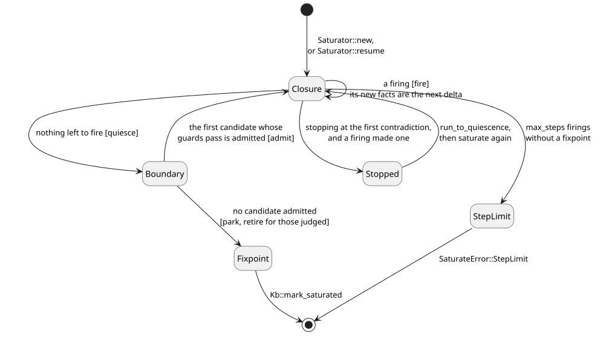
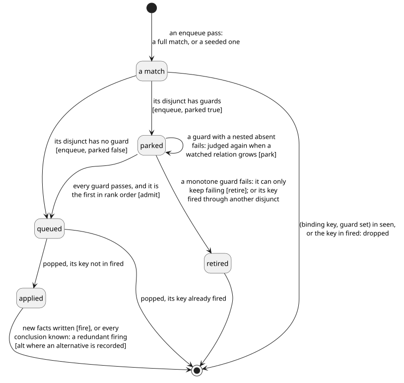
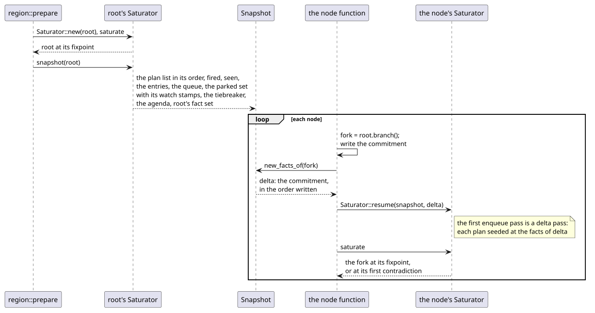

# Saturation

How `ein-infer` brings a KB to its fixpoint: the saturator
([`saturator.rs`](../../../../ein.rs/crates/ein-infer/src/saturator.rs)) drives the matcher
([`05-matcher.md`](05-matcher.md)) over the compiled plans of an `Engine`
([`engine.rs`](../../../../ein.rs/crates/ein-infer/src/engine.rs)), applies each firing
([`firing.rs`](../../../../ein.rs/crates/ein-infer/src/firing.rs)), and checks for a contradiction
([`contradiction.rs`](../../../../ein.rs/crates/ein-infer/src/contradiction.rs)). What a fixpoint is, and why a
negation-as-failure guard is read on a quiescent KB, is the semantics; this page is how `ein.rs` computes it.

## 1. Two phases

Saturation is a loop of two phases, and that shape is the contract:

```text
step():
  loop {
      if let Some(f) = closure_step()  { return f }     // purely positive
      if admit_from_boundary() == 0    { return None }  // one NAF admission
  }
```

- **Closure.** The positive plans fire to quiescence; no negation is consulted. Every top-level `(absent …)` was
  lifted out of its disjunct at compile time, into the plan's NAF guards ([`05-matcher.md`](05-matcher.md)), so a plan's
  steps are a positive program.
- **Boundary.** At quiescence every parked candidate, a match whose NAF guards were not yet judged or failed, is
  judged against that fixpoint, and **at most one is admitted per round**. That is a soundness requirement, not a
  throttle: admitting a batch would let one admission invalidate another's guard after its verdict was taken, which
  on the two rules $p \leftarrow \operatorname{absent} q$ and $q \leftarrow \operatorname{absent} p$ derives both, and
  $\{p, q\}$ is a model of that program under no reading. A
  candidate whose guard fails **stays parked**, since a `forall`'s nested absent can flip from failing to passing as
  the KB grows; one whose guard can only keep failing is **retired**. The events are `park`, `admit` and `retire`
  ([`../05-events.md`](../05-events.md)).

`Saturator::step` returns one firing at a time and `Saturator::saturate` runs it to the end. A runaway program is
stopped by the configured step limit, `SaturateError::StepLimit`, an error and never an answer.

The loop as a state machine. The saturator is in the closure while the queue or a pending delta can still yield a
firing, at the boundary for one round each time the closure is quiescent, and at the fixpoint when a round admits
nothing; the events a transition writes are in brackets. `Stopped` is reached only by a saturation that stops at
its first contradiction (§ 5), and is left by running the same saturator on.



## 2. The agenda

Every saturation ranks its candidates in two halves, `saturator::AGENDA`: first those of a rule whose conclusion a
contradiction can be made of, `(false)`, or either side of a pair a rule refutes (`contradiction::Pairs`): the side
that holds the other, a stored negation `(not …)` where the program imports `std.contradiction`, or a fact of a
relation the holding side of which some plan concludes or the KB holds (`FailFirst::Pairs`, read off the compiled
plans); then the rest. **Within each half the order is FIFO**, the written and arrival order, kept by
a monotone tiebreaker: no rule has a priority. The boundary walks its parked candidates in the same order. Root's
saturation, every node a route or the oracle computes, and every reader of a fixpoint take it
([Q-M1f.313](../../../decisions/engine/Q-M1f.313-the-agenda-fires-first-what-leads-to-false.md)).

The order decides when a fact is derived and which derivation a fact's record keeps first, so a core, the rules
beside it and the narration follow it. It decides no fixpoint and no answer where no rule's `absent` reads a relation
that another rule waiting on an `absent` derives at the same boundary; where one does, the boundary admits the one
written first, on a program the static check calls monotone as well, since that check is of what a commitment can
change ([`07-search.md` § 7](07-search.md#7-monotone-and-flagged-programs)). `ein-infer/tests/agenda.rs` holds the
agenda and the written order to one answer on the corpus's monotone programs. A saturation takes the agenda it is built under; the switches `saturator::fifo` and
`saturator::fail_first` exist for that test and for a measurement, and no configuration field, option or environment
name reaches them.

## 3. The queue, the delta and the parked set

| state | structure |
|---|---|
| the queue | a binary heap of ranked entries over a side arena: the agenda's half, then the tiebreaker |
| the parked set | an ordered set keyed on the tiebreaker, so the boundary walks it in agenda order |
| `seen` | a hash set of (binding key, guard set): a match is enqueued once per disjunct's guards |
| the delta | the facts derived since the last enqueue pass, or none, which means a full pass |
| the matched plans | one flag per plan of the engine's list, in its order |

A candidate, one match of one plan's disjunct, lives in exactly one of these places from the enqueue pass that
found it to the application that fires it. Only the boundary moves a parked candidate, and nothing moves one back:



**The closure is semi-naive.** After a productive firing, the next enqueue pass reads only the derived facts,
seeding each plan whose positive premises name a delta fact's relation at that premise (`run_seeded`); a full pass
runs only where no delta is known. A binding key is a fixed-width array of `Value`s, the code's word for objects,
hashed with FxHash, keyed on the rule, **every argument of its activator** and the bindings
([Q-M1e.16](../../../decisions/engine/Q-M1e.16-a-firings-identity-keys-on-every-activator.md)).

**The boundary judges only what can have changed.** Each parked candidate records the epoch it was judged at, per
guard set; the sizes of the held extents of a guard set's watched relations are taken once per round, and a
candidate is re-judged only where one of them grew. The KB only grows, so a held extent of equal size is an equal
held extent, and a guard whose watched held extents did not grow gives the verdict it gave. A round stops at the
first admission, so it walks the parked set in order up to the first candidate whose guards now pass.

## 4. A node resumes root's saturation

A node of a search is root's saturation, continued
([Q-M1a.18](../../../decisions/engine/Q-M1a.18-a-node-resumes-roots-saturation.md)). `Saturator::snapshot` takes root's
state at quiescence (what it has fired, its parked set with their watch stamps, the boundary's clock, the agenda it
was built under), and `Saturator::resume` continues it over the node's KB, a fork of root's
([`03-data-model.md`](03-data-model.md)), seeded with the delta: the facts the fork has that the snapshot did not, in the
order the KB holds them, which is the order the caller wrote the commitment in. Three things make that root's
fixpoint grown by the commitment:

- root was at quiescence, so every match over root's facts was enqueued and applied there; a match that is new in the
  node reads at least one delta fact, which is what a seeded run starts from;
- the parked set is carried with its watch stamps, so a candidate whose guard failed at root is judged again in the
  node rather than forgotten;
- the tiebreaker continues from root's high-water mark, so the node's own candidates sort after the inherited ones
  within a half, which is what FIFO means for a queue not built from scratch.



The node's plans are the run's plan memo's ([`05-matcher.md`](05-matcher.md)), so a node compiles nothing root compiled.
`saturator.rs`'s `a_resumed_saturation_reaches_the_same_fixpoint` holds the fixpoint equal to a fresh saturation's.

**What may differ is narration**: the firings a node counts and narrates, and which of a fact's equally valid
derivations its record keeps first. A node narrates what its commitment adds, not root's closure again, and a trace
renders root's derivation as its own section before the states
(`ein-render/tests/idea08_acceptance.rs`). Narration is defined once, in the dev-only crate `ein-narration`: a
node's derivation, and anything keyed on a dying node's stopping point; the comparison of two event streams cuts it,
and `EIN_NARRATION_STRICT=1` compares it byte for byte as well ([`../05-events.md`](../05-events.md)).

## 5. A saturation stopped at its first contradiction

A route's node on a monotone program needs only to know that it is dead, so it is saturated with
`Saturator::stop_at_first_contradiction`: `saturate` returns at the first point its KB holds a contradiction, before
any firing where the facts written already do, and otherwise after the firing whose conclusions make one, every
conclusion of that firing written. The KB is then not marked saturated. It is no agenda: which candidate fires first
is still the agenda's, and the agenda puts first what can make the contradiction. A dead node's core is taken over
its fixpoint, the saturation going on from the stop ([`07-search.md`](07-search.md)).

## 6. Firing, redundancy, alternatives

Applying a match instantiates every conclusion of its `:assert`, a conjunction read flat, and looks each up:

- **every conclusion present**: a *redundant* firing, nothing inserted. Its derivation is recorded as an alternative
  justification of each conclusion that still accepts one (`Kb::record_justification`, [`03-data-model.md`](03-data-model.md));
  a cheap check that one is accepted comes first, so the common redundant path builds no record;
- **any conclusion absent**: one derivation record shared by every conclusion of the firing, its premises, its
  bindings in bind order, and its activator; the new facts join the delta.

`(config :record-alternative-justifications false)` stops recording alternatives; it may change a dead node's core,
and nothing else (the one exemption the configuration principle makes,
[Q-M1e2.30](../../../decisions/answer/Q-M1e2.30-no-configuration-option-lever-or-flag-changes-r.md)).

### 6.1 Contradiction

A KB is contradictory when a rule that states `:ein inconsistent` fired on it, and in no other way: a pair `X` and
`(not X)` is one where a rule says so, `std.contradiction`'s `clash-N`, which concludes `(false)` from the two
wherever the program imports the module, however either fact got there
([Q-M1f.557](../../../decisions/stdlib/Q-M1f.557-the-contradiction-is-a-theory-a-program-imports.md)). The firing is a
record on the KB and no fact ([`Kb::ended`](../../../../ein.rs/crates/ein-core/src/kb.rs),
[`firing::end`](../../../../ein.rs/crates/ein-infer/src/firing.rs)): the rule, the premises its match read, the
absences it passed and what its universals read, as a derived fact's derivation is, so a core is taken over it. A
held `(false)` is of this kind and the kernel reads it by its name nowhere: `std.core`'s rule, which every program
gets, matches it and states the key
([Q-M1f.551](../../../decisions/stdlib/Q-M1f.551-std-core-is-loaded-into-every-program.md)). A candidate of such a
rule is before every other in the queue, under the agenda and under the written order alone, and a saturation
stopped at its first contradiction fires what the facts written so far give such a rule before it returns. An
explanation reads through the rule every program gets to what it matched, and through a firing whose premises are a
fact and a fact holding it as its one argument to that pair (`contradiction::detect`). The result order is fixed,
the firings that ended the state in the order they fired, each followed by the pairs it is read through to, because
it reaches the core and the trace.

What a rule refutes beside a fact is read off the compiled plans, with no name (`contradiction::Pairs`): a plan whose
disjunct is a fact of distinct variables and a fact holding it as its one argument, and whose firing ends a state.
Where one is compiled, its candidate is before every other in the queue, as a rule that states the key is, so a
state ends at the firing that completes the pair; a candidate root holds the other side of is not in `H`; a
candidate an alive state so denies is dead above it (L8); and the agenda fires either side first.

### 6.2 Obligations

A rule whose `:assert` is `(open R)` or `(open ?R)` derives nothing and is not in the agenda: it runs as one pass
over the KB **after** the fixpoint ([`obligations.rs`](../../../../ein.rs/crates/ein-infer/src/obligations.rs)), and
what it reports, a node's debts, is read at every state. The pass of
[`open.rs`](../../../../ein.rs/crates/ein-infer/src/open.rs) writes it as `(open R)`, once for each relation owed,
into the part of the state no fork inherits, at root and at a state above root that is printed or saved or that uses
its `open` facts, and at every state under `--in-flight`
([Q-M1f.566](../../../decisions/hypotheses/Q-M1f.566-what-a-state-owes-is-open-r-a-fact-and-open-f.md),
[Q-M1f.655](../../../decisions/engine/Q-M1f.655-open-facts-are-written-at-root-and-where-a-state.md), [Q-M1f.656](../../../decisions/cli/Q-M1f.656-a-flag-runs-the-pass-at-every-state-and-checks.md)), beside the
hypotheses `(open F)` the writers of H give there ([`07-search.md` § 1](07-search.md#1-hypothesis-generation)), at
root and where a state is used
([Q-M1f.655](../../../decisions/engine/Q-M1f.655-open-facts-are-written-at-root-and-where-a-state.md)). The saturator
never fires an `(open F)` a rule concludes: the facts such a rule concludes beside it are an ordinary rule's, and the
hypothesis is the pass's. Where a rule reads an `open` fact, the saturation resumes over what the pass wrote, and the
two repeat until neither adds anything; the program is then flagged, by the static check's `open-read` site
([Q-M1f.569](../../../decisions/hypotheses/Q-M1f.569-a-rule-may-read-an-open-fact-and-its-program.md)). Its event is
`owe`.

## 7. `is_stalled` is not a read

`Saturator::is_stalled` asks whether a step would find nothing, and changes the answer to later questions: a full
enqueue pass runs first, since a caller may have written facts to the KB outside `step`'s flow, and that pass advances
the tiebreaker, the position of every candidate enqueued after it. So a drive that probes quiescence may fire the same
rules in a different order from one that does not. Nothing in the engine calls it ([`../04-api.md`](../04-api.md)).
