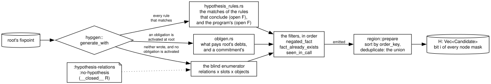
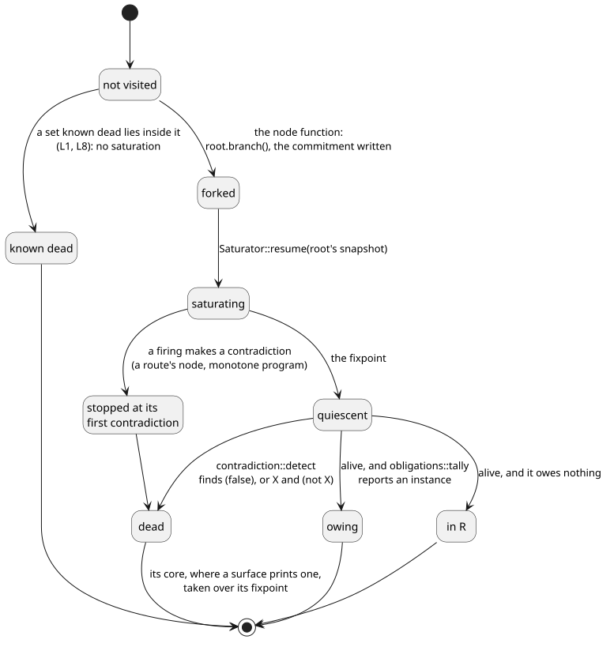
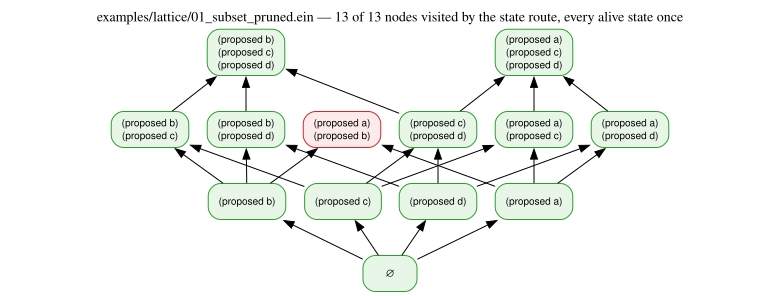
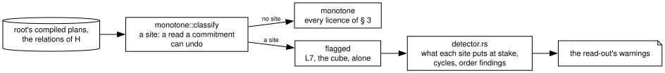

# The search

How `ein-infer` finds the region `R`: the hypothesis set H it searches over, the node function every route shares, the
routes that answer each question about `R`, the identity of a state, the cores that explain a dead node, and the
static check that says which routes a program licenses. The answer is the region `R`, the commitments, subsets of H,
whose state is alive and discharged
([Q-M1e2.7](../../../decisions/answer/Q-M1e2.7-the-answer-is-a-region-r-of-the-hypothesis.md)); what the routes
compute is defined, and the routes' formulas argued, without reference to this code. This page is how `ein.rs`
computes it.

## 1. Hypothesis generation

H is built once, at root, as **the union of its writers** ([`hypgen.rs`](../../../../ein.rs/crates/ein-infer/src/hypgen.rs),
`generate_config_free`), the hypotheses root holds, `(open F)`, less what root holds or denies
([Q-M1f.570](../../../decisions/hypotheses/Q-M1f.570-h-is-the-union-of-the-hypotheses-root-holds.md)):

1. **the rules that conclude a hypothesis**, `(open F)`
   ([`hypothesis_rules.rs`](../../../../ein.rs/crates/ein-infer/src/hypothesis_rules.rs)): a rule without
   parameters is one plan, a rule with them one plan per activator root holds, and each `(open F)` of a plan's
   `:assert` is a candidate per match, an instance of `eq` or `neq` none; with them the `(open F)` facts the program writes,
   which root alone holds;
2. beside them, **the obligations** activated at root
   ([`oblgen.rs`](../../../../ein.rs/crates/ein-infer/src/oblgen.rs)): the facts that would discharge what root
   owes, and, read off the rules with no saturation, what a rule can bring a commitment to owe. Under an activated
   obligation a state that owes nothing proposes nothing from it. An obligation whose guard, beside its witness, or
   whose trigger reads a relation whose held extent a commitment can change proposes what root's guard gives, as any
   obligation does, and the static check flags the program (§ 7,
   [Q-M1f.579](../../../decisions/hypotheses/Q-M1f.579-an-obligation-whose-guard-or-trigger-reads-what.md)); one
   whose witness step does not resolve under its activator proposes nothing;
3. only where neither writes and no obligation is activated, **the blind enumerator**
   ([Q-M1f.576](../../../decisions/hypotheses/Q-M1f.576-the-blind-enumerator-writes-only-where-root.md)): every
   eligible relation of one or two arguments, every guessable atom in each of
   its slots (a binary fact of an atom with itself left out). No slot is filtered by the name its declaration gives
   it: Ein has no types, the names a declaration writes as labels are only left out of the guessable atoms, and a
   candidate the program's rules do not allow is refuted by those rules, in its own node. The guessable atoms,
   `hypgen::candidate_objects` in the code, are drawn from the names the alive-set invariant lists for the program
   ([`invariant.rs`](../../../../ein.rs/crates/ein-infer/src/invariant.rs): no rule asserts a name the program
   lacks), never `__closed__`. The invariant is what lets H be taken once, at root, and it is
   enforced: [`ein-infer/tests/alive_invariant.rs`](../../../../ein.rs/crates/ein-infer/tests/alive_invariant.rs)'s
   `every_name_of_the_program_is_a_candidate_object` holds the static reading and
   `no_run_reaches_a_name_the_program_does_not_have` the one in the search, which fails when a node reaches a name
   outside root's fixpoint and the rules' constants.

An obligation rule the program loads and nothing activates writes nothing, so a module imported for another of its
names takes nothing off the blind enumerator. Candidates then pass a pipeline of filters, each named, and a dropped
candidate's `hyp` event names its filter ([`../05-events.md`](../05-events.md)), so that every candidate a writer
built is accounted for:

$$
\operatorname{raw} = \operatorname{emitted} + \sum_{f \in \text{filters}} \operatorname{dropped}_f
$$

From the program to the bit order of every node mask; the writers are drawn as a flow in
[`02-algorithms.md` § 6](../02-algorithms.md#6-hypothesis-generation-the-writers):

`(solve :hypothesis-relations …)`, `(solve :no-hypothesis …)` and `(__closed__ R)` configure the blind enumerator
alone ([`../07-reserved-engine-strings.md`](../07-reserved-engine-strings.md);
[Q-M1f.578](../../../decisions/hypotheses/Q-M1f.578-the-two-lists-and-a-closure-configure-the-blind.md)).

**The mechanisms are read together**, on root's fixpoint
([`mechanisms.rs`](../../../../ein.rs/crates/ein-infer/src/mechanisms.rs)), against the `open` facts the pass of
[`open.rs`](../../../../ein.rs/crates/ein-infer/src/open.rs) writes there: where root holds one, no closure closes
and no `:no-hypothesis` names the relation of one, and a `:hypothesis-relations` names exactly their relations;
nowhere is a relation in both lists or listed and closed. A conflict is refused before any search, and a redundant
name is a note. **`(solve :no-search)`** states that H is empty: no writer runs, and `R` is $\{\emptyset\}$ where
root is alive and discharged, empty otherwise. `ein show hyps FILE` prints H, one candidate per line, with no
search.

**Every state holds what the writers give at its fixpoint**: the pass of `open.rs` writes `(open R)` once for each
relation the state owes and `(open F)` for each hypothesis there, into the part of the state no fork inherits
(`ein_core::Kb::write_open`), root's at root and a node's at the node's own fixpoint. **It runs where a state is
used** ([Q-M1f.655](../../../decisions/engine/Q-M1f.655-open-facts-are-written-at-root-and-where-a-state.md)): at
root, at a node read through `region::Nodes`, which every surface that prints or saves a state reads it with, and at
every node of a program a rule of which reads `open`; at any other node of a search `open::Pass::Tally` reads what
the node owes and writes nothing, since no surface reads it. `--in-flight` runs it at every node
(`open::at_every_state`,
[Q-M1f.656](../../../decisions/cli/Q-M1f.656-a-flag-runs-the-pass-at-every-state-and-checks.md)). A node above root
that holds a hypothesis root does not makes the program not monotone, found in flight (§ 7).

## 2. The node

Every route reads every commitment through **one node function**
([`region.rs`](../../../../ein.rs/crates/ein-infer/src/region.rs)): a fork of root's KB
([`03-data-model.md`](03-data-model.md)) with the commitment's facts written in candidate order, resumed from root's
snapshot ([`06-saturation.md`](06-saturation.md)), saturation alone, what it owes read at its fixpoint, its `open`
facts written there where the pass of `open.rs` runs (§ 1), and nothing written into root or the node by the search
([Q-M1e2.2](../../../decisions/answer/Q-M1e2.2-a-node-is-a-fork-of-root-an-assumption-on.md)). Its outcome is
its kind, `dead` (its fixpoint is contradictory), `owing` (alive, with an undischarged obligation) or `in-r`, with what
it owes, its closure, and its facts beyond root's. So a route and the oracle may visit different nodes and cannot
read one differently.

A commitment's life in one run. Its kind is one of three, `region::Class`: `Dead`, `Owing` or `R`, printed `dead`,
`owing` and `in-r`. A set a route knows to be dead is never forked, and has no `enter` line (§ 3).

On a monotone program a route's node is saturated with the **stop at its first contradiction**: its dead bit is all
a route reads of a dead node, and the agenda puts first what can make the contradiction. A node a route reads whole,
an alive one, root, and every node of a flagged program, runs to quiescence.

## 3. The licences

A route skips a node only under a **licence** (`explore::Licence`), a theorem the static check (§ 7) proves for the
program's class:

| | licence |
|---|---|
| L0 | a fork only adds, so where root is dead every node is (any program) |
| L1 | dead is upward-closed: no superset of a dead node is visited |
| L2 | discharged is upward-closed: an alive superset of a node of `R` is in `R` |
| L3 | a commitment's state is its closure's, so a route may visit states rather than commitments |
| L4 | a node of `R` is maximal when every one-up extension is dead |
| L5 | an owed instance's alternatives are exhaustive: an owing state branches on one owed instance's alternatives |
| L7 | the cube: every node, nothing skipped (the only licence a flagged program has) |
| L8 | what a state denies is dead above it: an alive state whose fixpoint stores `(not b)`, beside which a rule refutes `b` (`ein_infer::contradiction::Pairs::denies`, `std.contradiction`'s where the program imports it), has a dead extension by `b`, known without saturating it |
| L9 | a fact nothing proposes and nothing writes is in no state |

**What is known dead is one memory** ([`known_dead.rs`](../../../../ein.rs/crates/ein-infer/src/known_dead.rs)):
before a route on a monotone program saturates a set, it asks whether a set known dead lies inside it, one a
saturation found dead (L1) or a state's denial (L8). Every route asks the same memory and writes to it.

## 4. The routes

A question is an `explore::Mode` ([`explore.rs`](../../../../ein.rs/crates/ein-infer/src/explore.rs)): which part
of `R` (all of it, the minimal line, the maximal line) and what is asked of it (describe it, find `n` of its states,
expect exactly one, or count it). `explore::run` answers each with the least work it needs
([Q-M1e2.31](../../../decisions/answer/Q-M1e2.31-each-question-about-r-does-the-least-work-it.md)):

| program | question | route |
|---|---|---|
| root dead | any | one saturation, root's: **route 1** ([`downset.rs`](../../../../ein.rs/crates/ein-infer/src/downset.rs)), which visits root alone (L0, L1); a monotone program's describe is answered by the state route, which stops at root the same way |
| monotone | describe, `--count` | **the tree and the classes** ([`tree_classes.rs`](../../../../ein.rs/crates/ein-infer/src/tree_classes.rs)), the default, where root owes an instance L5 or L9 licenses: `R`'s states by the obligation tree, and each state's class by dualising and advancing inside it; it computes neither `N` nor an empty `R`'s owing frontier, and says so. Elsewhere, or with `--describe-route states`, **the state route** ([`states.rs`](../../../../ein.rs/crates/ein-infer/src/states.rs)) |
| monotone | `-n`, `--single`, a line's first state | **the obligation tree** ([`tree.rs`](../../../../ein.rs/crates/ein-infer/src/tree.rs)): an owing state branches on one owed instance's alternatives (L5) |
| monotone | the maximal line | a climb, and dualise and advance |
| monotone | the minimal line | a shrink, and the duality against the maximal owing states |
| flagged | any | **route 2, the cube** (L7): in layer order where the question can be decided early (`-n`, `--single`, over all of `R` or the minimal line), whole where it cannot |

How a question reaches its route is drawn as one flow in
[`02-algorithms.md` § 8](../02-algorithms.md#8-the-routes-over-r), with each route's steps.

**The state route** visits each alive state once and saturates its one-up extensions, and nothing else: on a monotone
program a commitment's state is its closure's (L3), so the alive commitments fall into far fewer states than there are
commitments. It reads every row of the description off the states it met: a state's minimal generators are the
minimal transversals of its complements against the states below it, `N`, the minimal dead sets, the minimal
transversals of the complements of the maximal alive states, and `k_c`, the commitments over a state $T$, is
counted over the alive states strictly inside it
([`transversal.rs`](../../../../ein.rs/crates/ein-infer/src/transversal.rs)):

$$
f(T) = 2^{|T|} - \sum_{S \subsetneq T,\; S \text{ alive}} f(S)
$$

What the route visits on [`examples/lattice/01_subset_pruned.ein`](../../../../examples/lattice/01_subset_pruned.ein),
whose four candidates make a cube of sixteen commitments, as `ein render lattice FILE --view full` draws it: `R`
green, the one dead node red. The three commitments above the dead pair are not drawn, because the route never
saturated them (L1).

 The alive commitments it saturates are
distinct, so they are at most route 1's, and a dead extension it saturates prunes every superset (L1); where both
routes finish, their read-outs are identical but for the `route` and `work` rows (`ein-infer/tests/explore.rs`).

**Route 1** visits a monotone program's alive down-set, layer by layer from ∅ by the prefix join over candidate
indices: a commitment of size `k + 1` is visited only when each of its `k`-subsets is alive. **Route 2**, the cube,
saturates every commitment; it is the oracle's route.

A minimal question where ∅ is in `R` is decided at root on every route: ∅ is below every commitment, so the minimal
line is $\{\emptyset\}$.

### 4.1 Budgets

A run has two bounds: the **region budget**, facts beyond root, their `open` facts aside, summed over every fixpoint
the run computes
(`--region-budget`, [$2^{20}$ by default](../../../decisions/cli/Q-M1e2.35-the-default-region-budget-is-2-20-facts.md)),
checked before each step, and on the cube the **region limit**, the largest `n` whose whole cube a flagged program
gets (`--region-limit`). **A budget stops work and never changes an answer**: a stopped run says what it established,
members found, a line's members found, a verdict reached, with `exhausted` false, and no more
([Q-M1d.1](../../../decisions/answer/Q-M1d.1-a-search-stops-early-only-on-a-decided-question.md)). Past the limit a
question that needs the whole cube meets `R`'s members in layer order up to the limit, and describe certifies what it
can of them; a line mode answers from the same description
([Q-M1e2.19](../../../decisions/answer/Q-M1e2.19-past-the-limit-a-line-mode-certifies-what.md)). `-T` is a deadline, past
which the run is an error. A count is exact at any size and reported up to $2^{63} - 1$
([`count.rs`](../../../../ein.rs/crates/ein-infer/src/count.rs),
[Q-M1f.218](../../../decisions/answer/Q-M1f.218-a-count-is-exact-and-reported-up-to-2-63-1.md)).

### 4.2 One description

What a run established about `R` is built once, as a `Described`
([`described.rs`](../../../../ein.rs/crates/ein-infer/src/described.rs)), read off route 1's down-set, the state route,
the tree or the cube; the read-out, the summary, the answer dump and a region claim's check all read that one value,
so no two of them count `R` differently. `ein_infer::read_out` adds each listed state's model and each query's
projection classes, read through the node function.

### 4.3 The oracle

`ein oracle FILE` computes `R` by brute force: every commitment of the cube saturated to quiescence. It is the
reference every mode is held to ([Q-M1e2.32](../../../decisions/answer/Q-M1e2.32-no-two-commands-disagree-and-the-oracle-is.md)):
`ein-infer/tests/explore.rs`'s `every_mode_is_the_oracle` runs every mode against it on every program whose cube it
enumerates, `claim_routes.rs` holds each question `ein test` asks to the description and the oracle,
and `ein-cli/tests/lever_invariance.rs` holds every mode under every configuration lever to the same `R`
([Q-M1e2.30](../../../decisions/answer/Q-M1e2.30-no-configuration-option-lever-or-flag-changes-r.md)).

## 5. A state's identity

Two commitments that saturate to the same KB are one state. `canon::state_key`
([`canon.rs`](../../../../ein.rs/crates/ein-infer/src/canon.rs)) is the state's sorted fact set, free of provenance, and
**identity is the canonical form itself, never a hash of it**: every identity site keys on the list, so a hash
collision costs a comparison and never a wrong answer; `canon::state_digest` exists for display alone. For identity
any total order is equivalent, so the key sorts by fact id, which is no observable order; where a state is shown, it
is ordered by its rendered text ([`01-determinism-and-order.md`](01-determinism-and-order.md)). **A search keys a node
by its facts beyond root's**, read above root's mark of its stack at their own size, as a resumed node's delta is
(`Snapshot::new_facts_of`, [`06-saturation.md` § 4](06-saturation.md#4-a-node-resumes-roots-saturation)), and sorted as
`state_key` sorts: every fixpoint holds root's facts, so the part beyond them tells two states apart exactly as the
whole does, and the gate's build holds the one to the whole key less root's facts at every node. The whole key is
read where a state is compared with one reached another way and no search pays it at a node: the read-out's check of
a printed state's parent paths (`region::Nodes::by_parent`), and a saved container's solutions
([`09-binary-format.md` § 6](09-binary-format.md#6-the-solution-store)). No carrier head is
excluded: a committed fact is the fact itself, its provenance a commitment's, and a state's `open` facts are facts of
the kernel's relation `open`, a function of the rest of the state
([Q-M1f.572](../../../decisions/read-out/Q-M1f.572-a-states-open-facts-are-part-of-it-listed-drawn.md)).

## 6. Cores and explanations

A dead node's **core** is the smallest set of given facts, written or committed, from which one of its contradictions
follows ([`explain.rs`](../../../../ein.rs/crates/ein-infer/src/explain.rs)). Provenance is an AND/OR graph, a fact an
OR-node over the derivations recorded for it and each derivation an AND-node over its premises, so the search computes
an ATMS label per fact, the subset-minimal environments it follows from, over **every derivation the store holds**:
the primary, the alternatives kept by premise count, and the arrival with the smallest closure
([Q-M1e2.11](../../../decisions/answer/Q-M1e2.11-a-core-is-the-smallest-over-every-derivation.md)). A premise-free
derivation is a terminal labelled with the empty environment. A dead node's core follows an activator only where
the node derived it ([Q-M1e2.12](../../../decisions/answer/Q-M1e2.12-a-dead-nodes-core-follows-an-activator-only.md)),
and a derivation through a `forall` rests on each fact it read
([Q-M1e2.15](../../../decisions/answer/Q-M1e2.15-a-derivation-through-a-forall-rests-on-each-fact.md)).

Choosing the best combination of derivations is worst-case exponential, so the search has a budget
(`explain::ExplanationBudget`: environments kept per label, rounds, the largest environment, the largest premise
closure), and every core carries its status, `within-budget`, or `cut-` and the caps its search stopped at; a cut core
is sound and possibly not the smallest. **A core is an explanation**: it may vary with rule order, and no answer
depends on it ([Q-M1f.6](../../../decisions/answer/Q-M1f.6-a-core-is-an-explanation.md)). A node that is not dead has
no core, `null`; `[]` is a dead node's empty core. A core is taken only where a surface prints one (`region::Cores`):
root's and, on the cube, the minimal holes' always; each visited dead node's for `--events` and `--dump-lattice`; each
member of `N`'s for `--dump-answer` and `--trace`, taken after the run on the same fork, so `--jobs` moves none
([Q-M1f.25](../../../decisions/answer/Q-M1f.25-every-core-a-run-prints-is-taken-against-its-one.md)).

## 7. Monotone and flagged programs

**The static check** ([`monotone.rs`](../../../../ein.rs/crates/ein-infer/src/monotone.rs), `monotone::classify`) reads
the compiled plans and says whether `R` can have a **hole**, a node outside `R` between two inside it. A hole needs a
commitment that grows and takes a conclusion away, or grows and adds a debt; a **site** is a read that can do either:
an `(absent …)` at odd depth in a saturation rule over a relation a commitment changes, an obligation's trigger over
one, or a rule whose activator a commitment can derive. Three more sites let a node hold or need what root's H
lacks: a rule that reads `open` (`open-read`), a rule that concludes `(open F)` and reads a relation a commitment
changes at even depth (`hypothesis`), and an obligation whose guard reads one beside its witness
(`obligation-guard`). A program with no site is monotone, and its routes take every licence of § 3; a program with a
site is **flagged**, and gets the cube alone. A run that builds a node holding a hypothesis root does not, where
the pass runs (a node printed, every node of a program that reads `open`, every node under `--in-flight`), finds
the program not monotone **in flight** (`open::Writers::first_above`, `Monotonicity::in_flight`, and
`region::Nodes::in_flight`, which the read-out folds in for the states it prints): the warning is said at once,
once, and the answer stands
([Q-M1f.574](../../../decisions/answer/Q-M1f.574-a-hypothesis-first-held-above-root-makes-its.md)).

**The detector** ([`detector.rs`](../../../../ein.rs/crates/ein-infer/src/detector.rs)) says more of a flagged program:
its static half, read off root's plans before any node, is which property of a node each site puts at stake (the
**state**, or the **status**), whether a **cycle** runs through an `absent` over the relations a commitment changes,
whether the boundary's **order** of admission can decide what a node holds, and what is assumed (every node a fork of
root); its dynamic half, read in the run, is each node's stale facts and parent paths. A flagged program's answer is
reported with these warnings, and the engine claims nothing about it beyond what it computed. `ein solve FILE
--monotone` asks the static question alone (`explore::Checked`): root's fixpoint and the check, no node built, so it
has no `R` to disagree with another command about.

**A refutation resting on an `absent` a commitment can fill** is the shape L1's premise is false of:
[`examples/ein-bugs/naf-upward-closure.ein`](../../../../examples/ein-bugs/naf-upward-closure.ein), in which
`{(p A)}` derives `(false)` and `{(p A), (q A)}` does not. Such a program loads as any other does, and what keeps
L1 off it is the static check: the `absent` is a site, the program is flagged, and its routes are the cube's
([Q-M1f.564](../../../decisions/answer/Q-M1f.564-a-non-monotone-program-loads-with-a-warning.md)).
[`ein-infer/tests/non_monotone_loads.rs`](../../../../ein.rs/crates/ein-infer/tests/non_monotone_loads.rs) holds
that each corpus program with the shape is flagged and answered with no licence
(`a_refutation_under_an_absent_loads_flagged_and_unlicensed`). The relations a commitment can extend, followed
through each rule's activator, are [`extendable.rs`](../../../../ein.rs/crates/ein-infer/src/extendable.rs)'s, read
by the obligations for a debt a commitment can bring.