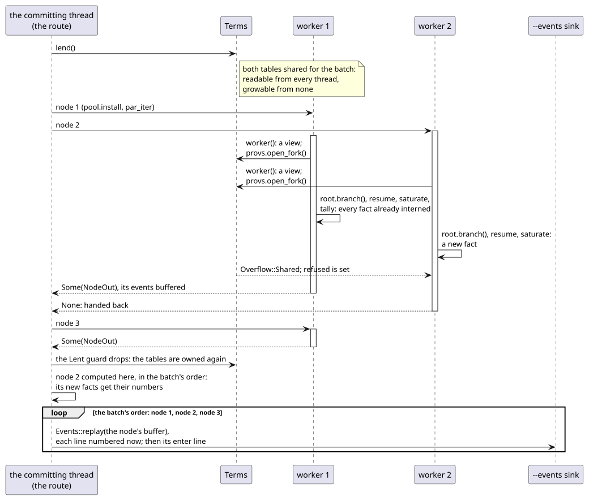

# Parallelism

What `--jobs N` runs in parallel, and why a job count moves nothing a run prints. The fan-out is
[`region::fan_out`](../../../../ein.rs/crates/ein-infer/src/region.rs), behind the `parallel` feature
([`10-toolchain-and-layout.md`](10-toolchain-and-layout.md)); what it shares is the lending of
[`ein_core::terms`](../../../../ein.rs/crates/ein-core/src/terms.rs).

## 1. The contract

| mode | flag | what it guarantees |
|---|---|---|
| **sequential** | `--jobs 1`, **the default** | the computation every golden is taken under |
| **parallel** | `--jobs N` | byte-identical to `--jobs 1`: the same answer, the same states and cores, **the same counters**, the same stdout, the same `--events` stream line for line; only the wall clock differs |

There is no third, unordered mode: a job count moves nothing a run prints
([Q-M1a.7](../../../decisions/engine/Q-M1a.7-a-job-count-moves-nothing-a-run-prints.md)). The default is 1 so that a
benchmark or a golden run never silently becomes a different computation (`ein-cli/src/solve.rs`). A sweep over job
counts compares what each count reaches, byte for byte
([Q-M1e.14](../../../decisions/engine/Q-M1e.14-a-jobs-sweep-compares-what-a-job-count-reaches.md)):
[`ein-render/tests/jobs_invariance.rs`](../../../../ein.rs/crates/ein-render/tests/jobs_invariance.rs) runs every
rendering of every corpus program that searches at several job counts against `--jobs 1`, and
`ein-cli/tests/cli_semantics.rs` holds the command line to the same.

### 1.1 What makes it affordable

**No observable order depends on the order ids were assigned in.** Symbols and fact ids are assigned in first-seen
order, and under parallelism that order would depend on scheduling. Every observable sort is by content (a name's
rank, a value, the rendered text), never by raw id; ids are used for identity alone, a hash key or a set's membership,
which leaks no order ([`01-determinism-and-order.md`](01-determinism-and-order.md), [`03-data-model.md`](03-data-model.md)).
Parallelism is what would make a violation visible, and `id_order_invariance` is what catches one first.

## 2. What runs in parallel

**The nodes of one step of a route.** Every route of the region search ([`07-search.md`](07-search.md)) computes its nodes
in batches: a route-1 layer, a state-route layer, a mode's batch, the cores taken after a run. Each batch is handed
to `fan_out`, which computes the nodes on a `rayon` pool of `jobs` threads (`region::pool_of`; none at `jobs` 1 or
without `parallel`, where every node runs on the caller) and returns them **in the batch's order**. The route then
reads them in that order, on the committing thread, so everything a node contributes to the answer, the read-out and
the stream is consumed as it would be sequentially.

A worker computes a node only where it can finish it **without numbering a new fact**: a worker's view of the
interner cannot grow (§ 3). A node whose saturation would intern a fact the run has not seen is handed back, and the
committing thread computes it after the batch, in order, which is where its new facts get their numbers. So the
numbering, and every order that follows from it, is the sequential run's at any job count.

One batch of three nodes at `--jobs 2`, of which the second would have to number a new fact. The committing thread
is the only one that writes the intern tables, the event stream and the route's memory; a worker writes its own
fork, its own derivation records and its own event buffer.

A node's narration is buffered per worker: a worker builds each event line with a hole where its sequence number goes,
and `Events::replay` fills the holes as the committing thread replays the node's events in visit order, so the stream
at `-j 4` is the stream at `-j 1` ([`../05-events.md`](../05-events.md)). A route's workers share nothing they write
([Q-M1e.23](../../../decisions/engine/Q-M1e.23-a-routes-workers-share-nothing-they-write.md)).

**Within a saturation, nothing runs in parallel.** The enqueue pass and the boundary round are each sequential: both
are incremental, reading a delta and a parked set walked in agenda order and stopped at the first admission
([`06-saturation.md`](06-saturation.md)), so there is little to divide and a barrier per pass would cost more than it
divides. Root's saturation is sequential, and so is the load.

## 3. What must be `Sync`, and how

| shared state | how a worker reads it |
|---|---|
| the program and the KB's core | immutable once published, behind an `Arc`; no lock |
| root's KB and the snapshot a node resumes from | read by `&`; each worker forks its own KB from root ([`03-data-model.md`](03-data-model.md)) and owns its saturator outright |
| the interner and the fact store (`Terms`) | **lent**: `Terms::lend` turns each table into its shared state for the batch, every worker takes a view (`Terms::worker`, over the `&Terms` that `Lent::get` hands out), and a lent table is readable from every thread and growable from none; the committing thread takes the tables back when the batch ends |
| the provenance arena | **per worker**: each view opens a fork region of its own (`ProvArena::open_fork`) and records its derivations there; nothing is shared |
| the plan memo | append-only, keyed by rule and activator, behind one lock; a worker almost always hits ([`05-matcher.md`](05-matcher.md)) |
| the work counters | thread-local (`ein_core::counters`), merged on the committing thread |
| the event sink | per worker, replayed in order (§ 2); `Events` is `Send` and deliberately **not** `Sync` |

Note what is not on the list: no shared mutable KB, no shared queue, no shared `seen` set. Each node owns its
saturator's state outright. That is what makes the design safe rather than merely fast.

**Why the interner takes no lock.** Lookups dominate interning by far, and a node's saturation interns almost nothing
new: every name a rule can write is interned at load (`intern_program_names`), and the engine's own names are
interned first, at fixed places (`ein_core::terms::ENGINE`), so a plan compiled on a worker asks and never assigns.
A lock or an atomic per lookup would be paid on every call to protect a write that a search does not need to make on
a worker; two states with one rule, *a lent table cannot grow*, cost a branch that is the same for the whole batch.
An `Arc` in both states would make every growth a uniqueness check on the shared count, which is the cost lending
avoids. That the interner does not grow on a worker is held by
[`ein-infer/tests/interning.rs`](../../../../ein.rs/crates/ein-infer/tests/interning.rs), and that a view that
tried was handed back, by the fan-out's `refused` check.

[`ein-infer/tests/shareable.rs`](../../../../ein.rs/crates/ein-infer/tests/shareable.rs) asserts at compile time
that every structure a worker touches is `Send` and `Sync`, and that a worker can hold an event sink while two cannot
share one; [`worker_view.rs`](../../../../ein.rs/crates/ein-infer/tests/worker_view.rs) checks the seam a worker
crosses as properties of types, with no thread: root is read by `&` (`Kb::branch`), and the intern tables are lent,
not locked. A fork's cost does not grow with the KB, because a fork shares its parent's layers
behind an `Arc` and copies only what it writes ([`ein-core/tests/fork_cost.rs`](../../../../ein.rs/crates/ein-core/tests/fork_cost.rs)).
