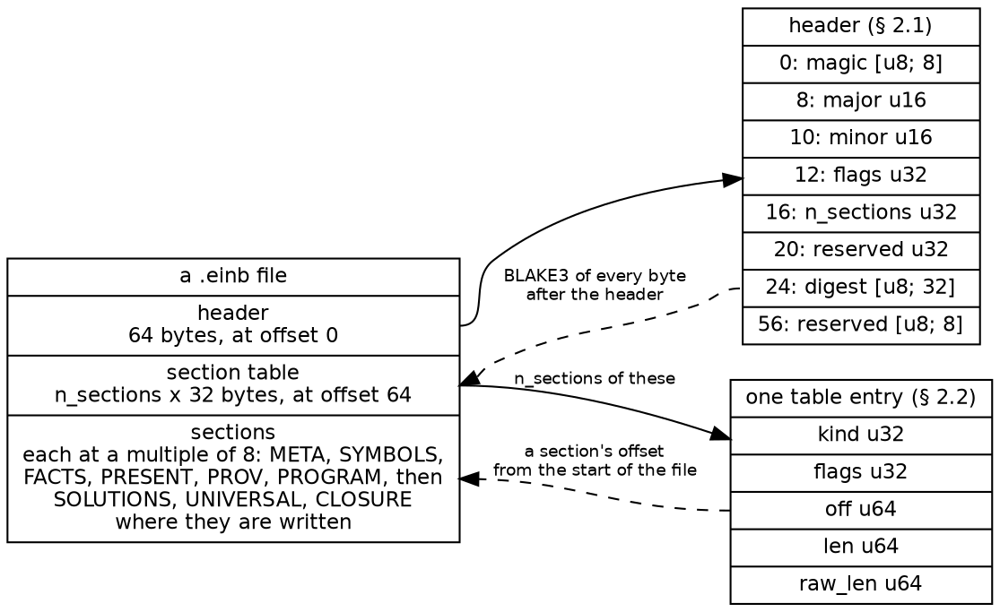
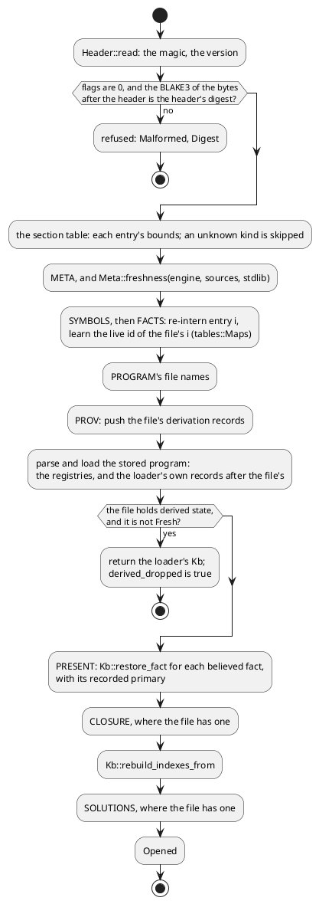

# The `.einb` container

This page specifies `.einb`, the file in which `ein.rs` stores a loaded, optionally saturated, knowledge base with its
interned tables and the program behind it, so that a later run opens it with no import resolution, no macro left to
expand and no filesystem walk. The crate is `ein-einb`:
[`lib.rs`](../../../../ein.rs/crates/ein-einb/src/lib.rs) (saving and opening),
[`header.rs`](../../../../ein.rs/crates/ein-einb/src/header.rs) (the header and the section table),
[`sections.rs`](../../../../ein.rs/crates/ein-einb/src/sections.rs) (each section's encoding),
[`tables.rs`](../../../../ein.rs/crates/ein-einb/src/tables.rs) (the id remap),
[`meta.rs`](../../../../ein.rs/crates/ein-einb/src/meta.rs) (what a file was made from),
[`solutions.rs`](../../../../ein.rs/crates/ein-einb/src/solutions.rs) (the solution store),
[`cast.rs`](../../../../ein.rs/crates/ein-einb/src/cast.rs) (the zero-copy casts) and
[`wire.rs`](../../../../ein.rs/crates/ein-einb/src/wire.rs) (the checked little-endian primitives). What a file
holds is the store of [`03-data-model.md`](03-data-model.md), serialised.

## 1. What it is for

**A private cache, never an interchange format.** `.ein` text is the only authoring format and the only thing anyone
edits; anything that crosses a tool boundary is `.ein` text or the JSON of the event protocol
([`05-events.md`](../05-events.md)). A container is one program's cache: an imported module that is a `.einb` is refused
at load, on every command ([Q-M1f.91](../../../decisions/imports/Q-M1f.91-an-imported-module-is-ein-text-and-a-einb.md)).
What it saves is the front end: parse, import resolution, macro expansion and load, the fixed cost every run pays
before it saturates or searches.

**Every command that takes a `.ein` takes a `.einb`.** Every command reads a program through one path,
`ein_ir::read::read_program`, which returns `Held::Text` or `Held::Container` by the file's first eight bytes
(`ein_ir::read::looks_like_einb` against `EINB_MAGIC`), never by its extension: a container named `x.ein` is opened
and a text named `x.einb` is parsed (`einb_cli.rs`: `a_container_is_recognised_under_any_name`). `ein-cli`'s
`common::read_program`, `load_held` and `parse_held` take either. A container answers as the program it stores:
its views draw the stored program
([Q-M1f.17](../../../decisions/cli/Q-M1f.17-a-view-of-a-container-draws-the-program-it.md)), its
`--dump-answer` directory is its source's
([Q-M1f.27](../../../decisions/cli/Q-M1f.27-a-containers-answer-directory-writes-the-program.md)), and a position
in it names `<program stored in x.einb>`
([Q-M1f.15](../../../decisions/diagnostics/Q-M1f.15-a-position-in-a-container-names-its-stored.md)).

**`ein solve x.einb` prints what `ein solve x.ein` prints**, byte for byte but for the path it echoes, with the same
stderr and exit code, where a fresh process opens the container: the identity path of § 3
([Q-M1a.22](../../../decisions/cli/Q-M1a.22-a-containers-solve-is-its-sources-byte-for-byte.md)).

**One command writes one.** `ein kb save FILE OUT.einb` loads `FILE` as every command does and writes the container;
by default it banks the **loaded** KB, which is why a solve of the container starts where a solve of the source does.
`--saturate` banks root's least fixpoint instead: another starting point, which reaches the same answer and is not
claimed byte-identical, because root's derivations are already there when the run starts. A `.einb` handed to `ein kb
save` is opened and saved again, keeping its sources and its state. `ein kb` is registered only in a build with the
`einb` feature, on by default; a build without it refuses a container with a `kb load error:` line. `ein --version`
prints the format a build reads on its `container` line, `einb/2.0`.

## 2. The container

Everything is little-endian and fixed-width, by the format's definition and not the host's.

The sections stand in the order the writer pushes them (`ein_einb::save_to_vec`); a reader finds each through the
table and depends on no order.

### 2.1 The header

| offset | field | type | rule |
|---|---|---|---|
| 0 | magic | `[u8; 8]` | `EINB\0\0\0\0` (`header::MAGIC`): four letters, a NUL and three pad bytes, so the fields after it are aligned |
| 8 | major | `u16` | must equal `header::FORMAT_MAJOR` |
| 10 | minor | `u16` | any; a later minor is a file this reader accepts |
| 12 | flags | `u32` | must be 0 |
| 16 | n_sections | `u32` | the section table's length |
| 20 | reserved | `u32` | must be 0 |
| 24 | digest | `[u8; 32]` | BLAKE3 of every byte after the header |
| 56 | reserved | `[u8; 8]` | must be 0 |

`header::HEADER_LEN = 64`. The digest covers everything after the header and not the header itself, so every header
field is either one that changes what the file claims to be, or a reserved word required to be zero, which leaves no
byte a flip can change unnoticed. `ein_einb::is_einb` and `ein_ir::read::looks_like_einb` test all eight magic bytes;
the two constants are compared by `einb_cli.rs`'s `the_two_magic_constants_agree`, and `ein-ir` keeps its own copy so
that a build without the container still recognises one in order to refuse it.

### 2.2 The section table

`n_sections` entries of `header::ENTRY_LEN = 32` bytes each, `header::Entry`:

| field | type | rule |
|---|---|---|
| `kind` | `u32` | a `header::Kind` number; an unknown one is skipped |
| `flags` | `u32` | reserved for per-section compression; must be 0, or the file is refused (`EinbError::Compressed`) |
| `off` | `u64` | the section's offset from the start of the file |
| `len` | `u64` | its length |
| `raw_len` | `u64` | its uncompressed length; must equal `len` |

The writer lays the table out before the bodies, since its size is known from the section count, and pads each body
to `header::ALIGN = 8`.

### 2.3 The sections

| kind | name | written | holds |
|---|---|---|---|
| 1 | `META` | always | what the file was made from (§ 4.3): the engine version, a writer string, the KB state (`Loaded`, `Saturated`, `Solved`), the stdlib digest, each source's path and BLAKE3 digest, and the `SolverConfig` in force field by field in `ein_core::config::FIELDS` order; no time |
| 2 | `SYMBOLS` | always | the interner in id order, as a string table: the count, the blob length, `count + 1` prefix-sum `u32` offsets, then the blob |
| 4 | `FACTS` | always | the fact store in id order: the row count, the argument count, the rows as `cast::RawRow { rel, args_at, arity }`, then the flat argument arena as `Value` bits |
| 5 | `PRESENT` | always | the believed facts in insertion order, as `FactId`s |
| 6 | `PROV` | always | the derivation records the KB references, then the primary map `(fact, record)` and the alternative lists `(fact, [record…])` |
| 7 | `PROGRAM` | always | the table of file names provenance positions refer to, then the resolved, import-flattened program as canonical text (`ein_ir::dump_canonical`) |
| 8 | `INDEXES` | never | known to the reader and skipped |
| 10 | `SOLUTIONS` | when the caller supplies one | § 6 |
| 11 | `CLOSURE` | when the KB has a closure entry | per believed fact with one: the fact, its closure, and its smallest-closure record if any |
| 12 | `UNIVERSAL` | when a record has some | per derivation record whose universal guards read facts, ascending by the record's position: the position and the facts |

Kinds 3 and 9 are retired and never reused, so a section of either kind is an unknown one and skipped. A reader
requires `META`, `SYMBOLS`, `FACTS`, `PROV` and `PROGRAM`, and `PRESENT` wherever it keeps the file's facts.

What the encodings decide:

- **A row on disk is not a row in memory.** `RawRow` is three `u32`s, 12 bytes with no padding
  (`cast.rs`: `a_row_is_twelve_bytes_with_no_padding`), and every argument goes to the arena, including the ones an
  in-memory `ein_core::facts::Row` holds inline. The format does not depend on `ein_core::facts::INLINE_ARGS`.
- **No presence bit set.** A fact is believed exactly when it is in `PRESENT`'s list, so storing the bit set beside
  it would store the list's membership twice, with room for the two to disagree.
- **The records kept** ([Q-M1f.110](../../../decisions/engine/Q-M1f.110-a-container-saved-again-is-the-same-container.md)):
  `sections::Kept` marks the last record any believed fact's primary, alternative or smallest-closure arrival cites,
  and the writer stores the arena up to it, each record at its own position, so no stored id moves. A record is its
  kind, the `:source` and rule symbols, the premises, the bindings as `(Symbol, Value)` bits, the negative premises
  (recursive patterns, refused past `MAX_NAF_DEPTH = 64` levels on read), the branch and the position. A record's
  `activator` is not stored: a container holds root's KB, and no core follows root's activators
  ([Q-M1e2.12](../../../decisions/answer/Q-M1e2.12-a-dead-nodes-core-follows-an-activator-only.md)). A fork-region
  id is never stored; `Kept` asserts it.
- **The program is text, not syntax arenas.** The canonical text is smaller than the arenas of the same forms, the
  front end already has its one serialiser, and the AST an open rebuilds is the parse of exactly these bytes, so every
  `ExprRef` the rebuilt registries hold indexes the AST that is there. What it costs is a parse of already-resolved
  text on open. The text carries every `:why`, `:source` and `:goal-text` as written
  ([Q-M1f.12](../../../decisions/read-out/Q-M1f.12-natural-language-text-reaches-a-fixed-set.md)).
- **No index is stored.** Every reverse index is a projection of the fact list in insertion order, and
  `Kb::rebuild_indexes` is the projection that defines it, so a rebuilt index is produced by the code that defines
  the original. The one exception is `rules_by_relation`, which is taken once at load and never extended: rebuilt from
  a saturated fact set it would be larger than the KB ever had, so the reader takes it from a fresh load of the stored
  program (`Kb::rebuild_indexes_from`). The equality classes are not stored either
  ([`03-data-model.md` § 10](03-data-model.md#10-equality-classes)).

### 2.4 Alignment and the zero-copy casts

Each section starts at a multiple of 8, and the arrays worth borrowing rather than decoding are laid out so that on a
little-endian host the file's bytes already are the array: the string offsets, the fact rows, the argument arena and
the fact-id lists. `cast::slice_of::<T>(bytes)` hands back `&[T]` over the file's own bytes, or `None`, and the
reader then decodes element by element (`Cow::Owned`). It checks three things rather than assuming them:

1. **Alignment.** The pointer is aligned for `T`, or `None`.
2. **Length.** The byte length is an exact multiple of `size_of::<T>()`; a trailing partial record is refused.
3. **Bit patterns.** `T` implements `cast::Pod`, an `unsafe` trait implemented for `u32`, `u64` and `RawRow` alone:
   `#[repr(C)]`, no padding, no invalid bit pattern. No type with a niche (`bool`, an `enum`, a `NonZero*`) is `Pod`,
   because a cast to one is undefined for a file holding the wrong byte, and that is the file the reader must survive.

On a big-endian target `slice_of` returns `None` always, so the bytes mean the same thing on every host.
`cast::Aligned` is a byte buffer backed by `Vec<u64>`, so its alignment is the allocator's guarantee rather than an
accident; `ein_einb::open(path)` reads the file into one, which makes the casts the path taken. `ein_einb::open_bytes`
accepts any slice and falls back to decoding where one is not aligned. The reader reads the whole file into memory and
does not map it; the layout is what a mapped file would need.

`cast.rs` is the one module of the workspace's libraries that contains `unsafe`: `ein-einb` is `#![deny(unsafe_code)]`
with `#![allow(unsafe_code)]` in that module alone, and it is the only library crate that is not
`#![forbid(unsafe_code)]`, because `forbid` cannot be lifted for one module and a crate boundary is what makes *exactly
one* hold ([`10-toolchain-and-layout.md`](10-toolchain-and-layout.md)). Every other read goes through `wire::Reader`, whose
every read is bounds-checked and returns `EinbError::Truncated` rather than panicking; `Reader::count` refuses a
count larger than the bytes left could hold, so a forged count cannot allocate the machine away.

## 3. Ids across the boundary

`Symbol`, `FactId` and `ProvId` are process-local integers ([`03-data-model.md` § 1](03-data-model.md#1-identity-and-what-it-costs)),
and a file must open into a process whose tables may already hold other names. Each id space is stored in id order,
so opening re-interns entry *i* and learns the live id of the file's *i*. That fills `tables::Maps`:

| table | from | maps |
|---|---|---|
| `sym` | `SYMBOLS` | a file's `Symbol` to the live `Symbol` |
| `fact` | `FACTS` | a file's `FactId` to the live `FactId` |
| `prov` | `PROV` | a file's record position to the live `ProvId` |
| `file` | `PROGRAM`'s file names | a `Loc`'s file index to the rebuilt AST's |

Every other section is translated through them in one linear pass. `Maps::value` keeps a stored `Value`'s tag and
moves its payload through the symbol or the fact table (`ein_core::Value::from_bits` reads the stored word);
`Value::UNBOUND` passes unchanged, and a word with the integer's tag bits is refused, `EinbError::Int`
([Q-M1f.10](../../../decisions/engine/Q-M1f.10-a-einb-file-holds-no-integer-table.md)). Rows are re-interned in
`FactId` order, so a nested argument always names an already-translated row; one that names a later row is refused,
checked on the file's id before the remap. An id past its table is `EinbError::BadId`, a fact listed twice in
`PRESENT` is malformed, and two rows that intern to one id are `EinbError::NotInjective`.

**The order of an open** is fixed by one fact: rebuilding the registries pushes the loader's own derivation records
into the arena. So the reader takes `META`, then `SYMBOLS` and `FACTS`, then `PROGRAM`'s file names, then `PROV`
(pushing the file's records), and only then parses and loads the stored program. In a fresh process the file's records
therefore land at their own positions, and the loader's records come after them, where nothing in the file refers to
them.

**The identity path is the normal one.** A fresh process opening one file re-interns into tables that hold only the
kernel's names, gets every id back as the file stored it, and `Maps::identity()`, which tests the symbol and fact
tables, is true: `Opened::remapped` is `false` and the translation is skipped. Every `ein` command is such a process,
so the CLI always takes it. A library caller that opens a container into a crowded `Terms` gets the same KB
renumbered and the same answer; its narration (which of two equal justifications was recorded first) may differ
([Q-M1a.22](../../../decisions/cli/Q-M1a.22-a-containers-solve-is-its-sources-byte-for-byte.md)). A container is
therefore position-independent and not interner-independent: it cannot be shared between processes as raw memory.

## 4. Versioning and invalidation

### 4.1 The format version

`header::FORMAT_MAJOR = 2` and `header::FORMAT_MINOR = 0`. The major moves on any change of layout, and a reader
refuses every major but its own, with `EinbError::Version` (`.einb format 1.2 — this engine reads 2.x`); a file of
another major is a cache to save again. The minor moves when a section kind is added, and a reader of the same major
skips a kind it does not know, which is what makes a minor additive. The numbers in `header::Kind` are on disk and are
never reordered; a retired number is never reused. Format 2 has no integer table and no time in `META`
([Q-M1f.10](../../../decisions/engine/Q-M1f.10-a-einb-file-holds-no-integer-table.md),
[Q-M1f.110](../../../decisions/engine/Q-M1f.110-a-container-saved-again-is-the-same-container.md)).

### 4.2 A file refused

`ein_einb::EinbError` names each way a file is not one this reader can open: `NotEinb` (the magic), `Version`,
`Digest` (the body does not match the header's BLAKE3), `Truncated`, `Malformed` (non-zero header flags or reserved
bytes, unsorted or unclosed string offsets, text that is not UTF-8, a forward fact reference, a fact believed twice,
an unknown provenance kind, a negative premise nested too deep, …), `BadId`, `MissingSection`, `Compressed`,
`Overflow` (re-interning ran out of ids), `Program` (the stored text does not parse or load, under the same
`ein_ir::LoadOptions` the `.ein` would load under), `NotInjective` and `Int`. A command prints it as a `kb load
error:` line with its load-error exit, 1 for `ein solve` and an `ERROR` row with 2 under `ein test`
(`einb_cli.rs`: `a_container_the_engine_cannot_read_fails_as_a_load_error`).

The digest is checked on every open unless the library caller turns `OpenOptions::verify_digest` off; no `ein`
command does. Without it the contract is weaker and still absolute: a damaged file is refused or opened, never a
panic, a hang or an unbounded allocation (`corruption.rs`: `damaged_bytes_never_panic_when_the_digest_is_not_checked`).

### 4.3 A file not believed

A file that opens can still describe a program other than the one on disk, or have been derived by another engine.
`META` records both, and `Meta::freshness(engine, sources, stdlib)` answers with `meta::Freshness`, asked in this
order:

| answer | when | what is believed |
|---|---|---|
| `OtherEngine` | `META`'s engine version is not the reader's (`meta::engine_version`, the workspace version) | `PROGRAM` only |
| `StaleStdlib` | the stdlib digest differs: BLAKE3 of `stdlib/MANIFEST.sha256` as the engine resolves it (`meta::stdlib_digest`, through `ein_ir::stdlib::resolve_default`) | `PROGRAM` only |
| `StaleSource` | a source the caller re-hashed has other bytes than `META` records | `PROGRAM` only |
| `Fresh` | none of the above | everything |

*`PROGRAM` only* applies to a file whose state holds something derived (`KbState::Saturated`, `Solved`): the reader
drops the derived sections and returns the loader's KB of the stored program, which is exactly what reading the
`.ein` would have produced (`Opened::derived_dropped`). A `Loaded` file has nothing derived to drop. A stale cache is
therefore a cache miss and never a different answer. A source the caller did not re-hash claims nothing, so a
container shipped without its source is not stale. The stdlib digest is BLAKE3 because it is a field of a binary
format; `ein --version` prints a SHA-256 of the same manifest for a reader with `sha256sum`
([`02-shared-assets.md`](02-shared-assets.md)).

The CLI re-hashes each source path `META` names that still exists, opens, and on any answer but `Fresh` prints
`warning: <path> was written under different inputs (<answer>)`, with `its derived state was dropped and the program
re-loaded` where it was, and carries on (`einb_cli.rs`: `an_edited_stdlib_is_a_cache_miss_rather_than_a_stale_hit`).

## 5. Saving and opening

| item | does |
|---|---|
| `ein_einb::save_to_vec(kb, terms, ast, forms, base_dir, opts)` | resolves the forms' imports against `base_dir`, writes the sections and the header; `save` writes the bytes to a path |
| `SaveOptions { state, sources, solutions }` | the `KbState` to record, the `meta::Source` digests, an optional `Solutions` |
| `ein_einb::open_bytes(bytes, terms, opts)`, `ein_einb::open(path, terms, opts)` | the open of §§ 3–4 |
| `OpenOptions { sources, verify_digest, engine, query, load, name }` | the inputs re-hashed now, the digest switch, the engine asking, which `(query …)` of the stored program the load is about, the load's requirements, and the container's name for positions |
| `Opened { kb, ast, forms, meta, freshness, derived_dropped, solutions, remapped }` | the KB, the AST its `ExprRef`s index, the stored program's top-level forms, and what the open decided |
| `ein_einb::meta_of`, `section_sizes`, `program_of`, `program_name` | `META` alone; each section's length; the stored program's text, the digest checked; the name positions in it carry |

The KB an open returns is built through four hooks of `ein_core::kb::Kb` that only a reader of a fact list uses:
`Kb::with_program` (a KB over the registries the stored program loaded to), `Kb::restore_fact` (believe an
already-interned fact with its recorded primary), `Kb::restore_alternatives` and `Kb::restore_closure` (reinstate a
list or a closure verbatim, rather than through `Kb::record_justification`'s policy, which would re-sort a sorted list
and re-cap a capped one), and then `Kb::rebuild_indexes_from`.

**A container saved again is the same container**, byte for byte
([Q-M1f.110](../../../decisions/engine/Q-M1f.110-a-container-saved-again-is-the-same-container.md)): `META` holds no
time, so a save is a function of the program, its state and the engine, and the records an open pushes for the loader
fall past the kept prefix. `ein kb save` of a container keeps its state, writing `Solved` as `Saturated` since it
stores no solutions and a dropped derived state as `Loaded`.

## 6. The solution store

`SOLUTIONS` (kind 10) is a section the format defines and no command writes. Its content is `solutions::Solutions`: a
`VerdictKind` (`Solution`, `Ambiguity`, `Contradiction`, `Aborted`, `Open`), an unsat core, counters
(`MonotonicStats` over `BaseStats`), and one `SolutionNode` per stored state:

| field of `SolutionNode` | holds |
|---|---|
| `state_key` | the state's canonical identity, its sorted fact list (`ein_infer::state_key`) |
| `delta` | the facts the state has and the file's KB does not, in the state's own insertion order |
| `bindings` | the goal's bindings per solution, in bind order |

A state is stored as its delta against the KB in the same file, not as a second KB, and
`SolutionNode::reconstitute(base)` is `base.fork()` plus the delta through `Kb::restore_fact`, the layered structure of
[`03-data-model.md` § 5](03-data-model.md#5-the-layered-kb). A delta fact gets no provenance of its own: a stored state is a
state, not a re-derivation, and inventing a justification would put a firing no rule performed into a trace.

Nothing in a run reads it. `ein kb save` passes `solutions: None`, the CLI's open discards `Opened::solutions`, and
`roundtrip.rs`'s `nothing_in_the_solve_path_reads_the_solution_store` fails if any source file of `ein-cli` reads a
`.solutions` field. A stored answer would memoise the puzzle rather than exercise the reasoner, so what a file carries
and what a run computes stay separable. The section's one writer is the library caller that supplies
`SaveOptions::solutions`, which today is `roundtrip.rs`'s `a_stored_solution_reconstitutes_the_model_it_was_taken_from`.

## 7. Tests

| file | holds |
|---|---|
| [`ein-einb/tests/roundtrip.rs`](../../../../ein.rs/crates/ein-einb/tests/roundtrip.rs) | `every_corpus_entry_round_trips_into_an_empty_and_a_shared_interner`: every corpus program that loads, saved and opened into an empty `Terms` (the identity path taken, and `Kb::diff` clean) and into a crowded one (remapped, and `ein_core::shape` the same text); `a_saturated_kb_round_trips_with_its_derivations`; `a_saturated_zebra2_is_under_80_kb_and_opens_cold_under_6_ms_or_20_with_assertions`, a size ceiling and an open-time ceiling on one saturated container; `a_stored_solution_reconstitutes_the_model_it_was_taken_from`; `nothing_in_the_solve_path_reads_the_solution_store` |
| [`ein-einb/tests/invalidation.rs`](../../../../ein.rs/crates/ein-einb/tests/invalidation.rs) | `a_fresh_file_is_believed_whole`, `another_engine_keeps_the_program_and_drops_the_derived_sections`, `an_edited_source_is_a_cache_miss_and_says_so`, `a_stdlib_that_moved_under_the_file_is_a_cache_miss`, `not_looking_at_the_sources_is_not_evidence_that_they_moved`, `a_file_that_holds_an_integer_is_refused` (no kind 3 written, a 1.x header refused, a value with the integer's tag refused) |
| [`ein-einb/tests/corruption.rs`](../../../../ein.rs/crates/ein-einb/tests/corruption.rs) | `a_good_file_opens_and_every_truncation_of_it_does_not`, `a_single_flipped_bit_anywhere_is_caught_by_the_digest`, `damaged_bytes_never_panic_when_the_digest_is_not_checked`, `arbitrary_bytes_are_refused_and_never_mis_parsed` (its budget raised by `EIN_EINB_FUZZ_ITERS`), `an_unknown_section_kind_is_ignored_rather_than_refused`, `a_newer_major_version_is_refused`, `a_file_that_is_not_one_is_told_apart_by_its_first_bytes` |
| [`ein-cli/tests/einb_cli.rs`](../../../../ein.rs/crates/ein-cli/tests/einb_cli.rs) | `a_solve_of_a_container_is_byte_identical_to_a_solve_of_its_source`, `the_answer_directory_of_a_container_is_its_sources`, `the_diagnostic_flags_agree_too` (`--stats`, `--trace`, `--explain`, `--final-state`, `--dump-config`), `a_saturated_container_reaches_the_same_verdict`, `an_edited_stdlib_is_a_cache_miss_rather_than_a_stale_hit`, `a_container_is_recognised_under_any_name`, `a_container_the_engine_cannot_read_fails_as_a_load_error`, `a_container_is_not_larger_than_the_program_it_replaces`, `what_the_cli_writes_is_a_file_the_library_recognises`, `the_two_magic_constants_agree`, `a_container_saved_again_is_the_container` |
| unit tests | `cast.rs`: `a_row_is_twelve_bytes_with_no_padding`, `a_cast_refuses_a_partial_record_and_a_misaligned_start`, `the_round_trip_through_bytes_is_the_identity`, `an_aligned_buffer_is_aligned`; `tables.rs`: `a_fresh_table_is_the_identity_and_a_permuted_one_is_not`, `a_value_keeps_its_tag_and_moves_its_payload` |

What *identical* means in a round trip is `ein_core::kb::Kb::diff`: both KBs materialised, then compared field by
field, fact order, belief, the negated set, every index, the primary map, the alternative lists, closures and
smallest-closure arrivals, so the answer is about content and not about how many forks either went through. Elsewhere
the container is one of the ways every command reads a program: `ein-cli/tests/program_read.rs`'s
`every_command_answers_a_program_its_container_and_a_file_relative_import` and
`a_containers_positions_name_its_stored_program`, `natural_language_text.rs`'s `a_container_holds_the_texts`, and
`cli_semantics.rs`'s `a_file_that_starts_like_a_container_but_is_not_one_is_text_in_either_build`.
