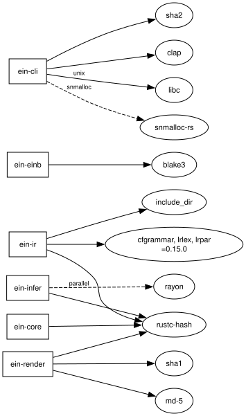
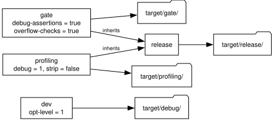
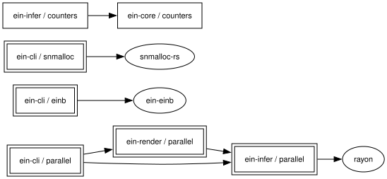
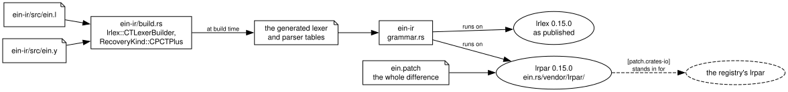

# Toolchain and layout

The `ein.rs/` workspace: its crates and how they stack, what a crate may depend on and where `unsafe` may appear, the
features, the build profiles, the vendored parser runtime, and how the tests, the benchmarks and the binary's own
report of itself are laid out.

## 1. The workspace

[`ein.rs/Cargo.toml`](../../../../ein.rs/Cargo.toml) is one workspace of eight crates, edition 2024, version `0.1.0`,
built with the toolchain [`rust-toolchain.toml`](../../../../ein.rs/rust-toolchain.toml) pins. Six crates ship:

| crate | holds |
|---|---|
| `ein-core` | interning, `Value` and `FactId`, the layered copy-on-write KB, provenance, the work counters ([`03-data-model.md`](03-data-model.md)) |
| `ein-ir` | the generated parser, macro expansion, import resolution, the loader, the stdlib's resolution ([`04-ir-frontend.md`](04-ir-frontend.md), [`02-shared-assets.md`](02-shared-assets.md)) |
| `ein-infer` | compile, match, saturate, the boundary, hypothesis generation and the routes over R ([`05-matcher.md`](05-matcher.md), [`06-saturation.md`](06-saturation.md), [`07-search.md`](07-search.md)) |
| `ein-einb` | the `.einb` container ([`09-binary-format.md`](09-binary-format.md)) |
| `ein-render` | the DOT views, the read-out, the trace, the dumps, the JSON summary, the structure's document and graphs |
| `ein-cli` | the `ein` binary and its library `ein_cli::run` |

Two are dev-only, `publish = false`, and no shipped crate depends on them: `ein-corpus`, the corpus manifest, the
fixture helpers, the worker pool the corpus sweeps share and the benchmark set; and `ein-narration`, the one
definition of what counts as a derivation's narration rather than its content ([`../05-events.md`](../05-events.md)).

The shipped crates stack linearly up to `ein-infer` and fork there: `ein-ir` over `ein-core` and `ein-infer` over `ein-ir`, then `ein-einb`
and `ein-render` as siblings over `ein-infer`, and `ein-cli` over both. A crate never depends on one above it, which is
why a doc comment in `ein-ir` names an `ein-infer` item in backticks rather than linking it. The crate and module map
is [`../01-architecture.md`](../01-architecture.md).

## 2. Dependency policy

A dependency is taken from the registry, at a declared version, through `[workspace.dependencies]` where more than
one crate takes it; [`ein.rs/deny.toml`](../../../../ein.rs/deny.toml) admits only registry sources and permissive
licences, denies wildcard versions and yanked releases. The engine's own dependencies are few and each has one job:
`rustc-hash` (the hash containers), `include_dir` (the embedded stdlib), `cfgrammar`, `lrlex` and `lrpar` at exact
versions (the generated parser), `rayon` (the route workers, behind `parallel`), `blake3` (the container's digests),
`md-5` and `sha1` (the digests the renderers write), `sha2` (`ein --version`'s stdlib digest), `clap` (the command
line), `libc` (one call, below) and `snmalloc-rs` (the binary's allocator, behind `snmalloc`).

Which of the six shipped crates takes which, from each manifest's `[dependencies]`; a dashed edge is an optional
dependency, behind the feature named on it. `lrpar` is the vendored copy (§ 6), and `ein-ir`'s build script takes
`lrlex` and `lrpar` again as `[build-dependencies]`.

**Every library crate is `#![forbid(unsafe_code)]`** but `ein-einb`, which is `deny` with one module allowed:
[`cast.rs`](../../../../ein.rs/crates/ein-einb/src/cast.rs), the zero-copy reads of an aligned container, audited as
such ([`09-binary-format.md`](09-binary-format.md)). The one other `unsafe` the engine ships is the binary's:
`ein-cli/src/main.rs`, a crate root outside `lib.rs`'s `forbid`, calls `libc::signal(SIGPIPE, SIG_DFL)` once, as
`main`'s first statement, so a closed stdout ends `ein` as it ends `cat`
([Q-M1f.68](../../../decisions/cli/Q-M1f.68-a-closed-stdout-ends-ein-by-sigpipe.md)). The engine crates write
nothing to stdout, and none runs an async runtime: the engine is synchronous and `Send`.

## 3. Build profiles

| profile | what it is |
|---|---|
| `dev` | the default debug build, at `opt-level = 1` |
| `release` | the shipped binary |
| `gate` | `release` codegen with `debug_assert!` and overflow checks on, which every test tier builds: the tests run optimised and still check the engine's assertions |
| `profiling` | `release` with line-level debug information and symbols kept, for a profiler |

The vendored allocator's C++ build keeps its own optimisation in every profile (the `snmalloc-sys` overrides), so a
profile's assertions or debug information never slow the allocator.

## 4. Feature flags

| feature | crate | default | |
|---|---|---|---|
| `parallel` | `ein-infer`, forwarded by `ein-render` and `ein-cli` | on | the route workers, `rayon`; off, `--jobs` is accepted and inert ([`08-parallelism.md`](08-parallelism.md)) |
| `counters` | `ein-core`, forwarded by `ein-infer` | off | the work counters, compiled out entirely when off |
| `einb` | `ein-cli` | on | `ein kb` and the `.einb` reader: every command that takes a `.ein` path takes a container |
| `snmalloc` | `ein-cli` | on | the global allocator, on the **binary** only: a library that installed one would make the choice for everything that links it |

What each feature turns on, read off the `[features]` tables. A double border is a feature in its crate's
`default`; `ein-cli` takes `ein-infer` and `ein-render` with `default-features = false`, so its own `parallel` is
the only switch on theirs in a build of the binary.

**A crate that forwards a job count forwards `parallel`**, so that a build without the pool cannot accept a `jobs`
argument and silently ignore it; `ein-cli` takes `ein-infer` and `ein-render` without their defaults and forwards
the feature, which is what lets `--no-default-features` on the binary drop `rayon`. `--no-default-features` builds
the binary against the system allocator, with no container and no worker pool, and needs no C++ toolchain.
`ein_infer::build::features` lists what a build has, and `ein --version` prints it (§ 7).

## 5. The tests

Each crate's tests live beside it: unit tests in its modules, integration tests under its `tests/`, and the goldens
a test pins under that crate's `tests/golden/`, beside the crate it pins
([Q-M1a.9](../../../decisions/corpus/Q-M1a.9-a-golden-lives-beside-the-crate-it-pins.md)). What reads the whole
corpus reads it through `ein-corpus` ([`02-shared-assets.md`](02-shared-assets.md)) and hands its loop to
`ein_corpus::pool::map`, whose units run on `EIN_TEST_JOBS` workers and come back in the units' order, so a verdict
never depends on the worker count. Some families worth knowing:

- **behaviour**: `ein-ir/tests/ir_semantics.rs`, the language's behaviour stated as tests; `ein-infer`'s
  `naf_semantics.rs`, `stdlib_semantics.rs`, `explore.rs` (every mode held to the oracle) and `stdlib_coverage.rs`
  (every stdlib rule activated by a program under `tests/stdlib/`);
- **invariance**: `ein-render/tests/id_order_invariance.rs` and `jobs_invariance.rs`
  ([`01-determinism-and-order.md`](01-determinism-and-order.md)), `ein-cli/tests/lever_invariance.rs` (no configuration
  option changes R) and `import_invariance.rs` (no import form changes the answer);
- **pages**: the tests that hold a page of the documentation to the code, `ein-cli/tests/embedding.rs`
  ([`../04-api.md`](../04-api.md)), `events_reference.rs` ([`../05-events.md`](../05-events.md)), `ein-ir/tests/grammar_pages.rs`;
- **the fuzzer**: `ein-ir/tests/fuzz_properties.rs`, a property-based fuzzer over the parser and the loader, seeded
  by `EIN_FUZZ_SEED` and run for `EIN_FUZZ_ITERS` cases. A case it ever found is banked as a fixture under
  [`corpus/fuzz_findings/`](../../../../corpus/fuzz_findings/README.md), and every seed's and finding's text is quoted
  in `ein-ir/tests/golden/fuzz_seeds.txt`.

## 6. The vendored parser runtime

`ein-ir`'s parser is generated by grmtools from the grammar ([`04-ir-frontend.md`](04-ir-frontend.md)). `lrpar`, its
runtime, is vendored under [`ein.rs/vendor/lrpar/`](../../../../ein.rs/vendor/lrpar/README.md), outside the
workspace (`exclude = ["vendor"]`) and put in the registry's place by `[patch.crates-io]`. The vendored copy is the
published release with one local patch, `ein.patch`, which makes error recovery deterministic
([Q-M1e2.25](../../../decisions/engine/Q-M1e2.25-the-parser-is-generated-from-the-grammar.md)); the copy is changed
only through that patch. `lrlex` is used as published
([Q-M1f.8](../../../decisions/engine/Q-M1f.8-the-lexer-is-lrlexs-unpatched.md)).

## 7. What a binary says it is

`ein --version` ([`ein-cli/src/version.rs`](../../../../ein.rs/crates/ein-cli/src/version.rs)) prints five lines,
because a version number alone does not say what a run will do:

| line | |
|---|---|
| `ein 0.1.0` | the crate version |
| `protocol` | the event protocol a `--events` file will declare, `ein-events/1` |
| `container` | the `.einb` major.minor this build reads, or `none` without `einb` |
| `features` | the features compiled in (§ 4), or `none` |
| `stdlib` | SHA-256 of `stdlib/MANIFEST.sha256` as resolved, and which source answered with its directory ([`02-shared-assets.md`](02-shared-assets.md)) |

The stdlib line's digest is the one `sha256sum stdlib/MANIFEST.sha256` gives, so a reader can check a binary against
a checkout with a command they already know; the container's digest of the same bytes is BLAKE3, a field of a binary
format.

## 8. Benchmarks

[`ein-corpus/benches/engine.rs`](../../../../ein.rs/crates/ein-corpus/benches/engine.rs) is the benchmark set, run by
`cargo bench`: parsing, the load path, root's saturation, the matcher over a saturated root, the boundary, a fork, and the routes answering
`-n 1` and `--single`. A page of the project states no measurement
([Q-M1f.349](../../../decisions/docs/Q-M1f.349-a-page-of-the-project-states-no-measurement.md)); a benchmark's result
is the machine's and the moment's.
