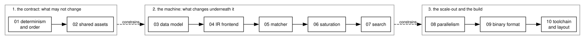

# Design contracts

The contracts `ein.rs` is built to: what each part of the engine guarantees, how it is laid out, and why. The crates
cite these pages as their specification; each states the engine as it is and names the tests that hold it.

## Reading order

Three groups, each constraining the next:

1. **The contract**: what may not change.
   [Determinism and order](01-determinism-and-order.md), then [Shared assets](02-shared-assets.md).
2. **The machine**: what changes underneath it.
   [Data model](03-data-model.md), [IR frontend](04-ir-frontend.md), [Matcher](05-matcher.md),
   [Saturation](06-saturation.md), then [Search](07-search.md).
3. **The scale-out and the build.**
   [Parallelism](08-parallelism.md), [Binary format](09-binary-format.md), then
   [Toolchain and layout](10-toolchain-and-layout.md).

The same order as a picture: a solid arrow is *read next*, and a dashed one is a group constraining the group
after it.

The first group is not a preamble: every choice in the second is legal only because the first can prove it changed
nothing, so a claim such as *this preserves the match order* in [`05-matcher.md`](05-matcher.md) is enforced by
[`01-determinism-and-order.md`](01-determinism-and-order.md).

## What each page settles

| page | settles |
|---|---|
| [`01-determinism-and-order.md`](01-determinism-and-order.md) | what a run's output may depend on, the ordered containers, the order-sensitive sites and the structure that fixes each, the value renderer, the tests |
| [`02-shared-assets.md`](02-shared-assets.md) | one stdlib and one corpus: the stdlib's resolution, drift between its copies, the corpus manifest |
| [`03-data-model.md`](03-data-model.md) | symbols, `Value`, `FactId`, the fact store, the layered copy-on-write KB, the indexes, provenance, the record shapes |
| [`04-ir-frontend.md`](04-ir-frontend.md) | the generated parser, the AST arena, parse errors, macros, imports by full name, the loader, the dumper |
| [`05-matcher.md`](05-matcher.md) | a rule compiled per activator to a plan, the register machine, candidate selection, which optimisations are legal |
| [`06-saturation.md`](06-saturation.md) | the two-phase loop, the agenda, the delta and the boundary, a node resumed from root, firing and alternatives |
| [`07-search.md`](07-search.md) | the hypothesis set, the node function, the licences, each question's route, a state's identity, cores, the static check |
| [`08-parallelism.md`](08-parallelism.md) | the `--jobs` contract, what runs in parallel, what must be `Sync` and how |
| [`09-binary-format.md`](09-binary-format.md) | the `.einb` container: layout, ids across the boundary, versioning, the zero-copy reads |
| [`10-toolchain-and-layout.md`](10-toolchain-and-layout.md) | the workspace, the dependency policy and `unsafe`, profiles, features, the tests, the vendored parser runtime, `ein --version` |

## What the answer rests on

Four premises an argument about the answer may stand on, because each is enforced
([Q-M1e.2](../../../decisions/docs/Q-M1e.2-an-argument-is-enough-only-when-its-premise-is.md)). The reasoning states
each premise and what it carries; this implementation holds it by a test or a check that fails when the premise
stops being true.

| premise | what it carries | stated in | enforced by |
|---|---|---|---|
| everything Ein lists, it lists in an order of the objects' content | a run's output is the same run after run, and under any job count | [firing a rule § The main steps](../../reasoning/02-kb-evolution/01-firing.md#the-main-steps) | the tests of [`01-determinism-and-order.md` § 9](01-determinism-and-order.md#9-the-tests-that-hold-it), which fail on an order that differs ([Q-M1a.7](../../../decisions/engine/Q-M1a.7-a-job-count-moves-nothing-a-run-prints.md)) |
| *dead is upward-closed* on a program with no site: a commitment whose state holds a contradiction stays dead under every larger one | no state above a dead commitment is in the answer, licence L1 of [`07-search.md` § 3](07-search.md#3-the-licences) | [solution semantics § 1.6](../../reasoning/02-kb-evolution/06-solution-semantics.md#16-monotone) and [a refutation resting on an `absent`](../../reasoning/02-kb-evolution/03-absent-and-naf.md#a-refutation-resting-on-an-absent) | the **static check**, which gives the licence to no program with a site, and two tests that fail when it does: every mode against the oracle's cube on every corpus program, and the programs whose refutation rests on an `absent` a commitment can still fill, each flagged and answered with no licence ([`07-search.md` § 7](07-search.md#7-monotone-and-flagged-programs), [Q-M1f.564](../../../decisions/answer/Q-M1f.564-a-non-monotone-program-loads-with-a-warning.md)) |
| *no rule asserts a name the program lacks* | the candidates Ein can guess are made of the program's names alone | [saturation § The alive-set invariant](../../reasoning/02-kb-evolution/02-saturation.md#the-alive-set-invariant) | a test that fails when a run reaches a name outside them ([`07-search.md` § 1](07-search.md#1-hypothesis-generation); [Q-M1e.21](../../../decisions/hypotheses/Q-M1e.21-a-rule-brings-in-no-name.md), [Q-M1e2.9](../../../decisions/language/Q-M1e2.9-a-programs-names-are-the-constants-its-facts.md)) |
| *names are never merged*: equality is name identity | no match reads past a name to an equal one | [the knowledge base § Identity](../../reasoning/01-static-ir/01-knowledge-base.md#identity) | a test that the store's equality classes stay inert and no matcher reads them ([`03-data-model.md` § 10](03-data-model.md#10-equality-classes); [Q1](../../../decisions/language/Q1-the-knowledge-base-is-a-hypergraph-of-atoms.md)) |

A premise nothing enforces is not one of these: an argument that rests on it is not accepted until something fails
when it stops being true, and the test cited for a premise is one that asserts the premise itself, not a claim next
to it.

## Conventions

- **A snippet of Rust is the code's**: a type, a field or a function named here exists under that name; a page that
  drifts from the code is wrong, and the code wins.
- **A size is the code's** and is named with the type or constant that fixes it, never a measurement of a run.
- **A decision is cited by its file** under [`docs/decisions/`](../../../decisions/README.md); a page states what
  holds and the decision says why it was chosen.
