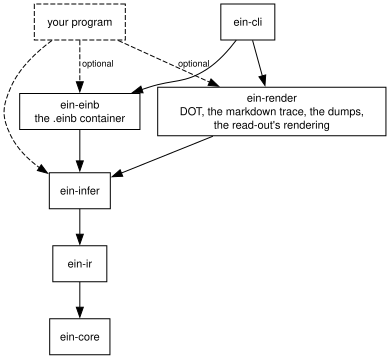
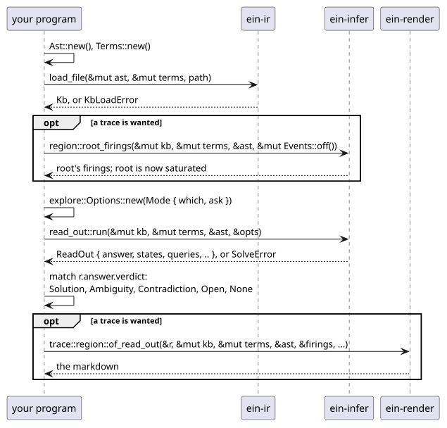

# Embedding the crates

How to drive the engine **as a library from another Rust program**: load a `.ein` program, ask a question about
its answer, the region `R`, and read what came back with its explanation. This page is the programmatic contract:
the crates a `Cargo.toml` adds and the functions it calls. The crates' structure is
[`01-architecture.md`](01-architecture.md); the design contracts under it are [`03-design/`](03-design/README.md).

**This page's example is a test.** The code in § 3 is the region of
[`ein.rs/crates/ein-cli/tests/embedding.rs`](../../../ein.rs/crates/ein-cli/tests/embedding.rs) between its two
`page` markers. Three of that file's tests hold this page to it: `the_page_quotes_this_file` diffs the code block,
`the_page_quotes_this_files_prose_too` diffs the paragraph after the output that names the tests, and
`the_page_and_the_file_name_the_same_tests` resolves every test name printed here against a `fn` that exists, in
both directions. So the example compiles, runs and prints the output shown, under `cargo test --workspace`.
**Edit the test, run it, paste; never edit the code block by hand.**

## 1. The crates

The crates are not published to a registry. A program depends on them by path, from a checkout:

```toml
[dependencies]
ein-core   = { path = "../ein/ein.rs/crates/ein-core" }
ein-ir     = { path = "../ein/ein.rs/crates/ein-ir" }
ein-infer  = { path = "../ein/ein.rs/crates/ein-infer" }
ein-render = { path = "../ein/ein.rs/crates/ein-render" }   # optional
ein-einb   = { path = "../ein/ein.rs/crates/ein-einb" }     # optional
```

Six crates ship and two are dev-only (`ein-corpus`, `ein-narration`, both `publish = false`). They stack linearly up
to `ein-infer` and fork there:



An arrow is *depends on*; each crate also names the crates below the one it points at, and the full graph of the
manifests is [`01-architecture.md` § 1.2](01-architecture.md#12-the-eight-crates).

Every library crate is `#![forbid(unsafe_code)]` except `ein-einb`, which is `deny` with one module allowed,
`cast.rs`, the zero-copy reads ([`03-design/09-binary-format.md`](03-design/09-binary-format.md)). The one other `unsafe` the
engine ships is the binary's: `ein-cli/src/main.rs`, a crate root outside `lib.rs`'s `forbid`, calls
`libc::signal(SIGPIPE, SIG_DFL)` once, as `main`'s first statement, so a closed stdout ends `ein` as it ends `cat`
([Q-M1f.68](../../decisions/cli/Q-M1f.68-a-closed-stdout-ends-ein-by-sigpipe.md)). A program that embeds the crates
keeps its own disposition: the library `ein_cli::run` leaves it alone, and the engine crates write nothing to stdout
(`ein-core`, `ein-ir`, `ein-infer`, `ein-einb` and `ein-render` hold no `print!`). **There is no async runtime**:
the engine is synchronous and `Send`, and `--jobs N` is a `rayon` pool built inside a route
([`03-design/08-parallelism.md`](03-design/08-parallelism.md)).

## 2. The five steps

| step | entry | crate |
|---|---|---|
| 1. arenas | `Ast::new()`, `Terms::new()` | `ein-ir`, `ein-core` |
| 2. load | `ein_ir::load_file(&mut ast, &mut terms, path)`, or `ein_ir::parse` then `ein_ir::load` | `ein-ir` |
| 3. saturate *(optional)* | `ein_infer::region::root_firings`, or `Saturator::new(&mut session)` and `.saturate(…)` | `ein-infer` |
| 4. ask | `ein_infer::read_out::run(&mut kb, &mut terms, &ast, &opts)`, or `ein_infer::explore::run` for the answer without its states read | `ein-infer` |
| 5. read | `ReadOut` (`answer`, `states`, `queries`); `ein_render::trace::region::of_read_out` for the trace | `ein-infer`, `ein-render` |

The five steps as the calls of § 3's example, in order. The caller owns the two arenas and the KB and lends them
to every call; nothing is kept between calls but what those three hold.



### 2.1 The two arenas

`Ast` owns the parsed forms; `Terms` owns the interned names and facts. Both outlive the KB and are threaded through
by `&mut`, because loading and solving both intern. A `Kb` means nothing without the `Terms` it was built against: a
fact is a row of `Value`s, the code's word for objects (an atom or a fact,
[Q-M1f.379](../../decisions/language/Q-M1f.379-an-object-is-a-node-of-the-knowledge-base-graph.md)), whose text
lives in the interner ([`03-design/03-data-model.md`](03-design/03-data-model.md)).

### 2.2 Load

`ein_ir::load_file` is parse, macro expansion, import resolution and KB construction in one call, resolving a local
module's name against the program file's directory. Where `std.*` comes from is
[`ein_ir::stdlib`](../../../ein.rs/crates/ein-ir/src/stdlib.rs)'s three steps: `$EIN_STDLIB`, a `stdlib/` found by
walking up from the executable, then the copy compiled in; `ein --version` prints which one answered
([`03-design/02-shared-assets.md`](03-design/02-shared-assets.md)).

For a caller that already has the text, `ein_ir::parse(&mut ast, text, filename)` returns the top-level forms and
`ein_ir::load(&mut ast, &mut terms, &forms, base_dir)` builds the KB. Both errors are structured values, not strings
to parse again: `ParseError` carries every error recovery reached, each with its line, column, notes and ranked
repairs ([`03-design/04-ir-frontend.md`](03-design/04-ir-frontend.md)), and `KbLoadError` the accumulated problems. That is what
linking gives a caller that the binary does not: the CLI hands back an exit code and lines of text.

### 2.3 Saturate (optional)

A route saturates root itself, so a caller reaches for this only to have the deductive closure without the search,
what the rules alone derive, or, as the example does, root's own firings for a trace.
`ein_infer::region::root_firings` saturates root in place and returns them, and a route run on that root afterwards
finds it saturated and leaves it as it is. Below it is `Saturator`, which runs inside a `Session`, the bundle of KB,
terms, AST, events and plan memo the engine's phases share ([`03-design/06-saturation.md`](03-design/06-saturation.md)).

> **`Saturator::is_stalled` is not a read.** It asks a question and changes the answer to later ones: a full
> enqueue pass runs first, since a caller may have written facts to the KB outside `step`'s flow and a stale queue
> would be a wrong answer rather than a cheap one, and that pass **advances the tiebreaker**, the FIFO position of
> every candidate enqueued after it. So a drive that probes quiescence can fire the same rules in a different order
> from one that does not. Nothing in the engine calls it; a caller that drives `step` itself probes at a boundary
> it is willing to have observed.

### 2.4 Ask

The answer is the **region `R`**, the commitments whose state is alive and discharged
([Q-M1e2.7](../../decisions/answer/Q-M1e2.7-the-answer-is-a-region-r-of-the-hypothesis.md)). A question about it is
an `explore::Mode`, the two axes `ein solve` has: which part of `R` (`Which::All`, `Minimal`, `Maximal`) and what is
asked of it (`Ask::Describe`, `Find(n)`, `Single`, `Count`). Each is answered with the least work it needs, by one
of the routes of [`ein_infer::explore`](../../../ein.rs/crates/ein-infer/src/explore.rs)
([Q-M1e2.31](../../decisions/answer/Q-M1e2.31-each-question-about-r-does-the-least-work-it.md),
[`03-design/07-search.md`](03-design/07-search.md)). Every route uses one node function, so no two questions read one commitment
differently, and every answer is held to the oracle by `ein-infer/tests/explore.rs`
([Q-M1e2.32](../../decisions/answer/Q-M1e2.32-no-two-commands-disagree-and-the-oracle-is.md)). There is one
answering path, the one `ein solve` takes.

`explore::Options::new(mode)` takes the defaults `ein solve` takes. The fields an embedder sets:

| field | |
|---|---|
| `budget` | facts beyond root, their `open` facts aside, summed over every fixpoint the run computes: `--region-budget`, [$2^{20}$ by default](../../decisions/cli/Q-M1e2.35-the-default-region-budget-is-2-20-facts.md). A run that reaches it stops and says what it established, with `exhausted` false; it never changes an answer |
| `limit` | the largest `n` whose whole cube a program the static check flags gets: `--region-limit` |
| `jobs` | `> 1` fans the nodes out over threads, with the same answer. Inert without the `parallel` feature |
| `deadline` | `-T`: an `Instant`, past which the run is an error, never an answer |
| `cores` | which dead nodes' cores the run takes beyond root's and the minimal holes', which the read-out prints (`region::Cores`): `visited`, each dead node the run visits, for a watch that reads them as `--events` and `--dump-lattice` do; `nogoods`, each member of `N` under describe, for `--dump-answer` and `--trace`, which refuse a member without one. A core is an explanation search and can cost far more than its node, so `Options::new` takes neither, as `ein solve` does; no answer depends on it ([Q-M1f.6](../../decisions/answer/Q-M1f.6-a-core-is-an-explanation.md)) |

`read_out::run` is `explore::run` plus every listed state read through the node function: each state's `(model …)`
and each `(query …)`'s projection classes. `read_out::run_with` and `explore::run_with` take an `Events` narrator:
`Events::off()` is the one that does nothing, and `Events::to(sink, level)` writes the
[`--events` protocol](05-events.md).

### 2.5 Read

`--single`'s word is `answer.verdict`: `Solution` (`R` is one state), `Ambiguity` (two or more; `states` holds two),
`Contradiction` (`R` is empty and every node is dead) or **`Open`** (`R` is empty and every alive node owes an
obligation the program stated). `Open` is the arm an embedder is most likely to mis-file, because `R` is empty
exactly as it is for a `Contradiction`, and it means *not yet a model* where `Contradiction` means *no model*
([Q-M1d.6](../../decisions/answer/Q-M1d.6-contradiction-is-said-only-where-no-node-is.md)). `None` means a budget or
the deadline stopped the run before it decided.

A described `R` is `answer.described`: its states with their commitments and lines, its counts (`k_s`, `k_c`), `N`,
root's own debts and core, and how the run was partial if it was. The bindings come from **each state's own
fixpoint**, not from root: `queries[i].classes` are a query's projection classes over the states listed, each with
its binding rows and the rows rendered through the query's `:goal-text`. A root whose fixpoint is dead carries its
unsat core in `described.root.core`: the source frontier that forces the conflict, not the conflicting facts
themselves.

For the narrative, `ein_render::trace::region::of_read_out` writes the markdown `ein solve --trace out.md` writes:
root's derivation, then each listed state's from its first minimal commitment, then `N`.

## 3. Worked example

```rust
use std::path::Path;

use ein_core::Terms;
use ein_infer::events::Events;
use ein_infer::explore::{self, Ask, Mode, Verdict, Which};
use ein_ir::Ast;

/// Ask whether one `.ein` file's answer is one state, and report it, as a
/// downstream crate would.
fn run(path: &Path) -> Result<String, String> {
    // 1 — the two arenas. `Ast` owns the parsed forms, `Terms` the interned
    //     symbols and values; both outlive the KB and are passed by `&mut`
    //     everywhere, because loading and solving both intern.
    let mut ast = Ast::new();
    let mut terms = Terms::new();

    // 2 — load: parse, expand macros, resolve `(import std.*)` against the
    //     file's directory, and build the KB. `ein_ir::parse` + `ein_ir::load`
    //     is the same thing in two steps, for a caller that has the text.
    let mut kb = ein_ir::load_file(&mut ast, &mut terms, path).map_err(|e| e.to_string())?;
    let loaded_facts = kb.n_facts();

    // 3 — root's derivation, kept for step 5's trace. The run below finds
    //     root saturated and leaves it as it is; a caller that wants no trace
    //     skips this.
    let firings = ein_infer::region::root_firings(&mut kb, &mut terms, &ast, &mut Events::off())
        .map_err(|e| e.to_string())?;

    // 4 — ask. A question is a `Mode`: which part of R (all of it, the
    //     minimal line, the maximal line) and what is asked of it (describe
    //     it, `Find(n)` states, or `Single`: is it exactly one state?). The
    //     read-out answers it and reads every state it lists — each state's
    //     `(model …)` and each query's projection classes over them.
    let opts = explore::Options::new(Mode {
        which: Which::All,
        ask: Ask::Single,
    });
    let r =
        ein_infer::read_out::run(&mut kb, &mut terms, &ast, &opts).map_err(|e| e.to_string())?;

    // 5 — read. `verdict` is `None` only when a budget stopped the run before
    //     it decided, so a caller that never sets one still has to name it.
    let mut out = format!("loaded {loaded_facts} facts\n");
    match r.answer.verdict {
        Some(Verdict::Solution) => {
            // R's one state: the positive facts of the candidates' relations,
            // and the query's rows in it — `(query …)` asked of the state, not
            // of root, which would answer nothing.
            out += &format!("one state: {} facts over H\n", r.states[0].model.len());
            for class in r.queries.iter().flat_map(|q| &q.classes) {
                for row in &class.rows {
                    for (var, val) in row {
                        out += &format!("  {var} = {val}\n");
                    }
                }
            }
        }
        Some(Verdict::Ambiguity) => out += "R holds two states or more\n",
        Some(Verdict::Contradiction) => out += "R is empty: every node is dead\n",
        // Alive nodes, every one of which still owes an obligation the program
        // stated. Not a model and not a refutation — a caller that branches
        // on "R is empty" alone would call it unsat.
        Some(Verdict::Open) => out += "R is empty: every alive node owes\n",
        None => out += &format!("undecided: {:?}\n", r.answer.stopped),
    }
    // `exhausted`: the states listed are all of the part of R asked about.
    // Under `Single` that is every word but `Ambiguity`, which lists two.
    out += &format!(
        "saturations: {}, R listed whole: {}\n",
        r.answer.saturations, r.answer.exhausted
    );

    // 6 — explain. The markdown `ein solve FILE --single --trace FILE.md`
    //     writes: root's derivation, then each state's, from step 3's firings.
    let md = ein_render::trace::region::of_read_out(
        &r,
        &mut kb,
        &mut terms,
        &ast,
        &firings,
        &ein_render::read_out::Options {
            command: "solve",
            argv: "",
            file: &path.to_string_lossy(),
            budget: opts.budget,
            uncut: false,
        },
        ein_render::trace::region::Shape {
            diagrams: false,
            relevant: false,
            reorder: false,
            full_kb: false,
            fold: false,
        },
    )?;
    let steps = md.lines().filter(|l| l.starts_with("### Step ")).count();
    out += &format!("trace: {steps} steps\n");
    Ok(out)
}
```

Output, on [`examples/zebra2.ein`](../../../examples/zebra2.ein):

```text
loaded 89 facts
one state: 25 facts over H
  h_water = House-1
  h_zebra = House-5
  who_water = Norwegian
  who_zebra = Japanese
saturations: 7, R listed whole: true
trace: 599 steps
```

`one state` counts the state's `(model …)`, the positive facts over H's relations and root's own, which is what
tells `R`'s states apart; the trace is root's derivation and the state's. *The Norwegian drinks water in House-1;
the Japanese owns the zebra in House-5*: the canonical Zebra answer.

<!-- prose -->
The counts above are asserted by `the_worked_example_runs`, which takes the
`Solution` arm; `the_other_three_verdicts_are_reachable` takes
`Contradiction`, `Ambiguity` and `Open`, on three other files. So the `match`
is five arms of which **four** have run. The fifth, `None`, needs a budget no
example here sets, and it is in the page because a caller that never sets one
still has to name it.
<!-- prose -->

## 4. Caching a loaded KB: `.einb`

`ein-einb` writes a loaded, optionally saturated, KB as a binary container and maps it back without parsing again:

| call | gives |
|---|---|
| `ein_einb::save(path, &kb, &terms, &mut ast, &forms, base_dir, &opts)` | a `.einb` file |
| `ein_einb::open(path, &mut terms, &opts)` | `Opened { kb, ast, forms, meta, .. }` |
| `ein_einb::is_einb(&bytes)` | whether the bytes start with the container's magic |

**It is a private cache format, never an interchange one.** Anything crossing a tool boundary is `.ein` text or the
event protocol's JSON. A reader refuses a newer `FORMAT_MAJOR` rather than guessing, and `ein --version` prints the
major.minor this build reads ([`03-design/09-binary-format.md`](03-design/09-binary-format.md)).

## 5. Features

| feature | default | |
|---|---|---|
| `ein-infer/parallel` | on | `explore::Options::jobs > 1`. Off, `jobs` is accepted and inert |
| `ein-render/parallel` | on | forwards the above |
| `ein-infer/counters` | off | the work counters, compiled out entirely when off |
| `ein-cli/snmalloc` | on | the global allocator, on the **binary** only. A library that installs one makes the choice for everything that links it, which is why no engine crate has this row |

A crate that forwards a job count forwards `parallel`
([`03-design/10-toolchain-and-layout.md`](03-design/10-toolchain-and-layout.md)).

## 6. What is not the contract

The matcher, the per-rule compiler, the hypothesis generator, the contradiction detector, the node function and the
routes' private helpers are internals. They are `pub` because the workspace is one unit and the tests reach into
them: **`pub` here is not a stability promise.** What this page names is; everything else may move.

The version is `0.1.0` and the crates are unpublished, so there is no semver commitment. What is stable is the
layer above: the CLI's surface, the event protocol (`ein-events/1`, [`05-events.md`](05-events.md)), the `.einb` format
major, and the language itself.

## 7. Other languages

Ein has no binding for another language
([Q-M1a.23](../../decisions/engine/Q-M1a.23-ein-has-no-binding-for-another-language.md)): one is added when a
consumer the binary cannot serve needs it. To drive Ein from another language, run the binary and read its output:
`--json-summary` for the answer and the counters as data, `--events` for the step-by-step narration
([`05-events.md`](05-events.md)), `--dump-answer` for the answer as files.
