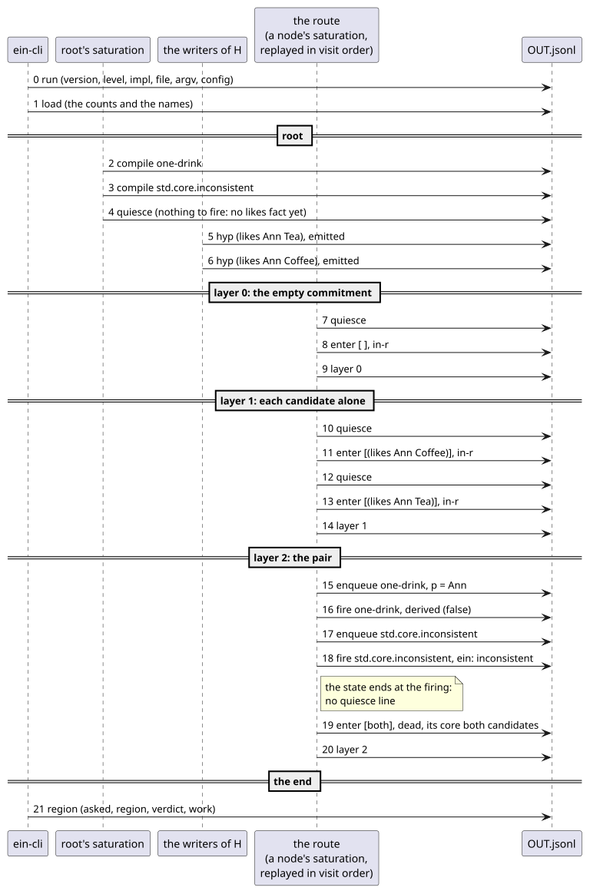
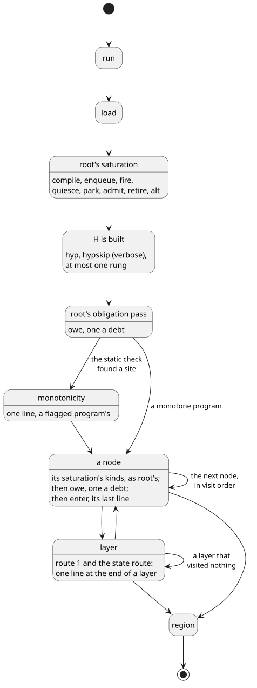

# The `--events` protocol

**Schema version:** `ein-events/1`

`ein solve --events FILE`, `ein saturate --events FILE` and `ein test --events FILE` make the engine narrate what
it did: **one JSON object per line**, opt-in, off by default. The narration is every compile miss, enqueue,
firing, park, admission and retirement, quiescence, alternative justification, obligation,
generation rung, hypothesis candidate, node visited, layer, monotonicity finding and region, in the order the
engine performed them. [§ Events](#events) is the enumeration, and
[`events_reference.rs`](../../../ein.rs/crates/ein-cli/tests/events_reference.rs) holds it to the emitters in both
directions: a kind an emitter writes with no row here fails, and so does a row no emitter writes.

The protocol is a schema rather than debug output, so every observer (a trace viewer, a comparison harness, an
embedder) reads the same stream. It is written by [`ein_infer::events`](../../../ein.rs/crates/ein-infer/src/events.rs);
an embedder opens it with `Events::to(sink, level)` ([`04-api.md`](04-api.md)).

## Ground rules

1. **Off is free.** With no `--events`, the sink is off and every call site reads `Events::on` before building
   anything: no formatting, no allocation, no branch on a hot path that is not there anyway.
2. **Emitting does not change behaviour.** Nothing here advances the saturator's tiebreaker or consumes an
   iterator the caller consumes again. A protocol that perturbed the run it describes would narrate a different
   run.
3. **No internal ids.** Facts are rendered as the canonical S-expression the CLI prints. Interned ids stay inside
   the engine, so nothing in the stream depends on interning order.
4. **Cost when enabled is irrelevant.** This is a debugging and comparison mode, never a benchmark mode; no line
   carries a time, so two streams of one run are equal byte for byte.

## Line format

```json
{"e": "fire", "n": 41, "rule": "symmetric", "…": "…"}
```

| field | meaning |
|---|---|
| `e` | event kind, from the tables below |
| `n` | per-run monotonic sequence number, from 0 |

Field order within a line is fixed by the emitter (`e`, `n`, then the kind's own fields in the order listed below),
so a raw `diff` of two files is readable without the comparison below.

The first line of every run is a `run` event carrying the schema version, so a consumer can reject a file it does
not understand before reading further.

## Levels

`--events-level {normal,verbose}` (default `normal`). At `normal` a redundant firing, one whose conclusions are all
already in the KB, is counted but not emitted, which keeps a file a person can read. **Everything that compares two
streams runs at `verbose`**: a dropped redundant firing is exactly the kind of difference a change to the engine
introduces.

Not every difference at `verbose` is one. A node resumes root's saturation rather than deriving root's closure
again ([Q-M1a.18](../../decisions/engine/Q-M1a.18-a-node-resumes-roots-saturation.md),
[`03-design/06-saturation.md`](03-design/06-saturation.md)), so two runs that reach the same answer, the corpus run again with
its id space permuted, say, can narrate different amounts of one derivation. The difference worth catching is a
dropped **productive** firing, and that is what [§ Comparison](#comparison) compares.

## Events

### Lifecycle

| `e` | emitted at | payload |
|---|---|---|
| `run` | process start | `version`, `level`; from the CLI also `impl`, `file`, `argv` and `config` (every resolved configuration field, kebab-cased) |
| `load` | after the program is loaded | `relations`, `rules`, `hrules`, `macros`, `facts` counts; `relation_names` and `rule_names` in registry order |
| `region` | the end of every region run: every `ein solve` and every `ein test` file ([§ Region runs](#region-runs)) | `asked`, `region`, `verdict`, `work`: the `--json-summary` blocks of the same names, each one JSON value, `region` without its `states` and `frontier` |
| `monotonicity` | at root, before the search, after root's obligation pass, and **only when the static check finds a site**, so the program is not monotone | `verdict` (`"non-monotone"`), `sites` (the count), `site` (one rendered line per site, sorted); the detector's static half, optional: `at_stake` (one key per site, in `site`'s order), `cycles` and `order` (one rendered line each, as the read-out's `cycle` and `order` rows) and `assumes` (`"fork"`) |

`impl` and `argv` are **not compared**. `impl` names the writer (`ein.rs`), which describes the run rather than its
result; `argv` carries the artefact paths the caller chose, so `--events a.jsonl` against `--events b.jsonl` is not
a divergence. Both stay in the file, where they document the run.

#### `monotonicity`: a program that is not monotone

[`ein_infer::monotone`](../../../ein.rs/crates/ein-infer/src/monotone.rs) classifies every relation a compiled plan
reads. A **site** is a read a commitment can undo: an `(absent …)` at odd depth in a saturation rule over a relation
a commitment changes, an obligation's trigger over one, or a rule whose activator a commitment can derive. On a
program with a site the region may have holes, and root's preparation narrates this one line; it changes nothing
about the run. The line carries the [detector](../../../ein.rs/crates/ein-infer/src/detector.rs)'s static half, read
at root before any node: what each site puts at stake (`at_stake`: `state`, `state, dead`, `status: owes`, or either
through a node's plan), the cycles through an `absent` over the relations a commitment changes, the order findings,
and what is assumed (`assumes: "fork"`, every node a fork of root). The dynamic half (a node's status, its stale
facts, its parent paths) needs the run, and is the read-out's and `--json-summary`'s, not the stream's
([`03-design/07-search.md`](03-design/07-search.md)).

A monotone program emits no `monotonicity` line. The same verdict is `--json-summary`'s `monotonicity` block on
every run, and the `lattice` block on stdout carries the warning when there is a site; `ein solve FILE --monotone`
asks for it alone. The corpus fixture that emits it is `examples/lattice/04_obligation_trigger_hole.ein`.

### Deductive layer

| `e` | emitted at | payload |
|---|---|---|
| `compile` | `Engine::compile_for`, **on a miss only** | `rule`, `activator`, `n_steps`, `n_disjuncts`, `n_guards`, `asserts` |
| `enqueue` | `Saturator::enqueue_binding`, after the dedup check | `rule`, `activator`, `bindings` (in binding order), `tiebreaker` (the order it is queued in, which the agenda ranks within its half), `parked` |
| `fire` | every firing the closure step yields | `rule`, `activator`, `bindings`, `premises`, `derived`, `redundant` |
| `park` / `retire` | the boundary round: the candidate waits for a later round, or is dead | `tiebreaker`, `round`, `rule`, `watched` (**the failing guard's** watch set, sorted) |
| `admit` | the boundary round: the one candidate a round admits | `tiebreaker`, `round`, `rule`. **No `watched`**: nothing failed, so there is no failing guard to read a watch set off |
| `quiesce` | closure quiescence, before the boundary speaks | `round`, `n_facts`, `n_queue`, `n_parked` |
| `alt` | `Kb::record_justification` returns true | `fact`, `rule`, `premises` |
| `owe` | the post-fixpoint obligation pass, once per node as its saturation leaves it, one line per undischarged instance | `rule`, `activator`, `relation` (the `(open ?R)` argument, `""` for a bare `(open)`), `bindings`, `why` (rendered) |

**Three of `compile`'s six numbers are not what they are named**, and they stay as they are because the event is a
comparison surface: a changed field meaning is a schema version ([§ Versioning](#versioning)), not a fix
([`engine.rs`](../../../ein.rs/crates/ein-infer/src/engine.rs)). On a plan with $d$ disjuncts:

- **`n_guards` is $d$**: one guard tuple per disjunct, whether or not the disjunct has a guard in it. It is the
  disjunct count and not the guard count, and it is the field a consumer is most likely to sum;
- **`n_disjuncts` is $d - 1$**: the *extra* disjuncts, so a rule with no `(or …)` reports `n_disjuncts 0` and
  `n_guards 1`;
- **`n_steps` is the first disjunct's** step count alone, not the plan's.

`asserts` and `rule` mean what they say.

**`owe` is not a firing.** A rule whose `:assert` is the verdict `open` derives nothing, so it is kept out of the
saturation agenda and runs as one pass over the KB after the fixpoint
([`03-design/06-saturation.md`](03-design/06-saturation.md)). Three consequences for a reader of this stream:

- **A rule never emits both.** An obligation rule never produces a `fire`; a saturation rule never produces an
  `owe`. That makes `owe` the activation evidence for the obligation half of the stdlib, which is how
  `ein-infer/tests/stdlib_coverage.rs` counts it.
- **It is emitted once per node, dead or not, when its saturation returns.** A node's debts are read on a dead node
  too, so a dead node narrates its `owe` lines as any node does: over its fixpoint or, where a monotone program's
  route stops a dead node at its first contradiction, over the node as far as there. Root's lines come first, then
  one group per node visited, each before that node's `enter` line.
- **Nothing it reports is stored.** An `open` conclusion is a tally on the node, never a fact: a contradiction
  survives an extension and a debt exists to be discharged by one, so a stored `open` would outlive its own
  discharge. Reading the KB again does not find what this line reports; `--json-summary`'s `owes` block is the
  same tally as a document.

Every derivation is reported exactly once, as a `fire`. `alt` is narrower than it looks: `record_justification` returns true only for a rule's
provenance with at least one premise, so a source fact derived again records nothing and emits nothing.

`enqueue`'s `tiebreaker` is the value the saturator's tiebreaker took for that entry. It is the engine's own total
order over queue entries ([`03-design/01-determinism-and-order.md`](03-design/01-determinism-and-order.md)), so carrying it
makes the queue's pop order checkable rather than inferred.

### Search layer

| `e` | emitted at | payload |
|---|---|---|
| `rung` | a generation call that **reached** the obligations rung | `mode`, `reason`, `owed`, `branches`, `declined`, `candidates`, `uncovered`; and `later_debts`, `later_candidates` where the call read a debt the state does not owe |
| `hyp` | each candidate the generator constructs | `fact`; `verdict`, which is `emitted` or the name of the filter that dropped it |
| `hypskip` | a skip **before** a candidate exists; *verbose only* | `relation`, `reason`, `object` (for `self_edge`), the stream's word for a guessable atom |
| `enter` | each node a route visits, after the node's own events, in visit order | `layer` (the commitment's size), `commitment` (sorted), `kind`, one of `dead`, `owing` and `in-r`, `owes`, `core` (a dead node's, a list; `null` on a node that is not dead, which has no core), `core_status` (`within-budget`, or `cut-` and the caps the core's search stopped at; `null` where no core was taken) |
| `layer` | the end of each layer of route 1 or of the state route | `layer`, `visited`, `dead`, `owing`, `r`, `facts`: the layer's own counters. On route 1 `layer` is the commitments' size, from 0; on the state route it is the layer's index, root's 0, then one per state size extended, and the counters are its saturations |

`hyp`'s `verdict` is the *name of the thing that dropped the candidate*, not a boolean:
$\operatorname{raw} = \operatorname{emitted} + \sum_{f} \operatorname{dropped}_f$ over the filters $f$ is the
invariant the generator's statistics assert, and naming the filter makes a counter difference locate itself (`hypgen::apply_filters` returns that name for this reason).

A skip before any candidate exists gets its own kind rather than a `hyp` with an invented `fact`: `closed_relation`,
`relation_not_whitelisted` and `no_hypothesis_relation` are decisions about a *relation*, and `self_edge` about an
(atom, relation) pair. They are verbose only, since `self_edge` fires once per (atom, filler, relation, slot).

`enter` and `core`: a core is an explanation
([Q-M1f.6](../../decisions/answer/Q-M1f.6-a-core-is-an-explanation.md)); `null` and `[]` differ, `[]` being the empty
core of a dead node ([Q-M1e2.27](../../decisions/read-out/Q-M1e2.27-in-eins-json-is-the-empty-set-and-null-what-does.md)).

#### `rung`: which generator proposed

Hypothesis generation is a **ladder**: the program's `(hrule …)` if there is one, else, where an obligation is
activated at the state, what would discharge the debts it owes, else the blind enumerator
([`03-design/07-search.md`](03-design/07-search.md)). A `rung` line is written once per generation call, and **only** where an
obligation is activated at the state the call is made at: a program that activates none emits none, whatever
obligation rules it loads. So the first and third rungs narrate nothing; a line appears only where the obligations
rung was consulted, and its `mode` says how that went:

| `mode` | what it means |
|---|---|
| `obligations` | it generated: the candidates are the facts that would discharge what this state owes |
| `stuck` | it owed something and proposed nothing: every debt scoped out by `:no-hypothesis`, `:hypothesis-relations` or `(__closed__ R)`, or every candidate already refuted. **The state is not silently complete**: this line is the report |
| `declined` | it refused the whole call and the blind enumerator ran instead: an obligation whose guard scans a relation the rung itself proposes, or whose trigger or guard beside its witness reads a relation a commitment can change; or a projection that did not resolve for this activator |

`reason` is the sentence of a `declined` call (*an obligation scans `food`, a relation a commitment can change*),
and otherwise `rule-order`, the one order the rung emits in: the owed instances' candidates in report order, plan by
plan and match by match. `owed` counts the undischarged instances at this quiescence, `branches` those branched on,
`declined` those scoped out, so that `owed = branches + declined`, and `candidates` the facts proposed before the
filter pipeline, which is the `hyp` stream's `raw` for this call.

`uncovered` is the ladder's **completeness condition as a number**: how many hypothesis-eligible relations no
obligation names, under the same eligibility test the blind enumerator applies. `0` says the rung is exhaustive by
construction: every relation a hypothesis could be about is one some obligation owes. A non-zero count does not say
the rung is incomplete; it says the claim rests on saturation determining those relations.

**`later_debts` and `later_candidates` are optional**, written only where the call read a debt the state does not
owe and a commitment can bring: an activator of an obligation rule that the state does not hold and a rule's
`:assert` concludes. `later_debts` counts those activators, and `later_candidates` the facts the rung proposed for
them before the filter pipeline, each a `hyp` line after the last one of a debt the state owes. `owed`, `branches`,
`declined` and `candidates` count what the state owes and none of these, so on such a call the `hyp` stream's `raw`
is `candidates + later_candidates`. A call that read no such debt writes neither field.

## Comparison

Two streams are compared by [`ein_narration::events`](../../../ein.rs/crates/ein-narration/src/events.rs), a
library function of a dev-only crate rather than a command: `split` cuts a log into segments and `diff` reports the
first segment that disagrees. What calls it is
[`ein-infer/tests/event_cut_control.rs`](../../../ein.rs/crates/ein-infer/tests/event_cut_control.rs), which mutates
a real stream and checks that the cut below still reports the mutation.

`n` is compared as a **position, not a field**: one extra event on either side renumbers every line after it, and a
comparison that reported all of them would bury the one difference that caused them.

The stream is split into **segments**, root's saturation and then one per node, at every `enter`, and at the first
hypothesis event, which is what closes root's. Within a segment:

| | compared |
|---|---|
| the **spine**: the lifecycle and search kinds (`run`, `load`, `hyp`, `hypskip`, `enter`, …) | in order, exactly |
| the **derivation**: every `fire` with `redundant = false` | the **multiset of facts derived** and the **set of rules** that derived them |
| the scheduling traffic: `enqueue`, `park`, `admit`, `retire`, `quiesce`, `alt`, `compile`, and every redundant `fire` | nothing; counted per side and reported |

The derivation is a multiset of facts and a set of rules, not an ordered list of firings, because a node may record
a different one of a fact's equally valid derivations first. `compile` is scheduling because a plan-memo miss
depends on how many enqueue passes ran.

That is the engine's one rule about narration, *a node's derivation, and anything keyed on a dying node's stopping
point, is narration, not content*, implemented in the dev-only crate `ein-narration`. `EIN_NARRATION_STRICT=1` runs
the comparison with no narration cut, event by event.

**A relaxation nothing exercises is a hole rather than a decision**, so the cut has a negative control:
`event_cut_control.rs` builds a real verbose stream, deletes one event from it, and asserts that deleting a
*productive* firing is reported while deleting a redundant one or an `enqueue` is not.

## Region runs

`ein solve --events FILE` narrates the run that answered, every run, a bare description included, and `ein test`'s
too. `ein test` asks a file the least question that can decide its claims and, of what that leaves undecided, the
describing one ([Q-M1f.221](../../decisions/answer/Q-M1f.221-ein-test-asks-a-file-the-least-question-that.md)); the
stream is one run's, the last question asked, and its `region` event's `asked` says which. A region run's stream
is, in order:

1. `run` and `load`, as above;
2. **root**, in this order: root's saturation (`compile`, `enqueue`, `fire`, …); **how H was built** (one `hyp` per
   candidate and, at `verbose`, the `hypskip`s, with the generator's `rung` line where it reached the obligations
   rung: after the candidates of a call that generated, before the blind enumerator's of a call that declined);
   root's obligation pass (`owe`); and, on a program the static check flags, one `monotonicity` line;
3. **every node the route visits**, in visit order whatever `-j` is: that node's saturation and obligation events,
   then one `enter` line. A dead node on a monotone program's route narrates its saturation up to the firing that
   makes its first contradiction, where the route stops it, and its debts there; the `enter` line's core is taken
   over its fixpoint. A worker narrates into its own buffer and the run replays it in order, so the stream at `-j 4`
   is the stream at `-j 1` line for line ([`03-design/08-parallelism.md`](03-design/08-parallelism.md));
4. **route 1 and the state route**: one `layer` line at the end of each layer, with its own counters;
5. **`region`**, last.

`region_modes.rs`'s `the_event_stream_is_the_runs_and_jobs_move_no_line` holds the shape and the `-j` invariance.

### One run, line by line

A program with one rule, one hrule and two candidates, small enough to follow every line of:

```lisp
(relation person Person      :why "{?3} is a person")
(relation drink  Drink       :why "{?3} is a drink")
(relation likes  Person Drink :why "{?3} likes {?4}")

(person Ann)
(drink Tea) (drink Coffee)

(hrule guess ()
  :match  (and (person ?p) (drink ?d))
  :assert (likes ?p ?d)
  :why    "guess that {?p} likes {?d}")

(rule one-drink ()
  :match  (and (likes ?p Tea) (likes ?p Coffee))
  :assert (false)
  :why    "{?p} cannot like both Tea and Coffee")
```

`ein solve FILE --events OUT.jsonl` describes its region by the state route: root, the two candidates alone, both
alive, and the pair, dead. Each arrow below is one line of `OUT.jsonl`, with its `n`; the column it leaves is the
part of the engine that wrote it, and a node's lines are written by the route as it takes the node.



### The orders a stream can take

The kinds of a region run's stream as a state machine: a state is the part of the run that is writing, the kinds
in it are the ones it may write, and a transition is the first line of the next part. A stream of `ein saturate` is
the first three states and nothing after them.



A state may write little or nothing: a program none of whose rules fires has a root saturation of its `compile`
lines and one `quiesce`, a program that states `(solve :no-search)` builds no H, and one that owes nothing has no
`owe`. The first node is root's own, the empty commitment, and under `--no-search` it is the only one.

## Versioning

`ein-events/<n>`. A new optional field is not a version bump; a removed field, a renamed event, or a changed field
meaning is. The version rides in the `run` event rather than a header line, so a truncated file still identifies
itself: the writer flushes per line, and a crashed run's prefix is the most useful artefact it can leave.
