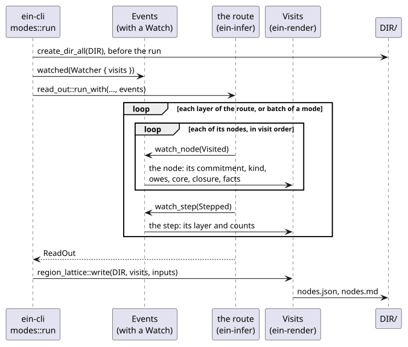
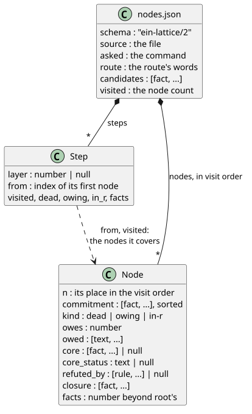
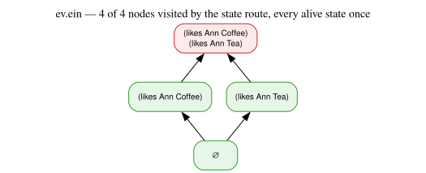

# The lattice dump

`ein solve FILE --dump-lattice DIR` writes **every node the run visited**, in visit order, whatever the question
and whatever the route. It is the audit trail of a search: which commitments the engine saturated, what each one
came to, and in which step of which route. The writer is
[`ein_render::dump::region_lattice`](../../../ein.rs/crates/ein-render/src/dump/region_lattice.rs); `ein render
lattice` draws the same nodes as a graph.

How the files come to be. The route does not know the dump exists: as it takes each node, on the committing
thread, it hands the node to the watch on its event sink, and `ein-cli`'s watcher keeps what it is handed. The
files are written after the run, from what was kept.

## Under a region mode — `nodes.json` and `nodes.md`

Every `ein solve` run, a bare description and each mode alike, takes `--dump-lattice DIR`, and writes two files:

- **`nodes.json`**, schema `ein-lattice/2`: a header (`schema`, `source`, `asked`, the command as typed less what it
  leaves out, `route`, the route in the words the read-out's `route` row begins with, such as `1, the alive
  down-set`, `2, the cube` or `the state route, every alive state once`, `candidates`, the hypothesis set H,
  `visited`, the node count); then `steps`, each a route-1 layer or a mode's batch (`layer`, `null` for a batch, `from`, the
  index of the first node it covers, and its counts `visited`, `dead`, `owing`, `in_r`, `facts`); then `nodes`, in
  visit order, each with
  - `n`, its place in the visit order, and `commitment`, sorted;
  - `kind`: `dead`, `owing` or `in-r`;
  - `owes` and `owed`: how many obligation instances it leaves undischarged, and each, rendered;
  - `core`, `core_status` and `refuted_by`: a dead node's unsat core, what the core's search established
    (`within-budget`, or `cut-` and the caps where it stopped) and the rules that refute it; `null` on a node that
    is not dead, which has no core, and `[]` only as a dead node's empty core
    ([Q-M1f.6](../../decisions/answer/Q-M1f.6-a-core-is-an-explanation.md),
    [Q-M1e2.27](../../decisions/read-out/Q-M1e2.27-in-eins-json-is-the-empty-set-and-null-no-object.md));
  - `closure`, and `facts`, how many facts its fixpoint holds beyond root's.
- **`nodes.md`**, the same as one table per step.

The document's shape:

**A dead node on a monotone program is listed as far as its first contradiction**, where the route's saturation of
it stops: what it owes, its closure and its facts are the node's there, and its core is taken over its fixpoint, the
saturation going on from the stop. A node whose whole fixpoint a route reads, an alive node, root and every node of a
flagged program, is listed to quiescence ([`03-design/07-search.md`](03-design/07-search.md)).

The nodes are read through the route's watch
([`ein_infer::events::Watch`](../../../ein.rs/crates/ein-infer/src/events.rs)), on the committing thread, so the
files are the same at every `-j` (`ein-cli/tests/region_modes.rs`'s `the_lattice_dump_is_every_node_visited`). Each
node's firings are the [`--events`](05-events.md) stream's, which narrates every node visited; the directory does not
hold a second copy.

**A node is visited when the node function computed it.** A set a route knew to be dead without it, one that holds
a set it had seen die, or the set of a state and a candidate that state's fixpoint denies, is not saturated, so it
is not in the files and has no `enter` line; `visited` is the `work` row's saturations. Which of the cube's nodes a
run left for either reason is what `ein render region CUBE --visited DIR` draws, node by node, on the cube `ein
oracle --dump` writes.

Past its directory the flag is additive: stdout, stderr and the exit code are those of the run without it. The
directory is made before the run; a run that cannot make it exits with an error.

## Drawing it

The four nodes a describing run visits on the program of [`05-events.md` § One run, line by line](05-events.md#one-run-line-by-line),
as `ein render lattice FILE --view full` draws them: the three states of `R` and the dead pair.

`ein render lattice FILE` runs a describing `ein solve` on the program and draws the nodes it visits, the same nodes
in the same order as `--dump-lattice` writes, as a DAG: `R` green, owing amber, dead red, each dead node with its
core. `--view solution` (the default) draws the nodes of `R` and the nodes one fact above them that are not;
`--view full` every node the run visited. The drawing is `region_lattice::dot`'s. Every renderer has a command that
reaches it ([Q-M1e.20](../../decisions/cli/Q-M1e.20-every-renderer-has-a-command-that-reaches-it.md)).
