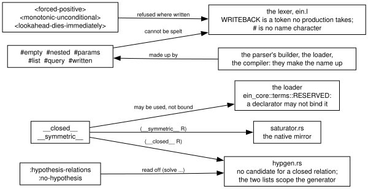

# Reserved engine strings

Engine-**internal** vocabulary: the strings the engine keys on that are not a program's own names. Each lives behind
one named constant in [`ein_core::terms`](../../../ein.rs/crates/ein-core/src/terms.rs),
[`ein_core::text`](../../../ein.rs/crates/ein-core/src/text.rs) or the module that reads it, and a name is reserved
if and only if it appears here or among the names the language reserves for a program to write (`relation`, `not`,
`absent`, `eq`, `open`, …, which `ein_core::terms::RESERVED` lists with the dunder below).

**The words around a program's English are the engine's too**: the provenance words `ein saturate --dump` writes
after a fact (`:source`, `:rule`, `:hypothesis`), the trace's *Derives*, *Premises* and *Assuming*, and the read-out's
labels. Every text a program writes, its `:why`s, `:source`s and `:goal-text`s, is the domain's, which the engine
fills and never edits ([Q-M1f.12](../../decisions/read-out/Q-M1f.12-natural-language-text-reaches-a-fixed-set.md)).

Each group of strings, and the one part of the engine that gives it its meaning: where a program is stopped from
writing or binding it, and where the engine reads it.

## The engine's names

A name that triggers behaviour hard-coded in the engine is written `__dunder__`, lexically distinct from a
program's relation and rule names; a bare name never triggers engine behaviour, and no name of a theory does
either: `is-a`, `symmetric`, `bijective` and `slot-partition` are a library's, which the engine reads by no name
([§ No theory's name](#no-theorys-name)). Each name below is written only with its fixed meaning, and is refused as
a program's own:

| name | a program may | a program may not | refused by |
|---|---|---|---|
| `__closed__` | **use** it wherever a name is used: as the relation of a fact, a premise, a conclusion, a goal or a claim's fact, and as an argument, `(imply1 functional __closed__)` among them | **bind** it: declare a relation of that name, name a rule, an hrule or a macro after it, or import a module `:as` it | the loader, *relation '__closed__' shadows a reserved kernel name* (and *rule*, *hrule*, *macro*, *alias*): it is in `ein_core::terms::RESERVED`, the names a declarator may not bind |
| `<forced-positive>`, `<monotonic-unconditional>`, `<lookahead-dies-immediately>` | — | write it anywhere: each names a conclusion no rule drew, which a program cannot | the parse: the grammar's `WRITEBACK` token, which no production takes (*unexpected `<forced-positive>`: the engine's writeback rule name (reserved)*) |

So a printed `:rule <lookahead-dies-immediately>` would always be the engine's. The name in a string or a comment
is not the name, and a longer run that starts with one (`<forced-positive>x`) is the name it spells.
[`ein-ir/tests/engine_names.rs`](../../../ein.rs/crates/ein-ir/tests/engine_names.rs) holds each name in each
position. Both groups, with the query rule, are interned first, at fixed places, by `ein_core::terms::ENGINE`, so the
interner does not grow with them during a search ([`03-design/08-parallelism.md`](03-design/08-parallelism.md)).

## No theory's name

The engine gives a fixed meaning to its own names and to none other: the names `ein_core::terms::Kernel` holds,
which `Terms::new` interns before a program arrives, the words of the grammar, and the three names `:over` takes
(`ein_ir::expect::Over::NAMES`). A theory's names, `is-a`, `T`,
`symmetric`, `bijective`, `slot-partition`, are the standard library's or a program's, and mean what the rules that
read them make them mean; a relation's symmetry is `std.algebra`'s rule `symmetric`, and the kernel mirrors no
relation ([Q-M1f.436](../../decisions/engine/Q-M1f.436-the-kernel-reads-no-theorys-name.md)).
`__symmetric__` is such a name: a program may bind it, and a fact of it derives nothing
(`ein-infer/tests/stdlib_semantics.rs`' `the_kernel_mirrors_no_relation_and_symmetric_is_a_rule`). A goal or a claim
over `is-a` is held to the program's relations as one over any relation is: a program that writes no `is-a` has no
such relation, and the load refuses it.

[`ein-render/tests/renaming_invariance.rs`](../../../ein.rs/crates/ein-render/tests/renaming_invariance.rs) holds it:
every corpus program, with every name that is not the kernel's renamed by an order-preserving bijection, in its
text and in every module its load reads, answers alike, its claims' verdicts among the answer, and is drawn alike,
apart from the names. No drawing reads one: the test's `READS`, where a drawing that read a theory's name would be
listed with the name, is empty, and a listed drawing that no longer moved on any program would fail it.

## Bookkeeping carrier heads

**None.** A committed hypothesis is a fact with a provenance *kind*, `hypothesis` (`ein_core::prov::ProvKind`),
never a fact wrapped in a carrier head. A state's `open` facts, `(open R)` and `(open F)`, are facts of the kernel's
relation `open` and part of the state
([Q-M1f.572](../../decisions/read-out/Q-M1f.572-a-states-open-facts-are-part-of-it-listed-drawn.md)), written at
its fixpoint from the rest of it, so the canonical state form,
[`canon::state_key`](../../../ein.rs/crates/ein-infer/src/canon.rs), excludes nothing: it is the sorted fact set of
the state, its `open` facts among them, free of provenance. A carrier head added later would have to be registered here **and** excluded by
`state_key`, so that it does not perturb a state's identity ([`03-design/07-search.md`](03-design/07-search.md)).

## Synthetic writeback rule names

The three names of the second row above name a rule that exists in no `(rule …)` form: a conclusion the search would
write back to root, justified by a property of the search (every alternative refuted) rather than by a derivation
in any one state. No code of the engine writes one; the names stay reserved, interned in `ein_core::terms::ENGINE`,
so that a writer added later cannot collide with a program's name.

Their shape is the **contract** a writer keeps: an empty premise list. Such a fact has no fact-level premises, so
every provenance walk **grounds out** on it: it ends the walk and contributes nothing to a frontier, and an unsat
core never names a search conclusion as a given.
[`Kb::record_justification`](../../../ein.rs/crates/ein-core/src/kb.rs) keeps the contract in both directions: it
refuses to record a premise-free derivation as an alternative (that would give a fact the empty environment,
*derivable from nothing*, and collapse every explanation through it), and it refuses to attach alternatives to a
fact whose first derivation is premise-free. [`explain.rs`](../../../ein.rs/crates/ein-infer/src/explain.rs) treats
such a fact as a terminal labelled with the empty environment.

## Names the parser and the loader make up

Five names stand for something a program writes no name for. Each starts with `#`, which is no name character (`#|`
opens a comment), so no program can spell one. `ein_core::text::INTERNAL_NAMES` lists them,
`ein_core::text::is_internal` is the test the dumper and `(import … :symbols …)` read, and
[`ein-ir/tests/generated_parser.rs`](../../../ein.rs/crates/ein-ir/tests/generated_parser.rs)'
`no_name_the_loader_makes_up_is_a_name` holds that none is a name of the lexer.

| name | names | printed as |
|---|---|---|
| `#empty` | the empty form `()`: an empty name list | `()` |
| `#nested` | a nested form whose head is not a name. The parse refuses every such form, `(r (_ a))`, `(r (?x a))` and `(r ((f b) a))` among them, so no program reaches it | `(_ …)` |
| `#params` | a rule's or a macro's parameter list | the list, with no head |
| `#list` | a fact's `:using` list, in the parse tree | the list, with no head |
| `#query` | the rule a query's `:goal` compiles to, so a binding has a rule to be reported under (`ein_core::terms::QUERY_RULE`) | a quoted name |

`:match ()` is the empty conjunction, which fires once, and `:assert ()` the empty conclusion, which asserts
nothing: each compiles with no synthetic head, so no run reaches an atom `#empty`.

## Provenance kinds

A closed set the engine branches on, `ein_core::prov::ProvKind`: `source` (a file wrote it), `rule` (a rule derived
it), `hypothesis` (a commitment assumed it), `rejected`. The words are the ones `ein saturate --dump` and a trace print
([`03-design/03-data-model.md`](03-design/03-data-model.md)).

## `__closed__` — engine effect

`(__closed__ R)` has one engine side, in [`hypgen.rs`](../../../ein.rs/crates/ein-infer/src/hypgen.rs) (`CLOSED`):
the blind enumerator reads the `(__closed__ R)` facts in the KB and proposes **no candidate for R**, at root and,
in [`open.rs`](../../../ein.rs/crates/ein-infer/src/open.rs), at every state above it. The marks are the
ones a program writes or a rule derives (`std.closure`'s `infer-closure` asserts `(__closed__ ?R)`), and H holds the
candidates of every other relation. It is genuinely the engine's: a saturation rule can neither suppress the
generator nor observe that no rule asserts R. The hypothesis mechanisms are read together, and a closure of a relation
root holds an `open` fact of, or of one a `:hypothesis-relations` list names, is refused
([`03-design/07-search.md`](03-design/07-search.md)).

## Hypothesis-scoping keys

Two `(solve …)` keywords the hypothesis generator reads to scope which relations the blind enumerator proposes
about: `HYPOTHESIS_RELATIONS` and `NO_HYPOTHESIS` in [`hypgen.rs`](../../../ein.rs/crates/ein-infer/src/hypgen.rs).

| key | effect |
|---|---|
| `:hypothesis-relations` | **an allow-list**: candidates only for the listed relations (unset: every eligible one) |
| `:no-hypothesis` | **a deny-list**: never a candidate on the listed relations; saturation rules on them still fire |

Neither touches the saturator: they scope generation only, where `(__closed__ R)` above also states that no rule
derives R. The mechanisms are read together on root's fixpoint (`ein_infer::mechanisms`): a relation in both lists,
or listed and closed, is refused before any search, and a list an hrule leaves filtering nothing is a note
([`03-design/07-search.md`](03-design/07-search.md)).
