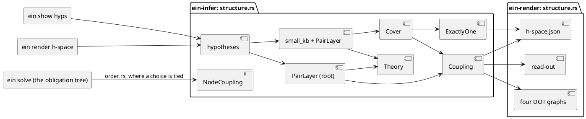
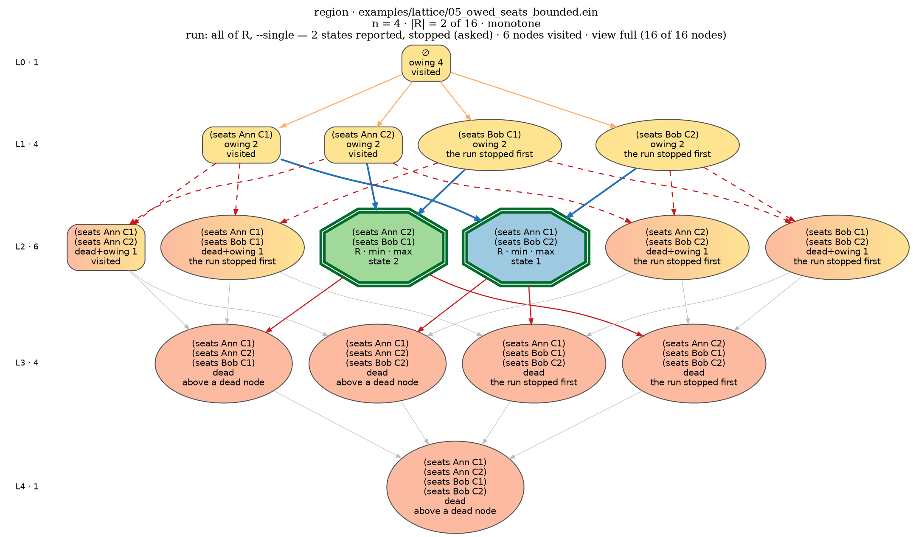

# Hypotheses and the answer, in code

Four pages of the reasoning define the candidate set, its structure, the answer and why every computation of the
answer agrees, and name no code. This page is their other half: for each notion, where it lives in `ein.rs`, the
algorithm the engine uses, the commands that show it, the files it writes, and the test that fails when it stops being
true. Section *n* here follows the *n*-th of them.

| the reasoning's page | states | here |
|---|---|---|
| [Hypothesis generation](../../reasoning/02-kb-evolution/04-hypothesis-generation.md) | $H$ as a definition by cases, the ladder | [§ 1](#1-hypothesis-generation) |
| [The hypothesis space](../../reasoning/02-kb-evolution/05-hypothesis-space.md) | the structure of $H$: pairs, groups, grids, the coupling | [§ 2](#2-the-hypothesis-space) |
| [Solution semantics](../../reasoning/02-kb-evolution/06-solution-semantics.md) | the node function, the status of a state, the region $R$ | [§ 3](#3-solution-semantics) |
| [Finding R](../../reasoning/02-kb-evolution/07-finding-r.md) | the oracle, the licences as lemmas, the agreement theorem | [§ 4](#4-finding-r) |

The design contract of the search, which the crates cite as their specification, is
[`03-design/07-search.md`](../03-design/07-search.md); this page does not restate it. Every module named below is
under [`ein.rs/crates/ein-infer/src/`](../../../../ein.rs/crates/ein-infer/src/) unless its crate is given, and every
test under a crate's `tests/`.

---

## 1. Hypothesis generation

### 1.1 Where it lives

| in the reasoning | in `ein.rs` |
|---|---|
| $\operatorname{gen}(P, \mathrm{root})$, the ladder | `hypgen::rung` decides the case, a `Rung` (`NoSearch`, `Hrules`, `Obligations`, `Blind`), and `hypgen::generate_config_free` runs it: one entry for the search, the listing and the structure, with no configuration switch applied |
| $\nu(P)$, nothing to guess | `hypgen::declares_no_search`: the program's `(solve :no-search)` |
| $\operatorname{Hr}(P)$, $H_{\mathrm{hr}}$ | [`hrule.rs`](../../../../ein.rs/crates/ein-infer/src/hrule.rs): each active `(hrule …)` is a compiled plan matched at root, its one `:assert` fact a candidate per match |
| $\operatorname{ActOb}(P)$ | `mechanisms::obligation_plans`, the one reading of *an obligation activated at root*, which the ladder and the conflict check share |
| $\operatorname{pay}(o, a, \theta)$ | [`oblgen.rs`](../../../../ein.rs/crates/ein-infer/src/oblgen.rs): the guard's own sub-plan run with the witness step skipped (`Matcher::scan_without` in `match_.rs`) |
| $\operatorname{declines}(P)$ and its reason | `oblgen::generate` answers `Mode::Declined`, with the reason, before it emits anything |
| $D^{+}$ | [`monotone.rs`](../../../../ein.rs/crates/ein-infer/src/monotone.rs) computes the relations a commitment can change once, for the static check, for *forbid* and for this rung |
| $\operatorname{ActOb}^{+}$, $\Pi^{+}$: a debt root is not told of | `forbid::derivable_activators`; each such debt is an `oblgen::LaterDebt`, counted apart from what root owes |
| stuck | `oblgen::Mode::Stuck` |
| $\operatorname{Uncov}(P)$ | `RungReport::uncovered`, over `hypgen::eligible_relations` |
| $\operatorname{obj}(P)$ | `hypgen::candidate_objects`, seeded with `invariant::program_names` |
| $\operatorname{unsettled}$ | the candidate filters of `hypgen.rs`, in this order: `negated_fact`, `fact_already_exists`, `seen_in_call` |
| $\operatorname{inscope}$ | the relation skips of `hypgen.rs`: `closed_relation`, `relation_not_whitelisted`, `no_hypothesis_relation`; and `self_edge` for a relation of two slots |
| the mechanisms judged together | [`mechanisms.rs`](../../../../ein.rs/crates/ein-infer/src/mechanisms.rs), at load, on every command; each refusal and each note, worded, is [`07-diagnostics.md` § 2.27](../../user/04-reference/07-diagnostics.md#227-a-programs-hypothesis-mechanisms-do-not-contradict-one-another) |
| what the universe leaves out, a type or a relation's name bound as an object | `scope.rs`, `types_as_objects.rs`, `relation_names.rs`: one sentence each, on every surface |

### 1.2 The ladder as the engine runs it

The choice between the rungs is one flow, drawn in
[`02-algorithms.md` § 6](../02-algorithms.md#6-hypothesis-generation-the-ladder), and its contract is
[`03-design/07-search.md` § 1](../03-design/07-search.md#1-hypothesis-generation). In the code's words: `hypgen::rung`
answers `NoSearch`, `Hrules`, `Obligations` or `Blind` before any rung runs; the two lists,
`:hypothesis-relations` and `:no-hypothesis`, are read once a call, and neither they nor a closure filter what an
hrule proposes; `oblgen::generate` scans each owed instance's guard with the witness step skipped, then the debts
a commitment can bring, and answers `Mode::Declined` with its reason before it emits anything; the blind
enumerator takes `candidate_objects`, and for each object, each eligible relation and each slot, one candidate a
filler, no fact of an object with itself.

Every candidate a rung constructs goes through one pipeline, `emit`: it is counted as `raw`, then dropped by the
first filter that names it or emitted, so `raw == emitted + Σ filtered` and a dropped candidate's `hyp` event names
its filter. A skip made before any candidate exists is a `hypskip` event, and a call that reaches the obligations
rung writes one `rung` event with its `mode`, its `reason` and its counts
([`05-events.md` § `rung`](../05-events.md#rung-which-generator-proposed)).

**The rung's name** is `Mode::as_str`, one of six words, and it is what the read-out's `universe` row, the note of
`ein show hyps` and the `rung` field of `h-space.json` print:

| word | the case of the definition |
|---|---|
| `no-search` | the program states `(solve :no-search)` |
| `hrules` | the program declares an hrule |
| `obligations` | an obligation is activated at root and the rung built $H$, empty where root owes nothing |
| `stuck` | the rung built nothing and root owes |
| `declined` | the rung declined, and the blind enumerator built $H$ |
| `blind` | neither an hrule nor an activated obligation |

**A decline says why**, in the `rung` event's `reason`. For
[`examples/ein-bugs/wrong-answers/oblig-derived-domain-declared.ein`](../../../../examples/ein-bugs/wrong-answers/oblig-derived-domain-declared.ein),
`ein solve FILE --events e.jsonl` writes:

<!-- output -->
```text
{"e": "rung", "n": 6, "mode": "declined", "reason": "an obligation scans `food`, a relation a commitment can change", "owed": 0, "branches": 0, "declined": 0, "candidates": 0, "uncovered": 0}
```

**A debt root is not told of is a row of the read-out**, under `universe`. For
[`examples/ein-bugs/wrong-answers/oblig-derived-activator.ein`](../../../../examples/ein-bugs/wrong-answers/oblig-derived-activator.ein),
`ein solve FILE` prints:

<!-- output -->
```text
  universe          2 candidates, 0 dead alone
    later debt      (total-owed drinks is-a) — a debt root does not owe: rule 'arm' concludes it from what a commitment can change. H holds what would pay it, 1 candidate: (drinks Ann Tea)
```

**The two rules the reasoning draws** are `ein render rule`'s: the obligation is `std.algebra`'s `total-owed`,
`ein render rule --name total-owed stdlib/algebra.ein`, whose `:match` is
`(and (relation ?R ?A ?B) (?isa ?a ?A) (absent (and (?isa ?b ?B) (?R ?a ?b))))` and whose `:assert` is `(open ?R)`;
the hypothesis rule is an `(hrule …)` with no parameter, drawn the same way by its name.

### 1.3 H, listed

**`ein render` draws and `ein show` lists**: what `ein show` prints is Ein text a `.ein` file could hold.

```sh
ein show hyps FILE [--no-require-why]
```

**stdout is H and nothing else**: one candidate a line, as the fact is written, every candidate, uncut, in the
universe's order. So it pipes, and a line is a fact a `.ein` file could hold: it is printed as a state file's facts
are (`--dump-answer`'s `models/`), and spelled as the program's own file spells the fact, a short name where the file
lists it and the full name where it does not.

<!-- generated: ein show hyps examples/zebra2.ein | head -3 -->
```text
(color-loc Green House-4)
(color-loc Green House-5)
(color-loc Ivory House-3)
```
<!-- /generated -->

The block is the binary's output, held to it by a test ([§ 2.6](#26-what-holds-the-structure)).

- **It is H as root's generator builds it**, on whichever rung the program is on: the set every route searches over.
  `ein solve FILE -H` lists the same candidates after a read-out, by relation, within stdout's 100 lines; the document
  of § 2.4 lists them under `candidates` with what the structure says of each. All three are one reading of H, root
  prepared as every route prepares it.
- **It costs what building H costs**: root's saturation and the generator's pass. No node is read, so no pair layer,
  no small KB and no whole node.
- **stderr holds one `note:`**, which rung built H and how many candidates it holds:
  ``note: FILE: H, built by the rung `hrules`: …``. An empty H prints nothing on stdout and exits 0, and the note says
  why in the words of the read-out's `universe` row: *no candidate*, and *the program states :no-search* where it
  does.
- **Exit codes**: 0 for every H, empty or not, a dead root's among them. A program the loader refuses, or the engine
  refuses to read, exits 1 with the line every command gives it.
- It takes no option but `--no-require-why`
  ([`06-config.md` § 3.4](../../user/04-reference/06-config.md#34-the-option-that-decides-loading)): nothing moves H.
  `FILE` is a `.ein` or a `.einb`.

### 1.4 A program for each case

Each is a corpus program whose note names the rung, re-taken by `ein show hyps FILE 2>&1 >/dev/null`:

| rung | program | what it is |
|---|---|---|
| `hrules` | [`examples/zebra2.ein`](../../../../examples/zebra2.ein) | the Zebra puzzle with `(hrule guess …)` |
| `obligations` | [`examples/zebra2-obligations.ein`](../../../../examples/zebra2-obligations.ein) | the same file with the hrule and the `:hrules` clause deleted and nothing else: `(bijective color-loc)` and its kin owe every attribute arrow |
| `obligations`, no candidate | [`examples/ein-bugs/wrong-answers/rung-discharged.ein`](../../../../examples/ein-bugs/wrong-answers/rung-discharged.ein) | an activated obligation and a root that owes nothing |
| `obligations`, with a later debt | [`examples/ein-bugs/wrong-answers/oblig-derived-activator.ein`](../../../../examples/ein-bugs/wrong-answers/oblig-derived-activator.ein) | a rule derives an obligation's activator from a commitment |
| `declined` | [`examples/ein-bugs/wrong-answers/oblig-derived-domain-declared.ein`](../../../../examples/ein-bugs/wrong-answers/oblig-derived-domain-declared.ein) | a guard reads a relation a commitment can change |
| `stuck` | [`examples/ein-bugs/wrong-answers/kw-or-in-obligation.ein`](../../../../examples/ein-bugs/wrong-answers/kw-or-in-obligation.ein) | root owes, and nothing is left to propose |
| `blind` | [`examples/ein-bugs/wrong-answers/dunder-object-closed-by-fact.ein`](../../../../examples/ein-bugs/wrong-answers/dunder-object-closed-by-fact.ein) | no hrule, no activated obligation |
| `no-search` | [`examples/beliefs/01_common_belief.ein`](../../../../examples/beliefs/01_common_belief.ein) | `(solve :no-search)` |

**The two Zebra files build one $H$**, which is the reasoning's example of a rung that leaves nothing uncovered.
The two listings are the same set:

```sh
ein show hyps examples/zebra2.ein             2>/dev/null | sort | md5sum
ein show hyps examples/zebra2-obligations.ein 2>/dev/null | sort | md5sum
```

A relation of three slots or more has no blind candidate and is named outside the universe:
[`examples/ein-bugs/wrong-answers/arity3.ein`](../../../../examples/ein-bugs/wrong-answers/arity3.ein).

### 1.5 What holds the ladder

| claim | test |
|---|---|
| the ladder dispatches by what the program states: an hrule overrides, an activated obligation takes the second rung, a declined obligation falls to the blind enumerator, a program with neither takes the blind enumerator, and `(solve :no-search)` runs no rung | `ein-infer/tests/obligation_rung.rs`: `the_ladder_dispatches_by_what_the_program_declares` |
| under an activated obligation a discharged root proposes nothing | `ein-infer/tests/obligation_rung.rs`: `a_discharged_state_owes_nothing_and_declines_nothing` |
| a module imported for one rule takes the rung of that rule written out; the answer does not depend on the import form | `ein-cli/tests/import_invariance.rs`: `a_module_imported_for_one_rule_takes_the_rung_of_the_rule_written_out`, `every_corpus_program_answers_alike_under_every_import_form` |
| the obligations rung's candidates are its guards' scans with the witness step skipped | `ein-infer/tests/obligation_rung.rs`: `the_candidates_are_what_the_guard_scans` |
| the hrule path and the obligation path build one $H$, and with it one $R$, on the zebra family | `ein-infer/tests/obligation_rung.rs`: `the_theory_finds_what_the_hrule_finds` |
| a root that owes and can propose nothing is stuck, reports it, and is no state of $R$ | `ein-infer/tests/obligation_rung.rs`: `owing_and_unable_to_branch_is_stuck_and_says_so` |
| $H$ holds the payments of a debt only a commitment brings, by the static reading, and $R$ over that $H$ is the oracle's | `ein-infer/tests/later_debts.rs`: `the_universe_is_the_static_readings_on_every_probe`, `r_over_the_readings_universe_is_the_oracles`, `the_rung_line_counts_a_later_debt_apart` |
| every name of the program is a blind candidate object, and no run reaches a name the program lacks | `ein-infer/tests/alive_invariant.rs`: `every_name_of_the_program_is_a_candidate_object`, `no_run_reaches_a_name_the_program_does_not_have` |
| a kernel dunder is no object, and a closure by a rule answers what the closure by a fact answers | `ein-infer/tests/dunder_objects.rs`: `a_dunder_written_as_a_value_is_no_object`, `a_closure_by_a_rule_answers_what_the_closure_by_a_fact_answers` |
| a type bound as an object, and a relation's name bound as an object, are each named on every surface | `ein-cli/tests/read_out.rs`: `a_type_bound_as_an_object_is_one_sentence_on_every_surface`; `ein-cli/tests/relation_names_row.rs`: `a_relations_name_bound_as_an_object_is_one_sentence_on_every_surface` |
| a relation of arity 3 or more has no blind candidate and is named outside the universe | `ein-cli/tests/read_out.rs`: `the_universes_scope_is_one_sentence_on_every_surface` |
| an hrule that reads a negation proposes what the oracle's does | `ein-cli/tests/hrule_reads_not.rs`: `an_hrule_that_reads_not_is_answered_as_the_oracle_answers`, `every_hrule_reads_the_state_it_was_asked_about` |
| an hrule's conclusion is one fact | `ein-cli/tests/conclusion_shapes.rs`: `an_hrule_concludes_one_fact` |
| the mechanisms' conflicts are refused on every command, a dead or redundant declaration is a note, and `:no-search` relaxes no conflict | `ein-cli/tests/mechanism_conflicts.rs`: `a_conflict_is_refused_on_every_command`, `a_dead_or_redundant_list_is_a_note_and_a_silent_pair_says_nothing`, `no_search_relaxes_no_conflict` |
| no option changes $H$ or $R$ | `ein-cli/tests/lever_invariance.rs`: `every_declared_lever_cell_moves_no_line_of_any_mode` |

---

## 2. The hypothesis space

### 2.1 Where it lives

| in the reasoning | in `ein.rs` |
|---|---|
| $H$ listed | `structure::hypotheses`: root prepared as every route prepares it, and the generator's pass |
| the pair layer | `structure::PairLayer`, read through the routes' node cache (`explore::Space::eval`) |
| the small KB, the theory's share | `structure::small_kb`, `structure::Theory`; a support is `explain::support_frontier` |
| the groups and the cover | `structure::Cover` (`cover`, `cover_in`): a clique enumeration bounded by `CLIQUE_STEPS` |
| exactly one, the grids | `structure::ExactlyOne`, over `oblgen::Alternatives`, the table of what root owes with each licensed instance's alternatives |
| the coupling | [`structure/coupling.rs`](../../../../ein.rs/crates/ein-infer/src/structure/coupling.rs): `Coupling`, its `Tie`s, `Edge`s and `Debt`s, and the two sets of components |
| the coupling a route reads | `structure/coupling/node.rs` (`NodeCoupling`), read by [`order.rs`](../../../../ein.rs/crates/ein-infer/src/order.rs) |
| the read-out, the graphs, the document | `ein-render/src/structure.rs`; the command is `ein-cli`'s `render h-space` |

The whole of it is [`structure.rs`](../../../../ein.rs/crates/ein-infer/src/structure.rs), whose module comment is
the fullest account of each object as built. No route reads a pair layer, the cover or the full coupling.

**The small KB** is built over the same interned terms as the program, so a candidate is one fact in both. It keeps
the loaded program's registries, every rule, declaration and import, and of the facts a file writes those the rule
keeps; `(written T)` is stated again as the loader states it, so it follows the facts it is read in. The rule reads
no relation by what it is called and no `:source`. Its nodes are the node function's, over its own saturated root
and the universe **root** built: the small KB's own generator is not asked.



### 2.2 What it costs

In the read-out's units, saturations and facts beyond root:

| object | what it costs |
|---|---|
| H, listed | root's saturation and the generator's pass at its fixpoint. No node: no single, no pair, no small KB |
| root's pair layer | root's node, a saturation a candidate, and one for each pair the two licences leave |
| the small KB's pair layer | the same over the same candidates, in the small KB, facts counted beyond its own root |
| the cover, *exactly one*, the grids | no saturation: a clique enumeration, and two passes of root's matcher |
| the coupling | one saturation, the whole node. The edges one application back are read off the same node |
| the coupling a route reads | one saturation, the whole node with every candidate committed, and neither pair layer |
| a support, where asked | its pair's node saturated a second time, and a search |

`ein render h-space` prints what one program's cost was, in its `work` row and under `cost` in the document. On the
declared control the two layers and the whole node are in [the read-out below](#the-read-out), and a describe of the
same program is `ein solve examples/zebra2.ein`, whose own `work` row stands beside them: there the structure costs
several times the answer. **No route pays for a pair layer**, and this page claims the comparison of no other
program: each has its two rows.

**The budget.** Each pair layer is read within `--region-budget`, facts beyond its own root summed over the fixpoints
it computes, the routes' budget in the routes' unit and by default the routes' default. Root's layer and the small
KB's are each read at it. The whole node is charged to neither: it is not read where its facts pass the budget.

**The bounds** are fixed, and no lever: no `(config …)` field, no option and no environment name reaches one, and
each says what it cut. They bound the calls of the clique enumeration for one graph, the rule applications of the
whole node's saturation, the rounds a label is settled in, the ways one application is read, and the descriptions of
one way.

**The coupling a route reads** is read by the obligation tree to choose the owed instance a state branches on
(`order.rs`): only where a choice is left tied by the count of alternatives not known dead, the run has already
saturated a fixed number of nodes, and the whole node costs a small share of the facts the run has derived. The node
is then one of the nodes the run visited and is counted in its `work` row; the read-out's `route` row says which
order the run took ([`08-read-out.md` § 3.1](../../user/04-reference/08-read-out.md#31-what-order-the-obligation-tree-took)).
`ein render h-space` does not show it.

### 2.3 The command

#### The options

```sh
ein render h-space FILE [--view VIEW] [--dump DIR] [--supports]
                        [--region-budget FACTS] [-j JOBS] [--no-require-why]
```

`FILE` is a `.ein` or a `.einb`, read as every command reads a program. A program the loader refuses is refused,
exit 1, with the loader's line. **Every structure exits 0**, whole or not.

| option | what it does |
|---|---|
| `--view` | what stdout holds. `summary`, the default, the read-out; `exclusion`, `cover`, `coupling` or `one-step`, one graph as DOT; `json`, the document |
| `--dump DIR` | also writes `h-space.json` and the four graphs to `DIR`. stdout and stderr are the same with it. The directory is made before the work: a path that cannot be made is exit 1 |
| `--supports` | also reads the support of every pair root excludes. The groups, the grids and the components are the same with it |
| `--region-budget` | each pair layer's budget |
| `-j`, `--jobs` | threads for each step's nodes. The same structure, byte for byte |
| `--no-require-why` | loads a program that carries no `:why` ([`06-config.md` § 3.4](../../user/04-reference/06-config.md#34-the-option-that-decides-loading)) |

None of them changes an answer ([`06-config.md` § 3.3](../../user/04-reference/06-config.md#33-what-an-option-can-do-to-the-answer)).
The view draws no SVG, as no `ein render` view does: a graph is DOT for Graphviz to lay out.

#### The read-out

<!-- generated: ein render h-space examples/zebra2.ein -->
```text
h-space      examples/zebra2.ein
H            56 candidates · 21 dead alone · 0 at root · built by the rung `hrules`
pairs        1 540 · 408 saturated · 327 excluded at root · 66 interacting · 234 implications · 9 equivalence classes
theory       128 pairs excluded by the theory alone · of root's 327, 45 the theory's and 282 the puzzle's · the small KB drops 18 of 66 stated facts and kills 0 candidates alone
supports     not asked: --supports names the statements each pair of the puzzle rests on
cover        36 groups · 0 candidates in no group · 5 components of the theory's graph
exactly one  36 owed groups · 0 groups nothing owes (0 an unlicensed instance is about) · 0 owed sets that are no group · 0 instances L5 does not license, of the 36 root owes
grids        5 grids · 5 bijections · 0 components that are no grid
coupling     36 questions · 535 ties · 393 edges (1 of three questions or more, 0 a debt's alone) · 495 edges one application back · 0 debts that are edges (0 unlicensed)
components   1 over every edge · 1 over the conflicts' and the derivations' alone · 0 debts across those
work         root's layer 465 saturations · 68 385 facts beyond root; the small KB's 1 597 saturations · 32 086 facts beyond its own root; the whole node 1 saturation · 182 facts beyond root; supports 0 saturations
graph        exclusion.dot · 56 nodes · 410 lines
graph        cover.dot · 92 nodes · 112 lines
graph        coupling.dot · 37 nodes · 419 lines
graph        coupling_one_step.dot · 125 nodes · 729 lines
whole        yes: nothing was stopped or cut at --region-budget 1048576
```
<!-- /generated -->

The block is the binary's output, held to it by a test: edit nothing in it by hand.

How to read two of its rows. **`theory`**: the theory excludes its pairs over all of H, and root's own layer lists as
exclusions only those of them whose two members are each alive alone at root; the rest have a member dead alone
there. So the first number is not the third, and the exclusion graph draws the first and the puzzle's together.
**`exactly one`** and **`grids`**: `zebra2.ein` states five relations bijective, and the structure finds five grids,
each a bijection, every group owed, with no name read to find them.

Three more rows appear where they have something to say: `domain`, a flagged program's sentences; `says`, what is
true of the program that makes its structure small or empty, no candidate, a dead root, no candidate alive alone, no
table of what root owes; and `unread`, below.

#### A structure that is not whole

**A structure a budget or a bound cut is never shown as a whole one.** Everything stopped, cut or left unread is a
sentence, and each sentence is said three times: a row `unread` of the read-out under `whole  NO`, a line of the
document's `unread` beside `whole: false`, and a `note:` on stderr. Each graph's title says how many there are. The
lists hold what was read, and no more.

What can be unread: a pair layer that stopped, with the singles and the pairs it left; a small KB with no layer, and
so no cover and no coupling; a clique enumeration its bound cut; supports the search did not read, or cut; the whole
node, where it passed a bound; a way or a description past its bound; labels that did not settle; and the witnesses'
holders, of the next paragraph.

**The witnesses' holders are read wherever a layer read its singles.** Which candidates' own nodes hold each witness
of an owed instance is read after a layer, off its singles, which the layer's own reading has already computed:
nothing is computed for it, so it asks no budget. A layer's last step is afforded by a projection and may carry the
layer past its budget; the layer then ends with every pair read, having spent more than it was given, and its holders
are read all the same.

**They are unread where a layer stopped before its last single, and there alone.** An unlicensed instance then has no
payers read: at root it is no edge of the coupling, and in the small KB it is about no group. The owner says so
itself, `exactly_one.singles_read` or `theory_read` false and, where the table holds an unlicensed instance,
`coupling.payers_read` false with `coupling.complete`; and the view says it in a sentence a layer, beside the one that
says the layer stopped.

**Asking for supports can make a whole structure not whole.** A support's search has caps of its own, and one it
stops at is cut: a real frontier of the death, of which a smaller one may exist, so it may name a statement the death
does not need. `ein render h-space examples/zebra2.ein --supports` reads every support and says some of them were cut,
under `whole  NO`, where the same program without the option is whole. What the option moves there is what it adds:
each excluded pair gains its support, and the ties and the edges gain the statements those supports name. The
candidates, the pair layer, the cover, *exactly one*, the questions, both sets of components, and which questions
each edge holds are the same with it and without.

At the default budget, with no support asked, no corpus program that searches has anything unread.

#### The graphs

Four undirected graphs, one a file under `--dump`.

| view | file | what it draws |
|---|---|---|
| `exclusion` | `exclusion.dot` | the pairs that exclude, in two strokes. A pair of the theory is a solid line, dotted where a member is dead alone at root. A pair of the puzzle is a dashed line, labelled under `--supports` with the statements its support names: `s7` is place 7 of `theory.stated`. A box is filled by its component of the theory's graph; a candidate dead alone at root is dashed and grey; one in no pair is not drawn |
| `cover` | `cover.dot` | a group a box, a candidate an oval joined to each group it is in, each component a cluster under what it is: a grid, a bijection, or why it is no grid. In a grid a member stands between its row and its column. An owed group has a double border and names the rule that owes it; a group an unlicensed instance is about is dashed |
| `coupling` | `coupling.dot` | the questions' hypergraph over the whole node's edges. A question is a box, an edge of two questions a line, an edge of more a point joined to each. A tie's edge is labelled with how many ties and ways it covers; a debt's alone is dashed and named for its debts |
| `one-step` | `coupling_one_step.dot` | the same over the edges read one application back |

**A question is drawn under its place**, `q3`, beside its name. The name is the pattern of its members' texts,
`(color-loc Green *)`, and is no identity: two questions of one program can share one, as the kinds of attribute at
one house of `examples/zebra.ein` do.

**A large graph is written and not promised a layout.** The document says how many nodes and lines each graph holds
(`graphs`), so a reader knows before asking Graphviz.

**No picture is held to its bytes.** A layout is Graphviz's, and nothing here pins one engine's or one version's. What
is held is the DOT: its bytes in any id space, and that `dot` draws it.

### 2.4 `h-space.json`

Schema `ein-h-space/1`. One document, every object. A candidate is its text wherever it is named; a group, a
question, a component, a grid, an instance and a debt is its place in its own list, which follows the universe's
order. **The document holds no clock and no job count**: it is a function of the program and of what was asked.

**The header.**

| key | what it holds |
|---|---|
| `schema`, `program` | `ein-h-space/1`; the program as the command was given it |
| `asked` | `region_budget` and `supports` |
| `n`, `rung`, `monotone`, `root_dead` | how many candidates; which rung built H; the static verdict; whether root's own fixpoint derives `(false)` |
| `whole`, `unread` | whether nothing was stopped, cut or left unread; the sentences where something was |
| `says` | what is true of the program that makes its structure small or empty |
| `domain` | `pair_layer`, `cover`, `coupling`: each `null`, or on a flagged program the sentence that says what its statements are about |
| `cost` | `root_layer` (`saturations`, `facts_beyond_root`); `small_kb_layer` (`saturations`, `facts_beyond_its_own_root`); `supports`; `cover` (`clique_calls`, `root_clique_calls`, `bound`); `exactly_one`; `whole_node` (`saturations`, `facts_beyond_root`, `applications`, `steps`, `contradictions`, `rounds`, `merged`); and `saturations`, their sum |
| `graphs` | for each graph: `graph`, `file`, `nodes`, `lines` |

**`candidates`: H listed.** One object a candidate, in the universe's order, with what each object says of it. The
candidates alone, one fact a line and no node read, are `ein show hyps FILE` ([§ 1.3](#13-h-listed)).

| key | what it holds |
|---|---|
| `candidate` | its text |
| `at_root` | its mark |
| `killed_by_the_theory_alone` | dead alone in the small KB |
| `implies`, `implied_by`, `equivalent_to` | candidates, by text |
| `pairs_the_theory_excludes`, `pairs_the_puzzle_excludes` | how many pairs of each stroke it is in |
| `groups`, `in_an_owed_group` | the groups it is in, by place; whether one of them is owed |
| `questions` | the questions that hold it, by place |
| `component`, `conflict_component` | its place in each set of components; `null` for a candidate not alive alone |

**`pairs`: root's pair layer.** `theory.small_kb_layer` is the same object of the small KB.

| key | what it holds |
|---|---|
| `n`, `candidates` | H |
| `monotone`, `domain`, `root_dead`, `licences` | the verdict; a flagged program's sentence; a dead root; the licences that decided a pair without its node |
| `complete`, `stopped`, `singles_left` | whether every single and every pair the licences leave was read; why it stopped (`why`, and `spent` and `projected` at a budget, `n` and `limit` at a limit); the singles it left |
| `pairs` | `all`; `dead_member` and `implied`, decided by a licence; `saturated`; `left` |
| `work` | `saturations`, `facts` |
| `at_root`, `dead_alone` | candidates |
| `implies` | pairs, the first implying the second |
| `equivalent` | the classes |
| `excluded`, `interacting` | pairs |
| `against_l1`, `against_l3` | on a flagged program, the pairs each licence would have read wrongly; `against_l3` each a `pair` with whether it is `dead` |

**`theory`: the theory's share.**

| key | what it holds |
|---|---|
| `small_kb` | `kept` and `dropped`, counts of the facts files write; `by_clause`, each `clause` of the rule with whether it is `kept` and its `facts`; `error`, where the small KB has no layer |
| `stated` | every fact the program holds before saturation: `fact`, `source`, `origin` (a fact, a declaration, the loader's `written`), `kept`, the `clause` that said so, `read_absent` |
| `theory_dead_alone`, `theory_excluded` | what the theory kills and excludes alone |
| `against_root`, `small_beyond_root` | `singles` and `pairs` dead in the small KB and alive at root; facts the small KB's fixpoint holds that root's does not |
| `root_excluded` | each pair root excludes: `pair`, `of_the_theory`, `support` |
| `rules_naming_objects` | the rules whose text names one of the candidates' objects |
| `small_kb_layer` | the small KB's pair layer |

A `support` is `null` where none was asked. Otherwise: `read`; `status`, what the search established; `dropped` and
`kept`, the stated facts it names by what the small KB does with each; `commitments`, the members of the pair it rests
on; `other`; `rules`, those whose firing ends the derivation; and `check`, which this command never asks and is always
`null` here.

**`cover`.**

| key | what it holds |
|---|---|
| `n`, `complete`, `monotone`, `small_monotone`, `domain` | as the layer's; `small_monotone` is the small KB's verdict |
| `stopped` | the small KB's layer's stop |
| `bound`, `steps`, `cut` | the enumeration's bound, its calls, and what the bound cut: `pairs` inside no group listed, `candidates` of such a pair in none |
| `candidates` | each `candidate` with `at_root`, `killed_by_the_theory_alone`, `groups` |
| `groups` | each its `members` and its `open` members |
| `in_no_group`, `components` | candidates; the components of the theory's exclusion graph |
| `pairs_alive_at_root` | the theory's pairs whose node is alive at root; `null` where root's pairs were not all read |
| `root_cliques` | the maximal cliques of root's own graph: `cliques`, `steps`, `cut` |

**`exactly_one`.**

| key | what it holds |
|---|---|
| `n`, `domain` | as the cover's |
| `root_owes`, `no_table` | how many instances root owes; why no table is read, where none is |
| `singles_read`, `theory_read` | whether the witnesses' holders were read, at root and in the small KB |
| `instances` | L5's table, below |
| `groups` | each `group` with its `members`, its `open` members, `owed_by`, `an_unlicensed_instance_is_about_it`, and its `grid` (`grid`, `family`) |
| `owed_groups`, `groups_nothing_owes` | groups, by place |
| `owed_sets_not_a_group`, `unlicensed` | instances, by place |
| `grids` | each `grid` with its `component`, `members`, `open`, `cells`, `relations`, two `families` (`groups`, `owed`, `an_unlicensed_instance_is_about`), `kind`, `bijection` |
| `components_that_are_no_grid` | each `component` with `members`, `groups`, `owed`, `relations`, `why`, and `detail` (`most`, or `members_in_one_group`) |

An instance: `instance`, `rule`, `standing`, `licensed`, `witnesses_denied_at_root` and `witnesses`, each a `fact`
with what it `is`, `held_at_root_by` and `held_in_the_theory_by`, or `unknown` with why none is known. A licensed one
adds `alternatives`, and by its standing `group`, `inside`, or `pairs_the_theory_does_not_exclude` with
`holds_groups`. An unlicensed one adds `why`, `pay_by_the_theory_alone`, `about_group`, and where its witnesses'
holders were read `witnesses_no_candidate_and_not_denied` and `of_them_brought_by_a_candidate_at_root`.

A grid's `relations` are read off its members' texts, for the reader. No grid is found by them.

**`coupling`.**

| key | what it holds |
|---|---|
| `reading`, `complete`, `domain` | the reading taken, the whole node's; whether it was read whole; a flagged program's sentence |
| `pairs_read`, `payers_read`, `node_stopped`, `cut` | whether root's pairs were all read; whether the payers of every instance L5 does not license were, which they are where root's layer read its singles; why the whole node was not, where it was not; what the bounds cut (`ways`, `descriptions`, `unsettled`) |
| `questions` | each what it `is`, its `name`, how many members are `open`, and its `members` with each one's mark |
| `ties` | each `pair` with its `kind` and, under `--supports`, the statements it is `stated` by |
| `edges`, `edges_one_step_back` | the two readings' edges, below |
| `components`, `conflict_components` | the two sets |
| `debts` | each `rule`, `instance`, `licensed`, `payers`, `questions` and `question_ids` |
| `debts_across_conflict_components` | debts, by place |
| `unlicensed_instances`, `committed` | how many instances L5 does not license; the candidates committed in the whole node |

An edge: `questions`, by name, and `question_ids`, by place, which is what tells two questions of one name apart;
`kind`, *a conflict or a derivation*, *a debt*, or both; `pairs` (`excludes`, `implies`, `interacts`) and `node`
(`conflicts`, `derivations`, `implications`), how much of each it covers; `debts`, the instances it is the edge of;
and `stated`, the puzzle's statements it rests on with how many of what it covers name each.

**`declared`: what the program declares, beside.** Nothing of the structure is read from it.

| key | what it holds |
|---|---|
| `mechanisms` | the hypothesis mechanisms at root's fixpoint: `hrules`, `active_hrule_plans`, `obligation_rules`, `obligation_plans`, counts; `proposed`, `owable`, `closed`, `listed`, `excluded`, relations; `no_search`. Or `error` |
| `relations` | for each relation a candidate is of, in the universe's order: `relation`, `candidates`, `stated_of_it`, `an_active_hrule_proposes_it`, `an_obligation_can_owe_it`, `closed`, `listed`, `excluded`, `candidates_in_no_group`, `grids`, `bijections` |

`stated_of_it` is the facts the program states, the small KB keeps, and that name the relation: a statement of the
relation whole. It is found by the relation's own name among a fact's arguments and by no other name, so nothing
read knows which of them means *bijective*. A reader does: on `examples/zebra2.ein` each of the five relations has
`(bijective R)` there, beside its one grid, a bijection.

### 2.5 The programs behind the reasoning's examples

| in the reasoning | the corpus program | held by |
|---|---|---|
| the cryptarithm whose edges are its columns | [`examples/beyond_arith/send_more_money.ein`](../../../../examples/beyond_arith/send_more_money.ein): the questions are the eight letters, and the edges read from the whole node alone are `{D, E}`, the units column `{D, E, Y}`, and each column above with the letters its carry comes from, `{D, E, N, R}`, `{D, E, N, O, R}` and `{D, E, M, N, O, R, S}` | `ein-infer/tests/node_coupling.rs`: `sends_edges_are_its_columns` |
| the same reading whatever order a program states its facts in | `examples/beyond_arith/send_more_money_written.ein`, the same program with its letters declared in another order | `ein-infer/tests/node_coupling.rs`: `the_reading_is_the_same_whatever_order_the_letters_are_declared_in` |
| a conflict of three shows no excluded pair, is in no group, and is one edge | [`examples/lattice/02_genuine_3set_death.ein`](../../../../examples/lattice/02_genuine_3set_death.ein) | `ein-infer/tests/pair_layer.rs`: `a_conflict_of_three_shows_no_excluded_pair`; `ein-infer/tests/cover.rs`: `a_conflict_of_three_is_in_no_group`; `ein-infer/tests/coupling.rs`: `a_conflict_of_three_is_one_coupling` |
| a declared bijection's rows and columns are owed groups, a grid each | [`examples/zebra2.ein`](../../../../examples/zebra2.ein), the read-out of § 2.3 | `ein-infer/tests/exactly_one.rs`: `a_declared_bijections_rows_and_columns_are_owed_groups` |
| under the blind enumerator a cover can be all of candidates dead alone | [`examples/branching/06_lookahead_on.ein`](../../../../examples/branching/06_lookahead_on.ein) | `ein-cli/tests/h_space_view.rs` |

**Where the small KB's rule does not fit a program**, the document says so in a key
([the reasoning's § The domain](../../reasoning/02-kb-evolution/05-hypothesis-space.md#the-domain) has the classes):

| what the reasoning says | the key of `h-space.json` |
|---|---|
| a clue written as a rule: the rules that name one of the candidates' objects | `theory.rules_naming_objects` |
| a theory's pair whose node is alive at root | `cover.pairs_alive_at_root` |
| a flagged program whose small KB is monotone | `cover.small_monotone` true beside `monotone` false |
| dead in the small KB and alive at root; held by the small KB's fixpoint and not by root's | `theory.against_root`, `theory.small_beyond_root` |
| which rung built $H$ | `rung`: `hrules`, `obligations`, `blind`, `declined`, `stuck` or `no-search` |

The three small universes the reasoning's page draws, a guest's chair and drink, two people and two chairs, and the
third question of the hat, are not corpus programs; their graphs are what `ein render h-space FILE --view exclusion`,
`--view cover` and `--view coupling` print for such a program, with the file's name taken out of the title.

### 2.6 What holds the structure

| claim | test |
|---|---|
| the excluded pairs are $N$'s members of two candidates, on every corpus program whose describe exhausts | `ein-infer/tests/pair_layer.rs`: `the_excluded_pairs_are_the_pairs_of_n` |
| the theory's share: a declared bijection's rows and columns are the theory's pairs, two programs a clue apart have one theory, one puzzle in two encodings has one theory, the small KB derives no more than the program | `ein-infer/tests/theory_share.rs`: `the_theory_excludes_a_declared_bijections_rows_and_columns`, `two_programs_one_clue_apart_have_one_theory`, `the_same_puzzle_in_two_encodings_has_one_theory`, `the_theory_derives_no_more_than_the_program` |
| the cover, *exactly one* and the grids, on their controls and over the corpus | `ein-infer/tests/cover.rs`: `every_cover_is_whole_and_its_groups_are_the_maximal_cliques`; `ein-infer/tests/exactly_one.rs` |
| every member of $N$ lies inside one edge of a conflict or a derivation, and $R$ is the product over the components over every edge, wherever a describe exhausts; the witnesses' holders are read wherever a layer read its singles | `ein-infer/tests/coupling.rs`: `the_coupling_is_held_to_n_and_to_r`, `a_layer_that_read_its_singles_has_its_holders_read` |
| the coupling a route reads: every edge it reads lies inside one component of the coupling on every program that searches and both read whole | `ein-infer/tests/node_coupling.rs`: `an_edge_of_the_node_alone_lies_inside_the_full_coupling` |
| the structure, the document and the graphs are the same in any id space and under every import form; the listing is the document's candidates and the universe a route is handed, and costs one saturation and no node | `ein-infer/tests/structure_invariance.rs`: `the_structure_is_the_same_under_a_permutation_of_the_ids`, `the_structure_is_the_same_under_every_import_form`, `listing_h_is_one_saturation_and_no_node` |
| the read-out block of § 2.3 is the binary's; this page names every key a document holds, on six documents of six kinds | `ein-cli/tests/h_space_view.rs`: `the_pages_read_out_is_the_binarys`, `the_page_names_every_key_a_document_holds` |
| the dump, a stopped structure, the witnesses' holders read and unread, a flagged program, a program that does not search, a refused program | `ein-cli/tests/h_space_view.rs`: `the_dump_is_every_view_and_moves_no_stdout`, `a_stopped_structure_says_what_was_not_read`, `a_layer_read_whole_has_its_holders_read`, `holders_a_stopped_layer_left_unread_are_said`, `a_flagged_programs_document_says_what_it_is_about`, `a_program_that_does_not_search_says_so`, `a_refused_program_has_no_h_space` |
| the listing block of § 1.3 is the binary's; nothing else on stdout, the note, an empty $H$, a dead root, a refused program, a `.einb` | `ein-cli/tests/show_hyps.rs`: `the_pages_listing_is_the_binarys`, `stdout_is_the_facts_and_stderr_one_note`, `an_empty_h_prints_nothing_and_says_why`, `a_dead_roots_h_is_listed`, `a_refused_program_lists_nothing` |
| Graphviz draws every graph, and every corpus structure that searches is whole at the default budget | `ein-render/tests/dot_wellformed.rs` |
| every order the obligation tree can take, the coupling's among them, gives the oracle's answer | `ein-infer/tests/explore.rs`: `every_order_of_the_tree_is_the_oracle`; `ein-infer/tests/order.rs`: `every_order_gives_one_answer` |

---

## 3. Solution semantics

### 3.1 Where it lives

| in the reasoning | in `ein.rs` |
|---|---|
| $K_0$, the knowledge base as loaded | what `ein-ir` loads into an `ein_core::Kb`, before any saturation; every command reads a program through `ein-cli`'s `common::read_program` |
| $\operatorname{names}(P)$ | `invariant::program_names` |
| $\mathrm{root}$ | `region::prepare`: root saturated once, and sealed |
| $\operatorname{st}(C)$, the node function | [`region.rs`](../../../../ein.rs/crates/ein-infer/src/region.rs): a copy-on-write fork of root's KB, the commitment's facts written in candidate order, root's saturation resumed; reached by every route through one cache, `explore::Space::eval` |
| $\operatorname{dead}$ | `contradiction.rs`: `(false)`, or a fact beside its stored `(not …)`, checked as each fact lands |
| $\operatorname{Owed}$, $\operatorname{owes}$ | [`obligations.rs`](../../../../ein.rs/crates/ein-infer/src/obligations.rs): one pass over a quiescent KB; an obligation rule is in no saturation agenda |
| a node's kind | `dead`, `owing` or `in-r`, with what it owes, its closure and its facts beyond root's |
| a state's identity, $C \sim C'$ | `canon::state_key`: the sorted fact set itself, never a hash of it |
| $R$ described: the lines, the components, the sub-cubes, $N$, $E$, the holes | `described::Described`, built once and read by the read-out, the summary, the answer dump and a region claim's check; `explore::Shape` |
| $k_s$, $k_c$ | `explore::Counts`, exact in [`count.rs`](../../../../ein.rs/crates/ein-infer/src/count.rs) and reported up to $2^{63} - 1$ |
| monotone | `monotone::classify`, the static check; `ein solve FILE --monotone` asks it alone |
| $\operatorname{model}(C)$, $\pi_g$ | `ein-render/src/models.rs`; `verdict.rs`, a query projected over a state |
| a claim compared with $R$ | `claim.rs`, `expect.rs` |
| the verdict of *is $R$ one state?* | `explore::Verdict`: `Solution`, `Ambiguity`, `Contradiction`, `Open` |

How the questions of the reasoning's § 5 are spelt:

| the question | the command |
|---|---|
| describe $R$ | `ein solve FILE` |
| the minimal elements, the maximal elements | `ein solve FILE --minimal`, `--maximal` |
| $j$ elements | `ein solve FILE -n j` |
| is $R$ one state? | `ein solve FILE --single` |
| the cardinalities | `ein solve FILE --count` |
| a query | a `(query …)` of the program, answered under each of the above |
| a claim | an `:expect` of the program, checked by `ein test FILE` |
| the oracle's table | `ein oracle FILE`, and `--dump DIR` to keep it |

### 3.2 The programs behind the reasoning's examples

| in the reasoning | the corpus program |
|---|---|
| theory, ontology, problem: the Zebra puzzle's parts | [`examples/zebra2.ein`](../../../../examples/zebra2.ein). Theory: `(relation drink-loc Drink House)`, `(bijective drink-loc)`, the `co-located` rules and the stdlib rules behind them. Ontology: `(is-a Tea Drink)`. Problem: the clue facts, each with `:source "condition (n)"`, the `(query …)` and `(hrule guess …)`. Imports bring context in: theory from [`stdlib/`](../../../../stdlib/) |
| a state built from scratch is not the fork's | [`examples/lattice/11_fifo_gap_static.ein`](../../../../examples/lattice/11_fifo_gap_static.ein) |
| almost any subset of the cube is some program's region | the programs under [`examples/lattice/synth/`](../../../../examples/lattice/synth/), each written for a chosen region |
| far more commitments than states | [`examples/features/02_star_in_identifiers.ein`](../../../../examples/features/02_star_in_identifiers.ein), below |
| the duality failing with no hole: nothing dead, and the top owes | [`examples/lattice/synth/maximal_not_top.ein`](../../../../examples/lattice/synth/maximal_not_top.ein) |
| the local test and the lattice disagreeing across a hole | [`examples/lattice/synth/local_not_global.ein`](../../../../examples/lattice/synth/local_not_global.ein) |
| the conflict of three, worked | [`examples/lattice/02_genuine_3set_death.ein`](../../../../examples/lattice/02_genuine_3set_death.ein): `a = (a-prop X)`, `b = (b-prop X)`, `c = (c-prop X)`, and one rule asserting `(false)` when all three hold |
| a type bound as an object | a program with `(is-a Red Color)` and `(relation co-located T T)`: `(co-located Blue Color)` is a candidate |
| a relation's name bound as an object | a program that derives `(liquid Tea)` by a rule, declares `liquid` nowhere and leaves `(relation tasty Thing)` open: `(tasty liquid)` is a candidate |

The two counts of the program with far more commitments than states:

```sh
ein solve examples/features/02_star_in_identifiers.ein --count
```

<!-- output -->
```text
  states (k_s)      728
  commitments (k_c) 32 768
```

The eight-node lattice of a guest's drink and the four-node lattice of the vegan who is picky, which the reasoning's
page draws, are not corpus programs: each drawing is `ein render region` on an `ein oracle --dump` of such a program,
with the tooltips, the legend and the file's name taken out.

### 3.3 Drawing a region

The reasoning's picture of the conflict of three,
[`region_02_genuine_3set_death.svg`](../../reasoning/02-kb-evolution/diagrams/region_02_genuine_3set_death.svg), is
`ein render region` ([`12-rendering.md`](../../user/04-reference/12-rendering.md#the-region--ein-render-region)) on
the oracle's dump with a bare `ein solve` overlaid. It is re-made from the repository's root with:

```sh
ein oracle examples/lattice/02_genuine_3set_death.ein --dump cube/
ein solve  examples/lattice/02_genuine_3set_death.ein --dump-lattice run/lattice --dump-answer run/answer
ein render region cube/ --visited run/lattice --answer run/answer \
    > docs/ein/reasoning/02-kb-evolution/diagrams/region_02_genuine_3set_death.dot
dot -Tsvg docs/ein/reasoning/02-kb-evolution/diagrams/region_02_genuine_3set_death.dot \
    -o docs/ein/reasoning/02-kb-evolution/diagrams/region_02_genuine_3set_death.svg
```

The files the three commands write are the region dump
([`11-region-dump.md`](../../user/04-reference/11-region-dump.md)), the lattice dump
([`06-lattice-dump.md`](../06-lattice-dump.md)) and the answer dump
([`10-answer-dump.md`](../../user/04-reference/10-answer-dump.md)).

### 3.4 What holds the definitions

| claim | test |
|---|---|
| $R$ as defined: every node's status and $R$ on the fixtures, `lattice/02_genuine_3set_death.ein` and `owed-seats.ein` among them | `ein-infer/tests/region.rs`: `the_seven_programs_have_the_tables_regions` |
| every way of computing $R$ gives the oracle's, which computes every node whole | `ein-infer/tests/explore.rs`: `every_mode_is_the_oracle` |
| a node's state is root's fork with the commitment written in, and owes what its fixpoint owes and nothing the computation wrote | `ein-infer/tests/region.rs`: `a_commitment_owes_what_its_fixpoint_owes_and_nothing_the_search_wrote`, `a_dead_node_still_says_what_it_owes` |
| a node and its closure are one state; on a monotone program saturation is a closure operator on every cube within the oracle's limit | `ein-infer/tests/region.rs`: `a_node_and_its_closure_are_one_state`, `a_monotone_verdict_makes_saturation_a_closure_operator` |
| a monotone program's cube shows no dead node with an alive superset and no discharged node with an owing one; the static check flags the non-monotone fixtures | `ein-infer/tests/region.rs`: `monotone_programs_show_no_violation_and_the_non_monotone_three_are_flagged` |
| the duality holds without holes and fails on the hole; across a hole the local test misreads the lines | `ein-infer/tests/region.rs`: `the_duality_holds_without_holes_and_fails_on_the_hole`, `across_a_hole_the_one_fact_test_misreads_the_lines` |
| each `synth/` program has the region it was written for | `ein-infer/tests/region.rs`: `every_synthetic_program_has_the_region_it_was_written_for` |
| every name of the program is a candidate object, and no run reaches a name the program does not have | `ein-infer/tests/alive_invariant.rs`: `every_name_of_the_program_is_a_candidate_object`, `no_run_reaches_a_name_the_program_does_not_have` |
| a dunder is no object, and a closure stated by a rule answers what one stated by a fact answers | `ein-infer/tests/dunder_objects.rs` |
| the obligations rung's reading of later debts, and $R$ over its universe is the oracle's | `ein-infer/tests/later_debts.rs`: `the_universe_is_the_static_readings_on_every_probe`, `r_over_the_readings_universe_is_the_oracles` |
| what the universe leaves out, a type bound as an object and a relation's name bound as an object are each one sentence on every surface | `ein-cli/tests/read_out.rs`: `the_universes_scope_is_one_sentence_on_every_surface`, `a_type_bound_as_an_object_is_one_sentence_on_every_surface`; `ein-cli/tests/relation_names_row.rs` |
| no option, lever or flag changes $R$ | `ein-cli/tests/lever_invariance.rs` |
| the agenda and the written order alone answer every question and every claim alike on the corpus's monotone programs | `ein-infer/tests/agenda.rs` |

---

## 4. Finding R

### 4.1 Where it lives

| in the reasoning | in `ein.rs` |
|---|---|
| the oracle, the table of the node function | `ein oracle FILE`: route 2, the cube, in `region.rs`; `explore::of_cube` reads an answer off it |
| a licence | `explore::Licence`, one variant a lemma: `ForkOnlyAdds` (L0), `DeadUpward` (L1), `DischargedUpward` (L2), `Closure` (L3), `LocalLines` (L4), `Exhaustive` (L5), `TheCube` (L7), `Denied` (L8), `Unheld` (L9). The read-out's `route` row prints the label of each one a run used |
| a licensed instance and its alternatives $\operatorname{alt}(I)$ | `oblgen::Alternatives`, read at load, instance by instance; L9 is [`unheld.rs`](../../../../ein.rs/crates/ein-infer/src/unheld.rs) |
| $\mathcal{K}$, what is known dead | [`known_dead.rs`](../../../../ein.rs/crates/ein-infer/src/known_dead.rs): one memory every route on a monotone program asks before it saturates a set, and writes to |
| a question | `explore::Mode`: which part of $R$ (`Which`: all, the minimal line, the maximal line) and what is asked of it (`Ask`) |
| the alive states by extension, a class from its closed subsets (its § 6.1) | the state route, [`states.rs`](../../../../ein.rs/crates/ein-infer/src/states.rs); the tree and the classes, [`tree_classes.rs`](../../../../ein.rs/crates/ein-infer/src/tree_classes.rs) |
| the leaves (its § 6.2) | the obligation tree, [`tree.rs`](../../../../ein.rs/crates/ein-infer/src/tree.rs); which instance it branches on, [`order.rs`](../../../../ein.rs/crates/ein-infer/src/order.rs) |
| the two completeness criteria, the duality (its § 6.3, § 6.4) | [`transversal.rs`](../../../../ein.rs/crates/ein-infer/src/transversal.rs): minimal transversals, dualise and advance |
| a dead root | one saturation on every route: route 1, [`downset.rs`](../../../../ein.rs/crates/ein-infer/src/downset.rs), which visits root alone, and for a monotone program's describe the state route, which stops at root |
| the static check that decides the class | `monotone::classify`; the detector, `detector.rs`, says more of a flagged program |

### 4.2 Which route answers which question

`explore::run` answers each question with the least work it needs
([Q-M1e2.31](../../../decisions/answer/Q-M1e2.31-each-question-about-r-does-the-least-work-it.md)).

How a question reaches its route is one flow, drawn in
[`02-algorithms.md` § 8](../02-algorithms.md#8-the-routes-over-r); the table of program, question and route is
[`03-design/07-search.md` § 4](../03-design/07-search.md#4-the-routes). Three things of it:

- **A dead root is one saturation on every route** (L0 on any program, L1 on a monotone one). A monotone
  program's describe reads it by the state route, which stops at root; every other question, and a flagged
  program, by route 1, which visits root alone. The read-out's `route` row names which.
- **A minimal question where ∅ is in $R$ is decided at root**, on a flagged program too: the minimal line is
  $\lbrace \emptyset \rbrace$.
- **`--no-search` asks no question about $R$**: root's node alone.

Describe, and `--count` by the same route, has two routes on a monotone program; `--describe-route tree|states`
chooses between them, and no part of $R$ depends on which
([Q-M1f.311](../../../decisions/answer/Q-M1f.311-describe-takes-the-tree-and-the-classes.md)). Where root is in $R$,
owes no instance a licence takes, or there is no candidate, the tree has nothing to branch on: it would visit what
the state route visits, and describe takes the state route.

**On a flagged program** every question takes the cube, in layer order, so a question that can be decided before
the cube ends stops there:

| question | what it does | what it certifies |
|---|---|---|
| `-n N` | visits commitments in layer order and lists each node of $R$ it meets | each state listed is a member of $R$, as the oracle's node is. *There are only k < N* needs the cube |
| `--single` | the same, and stops at the second state | `Ambiguity` is certified at once; `Solution` and `Contradiction` need the cube |
| `--minimal`, `--maximal`, describe | the cube | everything, within the oracle's limit. Past it, a part: a member met with no member of $R$ met below it is minimal, every subset having been met first, so the minimal line certified is those members (`{∅}` where ∅ is in $R$); the maximal line needs the whole cube, so none is certified. The other members met are members of $R$, counted |

Past the limit a line question certifies what describe certifies, no more
([Q-M1e2.19](../../../decisions/answer/Q-M1e2.19-past-the-limit-a-line-mode-certifies-what.md)).

### 4.3 A node, as computed

One function for every route and for the oracle: a copy-on-write fork of root, the commitment written in
candidate order, root's saturation resumed, and the verdicts read off the result. Its flow is
[`02-algorithms.md` § 7](../02-algorithms.md#7-the-node-function) and its contract
[`03-design/07-search.md` § 2](../03-design/07-search.md#2-the-node).

A route's node on a monotone program, root's excepted, is saturated to quiescence, **or to its first contradiction
where it is dead**: the fork as it stands after the firing that makes the contradiction, every conclusion of that
firing written, or with `C` written where that already makes one. So an alive node is computed whole and a dead one
costs only the derivation of its contradiction. What a dead node reports, its facts, and its debts and closure where
a surface lists visited nodes, is that stopped state. **Its core**, where a surface prints one, is taken over the
whole fixpoint: the saturation goes on from the stop, firing what it would have fired, so no core depends on the
stop. A computation that reads more of a dead node than its status computes the node whole: root, the oracle, a
flagged program's nodes, whose detector reads each node's fixpoint, and every reader of a node's derivations. A core
is taken only where a surface prints one ([`03-design/07-search.md` § 6](../03-design/07-search.md#6-cores-and-explanations)).

### 4.4 The routes, as procedures

Each route is told once, as a procedure, in [`02-algorithms.md` § 8](../02-algorithms.md#8-the-routes-over-r). Every step
of one is licensed by a proposition of the reasoning
([Finding R § 6](../../reasoning/02-kb-evolution/07-finding-r.md#6-the-routes-question-by-question)):

| route | the reasoning it carries out | its procedure |
|---|---|---|
| the oracle: every commitment, to quiescence | [Finding R § 2](../../reasoning/02-kb-evolution/07-finding-r.md#2-the-oracle-the-cube), the table of the node function | [§ 8.3](../02-algorithms.md#83-route-1-the-cube-and-the-oracle) |
| the state route: every alive state once | Finding R § 6.1, the alive states by one-candidate extensions (L1, L3, L8) | [§ 8.1](../02-algorithms.md#81-the-state-route) |
| the tree and the classes | Finding R § 6.2 for the states (L5, L9, L2, L3), § 6.1 for each class, counted from the closed sets inside it; the lines by L4 | [§ 8.2](../02-algorithms.md#82-the-obligation-tree-and-the-lines) |
| the obligation tree, for `-n N` | Finding R § 6.2, the leaves and their covering (L5, L9), then the states above them (L2) | [§ 8.2](../02-algorithms.md#82-the-obligation-tree-and-the-lines) |
| `--maximal`: a climb, then dualise and advance | Finding R § 6.3, which set of maximal elements is all of them (L4) | [§ 8.2](../02-algorithms.md#82-the-obligation-tree-and-the-lines) |
| `--minimal`: a shrink, then the duality against the maximal owing states | Finding R § 6.4 | [§ 8.2](../02-algorithms.md#82-the-obligation-tree-and-the-lines) |
| `--single`, *is $R$ one state?* | [Finding R § 7](../../reasoning/02-kb-evolution/07-finding-r.md#7-proving-that-r-is-one-state-without-the-lattice) (L5, L2, L1, L4) | [§ 8.2](../02-algorithms.md#82-the-obligation-tree-and-the-lines) |
| route 1: the alive down-set | L1, layer by layer | [§ 8.3](../02-algorithms.md#83-route-1-the-cube-and-the-oracle) |

### 4.5 What a run knows dead

Every route on a monotone program asks one memory before it saturates a set, `known_dead.rs`: a set a saturation
found dead (L1), or a state met with a candidate its own fixpoint denies (L8)
([`03-design/07-search.md` § 3](../03-design/07-search.md#3-the-licences)).

A refuted candidate goes into this memory and nowhere else: the fork that found the contradiction is dropped, and
root holds no `(not h)`. The read-out names the candidate among those dead alone.

### 4.6 Budgets, the limit, and a refusal

- **The region budget**, `--region-budget`, and **the region limit**, `--region-limit`, are
  [`03-design/07-search.md` § 4.1](../03-design/07-search.md#41-budgets): a run a budget stops reports a part of $R$,
  never a different $R$.
- **A refusal.** Each licence's premise is checked, not assumed. L5's and L9's are read at load, instance by
  instance, and checked again on every node a route computes. A route that meets a state contradicting what it knows,
  an alive set it holds dead, a member of $R$ with an owing extension, a node owing an instance root did not, refuses
  the run. A refusal is an engine defect, never an answer.

### 4.7 A run on the lattice

`ein render region` draws a run over the oracle's cube: what the run did at each node is the node's shape and the
last line of its label. Here `--single` on two guests and two chairs, a bijection, stops at the second leaf, having
saturated six of the sixteen nodes:

```sh
ein oracle examples/lattice/05_owed_seats_bounded.ein --dump cube/
ein solve  examples/lattice/05_owed_seats_bounded.ein --single --dump-lattice run/lattice --dump-answer run/answer
ein render region cube/ --visited run/lattice --answer run/answer
```



A rounded box is a node the run saturated, an octagon a state it reported, an ellipse a node it did not visit, with
why under its facts: *above a dead node* is L1, and *the run stopped first* is the question having been decided. The
tooltips and the legend the command writes are left out here.

### 4.8 What holds the routes

| claim | test |
|---|---|
| every question gives the oracle's $R$ on every monotone and flagged cube within the limit, describe and `--count` by both routes | `ein-infer/tests/explore.rs`: `every_mode_is_the_oracle` |
| describe's two routes give one $R$, every field both compute, on every corpus program; each is the oracle's; the default takes the tree where it branches | `ein-infer/tests/tree_classes.rs`: `every_field_both_routes_compute_is_one_on_the_corpus`, `both_routes_are_the_oracle_where_it_reaches`, `the_default_takes_the_tree_where_it_branches`; `ein-cli/tests/lever_invariance.rs` |
| the state route is the oracle on every monotone program it reaches | `ein-infer/tests/region.rs`: `the_state_route_is_the_oracle_on_every_monotone_program_it_reaches` |
| L5's premise is read as stated, and a licensed instance is owed exactly when none of its alternatives is in the state, on every monotone cube | `ein-infer/tests/region.rs`: `l5_is_the_oracle_on_every_monotone_program_it_reaches`, `l5_licenses_what_its_premise_holds_of_on_the_zebra_family` |
| L9 licenses where nothing writes the witness relation, gives every question the answer it has without it, and a node that breaks its premise refuses the run | `ein-infer/tests/unheld.rs`: `l9_licenses_where_nothing_writes_the_witness_relation`, `every_question_answers_alike_with_l9_and_without`, `a_node_that_breaks_the_premise_refuses_the_run` |
| a denial kills exactly where a computed node would, on every monotone cube; the run with and without the memory's denials gives one answer | `ein-infer/tests/known_dead.rs`: `what_an_alive_node_denies_is_dead_above_it_on_every_monotone_cube`, `every_question_answers_alike_with_the_denials_and_from_deaths_alone` |
| a route's dead node stopped at its first contradiction gives every question the answer the node run to quiescence gives | `ein-infer/tests/first_contradiction.rs`: `every_question_answers_alike_with_the_stop_and_without` |
| the agenda gives every question and every claim the answer the written order alone gives, on every monotone program | `ein-infer/tests/agenda.rs`: `every_question_and_claim_answers_alike_under_the_agenda_and_the_written_order` |
| every order the tree can take gives the oracle's answer | `ein-infer/tests/explore.rs`: `every_order_of_the_tree_is_the_oracle`; `ein-infer/tests/order.rs`: `every_order_gives_one_answer` |
| each claim a program states is decided alike by the question `ein test` asks, by describe and by the oracle | `ein-infer/tests/claim_routes.rs`: `every_claim_is_decided_as_the_oracle_decides_it` |
| a run a budget stopped says what it established and no more | `ein-infer/tests/tree_classes.rs`: `a_stopped_run_says_what_it_established_and_no_more` |
| no lever, option or flag changes $R$ | `ein-cli/tests/lever_invariance.rs` |
| where ∅ is in $R$ every minimal question stops at root, on a flagged program too | `ein-cli/tests/region_modes.rs`: `where_empty_is_in_r_every_minimal_question_stops_at_root` |
| past the limit a line question certifies what describe certifies | `ein-render/tests/line_modes_past_the_limit.rs`: `past_the_limit_a_line_mode_certifies_what_describe_does` |
| the oracle refuses past its limit | `ein-cli/tests/region_modes.rs`: `the_oracle_refuses_past_its_limit` |
