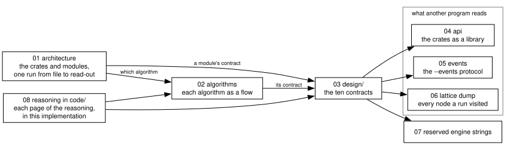

# `ein.rs`: the engine as built

The concrete implementation: the Rust workspace under [`ein.rs/`](../../../ein.rs/), its crates and modules, the
design contracts the code cites as its specification, the engine's own read-outs, and how to drive it as a library.
What a program means and what the answer is are stated without reference to this code elsewhere in `docs/ein/`;
these pages say how `ein.rs` computes it.

| page | what it holds |
|---|---|
| [`01-architecture.md`](01-architecture.md) | the system in its context, the crates and every dependency between them, one `ein solve` from file to read-out, every module and what it owns, where each part of the language lives in code |
| [`02-algorithms.md`](02-algorithms.md) | the algorithm `ein.rs` uses for each operation, where that places it, the levers that change how and never what, and each algorithm as a flow diagram with pseudocode: saturation and the agenda, the matcher, the generation ladder, the node function, the routes over `R`, core extraction, the obligation pass |
| [`03-design/`](03-design/README.md) | **the design contracts**: determinism and order, shared assets, the data model, the IR frontend, the matcher, saturation, the search, parallelism, the binary format, the toolchain and layout |
| [`04-api.md`](04-api.md) | **embedding the crates**: the five steps from a file to an answer, a worked example that is a test, the `.einb` cache, the features, what is and is not the contract |
| [`05-events.md`](05-events.md) | the `--events` protocol, `ein-events/1`: every kind, its payload, how two streams are compared |
| [`06-lattice-dump.md`](06-lattice-dump.md) | `--dump-lattice`: every node a run visited, as `nodes.json` and `nodes.md` |
| [`07-reserved-engine-strings.md`](07-reserved-engine-strings.md) | the engine's internal vocabulary: its reserved names, the names the loader makes up, the dunders' effects |
| [`08-reasoning-in-code/`](08-reasoning-in-code/README.md) | **the reasoning, in this code**: for each page of the reasoning, where `ein.rs` implements it, where its algorithm is told, the test that holds it and the commands that show it: [`01-static-ir.md`](08-reasoning-in-code/01-static-ir.md), [`02-saturation-and-negation.md`](08-reasoning-in-code/02-saturation-and-negation.md), [`03-hypotheses-and-the-answer.md`](08-reasoning-in-code/03-hypotheses-and-the-answer.md), [`04-rule-evolution.md`](08-reasoning-in-code/04-rule-evolution.md) |

How the pages stand to one another: the map first, then what the engine does and the contracts it is built to,
then the surfaces a program outside the engine reads, and last the bridge from the reasoning's pages to this code.

## The code's words

These pages name the code's identifiers as the code spells them, in backticks, and some of them are other words for
what the rest of the documentation defines ([the knowledge base](../reasoning/01-static-ir/01-knowledge-base.md)):

| in the code | in the documentation |
|---|---|
| `Value` | an **object**, a node of the knowledge-base graph: an atom or a fact ([Q-M1f.379](../../decisions/language/Q-M1f.379-an-object-is-a-node-of-the-knowledge-base-graph.md)) |
| `Symbol` | a **name**, the label of an atom; a `Value` tagged `Sym` is the atom |
| `FactId` | a **fact**, identified by its relation and arguments, whether or not a KB holds it |
| a relation's *extent* (`Kb::facts_of`, `n_by_rel`, the `scan_extent` counter) | the **held extent**, the facts of the relation that a KB holds ([Q-M1f.381](../../decisions/language/Q-M1f.381-a-relation-is-the-atom-under-a-facts-first-arrow.md)) |
| `candidate_objects`, `NameCategory::Object`, the `--events` field `object` | the **guessable atoms**, what the blind enumerator guesses about |
| `Relation::signature` | a declaration's **labels**. Ein has no types ([Q-M1f.372](../../decisions/language/Q-M1f.372-ein-has-no-types-a-declarations-slot-names-are.md)) |
