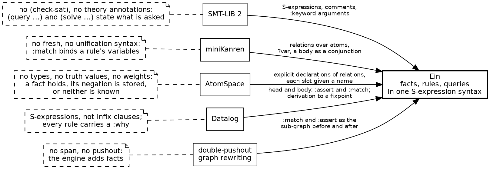

# Inspirations

Ein's language takes from several traditions and differs from each in specific places. This page states the
lineage: what was taken, and what Ein does instead.

| source | what Ein takes | where Ein differs |
|---|---|---|
| **SMT-LIB 2** | S-expressions; `;` and `#\| … \|#` comments; `:keyword` arguments; meaning carried by named atoms | rules are part of the program, with no separate form for a recursive definition; no theory annotations; no `(check-sat)`: a program states what it asks with `(query …)` and `(solve …)` |
| **miniKanren** | relations over atoms; the `?var` convention; a body as a conjunction of patterns | no `fresh` and no unification syntax: a rule's variables are bound by its `:match` |
| **AtomSpace** | explicit declarations of relations, each slot given a name | no types: a slot's name is an ordinary name, a label with no meaning a rule does not give it; no probabilistic truth values and no weights: a fact holds, its negation is stored, or neither is known |
| **Datalog** | a rule as a head and a body, which Ein writes as `:assert` and `:match`; derivation to a fixpoint | S-expressions rather than infix clauses; every rule carries a `:why` text, so a firing reads as a sentence |
| **Double-pushout graph rewriting** | `:match` and `:assert` read as the sub-graph before and the sub-graph after | a rule is not written as a span `L ← K → R`, and the engine does not rewrite by pushouts: it adds facts |

The same lineage as a picture. A solid arrow is what Ein takes; the dashed note under a source is the place where
Ein does something else.

## Why S-expressions

Ein is an S-expression language
([Q3](../../decisions/language/Q3-ein-is-an-s-expression-language.md)). The alternative for a constraint language
is a richer surface with infix operators, as Prolog, MiniZinc or an SMT solver's API have. S-expressions are chosen
for three properties:

- **One family of forms.** Rules are facts about facts, and a derivation is a structure of facts: with one
  syntactic family, a rule can match what another derived, a state the engine writes is a program it can load
  again, and a generator that writes Ein targets one grammar.
- **A grammar short enough to hold.** The whole surface is one context-free grammar, short enough to be read in
  full, held to its parser by a test, and used to constrain a generator that writes Ein.
- **Readable names.** Hyphenated relation names, capitalised object names and `;` comments keep a hand-written program
  readable, and distinguish the kinds of name without a parser hint.

## Why patterns inside rules

Some constraint systems keep one universal expression language; others, as Prolog and Datalog do, keep two: terms
and clauses. Ein is of the second kind. A rule's `:match` is a pattern, a conjunction of fact forms with variables,
and never an expression with side effects or calls
([Q4](../../decisions/language/Q4-a-rule-is-a-pattern-a-conclusion-and-a-reason.md)). That is what makes every
firing's cause structurally observable: the facts its pattern matched are its premises, and a trace or a core
names them.

## See also

The systems above, and many others, are catalogued outside this tree in [`docs/lib/`](../../lib/README.md): the
SMT-LIB, Datalog and Prolog lineage in [`02-solvers-csp-sat-smt.md`](../../lib/02-solvers-csp-sat-smt.md),
double-pushout rewriting in [`05-category-theory.md`](../../lib/05-category-theory.md), and why one syntactic family
helps a generator in [`01-llm-constrained-generation.md`](../../lib/01-llm-constrained-generation.md).
