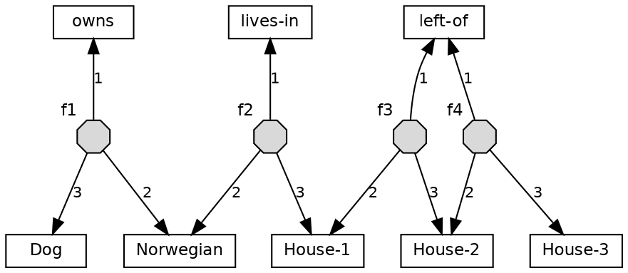
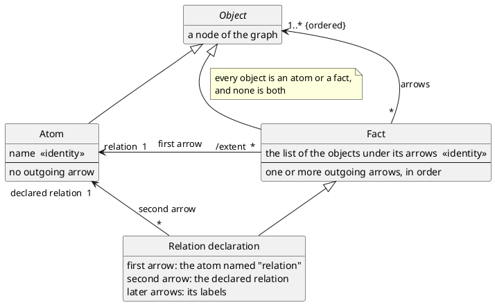
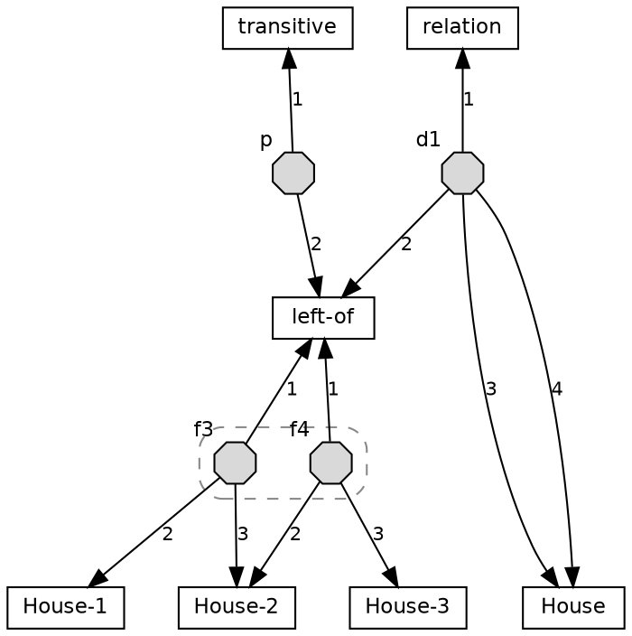
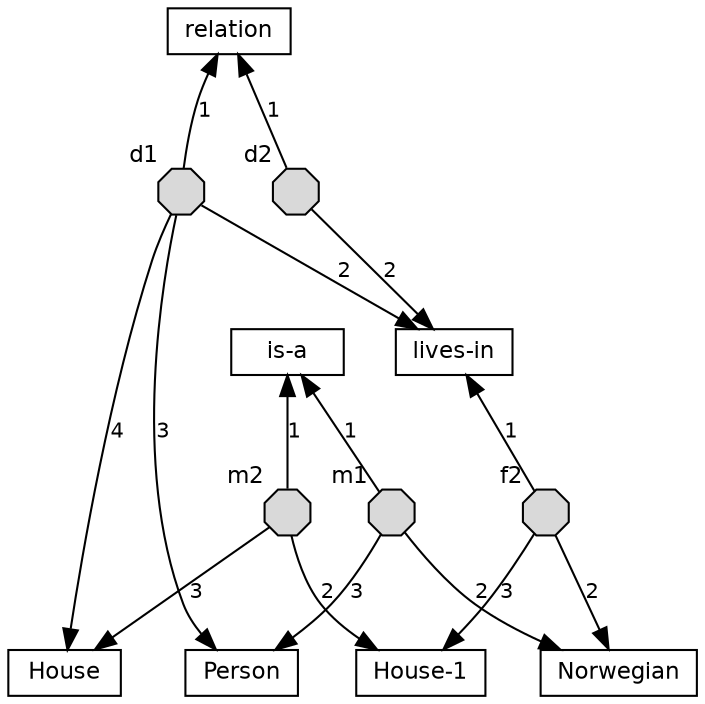
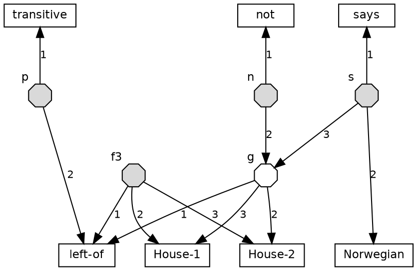
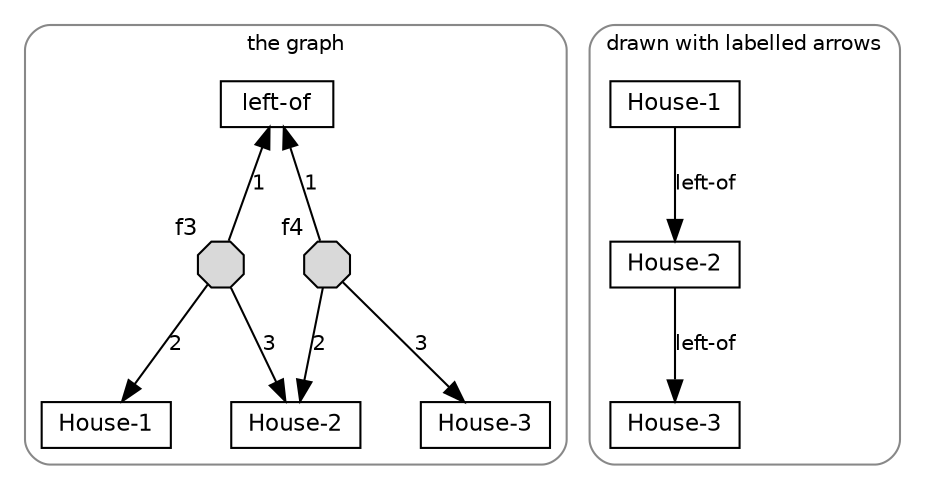

# The knowledge base: facts of relations

A knowledge base is a graph. This page shows the graph first, then names what is where in it: objects, atoms
and their names, facts, relations, declarations. Then it gives their properties: identity, order, the text of an
object, the count of a relation's arguments, nesting, and what a set of facts says of one fact. Nothing here
changes a knowledge base: a rule, which rewrites one, is [the next page](02-rewriting-rules.md), and how a
knowledge base grows is the part after it.

## The graph

**The idea it starts from.** A fact joins things in order: a relation, and what the relation is said of. A set
of such joins is a **hypergraph**, whose vertices are the things joined and whose hyperedges are the facts, each
a directed hyperedge over a list of vertices. A hypergraph has a graph that says the same, its **Levi graph**,
which is bipartite: one node for each vertex, one node for each hyperedge, and an arrow from the node of a
hyperedge to the node of each vertex it joins.

**The graph a knowledge base is** starts from that and is not strictly it. A fact may also join a fact, so an
arrow may point at a node that has arrows of its own, and the graph is not bipartite. What it keeps is the two
sorts of node: **nodes without outgoing arrows and nodes with them**. It is a finite directed graph whose arrows
are ordered at the node they leave:

$$
G = (O_K,\ \operatorname{out},\ \operatorname{name}), \qquad \operatorname{out} : O_K \to O_K^{\ast}, \qquad \operatorname{out}(o) = (o_1, o_2, \dots, o_k)
$$

$O_K$ is the finite set of its nodes, and $\operatorname{out}(o)$ is the list of the nodes that the arrows
leaving $o$ point at, **counted from the first**: $o_1$ is under its first arrow, $o_2$ under its second. A node
with no outgoing arrow carries a label, $\operatorname{name}(o)$, and a node with an outgoing arrow carries
none. Two conditions say when two nodes are one, and two more say what an arrow may point at:

$$
\begin{aligned}
&\operatorname{out}(o) = \operatorname{out}(o') = () \ \land\ \operatorname{name}(o) = \operatorname{name}(o') \implies o = o' && \text{one label, one node} \\
&\operatorname{out}(o) = \operatorname{out}(o') \neq () \implies o = o' && \text{one list of arrows, one node} \\
&\operatorname{out}(o) = (o_1, \dots, o_k) \implies \operatorname{out}(o_1) = () && \text{a first arrow points at a labelled node} \\
&\text{no path of arrows returns to the node it starts from}
\end{aligned}
$$

A knowledge base is such a graph together with the set $K$ of the nodes it **holds**, each a node with outgoing
arrows, such that every node of $O_K$ is in $K$ or lies on a path of arrows from a node of $K$. A node that the
graph has and $K$ lacks is only pointed at.

These pages return to one small program, the **three-house example**
([its spelling](../../ein.rs/08-reasoning-in-code/01-static-ir.md#the-running-example)). The knowledge base of
the four facts it writes with a source sentence is this graph:

**How the graph is drawn**, here and wherever these pages draw it. A box is a node with no outgoing arrow, and
the word in it is its label. An octagon is a node with outgoing arrows; it has no label, and the letter beside
it, $f_1$, is only what the text calls it. A filled octagon is held, an empty one is only pointed at. An arrow
carries its place in the list: $1$ on a first arrow, $2$ on a second. The picture has eight boxes and four
octagons, and every octagon is held:

$$
\begin{aligned}
\operatorname{out}(f_1) &= (\mathsf{owns},\ \mathsf{Norwegian},\ \mathsf{Dog}) & \operatorname{out}(f_3) &= (\mathsf{left\text{-}of},\ \mathsf{House\text{-}1},\ \mathsf{House\text{-}2}) \\
\operatorname{out}(f_2) &= (\mathsf{lives\text{-}in},\ \mathsf{Norwegian},\ \mathsf{House\text{-}1}) & \operatorname{out}(f_4) &= (\mathsf{left\text{-}of},\ \mathsf{House\text{-}2},\ \mathsf{House\text{-}3})
\end{aligned}
\qquad K = \{f_1, f_2, f_3, f_4\}
$$

The box $\mathsf{left\text{-}of}$ is one node, under the first arrow of $f_3$ and of $f_4$; $\mathsf{Norwegian}$
is one node, under the second arrow of $f_1$ and of $f_2$; and $\mathsf{House\text{-}2}$ is under the third
arrow of one fact and the second of another. Nothing in the graph is a label on an arrow: an arrow has only its
place.

### The graph, and how it is written

The graph is the knowledge base, and not a picture of something else. What is written down, on a page or in a
program, is a **list of tuples**, and the four right-hand sides above are one:

$$
(\mathsf{owns},\ \mathsf{Norwegian},\ \mathsf{Dog}), \quad
(\mathsf{lives\text{-}in},\ \mathsf{Norwegian},\ \mathsf{House\text{-}1}), \quad
(\mathsf{left\text{-}of},\ \mathsf{House\text{-}1},\ \mathsf{House\text{-}2}), \quad
(\mathsf{left\text{-}of},\ \mathsf{House\text{-}2},\ \mathsf{House\text{-}3})
$$

A list of tuples is a notation for the graph, and it repeats what the graph has once: the word
$\mathsf{left\text{-}of}$ is written twice, and $\mathsf{House\text{-}1}$, $\mathsf{House\text{-}2}$ and
$\mathsf{Norwegian}$ twice each. Twelve words are written, and the graph has eight labelled nodes. Reading the
notation is a map $\nu$ from what is written to nodes:

$$
\nu(w) = \text{the node labelled } w, \qquad
\nu\big((t_1, \dots, t_k)\big) = \text{the node } o \text{ with } \operatorname{out}(o) = \big(\nu(t_1), \dots, \nu(t_k)\big)
$$

for a word $w$ and a tuple of words and tuples. By the first two conditions there is exactly one such node in
each case: **exactly one node with a given label, and exactly one node with a given list of arrows**, however
often the word or the tuple is written, and wherever. So two written tuples are one fact exactly when $\nu$
sends them to one node, and that is the whole of what makes two things one in a knowledge base
([identity](#identity)).

## What is where

Given the graph, each thing a knowledge base is made of is a part of it.

**Objects.** Every node is an **object**. $O_K$ is the objects of the knowledge base $K$, and $O$ the objects of
every knowledge base together.

**Atoms and names.** An **atom** is a labelled node with no outgoing arrow, and its label is its **name**. A
name is a non-empty word over the **name characters** $\Sigma$, the ASCII letters and digits and a fixed finite
set of ASCII punctuation that [the grammar](../../user/04-reference/01-grammar.md) lists, so the names are
$\Sigma^{+}$. By the first condition an atom is its name, and the two are written alike: $\mathsf{Norwegian}$ is
the atom and the word.

**Facts.** A **fact** is a node with outgoing arrows. It has no label: it is the list of the objects its arrows
point at. $F$ is the facts of every knowledge base, so

$$
O = \Sigma^{+} \cup F, \qquad \Sigma^{+} \cap F = \emptyset
$$

An arrow of a fact points at an atom or at a fact, and a fact under an arrow of another is **nested** in it
([Q40](../../../decisions/language/Q40-a-fact-may-hold-a-fact-as-an-argument.md)). A fact is a directed
hyperedge over the objects under its arrows, and a node as well, since an arrow may point at it.

**Relations.** A **relation** is an object under the first arrow of a fact. By the third condition it is an atom.
The arrows of a fact after the first are its **argument arrows**, the objects under them its **arguments**, and
the fact is *a fact of* its relation:

$$
\operatorname{rel}(f) = o_1, \qquad \operatorname{arg}_i(f) = o_{i+1} \ \ (1 \le i \le n), \qquad \operatorname{ar}(f) = n, \qquad \text{where } \operatorname{out}(f) = (o_1, o_2, \dots, o_{n+1})
$$

**The first arrow points at the relation, the second at the first argument, and so on.** The fact with
$\operatorname{out}(f) = (r, v_1, \dots, v_n)$ is written $r(v_1, \dots, v_n)$, so $f_1$ above is
$\operatorname{owns}(\mathsf{Norwegian}, \mathsf{Dog})$. A fact may have its first arrow alone, $n = 0$. *Relation*
is a part an atom plays and not a sort of atom: an atom is a relation in a knowledge base because some fact's
first arrow points at it there, and the same atom may be an argument of another fact. *The same relation* means
that the first arrows of two facts point at one atom. So **a relation is a node, and a fact can be about it**
([Q27](../../../decisions/language/Q27-a-relations-properties-are-facts-beside.md)).

**A relation declaration** is a fact whose first arrow points at the atom $\mathsf{relation}$. Its second arrow
points at the atom that names the declared relation, and its arrows after that point at the relation's
**labels**, one for each argument a fact of the relation has:

$$
\operatorname{decl}(r;\ T_1, \dots, T_n) \;=\; \operatorname{relation}(r, T_1, \dots, T_n), \qquad r, T_1, \dots, T_n \in \Sigma^{+}
$$

and beside it the knowledge base holds $\operatorname{relation}(r)$, which says that $r$ is declared whatever
its count; for $n = 0$ the two are one fact
([Q-M1f.201](../../../decisions/language/Q-M1f.201-a-bare-relation-r-declares-no-argument.md)). The **declared
relations** are the atoms under the second arrow of a declaration. *Declared relation* and *relation* are two
definitions, and neither includes the other: a declared relation of which the knowledge base has no fact is
under no first arrow, and a relation that nothing declares is a relation all the same. The atom
$\mathsf{relation}$ is itself a relation, by the declarations, and cannot be declared.

### The definitions, in one diagram

The diagram below is of the definitions themselves, not of a knowledge base: it says how the terms above stand
to one another and what identifies each.

A box is a term, and the first line under its name is what identifies a thing of that kind where it is marked
*identity*. An arrow with a hollow head reads *is a*: an atom is an object, a fact is an object, a relation
declaration is a fact. An arrow with an open head is a way one thing points at another, with how many stand at
each end: a fact has one or more arrows, in order, each to one object; its first arrow is to one atom, which is
its **relation**, and read backwards that arrow gives the atom the facts of the relation, any number of them;
those of them a knowledge base holds are the relation's **extent** there. *Relation* and *declared relation* are names of ends of arrows, parts an atom plays, and not
boxes. Every node of the graph drawn at the head of this page is an instance of exactly one of *Atom* and
*Fact*: the eight boxes there are atoms, and the four octagons are facts.

### The relation, its extent, a fact of it

Three things go by a relation's name, and these pages keep them apart.

| | what it is | in the graph |
|---|---|---|
| **the relation** $r$ | a single object | one atom: the node under the first arrow of each of its facts |
| **the extent** of the relation in $K$ | its facts taken together | the set of the held facts whose first arrow points at that atom |
| **a fact of** the relation | one of them | one node with outgoing arrows, its first arrow at that atom |

$$
\operatorname{ext}_K(r) = \{\, f \in K \;:\; \operatorname{rel}(f) = r \,\}
$$

A fact of $r$ that the knowledge base only points at is a fact of the relation and is not in its extent. Which
of the three a statement is about is read off where the atom stands in it:

- a fact of $r$, with $r$ under its **first** arrow, is one member of the extent and says something of its own
  arguments;
- a fact with $r$ under a **later** arrow points at the single atom, and so speaks of the entire relation as one
  object, of all its facts at once. A **declaration** of $r$ is such a fact, and so is a fact that states a
  property of $r$.

That one fact can speak of a whole relation is what the atom being one node makes possible. Part of the graph
of the three-house example:

$$
\operatorname{ext}_K(\operatorname{left-of}) = \{ f_3, f_4 \}, \qquad
p = \operatorname{transitive}(\operatorname{left-of}), \qquad
d_1 = \operatorname{relation}(\operatorname{left-of}, \mathsf{House}, \mathsf{House})
$$

The first arrows of $f_3$ and $f_4$ meet at the atom $\mathsf{left\text{-}of}$, and the dashed frame around the
two is the extent. $p$ and the declaration $d_1$ point at the same atom with their second arrows: each is one
fact about the relation, and neither is in its extent. The third and fourth arrows of $d_1$ point at one atom,
since the declaration writes the label $\mathsf{House}$ twice.

The graph below has the declaration of $\operatorname{lives-in}$, as its two facts $d_1$ and $d_2$, one fact of
the relation, $f_2$, and two facts of a relation $\operatorname{is-a}$ that the example declares as it declares
any other:

$$
d_1 = \operatorname{relation}(\operatorname{lives-in}, \mathsf{Person}, \mathsf{House}), \quad
d_2 = \operatorname{relation}(\operatorname{lives-in}), \quad
f_2 = \operatorname{lives-in}(\mathsf{Norwegian}, \mathsf{House\text{-}1}), \quad
m_1 = \operatorname{is-a}(\mathsf{Norwegian}, \mathsf{Person}), \quad
m_2 = \operatorname{is-a}(\mathsf{House\text{-}1}, \mathsf{House})
$$

The atom $\mathsf{lives\text{-}in}$ is under the second arrow of $d_1$ and of $d_2$, which makes it a declared
relation, and under the first arrow of $f_2$, which makes it a relation. The labels $\mathsf{Person}$ and
$\mathsf{House}$ are atoms like any other, the same nodes $m_1$ and $m_2$ point at.

**Ein has no types.** No object has one, and no sort of node is one. A label is an atom under an arrow of a
declaration, and a declaration is a fact, so what a label means is what is made of that fact: nothing, unless
something reads it. $\operatorname{lives-in}(\mathsf{House\text{-}1}, \mathsf{Norwegian})$ is a fact as good as
$f_2$ beside the declaration above. A rule reads a declaration as it reads any fact, and it is such a rule that
gives a label the meaning *the argument in this place is one of these*
([Q-M1f.372](../../../decisions/language/Q-M1f.372-ein-has-no-types-a-declarations-slot-names-are.md),
[Q23](../../../decisions/language/Q23-a-premise-types-a-variable-and-no-entity-has.md);
[the rules](02-rewriting-rules.md#relation-polymorphic) has that rule). Two things a declaration does that
another fact does not are properties of the graph and are stated [below](#the-count-of-arguments): it fixes the
count of arguments, and a relation is declared once. One place beside the rules reads which atoms are labels,
and it is stated [where it is used](../02-kb-evolution/04-hypothesis-generation.md#5-the-blind-enumerator).

### A fact about a relation, a fact about a fact, a negation, falsity

What a fact is about is what its arrows point at, and each of these is a fact like any other.

$$
f_3 = \operatorname{left-of}(\mathsf{House\text{-}1}, \mathsf{House\text{-}2}), \quad
p = \operatorname{transitive}(\operatorname{left-of}), \quad
g = \operatorname{left-of}(\mathsf{House\text{-}2}, \mathsf{House\text{-}1}), \quad
n = \operatorname{not}(g), \quad
s = \operatorname{says}(\mathsf{Norwegian}, g), \qquad K = \{f_3, p, n, s\}
$$

- **A fact about a relation.** The second arrow of $p$ points at $\mathsf{left\text{-}of}$: the atom that is the
  relation of $f_3$ is the argument of $p$.
- **A fact about a fact.** The third arrow of $s$ points at the fact $g$: *the Norwegian says that the second
  house is left of the first*. The knowledge base holds $s$ and does not hold $g$, which is the empty octagon, a
  node the graph has because held facts point at it. Saying it does not make it held.
- **A stored negation.** $n$ is a fact of the relation $\mathsf{not}$, and its one argument is the fact $g$. It is
  written $\lnot g$ and says that $g$ does not hold.
- **Falsity.** $\bot$ is the fact of the relation $\mathsf{false}$ with its first arrow alone,
  $\operatorname{out}(\bot) = (\mathsf{false})$. It says that what holds it is impossible.

The atoms $\mathsf{not}$ and $\mathsf{false}$ are reserved, and the facts under them are of a fixed shape:

$$
\operatorname{rel}(f) = \mathsf{not} \implies \operatorname{ar}(f) = 1 \ \land\ \operatorname{arg}_1(f) \in F \ \land\ \operatorname{rel}(\operatorname{arg}_1(f)) \neq \mathsf{not},
\qquad\qquad
\operatorname{rel}(f) = \mathsf{false} \implies \operatorname{ar}(f) = 0
$$

So $\lnot a$ of an atom $a$ is no fact, and $\lnot\lnot g$ is no fact; $\lnot\bot$ is one, and $\bot$ may be an
argument ([Q-M1f.113](../../../decisions/language/Q-M1f.113-a-value-is-a-name-or-a-fact-a-state-could-hold.md),
[Q-M1f.123](../../../decisions/language/Q-M1f.123-false-with-no-argument-is-a-value.md)). What reads the two
relations is [below](#a-fact-its-negation-both-or-neither).

### The reserved atoms

A finite set $W \subset \Sigma^{+}$ of names is **reserved**: the language gives the atom one fixed part to play,
and no declaration takes its name ([the reserved names](../../user/04-reference/03-reserved-names.md) lists $W$).
Those the graph itself has a part for are $\mathsf{relation}$, $\mathsf{not}$ and $\mathsf{false}$, above;
$\mathsf{written}$, [below](#the-knowledge-base-of-a-program); and two markers, which a program may write as a
relation or as an argument and which are read where a knowledge base grows
([Q-M1f.7](../../../decisions/language/Q-M1f.7-the-dunders-are-never-bound-and-the-writeback.md)). A subset
$W_{\!c} \subset W$ is the relation of no fact at all: the words that join and test the parts of a pattern,
equality and inequality among them, which [the next page](02-rewriting-rules.md) defines. So no equality, no
test and no connective is a fact, and none is an object:

$$
\operatorname{rel}(f) \in \Sigma^{+} \setminus W_{\!c} \qquad \text{for every fact } f
$$

Two sorts of word stand beside the names and are no atom's name. A **text**, a quoted run of any characters, is
a sentence about a fact or a declaration and never an object
([Q-M1e2.23](../../../decisions/language/Q-M1e2.23-a-string-is-natural-language-text-never-a-value.md)). A
**made-up name** begins with a mark that is not in $\Sigma$: it names something a program's text gives no name
to, and no name a program writes is one
([Q-M1f.339](../../../decisions/language/Q-M1f.339-every-name-the-loader-makes-up-starts-with.md)).

## Drawn with labelled arrows

A fact with three arrows, a relation and two arguments, can be drawn as **one arrow**, from the object under its
second arrow to the object under its third, labelled with the relation's name. Two facts of
$\operatorname{left-of}$, as the graph on the left and as labelled arrows on the right:

On the left there are two facts, and that they are of one relation is in the graph: their first arrows point at
one atom. On the right each fact has become an arrow, and the relation has become a word written on it. **The
drawing loses the relation's identity**: $\mathsf{left\text{-}of}$ is no longer a node, and the same label is
written on as many arrows as the extent has facts. So it has no place for a fact about the relation, a
declaration or a property, which points at that node, nor for a fact that points at one of the two facts. So the labelled-arrow form is a way of drawing facts with
three arrows, for a reader, and never the representation: what it draws stands for the graph, by these rules.

| in the graph | drawn |
|---|---|
| a held fact with three arrows: its node, its arrows, and its relation's atom as far as this fact goes | **one arrow** from the object under the second arrow to the object under the third, labelled with the relation's name |
| a held fact with two arrows | one arrow from its argument to itself, a loop, labelled with the relation's name |
| a held fact with any other count of arrows | its node, an octagon, with **the relation's name written in it**: the first arrow and the atom under it are folded into that label. The arrows that stay are numbered by argument, $1$ on the arrow to the first argument |
| a fact under an arrow of another | one node labelled with the fact's [text](#the-text-of-an-object), its own arrows not drawn |

The four facts of the first drawing are then five nodes and four arrows, where the graph has twelve nodes and
twelve arrows. The drawings of the pages after this one are of this form, and add to it only what each says: an
oval and a box for the two ends of a fact of a relation spelt $\operatorname{is-a}$, a colour for the arrows of
one relation, a dashed arrow for a fact that a rule added
([rendering](../../user/04-reference/12-rendering.md) is the legend). Those are conventions of drawing and mark
no sort of object. On these two pages a drawing is of the graph unless it says that it is drawn with labelled
arrows.

## The knowledge base of a program

A **program** $P$ is a text. Each form of it is a fact, a declaration, or a question, and reading it gives one
knowledge base, $K_0$. For a program that declares no rule,

$$
K_0 \;=\; T \;\cup\; D \;\cup\; \{\, \operatorname{written}(t) \;:\; t \in \operatorname{sub}(f),\ f \in T \,\}
$$

- $T$ is the facts the text writes, the nodes $\nu$ sends its tuples to. A fact written twice is one fact.
- $D$ is the facts its relation declarations are, two for each as [above](#what-is-where). A declaration's own
  text, the sentence a fact of the relation reads as, is no part of the graph.
- The third set states, for each fact nested in a written fact, that the text wrote it
  ([Q-M1f.275](../../../decisions/language/Q-M1f.275-written-states-every-fact-a-file-nests.md)); $\operatorname{sub}$
  is defined [below](#nesting). No program writes a fact of $\mathsf{written}$
  ([Q-M1f.280](../../../decisions/language/Q-M1f.280-a-program-does-not-write-written.md)); what reads these
  facts is a rule that checks a representation where its terms are written
  ([Q-M1f.272](../../../decisions/language/Q-M1f.272-a-representation-module-reads-what-a-file-writes.md)).

A program also declares rules. A rule is no fact of $K_0$; its declaration adds to $K_0$ only facts of
$\mathsf{written}$, which are stated with the rules
([the next page](02-rewriting-rules.md#the-program-and-its-names)).

A written fact may carry a **source sentence**, a text. It says where the fact comes from, is no part of the
fact, and changes nothing a knowledge base holds.

**A declared name has one full name.** A relation that a module $m$ declares under the name $d$ is the atom
named $m\mathtt{.}d$: the module's name, a dot, the declared name. A file may write a short name for it, and
the short names of a file are a partial function into the full names, local to that file:

$$
\alpha_{\text{file}} : \Sigma^{+} \rightharpoonup \Sigma^{+}, \qquad \alpha_{\text{file}}(d) = m\mathtt{.}d
$$

The atoms of $K_0$ carry full names. Two modules that each declare $d$ declare two atoms, and a module reached
along several paths of imports is one module with one set of full names
([Q-M1f.231](../../../decisions/imports/Q-M1f.231-every-name-a-module-declares-has-a-full-name.md)). That
$\alpha_{\text{file}}$ is a function is a condition on a program: one short name for two full names in one file
is no program.

## Properties

### Identity

**An object's identity is its name or its tuple.** The first two conditions of the graph are the whole of it: an
atom is the one node with its name, and a fact is the one node with its list of arrows.

$$
\begin{aligned}
a = b &\iff \lvert a \rvert = \lvert b \rvert \;\land\; \forall i \le \lvert a \rvert.\; a_i = b_i && \text{for atoms: one word} \\
f = g &\iff \operatorname{out}(f) = \operatorname{out}(g) && \text{for facts: one list of arrows} \\
a \neq f &&& \text{for an atom } a \text{ and a fact } f
\end{aligned}
$$

The second line compares the objects under the arrows, which are atoms or facts again, so it is a recursion on
the depth of the facts, and it ends, since no path of arrows returns to its start. Written out it says that
$r(u_1, \dots, u_m)$ and $s(v_1, \dots, v_n)$ are one fact exactly when $r = s$, $m = n$ and $u_i = v_i$ for
every $i$, at every depth; a stored negation is a fact, so $\lnot f = \lnot g \iff f = g$ is a case of it. So
the objects of every knowledge base are the least set with

$$
O \;=\; \Sigma^{+} \;\cup\; \{\, (r, o_1, \dots, o_n) \;:\; r \in \Sigma^{+} \setminus W_{\!c},\ n \ge 0,\ o_1, \dots, o_n \in O \,\}
$$

less the tuples under $\mathsf{not}$ and $\mathsf{false}$ that are not of the shape those atoms fix. $F$ is the
tuples, and $\nu$ sends each written word or tuple to one object of $O$, every object being so written. A knowledge base is a
finite set $K \subseteq F$, and its graph is determined by it: its objects are the facts of $K$ and whatever
lies under their arrows, at any depth. $f \in K$, $K \subseteq K'$ and $K \cup K'$ are statements about sets of
facts.

**Identity is by name, and a digit is a name character.** No function from $\Sigma^{+}$ to the integers is part
of the theory:

$$
\mathsf{1} \ne \mathsf{01}, \qquad \mathsf{7},\ \mathsf{-7},\ \mathsf{1..5} \in \Sigma^{+}
$$

So **Ein has no numbers, no ranges and no integer kind**. A name of digits is compared and ordered as any other
name is ([Q-M1e2.24](../../../decisions/language/Q-M1e2.24-ein-has-no-numbers-and-no-ranges.md)), and arithmetic
is a theory of rules over numerals written in such names, never an operation on names.

**No two atoms are ever one.** Equality of objects is identity, and it is no fact: $\mathsf{eq}$ and
$\mathsf{neq}$ are in $W_{\!c}$, so no knowledge base holds an equality, and nothing merges two nodes
([Q1](../../../decisions/language/Q1-the-knowledge-base-is-a-typed-labelled.md),
[Q-M1e2.26](../../../decisions/language/Q-M1e2.26-eq-and-neq-are-the-relations-of-equality-and-non.md)).

**What is no part of identity**: where an object is written, how often, the source sentence of a fact, a
declaration's text, and the knowledge base that holds a fact. One fact held by two knowledge bases is one fact.

### Order

Any two objects compare. Write $\lt_{\text{lex}}$ for the order of words by code point, a proper prefix first.
The order $\prec$ compares two facts as two lists, by the objects under their arrows in turn, from the first
arrow; it is the least relation on $O$ with

$$
\begin{aligned}
a \prec f \quad & \text{for every atom } a \text{ and every fact } f \\
a \prec b \quad & \text{iff } a \lt_{\text{lex}} b, \text{ for atoms } a, b \\
f \prec g \quad & \text{iff } \operatorname{out}(f) \prec^{\ast} \operatorname{out}(g), \text{ for facts } f, g
\end{aligned}
$$

where $\prec^{\ast}$ compares two lists place by place by $\prec$, and puts a list that is a proper prefix of
another first:

$$
(u_1, \dots, u_m) \prec^{\ast} (v_1, \dots, v_n) \iff \exists k.\ \ \big(\forall i < k.\ u_i = v_i\big) \;\land\; \Big( \big(k \le \min(m, n) \land u_k \prec v_k\big) \ \lor\ \big(k = m + 1 \le n\big) \Big)
$$

and $u \preceq v$ means $u \prec v$ or $u = v$. In words:

- **an atom before a fact**;
- **two atoms by their names**, character by character. Names are ASCII, so a digit comes before an upper-case
  letter, and upper case before lower case. A name of digits is a word like any other:
  $\mathsf{10} \prec \mathsf{2}$, and so $\operatorname{p}(\mathsf{10}) \prec \operatorname{p}(\mathsf{2})$;
- **two facts by their relation's name, then their arguments in turn, then their count**. A stored negation and
  $\bot$ are facts and compare as facts, under the names of $\mathsf{not}$ and $\mathsf{false}$.

**Proposition.** $\preceq$ is a total order on $O$.

*Argument.* By induction on the depth of the two objects, the length of the longest path of arrows from each.
$\lt_{\text{lex}}$ is a total order of words, so atoms are totally ordered, and every atom comes before every
fact. For two facts, the lists of the objects under their arrows are compared by $\prec^{\ast}$, the
lexicographic order over $\prec$ on objects of smaller depth, which is total by induction; a lexicographic order
over a total order is total. Two facts that neither precedes the other have equal lists, which is identity of
facts. $\square$

A chain of nine objects in the order, three atoms and six facts. The drawing is of the order and not of a
knowledge base: each box is one object, written as a term.

```dot
digraph object_order {
  rankdir=LR;
  node [shape=box, fontname="Helvetica", fontsize=11, height=0.3];
  edge [fontname="Helvetica", fontsize=10];
  n1 [label="10"]; n2 [label="2"]; n3 [label="a"];
  f1 [label="adjacent(b, b)"];
  f2 [label="co-located(a)"];
  f3 [label="co-located(a, a)"];
  f4 [label="co-located(a, b)"];
  f5 [label="co-located(a, p(a))"];
  f6 [label="co-located(b)"];
  n1 -> n2 -> n3 -> f1 -> f2 -> f3 -> f4 -> f5 -> f6 [label="≺"];
}
```

Each arrow reads *comes before*. The third is an atom before a fact; the fourth is decided at the first arrow,
by the relation's name; the fifth by the count, a prefix first; the seventh by an atom before a fact under the
third arrow.

$\prec$ is a function of the objects alone, of their names and their arrows, so a listing in it is the same
however the objects are stored or numbered. It is stated because two objects of different sorts, an atom and a
fact, can stand under the same arrow of two facts of one relation, and the order must say which comes first.

### The text of an object

An object has a **text**, a word that is again a function of the object alone:

$$
\operatorname{text}(a) = a, \qquad \operatorname{text}(r(v_1, \dots, v_n)) = \texttt{(}\; r\; \sqcup\; \operatorname{text}(v_1)\; \sqcup\; \cdots\; \sqcup\; \operatorname{text}(v_n)\; \texttt{)}
$$

with $\sqcup$ one space, and $\texttt{(}\,r\,\texttt{)}$ for $n = 0$. It is the list of the objects under the
fact's arrows, in order, between parentheses. Reading is its inverse,

$$
\operatorname{read}(\operatorname{text}(v)) = v \qquad \text{for every object } v
$$

so $\operatorname{text}$ is injective: two objects are one exactly when their texts are one word. An object holds
no text of a program, no source sentence and no declaration's sentence, so none is in its text. A made-up name,
which begins with a mark outside $\Sigma$, is set between quotation marks where it is shown and does not read
back, which is how a reader tells it apart.

**Comparing texts is a second total order, and it is not $\prec$.** In the order of characters a space comes
before a closing parenthesis, and an opening parenthesis before every letter and digit, so

$$
\operatorname{text}(\operatorname{q}(\mathsf{10}, \mathsf{10})) \lt_{\text{lex}} \operatorname{text}(\operatorname{q}(\mathsf{10})) \ \ \text{but} \ \ \operatorname{q}(\mathsf{10}) \prec \operatorname{q}(\mathsf{10}, \mathsf{10}),
\qquad
\operatorname{text}(\operatorname{q}(\operatorname{p}(\mathsf{a}))) \lt_{\text{lex}} \operatorname{text}(\operatorname{q}(\mathsf{a})) \ \ \text{but} \ \ \operatorname{q}(\mathsf{a}) \prec \operatorname{q}(\operatorname{p}(\mathsf{a}))
$$

Each is total and each is a function of the objects alone. A listing says which of the two it is in.

**Quoted.** Where a sentence about a program names an object, it quotes it by one function $q$, from objects
and from lists $[v_1, \dots, v_n]$ of objects to ASCII words. It has three shapes, for a name, a list and a fact:

$$
\begin{aligned}
q(a) &= \texttt{'}a\texttt{'}, \quad \text{or } \ \texttt{"}a\texttt{"} \ \text{ where the name } a \text{ holds an apostrophe} \\
q([v_1, \dots, v_n]) &= \texttt{(}\,q(v_1)\texttt{,}\sqcup\cdots\texttt{,}\sqcup q(v_n)\,\texttt{)} \quad (n \ge 2), \qquad q([v_1]) = \texttt{(}\,q(v_1)\texttt{,)}, \qquad q([\,]) = \texttt{()} \\
q(r(v_1, \dots, v_n)) &= \texttt{Fact(relation}\_\texttt{name=}\,q(r)\,\texttt{,}\sqcup\texttt{args=}\,q([v_1, \dots, v_n])\,\texttt{)}
\end{aligned}
$$

The quoted form sets the relation apart from the arguments, where the text lists all the arrows alike. $q$ is
total and injective, so comparing quoted forms is a third total order, $u \lt_{q} v \iff q(u) \lt_{\text{lex}} q(v)$.

### The count of arguments

A fact has as many arguments as it has arrows after the first, and of a relation nothing declares the facts may
be of any count, each count giving different facts. A declaration fixes the count:

$$
P \text{ declares } r \text{ with the labels } T_1, \dots, T_n \ \land\ \operatorname{rel}(f) = r \implies \operatorname{ar}(f) = n \qquad \text{for every fact } f \text{ the text writes}
$$

so on the declared relations of a program $\operatorname{ar}$ is a function of the relation, the number of its
labels. The count is the whole of it: nothing is required of what stands under an arrow
([Q-M1f.315](../../../decisions/language/Q-M1f.315-a-form-of-a-declared-relation-has-as-many.md)). And a relation
is declared at most once: two declarations of one name are no program. Both are conditions on a text, and a text
that fails one is no program.

### Nesting

The **facts nested in** a fact are those under its argument arrows, at any depth:

$$
\operatorname{sub}(r(v_1, \dots, v_n)) = \bigcup_{i \le n} \big( (\{v_i\} \cap F) \cup \operatorname{sub}(v_i) \big), \qquad \operatorname{sub}(\lnot f) = \operatorname{sub}(f), \qquad \operatorname{sub}(a) = \emptyset
$$

The second equation is the one exception to the arrows: a stored negation and the fact it denies are read as
one, so a negation nests what the fact it denies nests, and not that fact itself. For a set $X$ of facts,
$\operatorname{sub}(X)$ is the union over its members, and the **names of** $X$ are the atoms under an argument
arrow of a fact of $X$, at any depth:

$$
\operatorname{names}(X) = \{\, a \in \Sigma^{+} \;:\; a = \operatorname{arg}_i(g) \ \text{ for some } i \text{ and some fact } g \text{ that is in } X \text{ or under an argument arrow of one, at any depth} \,\}
$$

An atom that the facts of $X$ point at with a first arrow alone is a relation of $X$ and not one of its names.
A nested fact is an object like any other: $\operatorname{says}(\mathsf{Norwegian}, g)$ has $g$ under its third
arrow, identified by its own arrows at every depth, whether or not the knowledge base holds $g$.

### A fact, its negation, both, or neither

For a fact $f$ that is no stored negation, a set $K$ of facts holds $f$, or $\lnot f$, or neither, or both:

$$
\operatorname{status}_K(f) =
\begin{cases}
\text{asserted} & f \in K,\ \lnot f \notin K \\
\text{negated} & f \notin K,\ \lnot f \in K \\
\text{open} & f \notin K,\ \lnot f \notin K \\
\text{contradicted} & f \in K,\ \lnot f \in K
\end{cases}
$$

In the graph the four are the four ways two nodes can be filled: $f$, and the fact of $\mathsf{not}$ that
points at it. A negated fact is not merely missing: a stored negation is a fact the set holds, and *open* is
that it holds neither.

**A contradiction** is a contradicted fact, or the fact of falsity:

$$
\operatorname{dead}(K) \iff \bot \in K \;\lor\; \exists f.\ \ f \in K \land \lnot f \in K, \qquad\qquad \operatorname{alive}(K) \iff \lnot \operatorname{dead}(K)
$$

A set of facts that holds a contradiction is **dead**, and one that holds none is **alive**. Both are properties
of the set: a set that includes a dead set is dead. This is all the two reserved relations mean, and it is what
the reasoning reads them for.
