# The knowledge base: facts of relations

A knowledge base is a graph. This page shows the graph first, then names what is where in it: objects, atoms
and their names, facts, relations, declarations, and the two contexts a fact may be in. Then it gives their
properties: identity, order, the text of an object, the count of a relation's arguments, nesting, what a set of
facts says of one fact, and what a context does not say of it. Nothing here
changes a knowledge base: a rule, which rewrites one, is [the next page](02-rewriting-rules.md), and how a
knowledge base grows is the part after it.

## The graph

**The idea it starts from.** A fact joins things in order: a relation, and what the relation is said of. A set
of such joins is a **hypergraph**, whose vertices are the things joined and whose hyperedges are the facts, each
a directed hyperedge over a list of vertices. A hypergraph has a graph that says the same, its **Levi graph**,
which is bipartite: one node for each vertex, one node for each hyperedge, and an arrow from the node of a
hyperedge to the node of each vertex it joins.

**The graph a knowledge base is** starts from that and is not strictly it. A fact may also join a fact, so an
arrow may point at a node that has arrows of its own, and the graph is not bipartite. What it keeps is the two
sorts of node: **nodes without outgoing arrows and nodes with them**. It is a finite directed graph whose arrows
are ordered at the node they leave:

$$
\begin{aligned}
G &= (O_K,\ \operatorname{out},\ \operatorname{name}) \\
\operatorname{out} &: O_K \to O_K^{\ast} \\
\operatorname{out}(o) &= (o_1, o_2, \dots, o_k)
\end{aligned}
$$

$O_K$ is the finite set of its nodes, and $\operatorname{out}(o)$ is the list of the nodes that the arrows
leaving $o$ point at, **counted from the first**: $o_1$ is under its first arrow, $o_2$ under its second. A node
with no outgoing arrow carries a label, $\operatorname{name}(o)$, and a node with an outgoing arrow carries
none. Two conditions say when two nodes are one, and two more say what an arrow may point at:

$$
\begin{aligned}
&\operatorname{out}(o) = \operatorname{out}(o') = () \ \land\ \operatorname{name}(o) = \operatorname{name}(o') \implies o = o' && \text{one label, one node} \\
&\operatorname{out}(o) = \operatorname{out}(o') \neq () \implies o = o' && \text{one list of arrows, one node} \\
&\operatorname{out}(o) = (o_1, \dots, o_k) \implies \operatorname{out}(o_1) = () && \text{a first arrow points at a labelled node} \\
&\text{no path of arrows returns to the node it starts from}
\end{aligned}
$$

A knowledge base is such a graph together with the set $K$ of the nodes it **holds**, each a node with outgoing
arrows, such that every node of $O_K$ is in $K$ or lies on a path of arrows from a node of $K$. A node that the
graph has and $K$ lacks is only pointed at.

These pages return to one small program, the **three-house example**
([its spelling](../../ein.rs/08-reasoning-in-code/01-static-ir.md#the-running-example)). The knowledge base of
the four facts it writes with a source sentence is this graph:

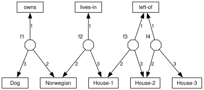

**How the graph is drawn**, here and wherever these pages draw it. A box is a node with no outgoing arrow, and
the word in it is its label. An octagon is a node with outgoing arrows; it has no label, and the letter beside
it, $f_1$, is only what the text calls it. An octagon that is only pointed at, and not held, stands inside a
dashed frame, named for the relation of the facts that point at it; a held one stands in no frame
([below](#the-global-context-and-the-context-of-a-fact)). An arrow carries its place in the list: $1$ on a first
arrow, $2$ on a second. The picture has eight boxes and four octagons; every octagon is held, and none is in a
frame:

$$
\begin{aligned}
\operatorname{out}(f_1) &= (\mathsf{owns},\ \mathsf{Norwegian},\ \mathsf{Dog}) \\
\operatorname{out}(f_2) &= (\mathsf{lives\text{-}in},\ \mathsf{Norwegian},\ \mathsf{House\text{-}1}) \\
\operatorname{out}(f_3) &= (\mathsf{left\text{-}of},\ \mathsf{House\text{-}1},\ \mathsf{House\text{-}2}) \\
\operatorname{out}(f_4) &= (\mathsf{left\text{-}of},\ \mathsf{House\text{-}2},\ \mathsf{House\text{-}3}) \\
K &= \{f_1, f_2, f_3, f_4\}
\end{aligned}
$$

The box $\mathsf{left\text{-}of}$ is one node, under the first arrow of $f_3$ and of $f_4$; $\mathsf{Norwegian}$
is one node, under the second arrow of $f_1$ and of $f_2$; and $\mathsf{House\text{-}2}$ is under the third
arrow of one fact and the second of another. Nothing in the graph is a label on an arrow: an arrow has only its
place.

### The graph, and how it is written

The graph is the knowledge base, and not a picture of something else. What is written down, on a page or in a
program, is a **list of tuples**, and the four right-hand sides above are one:

$$
\begin{aligned}
&(\mathsf{owns},\ \mathsf{Norwegian},\ \mathsf{Dog}) \\
&(\mathsf{lives\text{-}in},\ \mathsf{Norwegian},\ \mathsf{House\text{-}1}) \\
&(\mathsf{left\text{-}of},\ \mathsf{House\text{-}1},\ \mathsf{House\text{-}2}) \\
&(\mathsf{left\text{-}of},\ \mathsf{House\text{-}2},\ \mathsf{House\text{-}3})
\end{aligned}
$$

A list of tuples is a notation for the graph, and it repeats what the graph has once: the word
$\mathsf{left\text{-}of}$ is written twice, and $\mathsf{House\text{-}1}$, $\mathsf{House\text{-}2}$ and
$\mathsf{Norwegian}$ twice each. Twelve words are written, and the graph has eight labelled nodes. Reading the
notation is a map $\nu$ from what is written to nodes:

$$
\begin{aligned}
\nu(w) &= \text{the node labelled } w \\
\nu\big((t_1, \dots, t_k)\big) &= \text{the node } o \text{ with } \operatorname{out}(o) = \big(\nu(t_1), \dots, \nu(t_k)\big)
\end{aligned}
$$

for a word $w$ and a tuple of words and tuples. By the first two conditions there is exactly one such node in
each case: **exactly one node with a given label, and exactly one node with a given list of arrows**, however
often the word or the tuple is written, and wherever. So two written tuples are one fact exactly when $\nu$
sends them to one node, and that is the whole of what makes two things one in a knowledge base
([identity](#identity)).

## What is where

Given the graph, each thing a knowledge base is made of is a part of it.

**Objects.** Every node is an **object**. $O_K$ is the objects of the knowledge base $K$, and $O$ the objects of
every knowledge base together.

**Atoms and names.** An **atom** is a labelled node with no outgoing arrow, and its label is its **name**. A
name is a non-empty word over the **name characters** $\Sigma$, the ASCII letters and digits and a fixed finite
set of ASCII punctuation that [the grammar](../../user/04-reference/01-grammar.md) lists, so the names are
$\Sigma^{+}$. By the first condition an atom is its name, and the two are written alike: $\mathsf{Norwegian}$ is
the atom and the word.

**Facts.** A **fact** is a node with outgoing arrows. It has no label: it is the list of the objects its arrows
point at. $F$ is the facts of every knowledge base, so

$$
\begin{aligned}
O &= \Sigma^{+} \cup F \\
\emptyset &= \Sigma^{+} \cap F
\end{aligned}
$$

An arrow of a fact points at an atom or at a fact, and a fact under an arrow of another is **nested** in it
([Q40](../../../decisions/language/Q40-a-fact-may-hold-a-fact-as-an-argument.md)). A fact is a directed
hyperedge over the objects under its arrows, and a node as well, since an arrow may point at it.

**Relations.** A **relation** is an object under the first arrow of a fact. By the third condition it is an atom.
The arrows of a fact after the first are its **argument arrows**, the objects under them its **arguments**, and
the fact is *a fact of* its relation:

$$
\begin{aligned}
\operatorname{out}(f) &= (o_1, o_2, \dots, o_{n+1}) \\
\operatorname{rel}(f) &= o_1 \\
\operatorname{arg}_i(f) &= o_{i+1} && \text{for } 1 \le i \le n \\
\operatorname{ar}(f) &= n
\end{aligned}
$$

**The first arrow points at the relation, the second at the first argument, and so on.** The fact with
$\operatorname{out}(f) = (r, v_1, \dots, v_n)$ is written $r(v_1, \dots, v_n)$, so $f_1$ above is
$\operatorname{owns}(\mathsf{Norwegian}, \mathsf{Dog})$. A fact may have its first arrow alone, $n = 0$. *Relation*
is a part an atom plays and not a sort of atom: an atom is a relation in a knowledge base because some fact's
first arrow points at it there, and the same atom may be an argument of another fact. *The same relation* means
that the first arrows of two facts point at one atom. So **a relation is a node, and a fact can be about it**
([Q27](../../../decisions/language/Q27-a-relations-properties-are-facts-beside.md)).

**A relation declaration** is a fact whose first arrow points at the atom $\mathsf{relation}$. Its second arrow
points at the atom that names the declared relation, and its arrows after that point at the relation's
**labels**, one for each argument a fact of the relation has:

$$
\begin{aligned}
\operatorname{decl}(r;\ T_1, \dots, T_n) &= \operatorname{relation}(r, T_1, \dots, T_n) \\
r, T_1, \dots, T_n &\in \Sigma^{+}
\end{aligned}
$$

and beside it the knowledge base holds $\operatorname{relation}(r)$, which says that $r$ is declared whatever
its count; for $n = 0$ the two are one fact
([Q-M1f.201](../../../decisions/language/Q-M1f.201-a-bare-relation-r-declares-no-argument.md)). The **declared
relations** are the atoms under the second arrow of a declaration. *Declared relation* and *relation* are two
definitions, and neither includes the other: a declared relation of which the knowledge base has no fact is
under no first arrow, and a relation that nothing declares is a relation all the same. The atom
$\mathsf{relation}$ is itself a relation, by the declarations, and cannot be declared.

**The relations of a program** are every atom it writes first in a tuple, at any depth, and every atom it declares:
being first in a tuple is enough, and a declaration is an optional fact, a convention some modules of the standard
library use to reason about a relation's arguments
([Q-M1f.522](../../../decisions/language/Q-M1f.522-a-relation-of-the-program-is-any-atom-it-writes.md)). The few
atoms the kernel reads as the forms of its language, $\mathsf{relation}$ and the words of the rule language among
them, are relations of the graph that no program counts among its own
([saturation](../02-kb-evolution/02-saturation.md#the-alive-set-invariant) writes the set
$\operatorname{rels}(P)$).

### The definitions, in one diagram

The diagram below is of the definitions themselves, not of a knowledge base: it says how the terms above stand
to one another and what identifies each.

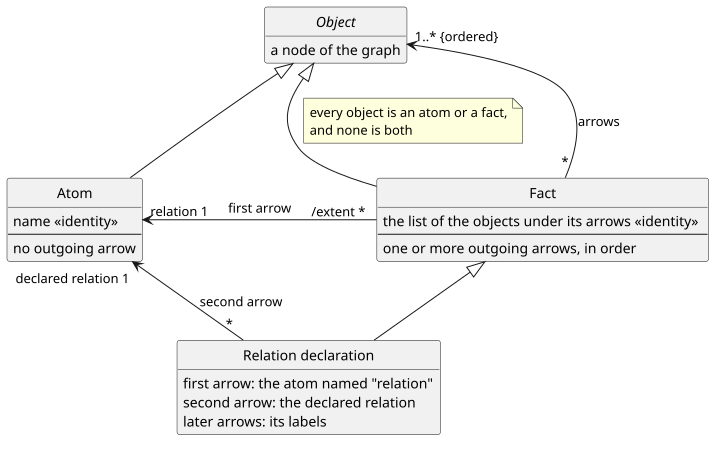

A box is a term, and the first line under its name is what identifies a thing of that kind where it is marked
*identity*. An arrow with a hollow head reads *is a*: an atom is an object, a fact is an object, a relation
declaration is a fact. An arrow with an open head is a way one thing points at another, with how many stand at
each end: a fact has one or more arrows, in order, each to one object; its first arrow is to one atom, which is
its **relation**, and read backwards that arrow gives the atom the facts of the relation, any number of them:
the relation's **extent**. *Relation* and *declared relation* are names of ends of arrows, parts an atom plays,
and not boxes. Every node of the graph drawn at the head of this page is an instance of exactly one of *Atom* and
*Fact*: the eight boxes there are atoms, and the four octagons are facts.

### The relation, its extent, a fact of it

Three things go by a relation's name, and these pages keep them apart.

| | what it is | in the graph |
|---|---|---|
| **the relation** $r$ | a single object | one atom: the node under the first arrow of each of its facts |
| **the extent** of the relation | its facts taken together | the set of every fact whose first arrow points at that atom, whether a knowledge base holds it or not |
| **a fact of** the relation | one of them | one node with outgoing arrows, its first arrow at that atom |

$$
\begin{aligned}
\operatorname{ext}(r) &= \{\, f \in F \;:\; \operatorname{rel}(f) = r \,\} \\
\operatorname{ext}_K(r) &= \operatorname{ext}(r) \cap K
\end{aligned}
$$

The extent is every fact of the relation: those a knowledge base holds, those it only points at, and those no
knowledge base holds yet. So it is a property of the relation alone, the same whatever is held. What a knowledge
base $K$ holds of it is the **held extent** $\operatorname{ext}_K(r)$, which is the part a rule reads when it
matches a fact of $r$. Which of the three a statement is about is read off where the atom stands in it:

- a fact of $r$, with $r$ under its **first** arrow, is one member of the extent and says something of its own
  arguments;
- a fact with $r$ under a **later** arrow points at the single atom, and so speaks of the entire relation as one
  object, of all its facts at once. A **declaration** of $r$ is such a fact, and so is a fact that states a
  property of $r$.

That one fact can speak of a whole relation is what the atom being one node makes possible. Part of the graph
of the three-house example:

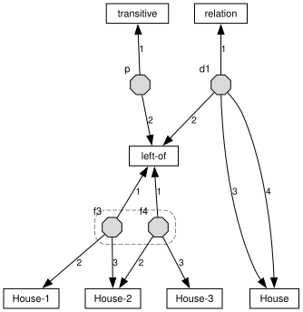

$$
\begin{aligned}
f_3 &= \operatorname{left-of}(\mathsf{House\text{-}1}, \mathsf{House\text{-}2}) \\
f_4 &= \operatorname{left-of}(\mathsf{House\text{-}2}, \mathsf{House\text{-}3}) \\
g &= \operatorname{left-of}(\mathsf{House\text{-}1}, \mathsf{House\text{-}3}) \\
\lbrace f_3, f_4, g \rbrace &\subseteq \operatorname{ext}(\operatorname{left-of}) \\
\operatorname{ext}_K(\operatorname{left-of}) &= \lbrace f_3, f_4 \rbrace \\
p &= \operatorname{transitive}(\operatorname{left-of}) \\
d_1 &= \operatorname{relation}(\operatorname{left-of}, \mathsf{House}, \mathsf{House})
\end{aligned}
$$

The first arrows of $f_3$, $f_4$ and $g$, drawn coloured, meet at the atom $\mathsf{left\text{-}of}$: they are
the part of the extent drawn, and every other fact of $\operatorname{left-of}$ has its first arrow there too.
$f_3$ and $f_4$ are held, and are the held extent; $g$, drawn grey, is a fact of the relation that the knowledge
base does not hold, and that no held fact points at. $p$ and the declaration $d_1$ point at the same atom with their second arrows: each is one fact
about the relation, and neither is in its extent. The third and fourth arrows of $d_1$ point at one atom,
since the declaration writes the label $\mathsf{House}$ twice.

The graph below has the declaration of $\operatorname{lives-in}$, as its two facts $d_1$ and $d_2$, one fact of
the relation, $f_2$, and two facts of a relation $\operatorname{is-a}$ that the example declares as it declares
any other:

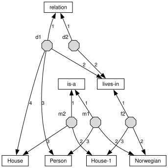

$$
\begin{aligned}
d_1 &= \operatorname{relation}(\operatorname{lives-in}, \mathsf{Person}, \mathsf{House}) \\
d_2 &= \operatorname{relation}(\operatorname{lives-in}) \\
f_2 &= \operatorname{lives-in}(\mathsf{Norwegian}, \mathsf{House\text{-}1}) \\
m_1 &= \operatorname{is-a}(\mathsf{Norwegian}, \mathsf{Person}) \\
m_2 &= \operatorname{is-a}(\mathsf{House\text{-}1}, \mathsf{House})
\end{aligned}
$$

The atom $\mathsf{lives\text{-}in}$ is under the second arrow of $d_1$ and of $d_2$, which makes it a declared
relation, and under the first arrow of $f_2$, which makes it a relation. The labels $\mathsf{Person}$ and
$\mathsf{House}$ are atoms like any other, the same nodes $m_1$ and $m_2$ point at.

**Ein has no types.** No object has one, and no sort of node is one. A label is an atom under an arrow of a
declaration, and a declaration is a fact, so what a label means is what is made of that fact: nothing, unless
something reads it. $\operatorname{lives-in}(\mathsf{House\text{-}1}, \mathsf{Norwegian})$ is a fact as good as
$f_2$ beside the declaration above. A rule reads a declaration as it reads any fact, and it is such a rule that
gives a label the meaning *the argument in this place is one of these*
([Q-M1f.372](../../../decisions/language/Q-M1f.372-ein-has-no-types-a-declarations-slot-names-are.md),
[Q23](../../../decisions/language/Q23-a-premise-says-what-a-variable-ranges-over.md);
[the rules](02-rewriting-rules.md#relation-polymorphic) has that rule). Two things a declaration does that
another fact does not are properties of the graph and are stated [below](#the-count-of-arguments): it fixes the
count of arguments, and a relation is declared once. One place beside the rules reads which atoms are labels,
and it is stated [where it is used](../02-kb-evolution/04-hypothesis-generation.md#5-the-blind-enumerator).

### A fact about a relation, a fact about a fact, a negation, falsity

What a fact is about is what its arrows point at, and each of these is a fact like any other.

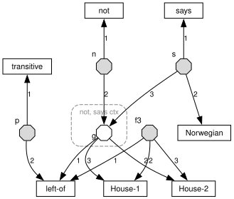

$$
\begin{aligned}
f_3 &= \operatorname{left-of}(\mathsf{House\text{-}1}, \mathsf{House\text{-}2}) \\
p &= \operatorname{transitive}(\operatorname{left-of}) \\
g &= \operatorname{left-of}(\mathsf{House\text{-}2}, \mathsf{House\text{-}1}) \\
n &= \operatorname{not}(g) \\
s &= \operatorname{says}(\mathsf{Norwegian}, g) \\
K &= \{f_3, p, n, s\}
\end{aligned}
$$

- **A fact about a relation.** The second arrow of $p$ points at $\mathsf{left\text{-}of}$: the atom that is the
  relation of $f_3$ is the argument of $p$.
- **A fact about a fact.** The third arrow of $s$ points at the fact $g$: *the Norwegian says that the second
  house is left of the first*. The knowledge base holds $s$ and does not hold $g$, which is the octagon in a
  frame, a node the graph has because held facts point at it. Saying it does not make it held. The frame around
  $g$ is named for the two relations whose facts point at it.
- **A stored negation.** $n$ is a fact of the relation $\mathsf{not}$, and its one argument is the fact $g$. It is
  written $\lnot g$ and says that $g$ does not hold.
- **Falsity.** $\bot$ is the fact of the relation $\mathsf{false}$ with its first arrow alone,
  $\operatorname{out}(\bot) = (\mathsf{false})$. It says that what holds it is impossible.

The atoms $\mathsf{not}$ and $\mathsf{false}$ are reserved, and the facts under them are of a fixed shape:

$$
\begin{aligned}
\operatorname{rel}(f) = \mathsf{not} &\implies \operatorname{ar}(f) = 1 \ \land\ \operatorname{arg}_1(f) \in F \\
\operatorname{rel}(f) = \mathsf{false} &\implies \operatorname{ar}(f) = 0
\end{aligned}
$$

So $\lnot a$ of an atom $a$ is no fact; $\lnot\bot$ is one, and $\bot$ may be an argument
([Q-M1f.113](../../../decisions/language/Q-M1f.113-an-object-is-an-atom-or-a-fact-a-state-could.md),
[Q-M1f.123](../../../decisions/language/Q-M1f.123-false-with-no-argument-is-an-object.md)). **A stored negation is
a fact, so it has a stored negation of its own**: $\lnot\lnot g$ is the fact of $\mathsf{not}$ whose one argument
is the fact $\lnot g$, and so at any depth
([Q-M1f.391](../../../decisions/language/Q-M1f.391-the-negation-of-a-negation-is-a-fact.md)). It is a third fact
beside $g$ and $\lnot g$, and says that $\lnot g$ does not hold. What reads the two relations is
[below](#a-fact-its-negation-both-or-neither).

### The global context, and the context of a fact

A fact of the graph stands to a knowledge base in two ways, and neither decides the other.

**It is held.** The set $K$ is the **global context**, and a fact $g$ is *in the global context* when $g \in K$.

**It is in a context.** A fact under an argument arrow of another is what that fact is about. The **context** of
a fact $g$ in $K$ is the held facts from which a path of argument arrows leads to $g$:

$$
\operatorname{ctx}_K(g) \;=\; \lbrace\, f \in K \;:\; \text{a path of one or more argument arrows leads from } f \text{ to } g \,\rbrace
$$

and $g$ is *in a context* when $\operatorname{ctx}_K(g) \neq \emptyset$: in the context of each of those facts,
a **local** context beside the global one. A fact of the context **speaks about** $g$. In the drawing above
$\operatorname{ctx}_K(g) = \lbrace n, s \rbrace$: $s$ says that the Norwegian says it, and $n$ that it does not
hold. Every fact of the graph is held or lies on a path from a held fact, so each is in exactly one of three
cases:

| | in the global context, $g \in K$ | in a context, $\operatorname{ctx}_K(g) \neq \emptyset$ | drawn |
|---|---|---|---|
| **held, in no context** | yes | no | in no frame, and no argument arrow enters it |
| **in a context, not held** | no | yes | in a frame |
| **held, and in a context** | yes | yes | in no frame, and an argument arrow enters it |

The three cases of one fact, in three knowledge bases over four objects. $\mathsf{=}$, $\mathsf{+}$,
$\mathsf{5}$ and $\mathsf{2}$ are names like any other: these pages have no numbers
([identity](#identity)), and no equality is a fact, so $\mathsf{=}$ is the name of an ordinary relation.

$$
\begin{aligned}
\operatorname{out}(s) &= (\mathsf{+},\ \mathsf{2},\ \mathsf{2}) \\
\operatorname{out}(e) &= (\mathsf{=},\ \mathsf{5},\ s) \\
\operatorname{out}(t) &= (\mathsf{think},\ \mathsf{Alice},\ e)
\end{aligned}
$$

$K = \lbrace e \rbrace$. The fact $e$ is held and in no context, and $s$ is in the context of $e$:

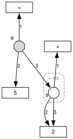

$K = \lbrace t \rbrace$. *Alice thinks that five is two plus two.* The fact $e$ is in the context of $t$ and is
not held:

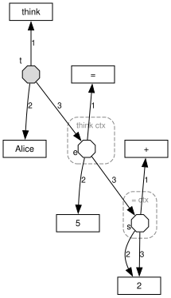

$K = \lbrace t, e \rbrace$. The fact $e$ is held, and in the context of $t$:

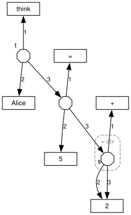

The three graphs differ in one node, $t$, and in whether $e$ stands in a frame. $e$ is the same node in all three,
with the same arrows: writing a fact by itself and under an arrow of another writes one fact. And $s$ is in a
context and not held in all three, since nothing states that two and two are added:

$$
\begin{aligned}
\operatorname{ctx}_{\lbrace e \rbrace}(s) &= \lbrace e \rbrace \\
\operatorname{ctx}_{\lbrace t \rbrace}(s) &= \lbrace t \rbrace \\
\operatorname{ctx}_{\lbrace t, e \rbrace}(s) &= \lbrace t, e \rbrace
\end{aligned}
$$

In the second, $s$ is in the context of $t$ through $e$, a fact that is not held: a path may pass through any
fact of the graph, and only its first node is held.

**How the two are drawn.** That a fact is in a context is read off the argument arrows that enter its octagon.
What the arrows do not show is whether it is also held, and one mark shows it: an octagon stands **inside a
dashed frame** exactly when the fact is in a context and not held, a node the graph has only because held facts
point at it. A held fact stands in no frame, whatever points at it, and no octagon is filled: in the third graph
$e$ is in no frame, and the arrow of $t$ enters it. A frame carries the name of the relation of the facts that
point at what is in it, and the word *ctx*: the facts that a fact of $\mathsf{think}$ points at, and that are not
held, are in the frame *think ctx*. A fact that facts of two relations point at is in one frame that names both,
as $g$ above is in *not, says ctx*, since a node is drawn once. Frames stand side by side and never one inside
another: in the second graph $s$ is in *= ctx* beside *think ctx*, and that it is also in the context of $t$ is
read off the path from $t$. Which fact speaks about a framed fact is read off the arrows that enter the frame. An
atom is in no frame.

What a context does and does not say of the fact in it is [below](#a-context-gives-a-fact-no-truth).

### The reserved atoms

A finite set $W \subset \Sigma^{+}$ of names is **reserved**: the language gives the atom one fixed part to play,
and no declaration takes its name ([the reserved names](../../user/04-reference/03-reserved-names.md) lists $W$).
Those the graph itself has a part for are $\mathsf{relation}$, $\mathsf{not}$ and $\mathsf{false}$, above, and
one marker, of closure, which a program may write as a relation or as an argument and which is read where a
knowledge base grows
([Q-M1f.7](../../../decisions/language/Q-M1f.7-the-dunder-is-never-bound-and-the-writeback.md)). No name of a
theory is reserved: a relation's symmetry, a type and a bijection are rules a library states over names the
program chooses. A subset
$W_{\!c} \subset W$ is the relation of no fact at all: the words that join and test the parts of a pattern,
equality and inequality among them, which [the next page](02-rewriting-rules.md) defines. So no equality, no
test and no connective is a fact, and none is an object:

$$
\forall f \in F.\ \ \operatorname{rel}(f) \in \Sigma^{+} \setminus W_{\!c}
$$

Two sorts of word stand beside the names and are no atom's name. A **text**, a quoted run of any characters, is
a sentence about a fact or a declaration and never an object
([Q-M1e2.23](../../../decisions/language/Q-M1e2.23-a-string-is-natural-language-text-never.md)). A
**made-up name** begins with a mark that is not in $\Sigma$: it names something a program's text gives no name
to, and no name a program writes is one
([Q-M1f.339](../../../decisions/language/Q-M1f.339-every-name-the-loader-makes-up-starts-with.md)).

## Drawn with labelled arrows

A fact with three arrows, a relation and two arguments, can be drawn as **one arrow**, from the object under its
second arrow to the object under its third, labelled with the relation's name; a fact with two arrows, a relation
and one argument, as **a loop** on the object under its second arrow, labelled the same way. Two facts of
$\operatorname{left-of}$, as the graph on the left and as labelled arrows on the right:

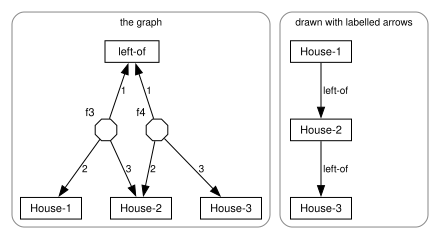

On the left there are two facts, and that they are of one relation is in the graph: their first arrows point at
one atom. On the right each fact has become an arrow, and the relation has become a word written on it. **The
drawing loses the relation's identity**: $\mathsf{left\text{-}of}$ is no longer a node, and the same label is
written on as many arrows as the extent has facts. So it has no place for a fact about the relation, a
declaration or a property, which points at that node. Nor can an arrow be pointed at: a fact that a fact points
at keeps its node, in this form too. So the labelled-arrow form is a way of drawing facts with three arrows, for
a reader, and never the representation: what it draws stands for the graph, by these rules.

| in the graph | drawn |
|---|---|
| a held fact with three arrows that no fact points at: its node, its arrows, and its relation's atom as far as this fact goes | **one arrow** from the object under the second arrow to the object under the third, labelled with the relation's name |
| a held fact with two arrows that no fact points at | **a loop** on the object under the second arrow, labelled with the relation's name |
| a held fact with any other count of arrows, one or four or more, that no fact points at | **its node**, an octagon, as in the graph: its first arrow at its relation's atom and the others at its arguments, numbered from the first |
| a fact that a fact points at, held or not, whatever its count | **its node, once**: that octagon, as in the graph. It stands in the dashed frame of its context where the knowledge base does not hold it, and in no frame where it does ([the global context, and the context of a fact](#the-global-context-and-the-context-of-a-fact)). It is never an arrow |

Nothing but a fact of three arrows or of two is folded, and in neither form is a relation's name written in a fact's node,
or a fact's text in any node
([Q-M1f.419](../../../decisions/cli/Q-M1f.419-ein-render-draws-a-fact-as-the-graph-has-it.md)). So every object
is drawn once in this form too, and what is drawn outside a frame is held
([Q-M1f.395](../../../decisions/cli/Q-M1f.395-ein-render-draws-every-object-once.md)).

The four facts of the first drawing are then five nodes and four arrows, where the graph has twelve nodes and
twelve arrows. The drawings of the pages after this one are of the graph, and add to it only what each says: a
colour for the arrows of one relation, a dashed octagon and dashed arrows for a fact that a rule added
([rendering](../../user/04-reference/12-rendering.md) is the legend). Those are conventions of drawing and mark
no sort of object, and no relation is drawn otherwise than another, $\operatorname{is-a}$ and
$\operatorname{relation}$ among them
([Q-M1f.421](../../../decisions/cli/Q-M1f.421-no-view-draws-a-relation-otherwise-than-another.md)). A drawing
that folds facts of three arrows into labelled arrows says so beside it.

## The knowledge base of a program

A **program** $P$ is a text. Each form of it is a fact, a declaration, or a question, and reading it gives one
knowledge base, $K_0$:

$$
K_0 \;=\; T \;\cup\; D
$$

- $T$ is the facts the text writes, the nodes $\nu$ sends its tuples to. A fact written twice is one fact.
- $D$ is the facts its relation declarations are, two for each as [above](#what-is-where). A declaration's own
  text, the sentence a fact of the relation reads as, is no part of the graph.

Reading a text states nothing else: a fact under an arrow of a written fact is in $K_0$ only where the text writes
it on its own, and its contexts are the facts that point at it. Whether a nested term is well-formed for the theory
that reads it is that theory's to ask, of the terms it takes
([Q-M1f.404](../../../decisions/stdlib/math/Q-M1f.404-a-numeral-is-checked-where-an-operation-takes-it.md)).

A program also declares rules. A rule is no fact of $K_0$, and its declaration adds no fact to $K_0$
([the next page](02-rewriting-rules.md#the-program-and-its-names)).

A written fact may carry a **source sentence**, a text. It says where the fact comes from, is no part of the
fact, and changes nothing a knowledge base holds.

**A declared name has one full name.** A relation that a module $m$ declares under the name $d$ is the atom
named $m\mathtt{.}d$: the module's name, a dot, the declared name. A file may write a short name for it, and
the short names of a file are a partial function into the full names, local to that file:

$$
\begin{aligned}
\alpha_{\text{file}} &: \Sigma^{+} \rightharpoonup \Sigma^{+} \\
\alpha_{\text{file}}(d) &= m\mathtt{.}d
\end{aligned}
$$

The atoms of $K_0$ carry full names. Two modules that each declare $d$ declare two atoms, and a module reached
along several paths of imports is one module with one set of full names
([Q-M1f.231](../../../decisions/imports/Q-M1f.231-every-name-a-module-declares-has-a-full-name.md)). That
$\alpha_{\text{file}}$ is a function is a condition on a program: one short name for two full names in one file
is no program.

## Properties

### Identity

**An object's identity is its name or its tuple.** The first two conditions of the graph are the whole of it: an
atom is the one node with its name, and a fact is the one node with its list of arrows.

$$
\begin{aligned}
a = b &\iff \lvert a \rvert = \lvert b \rvert \;\land\; \forall i \le \lvert a \rvert.\; a_i = b_i && \text{for atoms: one word} \\
f = g &\iff \operatorname{out}(f) = \operatorname{out}(g) && \text{for facts: one list of arrows} \\
a \neq f &&& \text{for an atom } a \text{ and a fact } f
\end{aligned}
$$

The second line compares the objects under the arrows, which are atoms or facts again, so it is a recursion on
the depth of the facts, and it ends, since no path of arrows returns to its start. Written out it says that
$r(u_1, \dots, u_m)$ and $s(v_1, \dots, v_n)$ are one fact exactly when $r = s$, $m = n$ and $u_i = v_i$ for
every $i$, at every depth; a stored negation is a fact, so $\lnot f = \lnot g \iff f = g$ is a case of it. So
the objects of every knowledge base are the least set with

$$
\begin{aligned}
O \;=\;\ & \Sigma^{+} \\
\cup\ & \{\, (r, o_1, \dots, o_n) \;:\; r \in \Sigma^{+} \setminus W_{\!c},\ n \ge 0,\ o_1, \dots, o_n \in O \,\}
\end{aligned}
$$

less the tuples under $\mathsf{not}$ and $\mathsf{false}$ that are not of the shape those atoms fix. $F$ is the
tuples, and $\nu$ sends each written word or tuple to one object of $O$, every object being so written. A knowledge base is a
finite set $K \subseteq F$, and its graph is determined by it: its objects are the facts of $K$ and whatever
lies under their arrows, at any depth. $f \in K$, $K \subseteq K'$ and $K \cup K'$ are statements about sets of
facts.

**Identity is by name, and a digit is a name character.** No function from $\Sigma^{+}$ to the integers is part
of the theory:

$$
\begin{aligned}
\mathsf{1} &\ne \mathsf{01} \\
\mathsf{7},\ \mathsf{-7},\ \mathsf{1..5} &\in \Sigma^{+}
\end{aligned}
$$

So **Ein has no numbers, no ranges and no integer kind**. A name of digits is compared and ordered as any other
name is ([Q-M1e2.24](../../../decisions/language/Q-M1e2.24-ein-has-no-numbers-and-no-ranges.md)), and arithmetic
is a theory of rules over numerals written in such names, never an operation on names.

**No two atoms are ever one.** Equality of objects is identity, and it is no fact: $\mathsf{eq}$ and
$\mathsf{neq}$ are in $W_{\!c}$, so no knowledge base holds an equality, and nothing merges two nodes
([Q1](../../../decisions/language/Q1-the-knowledge-base-is-a-hypergraph-of-atoms.md),
[Q-M1e2.26](../../../decisions/language/Q-M1e2.26-eq-and-neq-are-the-relations-of-equality-and-non.md)).

**What is no part of identity**: where an object is written, how often, the source sentence of a fact, a
declaration's text, and the knowledge base that holds a fact. One fact held by two knowledge bases is one fact.

### Order

Any two objects compare. Write $\lt_{\text{lex}}$ for the order of words by code point, a proper prefix first.
The order $\prec$ compares two facts as two lists, by the objects under their arrows in turn, from the first
arrow; it is the least relation on $O$ with

$$
\begin{aligned}
a &\prec f && \text{for every atom } a \text{ and every fact } f \\
a &\prec b \iff a \lt_{\text{lex}} b && \text{for atoms } a, b \\
f &\prec g \iff \operatorname{out}(f) \prec^{\ast} \operatorname{out}(g) && \text{for facts } f, g
\end{aligned}
$$

where $\prec^{\ast}$ compares two lists place by place by $\prec$, and puts a list that is a proper prefix of
another first:

$$
\begin{aligned}
(u_1, \dots, u_m) \prec^{\ast} (v_1, \dots, v_n) \iff \exists k.\ \ & \big(\forall i < k.\ u_i = v_i\big) \\
\land\ & \Big( \big(k \le \min(m, n) \land u_k \prec v_k\big) \ \lor\ \big(k = m + 1 \le n\big) \Big)
\end{aligned}
$$

and $u \preceq v$ means $u \prec v$ or $u = v$. In words:

- **an atom before a fact**;
- **two atoms by their names**, character by character. Names are ASCII, so a digit comes before an upper-case
  letter, and upper case before lower case. A name of digits is a word like any other:
  $\mathsf{10} \prec \mathsf{2}$, and so $\operatorname{p}(\mathsf{10}) \prec \operatorname{p}(\mathsf{2})$;
- **two facts by their relation's name, then their arguments in turn, then their count**. A stored negation and
  $\bot$ are facts and compare as facts, under the names of $\mathsf{not}$ and $\mathsf{false}$.

**Proposition.** $\preceq$ is a total order on $O$.

*Argument.* By induction on the depth of the two objects, the length of the longest path of arrows from each.
$\lt_{\text{lex}}$ is a total order of words, so atoms are totally ordered, and every atom comes before every
fact. For two facts, the lists of the objects under their arrows are compared by $\prec^{\ast}$, the
lexicographic order over $\prec$ on objects of smaller depth, which is total by induction; a lexicographic order
over a total order is total. Two facts that neither precedes the other have equal lists, which is identity of
facts. $\square$

A chain of nine objects in the order, three atoms and six facts. The drawing is of the order and not of a
knowledge base: a box is an atom, labelled with its name, and an octagon a fact, with the letter the text calls it
beside it; the arrows under each fact are left out, and are these:

$$
\begin{aligned}
f_1 &= \operatorname{adjacent}(\mathsf{b}, \mathsf{b}) \\
f_2 &= \operatorname{co-located}(\mathsf{a}) \\
f_3 &= \operatorname{co-located}(\mathsf{a}, \mathsf{a}) \\
f_4 &= \operatorname{co-located}(\mathsf{a}, \mathsf{b}) \\
f_5 &= \operatorname{co-located}(\mathsf{a}, \operatorname{p}(\mathsf{a})) \\
f_6 &= \operatorname{co-located}(\mathsf{b})
\end{aligned}
$$

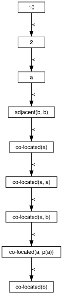

Each arrow reads *comes before*. The third is an atom before a fact; the fourth is decided at the first arrow,
by the relation's name; the fifth by the count, a prefix first; the seventh by an atom before a fact under the
third arrow.

$\prec$ is a function of the objects alone, of their names and their arrows, so a listing in it is the same
however the objects are stored or numbered. It is stated because two objects of different sorts, an atom and a
fact, can stand under the same arrow of two facts of one relation, and the order must say which comes first.

### The text of an object

An object has a **text**, a word that is again a function of the object alone:

$$
\begin{aligned}
\operatorname{text}(a) &= a \\
\operatorname{text}(r(v_1, \dots, v_n)) &= \texttt{(}\; r\; \sqcup\; \operatorname{text}(v_1)\; \sqcup\; \cdots\; \sqcup\; \operatorname{text}(v_n)\; \texttt{)}
\end{aligned}
$$

with $\sqcup$ one space, and $\texttt{(}\,r\,\texttt{)}$ for $n = 0$. It is the list of the objects under the
fact's arrows, in order, between parentheses. Reading is its inverse,

$$
\forall v \in O.\ \ \operatorname{read}(\operatorname{text}(v)) = v
$$

so $\operatorname{text}$ is injective: two objects are one exactly when their texts are one word. An object holds
no text of a program, no source sentence and no declaration's sentence, so none is in its text. A made-up name,
which begins with a mark outside $\Sigma$, is set between quotation marks where it is shown and does not read
back, which is how a reader tells it apart.

**Comparing texts is a second total order, and it is not $\prec$.** In the order of characters a space comes
before a closing parenthesis, and an opening parenthesis before every letter and digit, so each of the two pairs
below is put one way by its texts and the other way by $\prec$:

$$
\begin{aligned}
\operatorname{text}(\operatorname{q}(\mathsf{10}, \mathsf{10})) &\lt_{\text{lex}} \operatorname{text}(\operatorname{q}(\mathsf{10})) \\
\operatorname{q}(\mathsf{10}) &\prec \operatorname{q}(\mathsf{10}, \mathsf{10}) \\
\operatorname{text}(\operatorname{q}(\operatorname{p}(\mathsf{a}))) &\lt_{\text{lex}} \operatorname{text}(\operatorname{q}(\mathsf{a})) \\
\operatorname{q}(\mathsf{a}) &\prec \operatorname{q}(\operatorname{p}(\mathsf{a}))
\end{aligned}
$$

Each is total and each is a function of the objects alone. A listing says which of the two it is in.

**Quoted.** Where a sentence about a program names an object, it quotes it by one function $q$, from objects
and from lists $[v_1, \dots, v_n]$ of objects to ASCII words. It has three shapes, for a name, a list and a fact:

$$
\begin{aligned}
q(a) &= \texttt{'}a\texttt{'} \\
q(a) &= \texttt{"}a\texttt{"} && \text{where the name } a \text{ holds an apostrophe} \\
q([\,]) &= \texttt{()} \\
q([v_1]) &= \texttt{(}\,q(v_1)\texttt{,)} \\
q([v_1, \dots, v_n]) &= \texttt{(}\,q(v_1)\texttt{,}\sqcup\cdots\texttt{,}\sqcup q(v_n)\,\texttt{)} && \text{for } n \ge 2 \\
q(r(v_1, \dots, v_n)) &= \texttt{Fact(relation}\_\texttt{name=}\,q(r)\,\texttt{,}\sqcup\texttt{args=}\,q([v_1, \dots, v_n])\,\texttt{)}
\end{aligned}
$$

The quoted form sets the relation apart from the arguments, where the text lists all the arrows alike. $q$ is
total and injective, so comparing quoted forms is a third total order, $u \lt_{q} v \iff q(u) \lt_{\text{lex}} q(v)$.

### The count of arguments

A fact has as many arguments as it has arrows after the first, and of a relation nothing declares the facts may
be of any count, each count giving different facts. A declaration fixes the count:

$$
P \text{ declares } r \text{ with the labels } T_1, \dots, T_n \ \land\ f \in T \ \land\ \operatorname{rel}(f) = r \implies \operatorname{ar}(f) = n
$$

so on the declared relations of a program $\operatorname{ar}$ is a function of the relation, the number of its
labels. The count is the whole of it: nothing is required of what stands under an arrow
([Q-M1f.315](../../../decisions/language/Q-M1f.315-a-form-of-a-declared-relation-has-as-many.md)). And a relation
is declared at most once: two declarations of one name are no program. Both are conditions on a text, and a text
that fails one is no program.

### Nesting

The **facts nested in** a fact are those under its argument arrows, at any depth:

$$
\begin{aligned}
\operatorname{sub}(r(v_1, \dots, v_n)) &= \bigcup_{i \le n} \big( (\{v_i\} \cap F) \cup \operatorname{sub}(v_i) \big) \\
\operatorname{sub}(\lnot f) &= \operatorname{sub}(f) \\
\operatorname{sub}(a) &= \emptyset
\end{aligned}
$$

The second equation is the one exception to the arrows: a stored negation and the fact it denies are read as
one, so a negation nests what the fact it denies nests, and not that fact itself. It is applied at each
negation, so $\operatorname{sub}(\lnot\lnot g) = \operatorname{sub}(\lnot g) = \operatorname{sub}(g)$. The
[context](#the-global-context-and-the-context-of-a-fact) of a fact makes no such exception and follows every
argument arrow, the negation's too:

$$
\begin{aligned}
f &\notin \operatorname{sub}(\lnot f) \\
\lnot f \in K &\implies \lnot f \in \operatorname{ctx}_K(f)
\end{aligned}
$$

For a set $X$ of facts,
$\operatorname{sub}(X)$ is the union over its members, and the **names of** $X$ are the atoms under an argument
arrow of a fact of $X$, at any depth:

$$
\begin{aligned}
\operatorname{names}(X) = \{\, a \in \Sigma^{+} \;:\;\ & a = \operatorname{arg}_i(g) \ \text{ for some } i \text{ and some fact } g \\
& \text{that is in } X \text{ or under an argument arrow of a fact of } X \text{, at any depth} \,\}
\end{aligned}
$$

An atom that the facts of $X$ point at with a first arrow alone is a relation of $X$ and not one of its names.
A nested fact is an object like any other: $\operatorname{says}(\mathsf{Norwegian}, g)$ has $g$ under its third
arrow, identified by its own arrows at every depth, whether or not the knowledge base holds $g$.

### A fact, its negation, both, or neither

For a fact $f$, a set $K$ of facts holds $f$, or $\lnot f$, or neither, or both:

$$
\operatorname{status}_K(f) =
\begin{cases}
\text{asserted} & f \in K,\ \lnot f \notin K \\
\text{negated} & f \notin K,\ \lnot f \in K \\
\text{open} & f \notin K,\ \lnot f \notin K \\
\text{contradicted} & f \in K,\ \lnot f \in K
\end{cases}
$$

In the graph the four are the four ways two nodes can be held or not: $f$, and the fact of $\mathsf{not}$ that
points at it. A negated fact is not merely missing: a stored negation is a fact the set holds, and *open* is
that it holds neither.

**A contradiction** is a contradicted fact, or the fact of falsity:

$$
\begin{aligned}
\operatorname{dead}(K) &\iff \bot \in K \;\lor\; \exists f.\ \ f \in K \land \lnot f \in K \\
\operatorname{alive}(K) &\iff \lnot \operatorname{dead}(K)
\end{aligned}
$$

A set of facts that holds a contradiction is **dead**, and one that holds none is **alive**. Both are properties
of the set: a set that includes a dead set is dead. This is all the two reserved relations mean, and it is what
the reasoning reads them for.

**The fact $f$ may itself be a stored negation**, and the definitions read it as they read any fact. With
$f = \lnot g$, the pair they compare is $\lnot g$ and $\lnot\lnot g$:

$$
\begin{aligned}
\lnot g \in K \ \land\ \lnot\lnot g \in K &\implies \operatorname{dead}(K) \\
g \in K \ \land\ \lnot\lnot g \in K &\ \not\Longrightarrow\ \operatorname{dead}(K) \\
\lnot\lnot g \in K &\ \not\Longrightarrow\ g \in K
\end{aligned}
$$

A set that holds $\lnot\lnot g$ holds the denial of a denial, and no definition of this page takes it for $g$:
the two are different nodes, and no pair of the three facts $g$, $\lnot g$, $\lnot\lnot g$ is compared but a fact
with its own negation. That $g$ holds where $\lnot\lnot g$ does is a step of classical logic, and here it is a
rule that a program states, [written like any other](02-rewriting-rules.md#packing-and-unpacking).

### A context gives a fact no truth

The definitions of this page read the global context and nothing else: a status and a contradiction are stated
by membership in $K$, and none follows an argument arrow.

**Proposition (holding is not carried by an arrow).** For a fact $f \in K$ and a fact $g$ under an argument
arrow of $f$, nothing follows about $g \in K$; and for $g \in K$, nothing follows about any fact that points at
$g$. In particular, for a relation $c$ other than $\mathsf{not}$, an object $a$, and a fact $g$ with
$g \notin K$:

$$
\begin{aligned}
c(a, g) \in K \ \land\ \lnot g \notin K &\implies \operatorname{status}_K(g) = \text{open} \\
c(a, \bot) \in K &\ \not\Longrightarrow\ \operatorname{dead}(K) \\
c(a, g) \in K \ \land\ c(a, \lnot g) \in K &\ \not\Longrightarrow\ \operatorname{dead}(K) \\
c(a, g) \in K \ \land\ \lnot g \in K &\ \not\Longrightarrow\ \operatorname{dead}(K)
\end{aligned}
$$

*Argument.* Each right-hand side is defined by membership in $K$ of a fact that the left-hand side does not put
in $K$. $\square$

*Alice thinks that five is two plus two* is a fact about Alice and about $e$. It says what Alice thinks, and
nothing of whether five is two plus two. The knowledge base below holds $t$ and the stored negation of $e$, and is
alive: one held fact says that Alice thinks $e$, another that $e$ does not hold, and no fact is held together
with its negation.

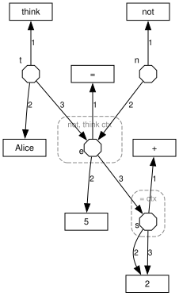

$$
\begin{aligned}
n &= \lnot e \\
K &= \lbrace t, n \rbrace \\
\operatorname{ctx}_K(e) &= \lbrace t, n \rbrace \\
\operatorname{status}_K(e) &= \text{negated}
\end{aligned}
$$

**One context is read: that of $\mathsf{not}$.** A stored negation is a held fact that points at the fact it
denies, so it is a context of that fact like any other, and it is the only one the definitions above read:
$\lnot g \in K$ makes $g$ negated, and makes $K$ dead where $g$ is in the global context too. The facts of every
other relation are opaque to those definitions. What $\mathsf{think}$ means, whether what a reliable witness
says is to be held, is what the rules of a program make of it
([packing and unpacking](02-rewriting-rules.md#packing-and-unpacking)), and with no such rule it means nothing.

**The context of $\mathsf{not}$ is no mirror of the global one.** Write $N_K = \lbrace g : \lnot g \in K \rbrace$
for the facts it holds. It grows as $K$ grows, by what a text states and what rules conclude, and it is not the
complement of $K$: the four statuses are the four ways a fact can be in the two,

| $\operatorname{status}_K(g)$ | $g \in K$ | $g \in N_K$ |
|---|---|---|
| asserted | yes | no |
| negated | no | yes |
| open | no | no |
| contradicted | yes | yes |

A mirror would leave no fact open. So a fact that is denied is no more held than one that somebody says: it is
in a context, and a pattern finds it there and not in the global one. Nor does denying twice lead back:
$\lnot\lnot g \in K$ puts $\lnot g$ in $N_K$, and says nothing of whether $g$ is in the global context.

**The same holds of every fact that is read where it is held.** A declaration is a held fact of
$\mathsf{relation}$, and the facts that apply a rule are held facts of its name
([the rules](02-rewriting-rules.md#a-rule-declared)). Under an argument arrow each is a fact about which
something is said: it declares nothing and applies nothing.

**What is the same in the three cases, and what differs.** For a fact $g$ of the graph of $K$:

| of the fact $g$ | the same, held or not | differs with $g \in K$ |
|---|---|---|
| its **identity** | one node, $\operatorname{out}(g)$ | |
| its **text**, its **quoted form**, its place in the **order** $\prec$ | functions of the object alone | |
| its membership of the **extent** | $g \in \operatorname{ext}(\operatorname{rel}(g))$ | $g \in \operatorname{ext}_K(\operatorname{rel}(g))$, the held extent, only where held |
| the **names** under its arrows | in $\operatorname{names}(K)$, which reads every depth | |
| its **status** | | asserted or contradicted where held, negated or open where not |
| making $K$ **dead**, with $\lnot g$ or as $\bot$ | | only where held |

What a rule reads of a fact in each case, and how a rule moves a fact from one to another, is
[the next page](02-rewriting-rules.md#packing-and-unpacking).
