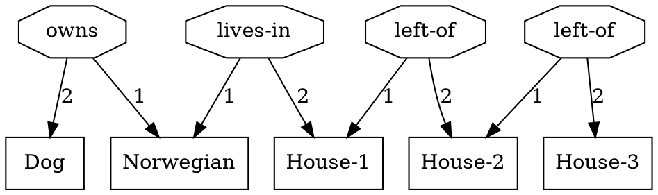
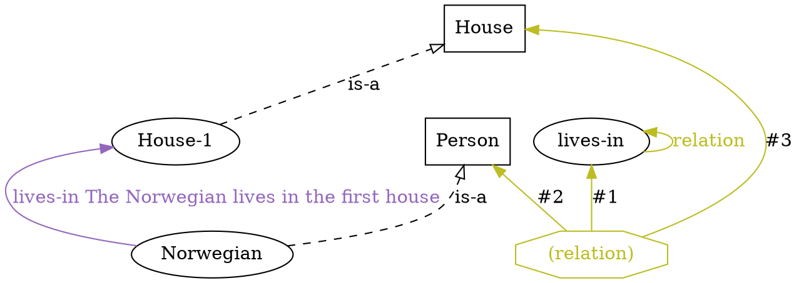

# Names and atoms

Everything a program is about is named. A **name** (an *atom*) is a word of the program's text, and the node of the
knowledge base it denotes is the thing named. **Identity is by name**: two occurrences of one name anywhere in one
program denote one node, and there is no second, hidden identity behind the name. This page defines the names, the
values built from them, and what makes two of them the same thing.

## Names

Let $\Sigma$ be the **name characters**: the ASCII letters, the ASCII digits, and a fixed finite set of ASCII
punctuation, the connectors and the decorators [the grammar](../../user/04-reference/01-grammar.md) lists. A
**name** is a non-empty word over $\Sigma$, an element of $\Sigma^{+}$, and two names are one name exactly when
they are one word:

$$
a = b \iff \lvert a \rvert = \lvert b \rvert \;\land\; \forall i \le \lvert a \rvert.\; a_i = b_i
$$

Nothing else enters. In particular a digit is a name character like any other, and no function from $\Sigma^{+}$
to the integers is part of the theory:

$$
\mathsf{1} \ne \mathsf{01}, \qquad \mathsf{7},\ \mathsf{-7},\ \mathsf{1..5} \in \Sigma^{+}
$$

So **Ein has no numbers, no ranges and no integer kind**. A name of digits is compared, ordered and proposed as
any other name is ([Q-M1e2.24](../../../decisions/language/Q-M1e2.24-ein-has-no-numbers-and-no-ranges.md)), and
arithmetic is a theory of rules over numerals written in such names, never an operation on names.

Four families of word stand beside the names, each disjoint from them or set apart among them:

| family | what it is | why it is no ordinary name |
|---|---|---|
| a **variable** | $\mathtt{?}w$ with $w \in \Sigma^{+}$; the set of them is $X$ | the mark $\mathtt{?} \notin \Sigma$, so $X \cap \Sigma^{+} = \emptyset$ |
| a **text** | a quoted run of any characters: a reason, a source sentence, a goal's wording | it annotates a form and is never a value ([Q-M1e2.23](../../../decisions/language/Q-M1e2.23-a-string-is-natural-language-text-never-a-value.md)) |
| a **made-up name** | a word that begins with the number sign: a name the reading of a program makes up for something the text writes no name for | the number sign is not in $\Sigma$, so no name a program writes collides with one ([Q-M1f.339](../../../decisions/language/Q-M1f.339-every-name-the-loader-makes-up-starts-with.md)) |
| a **reserved word** | one of a fixed finite set $W \subset \Sigma^{+}$: the words that head a declaration, the words of the pattern language, and a few relation names whose facts the reading of a program states or the kernel reads | the language gives it one fixed meaning, and no declaration binds it; [the reserved names](../../user/04-reference/03-reserved-names.md) lists $W$ |

Some reserved words are no relation's name: the words that head a declaration of a rule, a macro, an import or a
question, and the words of the pattern language, its two equalities, its absence, its two connectives, its
negation and its falsity. Write $W_{\!c} \subset W$ for those; negation and falsity enter the facts only as the
two forms $\lnot f$ and $\bot$ defined below. Two other words of $W$ are the **kernel's markers**, one that
closes a relation to hypotheses and one that closes it under the swap of its arguments. A program may write
either as a fact's relation or as a value, and may bind neither: no declaration, rule, macro or alias takes one
([Q-M1f.7](../../../decisions/language/Q-M1f.7-the-dunders-are-never-bound-and-the-writeback.md)).

**A name has one full name.** A name $d$ that a module $m$ declares, a relation, a rule or a macro, is the word
$m\mathtt{.}d$: the module's name, a dot, and the declared name. A file may write a short name for it, and the
short names of a file are a partial function into the full names,

$$
\alpha_{\text{file}} : \Sigma^{+} \rightharpoonup \Sigma^{+}, \qquad \alpha_{\text{file}}(d) = m\mathtt{.}d
$$

local to that file. Identity is by full name: two modules that each declare $d$ declare two names, and a module
reached along several paths of imports is one module with one set of full names
([Q-M1f.231](../../../decisions/imports/Q-M1f.231-every-name-a-module-declares-has-a-full-name.md)). That
$\alpha_{\text{file}}$ is a function is a condition on a program: one short name for two full names in one file is
no program.

## Values and facts

The **values** $V$ and the **facts** $F$ are the least sets with

$$
\begin{aligned}
A &= \{\, r(v_1, \dots, v_n) \;:\; r \in \Sigma^{+} \setminus W_{\!c},\ n \ge 0,\ v_1, \dots, v_n \in V \,\} \;\cup\; \{\bot\} \\
F &= A \;\cup\; \{\, \lnot f \;:\; f \in A \,\} \\
V &= \Sigma^{+} \;\cup\; F
\end{aligned}
$$

An element of $A$ is an **atom of an ordinary relation**: a relation name applied to a finite list of arguments,
each a name or a fact. $\bot$ is the fact of falsity, of no argument. $\lnot f$ is the **stored negation** of $f$,
a fact in its own right. So **an argument is a name or a fact**
([Q40](../../../decisions/language/Q40-a-fact-may-hold-a-fact-as-an-argument.md)), and **a value is a name, or a
fact a state could hold** ([Q-M1f.113](../../../decisions/language/Q-M1f.113-a-value-is-a-name-or-a-fact-a-state-could-hold.md)).
What the definition leaves out is as much a part of it:

- no equality, no absence and no connective is a fact. An equality is computed, an absence is a test of a state,
  and a connective joins premises ([rules as statements](04-rules-as-statements.md)); none is anything a state
  holds, so none is a value;
- $\lnot a$ of a name $a$ is the negation of no fact, and $\lnot\lnot f$ is no fact;
- a text is no value.

A fact has a relation and an argument list, and both are functions of it:

$$
\operatorname{rel}(r(v_1, \dots, v_n)) = r, \qquad \operatorname{arg}_i(r(v_1, \dots, v_n)) = v_i, \qquad \operatorname{ar}(r(v_1, \dots, v_n)) = n
$$

**A fact is a node with numbered edges.** Drawn, a fact is a node labelled by its relation, with one arrow to each
argument, numbered by the argument's place. The three-house example, which these pages return to, writes four
facts with a source sentence each:

$$
\operatorname{owns}(\mathsf{Norwegian}, \mathsf{Dog}), \quad \operatorname{lives-in}(\mathsf{Norwegian}, \mathsf{House\text{-}1}), \quad \operatorname{left-of}(\mathsf{House\text{-}1}, \mathsf{House\text{-}2}), \quad \operatorname{left-of}(\mathsf{House\text{-}2}, \mathsf{House\text{-}3})
$$

An octagon is a fact, a rectangle a name, and the arrow numbered $i$ from a fact $f$ points at
$\operatorname{arg}_i(f)$. $\mathsf{Norwegian}$ is one node though two facts name it: that is identity by name.
A fact of two arguments is also drawn short, as one arrow from its first argument to its second labelled by its
relation, and a fact of one argument as a loop on it; the two drawings say the same thing, and only the octagon
draws a fact of any count. How a fact is spelt is [the user's page on facts](../../user/03-syntax-and-semantics/03-facts.md).

**A nested fact is a value like any other.** With $g = \operatorname{co-located}(\mathsf{Norwegian}, \mathsf{House\text{-}2})$,
the fact $\operatorname{hypothesis}(g)$ has one argument, and $\operatorname{arg}_1$ of it is $g$, identified by
its structure at every depth. The **facts nested in** a fact are

$$
\operatorname{sub}(r(v_1, \dots, v_n)) = \bigcup_{i \le n} \big( (\{v_i\} \cap F) \cup \operatorname{sub}(v_i) \big), \qquad \operatorname{sub}(\lnot f) = \operatorname{sub}(f), \qquad \operatorname{sub}(a) = \emptyset
$$

so a negation nests what the fact it denies nests, and not that fact itself.

## The kinds of thing

Every node of the knowledge base is of one of four kinds, and the first three are named:

| kind | what it is | identified by |
|---|---|---|
| **object** | a thing the puzzle is about, $\mathsf{Norwegian}$, $\mathsf{House\text{-}1}$, $\mathsf{House}$ | its name |
| **relation** | what a fact says of its arguments, $\operatorname{lives-in}$, $\operatorname{is-a}$ | its full name |
| **rule** | a statement that derives facts from facts ([rules as statements](04-rules-as-statements.md)) | its full name |
| **fact** | a relation applied to arguments | its relation and its arguments, in order |

**Ein has no types.** No variable, relation, rule or fact carries a type, and no fifth kind of node is one. What a
program calls a type is an object: the name $\mathsf{House}$ in the membership fact
$\operatorname{is-a}(\mathsf{House\text{-}1}, \mathsf{House})$ is an argument of a fact of a relation the program
declares itself, and a variable is confined to houses by a premise that reads such a fact
([Q-M1f.372](../../../decisions/language/Q-M1f.372-ein-has-no-types-a-declarations-slot-names-are.md),
[Q23](../../../decisions/language/Q23-a-premise-types-a-variable-and-no-entity-has.md)).

A relation's **declaration** gives it a name and a list of **labels**, one for each argument:

$$
\operatorname{decl}(r;\ T_1, \dots, T_n), \qquad r \in \Sigma^{+} \setminus W, \quad T_1, \dots, T_n \in \Sigma^{+}, \quad n \ge 0
$$

The labels are ordinary names, and what they mean is what the program's rules make of them:

- the declaration fixes **how many** arguments a fact of $r$ has, and nothing about what fills each place:
  $\operatorname{ar}(f) = n$ for every fact $f$ of a declared $r$, written or matched, and
  $\operatorname{lives-in}(\mathsf{House\text{-}1}, \mathsf{Norwegian})$ is a fact as good as its converse
  ([Q-M1f.315](../../../decisions/language/Q-M1f.315-a-form-of-a-declared-relation-has-as-many.md)). A declaration
  with $n = 0$ declares a relation of no argument
  ([Q-M1f.201](../../../decisions/language/Q-M1f.201-a-bare-relation-r-declares-no-argument.md));
- a **rule** reads the labels as it reads any fact, through the facts a declaration is held as
  ([below](#a-relation-is-an-object)), and it is such a rule that gives $T_i$ the meaning *the $i$-th argument is
  one of these*;
- they are read by name in one more place, stated [below](#a-relation-is-an-object): the last rung of hypothesis
  generation proposes no fact about a name that some declaration writes as a label.

A name is declared once: two declarations of one relation name, or of one rule name, are no program.

## A relation is an object

Relations are nodes of the graph, not labels on its edges, and they take part in facts as themselves.

**A relation's properties are facts beside it.** $\operatorname{transitive}(\operatorname{left-of})$ is a fact
whose argument is a relation's name, and it is what applies the rule of transitivity to that relation
([Q27](../../../decisions/language/Q27-a-relations-properties-are-facts-beside.md)).

**A declaration is held as facts.** Reading a program states, for each declaration,

$$
\operatorname{decl}(r;\ T_1, \dots, T_n) \;\longmapsto\; \{\ \operatorname{relation}(r, T_1, \dots, T_n),\ \ \operatorname{relation}(r)\ \}
$$

the first fact carrying the labels and the second saying only that $r$ is a relation; for $n = 0$ the two are
one fact. A pattern over them is an ordinary premise: $\operatorname{relation}(r, x, y)$ binds $x$ and $y$ to the
labels of each relation of two arguments, and $\operatorname{relation}(r)$ holds of every declared relation
whatever its count. In the three-house example the declaration of $\operatorname{lives-in}$ is the fact drawn
below, in a fragment of the drawing of the example's knowledge base: an octagon with three numbered arrows, whose
labels $\mathsf{Person}$ and $\mathsf{House}$ are the same nodes the membership facts point at:

The loop on $\operatorname{lives-in}$ is the fact $\operatorname{relation}(\operatorname{lives-in})$, a fact of
one argument drawn as an arrow from its argument to itself. The boxes and ovals are the drawing's convention for
the two ends of a membership fact, and mark no kind of the theory.

So a rule can state what the labels are for. With $r$ a parameter of the rule (a
[relation-polymorphic rule](04-rules-as-statements.md#relation-polymorphic)),

$$
\operatorname{relation}(r, t_1, t_2) \;\land\; r(x_1, x_2) \;\land\; \operatorname{is-a}(x_1, t_1) \;\implies\; \operatorname{typed-first}(x_1, t_1)
$$

concludes of each fact of $r$ whose first argument is a member of the first label that it is one. Applied to
$\operatorname{lives-in}$ over the example's facts, it concludes
$\operatorname{typed-first}(\mathsf{Norwegian}, \mathsf{Person})$ from
$\operatorname{lives-in}(\mathsf{Norwegian}, \mathsf{House\text{-}1})$, and it concludes nothing from a fact
$\operatorname{lives-in}(\mathsf{House\text{-}1}, \mathsf{Norwegian})$, which is a fact all the same. A program
with no such rule gives its labels no meaning: what is left of them is their count, and the exclusion below.

**A relation nothing declares is still a relation.** A fact whose relation no declaration names makes that name a
relation, with no declared count. A rule may read a relation that nothing in the program makes, and then never
fires ([Q-M1f.120](../../../decisions/language/Q-M1f.120-a-rule-may-read-a-relation-nothing-makes.md)).

**What the text writes is stated as facts.** For the set $T$ of facts a program's text writes, reading states

$$
\{\ \operatorname{written}(t) \;:\; t \in \operatorname{sub}(f),\ f \in T \ \}
$$

and the same for each fact nested in a rule's conclusion that holds no variable. Each such fact is derived from
the fact it was read in. No program writes a fact of $\operatorname{written}$; a module that defines a
representation reads them, to check its own terms where they are written
([Q-M1f.275](../../../decisions/language/Q-M1f.275-written-states-every-fact-a-file-nests.md),
[Q-M1f.280](../../../decisions/language/Q-M1f.280-a-program-does-not-write-written.md),
[Q-M1f.272](../../../decisions/language/Q-M1f.272-a-representation-module-reads-what-a-file-writes.md)).

**Where a relation's name is set apart.** There is one place, and it is a device of tractability, not a layer of
the semantics. When nothing better proposes hypotheses, the last rung of
[hypothesis generation](../02-kb-evolution/04-hypothesis-generation.md) proposes facts about the program's objects,
and its objects are the names less four sets: the names the program declares as a relation, writes as a fact's
relation or names a rule by; the labels of its declarations; the words of the pattern language; and the
kernel's markers. A relation's name that only a rule's conclusion writes is not declared, and stays an object
([Q-M1f.306](../../../decisions/hypotheses/Q-M1f.306-the-blind-enumerators-objects-are-the-programs.md),
[Q-M1e.12](../../../decisions/hypotheses/Q-M1e.12-the-blind-enumerator-is-untyped-and-a-type-it.md)). Nothing stops a
rule from concluding a fact about a relation, and nothing reads such a fact differently from any other.

## The names of a program

A program is a finite text, and its **names** are the finite set

$$
\operatorname{names}(P) = \{\, a \in \Sigma^{+} \;:\; a \text{ stands in an argument place of a fact the text writes, at any depth} \,\} \;\cup\; \{\, a \in \Sigma^{+} \;:\; a \text{ stands anywhere in a rule} \,\}
$$

a rule's pattern and its conclusion alike. A name that only a query writes is not in $\operatorname{names}(P)$: a query asks about the
answer and does not change it
([Q-M1e2.9](../../../decisions/language/Q-M1e2.9-a-programs-names-are-the-constants-its-facts.md)).

**Proposition (a rule brings in no name).** Write $\operatorname{names}(K)$ for the names that stand in an
argument place of a fact of $K$, at any depth. For every state $K$ that any computation over the program reaches,

$$
\operatorname{names}(K) \subseteq \operatorname{names}(P)
$$

*Argument.* A state is reached from the facts the text writes by firing rules and by committing candidates. A
firing adds an instance $\psi\theta$ of a conclusion; every name of $\psi\theta$ stands in $\psi$, which is in a
rule, or in the range of $\theta$, which matched values of the state fired in. A candidate is a fact over names of
the program. By induction on the number of steps no step adds a name
([Q-M1e.21](../../../decisions/hypotheses/Q-M1e.21-a-rule-brings-in-no-name.md)). $\square$

$\operatorname{names}(P)$ is fixed when the program is read, before anything is derived, which is what makes every set a search ranges
over finite. [Saturation](../02-kb-evolution/02-saturation.md) states what the proposition buys.

## Identity, stated once

$$
\begin{aligned}
a = b &\iff a \text{ and } b \text{ are one word} && \text{for names, an object's name or a full name} \\
r(u_1, \dots, u_m) = s(v_1, \dots, v_n) &\iff r = s \;\land\; m = n \;\land\; \forall i \le n.\; u_i = v_i && \text{for facts, at any depth} \\
\lnot f = \lnot g &\iff f = g \\
a \ne f &&& \text{for a name } a \text{ and a fact } f
\end{aligned}
$$

What is **never** part of identity: where a thing is written, how a fact came to be held, the reason a rule gives,
and the knowledge base that holds it. Two facts with one relation and one argument list are one fact, however many
ways it was stated or derived ([relations and facts](02-relations-and-facts.md)); a fact held at the root of a
search and the same fact held in a node of it are one fact. Identity is equality; the total order over values,
which every order a reader can observe is built from, is [values and their order](03-values-and-order.md).

**Where a fact came from is not what it is.** The provenance of a fact
([relations and facts](02-relations-and-facts.md)) sorts the facts of a state into three classes,

$$
\operatorname{origin} : K \to \{\text{given},\ \text{background},\ \text{derived}\}
$$

a fact the text writes with a source sentence, a fact written with none or stated by reading a declaration, and a
fact a rule concluded or a commitment added. The partition is read off the provenance, never stored, and it is
for presentation alone: every rule, every check and every contradiction treats a fact alike whatever its origin,
and $\lnot f$ contradicts $f$ wherever either came from.
