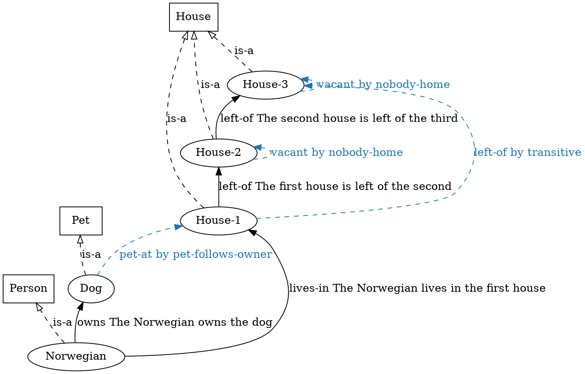
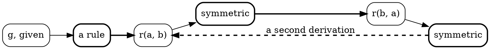
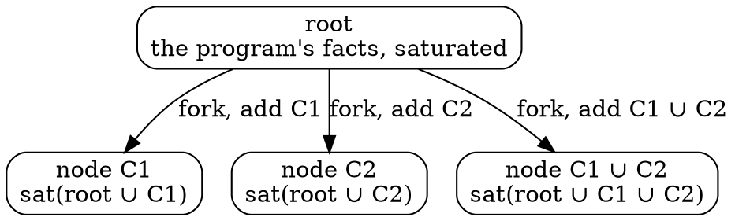
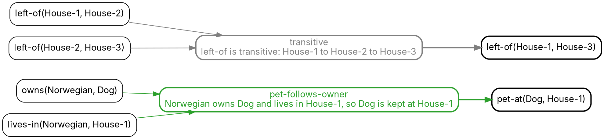

# Relations and facts

A **knowledge base** is the facts that hold, read with a program and with how each fact came to hold:

$$
K \subseteq F \ \text{ finite}, \qquad \text{read with } P \text{ and } J
$$

$K$ is a finite set of facts ([names and atoms](01-names-and-atoms.md) defines $F$), and that set is its
**state**: $f \in K$, $K \subseteq K'$ and $K \cup \Delta$ are statements about the set. $P$ is the **program**:
what the text declares, its relations and its rules, with its questions. $J$ is the **provenance**: for each
$f \in K$, the derivations recorded for it ([below](#provenance-a-fact-is-an-or-of-derivations)), written $J_K$
where the knowledge base has to be named. $K_0$ is the knowledge base a program's text is read into, and $S$ is
kept for the state a saturation ends in, root's or a node's. This page states what the state is, which operations
it has, and what $J$ records.

## A hypergraph with provenance

The knowledge base is a **hypergraph**: its vertices are the names and the facts, and each fact is one edge over
its arguments, labelled by its relation,

$$
G(K) = \big(\ \operatorname{names}(K) \cup K,\ \ \{\, (f,\ i,\ \operatorname{arg}_i(f)) \;:\; f \in K,\ 1 \le i \le \operatorname{ar}(f) \,\}\ \big)
$$

A relation of three arguments is one edge, not a construction of edges of two, and a fact is a vertex as well as
an edge, since a fact may be an argument. Every fact carries its provenance
([Q1](../../../decisions/language/Q1-the-knowledge-base-is-a-typed-labelled.md)). The state of the three-house
example, once its three rules have fired, is drawn below; the facts its declarations are held as are left out.

Each arrow is a fact of two arguments and each loop a fact of one. A solid black arrow is a fact the text writes
with its source sentence, which the label carries; a dashed arrow with an empty head is a membership fact; a
dashed blue arrow is a fact a rule derived, and its label names the rule. The provenance is on the drawing: it is
what tells the three kinds of arrow apart.

## A fact, its negation, and neither

A state holds a fact $f \in A$, or its stored negation, or neither, or both:

$$
\operatorname{status}_K(f) =
\begin{cases}
\text{asserted} & f \in K,\ \lnot f \notin K \\
\text{negated} & f \notin K,\ \lnot f \in K \\
\text{open} & f \notin K,\ \lnot f \notin K \\
\text{contradicted} & f \in K,\ \lnot f \in K
\end{cases}
$$

Each of the first three has a pattern that matches it and nothing else, in an alive state:

| $f$ is | the state holds | the pattern that matches it |
|---|---|---|
| **asserted** | the fact $f$ | $f$ |
| **negated** | the fact $\lnot f$ | $\lnot f$ |
| **open** | neither | $\operatorname{unknown}(f) \;=\; \operatorname{absent}(f) \land \operatorname{absent}(\lnot f)$ |

A stored negation is a fact like any other: written or derived, recorded with its provenance, matched by a pattern
of its shape. **The pattern $\lnot f$ matches a stored negation and nothing else.** It is never negation as
failure:

$$
K \models \lnot f \iff \lnot f \in K, \qquad\qquad K \models \operatorname{absent}(f) \iff f \notin K
$$

for a fact $f$ with no variable. The two differ on every open fact, where the second holds and the first does
not. The absence is a test of a state, and it is read against a saturated state, never against a half-built one
([negation as failure](../02-kb-evolution/03-absent-and-naf.md)).

**A contradiction** is a contradicted fact, or the fact of falsity:

$$
\operatorname{dead}(K) \iff \bot \in K \;\lor\; \exists f \in A.\ \ f \in K \land \lnot f \in K, \qquad\qquad \operatorname{alive}(K) \iff \lnot \operatorname{dead}(K)
$$

A knowledge base whose state is dead is dead. Which facts a contradiction rests on is its core
([cores](../02-kb-evolution/09-cores.md)).

## The state only grows

No operation removes a fact. Every operation on a state is an addition,

$$
K \;\longmapsto\; K \cup \Delta, \qquad \Delta \subseteq F
$$

so along any computation $K_0 \subseteq K_1 \subseteq K_2 \subseteq \cdots$, each the one before with facts added. A rule adds facts; a stored negation
is an added fact; nothing deletes one. A state is a set: stating a fact twice states one fact, and the provenance
of the first statement is the one kept, whether the two statements are in one file, in a module and the program,
or in two modules
([Q-M1f.139](../../../decisions/imports/Q-M1f.139-a-fact-stated-twice-keeps-its-first-statement.md)). What a search
assumes is undone by discarding a fork ([below](#a-fork)), never by taking a fact out of a state.

## Reading a program into a state

Each form of a program's text is a declaration, a question, or a **fact**. Reading gives the program $P$ and the
initial knowledge base

$$
K_0 \;=\; T \;\cup\; D \;\cup\; \{\, \operatorname{written}(t) \;:\; t \in \operatorname{sub}(f),\ f \in T \,\}
$$

where $T$ is the facts the text writes and $D$ the facts its declarations are held as
([names and atoms](01-names-and-atoms.md) defines both maps). A written fact's provenance is what the text says of
it:

| the text writes $f$ | its provenance | its origin |
|---|---|---|
| with a source sentence | given, with that sentence | given |
| with a rule's name and a list of premises | derived, as the text says, by that rule from those premises | derived |
| with neither | given, with no source | background |

A fact an import brings keeps the provenance its module writes, as if the program had written it in place
([Q-M1f.138](../../../decisions/imports/Q-M1f.138-an-imported-fact-keeps-its-own-provenance.md)).

**The conditions of a program.** A text is a program only if all of these hold, and a reading that refuses one
names every failure together:

$$
\begin{aligned}
&\text{each relation name and each rule name is declared at most once;} \\
&\operatorname{ar}(f) = n \quad \text{for every fact or pattern } f \text{ of a relation declared with } n \text{ labels;} \\
&\text{the relation } g \rightarrow f \text{ (} g \text{ is a premise the text states for } f \text{) has no cycle on } T.
\end{aligned}
$$

The third condition is on what the text **states**. A cycle among the derivations a computation **records** is
legitimate. Where a relation is symmetric, $r(\mathsf{a}, \mathsf{b})$ derives $r(\mathsf{b}, \mathsf{a})$, which
derives $r(\mathsf{a}, \mathsf{b})$ again, and each then has a derivation resting on the other:

What is defined over provenance [below](#provenance-a-fact-is-an-or-of-derivations), support and the frontier,
is defined as a least fixpoint, and so is well defined on such a cycle: a fact is not supported by a derivation
that rests on itself alone.

## A fork

A **fork** of a knowledge base $K$, with its provenance $J$, is a knowledge base $K'$ of the same program, with
provenance $J'$, that starts as $K$ stands, with the same facts and $J' = J$, and from then on is its own. Writing
$K(t)$ and $K'(t)$ for the two after $t$ further additions:

$$
\begin{aligned}
K'(t) &\supseteq K && \text{the fork keeps what its parent held when it was made;} \\
K'(t) \setminus K &\ \text{is the fork's alone} && \text{nothing a fork adds reaches its parent or a sibling;} \\
K(t) \setminus K &\ \text{is the parent's alone} && \text{nothing the parent adds afterwards reaches the fork;} \\
J'(f) \setminus J(f) &\ \text{stays in } K' && \text{a derivation recorded in a fork is the fork's.}
\end{aligned}
$$

The last line is what keeps explanations honest: a derivation recorded under a commitment may rest on the
commitment, which the parent never assumed, and would otherwise be named in an explanation of the parent.

Every arrow starts at root: **every node a search reads is a fork of root**, root's state with the node's
commitment added and saturated,

$$
\operatorname{st}(C) = \operatorname{sat}(\mathrm{root} \cup C)
$$

([Q-M1e2.2](../../../decisions/answer/Q-M1e2.2-a-node-is-a-fork-of-root-an-assumption-on.md)). A node's state is
defined from root's, never from another node's, and no arrow points back: that nothing a node derives reaches
root is what lets every node be read independently of every other
([finding R](../02-kb-evolution/07-finding-r.md)). A node's saturation continues root's rather than repeating it,
and reaches the fixpoint that a saturation started afresh from the grown state reaches
([Q-M1a.18](../../../decisions/engine/Q-M1a.18-a-node-resumes-roots-saturation.md)).

## Provenance: a fact is an OR of derivations

For each fact $f \in K$, $J(f)$ is a non-empty finite sequence of **derivations**, in the order they were
recorded:

$$
J(f) = (\delta_1, \delta_2, \dots, \delta_k), \qquad k \ge 1
$$

A derivation is a **terminal**, *given* (with its source sentence where the text writes one) or *committed* (a
hypothesis), or it is a **firing**:

$$
\delta = \big(\rho,\ a,\ \theta,\ \operatorname{prem}(\delta),\ \operatorname{all}(\delta),\ \operatorname{abs}(\delta)\big)
$$

| part | what it records |
|---|---|
| $\rho$ | the rule that fired |
| $a$ | the activator the rule was applied under ([values and their order](03-values-and-order.md)) |
| $\theta$ | the substitution the pattern matched under |
| $\operatorname{prem}(\delta) \subseteq K$ | the positive premises the pattern matched |
| $\operatorname{all}(\delta) \subseteq K$ | for each universal premise, the facts its body matched over its domain |
| $\operatorname{abs}(\delta)$ | the absences: the patterns that had to match nothing for the firing to be admitted |

([Q18](../../../decisions/engine/Q18-provenance-is-per-fact-an-or-of-derivations-over.md)). The proof structure is
an **AND/OR graph**: a fact is an OR over its derivations, and a derivation is an AND over what it rests on,

$$
\operatorname{supported}(f) \iff \bigvee_{\delta \in J(f)} \Big( \delta \text{ is a terminal} \;\lor \bigwedge_{g \in \operatorname{rests}(\delta)} \operatorname{supported}(g) \Big)
$$

read as a least fixpoint, where $\operatorname{rests}(\delta) = \operatorname{prem}(\delta) \cup \operatorname{all}(\delta)$, with the activator $a$ too where a node
derived or committed it, and where a firing with $\operatorname{rests}(\delta) = \emptyset$ counts as a terminal
([Q-M1e2.12](../../../decisions/answer/Q-M1e2.12-a-dead-nodes-core-follows-an-activator-only.md),
[Q-M1e2.15](../../../decisions/answer/Q-M1e2.15-a-derivation-through-a-forall-rests-on-each-fact.md)). Two firings of the
three-house example, as premises, the firing, and the fact it adds:

A thin box is a fact, a bold box a firing with its rule and the rule's reason, an arrow into a firing one of its
premises, the bold arrow out of it the fact it adds. The four facts on the left are terminals, given by the text.

What is true of $J$ in every implementation:

- **The primary derivation is the first one recorded**, $\delta_1$. Deriving the fact again never changes it, so
  everything that reads one derivation of a fact reads one stable story.
- **A terminal takes no other derivation**: if $\delta_1$ is a terminal then $k = 1$. A given fact and a commitment are
  the frontier of every explanation, and a given that some rule could also derive is still given. A firing with no
  premise is a terminal too: the frontier stops at it.
- **Two firings of one rule over the same premises under the same activator are one derivation**:
  $(\rho, a, \operatorname{prem}(\delta))$ is what tells two derivations apart. The substitution $\theta$ is recorded to be
  shown, and is no part of a derivation's identity.
- **What is recorded is what saturation attempted.** A derivation no firing reached is in no $J(f)$. An
  implementation may bound $k$, and a program may ask for the primary alone. Neither changes $K$, nor the answer:
  what they may change is a dead node's core, which is an explanation and not part of the answer
  ([Q-M1e2.30](../../../decisions/answer/Q-M1e2.30-no-configuration-option-lever-or-flag-changes-r.md),
  [Q-M1f.6](../../../decisions/answer/Q-M1f.6-a-core-is-an-explanation.md)).

**The derivation graph of a fact** is its premises, followed to the terminals: through $\delta_1$ alone, which is one
proof a reader can follow, or through every recorded derivation, which is the AND/OR graph. The **frontier** of a
fact is the set of terminals the second reaches, the least sets with

$$
\operatorname{front}(f) =
\begin{cases}
\{f\} & \delta_1 \text{ of } J(f) \text{ is a terminal} \\
\bigcup_{\delta \in J(f)}\ \bigcup_{g \in \operatorname{rests}(\delta)} \operatorname{front}(g) & \text{otherwise}
\end{cases}
$$

An **explanation** of a set $X$ of facts is the set $Z$ of terminals that a *witness* ends in, a witness being a
choice of one recorded derivation for each fact reached from $X$ along the derivations chosen.

**Proposition (the frontier bounds every explanation).** For every explanation $Z$ of $X$,

$$
Z \subseteq \bigcup_{f \in X} \operatorname{front}(f)
$$

*Argument.* A witness follows, from each $f \in X$, one derivation of $J(f)$ and then one derivation of each of
its premises, down to terminals. $\operatorname{front}(f)$ follows every derivation of $J(f)$ and of every
premise. So each path of the witness is a path the frontier follows, and the terminal it ends in is in
$\operatorname{front}(f)$. $\square$

So no core of a contradiction names a fact outside the frontier of the facts it rests on. Choosing a *smallest*
explanation is a minimisation over the AND/OR graph, which the frontier does not solve, and is
[cores](../02-kb-evolution/09-cores.md)' subject.

## Equality

No fact makes two names one. Equality is name identity, a relation computed from its two arguments and never
stored, and inequality is its complement:

$$
K \models (u = v) \iff u \text{ and } v \text{ are one value}, \qquad K \models (u \ne v) \iff \lnot\, K \models (u = v)
$$

for every state $K$ alike. Nothing merges two names into one node, and a pattern matches a name only where that
name is written ([Q1](../../../decisions/language/Q1-the-knowledge-base-is-a-typed-labelled.md),
[Q-M1e2.26](../../../decisions/language/Q-M1e2.26-eq-and-neq-are-the-relations-of-equality-and-non.md)).
