# The rules: rewriting the graph

A rule rewrites the graph a knowledge base is ([the knowledge base](01-knowledge-base.md)). This page does the
rewriting first: a pattern, which is the same graph with variables in it; a match of a pattern in a knowledge
base; the conditions a match can be held to; a conclusion; the knowledge base that rewriting at a match
gives; and how a rewriting moves a fact into a context and out of one. Then it says how a rule is declared, what
a declaration must meet, and the kinds of rule. Everything
here is about one knowledge base as it stands. When a rule is applied, in what order, and what a knowledge base
becomes under all its rules is [the part after this one](../02-kb-evolution/01-firing.md).

## A pattern: the graph, with variables

Let $X$ be a set of **variables**, written with a mark that is no name character, so $X \cap \Sigma^{+} =
\emptyset$. A **pattern graph** is a graph of the shape a knowledge base has, with one more sort of node: a node
with no outgoing arrow is an atom, labelled by a name, or a **variable**, labelled by a variable. A node with
outgoing arrows is a **fact pattern**, and the four conditions hold as they do of a knowledge base: one label is
one node, one list of arrows is one node, no path of arrows returns to its start, and a first arrow points at a
node with no outgoing arrow, an atom or a variable. As terms:

$$
\begin{aligned}
t \;&::=\; a \;\mid\; x \;\mid\; s(t_1, \dots, t_n) \\
a &\in \Sigma^{+} \\
x &\in X \\
s &\in (\Sigma^{+} \setminus W_{\!c}) \cup X
\end{aligned}
$$

within the shapes the reserved atoms fix: $\lnot t$ is the fact pattern $\operatorname{not}(t)$ with $t$ a fact
pattern, a negation among them and never a variable, and $\bot$ is $\operatorname{false}()$. A fact pattern with no variable under any of
its arrows, at any depth, is a fact. Some of the fact patterns of a pattern graph are its **premises**, as some
of the facts of a knowledge base are held.

The pattern graph below is two premises over three variables:

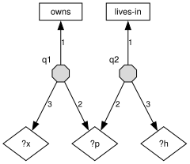

$$
\begin{aligned}
q_1 &= \operatorname{owns}(p, x) \\
q_2 &= \operatorname{lives-in}(p, h)
\end{aligned}
$$

A diamond is a variable. A box is an atom and an octagon a fact pattern, drawn as a fact is in a knowledge base
with a premise for *held*: a pattern under an argument arrow of another stands in a frame only where it is no
premise. The variable $p$ is one node, under an arrow of each premise: that the two premises share it is
what the pattern says.

## A match

A **substitution** $\theta$ gives objects to variables, and $t\theta$ is $t$ with each variable replaced by its
object. A **match** of a pattern graph in a knowledge base $K$ is a substitution $\theta$ of its variables under
which every premise is a held fact:

$$
\forall t \text{ a premise}.\ \ t\theta \in K
$$

On the graphs, a match is a **homomorphism** $m$ from the pattern graph to the graph of $K$: a map of nodes that
fixes the atoms, keeps the arrows in their order, and sends a premise to a held fact,

$$
\begin{aligned}
m(a) &= a && \text{for an atom } a \\
\operatorname{out}(m(t)) &= \big(m(t_1), m(t_2), \dots, m(t_k)\big) && \text{where } \operatorname{out}(t) = (t_1, t_2, \dots, t_k) \\
m(t) &\in K && \text{for a premise } t
\end{aligned}
$$

and $m$ is $\theta$ on the variables and $t \mapsto t\theta$ on the fact patterns. Four things follow from the
definition:

- a fact pattern matches only a fact with **as many arrows**: matching is by count;
- a variable under a first arrow is sent to an **atom**, since a first arrow points at one, and a variable under
  another arrow to any object, an atom or a fact;
- a fact pattern that is no premise is sent to a fact that need not be held: the pattern
  $\operatorname{says}(x, \operatorname{owns}(x, y))$ matches into the nested fact, which is how a pattern reads
  what a fact is about, a fact in a context ([packing and unpacking](#packing-and-unpacking));
- $m$ **need not be injective**: two variables may be sent to one object.

The pattern above has exactly one match in the knowledge base of three facts drawn beside it:

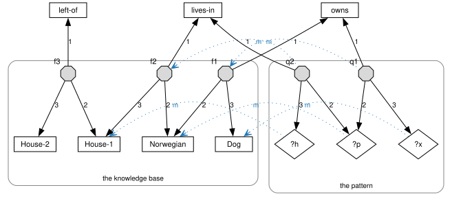

$$
\begin{aligned}
\theta &= \{\, p \mapsto \mathsf{Norwegian},\ x \mapsto \mathsf{Dog},\ h \mapsto \mathsf{House\text{-}1} \,\} \\
m(q_1) &= f_1 = \operatorname{owns}(\mathsf{Norwegian}, \mathsf{Dog}) \\
m(q_2) &= f_2 = \operatorname{lives-in}(\mathsf{Norwegian}, \mathsf{House\text{-}1})
\end{aligned}
$$

A dotted arrow is the match, drawn for the five nodes it moves; the atoms
$\mathsf{owns}$ and $\mathsf{lives\text{-}in}$ are the same nodes in the pattern and in the knowledge base, and
$m$ fixes them. $f_3$ is no image of the pattern: a match is into a part of the graph.

## The conditions on a match

A **pattern** is premises with conditions. A condition adds no node to what is matched; it restricts which
substitutions count. With $t, t'$ terms and $\gamma$ ranging over the parts of a pattern:

$$
\begin{aligned}
\gamma &\;::=\; t \;\mid\; t = t' \;\mid\; t \neq t' \;\mid\; \operatorname{absent}(\gamma_1 \land \cdots \land \gamma_k) \\
\varphi &\;::=\; \top \;\mid\; \gamma_1 \land \cdots \land \gamma_k \;\mid\; (\gamma_{1,1} \land \cdots) \;\lor\; \cdots \;\lor\; (\gamma_{l,1} \land \cdots)
\end{aligned}
$$

A $t$ that stands as a part is a premise, a fact pattern; in an equality or an inequality a term is a variable,
an atom, or a fact with no variable
([Q-M1f.30](../../../decisions/language/Q-M1f.30-a-guard-argument-holds-no-variable-inside-a-fact.md)). A
disjunction is a whole pattern and no part of one
([Q-M1f.74](../../../decisions/language/Q-M1f.74-a-nested-or-a-macros-expansion-writes-is-refused.md)).
$K \models \varphi\theta$, *$\varphi$ holds in $K$ under $\theta$*, is defined on the shape of the pattern:

$$
\begin{aligned}
K &\models \top\theta && \text{always} \\
K &\models t\,\theta && \iff\ t\theta \in K \\
K &\models (t = t')\theta && \iff\ t\theta \text{ and } t'\theta \text{ are one object} \\
K &\models (t \ne t')\theta && \iff\ t\theta \text{ and } t'\theta \text{ are two objects} \\
K &\models (\gamma_1 \land \cdots \land \gamma_k)\theta && \iff\ K \models \gamma_i\theta \ \text{ for every } i \\
K &\models (\varphi_1 \lor \cdots \lor \varphi_l)\theta && \iff\ K \models \varphi_i\theta \ \text{ for some } i \\
K &\models \operatorname{absent}(G)\theta && \iff\ \text{there is no } \theta' \supseteq \theta \text{ with } K \models G\theta'
\end{aligned}
$$

- **The empty pattern** $\top$ holds under the empty substitution and no other: it is matched once
  ([Q-M1e2.36](../../../decisions/language/Q-M1e2.36-an-empty-match-is-true-and-fires-once.md)).
- **A premise** is the homomorphism condition above. A stored negation is nothing new: the premise $\lnot t$ is
  the fact pattern $\operatorname{not}(t)$, and it is sent to a held fact of $\mathsf{not}$ and to nothing
  else.
- **An equality or an inequality** is computed from the two objects and reads no fact: equality is identity, and
  no knowledge base holds one
  ([Q-M1e2.26](../../../decisions/language/Q-M1e2.26-eq-and-neq-are-the-relations-of-equality-and-non.md)).
- **A conjunction** is one pattern graph: the union of its premises, with every condition of every part.
- **A disjunction** is several patterns, and a match of it is a match of one of them.
- **An absence** $\operatorname{absent}(G)$ is a negative condition: the match counts only where the pattern $G$
  has no match that extends it. The variables of $G$ that $\theta$ leaves free are the absence's own, and it
  reads *for no objects in their places*.

**Which variables a substitution gives objects to.** A conjunction is a list, and a variable is **bound** at a
part by the parts before it: by a premise it stands in, or by an equality or an inequality it stands in. A
premise binds its variables to whatever the homomorphism sends them to. A variable that no premise of its
conjunction binds, and that stands in an equality or an inequality, ranges over a finite set $N$ of atoms that
the pattern is matched *over*: for the rules of a program, the program's names, [below](#the-program-and-its-names)
([Q-M1f.34](../../../decisions/language/Q-M1f.34-a-guard-that-binds-its-variable-binds-it-where.md)). In
$\operatorname{absent}(G)$ the substitution $\theta$ is the one the parts before the absence give, so its own
variables are those of $G$ that nothing before it binds:

$$
\begin{aligned}
\operatorname{owns}(p, x) \land \operatorname{absent}(\operatorname{lives-in}(p, h)) \ \ &\text{reads} \ \ \lnot \exists h.\ \operatorname{lives-in}(p\theta, h) \\
\operatorname{absent}(\operatorname{lives-in}(p, h)) \land \operatorname{owns}(p, x) \ \ &\text{reads} \ \ \lnot \exists p, h.\ \operatorname{lives-in}(p, h)
\end{aligned}
$$

A **match** of a pattern $\varphi$ in $K$ over $N$ is a substitution $\theta$ of the variables that stand in
$\varphi$ outside every absence, with $K \models \varphi\theta$.

**Two forms written with these**, and no part of the definition: the bounded universal and the open fact,

$$
\begin{aligned}
\operatorname{forall}(x;\ G,\ B) &= \operatorname{absent}\big(G \land \operatorname{absent}(B)\big) \\
\operatorname{unknown}(t) &= \operatorname{absent}(t) \land \operatorname{absent}(\lnot t)
\end{aligned}
$$

the first read *for every $x$ with $G$, $B$ holds*. With them each of the three statuses of a fact $f$ that an
alive knowledge base can give it ([the knowledge base](01-knowledge-base.md#a-fact-its-negation-both-or-neither))
has a pattern that holds exactly there:

| $\operatorname{status}_K(f)$ | $K$ holds | the pattern |
|---|---|---|
| asserted | $f$ | $f$ |
| negated | $\lnot f$ | $\lnot f$ |
| open | neither | $\operatorname{unknown}(f)$ |

**The premise $\lnot f$ is never the absence of $f$**:

$$
\begin{aligned}
K \models \lnot f &\iff \lnot f \in K \\
K \models \operatorname{absent}(f) &\iff f \notin K
\end{aligned}
$$

for a fact $f$. The two differ on every open fact, where the second holds and the first does not.

A pattern with an absence, drawn with labelled arrows
([the knowledge base](01-knowledge-base.md#drawn-with-labelled-arrows)): the third rule of the three-house example,
$\operatorname{is-a}(h, \mathsf{House}) \land \operatorname{absent}(\operatorname{lives-in}(p, h))$, with its
conclusion $\operatorname{vacant}(h)$ in the lower panel.

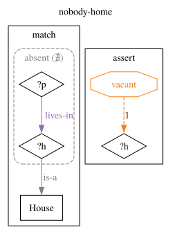

The dashed box is the absence: the variable $p$ is its own, and the match counts where no object in its place
makes the arrow in the box a held fact.

## A conclusion, and the result of rewriting

A **conclusion** $\psi$ is again fact structures with variables: a finite set of **literals**, each one of

$$
\ell \;::=\; t \;\mid\; \lnot x \;\mid\; t = t' \;\mid\; t \neq t'
$$

a fact pattern, $\lnot t$ and $\bot$ among them; the negation of whatever fact a variable stands for; or a
**check**, an equality or an inequality
([Q-M1f.351](../../../decisions/language/Q-M1f.351-a-bare-variable-or-name-is-no-whole-conclusion.md)). For a
substitution $\theta$ that gives every variable of $\psi$ an object, the **instance** $\psi\theta$ is a set of
facts, the union over the literals of

$$
\begin{aligned}
t &\mapsto \{ t\theta \} \\
\lnot x &\mapsto \begin{cases} \{ \lnot\,\theta(x) \} & \theta(x) \in F \\ \emptyset & \theta(x) \in \Sigma^{+} \end{cases} \\
(t = t') &\mapsto \begin{cases} \emptyset & t\theta = t'\theta \\ \{ \bot \} & t\theta \neq t'\theta \end{cases} \\
(t \neq t') &\mapsto \begin{cases} \{ \bot \} & t\theta = t'\theta \\ \emptyset & t\theta \neq t'\theta \end{cases}
\end{aligned}
$$

An atom has no negation, so the second literal adds nothing where its variable holds one
([Q-M1f.128](../../../decisions/language/Q-M1f.128-a-firing-that-meets-the-negation-of-a-name.md)), and a check
that fails is a contradiction, as $\bot$ is. A stored negation has one: where $\theta(x) = \lnot g$, the literal
gives $\lnot\lnot g$, a fact
([Q-M1f.391](../../../decisions/language/Q-M1f.391-the-negation-of-a-negation-is-a-fact.md)).

**The result of rewriting** a knowledge base $K$ by a pattern $\varphi$ and a conclusion $\psi$ **at a match**
$\theta$ of $\varphi$ in $K$ is the knowledge base

$$
K \cup \psi\theta
$$

It is a set of facts, defined by $K$, $\psi$ and $\theta$ alone. Its graph is the graph of $K$ with the fact
nodes of $\psi\theta$ glued on along the match: each new fact points at the objects $\theta$ found and at the
atoms the conclusion names. Three things are true of it by the definition:

$$
\begin{aligned}
K &\subseteq K \cup \psi\theta \\
\psi\theta \subseteq K &\implies K \cup \psi\theta = K \\
\operatorname{names}(K \cup \psi\theta) &\subseteq \operatorname{names}(K) \cup \operatorname{names}(\psi) \cup N
\end{aligned}
$$

Nothing is removed and no object is changed, so a rewriting never undoes a fact, and a negative conclusion adds
a stored negation, which is a fact. A conclusion already held changes nothing. And the result names no atom but
those of $K$, of the conclusion and of $N$: every object $\theta$ gives is one a premise found under an argument
arrow of $K$, or an atom of $N$.

The match above, with the conclusion $\operatorname{pet-at}(x, h)$, gives the knowledge base below. The dashed
octagon and its dashed arrows are what the rewriting added:

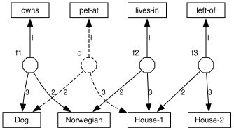

$$
\begin{aligned}
K \cup \psi\theta &= \{ f_1, f_2, f_3 \} \cup \{ c \} \\
c &= \operatorname{pet-at}(x, h)\,\theta = \operatorname{pet-at}(\mathsf{Dog}, \mathsf{House\text{-}1})
\end{aligned}
$$

The same pattern and conclusion drawn with labelled arrows, the pattern in the upper panel and the conclusion in
the lower. A diamond is a variable, a solid arrow a premise with three arrows, a dashed arrow a fact the
conclusion adds:

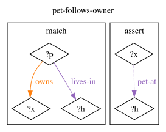

### As a span

In the algebraic reading of graph rewriting a rule is a span of graphs, usually written with three letters that
mean other things on these pages; here it is

$$
L \;\xleftarrow{\ l\ }\; I \;\xrightarrow{\ r\ }\; L^{+}
$$

$L$ the pattern to find, $L^{+}$ what replaces it, and the interface $I$ the part both keep. Rewriting at a
match $m : L \to G$ deletes from $G$ what $L$ has and $I$ lacks, and glues on what $L^{+}$ has and $I$ lacks:
the double-pushout construction. A pattern and a conclusion delete nothing, so their span is the degenerate one,

$$
\begin{aligned}
I &= L \\
l &= \operatorname{id} \\
L^{+} &= L \cup \psi
\end{aligned}
$$

with $L$ the pattern graph of the premises of $\varphi$, and the double pushout reduces to one gluing. With
$G(K)$ the graph of $K$:

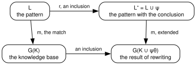

The drawing is of four graphs and three kinds of map, not of a knowledge base. The square commutes, and
$G(K \cup \psi\theta)$ is its pushout **among the graphs in which one list of arrows is one node**: the
conclusion's facts are glued on along the match, and a fact of the conclusion that $K$ already has is the node
$K$ has, not a second one. In graphs that may hold two nodes with one list of arrows the pushout would add a
copy; the second condition of [the graph](01-knowledge-base.md#the-graph) is what makes the gluing a union of
sets of facts. Both horizontal arrows are inclusions. The graphs of the square are read with their held sets,
the premises being the held set of a pattern: $L \to L^{+}$ may add nodes, and it may add none and only hold a
node that $L$ has under an arrow ([an unpacking](#packing-and-unpacking)). The conditions are read on the same
square:

- **an equality or an inequality is an application condition on the match**: it restricts which matches count,
  and adds nothing to $L$;
- **an absence is a negative application condition**: a match counts only where it does not extend to a match
  of the absent pattern.

The pattern and the conclusion above drawn as one graph with labelled arrows, $L$ solid and what $L^{+}$ adds
dashed:

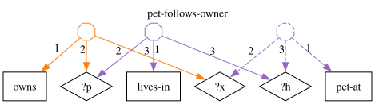

## Packing and unpacking

A fact is in the global context, in the context of a fact, or in both
([the knowledge base](01-knowledge-base.md#the-global-context-and-the-context-of-a-fact)). This section says
what a rule reads of a fact in each, and how a rewriting moves a fact from one to another. It needs nothing the
sections above do not have.

**A premise reads the global context.** A match sends a premise to a held fact, and a fact pattern under an
argument arrow of a premise to the fact that stands there, held or not. So a pattern reads a fact $g$ in one of
two places, which do not overlap:

$$
\begin{aligned}
K \models g\,\theta &\iff g\theta \in K && \text{a premise: } g\theta \text{ is in the global context} \\
K \models c(u, g)\,\theta &\iff c(u, g)\theta \in K && \text{under an arrow of a premise: } g\theta \text{ is in the context of a held fact of } c
\end{aligned}
$$

and the second says nothing of whether $g\theta \in K$. **Every rule is matched in the global context**: there
is no rule of a context, and no rule whose premise a fact satisfies by standing under an arrow.

**A rule for a context is the same rule, wrapped.** A rule that is to read and to conclude what a context holds
writes each of its fact patterns under an arrow of a fact pattern of the context's relation. The first rule of
the three-house example, and the same rule for what somebody says:

$$
\begin{aligned}
\operatorname{owns}(p, x) \;\land\; \operatorname{lives-in}(p, h) \;&\implies\; \operatorname{pet-at}(x, h) \\
\operatorname{says}(w, \operatorname{owns}(p, x)) \;\land\; \operatorname{says}(w, \operatorname{lives-in}(p, h)) \;&\implies\; \operatorname{says}(w, \operatorname{pet-at}(x, h))
\end{aligned}
$$

The first has a match where the two facts are held, and holds its conclusion. The second has a match where one
witness says both, and holds that the witness says the conclusion; the fact
$\operatorname{pet-at}(x, h)\theta$ is then in a context and is not held. Neither rule has a match at the facts
the other reads. The context's relation may be a parameter, as any relation may, so that one rule serves every
context that names it. With parameters $C$ and $R$:

$$
C(w, R(x, y)) \;\land\; C(w, \lnot R(x, y)) \;\implies\; C(w, \bot)
$$

*whoever says a fact and its negation says what is impossible*, applied once for each activator. What the text
of such a rule fixes is the count of arrows, of the context's fact and of the fact in it; the two relations are
whatever an activator names.

**Falsity in a context is a fact about the context.** The conclusion $C(w, \bot)$ above is a fact of the
relation $C$ that points at $\bot$. It does not hold $\bot$, so the result of the rewriting is alive
([a context gives a fact no truth](01-knowledge-base.md#a-context-gives-a-fact-no-truth)). It is read as any
fact is, by a premise that writes the context, $\operatorname{says}(w, \bot)$, and under a universal premise:

$$
\operatorname{forall}\big(w;\ \ \operatorname{witness}(w),\ \ \operatorname{says}(w, \bot)\big) \;\implies\; \bot
$$

is dead exactly where every witness says what is impossible. So the global $\bot$ is reached from a context's
by a rule that says so, and in no other way. A check cannot be wrapped: an equality is no fact, so none stands
under an arrow.

**Packing.** A rule **packs** when a literal of its conclusion is a fact pattern $c$ with a fact pattern $u$
under one of its argument arrows. The result holds $c\theta$, which points at $u\theta$:

$$
\begin{aligned}
c\theta &\in K \cup \psi\theta \\
u\theta \in K \cup \psi\theta &\iff u\theta \in K \ \lor\ u\theta \in \psi\theta
\end{aligned}
$$

so packing holds the fact that points, and **never the fact pointed at**: $u\theta$ is held after exactly where
it was held before, or where the conclusion states it too. Where $u$ is a premise of the rule, $u\theta$ was
held, stays held, and gains a context. Where $u$ is built from the variables and is no premise, $u\theta$ is in
a context and not held. The rule *what is so, Alice thinks*, over the example of
[the knowledge base](01-knowledge-base.md#the-global-context-and-the-context-of-a-fact), where $\mathsf{=}$ is
the name of an ordinary relation:

$$
\begin{aligned}
\operatorname{out}(q) &= (\mathsf{=},\ a,\ b) && \text{the premise} \\
\operatorname{out}(c) &= (\mathsf{think},\ \mathsf{Alice},\ q) && \text{the conclusion}
\end{aligned}
$$

The conclusion points at the premise's own node with its third arrow: in a pattern graph one list of arrows is
one node, as in a knowledge base. Its one match in $K = \lbrace e \rbrace$:

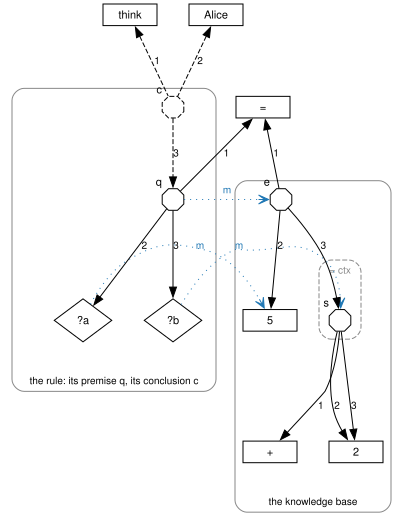

$$
\begin{aligned}
\theta &= \lbrace\, a \mapsto \mathsf{5},\ b \mapsto s \,\rbrace \\
q\theta &= e \\
c\theta &= t \\
K \cup \psi\theta &= \lbrace e, t \rbrace
\end{aligned}
$$

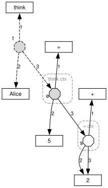

The dashed octagon and its dashed arrows are what the rewriting added: one node, $t$. The fact $e$ was held and
in no context, and is now held and in a context: still in no frame, with the arrow of $t$ entering it.

**Unpacking.** A rule **unpacks** when a literal of its conclusion is a fact pattern $u$ that stands under an
argument arrow of one of its premises. The pattern graph already has the node $u$, as a fact pattern that is no
premise, and a match sends it to a fact $u\theta$ of the graph that need not be held. The conclusion holds it:

$$
\begin{aligned}
u\theta &\in O_K && \text{the graph of } K \text{ has the node before the rewriting} \\
K \cup \psi\theta &= K \cup \lbrace u\theta \rbrace \\
O_{K \cup \psi\theta} &= O_K && \text{no node and no arrow is added}
\end{aligned}
$$

**So an unpacking changes nothing in the graph but which nodes are held.** The rule *what Alice thinks is so*:

$$
\begin{aligned}
\operatorname{out}(u) &= (\mathsf{=},\ a,\ b) && \text{the conclusion} \\
\operatorname{out}(q) &= (\mathsf{think},\ \mathsf{Alice},\ u) && \text{the premise}
\end{aligned}
$$

Its one match in $K = \lbrace t \rbrace$:

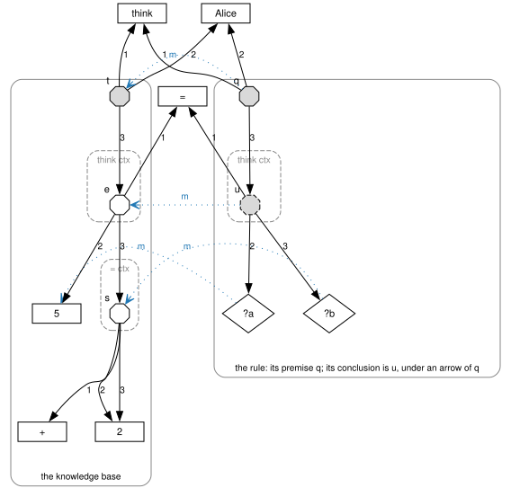

$$
\begin{aligned}
\theta &= \lbrace\, a \mapsto \mathsf{5},\ b \mapsto s \,\rbrace \\
q\theta &= t \\
u\theta &= e \\
K \cup \psi\theta &= \lbrace t, e \rbrace
\end{aligned}
$$

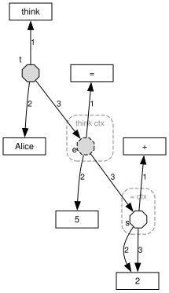

The graph after is the graph before. The octagon $e$ has left its frame, with a dashed outline for what the
rewriting did, and its arrows are solid: they were there. The fact $e$ was in a context and not held, and is now held and
in a context.

**Proposition (a fact changes case only by a rule that says so).** Let $K'$ be the result of rewriting $K$ by a
rule at a match, and $g$ a fact of the graph of $K$. Then

$$
\begin{aligned}
g \in K &\implies g \in K' && \text{a held fact stays held} \\
g \in K' \setminus K &\implies g \in \psi\theta && \text{a fact becomes held only as an instance of a literal of the conclusion} \\
\operatorname{ctx}_{K'}(g) \setminus \operatorname{ctx}_K(g) &\subseteq \psi\theta && \text{and gains a context only by a fact the conclusion adds}
\end{aligned}
$$

*Argument.* $K' = K \cup \psi\theta$, a union of sets of facts, and a context is taken among held facts.
$\square$

So a fact goes from *in a context* to *held and in a context* exactly when a rule concludes it, from *held* to
*held and in a context* exactly when a rule concludes a fact that points at it, and never out of *held*.

**What a rule can spell.** A premise is a fact pattern, and a literal of a conclusion is a fact pattern, the
negation of a variable, or a check. So:

| a rule that would | is written | by |
|---|---|---|
| hold a fact found in a context | $\operatorname{says}(w, \operatorname{owns}(p, x)) \implies \operatorname{owns}(p, x)$ | spelling the fact's relation and its count |
| the same for any relation of one count | $\operatorname{says}(w, R(p, x)) \implies R(p, x)$, with $R$ a parameter | one application for each activator that names a relation |
| deny a fact found in a context, whatever it is | $\operatorname{says}(w, z) \implies \lnot z$ | the literal $\lnot z$; where $z$ is itself a stored negation $\lnot g$, the fact concluded is $\lnot\lnot g$ |
| hold a fact whose double negation is held | $\lnot\lnot R(p, x) \implies R(p, x)$, with $R$ a parameter | spelling the count, as any unpacking does: the denied fact stands under two arrows of $\mathsf{not}$ |
| hold a fact found in a context, whatever it is | not a rule | a variable is no literal |
| ask whether the fact a variable stands for is held, denied or absent | not a rule | a variable is no premise; the fact's shape is spelt, $\operatorname{says}(w, \operatorname{owns}(p, x)) \land \operatorname{owns}(p, x)$ |

A relation's place takes its atom from an activator and never from a fact under an arrow, so no rule reads off
*the relation of whatever fact this is*: what a rule must know of a fact it moves is its count
([Q-M1f.393](../../../decisions/language/Q-M1f.393-a-rule-unpacks-a-fact-by-its-count.md)).

## A rule, declared

A **rule** is a pattern and a conclusion declared under a name, with parameters and a reason
([Q4](../../../decisions/language/Q4-a-rule-is-a-pattern-a-conclusion-and-a-reason.md)):

$$
\begin{aligned}
\rho &= (\bar{p},\ \varphi,\ \psi) \\
\operatorname{name}(\rho) &\in \Sigma^{+} \setminus W \\
\bar{p} &= (p_1, \dots, p_m) \in X^{m} && \text{with } m \ge 0
\end{aligned}
$$

| part | in the terms above |
|---|---|
| its **name** | a name. Where the rule has parameters the atom of that name is a relation: the facts under it are the rule's activators |
| its **parameters** $\bar{p}$ | variables that no part of $\varphi$ need bind: one more premise binds them, the **activator pattern** $\operatorname{name}(\rho)(p_1, \dots, p_m)$ |
| its **pattern** $\varphi$ | a pattern, matched over the names of the program |
| its **conclusion** $\psi$ | a conclusion over the variables the pattern and the parameters bind |
| its **reason** | a text, with places for the variables: what an instance of the rule reads as. It is no part of what the rule states |

How each part is spelt is [the user's page on rules](../../user/03-syntax-and-semantics/05-rules.md).

**Activators.** An **activator** of $\rho$ in $K$ is a held fact that the activator pattern matches, and it
gives the parameters their objects:

$$
\begin{aligned}
\operatorname{Act}_K(\rho) &= \{\, a \in K \;:\; \operatorname{out}(a) = (\operatorname{name}(\rho), v_1, \dots, v_m) \,\} \\
\rho[a] &= (\varphi[a],\ \psi[a]) && \text{with each } p_i \text{ replaced by } v_i
\end{aligned}
$$

$\rho[a]$ is the rule **applied under** $a$: a pattern and a conclusion with no parameter left. A rule with no
parameter, $m = 0$, has no activator pattern and is applied as it stands, once. A rule with parameters has one
application for each activator: none where $\operatorname{Act}_K(\rho) = \emptyset$, and a fact under the rule's
name with another count of arguments is no activator
([Q-M1f.203](../../../decisions/language/Q-M1f.203-a-kernel-marker-and-an-activator-are-held-to-no.md)). Two
activators that differ in any argument are two facts, so two applications, and an activator gives a parameter
whatever object stands in its place, an atom or a fact
([Q-M1f.43](../../../decisions/engine/Q-M1f.43-a-plans-activator-is-every-argument.md)): $\mathsf{1}$ and
$\mathsf{01}$ are two atoms, so $\operatorname{note}(\operatorname{edge}, \mathsf{1})$ and
$\operatorname{note}(\operatorname{edge}, \mathsf{01})$ are two applications of a rule named $\operatorname{note}$.

A **match of a rule** in $K$ is a pair $(a, \theta)$ of an activator $a \in \operatorname{Act}_K(\rho)$, or
nothing in its place where $m = 0$, and a match $\theta$ of $\varphi[a]$ in $K$. **The result of rewriting $K$ by
$\rho$ at $(a, \theta)$** is

$$
K \cup \psi[a]\theta
$$

The rule of transitivity has one parameter, which stands under the first arrow of its premises and of its
conclusion. With its activator pattern:

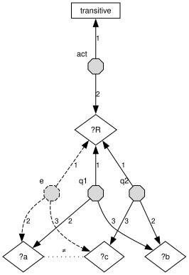

$$
\begin{aligned}
\mathit{act} &= \operatorname{transitive}(R) && \text{the activator pattern} \\
q_1 &= R(a, b) && \text{a premise} \\
q_2 &= R(b, c) && \text{a premise} \\
a &\neq c && \text{a condition} \\
e &= R(a, c) && \text{the conclusion}
\end{aligned}
$$

The variable $R$ is one diamond: the activator pattern points at it with its second arrow, and both premises and
the conclusion point at it with their first. The dotted line with no head is the inequality, a condition and no fact;
the dashed octagon is the conclusion. In a knowledge base that holds
$\operatorname{transitive}(\operatorname{left-of})$ the rule is applied under that fact, with
$\mathsf{left\text{-}of}$ in the diamond's place, and $\operatorname{transitive}[\operatorname{left-of}]$ is
$\operatorname{left-of}(a, b) \land \operatorname{left-of}(b, c) \land a \neq c$ with the conclusion
$\operatorname{left-of}(a, c)$. This is where *a relation is a node* pays: the activator is an ordinary fact
whose argument is a relation, so a property of a relation is a fact about it, and one rule serves every relation
that has the property ([Q27](../../../decisions/language/Q27-a-relations-properties-are-facts-beside.md)).

**What a rule states.** A knowledge base $K$ **satisfies** $\rho$ when rewriting by it at any match changes
nothing:

$$
\forall a \in \operatorname{Act}_K(\rho).\ \forall \theta.\ \ K \models \varphi[a]\theta \ \implies\ \psi[a]\theta \subseteq K
$$

with the one empty application where $m = 0$. This is a sentence about $K$ alone: a rule reads and concludes
facts of one knowledge base, and nothing in it reads another, how many there are, or how one was reached
([Q-M1d.7](../../../decisions/language/Q-M1d.7-a-rule-is-a-sentence-about-the-state-it-fires.md)).

### The conditions of a declaration

A declaration is a rule only if each of these holds; a text that fails one is no program.

$$
\begin{aligned}
&\operatorname{vars}(\psi) \;\subseteq\; \bar{p} \;\cup\; \bigcap_{i \le l} \operatorname{bound}(\varphi_i) && \text{where } \varphi = \varphi_1 \lor \cdots \lor \varphi_l \\
&x \text{ stands under a first arrow in } \varphi \text{ or } \psi \implies x \in \bar{p} \\
&\operatorname{ar}(t) = n && \text{for a fact pattern } t \text{ of a relation declared with } n \text{ labels} \\
&\operatorname{name}(\rho) \neq \operatorname{name}(\rho') && \text{for two rules } \rho \neq \rho' \text{ of one program}
\end{aligned}
$$

- **Every variable of the conclusion is bound by every way of satisfying the pattern**, or is a parameter:
  $\operatorname{bound}(\varphi_i)$ is the variables that stand in the conjunction $\varphi_i$ outside every
  absence
  ([Q-M1e2.37](../../../decisions/language/Q-M1e2.37-a-conclusions-variable-is-bound-by-every-way.md)). So an
  instance $\psi[a]\theta$ is always defined, and is a set of facts with no variable.
- **A variable in a relation's place is a parameter**, so only an activator gives a relation's place its atom.
  An activator that would put a fact there is no activator of a program, whether the text writes it or some
  rule's conclusion could make it
  ([Q-M1f.1](../../../decisions/language/Q-M1f.1-a-rule-that-could-derive-an-activator-binding.md)).
- **A fact pattern of a declared relation has the declared count**
  ([Q-M1f.315](../../../decisions/language/Q-M1f.315-a-form-of-a-declared-relation-has-as-many.md)). One whose
  relation is a parameter is held to no count, and matches by count
  ([Q-M1f.202](../../../decisions/language/Q-M1f.202-a-relation-written-as-a-variable-is-held-to-no.md)).
- **A rule's name is declared once.**
- **A conclusion is literals and nothing else**: no disjunction, and no fact made of several. *One of these* is
  not said by a rewriting rule. A conjunction in a conclusion is read flat, as the set of its literals, at any depth of
  nesting, and the empty conclusion adds nothing.
- **A conclusion $\lnot x$ is of a variable that holds a fact**: where the text shows that $x$ can hold an atom,
  the declaration is no rule
  ([Q-M1f.127](../../../decisions/language/Q-M1f.127-a-conclusion-not-x-is-refused-where-the-program.md)).

A pattern may read a relation of which the knowledge base has no fact and no declaration: it is a rule, and it
has no match ([Q-M1f.120](../../../decisions/language/Q-M1f.120-a-rule-may-read-a-relation-nothing-makes.md)).

### The program, and its names

A program $P$ is read into its knowledge base $K_0$ ([the knowledge base](01-knowledge-base.md#the-knowledge-base-of-a-program))
and its finite set of rules, also written $P$ where a rule set is meant. A rule is no fact: $K_0$ holds no node
for a rule's pattern or its conclusion, and a declaration of a rule adds no fact to $K_0$. The **names of a rule**
are the atoms under an argument arrow of its fact patterns, at any depth, and those its equalities and
inequalities compare; the **names of the program** are those of its knowledge base and of its rules:

$$
\operatorname{names}(P) \;=\; \operatorname{names}(K_0) \;\cup \bigcup_{\rho \in P} \operatorname{names}(\rho)
$$

a finite subset of $\Sigma^{+}$, fixed by the text. A name that only a question writes is not among them
([Q-M1e2.9](../../../decisions/language/Q-M1e2.9-a-programs-names-are-the-constants-its-facts.md)).
$\operatorname{names}(P)$ is the set $N$ a rule's pattern is matched over, so by the third property of a
rewriting, for every match of a rule of $P$ in a knowledge base $K$,

$$
\operatorname{names}(K \cup \psi[a]\theta) \;\subseteq\; \operatorname{names}(K) \cup \operatorname{names}(P)
$$

**a rewriting brings in no name** ([Q-M1e.21](../../../decisions/hypotheses/Q-M1e.21-a-rule-brings-in-no-name.md)).

## The kinds of rule

### By its conclusion

What a rule does to a knowledge base it matches in is read off its conclusion:

| the conclusion holds | the result of rewriting |
|---|---|
| facts, stored negations among them | holds them |
| $\bot$ | is dead: the rule is a **constraint**, a pattern that no alive knowledge base matches and satisfies |
| a check | is $K$ where the check holds of the match, and dead where it does not |
| nothing | is $K$ |

Two more kinds of declaration have a rule's parts and are not rewriting rules: neither adds its conclusion to
the knowledge base it matches in. Each is defined where it is used, in the part after this one
([the first](../02-kb-evolution/04-hypothesis-generation.md#3-the-hypothesis-rules-what-the-program-says-to-guess),
[the second](../02-kb-evolution/04-hypothesis-generation.md#41-an-instance-and-the-facts-that-would-pay-it)).

### By what its variables stand for

The kinds below are not exclusive: a rule is of the kind of its widest variable.

| kind | its variables stand for | applied |
|---|---|---|
| **first-order** | objects under argument arrows; every relation is an atom of the pattern | once, as it stands |
| **relation-polymorphic** | objects, and relations: a variable stands under a first arrow | once for each activator that gives its parameters their objects |
| **structural** | a whole region of the graph: what remains, which is the last | as the first two kinds are, through a universal premise |

#### First-order

Every relation of the pattern is an atom, and the variables stand under argument arrows. The pattern is a fixed
shape of the graph up to which objects fill it, and it matches wherever the shape occurs. The first rule of the
three-house example is one, with no parameter; it is the pattern and the conclusion drawn above,

$$
\operatorname{owns}(p, x) \;\land\; \operatorname{lives-in}(p, h) \;\implies\; \operatorname{pet-at}(x, h)
$$

#### Relation-polymorphic

At least one variable stands under a first arrow, as $R$ does in the rule of transitivity above. Such a variable
is never free to range over every relation: it is a parameter, and the rule has one application for each
activator.

**A declaration is read like any fact.** A relation's declaration is a fact of $\mathsf{relation}$, so a pattern
over it is an ordinary premise: $\operatorname{relation}(R, x, y)$ gives $x$ and $y$ the labels of a relation of
two arguments. That is how a rule states what the labels are for. With $R$ a parameter,

$$
\operatorname{relation}(R, t_1, t_2) \;\land\; R(x_1, x_2) \;\land\; \operatorname{is-a}(x_1, t_1) \;\implies\; \operatorname{fits}(x_1, t_1)
$$

matches each fact of $R$ whose first argument is, by a fact of $\operatorname{is-a}$, a member of the first
label, and concludes that it fits. Applied under an activator that names $\operatorname{lives-in}$, in the
knowledge base of [the declaration's drawing](01-knowledge-base.md#what-is-where), it has one match, whose
result holds $\operatorname{fits}(\mathsf{Norwegian}, \mathsf{Person})$. It has no match at a fact
$\operatorname{lives-in}(\mathsf{House\text{-}1}, \mathsf{Norwegian})$, which is a fact all the same. A program
with no such rule gives its labels no meaning
([Q-M1f.372](../../../decisions/language/Q-M1f.372-ein-has-no-types-a-declarations-slot-names-are.md)).

#### Structural

A structural statement is about a region of the graph rather than a few facts in it: *exactly one object
remains*, *no other object takes this place*. **Ein has no aggregate.** No function counts the facts of a
relation, and the only conditions whose truth is computed are equality and inequality
([Q-M1e2.26](../../../decisions/language/Q-M1e2.26-eq-and-neq-are-the-relations-of-equality-and-non.md)): the
truth of a fact is data, which a pattern can find. A structural statement is an ordinary rule whose pattern holds a universal
premise. The standard library's rule of **domain elimination** concludes the one object left for an argument
once every other is denied. With $R$ the relation and $m$ the program's membership relation as its parameters:

$$
\begin{aligned}
&\operatorname{functional}(R) \;\land\; \operatorname{total}(R) \;\land\; \operatorname{relation}(R, A, B) \;\land\; m(a, A) \;\land\; m(b, B) \\
&\quad \land\; \operatorname{forall}\big(b';\ \ m(b', B) \land b' \ne b,\ \ \lnot R(a, b')\big) \\
&\implies\ R(a, b)
\end{aligned}
$$

Drawn with labelled arrows:

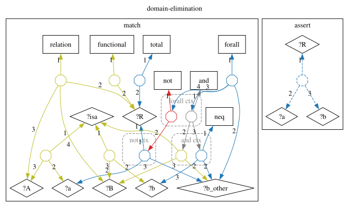

The dashed box is the universal premise: the variable inside it is its own, the red arrow is a stored negation,
and the box reads *every other member of the second label is denied*. The octagon with three numbered arrows is
the premise that reads the declaration, with the name of $\mathsf{relation}$ written in it and its arrows
numbered by argument. The arrows labelled by a
variable are premises whose relation is a parameter. The statement is in the pattern language, not beneath it.

## The four levels a knowledge base describes itself in

A program speaks at four **levels**, and each is a part an atom or a fact plays, not a sort of node:

| level | what is there | in the three-house example |
|---|---|---|
| **L0, the things named** | atoms under argument arrows | $\mathsf{Norwegian}$, $\mathsf{House\text{-}1}$, $\mathsf{House}$ |
| **L1, facts** | facts over them | $\operatorname{lives-in}(\mathsf{Norwegian}, \mathsf{House\text{-}1})$ |
| **L2, relations** | declarations, and the facts about a relation that say what holds of its facts | the declaration of $\operatorname{left-of}$; $\operatorname{transitive}(\operatorname{left-of})$ |
| **L3, rules** | patterns with conclusions | the rule of transitivity |

One atom may play at several levels: $\mathsf{left\text{-}of}$ is the relation of two facts and an argument of a
third, and $\mathsf{transitive}$ names a rule and is the relation of its activator. **Each level reads the
levels below it:**

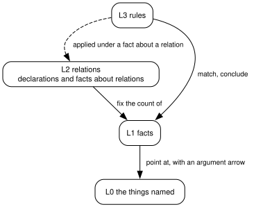

The drawing is of the levels, not of a knowledge base.

- **rules** match facts and conclude facts, and a relation-polymorphic rule is applied under a fact of L2;
- **relations** stand over facts: a fact's relation is an atom, whose declaration fixes how many arguments the
  fact has and whose property facts are the activators of the rules that hold of it;
- **facts** point at the things named with their argument arrows;
- **the things named** are leaves.

**Where the stack folds back on itself.** Two folds keep the reading downward:

- **L2 is readable as L1.** A declaration is facts of $\mathsf{relation}$, and a property is a fact about a
  relation, so a pattern reads a relation's labels and its properties as it reads any fact. The levels are a
  reading of one graph, and the graph describes its own schema.
- **L3 is the program's text.** A conclusion is literals; none is a rule or a declaration, and the graph holds
  no node for a rule. So a rewriting adds facts, and adds no rule, no declaration and no name.

Rules that read and write rules, a level over L3, are what
[rules as data](../03-rule-evolution/01-rules-as-data.md) takes up: what of Ein describes itself in Ein, and
where rules as data would begin.
