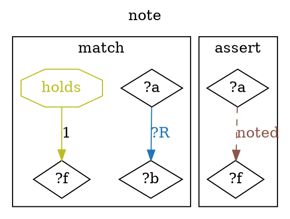
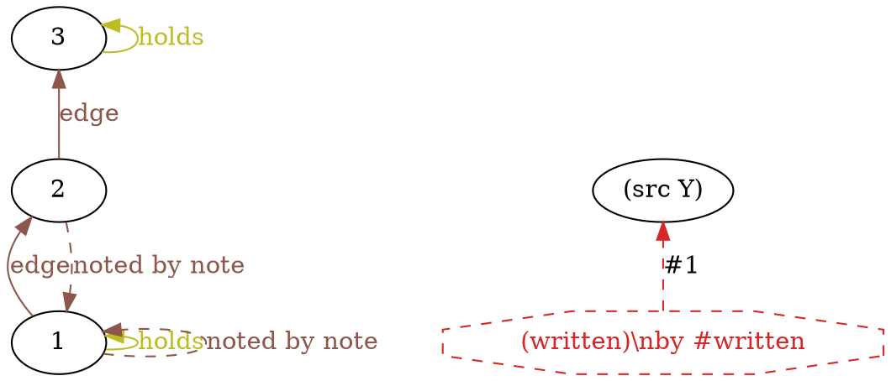

# Values and their order

Where what a run reports depends on an order, the order is defined here, as a function of the values themselves,
so that two implementations given one program report the same thing in the same order. Each section defines an
order or an identity a reader can observe, and says why it is fixed rather than left to the implementation.

## No output depends on how names were numbered

An implementation may number the names and facts it meets, by any injection $\iota$ from the values it has seen
into the integers, may keep them in collections that iterate in any order, and may share a run among any number
$w$ of workers. Let $O$ be anything a reader can observe of a run: the answer, a rendering of it, a narration, a
core, a dump. Then

$$
O(P;\ \iota,\ w) = O(P;\ \iota',\ w') \qquad \text{for all } \iota, \iota', w, w'
$$

so $O$ is a function of the program alone. Every order a reader sees is therefore an order of the values'
content, one of the orders of this page. A collection read only for membership needs no order; one whose
iteration reaches an output is ordered by content at that point.

## Values are totally ordered

A value is a name or a fact ([names and atoms](01-names-and-atoms.md)), and any two values compare. Write
$\lt_{\text{lex}}$ for the order of words by code point, a proper prefix first. Then $\prec$ is the least relation
on $V$ with

$$
\begin{aligned}
a \prec f \quad & \text{for every name } a \text{ and every fact } f \\
a \prec b \quad & \text{iff } a \lt_{\text{lex}} b, \text{ for names } a, b \\
r(u_1, \dots, u_m) \prec s(v_1, \dots, v_n) \quad & \text{iff } r \lt_{\text{lex}} s, \ \text{ or } \ r = s \text{ and } (u_1, \dots, u_m) \prec^{*} (v_1, \dots, v_n)
\end{aligned}
$$

where $\prec^{*}$ compares two argument lists place by place by $\prec$, and puts a list that is a proper prefix of
another first:

$$
(u_1, \dots, u_m) \prec^{*} (v_1, \dots, v_n) \iff \exists k.\ \ \big(\forall i < k.\ u_i = v_i\big) \;\land\; \Big( \big(k \le \min(m, n) \land u_k \prec v_k\big) \ \lor\ \big(k = m + 1 \le n\big) \Big)
$$

A stored negation $\lnot f$ and the fact $\bot$ are facts and compare as facts: by their relation's name, then by
their argument. $u \preceq v$ means $u \prec v$ or $u = v$. In words:

- **a name before a fact**;
- **two names by their text**, character by character. Names are ASCII, so digits come before upper case, and
  upper case before lower case. A name of digits is text like any other: $\mathsf{10} \prec \mathsf{2}$, and so
  $\operatorname{p}(\mathsf{10}) \prec \operatorname{p}(\mathsf{2})$;
- **two facts by their relation's name, then their arguments pairwise, then their count**.

**Proposition.** $\preceq$ is a total order on $V$.

*Argument.* By induction on the depth of the two values. $\lt_{\text{lex}}$ is a total order of words. Names come
before facts, and names are ordered by $\lt_{\text{lex}}$. For two facts, the relation names are compared by
$\lt_{\text{lex}}$, and if they are equal the argument lists are compared by $\prec^{*}$, the lexicographic order
over $\prec$ on values of smaller depth, which is total by induction; a lexicographic order over a total order is
total. Two values that neither precedes the other have the same relation, the same count and equal arguments,
which is identity of facts. $\square$

A chain of nine values in the order, three names and six facts:

```dot
digraph value_order {
  rankdir=LR;
  node [shape=rectangle];
  n1 [label="10"]; n2 [label="2"]; n3 [label="a"];
  node [shape=octagon];
  f1 [label="adjacent(b, b)"];
  f2 [label="co-located(a)"];
  f3 [label="co-located(a, a)"];
  f4 [label="co-located(a, b)"];
  f5 [label="co-located(a, p(a))"];
  f6 [label="co-located(b)"];
  n1 -> n2 -> n3 -> f1 -> f2 -> f3 -> f4 -> f5 -> f6 [label="≺"];
}
```

Each arrow reads *comes before*. The third arrow is a name before a fact; the fourth is decided by the relation's
name; the fifth by the count, a prefix first; the seventh by a name before a fact in the second place.

It is the order a run uses wherever it compares values as values: the facts that the states it lists differ in,
and the values a check's findings are listed by. It is stated rather than inherited because two values of
different kinds, a name and a nested fact, can meet in one argument place of one relation, and the order must say
which comes first.

## The order of the candidates

The candidate set $H$ is ordered by another function of content: the text of a value,

$$
\operatorname{text}(a) = a, \qquad \operatorname{text}(r(v_1, \dots, v_n)) = \texttt{(}\; r\; \sqcup\; \operatorname{text}(v_1)\; \sqcup\; \cdots\; \sqcup\; \operatorname{text}(v_n)\; \texttt{)}
$$

with $\sqcup$ one space, and $\texttt{(}\,r\,\texttt{)}$ for $n = 0$. Then

$$
h \lt_{H} h' \iff \operatorname{text}(h) \lt_{\text{lex}} \operatorname{text}(h')
$$

This is the **universe's order**, the order in which $H$ is listed
([the hypothesis space](../02-kb-evolution/05-hypothesis-space.md)). $\lt_{H}$ and $\prec$ are two orders and
disagree: in the order of characters a space comes before a closing parenthesis, and an opening parenthesis
before every letter and digit, so

$$
\operatorname{q}(\mathsf{10}, \mathsf{10}) \lt_{H} \operatorname{q}(\mathsf{10}) \quad \text{but} \quad \operatorname{q}(\mathsf{10}) \prec \operatorname{q}(\mathsf{10}, \mathsf{10}),
\qquad
\operatorname{q}(\operatorname{p}(\mathsf{a})) \lt_{H} \operatorname{q}(\mathsf{a}) \quad \text{but} \quad \operatorname{q}(\mathsf{a}) \prec \operatorname{q}(\operatorname{p}(\mathsf{a}))
$$

Each is total, each is a function of content, and a surface says which one it lists by.

## A state is its facts

**Two commitments whose saturated states hold the same facts reach one state.** The identity of a state is its
set of facts, compared as a set:

$$
\operatorname{st}(C) = \operatorname{st}(C') \iff \forall f \in F.\ \ f \in \operatorname{st}(C) \leftrightarrow f \in \operatorname{st}(C')
$$

A digest $d$ of a state may label it for a reader, and is never what decides that two states are one:
$d(S) = d(S')$ does not imply $S = S'$, so a comparison of digests could count two states as one, and the
comparison of sets cannot. What a state's identity leaves out is everything a fact's identity leaves out: how each
fact came to be held, and in which order.

The commitments that reach one state are a **state class**, a class of the equivalence

$$
C \sim C' \iff \operatorname{st}(C) = \operatorname{st}(C')
$$

and the answer is counted twice, in commitments and in classes:

$$
k_c = \lvert R \rvert, \qquad k_s = \lvert R / {\sim} \rvert, \qquad k_s \le k_c
$$

The two differ exactly where saturation derives a candidate at a node of $R$: there the node $C$ and its closure
$\operatorname{cl}(C) \supsetneq C$ are two commitments with one state
([solution semantics](../02-kb-evolution/06-solution-semantics.md)).

## A rule application's identity

A rule $\rho$ with parameters $\bar{p} = (p_1, \dots, p_m)$ is applied once for each **activator**: a fact whose
relation is the rule's name and whose arguments bind its parameters
([rules as statements](04-rules-as-statements.md)). In a state $S$,

$$
\operatorname{Act}_S(\rho) = \{\, \bar{a} \in V^{m} \;:\; \operatorname{name}(\rho)(a_1, \dots, a_m) \in S \,\}
$$

and a rule with no parameter, $m = 0$, has one application in every state. An **application** is a pair
$(\rho, \bar{a})$. A **firing** is one application matched once, and its identity is the triple

$$
(\rho,\ \bar{a},\ \theta)
$$

its rule, its activator, and the values its variables are bound to
([Q-M1e.16](../../../decisions/engine/Q-M1e.16-a-firings-identity-keys-on-every-activator.md)). Two firings are one
when the three parts are equal, the activators compared **in every argument, as values**, names and nested facts
alike ([Q-M1f.43](../../../decisions/engine/Q-M1f.43-a-plans-activator-is-every-argument.md)):

$$
(\rho, \bar{a}, \theta) = (\rho', \bar{a}', \theta') \iff \rho = \rho' \;\land\; \forall i \le m.\ a_i = a'_i \;\land\; \forall x.\ \theta(x) = \theta'(x)
$$

One identity fires at most once. Three consequences:

- two activators of one rule that differ in **any** argument are two applications, and each fires: $\mathsf{1}$
  and $\mathsf{01}$ are two names, so $\operatorname{note}(\operatorname{edge}, \mathsf{1})$ and
  $\operatorname{note}(\operatorname{edge}, \mathsf{01})$ are two applications;
- an activator binds each parameter to its argument **whatever value it is**: under
  $\operatorname{act}(\operatorname{f}(\mathsf{a}))$ the parameter is the fact $\operatorname{f}(\mathsf{a})$, and
  a premise $\operatorname{p}(y)$ with $y$ that parameter matches $\operatorname{p}(\operatorname{f}(\mathsf{a}))$
  alone;
- **the order activators are written in decides nothing.**

**Proposition.** Let no rule of the program read an absence. Then the state its facts saturate to does not depend
on the order they are written in, and writing one more activator only adds facts to it.

*Argument.* The firings of $\rho$ in $S$ are the triples $(\rho, \bar{a}, \theta)$ with
$\bar{a} \in \operatorname{Act}_S(\rho)$ and $S \models \varphi[\bar{a}]\theta$. Both conditions are conditions on
the set $S$, not on the order its facts arrived in, and both are preserved when $S$ grows. So the saturated state
is the least state that holds the written facts and is closed under these firings, which is one state whatever
the order. A new activator adds triples and, since every argument is part of the identity, is equal to none that
was there; the least closed state above a larger set of facts is larger. $\square$

An identity that kept only some of an activator's arguments, a projection $\pi(\bar{a})$ that is not injective,
would make one identity of two applications with $\pi(\bar{a}) = \pi(\bar{a}')$ and one $\theta$, and would drop
the second firing as a repeat of the first: which conclusion survived would depend on which activator came first.

**The example where that would show.** One rule with two parameters, $r$ in a relation's place and $f$ a value:

$$
\operatorname{note}[r, f]:\qquad r(a, b) \;\land\; \operatorname{holds}(f) \;\implies\; \operatorname{noted}(a, f)
$$

The upper panel is the pattern and the lower the conclusion; a diamond is a variable, and the arrow labelled by
the variable in a relation's place stands for a fact of whichever relation the activator names. The text writes
four facts and two activators:

$$
\operatorname{edge}(\mathsf{1}, \mathsf{2}),\ \ \operatorname{edge}(\mathsf{2}, \mathsf{3}),\ \ \operatorname{holds}(\mathsf{1}),\ \ \operatorname{holds}(\mathsf{3}),
\qquad
\operatorname{note}(\operatorname{edge}, \mathsf{1}),\ \ \operatorname{note}(\operatorname{edge}, \operatorname{src}(\mathsf{Y}))
$$

The first activator binds $f$ to the name $\mathsf{1}$, which holds, and derives
$\operatorname{noted}(\mathsf{1}, \mathsf{1})$ and $\operatorname{noted}(\mathsf{2}, \mathsf{1})$, one for each
edge. The second binds $f$ to the fact $\operatorname{src}(\mathsf{Y})$, of which nothing says that it holds, so
it derives nothing, and it removes nothing the first derives. In either order of the two activators the state is
the same:

The two dashed arrows labelled with the rule are the two conclusions. The octagon is the fact that reading states
of the nested value the second activator writes ([names and atoms](01-names-and-atoms.md)); the activators and
the declarations' facts are left out of the drawing.

## How a value is printed

**As text that reads back.** On every surface that prints a value, a read-out, a dump, a trace, a drawing's
label, a value $v$ is printed as $\operatorname{text}(v)$ of [the candidates' order](#the-order-of-the-candidates), and reading is its inverse:

$$
\operatorname{read}(\operatorname{text}(v)) = v \qquad \text{for every value } v \text{ over names of } \Sigma^{+}
$$

so $\operatorname{text}$ is injective. A name a program writes is a word over $\Sigma$, and prints bare. A made-up
name, which begins with a mark outside $\Sigma$, prints between quotation marks and does not read back, which is
how a reader tells it apart. Every state an answer's files hold reads back as the state it was written from.

**A drawing labels a value as written.** A value holds no annotation, so none reaches a label, and every program
that is read can be drawn.

**In a message, quoted.** A message that quotes a value, a diagnostic that names a rule, a check's warning,
quotes it by one function $q$ from values, and from lists $[v_1, \dots, v_n]$ of values, to ASCII words. It has
three shapes, a name, a list and a fact:

$$
\begin{aligned}
q(a) &= \texttt{'}a\texttt{'}, \quad \text{or } \ \texttt{"}a\texttt{"} \ \text{ where the name } a \text{ holds an apostrophe} \\
q([v_1, \dots, v_n]) &= \texttt{(}\,q(v_1)\texttt{,}\sqcup\cdots\texttt{,}\sqcup q(v_n)\,\texttt{)} \quad (n \ge 2), \qquad q([v_1]) = \texttt{(}\,q(v_1)\texttt{,)}, \qquad q([\,]) = \texttt{()} \\
q(r(v_1, \dots, v_n)) &= \texttt{Fact(relation}\_\texttt{name=}\,q(r)\,\texttt{,}\sqcup\texttt{args=}\,q([v_1, \dots, v_n])\,\texttt{)}
\end{aligned}
$$

A text, which may hold any character, is quoted as a name is, with an escape for the quotation mark chosen, for
the backslash, and for every character that is not printable; a name never needs one, since $\Sigma$ holds
neither a backslash nor a quotation mark nor a character outside ASCII.

$q$ is total and injective, so it is an order too:

$$
u \lt_{q} v \iff q(u) \lt_{\text{lex}} q(v)
$$

The facts of a contradiction's core, drawn as the arrows into $\bot$ in the drawing of a refutation, are listed
in $\lt_{q}$, whatever order they were found in.
