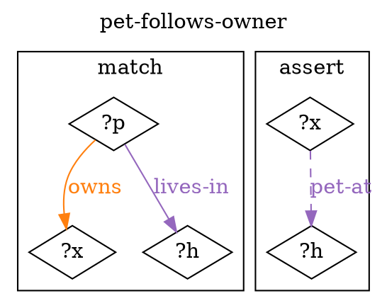
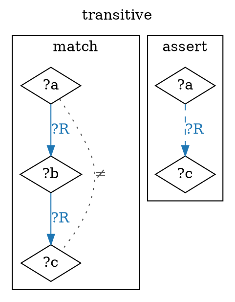
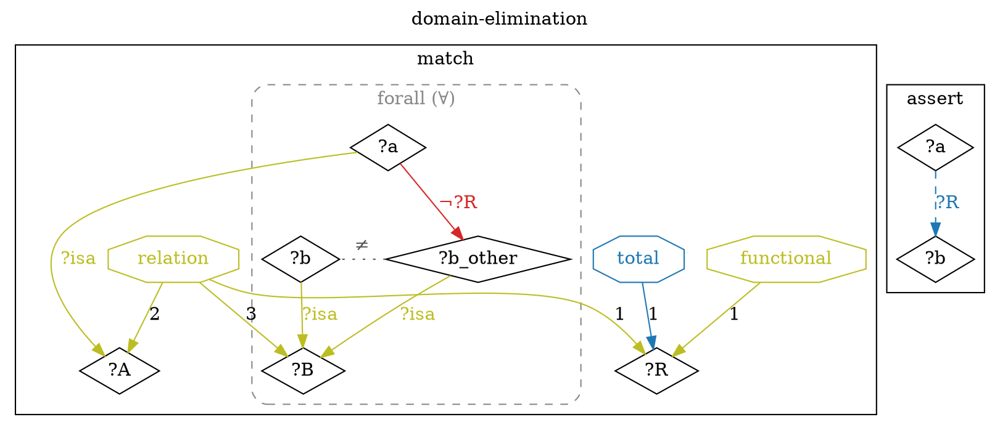
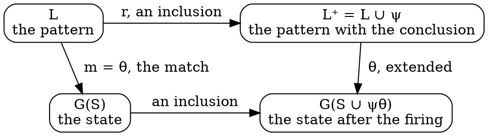
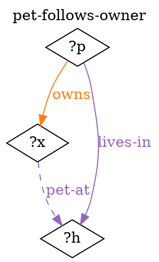
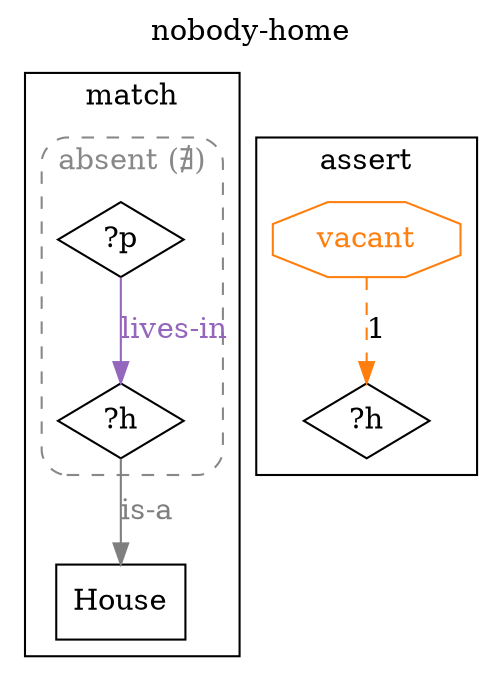
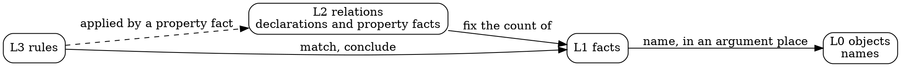

# Rules as statements

A **rule** is a statement about the state it fires in: where its pattern matches the facts held, its conclusion
holds too ([Q4](../../../decisions/language/Q4-a-rule-is-a-pattern-a-conclusion-and-a-reason.md)). It reads facts
and concludes facts of one state, and nothing in it reads another state, the number of states, or how far a search
has gone ([Q-M1d.7](../../../decisions/language/Q-M1d.7-a-rule-is-a-sentence-about-the-state-it-fires.md)). How a
rule is spelt, with its parts and its reason, is [the user's page on rules](../../user/03-syntax-and-semantics/05-rules.md).
This page defines a rule, the kinds of statement a rule can be, a rule as a rewrite of a graph, and the levels a
knowledge base describes itself in.

## A rule

A rule is a triple, with a name and a reason beside it:

$$
\rho = (\bar{p},\ \varphi,\ \psi)
$$

$\bar{p}$ is a list of variables, its **parameters**; $\varphi$ is its **pattern**; $\psi$ is its **conclusion**.
The reason is a text, and no part of what the rule states. A **term** is a name, a variable, or a fact over terms,
and a **pattern** is built from atoms of terms:

$$
\begin{aligned}
t &::= a \;\mid\; x \;\mid\; r(t_1, \dots, t_n) \;\mid\; \lnot\, r(t_1, \dots, t_n) \\
\varphi &::= \top \;\mid\; r(t_1, \dots, t_n) \;\mid\; \lnot\, r(t_1, \dots, t_n) \;\mid\; t = t' \;\mid\; t \ne t' \;\mid\; \varphi \land \varphi \;\mid\; \varphi \lor \varphi \;\mid\; \operatorname{absent}(\varphi)
\end{aligned}
$$

where $r$ is a relation name or a parameter. A **substitution** $\theta$ maps variables to values, and
$\varphi\theta$ is $\varphi$ with each variable replaced. **Satisfaction** in a state $S$ is defined by the shape
of the pattern:

$$
\begin{aligned}
S &\models \top\theta && \text{always} \\
S &\models r(t_1, \dots, t_n)\theta && \iff\ r(t_1, \dots, t_n)\theta \in S \\
S &\models (\lnot\, r(t_1, \dots, t_n))\theta && \iff\ \lnot\, r(t_1, \dots, t_n)\theta \in S \\
S &\models (t = t')\theta && \iff\ t\theta \text{ and } t'\theta \text{ are one value} \\
S &\models (t \ne t')\theta && \iff\ t\theta \text{ and } t'\theta \text{ are two values} \\
S &\models (\varphi_1 \land \varphi_2)\theta && \iff\ S \models \varphi_1\theta \ \text{ and } \ S \models \varphi_2\theta \\
S &\models (\varphi_1 \lor \varphi_2)\theta && \iff\ S \models \varphi_1\theta \ \text{ or } \ S \models \varphi_2\theta \\
S &\models \operatorname{absent}(\varphi)\theta && \iff\ \text{there is no } \theta' \supseteq \theta \text{ with } S \models \varphi\theta'
\end{aligned}
$$

The empty pattern $\top$ holds once. A negated atom is matched against a stored negation, a fact; an absence is
a test that nothing matches, and in which state it is read is [negation as failure](../02-kb-evolution/03-absent-and-naf.md)'s
subject. Two forms are written with these and are no part of the definition: the bounded universal and the
undecided fact,

$$
\operatorname{forall}(x;\ \gamma,\ \beta) \;=\; \operatorname{absent}\big(\gamma \land \operatorname{absent}(\beta)\big), \qquad\qquad \operatorname{unknown}(\alpha) \;=\; \operatorname{absent}(\alpha) \land \operatorname{absent}(\lnot\alpha)
$$

the first read *for every $x$ with $\gamma$, $\beta$ holds*.

The **conclusion** $\psi$ is one of three things: a finite set of **literals**, atoms and stored negations of
terms, with $\bot$ possibly among them; the empty set; or an **obligation**, which is then the whole conclusion
and states what a state owes rather than what it holds
([obligations](../../user/03-syntax-and-semantics/08-obligations.md)). A conclusion holds no disjunction and no
fact made of several: *one of these* is said by hypotheses, not by a rule. A conjunction in a conclusion is read
flat, as the set of its literals, at any depth of nesting.

**The condition of a rule.** Every variable of $\psi$ is a parameter or is bound by every way of satisfying
$\varphi$: if $\varphi$ is put in disjunctive form $\varphi_1 \lor \cdots \lor \varphi_k$,

$$
\operatorname{vars}(\psi) \;\subseteq\; \bar{p} \;\cup\; \bigcap_{i \le k} \operatorname{bound}(\varphi_i)
$$

where a variable is bound by a conjunction when it stands in one of its atoms outside every absence. A variable
in a relation's place is always a parameter ([below](#relation-polymorphic)).

**What the rule states.** For a list of values $\bar{a}$ for the parameters, write $\varphi[\bar{a}]$ and
$\psi[\bar{a}]$ for the pattern and the conclusion with the parameters replaced. A state $S$ **satisfies** $\rho$
under $\bar{a}$ when

$$
\forall \theta.\ \ S \models \varphi[\bar{a}]\theta \ \implies\ \psi[\bar{a}]\theta \subseteq S
$$

This is a sentence about $S$ alone. A **firing** of $\rho$ makes one instance of it true by adding its conclusion:

$$
S \;\longmapsto\; S \cup \psi[\bar{a}]\theta \qquad \text{where } S \models \varphi[\bar{a}]\theta
$$

**Rules only add.** A firing removes nothing. A negative conclusion adds a stored negation, which is a fact
([relations and facts](02-relations-and-facts.md)). What a search assumes is set aside by discarding a fork, never
by a rule.

## Three kinds, by what a pattern ranges over

A rule's kind is read off what its variables range over. The kinds are not exclusive: a rule is of the kind of
its widest variable.

| kind | its variables range over | applied |
|---|---|---|
| **first-order** | values; every relation is written by name | once, wherever its pattern matches |
| **relation-polymorphic** | values and relations: a variable stands in a relation's place | once for each activator that binds its parameters |
| **structural** | a whole region of the state: what remains, which is the last | by the first two kinds, through a universal premise |

### First-order

Every relation of the pattern is a name, and the variables stand for values. The pattern is a fixed shape of the
graph up to which values fill it, and the rule fires wherever the shape occurs. The three-house example has one,
$\bar{p}$ empty:

$$
\operatorname{owns}(p, x) \;\land\; \operatorname{lives-in}(p, h) \;\implies\; \operatorname{pet-at}(x, h)
$$

The upper panel is $\varphi$ and the lower $\psi$. A diamond is a variable; a solid arrow is an atom the pattern
must find, a dashed arrow an atom the conclusion adds.

### Relation-polymorphic

At least one variable stands in a relation's place, as $r$ does in

$$
\operatorname{transitive}[r]:\qquad r(a, b) \;\land\; r(b, c) \;\land\; a \ne c \;\implies\; r(a, c)
$$

Such a variable is never free to range over every relation. It is a **parameter**, and the rule is applied once
for each **activator**: a fact whose relation is the rule's name and whose arguments are the values of the
parameters,

$$
\operatorname{Act}_S(\rho) = \{\, \bar{a} \;:\; \operatorname{name}(\rho)(\bar{a}) \in S \,\}
$$

and under each $\bar{a} \in \operatorname{Act}_S(\rho)$ the rule fires as the rule with no parameter
$(\varepsilon,\ \varphi[\bar{a}],\ \psi[\bar{a}])$ fires.

With $\operatorname{transitive}(\operatorname{left-of}) \in S$, the rule above is the first-order rule
$\operatorname{left-of}(a, b) \land \operatorname{left-of}(b, c) \land a \ne c \implies \operatorname{left-of}(a, c)$.
If $\operatorname{Act}_S(\rho) = \emptyset$ a rule with parameters never fires
([Q27](../../../decisions/language/Q27-a-relations-properties-are-facts-beside.md)).

The arrows are labelled by the parameter, not by a relation; the dotted line with no head is the inequality,
which is computed and is no fact.

So a property of a relation is a fact about the relation, beside its declaration, and one rule serves every
relation that has the property. This is where *a relation is a node* pays: the activator is an ordinary fact
whose argument is a relation's name ([names and atoms](01-names-and-atoms.md)). An activator may be written or
derived, and each one is an application of its own, identified by every one of its arguments
([values and their order](03-values-and-order.md)).

### Structural

A structural statement is about a region of the state rather than a few facts in it: *exactly one value remains*,
*no other object takes this place*. **Ein has no aggregate.** No function counts the facts of a relation, and the
only relations whose truth is computed are equality and inequality
([Q-M1e2.26](../../../decisions/language/Q-M1e2.26-eq-and-neq-are-the-relations-of-equality-and-non.md)): the truth of
a fact is data, which a rule can derive and an explanation can name. A structural statement is an ordinary rule
whose pattern holds a universal premise. The standard library's rule of **domain elimination** concludes the one
value left for an object once every other value is denied. With $r$ the relation and $m$ the program's membership
relation as its parameters:

$$
\begin{aligned}
&\operatorname{functional}(r) \;\land\; \operatorname{total}(r) \;\land\; \operatorname{relation}(r, A, B) \;\land\; m(a, A) \;\land\; m(b, B) \\
&\quad \land\; \forall b'.\ \big(\, m(b', B) \land b' \ne b \ \rightarrow\ \lnot\, r(a, b') \,\big) \\
&\implies\ r(a, b)
\end{aligned}
$$

The dashed box is the universal premise: the variable inside it is bound there, the red arrow is a stored
negation, and the box reads *every other member of the second slot name is denied*. The octagon with three
numbered arrows is the fact a declaration is held as: through it the rule reads the relation's slot names $A$
and $B$ as values, which is how a rule gives them a meaning
([names and atoms](01-names-and-atoms.md)). The statement is in the pattern language, not beneath it, so a firing
of it is named and explained like any other; when its universal premise is decided is
[negation as failure](../02-kb-evolution/03-absent-and-naf.md)'s subject.

## A rule as a rewrite

In the algebraic reading of graph rewriting a rule is a span of graphs, usually written with three letters that
mean other things on these pages; here it is

$$
L \;\xleftarrow{\ l\ }\; I \;\xrightarrow{\ r\ }\; L^{+}
$$

$L$ the pattern to find, $L^{+}$ what replaces it, and the interface $I$ the part both keep. A firing finds a
match $m : L \to G$ in a graph $G$, deletes what $L$ has and $I$ lacks, and glues on what $L^{+}$ has and $I$
lacks: the double-pushout construction.

An Ein rule deletes nothing, so its span is the degenerate one,

$$
I = L, \qquad l = \operatorname{id}, \qquad L^{+} = L \cup \psi
$$

and the double pushout reduces to one gluing. With $G = G(S)$ the graph of the state
([relations and facts](02-relations-and-facts.md)) and the match $m$ the substitution $\theta$,

the square commutes and $G(S \cup \psi\theta)$ is the pushout: the state's graph with the conclusion glued on
along the match. Both horizontal arrows are inclusions, so the graph only grows. The same rule drawn as one
graph, $L$ solid and what $L^{+}$ adds dashed:

Two readings complete the picture:

- **an equality or an inequality is an application condition on the match**: it restricts which matches count,
  and adds nothing to $L$;
- **an absence is a negative application condition**: a match counts only where no fact of the absent shape is
  held. It is judged against the saturated state the match is admitted into, not against the graph at the moment
  of the match, which is what keeps a firing's admission independent of the order rules fire in
  ([negation as failure](../02-kb-evolution/03-absent-and-naf.md)).

This is the example's third rule,
$\operatorname{is-a}(h, \mathsf{House}) \land \operatorname{absent}(\operatorname{lives-in}(p, h)) \implies \operatorname{vacant}(h)$.
The dashed box is the negative application condition: the variable $p$ is bound inside it alone, and the match
counts where no value of $p$ fills it.

A firing records its match, the rule and the activator as the derivation of what it glues on, so the rewrite and
its trace are one object ([relations and facts](02-relations-and-facts.md)).

## The four levels a knowledge base describes itself in

Every node of a knowledge base belongs to one of four **levels**, by its kind:

$$
\ell(\text{object}) = 0, \qquad \ell(\text{fact}) = 1, \qquad \ell(\text{relation}) = 2, \qquad \ell(\text{rule}) = 3
$$

| level | what lives there | in the three-house example |
|---|---|---|
| **L0, objects** | names standing for things | $\mathsf{Norwegian}$, $\mathsf{House\text{-}1}$, $\mathsf{House}$ |
| **L1, facts** | propositions over objects | $\operatorname{lives-in}(\mathsf{Norwegian}, \mathsf{House\text{-}1})$ |
| **L2, relations** | declarations, and the property facts that say what holds of a relation's facts | the declaration of $\operatorname{left-of}$; $\operatorname{transitive}(\operatorname{left-of})$ |
| **L3, rules** | statements from facts to facts | the rule of transitivity |

A level classifies the nodes of the one graph by role; it is not a separate store. **Each level reads the levels
below it:**

- **rules** match facts and conclude facts, and a relation-polymorphic rule is applied by a property fact of L2;
- **relations** stand over facts: a fact's relation is a relation's name, whose declaration fixes how many
  arguments the fact has and whose property facts apply the rules that hold of it;
- **facts** name objects in their argument places;
- **objects** are the leaves, named by themselves.

In the example, $\mathsf{House\text{-}1}$ and $\mathsf{House\text{-}3}$ are L0;
$\operatorname{left-of}(\mathsf{House\text{-}1}, \mathsf{House\text{-}2})$ is L1 and names two objects; the
declaration of $\operatorname{left-of}$ and $\operatorname{transitive}(\operatorname{left-of})$ are L2; the rule
of transitivity is L3, applied to $\operatorname{left-of}$ by that property fact, and reading and concluding L1
facts of $\operatorname{left-of}$.

**Levels are not origins.** A fact's level says what it is; its origin says where it came from, given, background
or derived ([names and atoms](01-names-and-atoms.md)). An L1 fact may be any of the three.

**Where the stack folds back on itself.** The levels are read downward, and two folds keep that true:

- **L2 is readable as L1.** A declaration is held as facts of the relation $\operatorname{relation}$, and a
  property is a fact about a relation, so a rule reads a relation's slot names and its properties as it reads any
  fact ([names and atoms](01-names-and-atoms.md)). The levels are a reading of one graph, and the graph describes
  its own schema.
- **L3 is the program's text.** A conclusion is a set of literals, the empty set or an obligation; no conclusion
  is a rule or a declaration, and no rule brings in a name
  ([Q-M1e.21](../../../decisions/hypotheses/Q-M1e.21-a-rule-brings-in-no-name.md)). So along every computation over
  a knowledge base $(P, S, J)$

$$
P \text{ is constant}, \qquad N \text{ is constant}, \qquad S \text{ grows by facts alone}
$$

Rules that read and write rules, a level over L3, are what
[rules as data](../03-rule-evolution/01-rules-as-data.md) takes up: what of Ein describes itself in Ein, and
where rules as data would begin.
