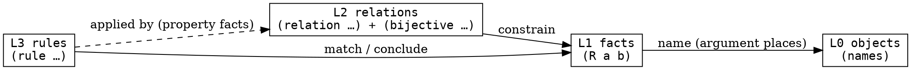

# Rules as statements

A **rule** is a statement about the state it fires in: where its pattern matches the facts held, its conclusion
holds too ([Q4](../../../decisions/language/Q4-a-rule-is-a-pattern-a-conclusion-and-a-reason.md)). It reads facts
and concludes facts of one state, and no form reads another state, the number of states, or how far a search has
gone ([Q-M1d.7](../../../decisions/language/Q-M1d.7-a-rule-is-a-sentence-about-the-state-it-fires.md)). How a
rule is written, its parts and its reason, is the user's [rules page](../../user/03-syntax-and-semantics/05-rules.md);
this page states what kinds of statement a rule can be, how a rule reads as a rewrite of a graph, and the levels a
knowledge base describes itself in.

**Rules only add.** A firing adds its conclusion and removes nothing; a negative conclusion adds a stored negation,
which is a fact ([relations and facts](02-relations-and-facts.md#a-fact-its-negation-and-neither)). What a search
assumes is set aside by discarding a fork, never by a rule.

## Three kinds, by what a pattern ranges over

A rule's kind is read off what its pattern quantifies over, and so what an implementation must enumerate to find
its matches. The kinds are not exclusive; a rule is of the kind of its widest variable.

| kind | its pattern ranges over | example | applied |
|---|---|---|---|
| **first-order** | objects; every relation is written by name | `(and (R₁ ?a ?b) (R₂ ?b ?c))` ⇒ `(R₃ ?a ?c)` | once, wherever its pattern matches |
| **relation-polymorphic** | objects and relations: a variable stands where a relation's name goes | `(and (?R ?a ?b) (?R ?b ?c) (neq ?a ?c))` ⇒ `(?R ?a ?c)` | once for each activator that binds its relation variables |
| **structural** | a property of a whole region of the state: what remains, how many, which is the last | *the only colour left for house 3* | expressed by the first two kinds, below |

### First-order

Every relation the pattern names is written literally; the variables stand for objects. The pattern is a fixed
shape of the graph up to which objects fill it, and the rule fires wherever the shape occurs. This is classical
first-order graph rewriting.

### Relation-polymorphic

At least one variable stands in a relation's place, `(?R ?a ?b)`. Such a variable is never left free to range over
every relation: it is a **parameter** of the rule, and the rule is applied once for each **activator**, a fact
whose relation is the rule's name and whose arguments bind the parameters. `(transitive co-located)` applies
`transitive` with `?R` bound to `co-located`; the rule then matches as a first-order rule over `co-located`. A
rule with parameters and no activator never fires
([Q27](../../../decisions/language/Q27-a-relations-properties-are-facts-beside.md)).

So the property of a relation is a fact about the relation, beside its declaration, and one rule serves every
relation that has the property. This is where *a relation is a node* pays: the activator is an ordinary fact whose
arguments are relation names ([names and atoms](01-names-and-atoms.md#a-relation-is-an-object)). An activator may be
written or derived, and each one is an application of its own, identified by every one of its arguments
([values and their order](03-values-and-order.md#a-rule-applications-identity)).

### Structural

A structural statement is about a region of the state rather than a few facts in it: *exactly one value remains*,
*no other object takes this place*. **Ein has no aggregate predicate.** Its only computed relations are `eq` and
`neq`, fixed by name identity
([Q-M1e2.26](../../../decisions/language/Q-M1e2.26-eq-and-neq-are-the-relations-of-equality-and-non.md)): a
predicate's truth would be computed from the bindings, where a relation's truth is data a rule can derive and an
explanation can name. A structural statement is written instead as an ordinary rule whose pattern holds a
`forall` over nested `absent`s, decided at the boundary where negation is read
([`absent`](../02-kb-evolution/03-absent-and-naf.md)). `std.bijection`'s `domain-elimination` concludes the one value
left for an object once every other value of the type is denied, and `std.slots`' `slot-elimination` and
`slot-fill` do the same over slots. The statement is in the pattern language, not beneath it, so a firing of it is
named and explained like any other.

## A rule as a rewrite

In the algebraic reading of graph rewriting, a rule is a span `L ← K → R`: `L` the pattern to find, `R` what
replaces it, and `K` the part both keep. A firing finds a match of `L` in the graph, deletes what `L` has and `K`
lacks, and glues on what `R` has and `K` lacks (the double-pushout construction).

An Ein rule deletes nothing, so its span is the degenerate one, `K = L` and `R = L` with the conclusion added: a
firing glues the conclusion onto the match and keeps everything it matched. The double pushout reduces to a single
gluing, and the graph only grows. Two readings complete the picture:

- **guards are application conditions on the match**: `(neq ?a ?c)` and `(eq ?a ?c)` restrict which matches count,
  and add nothing to `L`;
- **`(absent P)` is a negative application condition**: a match counts only where no fact of `P`'s shape is held.
  Ein judges it against the saturated world the match is admitted into, not against the graph at the moment of the
  match, which is what keeps a firing's admission independent of the order rules fire in
  ([`absent`](../02-kb-evolution/03-absent-and-naf.md)).

A firing records its match, the rule and the activator as the derivation of what it glues on, so the rewrite and
its trace are one object ([relations and facts](02-relations-and-facts.md#provenance-a-fact-is-an-or-of-derivations)).

## The four levels a knowledge base describes itself in

Every node of a knowledge base belongs to one of four **levels**, by what kind of node it is:

| level | what lives there | example |
|---|---|---|
| **L0 — objects** | names standing for things, instances and types alike | `Red`, `House-1`, `Englishman`, `Color` |
| **L1 — facts** | propositions over objects, `(R a b …)` | `(color-loc Red House-1)` |
| **L2 — relations** | declarations, and the property facts that constrain a relation's facts | `(relation color-loc Color House)`, `(bijective color-loc)` |
| **L3 — rules** | statements from facts to facts | `(rule symmetric (?R) :match (?R ?a ?b) :assert (?R ?b ?a) :why …)` |

A level classifies nodes of the one graph by role; it is not a separate store. **Each level reads the levels below
it:**

- **rules** match facts and conclude facts, and a relation-polymorphic rule is applied by L2's property facts;
- **relations** constrain facts: a fact's head names a relation, whose declaration fixes how many arguments it has
  and whose property facts activate the rules that hold of it;
- **facts** name objects in their argument places;
- **objects** are the leaves, named by themselves.

Through `examples/zebra2.ein`: `Red` and `House-1` are L0; `(color-loc Red House-1)` is L1 and names both;
`(relation color-loc Color House)` and `(bijective color-loc)` are L2 and constrain every `color-loc` fact; the rules
`std.bijection` brings are L3, applied to `color-loc` through the activators its setup rule derives from
`(bijective color-loc)`, and reading L1 `color-loc` facts.

**Levels are not origins.** A fact's level says what it is; its provenance says where it came from, given, background
or derived ([names and atoms](01-names-and-atoms.md#identity-stated-once)). An L1 fact may be any of the three.

**Where the stack folds back on itself.** The levels are read downward, and two folds keep that true:

- **L2 is readable as L1.** A declaration is stored as facts of `relation`, and a property is a fact about a
  relation, so a rule reads a relation's signature and properties as it reads any fact
  ([names and atoms](01-names-and-atoms.md#a-relation-is-an-object)). The levels are a reading of one graph, and the
  graph describes its own schema.
- **L3 is the program's text.** A rule's conclusion is a conjunction of facts and stored negations, an empty
  conclusion, or an obligation ([Q-M1d.7](../../../decisions/language/Q-M1d.7-a-rule-is-a-sentence-about-the-state-it-fires.md));
  a rule is a form of the program, and no conclusion is a rule or a declaration. No rule brings in a name either
  ([Q-M1e.21](../../../decisions/hypotheses/Q-M1e.21-a-rule-brings-in-no-name.md)). So a program's relations,
  rules and names are fixed when it is read, and saturation and search grow L1 alone.

Rules that read and write rules, a level L4 over L3, are what [rules as data](../03-rule-evolution/01-rules-as-data.md)
takes up: what of Ein already describes itself in Ein, and where rules as data would begin.

## What holds it

| claim | test |
|---|---|
| a rule with parameters and no activator never fires, and an activator applies it over the relation it names alone | `ein-infer/tests/rule_semantics.rs`: `a_parametrised_rule_with_no_activator_is_dormant` |
| a rule with no parameters fires once over an empty pattern, and once per activator with parameters | `ein-infer/tests/rule_semantics.rs`: `an_empty_match_fires_once_or_once_per_activator` |
| `eq` and `neq` are computed from the bindings, each admitting what the other rejects | `ein-infer/tests/rule_semantics.rs`: `eq_admits_exactly_the_bindings_neq_rejects` |
| `domain-elimination` concludes the last value left, and nothing while two survive | `ein-infer/tests/stdlib_semantics.rs`: `domain_elimination_forces_the_last_surviving_value`, `range_elimination_forces_the_last_surviving_object`, `domain_elimination_says_nothing_while_two_values_survive` |
| a `forall` over an empty domain holds | `ein-infer/tests/rule_semantics.rs`: `a_forall_over_an_empty_domain_is_vacuously_true` |
| a declaration is stored as facts of `relation` | `ein-infer/tests/compile_semantics.rs`: `a_bare_declaration_is_declared_with_an_empty_signature_and_stores_one_fact` |
| every stdlib rule is a rule written in Ein, and each is applied by a program of the suite | `ein-infer/tests/stdlib_coverage.rs`: `every_stdlib_rule_is_activated_by_a_program` |
| no run reaches a name the program does not have | `ein-infer/tests/alive_invariant.rs`: `no_run_reaches_a_name_the_program_does_not_have` |
