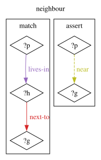
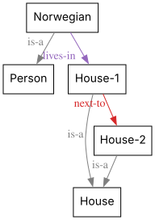
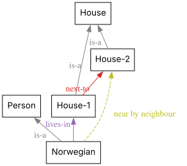
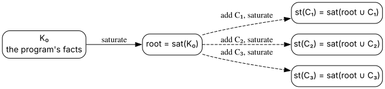
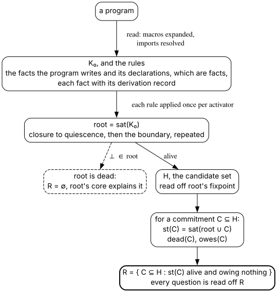

# Firing a rule — what Ein solves, and the operations it performs

[The first part](../01-static-ir/01-knowledge-base.md) defines a knowledge base, and a rule as a rewriting of it
at one match, in one knowledge base as it stands. This part is what a knowledge base becomes when its rules are
applied. This page states one application, a **firing**; names the two layers of the reasoning and the things
every page of this part speaks of, root, a candidate, a commitment, a node and its state; says what Ein answers;
and lists the steps every answer goes through and the nine operations any implementation performs, each with
its name in the fields it comes from. The pages after it state each step exactly.

## Firing a rule

Everything a firing is made of is defined in the first part and is used here as it is defined there: an object,
an atom and its name, a fact, a stored negation $\lnot f$ and falsity $\bot$, a knowledge base $K$, the one a
program is read into, $K_0$, and *dead* and *alive*
([the knowledge base](../01-static-ir/01-knowledge-base.md)); a pattern $\varphi$, a substitution $\theta$, a
match and $K \models \varphi\theta$, a conclusion $\psi$ and its instance $\psi\theta$, a rule
$\rho = (\bar p, \varphi, \psi)$, an activator $a$ and the rule applied under it, $\rho[a]$, with its pattern
$\varphi_\rho[a]$ and its conclusion $\psi_\rho[a]$ ([the rules](../01-static-ir/02-rewriting-rules.md)).

**What a firing reads.** Whether a pattern holds in $K$ under $\theta$ is decided by the facts $K$ holds
([the conditions on a match](../01-static-ir/02-rewriting-rules.md#the-conditions-on-a-match)), with one
exception: an absence, $\operatorname{absent}(G)$, holds where the pattern $G$ has no match, so it is the one
condition by which a rule reads what $K$ lacks. In which knowledge base an absence is read is not left to the
firing; it is fixed by [the boundary](03-absent-and-naf.md). What $K$ owes, a fact of $\mathsf{open}$ read off its
fixpoint, is held, and a rule that reads it reads a held fact
([absence](03-absent-and-naf.md#what-a-world-owes-and-supposes) says what that reads across worlds).

**Application.** A rule with parameters is applied once under each of its activators in $K$, the facts of
$\operatorname{Act}_K(\rho)$; a rule with no parameter is applied once, as it stands; and a rule with parameters
and no activator is not applied ([a rule, declared](../01-static-ir/02-rewriting-rules.md#a-rule-declared)). An
activator is a held fact like any other: the program may write it and a rule may conclude it, so the
applications a rule has in $K$ are read off $K$ as it stands.

**Firing.** A **firing** is $\xi = (\rho, a, \theta)$: a rule, an activator of it, with nothing in its place
where the rule has no parameter, and a substitution of the variables of its pattern. It is **enabled** in $K$
when $(a, \theta)$ is a match of the rule there, and to **fire** it is to rewrite $K$ at that match
([the result of rewriting](../01-static-ir/02-rewriting-rules.md#a-conclusion-and-the-result-of-rewriting)):

$$
\begin{aligned}
\xi \in \operatorname{en}(K) &\iff a \in K \;\land\; K \models \varphi_\rho[a]\,\theta \\
\operatorname{fire}(K, \xi) &= K \cup \psi_\rho[a]\,\theta
\end{aligned}
$$

Three properties follow from the definition, and every later page rests on them:

$$
\begin{aligned}
K &\subseteq \operatorname{fire}(K, \xi) \\
\operatorname{fire}(\operatorname{fire}(K, \xi), \xi) &= \operatorname{fire}(K, \xi) \\
\operatorname{dead}(K) &\implies \operatorname{dead}(\operatorname{fire}(K, \xi))
\end{aligned}
$$

A firing only adds; firing it again adds nothing, so one identity fires at most once; and a dead knowledge base
stays dead.

**A firing of a rule that states the engine's word** adds nothing, its instance being no fact, and the knowledge
base it is enabled in is dead ([the rules](../01-static-ir/02-rewriting-rules.md#by-its-conclusion)):

$$
\rho \in P_{\mathsf{inc}} \;\land\; \xi \in \operatorname{en}(K) \implies \operatorname{fire}(K, \xi) = K \;\land\; \operatorname{dead}(K)
$$

It is the one way a knowledge base becomes dead. A held $\bot$ is a contradiction by such a rule, the one every
program holds, and a fact beside its stored negation by a rule that concludes $\bot$ from the two where the program
takes one; the kernel judges no pair by itself
([cores § A contradiction](09-cores.md#a-contradiction)).

**A firing's identity** is the triple, its rule, its activator, and the objects its variables are bound to
([Q-M1e.16](../../../decisions/engine/Q-M1e.16-a-firings-identity-keys-on-every-activator.md)). Two firings are
one when the three parts are equal, the activators compared **in every argument, as objects**, atoms and nested
facts alike ([Q-M1f.43](../../../decisions/engine/Q-M1f.43-a-plans-activator-is-every-argument.md)):

$$
\begin{aligned}
(\rho, a, \theta) = (\rho', a', \theta') \iff\ & \rho = \rho' \\
\land\ & \forall i \le m.\ \operatorname{arg}_i(a) = \operatorname{arg}_i(a') \\
\land\ & \forall x.\ \theta(x) = \theta'(x)
\end{aligned}
$$

So two activators of one rule that differ in any argument are two applications, and each fires. An identity that
kept only some of an activator's arguments, a projection $\pi(a)$ that is not injective, would make one identity
of two applications with $\pi(a) = \pi(a')$ and one $\theta$, and would drop the second firing as a repeat of
the first: which conclusion survived would depend on which activator came first.
[Saturation](02-saturation.md#the-agenda-the-order-rules-fire-in) has the proposition this identity buys, and
the example where a projection would show.

**As a rewrite of the graph.** The drawings below fold each fact into a labelled arrow
([the knowledge base](../01-static-ir/01-knowledge-base.md#drawn-with-labelled-arrows)): an atom is a node, and
a fact with a relation and two arguments, which no fact here points at, is an arrow from its first argument to
its second, labelled with the relation's name. A rule is drawn as its pattern above its conclusion, with its variables as diamonds. The rule
below says that whoever lives in a house lives near the house next to it,

$$
\operatorname{lives-in}(p, h) \;\land\; \operatorname{next-to}(h, g) \;\implies\; \operatorname{near}(p, g)
$$

A match $\theta$ sends the diamonds of the pattern to nodes of the knowledge base so that each arrow of the
pattern lands on an arrow with the same label. Here is a knowledge base before the firing, $K$, drawn without its declarations' facts: a fact of
$\operatorname{is-a}$ is an arrow like any other. It is drawn as the fixpoint of a program that states it and has no
rule, with the facts of $\mathsf{open}$ written there
([hypothesis generation](04-hypothesis-generation.md#2-the-union)): each octagon in the frame
$\mathsf{open\ ctx}$ is a fact $K$ does not hold, a **hypothesis**, and the dashed loop labelled $\mathsf{open}$ on
it is the fact $\operatorname{open}(f)$ that says so. Nothing says what to guess, so they are every fact $K$ does
not hold of a declared relation between two different names that are neither a relation nor a label
([the blind enumerator](04-hypothesis-generation.md#5-the-blind-enumerator)). The rule reads none of them, and
its firing adds none.

The pattern has exactly one match,

$$
\theta = \lbrace\, p \mapsto \mathsf{Norwegian},\ h \mapsto \mathsf{House\text{-}1},\ g \mapsto \mathsf{House\text{-}2} \,\rbrace
$$

and the firing glues the conclusion onto the nodes $\theta$ found. After it, $\operatorname{fire}(K, \xi)$ holds
one arrow more, dashed because it is derived, and every arrow it held before. Drawn as the fixpoint of the program
with the rule, its facts of $\mathsf{open}$ are written at that fixpoint, and they are those drawn with $K$ but one:
$\operatorname{near}(\mathsf{Norwegian}, \mathsf{House\text{-}2})$ is held now, and no longer a hypothesis.

$$
\operatorname{fire}(K, \xi) = K \cup \lbrace\, \operatorname{near}(\mathsf{Norwegian}, \mathsf{House\text{-}2}) \,\rbrace
$$

In the algebraic reading of graph rewriting this is the degenerate span: nothing is deleted, the pattern is kept
whole, and the conclusion is glued on ([the rules](../01-static-ir/02-rewriting-rules.md#as-a-span)). The new
arrow carries its derivation record $\delta$, which holds $\rho$, $a$, $\theta$ and the premises $\theta$ matched
([cores](09-cores.md#a-derivation-record)), so the rewrite and its trace are one thing.

## Two layers

The reasoning splits along the monotone/non-monotone seam.

**The deductive layer** is monotone and append-only. **Saturation** fires the rules of a program in a knowledge
base until no enabled firing adds a fact, and $\operatorname{sat}(K) \supseteq K$ is the knowledge base it ends
in, a fixpoint; no fact is retracted on the way. It is itself two-phase: a purely positive closure that consults
no absence, and a boundary at each quiescence of the closure where the premises $\operatorname{absent}(G)$ are
judged against that fixpoint ([saturation](02-saturation.md) defines it, and [absence](03-absent-and-naf.md) the
boundary).

**The search over commitments** is where the non-monotonicity lives. Five things are named here, and the pages
of this part use them from here on:

- **root** is the program's own knowledge base, saturated;
- a **candidate** is a fact that may be supposed, and the **candidate set** $H$ is a finite set of them: the
  hypotheses root holds, the facts $f$ with $\operatorname{open}(f) \in \mathrm{root}$, less those root holds or denies
  ([hypothesis generation](04-hypothesis-generation.md#2-the-union) builds it);
- a **commitment** $C \subseteq H$ is a set of candidates supposed together, and as a point of the lattice of all
  of them, $(2^{H}, \subseteq)$, it is a **node**;
- the **state** of a commitment, $\operatorname{st}(C)$, is the knowledge base that root with the commitment added
  is saturated to, in a fork of root (below).

$$
\begin{aligned}
\mathrm{root} &= \operatorname{sat}(K_0) \\
\operatorname{st}(C) &= \operatorname{sat}(\mathrm{root} \cup C) && \text{for } C \subseteq H \\
\operatorname{st}(\emptyset) &= \mathrm{root}
\end{aligned}
$$

A predicate of a knowledge base is said of a commitment through its state: $\operatorname{dead}(C)$ is
$\operatorname{dead}(\operatorname{st}(C))$. [Solution semantics](06-solution-semantics.md) states each of the
five exactly, with what makes two states one.

Nothing a node derives is written back into root. A commitment that leads to a contradiction is not retracted:
its node is dead, and a search learns from it by not entering what it decides ([finding R](07-finding-r.md)).

**A fork.** The state of each node is built in a **fork** of root: a knowledge base of the same program that
starts as root's fixpoint stands and from then on is its own. Writing $K(t)$ for a knowledge base after $t$
further additions, a fork $K'$ of $K$ has

$$
\begin{aligned}
K'(t) &\supseteq K \setminus \operatorname{ext}_K(\mathsf{open}) \\
K'(t) \setminus K &\ \text{ is the fork's alone} \\
K(t) \setminus K &\ \text{ is the parent's alone}
\end{aligned}
$$

The fork keeps what its parent held when it was made, but for the facts of $\mathsf{open}$, what the parent owes and
supposes; nothing a fork adds reaches its parent or a sibling; and nothing the parent adds afterwards reaches the
fork. The facts of $\mathsf{open}$ are a function of each fixpoint, held in a part of a knowledge base that no fork
inherits: a fork drops every one, and its own are those of its own fixpoint
([saturation](02-saturation.md#the-pass-what-a-state-owes-and-supposes),
[Q-M1f.566](../../../decisions/hypotheses/Q-M1f.566-what-a-state-owes-is-open-r-a-fact-and-open-f.md)). So a
saturation that continues a fixpoint $S$ with facts $X$ added, written $\operatorname{sat}(S \cup X)$ on every page,
is a fork's, and starts from $S \setminus \operatorname{ext}_S(\mathsf{open})$ and $X$; and what a commitment pays
is not owed by the state that pays it. What a search assumes is so set aside by discarding a fork, and what a state
no longer owes by not inheriting it, never by taking a fact out of a knowledge base, and every node is read independently
of every other ([Q-M1e2.2](../../../decisions/answer/Q-M1e2.2-a-node-is-a-fork-of-root-an-assumption-on.md)). The
records of how a fork's facts came to be held are the fork's too ([cores](09-cores.md#a-derivation-record)).

A solid arrow is the deductive layer, one saturation. A dashed arrow is a commitment: a copy of root with a set
of candidates added, saturated on its own. No arrow leads back, and none joins two nodes.

## What Ein answers

Ein answers **finite-domain constraint-satisfaction** questions over a knowledge base, a graph of facts, and the
rules over it: the Zebra puzzle and its kin. The answer to a program is one thing, the **region** $R$: the
commitments whose state is alive and owes nothing. What a state can owe is stated by an **obligation**, a rule
whose whole conclusion is $\operatorname{open}(r)$: it derives nothing, and a state holds $\operatorname{open}(r)$
at its fixpoint where it owes an instance of it, something it has still to hold
([the rules](../01-static-ir/02-rewriting-rules.md#what-a-state-owes-and-what-it-supposes);
[solution semantics](06-solution-semantics.md) defines what is owed, and $R$):

$$
R = \lbrace\, C \subseteq H \;:\; \lnot\operatorname{dead}(C) \;\land\; \operatorname{owes}(C) = 0 \,\rbrace
$$

where $\operatorname{dead}(C)$ and $\operatorname{owes}(C)$, the number of instances owed, are read on the state
$\operatorname{st}(C)$. Every question a user asks is read off $R$, never chosen in advance. Write
$\mathcal{S}(R) = \lbrace \operatorname{st}(C) : C \in R \rbrace$ for the states of $R$:

| question | what it reads off $R$ |
|---|---|
| **solve**: is there exactly one state? | $\lvert \mathcal{S}(R) \rvert = 1$ |
| **gaps**: which facts are forced and which are open? | forced: $\bigcap \mathcal{S}(R)$; open: $\bigcup \mathcal{S}(R) \setminus \bigcap \mathcal{S}(R)$ |
| **contradictions**: why is there none? | $R = \emptyset$, and a dead root or node carries a core, a set of facts its contradiction rests on ([cores](09-cores.md)) |

These are three readings of one answer, not three problems: the same program gives the same $R$ whichever is
asked.

## Three paradigms

Almost every part of Ein is a piece of one of three classical paradigms:

| paradigm | what Ein takes from it | classic systems |
|---|---|---|
| **deductive database** (Datalog) | forward chaining to a fixpoint, bottom up, never retracting; negation judged one closure at a time, at a boundary | Soufflé, LogicBlox, DDlog |
| **constraint satisfaction and SAT** | propose undecided choices, propagate, detect a clash; a refuted choice is not entered again | DPLL and CDCL solvers, CSP solvers, answer-set programming |
| **truth maintenance** (ATMS) | hypotheses as assumptions, every fact with its justifications, a contradiction explained by the assumptions and givens it rests on | de Kleer's ATMS, JTMS |

The single most useful reframing: **the deductive part of Ein is a Datalog engine, and the search is an
environment search over sets of assumptions.** Ein reasons over **sets of commitments**, read as a lattice, rather
than over one decision variable at a time, and it keeps an explicit world per assumption set with full provenance
rather than one trail. That is what makes *forced*, *open* and *why not* fall out of one answer, at the cost of
the machinery a per-variable solver has.

## The vocabulary

The words of this part, each with where it is defined and what other fields call it.

| | what it is | elsewhere |
|---|---|---|
| **fact** $f$ | an object with outgoing arrows, the first at its relation and the others at its arguments ([the knowledge base](../01-static-ir/01-knowledge-base.md#what-is-where)) | a ground atomic formula, a tuple, a directed hyperedge |
| **stored negation** $\lnot f$ | the fact of $\mathsf{not}$ whose argument is $f$: it says that $f$ does not hold ([the knowledge base](../01-static-ir/01-knowledge-base.md#a-fact-about-a-relation-a-fact-about-a-fact-a-negation-falsity)) | a negative literal |
| **relation** $r$ | the atom under a fact's first arrow; its facts taken together are its extent, and those a knowledge base holds its held extent ([the knowledge base](../01-static-ir/01-knowledge-base.md#the-relation-its-extent-a-fact-of-it)) | a predicate symbol; a table's name, the held extent being its rows |
| **rule** $\rho$ | a pattern and a conclusion declared under a name, applied once under each activator ([the rules](../01-static-ir/02-rewriting-rules.md#a-rule-declared)) | a Datalog or production rule, a Horn-like clause |
| **firing** $\xi$ | one application of a rule at one match ([above](#firing-a-rule)) | a rule instance, a rewriting step |
| **world** | one knowledge base under saturation, asked at a quiescence: root, or a node ([absence](03-absent-and-naf.md#worlds)) | a possible world, an ATMS environment |
| **derivation record** $\delta$ | how a fact came to be: given, a rule's firing, or a commitment ([cores](09-cores.md#a-derivation-record)) | a TMS justification, why-provenance, a proof term |
| **commitment** $C \subseteq H$ | a set of candidates supposed together ([above](#two-layers)) | a partial assignment, an ATMS environment |
| **state** $S$ | a commitment's world at its fixpoint, $\operatorname{st}(C)$, identified by its set of facts ([solution semantics](06-solution-semantics.md#15-commitment-node-state)) | a model, an answer set |
| **what a state owes and supposes** $\operatorname{open}(r)$, $\operatorname{open}(f)$ | facts of $\mathsf{open}$, a function of a state's fixpoint, inherited by no fork: a relation an instance is owed of, and a hypothesis ([saturation](02-saturation.md#the-pass-what-a-state-owes-and-supposes)) | an unmet goal; an assumption that may be made |
| **core** | of a dead node, a smallest set of givens and commitments its contradiction follows from ([cores](09-cores.md#the-core)) | an unsat core, a conflict |

## The main steps

Every step but the last is a function of the program alone:

$$
P \mapsto K_0 \mapsto \mathrm{root} \mapsto H \mapsto \bigl( C \mapsto \operatorname{st}(C) \bigr) \mapsto R
$$

The last is a definition that several computations satisfy, and each is held to the definition: on a program
small enough to enumerate, $R$ is the set the definition gives, node for node ([finding R](07-finding-r.md)).

**No output depends on how objects were numbered.** An implementation may number the atoms and facts it meets,
by any injection $\iota$ from the objects it has seen into the integers, may keep them in collections that
iterate in any order, and may share a run among any number $w$ of workers. Let $\operatorname{Obs}$ be anything a
reader can observe of a run: the answer, a rendering of it, a narration, a core, a dump. Then

$$
\forall \iota, \iota', w, w'.\ \ \operatorname{Obs}(P;\ \iota,\ w) = \operatorname{Obs}(P;\ \iota',\ w')
$$

so $\operatorname{Obs}$ is a function of the program alone. Every order a reader sees is therefore an order of
the objects' content: the order of the objects, of their texts, or of their quoted forms
([the knowledge base](../01-static-ir/01-knowledge-base.md#order)), and a listing says which. A collection read
only for membership needs no order; one whose iteration reaches an output is ordered by content at that point.

## The core operations

Strip away the puzzle vocabulary and the reasoning performs nine operations.

| | operation | what it computes | page |
|---|---|---|---|
| **O1** | conjunctive matching | $\lbrace \theta : K \models \varphi\theta \rbrace$, the matches of a pattern | [the rules](../01-static-ir/02-rewriting-rules.md#a-match), this page |
| **O2** | saturation | $\operatorname{sat}(K)$, the least knowledge base containing $K$ that no firing changes | [saturation](02-saturation.md) |
| **O3** | negation as failure | $K \models \operatorname{absent}(G)\theta$, asked once, of a quiescent $K$ | [absence](03-absent-and-naf.md) |
| **O4** | equality | $s\theta = t\theta$, identity of objects and nothing else | [the knowledge base](../01-static-ir/01-knowledge-base.md#identity) |
| **O5** | contradiction detection | $\operatorname{dead}(K)$ | [cores](09-cores.md) |
| **O6** | provenance and the core | every derivation record of each fact, and a smallest set of givens and commitments a contradiction follows from | [cores](09-cores.md) |
| **O7** | the candidate set and the lattice | $H$, read off root, and $(2^H, \subseteq)$ | [hypothesis generation](04-hypothesis-generation.md), [the hypothesis space](05-hypothesis-space.md) |
| **O8** | learning from a refutation | on a monotone program, $\operatorname{dead}(C) \land C \subseteq C' \implies \operatorname{dead}(C')$ | [finding R](07-finding-r.md), [monotonicity](08-monotonicity.md) |
| **O9** | state identity | $C \sim C' \iff \operatorname{st}(C) = \operatorname{st}(C')$, equality of fact sets | [solution semantics](06-solution-semantics.md#15-commitment-node-state) |

- **O1.** A match is structural: it binds the premises of a pattern, $r(a, b) \land s(b, c) \land \dots$, against
  the facts held, and a relation's place may itself be a variable bound by the activator.
- **O4.** No two atoms are ever made one. A program that takes two atoms for one thing says so by facts of a
  relation of its own, which are read as any other facts, and $\operatorname{eq}$ and $\operatorname{neq}$
  compare two objects by identity.
- **O8.** One dead node then decides every node above it. What a computation of $R$ may conclude without
  saturating a node is stated as its licences ([finding R](07-finding-r.md)).
- **O9.** Two commitments whose worlds hold the same facts are one state. The identity is the set of facts itself,
  compared element by element, never a digest of it.

## Analogs in other fields

| op | this is, elsewhere | canonical names |
|---|---|---|
| **O1** matching | relational join; conjunctive-query evaluation; production-system matching; subgraph homomorphism | RETE, TREAT, LEAPS; hash, sort-merge and index joins; worst-case-optimal joins |
| **O2** saturation | Datalog bottom-up evaluation; transitive closure; chaotic-iteration fixpoints; forward chaining | naive and semi-naive evaluation; magic sets; DRed; differential dataflow |
| **O3** negation | stratified negation; the closed-world assumption; default logic | stratified Datalog; well-founded and stable-model semantics |
| **O4** equality | disjoint sets; congruence closure; term rewriting | union-find; Nelson–Oppen, Downey–Sethi–Tarjan; e-graphs and equality saturation |
| **O5** clash | clause violation; integrity-constraint check; tableau clash | unit-propagation conflict; watched literals |
| **O6** provenance | truth maintenance; database provenance; proof certificates | ATMS and JTMS justifications; provenance semirings; DRUP and DRAT; MUS |
| **O7** the lattice | CSP value enumeration; SAT decisions; frequent-itemset mining; ATMS environments | DPLL decisions; Apriori candidate generation; minimal hitting sets |
| **O8** learning | conflict-clause learning; constraint propagation; consistency | CDCL; conflict-directed backjumping; arc consistency |
| **O9** identity | state canonicalisation; symmetry breaking | order-insensitive keys; SBDS and SBDD; graph canonisation |

## The design principles

1. **The graph is the knowledge, and reasoning only adds to it.** $K \subseteq \operatorname{fire}(K, \xi)$: a
   world's facts only grow, a rule never removes a fact, and a fact never changes. What a search learns from a
   dead node, it learns by not entering it.
2. **Rules may be higher-order.** A rule's parameters can stand for relations, bound by its activator facts, so
   one rule states a property for every relation that has it: the activator
   $\operatorname{functional}(\operatorname{color-loc})$ applies the rule named $\operatorname{functional}$ to the
   relation $\operatorname{color-loc}$. A match ranges over relations as it ranges over the arguments of a fact.
3. **Every firing leaves provenance.** Each fact records how it came to be, every recorded derivation of it and
   not only the first, so a fact is an OR over its derivations and a derivation an AND over its premises; a trace,
   a rule's reason in words and a core are all read off that one structure
   ([Q18](../../../decisions/engine/Q18-provenance-is-per-fact-an-or-of-derivations-over.md)).
4. **Saturate before supposing.** Propagation decides everything it can before anything is hypothesised: $H$ is
   proposed at root's fixpoint, and a node is judged as its rules leave it
   ([Q19](../../../decisions/hypotheses/Q19-hypotheses-are-proposed-at-a-fixpoint-after.md)).
5. **Encoding-agnostic.** The reasoning works over any ontology a program writes: the Zebra puzzle encoded with
   one generic equivalence relation and the same puzzle encoded with five relations, one an attribute, reach one
   model. Membership is facts like any other; no label has a meaning the reasoning reads.
6. **Negation sits on the closure/world boundary.** The closure is purely positive and consults no negation;
   $\operatorname{absent}(G)$ is asked once, of a saturated world, never of a half-built one
   ([absence](03-absent-and-naf.md)). So where no rule reads an absence the order rules fire in decides no
   fixpoint, and where every absence reads only what the positive closure completes it decides nothing
   derivable; what is left for the order to decide is stated there.
7. **Ein decides every program itself.** No part of a program is handed to an external solver: an answer is one
   that can be explained from the program's own rules
   ([Q2](../../../decisions/engine/Q2-ein-hands-no-problem-to-an-external-solver.md)).
