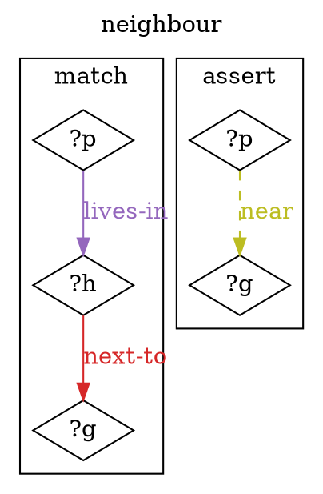
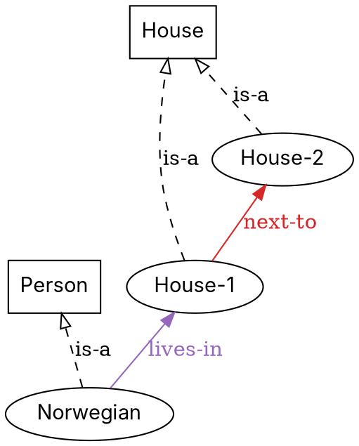
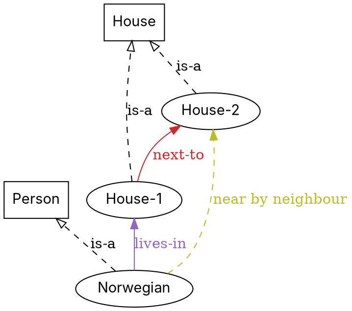
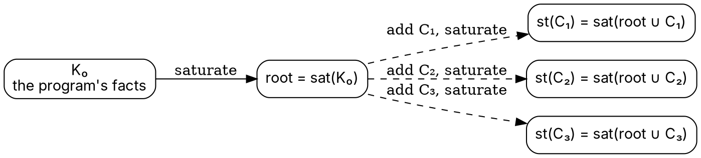
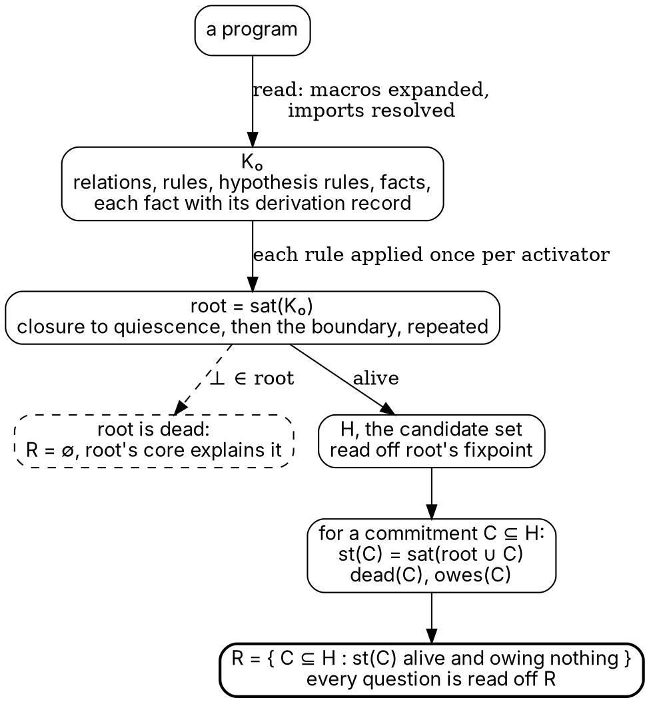

# Firing a rule — what Ein solves, and the operations it performs

This page places Ein's reasoning: what it answers, the objects the answer is made of, what one firing of a rule
does to a knowledge base, the steps every answer goes through, and the nine operations any implementation
performs, each with its name in the fields it comes from. The pages after it state each step exactly.

## What Ein answers

Ein answers **finite-domain constraint-satisfaction** questions over a labelled hypergraph of facts and the rules
over it, the Zebra puzzle and its kin. The answer to a program is one object, the **region** $R$: the commitments
$C$, sets of candidate facts drawn from a finite candidate set $H$, whose state is alive and owes nothing
([solution semantics](06-solution-semantics.md)):

$$
R = \lbrace\, C \subseteq H \;:\; \lnot\operatorname{dead}(C) \;\land\; \operatorname{owes}(C) = 0 \,\rbrace,
\qquad \operatorname{st}(C) = \operatorname{sat}(\mathrm{root} \cup C)
$$

where $\operatorname{dead}(C)$ and $\operatorname{owes}(C)$, the number of instances owed, are read on the state
$\operatorname{st}(C)$, and
$\mathrm{root} = \operatorname{sat}(K_0)$ is the program's own facts saturated by its rules. Every question a
user asks is read off $R$, never chosen in advance. Write $\mathcal{S}(R) = \lbrace \operatorname{st}(C) : C \in R \rbrace$
for the states of $R$:

| question | what it reads off $R$ |
|---|---|
| **solve**: is there exactly one state? | $\lvert \mathcal{S}(R) \rvert = 1$ |
| **gaps**: which facts are forced and which are open? | forced: $\bigcap \mathcal{S}(R)$; open: $\bigcup \mathcal{S}(R) \setminus \bigcap \mathcal{S}(R)$ |
| **contradictions**: why is there none? | $R = \emptyset$, and a dead root or node carries a core, a set of facts its contradiction rests on ([cores](09-cores.md)) |

These are three readings of one answer, not three problems: the same program gives the same $R$ whichever is
asked.

## Three paradigms

Almost every part of Ein is a piece of one of three classical paradigms:

| paradigm | what Ein takes from it | classic systems |
|---|---|---|
| **deductive database** (Datalog) | forward chaining to a fixpoint, bottom up, never retracting; negation judged one closure at a time, at a boundary | Soufflé, LogicBlox, DDlog |
| **constraint satisfaction and SAT** | propose undecided choices, propagate, detect a clash; a refuted choice is not entered again | DPLL and CDCL solvers, CSP solvers, answer-set programming |
| **truth maintenance** (ATMS) | hypotheses as assumptions, every fact with its justifications, a contradiction explained by the assumptions and givens it rests on | de Kleer's ATMS, JTMS |

The single most useful reframing: **the deductive part of Ein is a Datalog engine, and the search is an
environment search over sets of assumptions.** Ein reasons over **sets of commitments**, read as a lattice, rather
than over one decision variable at a time, and it keeps an explicit world per assumption set with full provenance
rather than one trail. That is what makes *forced*, *open* and *why not* fall out of one answer, at the cost of
the machinery a per-variable solver has.

## The objects

The symbols below are the ones every page of this part uses.

**Values and facts.** A **value** is a name or a fact; $V$ is the set of values
([names and atoms](../01-static-ir/01-names-and-atoms.md)). A **fact** is a relation applied to values,

$$
f = r(v_1, \dots, v_k), \qquad r \text{ a name},\quad v_i \in V,
$$

and its identity is $r$ and $(v_1, \dots, v_k)$, whatever derived it. A program's constants are written
$\mathsf{Norwegian}$, $\mathsf{House\text{-}1}$, and a fact as
$\operatorname{lives-in}(\mathsf{Norwegian}, \mathsf{House\text{-}1})$.

**Literals.** A **stored negation** $\lnot f$ is the statement that $f$ does not hold, stored as a fact is: it is
the fact $\operatorname{not}(f)$. A **literal** $\ell$ is a fact, a stored negation, or the **contradiction**
$\bot$, the one fact that says a state is impossible (the language spells it `(false)`; the user's
[constraints page](../../user/03-syntax-and-semantics/06-constraints.md) shows where it is written).

**Knowledge base.** A **knowledge base** $K$ is a finite set of literals, read with the program $P$ whose rules
act on it and with the provenance of its facts ([relations and facts](../01-static-ir/02-relations-and-facts.md)).
$K_0$ is the knowledge base the program states. $K$ is **dead** when it holds a contradiction and
**alive** otherwise:

$$
\operatorname{dead}(K) \iff \bot \in K \;\lor\; \exists f.\; f \in K \land \lnot f \in K
$$

**Rule.** A **rule** $\rho = (\bar p, \varphi, \psi)$ has parameters $\bar p$, a **match** $\varphi$, a pattern
over variables, and a **conclusion** $\psi$, with a name, $\operatorname{name}(\rho)$, and a reason in words beside
them
([rules as statements](../01-static-ir/04-rules-as-statements.md); the user's
[rules page](../../user/03-syntax-and-semantics/05-rules.md) has the spelling). $\psi$ is a finite set of literals over
the variables of $\varphi$, read as their conjunction; or it is the single verdict that makes $\rho$ an **obligation**,
which derives nothing ([satisfiability](10-satisfiability.md)).

| object | what it is | elsewhere |
|---|---|---|
| **fact** $f$ | a relation applied to values; its identity is the relation and the arguments | a ground atom, a tuple, a labelled hyperedge |
| **stored negation** $\lnot f$ | the statement that $f$ does not hold, stored as a fact is | a negative literal |
| **relation** $r$ | a name, with as many argument places as its declaration has labels | a database schema, a predicate symbol |
| **rule** $\rho$ | parameters, a match, a conclusion and a reason; applied once per activator fact of its parameters | a Datalog or production rule, a Horn-like clause |
| **world** | one knowledge base under saturation, asked at a quiescence: root, or a node | a possible world, an ATMS environment |
| **derivation record** $\delta$ | how a fact came to be: given, a rule's firing, or a commitment ([cores](09-cores.md)) | a TMS justification, why-provenance, a proof term |
| **commitment** $C \subseteq H$ | a set of candidates assumed together | a partial assignment, an ATMS environment |
| **state** $S$ | a commitment's world at its fixpoint, $\operatorname{st}(C)$, identified by its set of facts ([values and their order](../01-static-ir/03-values-and-order.md)) | a model, an answer set |
| **core** | of a dead node, a smallest set of givens and commitments its contradiction follows from | an unsat core, a conflict |

A declaration's argument places carry labels, ordinary names: no value has a type, and a label means what the
rules that read it make it mean.

## Firing a rule

**Satisfaction.** A substitution $\theta$ maps variables to values. $K \models \varphi\theta$, *$K$ satisfies $\varphi$ under
$\theta$*, is defined on the shape of the pattern, with $s, t$ terms and $\bar t$ a tuple of terms:

$$
\begin{aligned}
K \models r(\bar t)\,\theta &\iff r(\bar t)\theta \in K \\
K \models \lnot r(\bar t)\,\theta &\iff \lnot\bigl(r(\bar t)\theta\bigr) \in K \\
K \models (\varphi_1 \land \varphi_2)\,\theta &\iff K \models \varphi_1\theta \ \text{ and } \ K \models \varphi_2\theta \\
K \models (\varphi_1 \lor \varphi_2)\,\theta &\iff K \models \varphi_1\theta \ \text{ or } \ K \models \varphi_2\theta \\
K \models \operatorname{eq}(s, t)\,\theta &\iff s\theta = t\theta \\
K \models \operatorname{neq}(s, t)\,\theta &\iff s\theta \neq t\theta \\
K \models \operatorname{absent}(G)\,\theta &\iff \text{no } \theta' \supseteq \theta \text{ has } K \models G\theta'
\end{aligned}
$$

A negated pattern reads a stored negation and nothing else. Equality is identity of values: two names are two
objects, and nothing makes them equal. The last line is the one place a rule reads what $K$ lacks, and the
knowledge base it is read in is fixed by [the boundary](03-absent-and-naf.md).

**Application.** A rule with parameters $\bar p = (p_1, \dots, p_m)$, $m \geq 1$, is applied once for each
**activator**, a fact $a = \operatorname{name}(\rho)(v_1, \dots, v_m) \in K$ whose relation is the rule's name; the
application $\rho[a]$ is $\rho$ with each $p_i$ replaced by $v_i$, and $\varphi_\rho[a]$ and $\psi_\rho[a]$ are its
match and its conclusion. A parameter may stand where a relation's name goes, so one
rule states a property for every relation an activator names. A rule with no parameter has one application, and
a rule with parameters and no activator has none.

**Firing.** A **firing** is $\xi = (\rho, a, \theta)$: a rule, its activator, and a substitution of the variables
of its match. Its identity is that triple ([values and their order](../01-static-ir/03-values-and-order.md)). It
is **enabled** in $K$ when the match holds there, and firing it adds the conclusion:

$$
\xi \in \operatorname{en}(K) \iff a \in K \;\land\; K \models \varphi_\rho[a]\,\theta,
\qquad
\operatorname{fire}(K, \xi) = K \cup \psi_\rho[a]\,\theta
$$

Three properties follow from the definition, and every later page rests on them:

$$
K \subseteq \operatorname{fire}(K, \xi), \qquad
\operatorname{fire}(\operatorname{fire}(K, \xi), \xi) = \operatorname{fire}(K, \xi), \qquad
\operatorname{dead}(K) \implies \operatorname{dead}(\operatorname{fire}(K, \xi))
$$

A firing only adds; firing it again adds nothing, so one identity fires at most once; and a dead knowledge base
stays dead.

**As a rewrite of the graph.** A knowledge base is a graph: a name is a node, a fact of two arguments an arrow
from its first argument to its second, labelled by its relation. A rule is a pair of pattern graphs over
variables, drawn as diamonds: what it looks for, and what it adds. The rule below says that whoever lives in a
house lives near the house next to it,

$$
\operatorname{lives-in}(p, h) \;\land\; \operatorname{next-to}(h, g) \;\implies\; \operatorname{near}(p, g)
$$

A substitution $\theta$ is a map from the diamonds of the match to nodes of the knowledge base that carries each
pattern arrow onto an arrow of the same label. Here is a knowledge base before the firing, $K$: boxes are labels,
ovals the names under them, a dashed arrow with an empty head is membership.

The match holds under exactly one substitution,

$$
\theta = \lbrace\, p \mapsto \mathsf{Norwegian},\ h \mapsto \mathsf{House\text{-}1},\ g \mapsto \mathsf{House\text{-}2} \,\rbrace,
$$

and the firing glues the conclusion onto the nodes $\theta$ found. After it, $\operatorname{fire}(K, \xi)$ holds
one arrow more, dashed because it is derived, and every arrow it held before:

$$
\operatorname{fire}(K, \xi) = K \cup \lbrace\, \operatorname{near}(\mathsf{Norwegian}, \mathsf{House\text{-}2}) \,\rbrace
$$

In the algebraic reading of graph rewriting this is the degenerate span: nothing is deleted, the match is kept
whole, and the conclusion is glued on ([rules as statements](../01-static-ir/04-rules-as-statements.md)). The new
arrow carries its derivation record $\delta$, which holds $\rho$, $a$, $\theta$ and the premises $\theta$ matched
([relations and facts](../01-static-ir/02-relations-and-facts.md#provenance-a-fact-is-an-or-of-derivations)), so the
rewrite and its trace are one object.

## Two layers

The reasoning splits along the monotone/non-monotone seam.

**The deductive layer** is monotone and append-only: a knowledge base is saturated by its rules to a fixpoint,
$\operatorname{sat}(K) \supseteq K$, and no fact is retracted. It is itself two-phase: a purely positive closure
that consults no absence, and a boundary at each quiescence of the closure where the premises
$\operatorname{absent}(G)$ are judged against that fixpoint ([saturation](02-saturation.md),
[absence](03-absent-and-naf.md)).

**The search over commitments** is where the non-monotonicity lives. A candidate set $H$ is read off root's
fixpoint, and each commitment $C \subseteq H$ names a node, root's fixpoint with $C$ added and saturated again:

$$
\mathrm{root} = \operatorname{sat}(K_0), \qquad
\operatorname{st}(C) = \operatorname{sat}(\mathrm{root} \cup C), \qquad
\operatorname{st}(\emptyset) = \mathrm{root}
$$

Nothing a node derives is written back into root. A commitment that leads to a contradiction is not retracted:
its node is dead, and a search learns from it by not entering what it decides ([finding R](07-finding-r.md)).

A solid arrow is the deductive layer, one saturation. A dashed arrow is a commitment: a copy of root with a set
of candidates added, saturated on its own. No arrow leads back, and none joins two nodes.

## The main steps

Every step but the last is a function of the program alone:

$$
P \;\longmapsto\; K_0 \;\longmapsto\; \mathrm{root} \;\longmapsto\; H \;\longmapsto\;
\bigl( C \mapsto \operatorname{st}(C) \bigr) \;\longmapsto\; R
$$

The last is a definition that several computations satisfy, and each is held to the definition: on a program
small enough to enumerate, $R$ is the set the definition gives, node for node ([finding R](07-finding-r.md)).

## The core operations

Strip away the puzzle vocabulary and the reasoning performs nine operations.

| | operation | what it computes | page |
|---|---|---|---|
| **O1** | conjunctive matching | $\lbrace \theta : K \models \varphi\theta \rbrace$, the substitutions under which a match holds | this page |
| **O2** | saturation | $\operatorname{sat}(K)$, the least knowledge base containing $K$ that no firing changes | [saturation](02-saturation.md) |
| **O3** | negation as failure | $K \models \operatorname{absent}(G)\theta$, asked once, of a quiescent $K$ | [absence](03-absent-and-naf.md) |
| **O4** | equality | $s\theta = t\theta$, identity of values and nothing else | this page |
| **O5** | contradiction detection | $\operatorname{dead}(K)$ | [cores](09-cores.md) |
| **O6** | provenance and the core | every derivation record of each fact, and a smallest set of givens and commitments a contradiction follows from | [cores](09-cores.md) |
| **O7** | the candidate set and the lattice | $H$, read off root, and $(2^H, \subseteq)$ | [hypothesis generation](04-hypothesis-generation.md), [the hypothesis space](05-hypothesis-space.md) |
| **O8** | learning from a refutation | on a monotone program, $\operatorname{dead}(C) \land C \subseteq C' \implies \operatorname{dead}(C')$ | [finding R](07-finding-r.md), [monotonicity](08-monotonicity.md) |
| **O9** | state identity | $C \sim C' \iff \operatorname{st}(C) = \operatorname{st}(C')$, equality of fact sets | [values and their order](../01-static-ir/03-values-and-order.md) |

- **O1.** A match is structural: it binds the premises of a pattern, $r(a, b) \land s(b, c) \land \dots$, against
  the facts held, and a relation's place may itself be a variable bound by the activator.
- **O4.** Ein has no equality of its own between objects: equality between objects is whatever relation a program
  states, read as any other relation, and $\operatorname{eq}$ and $\operatorname{neq}$ compare two values as
  written.
- **O8.** One dead node then decides every node above it. What a computation of $R$ may conclude without
  saturating a node is stated as its licences ([finding R](07-finding-r.md)).
- **O9.** Two commitments whose worlds hold the same facts are one state. The identity is the set of facts itself,
  compared element by element, never a digest of it.

## Analogs in other fields

| op | this is, elsewhere | canonical names |
|---|---|---|
| **O1** matching | relational join; conjunctive-query evaluation; production-system matching; subgraph homomorphism | RETE, TREAT, LEAPS; hash, sort-merge and index joins; worst-case-optimal joins |
| **O2** saturation | Datalog bottom-up evaluation; transitive closure; chaotic-iteration fixpoints; forward chaining | naive and semi-naive evaluation; magic sets; DRed; differential dataflow |
| **O3** negation | stratified negation; the closed-world assumption; default logic | stratified Datalog; well-founded and stable-model semantics |
| **O4** equality | disjoint sets; congruence closure; term rewriting | union-find; Nelson–Oppen, Downey–Sethi–Tarjan; e-graphs and equality saturation |
| **O5** clash | clause violation; integrity-constraint check; tableau clash | unit-propagation conflict; watched literals |
| **O6** provenance | truth maintenance; database provenance; proof certificates | ATMS and JTMS justifications; provenance semirings; DRUP and DRAT; MUS |
| **O7** the lattice | CSP value enumeration; SAT decisions; frequent-itemset mining; ATMS environments | DPLL decisions; Apriori candidate generation; minimal hitting sets |
| **O8** learning | conflict-clause learning; constraint propagation; consistency | CDCL; conflict-directed backjumping; arc consistency |
| **O9** identity | state canonicalisation; symmetry breaking | order-insensitive keys; SBDS and SBDD; graph canonisation |

## The design principles

1. **The graph is the knowledge, and reasoning only adds to it.** $K \subseteq \operatorname{fire}(K, \xi)$: a
   world's facts only grow, a rule never removes a fact, and a fact never changes. What a search learns from a
   dead node, it learns by not entering it.
2. **Rules may be higher-order.** A rule's parameters can stand for relations, bound by its activator facts, so
   one rule states a property for every relation that has it: the activator
   $\operatorname{functional}(\operatorname{color-loc})$ applies the rule named $\operatorname{functional}$ to the
   relation $\operatorname{color-loc}$. A match ranges over relations as it ranges over objects.
3. **Every firing leaves provenance.** Each fact records how it came to be, every recorded derivation of it and
   not only the first, so a fact is an OR over its derivations and a derivation an AND over its premises; a trace,
   a rule's reason in words and a core are all read off that one structure
   ([Q18](../../../decisions/engine/Q18-provenance-is-per-fact-an-or-of-derivations-over.md)).
4. **Saturate before supposing.** Propagation decides everything it can before anything is hypothesised: $H$ is
   proposed at root's fixpoint, and a node is judged as its rules leave it
   ([Q19](../../../decisions/hypotheses/Q19-hypotheses-are-proposed-at-a-fixpoint-after.md)).
5. **Encoding-agnostic.** The reasoning works over any ontology a program writes: the Zebra puzzle encoded with
   one generic equivalence relation and the same puzzle encoded with five relations, one an attribute, reach one
   model. Membership is facts like any other; no label has a meaning the reasoning reads.
6. **Negation sits on the closure/world boundary.** The closure is purely positive and consults no negation;
   $\operatorname{absent}(G)$ is asked once, of a saturated world, never of a half-built one
   ([absence](03-absent-and-naf.md)). So where no rule reads an absence the order rules fire in decides no
   fixpoint, and where every absence reads only what the positive closure completes it decides nothing
   derivable; what is left for the order to decide is stated there.
7. **Ein decides every program itself.** No part of a program is handed to an external solver: an answer is one
   that can be explained from the program's own rules
   ([Q2](../../../decisions/engine/Q2-ein-hands-no-problem-to-an-external-solver.md)).
