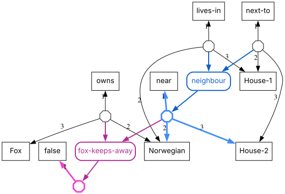
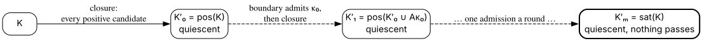
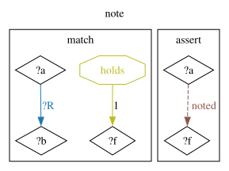
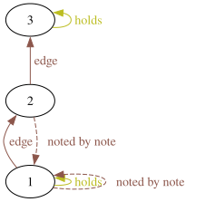
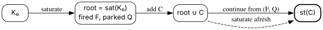
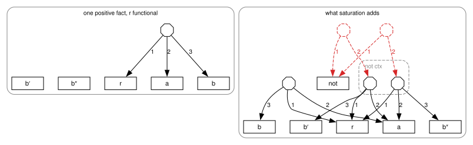

# Saturation

Saturation is the one computation every answer is made of. Root is the program's own facts saturated by its
rules, $\mathrm{root} = \operatorname{sat}(K_0)$; every node of the search is root's fixpoint with a
commitment added, saturated again, $\operatorname{st}(C) = \operatorname{sat}(\mathrm{root} \cup C)$; the
candidate set $H$ is read off root's fixpoint, and whether a node is dead and what it owes off its own
([solution semantics](06-solution-semantics.md)). This page states what $\operatorname{sat}$ computes, the order
it derives in and what that order can and cannot decide, what it derives before anything is supposed, and the
invariant that lets $H$ be taken once, at root. The symbols are those of [firing a rule](01-firing.md).

## The fixpoint

**The consequence operator.** One step applies every enabled firing at once:

$$
T_P(K) \;=\; K \;\cup \bigcup_{(\rho, a, \theta) \,\in\, \operatorname{en}(K)} \psi_\rho[a]\,\theta
$$

$T_P$ is **inflationary**, $K \subseteq T_P(K)$: firing adds the facts of a conclusion's instance, stored
negations among them, and never removes one. Within one world the set of facts only grows, and nothing is
retracted.

**Where no rule reads an absence, $T_P$ is monotone**, since a match that holds in $K$ holds in every larger
knowledge base:

$$
\begin{aligned}
K \subseteq K' &\implies \operatorname{en}(K) \subseteq \operatorname{en}(K') \\
&\implies T_P(K) \subseteq T_P(K')
\end{aligned}
$$

and $\operatorname{sat}(K)$ is the least knowledge base containing $K$ that no firing changes, the limit of the
chain

$$
\begin{aligned}
K \;&\subseteq\; T_P(K) \;\subseteq\; T_P^2(K) \;\subseteq\; \cdots \\
\operatorname{sat}(K) \;&=\; \bigcup_{n \geq 0} T_P^{\,n}(K) \\
&=\; \min \lbrace\, K' \supseteq K \;:\; T_P(K') = K' \,\rbrace
\end{aligned}
$$

Three properties of that fixpoint are used on every later page:

$$
\begin{aligned}
K &\subseteq \operatorname{sat}(K) && \text{extensive} \\
\operatorname{sat}(\operatorname{sat}(K)) &= \operatorname{sat}(K) && \text{idempotent} \\
K \subseteq K' &\implies \operatorname{sat}(K) \subseteq \operatorname{sat}(K') && \text{monotone}
\end{aligned}
$$

It is extensive, idempotent and monotone: a **closure operator**.

**With an absence the third property can fail.** A premise $\operatorname{absent}(G)$ holds in $K$ and may fail in
a larger $K'$, so a larger input can block a firing a smaller one admits, $\operatorname{en}(K) \not\subseteq
\operatorname{en}(K')$. What $\operatorname{sat}$ is on a program that reads absences is fixed by the next section
and by [absence](03-absent-and-naf.md): the least fixpoint above is taken on the positive part of the program,
and a boundary decides the rest. The first two properties hold of every program.

**A fact is held because it was given or concluded, and never because of its context.** The fixpoint is $K$
closed under rewriting, and a rewriting holds exactly the instances of a conclusion's literals. So for every fact
$g$,

$$
g \in \operatorname{sat}(K) \iff g \in K \ \lor\ g \in \psi_\rho[a]\,\theta \ \text{ for a firing } \xi = (\rho, a, \theta) \text{ along the saturation of } K
$$

and no clause of the right-hand side reads the context of $g$
([the knowledge base](../01-static-ir/01-knowledge-base.md#the-global-context-and-the-context-of-a-fact)). A fact
that stands under an arrow of a held fact is held at the fixpoint only where some rule concluded it, by spelling
it ([packing and unpacking](../01-static-ir/02-rewriting-rules.md#packing-and-unpacking)).

**Termination is assumed, not given.** A rule may build a fact out of a fact, so nesting can grow without bound
and the chain above need not become stationary. Everything stated about an answer is about programs whose
saturation reaches a fixpoint:

$$
\exists n.\; T_P^{\,n+1}(K) = T_P^{\,n}(K)
$$

**A derivation is a graph.** Read with what each firing matched, the chain is a directed acyclic graph: a fact
is a node, a firing is a node, an arrow leads from each premise into the firing and from the firing to what it
adds. Two firings below take three stated facts to a contradiction; the first adds
$\operatorname{near}(\mathsf{Norwegian}, \mathsf{House\text{-}2})$ and the second reads it.

An octagon is a fact, its first arrow at its relation and its next ones at its arguments; a heavy octagon, in the
brighter shade of its firing's colour, is a fact a firing added, $\bot$ the one whose only arrow is at
$\mathsf{false}$; a coloured box is a firing, its arrows in its colour. The
octagons no firing points at are $K$; each firing to the right of another is one more application of $T_P$:

$$
\begin{aligned}
K \;&\subset\; T_P(K) \;\subset\; T_P^2(K) \\
T_P(K) &= K \cup \lbrace \operatorname{near}(\mathsf{Norwegian}, \mathsf{House\text{-}2}) \rbrace \\
T_P^2(K) &= T_P(K) \cup \lbrace \bot \rbrace \\
&= \operatorname{sat}(K)
\end{aligned}
$$

## Two phases: the closure and the boundary

Saturation alternates two phases, and that shape is the contract.

**Candidates.** A rule's pattern is a disjunction of conjunctions
([the rules](../01-static-ir/02-rewriting-rules.md#the-conditions-on-a-match)). Write each disjunct as a positive
part and its **guards**, the absences that stand in it:

$$
\varphi \;=\; \bigvee_{d} \Bigl( \varphi_d^{+} \;\land\; \bigwedge_{j} \operatorname{absent}(G_{d,j}) \Bigr)
$$

where $\varphi_d^{+}$ holds the disjunct's premises, stored negations among them, and its equalities and
inequalities, and no absence. A **candidate** is $\kappa = (\rho, a, \theta, d)$ with
$K \models \varphi_d^{+}\theta$. It is **positive** when its disjunct has no guard,
and **parked** otherwise. A parked candidate **passes** in $K$ when every guard of its disjunct holds there:

$$
\operatorname{passes}(\kappa, K) \iff \forall j.\;\; K \models \operatorname{absent}(G_{d,j})\,\theta
$$

**The closure** consults no negation. It is the least fixpoint of the positive candidates alone:

$$
\begin{aligned}
T_P^{+}(K) \;&=\; K \;\cup \bigcup_{\kappa \text{ positive in } K} \psi_\kappa\,\theta \\
\operatorname{pos}(K) \;&=\; \bigcup_{n \geq 0} \bigl(T_P^{+}\bigr)^{n}(K)
\end{aligned}
$$

$K$ is **quiescent** when $\operatorname{pos}(K) = K$.

**The boundary** speaks only at a quiescence. It judges the parked candidates against that fixpoint and admits
**at most one**, the first in the agenda's order $\lhd$ (next section) that passes and was not admitted before.
Saturation is the sequence

$$
\begin{aligned}
K_0' &= \operatorname{pos}(K) \\
K_{i+1}' &= \operatorname{pos}\bigl(K_i' \cup \psi_{\kappa_i}\theta_i\bigr) \\
\kappa_i &= \min_{\lhd} \,\lbrace\, \kappa \text{ parked} : \operatorname{passes}(\kappa, K_i') \,\rbrace \setminus \lbrace \kappa_0, \dots, \kappa_{i-1} \rbrace
\end{aligned}
$$

and its **fixpoint** is the first quiescence at which the boundary admits nothing:

$$
\begin{aligned}
\operatorname{sat}(K) &= K_m' \\
m &= \min \lbrace\, i \;:\; \text{no parked } \kappa \notin \lbrace \kappa_0, \dots, \kappa_{i-1} \rbrace \text{ passes in } K_i' \,\rbrace
\end{aligned}
$$

A solid arrow is the closure, a least fixpoint in which no absence is read. A dashed arrow is one round of the
boundary: one candidate admitted, against exactly the knowledge base its guards were judged in, and the closure
resumed.

**One admission a round is a soundness requirement.** Let $P$ hold the two rules
$t \land \operatorname{absent}(q) \implies p$ and $t \land \operatorname{absent}(p) \implies q$, and $K = \lbrace
t \rbrace$. Both candidates pass in $K$. A boundary that admitted every passing candidate would reach
$\lbrace t, p, q \rbrace$, in which neither guard holds, a model of $P$ under no reading. Admitting one and judging
the other again in the knowledge base the first made reaches $\lbrace t, p \rbrace$ or $\lbrace t, q \rbrace$:

$$
\begin{aligned}
\lbrace t \rbrace \;&\xrightarrow{\ \kappa_0 = p\ }\; \lbrace t, p \rbrace \\
\lbrace t, p \rbrace &\not\models \operatorname{absent}(p)
\end{aligned}
$$

**A parked candidate's fate.** A guard with no absence nested in it, once failed, fails in every larger
knowledge base, so its candidate can never pass and is dropped. A guard with a nested absence, a universal's, can
turn from failing to passing as the knowledge base grows; its candidate stays parked and is judged again at a
later quiescence ([absence](03-absent-and-naf.md)).

## The agenda: the order rules fire in

Every saturation, root's, each node's and that of any reading of a fixpoint, derives in one order, the
**agenda**. It is a total order on the candidates that are enabled and not yet fired, defined by two keys.

**Leads to $\bot$.** A candidate leads to a contradiction when its rule's conclusion can make one:

$$
\begin{aligned}
\operatorname{lead}(\kappa, K) \iff\ & \bot \in \psi_\rho \\
\lor\ & \exists f.\; \lnot f \in \psi_\rho \\
\lor\ & \exists r(\bar t) \in \psi_\rho.\ \bigl( \text{some rule of } P \text{ concludes } \lnot r(\cdot) \\
& \phantom{\exists r(\bar t) \in \psi_\rho.\ \bigl(} \lor\; \exists \bar v.\; \lnot r(\bar v) \in K \bigr)
\end{aligned}
$$

**Arrival.** $\operatorname{arr}(\kappa) \in \mathbb{N}$ is the candidate's place in the sequence in which
candidates become enabled; candidates that become enabled together are taken in the written order of their rules.

$$
\begin{aligned}
\kappa \lhd \kappa' \iff\ & \bigl( \lnot\operatorname{lead}(\kappa, K),\ \operatorname{arr}(\kappa) \bigr) \\
\lt\ & \bigl( \lnot\operatorname{lead}(\kappa', K),\ \operatorname{arr}(\kappa') \bigr)
\end{aligned}
$$

the two pairs compared by their first key and then by their second, with *false* before *true*: first what leads
to $\bot$, then the rest, and within each half first in, first out.
The $j$-th firing of a saturation is the $\lhd$-least candidate enabled after the first $j - 1$; the boundary
takes its parked candidates in the same order; a saturation that continues another keeps it
([Q-M1f.313](../../../decisions/engine/Q-M1f.313-the-agenda-fires-first-what-leads-to-false.md)).

**Proposition (the order decides no fixpoint where $T_P$ is monotone).** If no rule of $P$ reads an absence,
every order of firing that leaves no enabled candidate unfired reaches $\operatorname{sat}(K)$.

*Argument.* Let $K^{\ast}$ be the set an exhaustive order ends on. Each firing adds a subset of
$T_P$ of what is held, so by induction along the order $K^{\ast} \subseteq \operatorname{sat}(K)$. No candidate
is left enabled and unfired, so $T_P(K^{\ast}) = K^{\ast}$, and $\operatorname{sat}(K)$ is the least such set
containing $K$: $\operatorname{sat}(K) \subseteq K^{\ast}$. $\square$

**Corollary (the order activators are written in decides nothing).** Let no rule of $P$ read an absence. Then
$\operatorname{sat}(K_0)$ does not depend on the order the facts of $K_0$ are written in, and writing one more
activator only adds facts to it.

*Argument.* The firings of $\rho$ in $K$ are the triples $(\rho, a, \theta)$ with
$a \in \operatorname{Act}_K(\rho)$ and $K \models \varphi_\rho[a]\theta$. Both conditions are conditions on the
set $K$, not on the order its facts arrived in, and both are preserved when $K$ grows, so by the proposition the
fixpoint is one set whatever the order. A new activator adds triples and, since every argument of an activator
is part of a firing's identity ([firing a rule](01-firing.md#firing-a-rule)), is equal to none that was there;
$\operatorname{sat}$ is monotone, so the fixpoint of a larger set of facts is larger. $\square$

**The example where a narrower identity would show.** One rule, named $\operatorname{note}$, with two
parameters, $r$ in a relation's place and $f$ any object:

$$
r(a, b) \;\land\; \operatorname{holds}(f) \;\implies\; \operatorname{noted}(a, f)
$$

The upper panel is the pattern and the lower the conclusion; a diamond is a variable. The drawing folds each fact
pattern of three arrows into a labelled arrow and each of two into a labelled loop
([the knowledge base](../01-static-ir/01-knowledge-base.md#drawn-with-labelled-arrows)): the arrow labelled by
the variable in a relation's place stands for a fact of whichever relation the activator names. The premise
$\operatorname{holds}(f)$, of two arrows, is a loop on $f$ labelled $\mathsf{holds}$. The program
states four facts and two activators:

$$
\begin{aligned}
&\operatorname{edge}(\mathsf{1}, \mathsf{2}) \\
&\operatorname{edge}(\mathsf{2}, \mathsf{3}) \\
&\operatorname{holds}(\mathsf{1}) \\
&\operatorname{holds}(\mathsf{3}) \\
&\operatorname{note}(\operatorname{edge}, \mathsf{1}) && \text{the first activator} \\
&\operatorname{note}(\operatorname{edge}, \operatorname{src}(\mathsf{Y})) && \text{the second activator}
\end{aligned}
$$

The first activator binds $f$ to the atom $\mathsf{1}$, which holds, and derives
$\operatorname{noted}(\mathsf{1}, \mathsf{1})$ and $\operatorname{noted}(\mathsf{2}, \mathsf{1})$, one for each
edge. The second binds $f$ to the fact $\operatorname{src}(\mathsf{Y})$, of which nothing says that it holds, so
it derives nothing, and it removes nothing the first derives. In either order of the two activators the fixpoint
is the same:

It folds each fact of three arrows and of two as the rule's drawing does; a fact of $\operatorname{holds}$ is a
loop on its argument.
The two dashed arrows labelled with the rule are the two conclusions, $\operatorname{noted}(\mathsf{1},
\mathsf{1})$ an arrow from $\mathsf{1}$ to itself. The activators and the declarations' facts are left out of the
drawing, and so is $\operatorname{src}(\mathsf{Y})$: nothing drawn points at it, and nothing
holds it.

So on such a program every question and every claim answers alike under the agenda and under the written order
alone. Taking first what can make a contradiction finds a dead node's contradiction sooner, and that is all the
order is for. What it does decide is *when* a fact is derived:

- where a dead node's derivation stops;
- how much of a derivation a node narrates;
- which of a fact's equally valid derivations its record keeps first, which a core is explained from. A core is
  an explanation, and it may move with the order
  ([Q-M1f.6](../../../decisions/answer/Q-M1f.6-a-core-is-an-explanation.md)).

Where rules read absences, the order of admission at the boundary is part of what $\operatorname{sat}$ is, and
[absence](03-absent-and-naf.md) says when it can decide what is derived. Of a program that may not be monotone no
answer is claimed under any order ([monotonicity](08-monotonicity.md)).

## A node resumes root's saturation

A node's saturation is root's, continued. It starts from root's fixpoint, with what root has fired and what it
has parked, adds the commitment's facts, and saturates to quiescence; it does not derive root's fixpoint again,
and every candidate it inherits parked is judged again in its own world before it can be admitted.

**Proposition (continuing is saturating afresh).** Let $\mathrm{root}$ be quiescent with fired set $\Xi$ and
parked set $Q$. The saturation continued from $(\mathrm{root}, \Xi, Q)$ with $C$ added reaches the fixpoint a
fresh saturation of the set $\mathrm{root} \cup C$ reaches
([Q-M1a.18](../../../decisions/engine/Q-M1a.18-a-node-resumes-roots-saturation.md)).

*Argument.* A fresh saturation of $\mathrm{root} \cup C$ meets three kinds of candidate. One whose match
lies in $\mathrm{root}$ and is positive was fired at root, is in $\Xi$, and adds nothing a second time. One
whose match lies in $\mathrm{root}$ and is parked is in $Q$, and the continued saturation judges it again in
the node's own world. One whose match reads a fact of $C$ or a fact derived from one is new to both, and both
find it, since the continued saturation starts from the facts the node has and root lacked. $\square$

The two arrows into $\operatorname{st}(C)$ end on one set of facts, so every answer and every count is the same
by either. What may differ is how many firings are counted, and which derivation of a fact derived several ways
its record keeps first. Saturating the program's own facts with the commitment, $\operatorname{sat}(K_0 \cup C)$,
is a third construction and is not claimed equal to these where rules read absences
([monotonicity](08-monotonicity.md)).

**Proposition (a dead node may stop at its first contradiction).** Let $K_0'' \subseteq K_1'' \subseteq \cdots$
be the knowledge bases a saturation passes through. Then

$$
\begin{aligned}
\operatorname{dead}(K_j'') &\implies \forall j' \geq j.\; \operatorname{dead}(K_{j'}'') \\
&\implies \operatorname{dead}(\operatorname{sat}(K))
\end{aligned}
$$

since a world never loses a fact. Whether a node is dead is therefore decided at the first $j$ at which a
contradiction is held, and every firing after it adds nothing to that. On a monotone program a computation of
$R$ that needs only *dead* of a node may stop there, and the answer is the one the node run to quiescence gives.
The definition of a state never stops: $\operatorname{st}(C)$ is the fixpoint. Root, a program that may not be
monotone, and any reading that needs the whole state run to quiescence, and a core is always taken over the
whole fixpoint ([finding R](07-finding-r.md)).

## What saturation derives before anything is supposed

Propagation decides everything it can before anything is supposed: $H$ is proposed at root's fixpoint, never
while a saturation runs, and a node is judged as its rules leave it
([Q19](../../../decisions/hypotheses/Q19-hypotheses-are-proposed-at-a-fixpoint-after.md)). So what a solver by
hand concludes without guessing, saturation has to conclude too, and that includes the negatives.

**Negative completion.** A stored negation can be derived from positive evidence and a property stated of a
relation, with no search behind it. For a relation $r$ whose facts lead from a domain $X$ to a range $Y$, each
the set of the atoms under one label:

$$
\begin{aligned}
r(a, b) \;\land\; b' \in Y \setminus \lbrace b \rbrace &\implies \lnot r(a, b') && \text{functional} \\
r(a, b) \;\land\; a' \in X \setminus \lbrace a \rbrace &\implies \lnot r(a', b) && \text{injective} \\
(\forall b' \in Y \setminus \lbrace b \rbrace.\ \lnot r(a, b')) &\implies r(a, b) && \text{domain elimination} \\
(\forall a' \in X \setminus \lbrace a \rbrace.\ \lnot r(a', b)) &\implies r(a, b) && \text{range elimination}
\end{aligned}
$$

and a stored negation carries across a relation $e$ stated an equivalence:
$\lnot r(a, b) \land e(b, b') \implies \lnot r(a, b')$. The standard library states these as rules over the
properties stated of a relation, each property a fact about it
([properties and operators](../../user/03-syntax-and-semantics/07-properties-and-operators.md)), so a puzzle
writes one property per constraint and saturation fans it out.

A solid octagon is a fact; a red dashed octagon is a stored negation saturation derived, a fact of
$\mathsf{not}$ whose second arrow is at the fact it denies, which stands in the frame *not ctx* because the
knowledge base does not hold it. Elimination is the same picture read backwards: when every fact
$r(a, y)$ but one is denied, the last one is derived. On the Zebra
puzzle this closes at depth zero every step of the human walkthrough: each *therefore* is reached from the clues
and the ontology with $C = \emptyset$.

**The same inference over one generic relation.** A puzzle may instead link every attribute through one
relation $e$ stated an equivalence, whose facts are a bijection only between each pair of labels. The same
inference is stated for that encoding, from a property scoped by a family of labels, rule for rule: placement
through an index, a label whose atoms are the places; exclusivity within a label; the negative across a link;
the one place left for an atom, and the one atom of a label left for a place; the unique-neighbour spatial
rules. Two things are worth knowing about it. The two eliminations, of the places for an atom and of the atoms
for a place, are both needed and are not each other's mirror: the conclusions are the same edge, but they read
different stored negations and fire at different times. And a relation stated symmetric needs its stored
negations mirrored, $\lnot e(a, b) \implies \lnot e(b, a)$: a negation derived in one argument order reaches no
rule that reads the other. Both encodings of the Zebra puzzle reach the same model by the same walkthrough.

**The closed-world reads are on what saturation determines.** Both encodings read under an absence only the
position structure, the neighbour, pruning and endpoint guards, which the clues fix before any hypothesis; they
never read under one an attribute the search decides. That is the bet a closed-world read makes, and it is
exactly the line the language draws: a refutation may not rest on an absence over the held extent of a relation
([the knowledge base](../01-static-ir/01-knowledge-base.md#the-relation-its-extent-a-fact-of-it)) that a
commitment can still extend ([absence](03-absent-and-naf.md#a-refutation-resting-on-an-absent)).

## The alive-set invariant

The candidate set $H$ is taken once, at root's fixpoint, and every computation of $R$ reads subsets of it. That
is sound only if nothing a node derives names what root's fixpoint and the program did not: a name that first
appeared inside a node would be an atom no candidate is about, in a part of the lattice $H$ was not built for,
and a model naming it would be missing from $R$.

$\operatorname{names}(X)$, the names of a set $X$ of facts, is that of
[the knowledge base](../01-static-ir/01-knowledge-base.md#nesting), and $\operatorname{names}(P)$, the names of
the program, that of [the rules](../01-static-ir/02-rewriting-rules.md#the-program-and-its-names)
([Q-M1e2.9](../../../decisions/language/Q-M1e2.9-a-programs-names-are-the-constants-its-facts.md)). Write
$\operatorname{rels}(X)$ for the relations of the facts of $X$, a set of atoms. The invariant, *no rule asserts
a name the program lacks*, is

$$
\forall C \subseteq H.\ \ \operatorname{names}\bigl(\operatorname{st}(C)\bigr) \subseteq \operatorname{names}(\mathrm{root}) \cup \operatorname{names}(P)
$$

and it has three clauses:

1. **No new atoms.** $\operatorname{names}(\operatorname{fire}(K, \xi)) \subseteq \operatorname{names}(K) \cup
   \operatorname{names}(P)$: a rewriting brings in no name
   ([the rules](../01-static-ir/02-rewriting-rules.md#the-program-and-its-names)). A variable carries only an
   object a match already found, or an atom of the program, and nothing else but an atom a rule writes can bring
   a name in, and every such atom is the program's
   ([Q-M1e.21](../../../decisions/hypotheses/Q-M1e.21-a-rule-brings-in-no-name.md)). By induction along a
   saturation, $\operatorname{names}(\operatorname{sat}(K)) \subseteq \operatorname{names}(K) \cup
   \operatorname{names}(P)$. An atom only a query writes is not a name of the program: adding a query never
   changes $R$.
2. **No new relations.** $\operatorname{rels}(\operatorname{st}(C)) \subseteq \operatorname{rels}(P)$, the
   relations fixed when the program is read: the declared ones, the relations of the program's facts, and every
   atom under the first arrow of a fact pattern a rule can conclude. No fact of any other relation is added
   while a saturation runs, and nothing adds a rule or a declaration: a conclusion is literals, so along every
   saturation $P$ and $\operatorname{names}(P)$ are constant and a knowledge base grows by facts alone.
3. **Hypotheses connect names.** $h \in H \implies \operatorname{names}(h) \subseteq \operatorname{names}(P)$: a
   candidate's arguments are atoms of the program or facts built of them. A parameter written in a relation's
   place and bound to a fact, an object that is no relation, is refused where it is written or where a rule
   could derive it.

Three readings of the invariant, each stronger than the one before:

| | claim |
|---|---|
| **static** | $\operatorname{names}(P) \setminus X \subseteq \operatorname{guessable}(P)$: every name of the program, less the excluded kinds $X$ below, is an atom candidates are proposed about when nothing narrower is stated |
| **at the fixpoint** | $\operatorname{names}(\operatorname{sat}(K_0)) \subseteq \operatorname{names}(K_0) \cup \operatorname{names}(P)$: nothing a saturation derives names what the program as read, its facts and the atoms its rules write, did not |
| **in the search** | $\forall C \subseteq H.\; \operatorname{names}(\operatorname{st}(C)) \subseteq \operatorname{names}(\mathrm{root}) \cup \operatorname{names}(P)$: nothing a node reaches names what root's fixpoint and the atoms the rules write did not |

The third is the one $R$'s soundness rests on, and the first is what makes it hold for an atom a rule writes:
such an atom, which would be reached only inside a commitment, is guessable from root on. The static
reading answers for every saturation the program could have, not only for the one that happened. Together they
make the lattice finite: $H$ is a finite set of facts over $\operatorname{names}(P)$, and
$\lvert 2^H \rvert = 2^{\lvert H \rvert}$.

**The guessable atoms are not the list of names.** Four kinds of name, the set $X$, are not guessable, each left
out by its name: the labels of the declarations, the reserved words of the pattern language, the names of
relations and rules, and the reserved marker of closure.
[Hypothesis generation § 5](04-hypothesis-generation.md#5-the-blind-enumerator) defines
$\operatorname{guessable}(P)$ and says what each of the four is
([Q-M1f.306](../../../decisions/hypotheses/Q-M1f.306-the-guessable-atoms-are-the-programs-names-never.md)).
