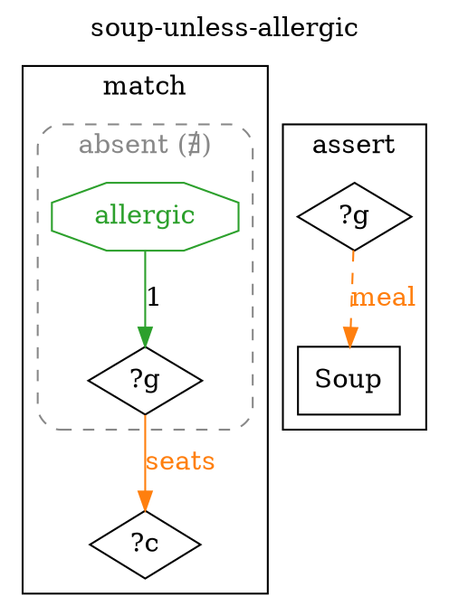
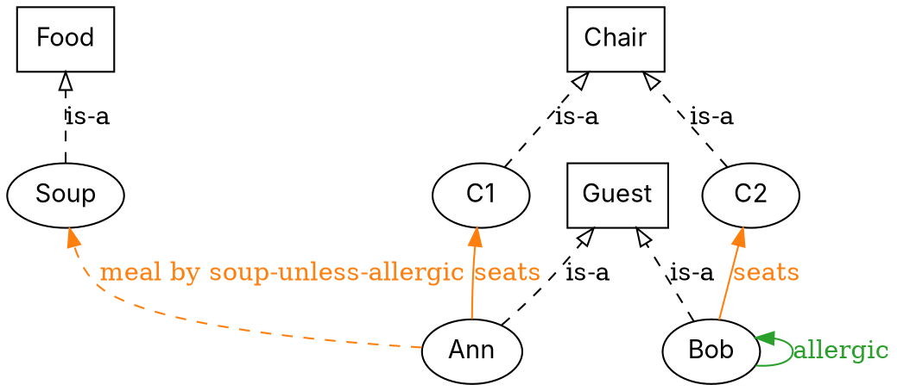
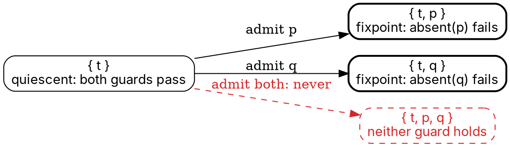
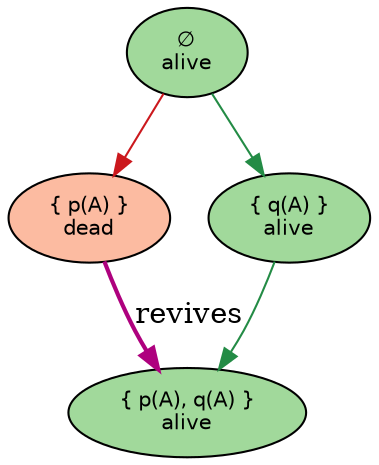
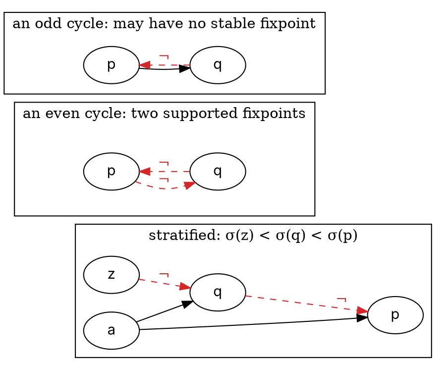

# Absence: negation as failure

$\operatorname{absent}(G)$ is the one place a rule reads what a world lacks. Everything else a rule does is
positive: it reads facts and adds facts, and a knowledge base only grows. This page states what
$\operatorname{absent}(G)$ means, the one moment at which it is asked, what follows from that for the rest of the
reasoning, and what it does not give. The symbols are those of [firing a rule](01-firing.md) and
[saturation](02-saturation.md).

The one distinction that matters: **$\operatorname{absent}(G)$ is a question about a saturated world, never a
fact.** It is asked, answered and acted on, and its answer is not stored, kept or carried to another world. Of the
three readings of negation as failure a reasoner could take, closed-world, stratified and world-relative
epistemic, Ein takes the third; the worked examples below are where the other two give other answers.

How a program writes an absence, and the universal and the *unknown* test built from it, is the user's
[rules page](../../user/03-syntax-and-semantics/05-rules.md) and [macros page](../../user/03-syntax-and-semantics/11-macros.md).

## Two halves: a positive closure and a boundary

Saturation is split along negation ([saturation](02-saturation.md)):

$$
K_0' = \operatorname{pos}(K), \qquad
K_{i+1}' = \operatorname{pos}\bigl(K_i' \cup \psi_{\kappa_i}\theta_i\bigr), \qquad
\operatorname{sat}(K) = K_m'
$$

- **the closure** $\operatorname{pos}$ fires the purely positive part of every rule to quiescence and consults
  no negation at all. A rule's absences are set aside; a candidate whose disjunct carries one is **parked**, not
  fired;
- **the boundary**, at each quiescence $K_i'$, judges the parked candidates against that fixpoint, admits at most
  one whose every guard passes, $\kappa_i$, and hands it back to the closure.

So the deductive part of Ein is monotone, and the non-monotone part, absence, is confined to one place with one
world to look at. Nothing is ever retracted: a world's facts only grow.

## Worlds

A **world** is one knowledge base under saturation: root, the program's own facts saturated by its rules, or a
node, root's fixpoint with a commitment $C$ added and the saturation continued
([solution semantics](06-solution-semantics.md)). Write $K_t$ for a world's facts after $t$ firings. Within one
saturation a world is **append-only**:

$$
K_t \subseteq K_{t+1}
$$

Two worlds are related only by the fork that made one from the other; a question asked in one is not an answer
in another.

## The definition

**Boundary epistemic negation as failure.** For a candidate considered in a world at a **positive quiescence**
$K = \operatorname{pos}(K)$, with bindings $\theta$:

$$
K \models \operatorname{absent}(G)\,\theta
\;\iff\; \lnot \exists\, \theta' \supseteq \theta.\;\; K \models G\theta'
\;\iff\; K \not\models \exists \bar x.\; G\theta
$$

where $\bar x$ are the variables of $G$ that $\theta$ leaves unbound. In words: no extension of the bindings
makes the pattern match facts $K$ holds.

**$\theta$ is the bindings as far as the premises written before the guard bind them.** Where a guard is written
decides which question it asks:

$$
\begin{aligned}
\operatorname{absent}(p(x)) \land q(x) \quad &\text{asks} \quad \lnot \exists x.\; p(x) && \text{there is no } p \text{ at all} \\
q(x) \land \operatorname{absent}(p(x)) \quad &\text{asks} \quad \lnot\, p(x\theta) && \text{there is no } p \text{ for this } x
\end{aligned}
$$

Setting the guard aside until the boundary asks exactly the question it would have asked in place.

**As a graph.** A rule with an absence is drawn with the absent pattern in a dashed cluster: the match is the
solid part, found in the graph, and the cluster is a part that must not be found. The rule below gives a seated
guest the soup unless the guest is allergic,

$$
\operatorname{seats}(g, c) \;\land\; \operatorname{absent}\bigl(\operatorname{allergic}(g)\bigr) \;\implies\; \operatorname{meal}(g, \mathsf{Soup})
$$

and in the saturated world below, where two guests are seated and one is allergic, it has fired for one of them.
A fact of one argument is a loop on its argument; the dashed arrow is the fact the rule derived.

$$
K \models \operatorname{absent}\bigl(\operatorname{allergic}(g)\bigr)\lbrace g \mapsto \mathsf{Ann} \rbrace,
\qquad
K \not\models \operatorname{absent}\bigl(\operatorname{allergic}(g)\bigr)\lbrace g \mapsto \mathsf{Bob} \rbrace
$$

Three consequences of the definition:

- **Membership, of a saturated store.** An absence reads the facts held, not the theory. Since the store it
  reads is the positive fixpoint, everything positively derivable is there, so for the positive part of a program
  membership and derivability coincide. They do not coincide on what a later round of the boundary admits: a fact
  admitted through one guard is not in the world an earlier guard was judged in.
- **A variable inside the guard is existential.** The guard is $\lnot\exists$ over the variables of its pattern
  that nothing bound before it. A conjunction inside a guard is one existential, and the universal is this
  existential negated twice:

$$
\operatorname{absent}\bigl(g(x, y) \land h(y)\bigr) \;\equiv\; \lnot \exists y.\; g(x, y) \land h(y),
\qquad
\forall b.\; \bigl( G \to B \bigr) \;\equiv\; \operatorname{absent}\bigl( G \land \operatorname{absent}(B) \bigr)
$$

- **One question, one world.** A guard is asked of the world it is judged in and its answer is acted on at once,
  so it has no interval in which to go stale.

A fact $f$ is **unknown** in $K$ when neither it nor its stored negation is held, which is two guards:

$$
\operatorname{unknown}(f) \;\equiv\; \operatorname{absent}(f) \;\land\; \operatorname{absent}(\lnot f)
$$

## The boundary

There is **one** point at which a guard is evaluated, and it is the boundary.

- **At quiescence, once.** The closure runs to its fixpoint with the guards set aside, so a candidate the closure
  finds says nothing about negation. At a quiescence $K_i'$ each parked candidate is judged,
  $\operatorname{passes}(\kappa, K_i') \iff \forall j.\; K_i' \models \operatorname{absent}(G_{d,j})\theta$, and
  it is admitted if it passes. That judgement is the decision, and there is no other.
- **One admission a round.** At quiescence the closure has nothing left to fire, so the one admitted candidate
  fires at once, against exactly the world its guards were judged in, and the closure resumes. This is a
  soundness requirement. With the two rules $t \land \operatorname{absent}(q) \implies p$ and
  $t \land \operatorname{absent}(p) \implies q$ both guards pass in the world that holds neither, so admitting
  both would derive $\lbrace p, q \rbrace$, which is a model of that program under no reading. Admitting one and
  judging the other again in the world the first made derives one of the two.
- **Never after a firing.** Nothing is retracted. A fact admitted through a guard stays, whatever the world later
  comes to hold: $f \in K_i' \implies f \in \operatorname{sat}(K)$.
- **The fixpoint is a quiescence that admits nothing.** A saturation that ends with candidates still parked ends
  because none of them passes; a world whose closure has quiesced while a parked candidate would pass is not at
  its fixpoint.

A solid box is a world a saturation can reach, a heavy one a fixpoint; the agenda's order takes one of the two
solid arrows. The red dashed world is the one a batch admission would make.

**How a guard's answer can change while the world grows**, and what that means for a candidate parked on it. Let
$K \subseteq K'$:

$$
G \text{ holds no absence:} \qquad K \not\models \operatorname{absent}(G)\theta \;\implies\; K' \not\models \operatorname{absent}(G)\theta
$$

Such a guard is anti-monotone in the world: once its pattern matches it matches for ever, so a candidate it
rejects can never pass and is dropped. A guard **with a nested absence**, a universal's, can turn from failing
to passing as the world grows: adding a $B$ makes the inner absence fail and the outer one pass. Its candidate
stays parked and is judged again at a later quiescence, where a relation the guard reads has grown.

## What follows

Each of these holds wherever it applies; this page is the shared reason.

- **Root is never written by a node.** A fact a node derives may rest on an absence that holds in that node and
  not in root's future, so nothing a node derives is written back into root. Every node is root's fixpoint and
  its own commitment, $\operatorname{st}(C) = \operatorname{sat}(\mathrm{root} \cup C)$, and nothing else
  ([finding R](07-finding-r.md)).
- **A derivation records the absences it rested on.** A firing admitted at the boundary records each question
  that had to fail, one pattern per guard with a position the question left free recorded as free, beside the
  positive premises it read:

$$
\delta = \bigl( \rho,\ a,\ \theta,\ \operatorname{prem}(\delta),\ \operatorname{all}(\delta),\ \operatorname{abs}(\delta) \bigr),
\qquad
\operatorname{dep}(f) = \operatorname{prem}(\delta) \cup \operatorname{all}(\delta) \cup \operatorname{abs}(\delta)
$$

  Negative dependence is so visible: what a fact depends on is its positive premises and those absences
  together. A core names facts only and does not count the absences ([cores](09-cores.md)); the check of a
  program that may not be monotone reads them ([monotonicity](08-monotonicity.md)).
- **Deleting a fact can fabricate a contradiction.** With an absence, a smaller knowledge base can be dead where
  a larger one is alive: under the rule $p(x) \land \operatorname{absent}(q(x)) \implies \bot$,

$$
\lnot\operatorname{dead}\bigl(\operatorname{sat}(\lbrace p(\mathsf{A}), q(\mathsf{A}) \rbrace)\bigr)
\qquad\text{and}\qquad
\operatorname{dead}\bigl(\operatorname{sat}(\lbrace p(\mathsf{A}) \rbrace)\bigr)
$$

  A smallest explanation of a contradiction is therefore found among the derivations a world recorded, never by
  deleting facts and saturating again ([cores](09-cores.md)).
- **An absence is world-relative.** The same ground question can answer one way in root and another in a node,

$$
\mathrm{root} \models \operatorname{absent}(G)\theta
\qquad\text{and}\qquad
\operatorname{st}(C) \not\models \operatorname{absent}(G)\theta ,
$$

  so a guard's answer is never carried across worlds nor stored as a fact; a candidate a node inherits parked
  from root is judged again in the node's own world before it can be admitted. A fact root admitted through a
  guard is, though, part of root's fixpoint, and every node holds it, $\operatorname{root} \subseteq
  \operatorname{st}(C)$; where a commitment can fill the absence that fact rested on, the node holds it beside
  the fact that denies its premise. That is the case in which a node's state depends on the path to it, and a
  program that can reach it is not monotone ([monotonicity](08-monotonicity.md),
  [Q-M1e2.2](../../../decisions/answer/Q-M1e2.2-a-node-is-a-fork-of-root-an-assumption-on.md)).
- **The answer inherits the semantics.** Whether a node is dead and what it owes are read off its fixpoint, and
  the candidate set $H$ off root's, so the region $R$, every count and every claim are downstream of the same
  questions asked at the boundary.

## What is not provided

- **Stable or well-founded models.** The fixpoint is *supported at the boundary*: every admitted fact had its
  guards pass when it was admitted. It need not be stable. The program $s \land \operatorname{absent}(q)
  \implies p$, $p \implies q$ with $s$ given has no stable model and converges to $\lbrace s, p, q \rbrace$; the
  program $\operatorname{absent}(q) \implies p$, $\operatorname{absent}(p) \implies q$ has two, and the boundary's
  order picks one.
- **Retraction or truth maintenance.** A world never loses a fact. What a search learns from a dead node it
  learns by not entering it, not by retracting what led there.
- **Stratification as a refusal.** A program whose rules read through an absence in a cycle has no
  stratification; it is read and answered, and the cycle is reported as a diagnostic
  ([stratification](#stratification)).

**What the order of admission can decide.** Call a guard **settled by the closure** when no relation it reads
is, or can be reached from, a relation that a rule carrying a guard concludes, in the graph of
[§ Stratification](#stratification): every fact it could read is derived by positive candidates alone.

**Proposition.** If every guard of $P$ is settled by the closure, $\operatorname{sat}(K)$ does not depend on the
order rules are written in or admitted in.

*Argument.* Let $Q$ be the relations the guards read. An admitted candidate adds facts of relations from which
no relation of $Q$ can be reached, and the closure that follows adds only what is reachable from them; so every
quiescence holds the same facts of $Q$, $K_i' \cap Q = K_0' \cap Q$, and a guard passes at one quiescence exactly
when it passes at every other. Each guarded rule then acts as a positive rule under a fixed side condition, and
the fixpoint of positive rules does not depend on the order ([saturation](02-saturation.md)). $\square$

The producer of a relation a guard reads has then always finished before the guard is judged, whatever the
order. Where a guard reads a relation that another guarded rule concludes, the two candidates wait at the same
boundary and the agenda's order
([Q-M1f.313](../../../decisions/engine/Q-M1f.313-the-agenda-fires-first-what-leads-to-false.md)) says which is
judged first. That order is not the order of the program's strata:

- on a **stratified** program a reader can be admitted before the producer of what it reads, and the fixpoint
  then holds a fact whose guard the fixpoint itself falsifies, which the stratum-by-stratum model does not hold
  ([monotonicity § 8.3](08-monotonicity.md#83-the-fifo-gap));
- on a program **with no stratification** the order picks which of several supported fixpoints root reaches,
  and nothing tells the others exist.

## A refutation resting on an absent

A rule that concludes $\bot$ or a stored negation may not rest on an $\operatorname{absent}(G)$ over a relation a
commitment can still extend: directly, through a fact a rule derived under such an absence, or through the
activator its rule was applied with. Write $D^{+}$ for the relations a commitment can extend (below) and
$\operatorname{abs}^{\ast}(\rho)$ for the absences $\rho$'s conclusion can depend on in those three ways:

$$
\bigl( \bot \in \psi_\rho \;\lor\; \exists f.\; \lnot f \in \psi_\rho \bigr) \;\land\;
\exists\, \operatorname{absent}(G) \in \operatorname{abs}^{\ast}(\rho).\;\; \operatorname{rels}(G) \cap D^{+} \neq \emptyset
\;\;\implies\;\; P \text{ is refused}
$$

A program that writes one is refused when it is read, with one line for each refusing rule
([Q-M1e2.5](../../../decisions/language/Q-M1e2.5-a-refutation-may-not-rest-on-an-absent.md); the user's
[diagnostics](../../user/04-reference/07-diagnostics.md) has the refusal as it is printed).

The reason is what such a rule says. Over an extendable relation it judges a state that has not yet decided $G$
as if $G$ were false: it says *contradiction* where the truth is *not yet*, an obligation written as a
refutation. And *dead* stops being closed upward. Under $p(x) \land \operatorname{absent}(q(x)) \implies \bot$,
with $p(\mathsf{A})$ and $q(\mathsf{A})$ candidates:

$$
\operatorname{dead}\bigl(\lbrace p(\mathsf{A}) \rbrace\bigr), \qquad
\lbrace p(\mathsf{A}) \rbrace \subseteq \lbrace p(\mathsf{A}), q(\mathsf{A}) \rbrace, \qquad
\lnot\operatorname{dead}\bigl(\lbrace p(\mathsf{A}), q(\mathsf{A}) \rbrace\bigr)
$$

Each node is a commitment, an arrow adds one candidate, green is alive and red dead. A search that took a
superset of a dead set for dead would lose the bottom state, a member of $R$. The refusal names the forms that
say what was meant:

1. close the relation, if no commitment is meant to extend it;
2. make the attribute one the search must decide, and refute the decided *no*, a stored negation;
3. state the requirement as an obligation ([satisfiability](10-satisfiability.md));
4. conclude from a stored negative, as the standard library's totality does.

**Extendable.** $D^{+}$ is the set of relations a commitment can change, followed through every rule with
parameters whose activator relation it holds, since an application a node makes that root never had can conclude
relations a commitment changes:

$$
D^{+} \;=\; \mu X.\;\; \operatorname{rels}(H) \;\cup\; \lbrace\, \operatorname{rels}(\psi_\rho) : \rho \text{ reads a relation of } X \,\rbrace
\;\cup\; \lbrace\, \operatorname{rels}(\psi_\rho[\cdot]) : \text{the name of } \rho \text{ is in } X \,\rbrace
$$

with $\mu$ the least fixpoint, $D^{+} = D^{+}(\operatorname{rels}(H))$ in the notation of
[hypothesis generation](04-hypothesis-generation.md#43-when-it-declines): the relations of the candidates, what a rule that reads one of them concludes,
and what any application of a rule can conclude once its activator's relation is among them. Over a relation no commitment can extend, the same shape is closed-world
reasoning and is accepted.

This is not the stratification hazard and the two do not overlap. A guard over a relation a rule derives can
change its answer during saturation, and judging it at the fixpoint makes that sound. A guard over an extendable
relation is discharged by a commitment, in a world the guard was never asked in.

## Stratification

The relations a program's rules read and write form a directed graph: an edge $q \to r$ for each rule that reads
$q$ and concludes $r$, **negative**, written $q \xrightarrow{\lnot} r$, where the read is under an absence. A
**stratification** is a map $\sigma$ from relations to natural numbers with

$$
q \to r \implies \sigma(q) \leq \sigma(r), \qquad q \xrightarrow{\lnot} r \implies \sigma(q) < \sigma(r),
$$

and one exists exactly when no cycle runs through a negative edge. The parity of the negative edges on such a
cycle says what it may mean: an even cycle may have several supported fixpoints, an odd one may have none.

A node is a relation, a black arrow a positive read, a red dashed arrow a read under an absence. Such a cycle is
reported as a diagnostic, never as a refusal, and only ever as what the graph licenses, since a cycle whose
rules never fire changes nothing. The graph, its strata and what is reported of them are the
[analysis of rules](../03-rule-evolution/02-analysis-of-rules.md).

## Worked examples

Each program is its rules; every fact named as given is in $K$.

| program | given | $\operatorname{sat}(K)$ adds | what it shows |
|---|---|---|---|
| $s \land \operatorname{absent}(q) \implies p$; $\ t \implies q$ | $s$, $t$ | $q$, and no $p$, in either written order of the two rules | the guard is judged against the positive fixpoint, in which $q$ already holds; its guard is settled by the closure, so the order decides nothing derivable |
| $s \land \operatorname{absent}(q) \implies p$; $\ p \implies q$ | $s$ | $p$, $q$ | the fixpoint is supported at the boundary, not stable: this program has no stable model |
| $t(x) \land \operatorname{absent}(q(x)) \implies p(x)$; $\ t(x) \land \operatorname{absent}(p(x)) \implies q(x)$ | $t(\mathsf{one})$ | exactly one of $p(\mathsf{one})$, $q(\mathsf{one})$ | two stable models; the boundary admits one candidate a round and the other's guard then fails |
| $s(x) \land \operatorname{absent}\bigl(g(x, y) \land h(y)\bigr) \implies \operatorname{ok}(x)$ | $s(\mathsf{A})$, $s(\mathsf{B})$, $g(\mathsf{A}, \mathsf{C})$, $h(\mathsf{C})$ | $\operatorname{ok}(\mathsf{B})$ only | a guard over a conjunction is $\lnot\exists$ over its unbound variables |
| $\bigl( t_1 \land \operatorname{absent}(r_1) \bigr) \lor \bigl( t_2 \land \operatorname{absent}(r_2) \bigr) \implies u$; $\ w \implies r_2$ | $t_2$, $w$ | $r_2$, and no $u$ | each disjunct's guards are judged with that disjunct, at the boundary |
| $a(x) \land o(y) \land \operatorname{absent}\bigl(n(x, y)\bigr) \implies m(x, y)$, with $n$ derived from another relation and closed by symmetry | an $a$ and an $o$ that are neighbours only through the derived, mirrored $n$ | no $m$ | a guard sees the closed extent of what it reads, however many firings built it |
