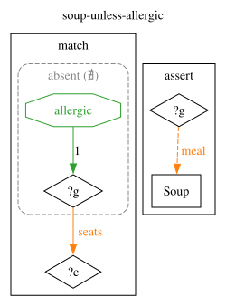
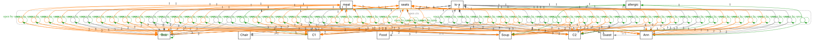
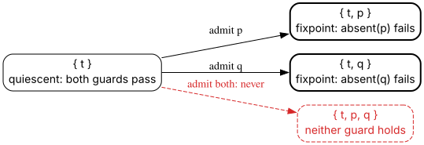
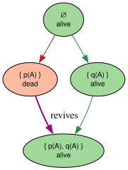
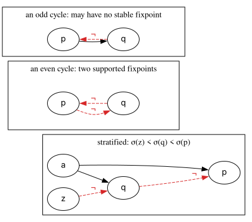
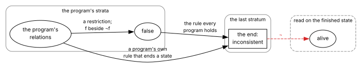

# Absence: negation as failure

$\operatorname{absent}(G)$ is the one condition by which a rule reads what a world lacks. Everything else a rule
does is positive: it reads facts and adds facts, and a knowledge base only grows. This page states what
$\operatorname{absent}(G)$ means, the one moment at which it is asked, what follows from that for the rest of the
reasoning, what a world's facts of $\mathsf{open}$ say of what it lacks, and what absence does not give. The
symbols are those of [firing a rule](01-firing.md) and [saturation](02-saturation.md).

The one distinction that matters: **$\operatorname{absent}(G)$ is a question about a saturated world, never a
fact.** It is asked, answered and acted on, and its answer is carried to no other world. The one answer a world
keeps as a fact, what it owes, is a fact of $\mathsf{open}$, which no fork inherits
([below](#what-a-world-owes-and-supposes)). Of the three readings of negation as failure a reasoner could take,
closed-world, stratified and world-relative epistemic, Ein takes the third; the worked examples below are where the
other two give other answers.

How a program writes an absence, and the universal and the *unknown* test built from it, is the user's
[rules page](../../user/03-syntax-and-semantics/05-rules.md) and [macros page](../../user/03-syntax-and-semantics/11-macros.md).

## Two halves: a positive closure and a boundary

Saturation is split along negation ([saturation](02-saturation.md)), here where no rule reads a fact of
$\mathsf{open}$:

$$
\begin{aligned}
K_0' &= \operatorname{pos}(K) \\
K_{i+1}' &= \operatorname{pos}\bigl(K_i' \cup \psi_{\kappa_i}\theta_i\bigr) \\
\operatorname{sat}(K) &= K_m' \cup \operatorname{opens}(K_m')
\end{aligned}
$$

- **the closure** $\operatorname{pos}$ fires the purely positive part of every rule to quiescence and consults
  no negation at all. A rule's absences are set aside; a candidate whose disjunct carries one is **parked**, not
  fired;
- **the boundary**, at each quiescence $K_i'$, judges the parked candidates against that fixpoint, admits at most
  one whose every guard passes, $\kappa_i$, and hands it back to the closure;
- **the pass**, at the quiescence the boundary admits nothing at, writes what the world owes and supposes, as facts
  of $\mathsf{open}$ ([saturation](02-saturation.md#the-pass-what-a-state-owes-and-supposes)).

So the deductive part of Ein is monotone, and the non-monotone part, absence, is confined to one place with one
world to look at. Nothing is ever retracted: a world's facts only grow.

## Worlds

A **world** is one knowledge base under saturation: root, the program's own facts saturated by its rules, or a
node, root's fixpoint with a commitment $C$ added and the saturation continued
([solution semantics](06-solution-semantics.md)). Write $K_t$ for a world's facts after $t$ firings. Within one
saturation a world is **append-only**:

$$
K_t \subseteq K_{t+1}
$$

Two worlds are related only by the fork that made one from the other, which keeps every fact of the parent but
its facts of $\mathsf{open}$ ([firing a rule](01-firing.md#two-layers)); a question asked in one is not an answer
in another.

## The definition

**Boundary epistemic negation as failure.** The condition $\operatorname{absent}(G)$ and what it holds under are
those of [the rules](../01-static-ir/02-rewriting-rules.md#the-conditions-on-a-match). What this page fixes is
the knowledge base it is read in: for a candidate considered in a world, a **positive quiescence**
$K = \operatorname{pos}(K)$ of it, with the candidate's substitution $\theta$:

$$
\begin{aligned}
K \models \operatorname{absent}(G)\theta &\iff \lnot \exists \theta' \supseteq \theta.\ K \models G\theta' \\
&\iff K \not\models \exists \bar x.\; G\theta
\end{aligned}
$$

where $\bar x$ are the variables of $G$ that $\theta$ leaves free. In words: no extension of the substitution
makes the pattern hold in $K$.

**$\theta$ is the substitution as far as the parts written before the guard bind it**
([the rules](../01-static-ir/02-rewriting-rules.md#the-conditions-on-a-match)). Where a guard is written decides
which question it asks:

$$
\begin{aligned}
\operatorname{absent}(p(x)) \land q(x) \ \ &\text{asks} \ \ \lnot \exists x.\; p(x) && \text{there is no fact of } p \text{ at all} \\
q(x) \land \operatorname{absent}(p(x)) \ \ &\text{asks} \ \ \lnot\, p(x\theta) && \text{there is no fact of } p \text{ for this } x
\end{aligned}
$$

Setting the guard aside until the boundary asks exactly the question it would have asked in place.

**As a graph.** A rule with an absence is drawn with the absent pattern in a dashed cluster: the premises are
the solid part, found in the graph, and the cluster is a part that must not be found. The rule below gives a
seated guest the soup unless the guest is allergic,

$$
\operatorname{seats}(g, c) \;\land\; \operatorname{absent}\bigl(\operatorname{allergic}(g)\bigr) \implies \operatorname{meal}(g, \mathsf{Soup})
$$

and in the saturated world below, where two guests are seated and one is allergic, it has fired for one of them.
Both drawings fold each fact of three arrows into a labelled arrow and each of two into a labelled loop
([the knowledge base](../01-static-ir/01-knowledge-base.md#drawn-with-labelled-arrows)): a fact of one argument,
$\operatorname{allergic}(\mathsf{Bob})$, is a loop on $\mathsf{Bob}$, and the world is drawn without its
declarations' facts. The dashed arrow labelled with the rule is the fact the rule derived. The world is drawn with
the facts of $\mathsf{open}$ written at its fixpoint
([hypothesis generation](04-hypothesis-generation.md#2-the-union)): each octagon in the frame
$\mathsf{open\ ctx}$ is a fact the world does not hold and supposes, a **hypothesis**, and the dashed loop labelled
$\mathsf{open}$ on it is $\operatorname{open}(f)$. Nothing says what to guess, so they are every fact the world does
not hold of a declared relation over names that are neither a relation nor a label, two different ones for a
relation of two ([the blind enumerator](04-hypothesis-generation.md#5-the-blind-enumerator)). One of them is
$\operatorname{allergic}(\mathsf{Ann})$, the fact the absence reads for $\mathsf{Ann}$. The absence reads a relation
a commitment can add a fact of, so the static check finds a site in the rule
([monotonicity § 3](08-monotonicity.md#3-the-static-check)), and nothing is claimed of the program's answer
([§ 11.3](08-monotonicity.md#113-what-is-claimed-of-a-flagged-program)).

$$
\begin{aligned}
K &\models \operatorname{absent}(\operatorname{allergic}(g))\lbrace g \mapsto \mathsf{Ann} \rbrace \\
K &\not\models \operatorname{absent}(\operatorname{allergic}(g))\lbrace g \mapsto \mathsf{Bob} \rbrace
\end{aligned}
$$

Three consequences of the definition:

- **Membership, of a saturated store.** An absence reads the facts held, not the theory. Since the store it
  reads is the positive fixpoint, everything positively derivable is there, so for the positive part of a program
  membership and derivability coincide. They do not coincide on what a later round of the boundary admits: a fact
  admitted through one guard is not in the world an earlier guard was judged in.
- **A variable inside the guard is existential.** The guard is $\lnot\exists$ over the variables of its pattern
  that nothing bound before it. A conjunction inside a guard is one existential, and the universal
  ([the rules](../01-static-ir/02-rewriting-rules.md#the-conditions-on-a-match)) is this existential negated
  twice:

$$
\begin{aligned}
\operatorname{absent}\bigl(g(x, y) \land h(y)\bigr) \;&\equiv\; \lnot \exists y.\; g(x, y) \land h(y) \\
\forall b.\; ( G \to B ) \;&\equiv\; \operatorname{absent}\bigl( G \land \operatorname{absent}(B) \bigr)
\end{aligned}
$$

- **One question, one world.** A guard is asked of the world it is judged in and its answer is acted on at once,
  so it has no interval in which to go stale.

A fact $f$ is open in $K$ when neither it nor its stored negation is held
([the knowledge base](../01-static-ir/01-knowledge-base.md#a-fact-its-negation-both-or-neither)), and the form
that tests it, $\operatorname{unknown}$ ([the rules](../01-static-ir/02-rewriting-rules.md#the-conditions-on-a-match)),
is two guards:

$$
\operatorname{unknown}(f) \;\equiv\; \operatorname{absent}(f) \;\land\; \operatorname{absent}(\lnot f)
$$

## The boundary

There is **one** point at which a guard is evaluated, and it is the boundary.

- **At quiescence, once.** The closure runs to its fixpoint with the guards set aside, so a candidate the closure
  finds says nothing about negation. At a quiescence $K_i'$ each parked candidate is judged,
  $\operatorname{passes}(\kappa, K_i') \iff \forall j.\; K_i' \models \operatorname{absent}(G_{d,j})\theta$, and
  it is admitted if it passes. That judgement is the decision, and there is no other.
- **One admission a round.** At quiescence the closure has nothing left to fire, so the one admitted candidate
  fires at once, against exactly the world its guards were judged in, and the closure resumes. This is a
  soundness requirement. With the two rules $t \land \operatorname{absent}(q) \implies p$ and
  $t \land \operatorname{absent}(p) \implies q$ both guards pass in the world that holds neither, so admitting
  both would derive $\lbrace p, q \rbrace$, which is a model of that program under no reading. Admitting one and
  judging the other again in the world the first made derives one of the two.
- **Never after a firing.** Nothing is retracted. A fact admitted through a guard stays, whatever the world later
  comes to hold: $f \in K_i' \implies f \in \operatorname{sat}(K)$.
- **The fixpoint is a quiescence that admits nothing.** A saturation that ends with candidates still parked ends
  because none of them passes; a world whose closure has quiesced while a parked candidate would pass is not at
  its fixpoint.

A solid box is a world a saturation can reach, a heavy one a fixpoint; the agenda's order takes one of the two
solid arrows. The red dashed world is the one a batch admission would make.

**How a guard's answer can change while the world grows**, and what that means for a candidate parked on it. Let
$K \subseteq K'$:

$$
\begin{aligned}
K \not\models \operatorname{absent}(G)\theta &\implies K' \not\models \operatorname{absent}(G)\theta && \text{where } G \text{ holds no absence}
\end{aligned}
$$

Such a guard is anti-monotone in the world: once its pattern matches it matches for ever, so a candidate it
rejects can never pass and is dropped. A guard **with a nested absence**, a universal's, can turn from failing
to passing as the world grows: adding a $B$ makes the inner absence fail and the outer one pass. Its candidate
stays parked and is judged again at a later quiescence, where the held extent of a relation the guard reads
([the knowledge base](../01-static-ir/01-knowledge-base.md#the-relation-its-extent-a-fact-of-it)) has grown.

## What follows

Each of these holds wherever it applies; this page is the shared reason.

- **Root is never written by a node.** A fact a node derives may rest on an absence that holds in that node and
  not in root's future, so nothing a node derives is written back into root. Every node is root's fixpoint and
  its own commitment, $\operatorname{st}(C) = \operatorname{sat}(\mathrm{root} \cup C)$, and nothing else
  ([finding R](07-finding-r.md)).
- **A derivation records the absences it rested on.** A firing admitted at the boundary records each question
  that had to fail, one pattern per guard with a position the question left free recorded as free, beside the
  positive premises it read ([cores](09-cores.md#a-derivation-record) defines the record):

$$
\begin{aligned}
\delta &= (\rho, a, \theta, \operatorname{prem}(\delta), \operatorname{all}(\delta), \operatorname{abs}(\delta)) \\
\operatorname{dep}(f) &= \operatorname{prem}(\delta) \cup \operatorname{all}(\delta) \cup \operatorname{abs}(\delta)
\end{aligned}
$$

  Negative dependence is so visible: what a fact depends on is its positive premises and those absences
  together. A core names facts only and does not count the absences ([cores](09-cores.md)); the check of a
  program that may not be monotone reads them ([monotonicity](08-monotonicity.md)).
- **Deleting a fact can fabricate a contradiction.** With an absence, a smaller knowledge base can be dead where
  a larger one is alive: under the rule $p(x) \land \operatorname{absent}(q(x)) \implies \bot$,

$$
\begin{aligned}
&\lnot\operatorname{dead}\bigl(\operatorname{sat}(\lbrace p(\mathsf{A}), q(\mathsf{A}) \rbrace)\bigr) \\
&\operatorname{dead}\bigl(\operatorname{sat}(\lbrace p(\mathsf{A}) \rbrace)\bigr)
\end{aligned}
$$

  A smallest explanation of a contradiction is therefore found among the derivations a world recorded, never by
  deleting facts and saturating again ([cores](09-cores.md)).
- **An absence is world-relative.** The same ground question can answer one way in root and another in a node,

$$
\begin{aligned}
\mathrm{root} &\models \operatorname{absent}(G)\theta \\
\operatorname{st}(C) &\not\models \operatorname{absent}(G)\theta
\end{aligned}
$$

  so a guard's answer is never carried across worlds: the one a world keeps as a fact, what it owes, is a fact of
  $\mathsf{open}$, which no fork inherits, and a candidate a node inherits parked from root is judged again in the
  node's own world before it can be admitted. A fact root admitted through a
  guard is, though, part of root's fixpoint, and every node holds it, $\mathrm{root} \subseteq
  \operatorname{st}(C)$; where a commitment can fill the absence that fact rested on, the node holds it beside
  the fact that denies its premise. That is the case in which a node's state depends on the path to it, and a
  program that can reach it is not monotone ([monotonicity](08-monotonicity.md),
  [Q-M1e2.2](../../../decisions/answer/Q-M1e2.2-a-node-is-a-fork-of-root-an-assumption-on.md)).
- **The answer inherits the semantics.** Whether a node is dead and what it owes are read off its fixpoint, and
  the candidate set $H$ off root's, so the region $R$, every count and every claim are downstream of the same
  questions asked at the boundary.

## What is not provided

- **Stable or well-founded models.** The fixpoint is *supported at the boundary*: every admitted fact had its
  guards pass when it was admitted. It need not be stable. The program $s \land \operatorname{absent}(q)
  \implies p$, $p \implies q$ with $s$ given has no stable model and converges to $\lbrace s, p, q \rbrace$; the
  program $\operatorname{absent}(q) \implies p$, $\operatorname{absent}(p) \implies q$ has two, and the boundary's
  order picks one.
- **Retraction or truth maintenance.** A world never loses a fact. What a search learns from a dead node it
  learns by not entering it, not by retracting what led there.
- **Stratification as a refusal.** A program whose rules read through an absence in a cycle has no
  stratification; it is read and answered, and the cycle is reported as a diagnostic
  ([stratification](#stratification)).

**What the order of admission can decide.** Call a guard **settled by the closure** when no relation whose facts
it reads is, or can be reached from, a relation of which a rule carrying a guard concludes a fact, in the graph
of [§ Stratification](#stratification): every fact it could read is derived by positive candidates alone.

**Proposition.** If every guard of $P$ is settled by the closure, $\operatorname{sat}(K)$ does not depend on the
order rules are written in or admitted in.

*Argument.* Let $Q$ be the relations whose facts the guards read. An admitted candidate adds facts of relations
from which no relation of $Q$ can be reached, and the closure that follows adds only what is reachable from
them; so every quiescence holds the same facts of each relation of $Q$,
$\operatorname{ext}_{K_i'}(q) = \operatorname{ext}_{K_0'}(q)$ for every $q \in Q$, and a guard passes at one
quiescence exactly when it passes at every other. Each guarded rule then acts as a positive rule under a fixed side condition, and
the fixpoint of positive rules does not depend on the order ([saturation](02-saturation.md)). $\square$

The rules that derive the facts a guard reads have then always finished before the guard is judged, whatever
the order. Where a guard reads facts of a relation of which another guarded rule concludes a fact, the two
candidates wait at the same boundary and the agenda's order
([Q-M1f.313](../../../decisions/engine/Q-M1f.313-the-agenda-fires-first-what-leads-to-false.md)) says which is
judged first. That order is not the order of the program's strata:

- on a **stratified** program a reader can be admitted before the producer of what it reads, and the fixpoint
  then holds a fact whose guard the fixpoint itself falsifies, which the stratum-by-stratum model does not hold
  ([monotonicity § 8.3](08-monotonicity.md#83-the-fifo-gap));
- on a program **with no stratification** the order picks which of several supported fixpoints root reaches,
  and nothing tells the others exist.

## A refutation resting on an absent

Take a **refutation**, a rule whose firing can make a state dead: one that ends a state, one that concludes a fact a
rule that ends a state reads, $\bot$ in every program, or one that concludes the side of a pair a rule refutes that
holds the other, a stored negation where the program takes the contradiction's rules
([saturation](02-saturation.md#the-agenda-the-order-rules-fire-in)); write $\operatorname{refutes}(\rho)$. Let it
rest on an $\operatorname{absent}(G)$ that reads the held extent of a relation a commitment can still extend:
directly, through a fact a rule derived under such an absence, or through the activator its rule was applied with.
Write $D^{+}$ for the relations whose held extent a commitment can extend (below) and
$\operatorname{abs}^{\ast}(\rho)$ for the absences $\rho$'s conclusion can depend on in those three ways. The shape is

$$
\begin{aligned}
& \operatorname{refutes}(\rho) \\
\land\ & \exists\, \operatorname{absent}(G) \in \operatorname{abs}^{\ast}(\rho).\;\; \operatorname{rels}(G) \cap D^{+} \neq \emptyset
\end{aligned}
$$

Over the held extent of such a relation the rule judges a state that has not yet decided $G$ as if $G$ were false:
it says *contradiction* where the truth is *not yet*. And *dead* stops being closed upward. Under
$p(x) \land \operatorname{absent}(q(x)) \implies \bot$, with $p(\mathsf{A})$ and $q(\mathsf{A})$ candidates:

$$
\begin{aligned}
&\operatorname{dead}\bigl(\lbrace p(\mathsf{A}) \rbrace\bigr) \\
&\lbrace p(\mathsf{A}) \rbrace \subseteq \lbrace p(\mathsf{A}), q(\mathsf{A}) \rbrace \\
&\lnot\operatorname{dead}\bigl(\lbrace p(\mathsf{A}), q(\mathsf{A}) \rbrace\bigr)
\end{aligned}
$$

Each node is a commitment, an arrow adds one candidate, green is alive and red dead. A search that took a
superset of a dead set for dead would lose the bottom state.

**A program with the shape is not monotone.** It is read as any other program is; the static check finds a site
in it ([monotonicity § 3](08-monotonicity.md#3-the-static-check)), so no step of the search rests on a property
the program lacks, and nothing is claimed of its answer
([Q-M1f.564](../../../decisions/answer/Q-M1f.564-a-non-monotone-program-loads-with-a-warning.md);
[monotonicity § 11.3](08-monotonicity.md#113-what-is-claimed-of-a-flagged-program)).

**Extendable.** A relation is **extendable** when it is in $D^{+}$, the set of the relations whose held extent
a commitment can change, followed through every rule with parameters whose activator's relation it holds, since
an application a node makes that root never had can conclude facts of relations whose held extent a commitment
changes:

$$
\begin{aligned}
D^{+} \;=\; \mu X.\ \ & \operatorname{rels}(H) \\
\cup\ & \lbrace\, \operatorname{rels}(\psi_\rho) : \rho \text{ reads a fact of a relation of } X \,\rbrace \\
\cup\ & \lbrace\, \operatorname{rels}(\psi_\rho[\cdot]) : \text{the name of } \rho \text{ is in } X \,\rbrace
\end{aligned}
$$

with $\mu$ the least fixpoint: the relations of the candidates, those
of what a rule that reads a fact of one of them concludes, and those of what any application of a rule can
conclude once its activator's relation is among them. With another set $X_0$ of relations as the seed, in the
place of $\operatorname{rels}(H)$, the same fixpoint is written $D^{+}(X_0)$, so
$D^{+} = D^{+}(\operatorname{rels}(H))$. Over the held extent of a relation that is not
extendable, the same shape is closed-world reasoning: no commitment changes what the absence reads.

This is not the stratification hazard and the two do not overlap. A guard over the facts of a relation that a
rule derives can change its answer during saturation, and judging it at the fixpoint makes that sound. A guard
over the held extent of an extendable relation is discharged by a commitment, in a world the guard was never
asked in.

## What a world owes and supposes

**What a world owes is an absence's answer, kept as a fact.** An obligation's pattern is a trigger and the absence of
a witness. At a world's fixpoint, where the trigger holds with no witness, the world holds
$\operatorname{open}(r)$, and beside it the hypotheses $\operatorname{open}(f)$ its writers read off the same
fixpoint ([saturation](02-saturation.md#the-pass-what-a-state-owes-and-supposes)). Neither outlives its world: a
fork drops every fact of $\mathsf{open}$, and the fork's are those of its own fixpoint, so what an absence
answered in one world is carried to no other, as [§ What follows](#what-follows) has it of every guard.

**A rule that reads one reads an absence across worlds.** A rule may read a fact of $\mathsf{open}$, or its
absence. What it concludes is a fact like any other, which every fork keeps; the fact of $\mathsf{open}$ it read is
dropped at the fork and held again only where the fork's own fixpoint gives it. So a commitment that pays what
root owes leaves the node holding a conclusion of a debt it no longer has, which is the shape of a refutation
resting on an absent, above, with no absence written. The static check finds it as a site of its own, a **read of
$\mathsf{open}$**, and such a program is not monotone
([Q-M1f.569](../../../decisions/hypotheses/Q-M1f.569-a-rule-may-read-an-open-fact-and-its-program.md);
[monotonicity § 3.1](08-monotonicity.md#31-what-it-reads)).

**Where a commitment changes what is supposed or owed.** Two more shapes let a world above root hold what root's
fixpoint did not, each a site of the same check, with $D$ the relations whose held extent a commitment can change
([monotonicity § 3.1](08-monotonicity.md#31-what-it-reads)):

- **a hypothesis**: a rule that concludes one reads a relation of $D$ under an even number of absences, so growing
  the relation adds a match, and a world above root supposes a fact root did not
  ([Q-M1f.574](../../../decisions/answer/Q-M1f.574-a-hypothesis-first-held-above-root-makes-its.md));
- **an obligation's trigger or guard**: an obligation whose trigger, or whose guard beside its witness, reads a
  relation of $D$, so a world above root owes an instance root did not, or has a payment root's guard did not give.
  It writes at root what root's guard gives, as every obligation does
  ([Q-M1f.579](../../../decisions/hypotheses/Q-M1f.579-an-obligation-whose-guard-or-trigger-reads-what.md)).

**Found in flight.** Whatever the sites, a world above root that holds a hypothesis root does not makes the
program not monotone: a monotone program, world by world, proves or refutes hypotheses and adds none. A computation
that writes such a world's facts of $\mathsf{open}$ says so at once, and once, where it writes them, which a run
may be asked to do at every world; where the check is made changes no $R$, the answer stands, and nothing is
claimed of it
([Q-M1f.574](../../../decisions/answer/Q-M1f.574-a-hypothesis-first-held-above-root-makes-its.md),
[Q-M1f.656](../../../decisions/cli/Q-M1f.656-a-flag-runs-the-pass-at-every-state-and-checks.md),
[Q-M1f.564](../../../decisions/answer/Q-M1f.564-a-non-monotone-program-loads-with-a-warning.md)).

## Stratification

The relations whose facts a program's rules read and conclude form a directed graph: an edge $q \to r$ for each
rule that reads a fact of $q$ and concludes a fact of $r$, **negative**, written $q \xrightarrow{\lnot} r$,
where the read is under an absence. A **stratification** is a map $\sigma$ from relations to natural numbers
with

$$
\begin{aligned}
q \to r &\implies \sigma(q) \leq \sigma(r) \\
q \xrightarrow{\lnot} r &\implies \sigma(q) < \sigma(r)
\end{aligned}
$$

and one exists exactly when no cycle runs through a negative edge. The parity of the negative edges on such a
cycle says what it may mean: an even cycle may have several supported fixpoints, an odd one may have none.

A node is a relation, a black arrow a positive read, a red dashed arrow a read under an absence. Such a cycle is
reported as a diagnostic, never as a refusal, and only ever as what the graph licenses, since a cycle whose
rules never fire changes nothing. The graph, its strata and what is reported of them are the
[analysis of rules](../03-rule-evolution/02-analysis-of-rules.md).

**The end of a state stands last.** A rule that states the engine's word concludes no relation
([the rules](../01-static-ir/02-rewriting-rules.md#by-its-conclusion)). Put it in the graph as one node more, the
**end**, with an edge into it from each relation such a rule reads, negative where it reads it under an absence. No
edge leaves the end: it is no fact, so no rule reads it. So every stratification of the program's relations extends
to one with the end above them all,

$$
\sigma(\mathrm{end}) \;=\; 1 + \max_{r} \sigma(r)
$$

and a rule that ends a state never puts a cycle through the graph: a program is stratified with its rules that end
a state exactly when it is stratified without them. In every program the end reads $\bot$, through the rule every
program holds, and $\bot$ is concluded from the program's relations, by a restriction or, where the program takes
it, by the contradiction from a fact beside its negation:

A black arrow is a positive read, a red dashed one a read under an absence, and each box is a stratum. *Alive* is
read above the last of them: the absence of an end, asked of the finished state as an absence is asked of a
fixpoint, and never a fact the state holds
([solution semantics § 1.5](06-solution-semantics.md#15-commitment-node-state)). That the end is last is also why it
may fire first ([saturation](02-saturation.md#the-agenda-the-order-rules-fire-in)): it writes nothing another rule
reads, so firing it as soon as it is enabled changes no fact the state's other rules derive, and a death that rests
on no absence is final once it fires, a state's facts only growing.

## Worked examples

Each program is its rules; every fact named as given is in $K$.

| program | given | $\operatorname{sat}(K)$ adds | what it shows |
|---|---|---|---|
| $s \land \operatorname{absent}(q) \implies p$; $\ t \implies q$ | $s$, $t$ | $q$, and no $p$, in either written order of the two rules | the guard is judged against the positive fixpoint, in which $q$ already holds; its guard is settled by the closure, so the order decides nothing derivable |
| $s \land \operatorname{absent}(q) \implies p$; $\ p \implies q$ | $s$ | $p$, $q$ | the fixpoint is supported at the boundary, not stable: this program has no stable model |
| $t(x) \land \operatorname{absent}(q(x)) \implies p(x)$; $\ t(x) \land \operatorname{absent}(p(x)) \implies q(x)$ | $t(\mathsf{one})$ | exactly one of $p(\mathsf{one})$, $q(\mathsf{one})$ | two stable models; the boundary admits one candidate a round and the other's guard then fails |
| $s(x) \land \operatorname{absent}\bigl(g(x, y) \land h(y)\bigr) \implies \operatorname{ok}(x)$ | $s(\mathsf{A})$, $s(\mathsf{B})$, $g(\mathsf{A}, \mathsf{C})$, $h(\mathsf{C})$ | $\operatorname{ok}(\mathsf{B})$ only | a guard over a conjunction is $\lnot\exists$ over its unbound variables |
| $\bigl( t_1 \land \operatorname{absent}(r_1) \bigr) \lor \bigl( t_2 \land \operatorname{absent}(r_2) \bigr) \implies u$; $\ w \implies r_2$ | $t_2$, $w$ | $r_2$, and no $u$ | each disjunct's guards are judged with that disjunct, at the boundary |
| $a(x) \land o(y) \land \operatorname{absent}\bigl(n(x, y)\bigr) \implies m(x, y)$, with the facts of $n$ derived from those of another relation and mirrored by a rule of symmetry | an $a$ and an $o$ that are neighbours only through a derived, mirrored fact of $n$ | no fact of $m$ | a guard sees the held extent of what it reads as the closure completed it, however many firings built it |
