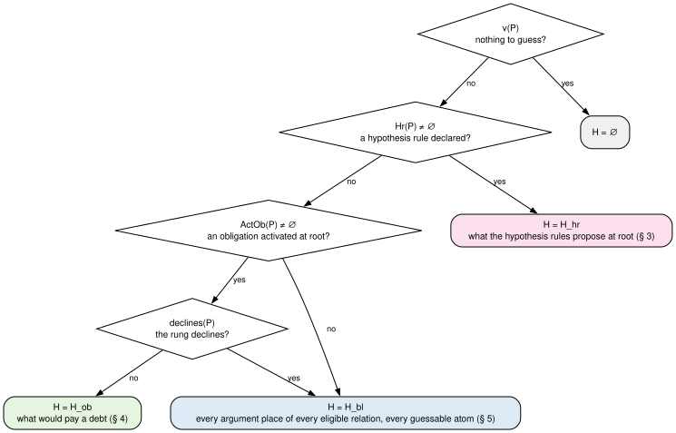
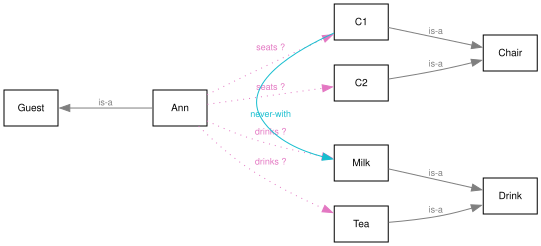

# Hypothesis generation: the ladder that builds H

Saturation decides what a program's facts and rules entail. What they leave undecided is guessed: a candidate, also
called a **hypothesis**, is a fact that a commitment may add, and the candidate set $H$, also called the
**universe**, is the set of them ([firing a rule](01-firing.md#two-layers) names both). Every node of the
answer's lattice is root with a subset of $H$ committed, so $H$ fixes what the answer can contain
([Solution semantics](06-solution-semantics.md) defines $R$ over it; [Finding R](07-finding-r.md) says why every
computation over it agrees).

This page defines $H$: a function of the program and of root's fixpoint, given by cases. The cases are called the
**ladder**, and each case a **rung**. How a program spells what the ladder reads is
[hypotheses](../../user/03-syntax-and-semantics/09-hypotheses.md) and
[obligations](../../user/03-syntax-and-semantics/08-obligations.md); how the engine that ships computes $H$, and
what holds it to this page, is [hypotheses and the answer, in code](../../ein.rs/08-reasoning-in-code/03-hypotheses-and-the-answer.md).

**The symbols.** $P$ is the program, $K_0$ its knowledge base as loaded, $\mathrm{root} = \operatorname{sat}(K_0)$,
and $\operatorname{st}(C) = \operatorname{sat}(\mathrm{root} \cup C)$ the state of a commitment $C \subseteq H$
([Solution semantics § 1](06-solution-semantics.md#1-the-vocabulary)). The stored negation $\lnot f$ of a fact $f$,
its relation $\operatorname{rel}(f)$, and the **held extent** of a relation $r$, the facts of $r$ that a state holds,
are [the knowledge base](../01-static-ir/01-knowledge-base.md#the-relation-its-extent-a-fact-of-it)'s;
$\operatorname{rels}(X)$ is the relations of the facts in $X$ ([saturation](02-saturation.md)). A rule's pattern
$\varphi$, its conclusion $\psi$ and its activators at root, $\operatorname{Act}_{\mathrm{root}}(\rho)$, are
[the rules](../01-static-ir/02-rewriting-rules.md#a-rule-declared)'.

## 1. When H is built

$$
\begin{aligned}
H &= \operatorname{gen}(P, \mathrm{root}) \\
\mathrm{root} &= \operatorname{sat}(K_0)
\end{aligned}
$$

**$H$ is proposed at root's fixpoint**: the program's facts saturated to quiescence by its rules, with nothing
hypothesised ([Q19](../../../decisions/hypotheses/Q19-hypotheses-are-proposed-at-a-fixpoint-after.md)). It is one
set, and every node is a subset of that one set: $\operatorname{gen}$ is applied to root and to no other state, so
nothing a node derives adds a candidate, and nothing is proposed before saturation has decided everything it can.

**No option changes $H$.** $\operatorname{gen}$ has two arguments, the program and root's fixpoint. Nothing a
computation is configured with is a third, so none reaches $H$, and with it none reaches $R$
([Q-M1e2.30](../../../decisions/answer/Q-M1e2.30-no-configuration-option-lever-or-flag-changes-r.md)).

**A program may state that there is nothing to guess.** Write $\nu(P)$ for that statement. It says the lattice is
root alone:

$$
\begin{aligned}
\nu(P) &\implies H = \emptyset \\
\nu(P) &\implies R =
\begin{cases}
\lbrace \emptyset \rbrace & \text{if } \operatorname{alive}(\mathrm{root}) \land \operatorname{discharged}(\mathrm{root}) \\
\emptyset & \text{otherwise}
\end{cases}
\end{aligned}
$$

It relaxes no conflict between the mechanisms of § 6
([Q-M1f.254](../../../decisions/hypotheses/Q-M1f.254-solve-no-search-relaxes-no-conflict.md)).

## 2. The ladder

Four things are read off the program and root:

| symbol | what it is |
|---|---|
| $\nu(P)$ | the program states that there is nothing to guess |
| $\operatorname{Hr}(P)$ | the **hypothesis rules** the program declares: rules whose conclusion is a guess (§ 3) |
| $\operatorname{ActOb}(P)$ | the obligations **activated** at root: the pairs $(o, a)$ of an obligation rule $o$ and an activator $a \in \operatorname{Act}_{\mathrm{root}}(o)$ of its parameters, and $(o, ())$ for each obligation rule with no parameter (§ 4) |
| $\operatorname{declines}(P)$ | the obligations rung **declines** (§ 4.3) |

$$
\operatorname{gen}(P, \mathrm{root}) \;=\;
\begin{cases}
\emptyset & \text{if } \nu(P) \\
H_{\mathrm{hr}} & \text{else if } \operatorname{Hr}(P) \neq \emptyset \\
H_{\mathrm{ob}} & \text{else if } \operatorname{ActOb}(P) \neq \emptyset \text{ and not } \operatorname{declines}(P) \\
H_{\mathrm{bl}} & \text{otherwise}
\end{cases}
$$

A diamond is a condition on the program and on root's fixpoint, a box the set $H$ is. The diagram is the definition
by cases and no more: no arrow is a step taken on a state other than root.

The case is decided by one reading of the program, which everything that reads the ladder shares
([Q-M1f.308](../../../decisions/hypotheses/Q-M1f.308-the-ladders-second-rung-is-taken-where-root.md)). Three things
about the third case decide what it means:

- **It is about what the program states, not what root owes.** $\operatorname{ActOb}(P)$ is defined by root holding an
  obligation's activator, whether or not root owes anything under it
  ([Q-M1f.243](../../../decisions/hypotheses/Q-M1f.243-an-obligation-is-read-as-activated-owed-or-not.md)). Under an
  activated obligation a root that owes nothing proposes nothing, $H_{\mathrm{ob}} = \emptyset$, and is complete
  because it is discharged. Falling back to $H_{\mathrm{bl}}$ wherever nothing was owed would make exhaustion, not
  discharge, decide when a state is finished, at exactly the states the obligation exists to judge.
- **It is about what the program activates, not what it loads.** Every import brings its module whole, obligation
  rules among it ([Q-M1f.247](../../../decisions/imports/Q-M1f.247-every-import-brings-its-module-whole.md)). An
  obligation rule with parameters and no activator at root is in no pair of $\operatorname{ActOb}(P)$, so a module
  imported for another of its names leaves the facts of the program's own eligible relations (§ 5) to
  $H_{\mathrm{bl}}$, and a module imported for one rule gives the $H$ of that rule written out
  ([Q-M1f.249](../../../decisions/imports/Q-M1f.249-the-answer-does-not-depend-on-the-import-form.md)).
- **The obligations rung may decline** (§ 4.3), and then $H = H_{\mathrm{bl}}$. $H$ is never part of one rung's set
  and part of another's.

**Every rung's candidate is a fact root does not settle.** Each rung first forms its **proposals**, a set
$\Pi$ of facts, and $H$ is what of them root leaves open:

$$
\operatorname{unsettled}(\Pi) = \lbrace\, f \in \Pi \;:\; f \notin \mathrm{root} \land \lnot f \notin \mathrm{root} \,\rbrace
$$

$H$ is a set: a fact proposed twice is in it once, and what the answer depends on is which candidates it holds.

## 3. The hypothesis rules: what the program says to guess

A **hypothesis rule** $h$ is a declaration with a rule's parts whose conclusion is a guess, proposed and not added
to the knowledge base it matches in: a pattern $\varphi_h$ and a conclusion $\psi_h$ of one fact pattern, written
$\varphi_h(a, \theta)$ and $\psi_h(a, \theta)$ for $\varphi_h[a]\theta$ and $\psi_h[a]\theta$
([the rules](../01-static-ir/02-rewriting-rules.md#the-kinds-of-rule) has the kinds of rule). A conclusion of more than
one fact is no hypothesis rule
([Q-M1f.271](../../../decisions/language/Q-M1f.271-an-hrules-conclusion-is-one-fact.md)). It is **active** under the
activators $\operatorname{listed}(h)$: the empty one where $h$ has no parameter, and otherwise each activator the
program lists for it. A conclusion may point at a fact, and then so does the candidate; a commitment that holds
such a candidate holds it and nothing it points at
([the knowledge base](../01-static-ir/01-knowledge-base.md#a-context-gives-a-fact-no-truth)). At root it
proposes, for each activator $a$ and each match $\theta$ of its pattern, the one fact its conclusion makes:

$$
\begin{aligned}
\Pi_{\mathrm{hr}} &= \lbrace\, \psi_h(a, \theta) \;:\; h \in \operatorname{Hr}(P), \ a \in \operatorname{listed}(h), \ \mathrm{root} \models \varphi_h(a, \theta) \,\rbrace \\
H_{\mathrm{hr}} &= \operatorname{unsettled} \big( \lbrace\, f \in \Pi_{\mathrm{hr}} \;:\; \operatorname{rel}(f) \notin \lbrace \operatorname{eq}, \operatorname{neq} \rbrace \,\rbrace \big)
\end{aligned}
$$

An instance of equality or of inequality is no candidate, since a state stores neither
([Q-M1f.32](../../../decisions/hypotheses/Q-M1f.32-an-hrules-eq-or-neq-instance-is-no-hypothesis.md)), and a
hypothesis rule whose pattern reads a stored negation reads root's
([Q-M1f.129](../../../decisions/engine/Q-M1f.129-an-hrule-that-reads-not-reads-the-state-it-was.md)).

A hypothesis rule is drawn as any rule is, its pattern beside its conclusion. This one says *guess, for each guest
and each drink, that the guest drinks it*:

A diamond is a variable, a rectangle an atom, a solid arrow a premise, a fact the pattern must find, and the dashed
arrow the fact the rule proposes. A root that holds one guest and two drinks gives

$$
\begin{aligned}
\varphi_h(g, d) &= \operatorname{is-a}(g, \mathsf{Guest}) \land \operatorname{is-a}(d, \mathsf{Drink}) \\
\psi_h(g, d) &= \operatorname{drinks}(g, d) \\
\Pi_{\mathrm{hr}} &= \lbrace \operatorname{drinks}(\mathsf{Ann}, \mathsf{Tea}), \ \operatorname{drinks}(\mathsf{Ann}, \mathsf{Milk}) \rbrace
\end{aligned}
$$

and these, with a second rule's $\operatorname{vegan}(\mathsf{Ann})$, are the universe of the first drawing of
[Solution semantics § 1.5](06-solution-semantics.md#15-commitment-node-state).

**The hypothesis rules are an override.** A program that says what to guess is never second-guessed by what it owes: where
$\operatorname{Hr}(P) \neq \emptyset$ no other rung contributes, and the scoping of § 6 filters nothing. What a
hypothesis rule proposes is what its pattern finds at root:

$$
\operatorname{st}(C) \models \varphi_h(a, \theta) \ \land\ \mathrm{root} \not\models \varphi_h(a, \theta) \implies \psi_h(a, \theta) \text{ is in no candidate on this account}
$$

A match only a node's state would have proposes nothing, since $H$ is root's.

## 4. The obligations rung: what would pay a debt

### 4.1 An instance, and the facts that would pay it

An **obligation** is a declaration with a rule's parts that is no rewriting rule: it adds no fact to the knowledge
base it matches in ([the rules](../01-static-ir/02-rewriting-rules.md#by-its-conclusion)). Its whole conclusion is
the verdict that the held extent of a relation is incomplete, written $\operatorname{open}(r)$, and its pattern is
the requirement's guard
([Q-M1d.2](../../../decisions/hypotheses/Q-M1d.2-an-obligation-is-a-rule-that-concludes-open-r.md)). The relation the
verdict names is the one the obligation **owes**: what is owed is a fact of it. The guard of $o$ under an activator
$a$ has two parts, a **trigger** $T_o$, which says who is owed, and one absence, over the **witness** $W_o$:

$$
\begin{aligned}
\operatorname{owes}(o, a, \theta, S) &\iff S \models T_o(a, \theta) \ \land\ \lnot \exists \bar{y}.\ S \models W_o(a, \theta, \bar{y}) \\
W_o(a, \theta, \bar{y}) &= \Delta_o(a, \theta, \bar{y}) \land w_o(a, \theta, \bar{y})
\end{aligned}
$$

$w_o$ is the **witness step**, the one premise that binds $\bar{y}$, a fact pattern of the owed relation, and
$\Delta_o$, the rest of the absence, is the **domain** of the debt. An **instance** is a triple $(o, a, \theta)$ with
$\mathrm{root} \models T_o(a, \theta)$, and it is **owed** at a state $S$ while $\operatorname{owes}(o, a, \theta, S)$
holds, that is, while no witness is there.

The obligation *every member of the first label has an image in the second* is drawn by the engine with its absence
as a dashed cluster:

Outside the dashed cluster is the trigger: the relation $r$ is declared with the labels $A$ and $B$, and $x$ is a
member of $A$. Inside it is the witness: the arrow labelled with the relation, a fact pattern of it, is the witness
step, and the membership of $y$ in $B$ beside it is the domain. The octagon on the right is the verdict, pointing at
the relation whose facts would pay. In formulas, with the rule's two parameters bound by the activator to a relation
$r$ and to a membership relation $\operatorname{isa}$:

$$
\begin{aligned}
T(x) &= \operatorname{relation}(r, A, B) \land \operatorname{isa}(x, A) \\
\Delta(x, y) &= \operatorname{isa}(y, B) \\
w(x, y) &= r(x, y)
\end{aligned}
$$

**The facts that would pay an owed instance are read off its own guard**, the domain kept and the witness step left
out:

$$
\operatorname{pay}(o, a, \theta) = \lbrace\, w_o(a, \theta, \bar{y}) \;:\; \mathrm{root} \models \Delta_o(a, \theta, \bar{y}) \,\rbrace
$$

For the obligation above, $\operatorname{pay} = \lbrace r(x, y) : \mathrm{root} \models \operatorname{isa}(y, B) \rbrace$. Nothing
restates the domain: the set of payments is the guard, read at root, and nothing stores it
([Q-M1d.3](../../../decisions/hypotheses/Q-M1d.3-an-obligation-needs-no-closed-domain.md)). An obligation whose guard
does not say which premise is the witness step, none or two of them, is no obligation where that does not depend on the
activator, and declines the rung where it does (§ 4.3).

**Read off a root.** One guest, two chairs, two drinks; the guest is owed a chair and a drink, each of the two
relations is stated functional, and a stated fact says nobody at the first chair drinks milk. Root's facts are the
solid and the dashed arrows below, in the vocabulary the engine draws a knowledge base in, and the dotted arrows are
the four payments:

A box is a label, an oval an atom that is no label, a dashed arrow with an open head a membership, a solid arrow a stated fact. Root
owes two instances, $I_{\mathrm{s}}$, *the guest has a chair*, and $I_{\mathrm{d}}$, *the guest has a drink*, and

$$
\begin{aligned}
\operatorname{pay}(I_{\mathrm{s}}) &= \lbrace \operatorname{seats}(\mathsf{Ann}, \mathsf{C1}), \ \operatorname{seats}(\mathsf{Ann}, \mathsf{C2}) \rbrace \\
\operatorname{pay}(I_{\mathrm{d}}) &= \lbrace \operatorname{drinks}(\mathsf{Ann}, \mathsf{Tea}), \ \operatorname{drinks}(\mathsf{Ann}, \mathsf{Milk}) \rbrace
\end{aligned}
$$

No dotted arrow joins a chair to a drink or the guest to a label: a payment is a fact the guard admits, and the guard
admits a chair for the guest and nothing else.

### 4.2 H is the union

$$
\begin{aligned}
\Pi_{\mathrm{ob}} &= \bigcup_{(o, a, \theta) \,\in\, \operatorname{Owed}(\mathrm{root})} \operatorname{pay}(o, a, \theta) \ \cup\ \Pi^{+} \\
H_{\mathrm{ob}} &= \operatorname{unsettled} \big( \lbrace\, f \in \Pi_{\mathrm{ob}} \;:\; \operatorname{inscope}(\operatorname{rel}(f)) \,\rbrace \big)
\end{aligned}
$$

**$H$ on this rung is the union, over the owed instances, of the facts that would pay each**, with the payments
$\Pi^{+}$ of the debts root is not told of (§ 4.4), less what the program scopes out (§ 6). In the drawing above
$H_{\mathrm{ob}}$ is the four dotted arrows.

One instance's payments are jointly exhaustive: the obligation says some witness must hold, so every member of $R$
above a state that owes the instance holds one of them,

$$
C \in R \ \land\ \operatorname{owes}(o, a, \theta, \mathrm{root}) \ \implies\ \operatorname{cl}(C) \cap \operatorname{pay}(o, a, \theta) \neq \emptyset
$$

under the conditions [Satisfiability § 4](10-satisfiability.md) states. But $H$ is one set, the lattice's, so the
rung proposes every instance's payments together, of which each instance's own set is a subset. A computation that
branches on one instance at a time reads that instance's alternatives inside $H$
([Finding R § 4](07-finding-r.md#4-a-monotone-program-three-properties-and-the-licences)); nothing is lost by the
union, and nothing outside it is proposed.

### 4.3 When it declines

A choice among an instance's payments is exhaustive only while the set of them cannot grow beneath it. Where it
could, **the rung declines and the blind enumerator builds $H$**
([Q-M1e2.10](../../../decisions/hypotheses/Q-M1e2.10-the-obligations-rung-declines-where-its-domain.md)).

**The relations whose held extent a commitment can change**, $D^{+}$, are read off the rules, with no state
consulted. For a set $X$ of relations, $D^{+}(X)$ is the fixpoint of
[absence](03-absent-and-naf.md#a-refutation-resting-on-an-absent) seeded with $X$, which is the least set that holds
$X$ and is closed under the rules that derive:

$$
D^{+}(X) = \text{the least } D \supseteq X \text{ such that } \ \forall \rho.\ \ \operatorname{reads}(\rho) \cap D \neq \emptyset \implies \operatorname{concludes}(\rho) \subseteq D
$$

where $\rho$ ranges over the rules that derive, $\operatorname{reads}(\rho)$ is the relations whose facts its pattern
reads, with the relation its activators are facts of, and $\operatorname{concludes}(\rho)$ the relations of the facts
it concludes. It is at relation grain: a relation is in or out whole, whatever its facts. The seed is the relations
of what the rung would propose, $D^{+} = D^{+}(\operatorname{rels}(\Pi_{\mathrm{ob}}))$.

$$
\begin{aligned}
\operatorname{declines}(P) \iff\ & \exists (o, a) \in \operatorname{ActOb}(P) \cup \operatorname{ActOb}^{+}(P). \\
& \operatorname{d}_1(o, a) \lor \operatorname{d}_2(o, a) \lor \operatorname{d}_3(o) \lor \operatorname{d}_4(o, a)
\end{aligned}
$$

| | the condition | why the choice would not be exhaustive |
|---|---|---|
| $\operatorname{d}_1$ | $\operatorname{rels}(\Delta_o) \cap \operatorname{rels}(\Pi_{\mathrm{ob}}) \neq \emptyset$: a guard's domain reads facts of a relation the rung itself proposes facts of | a payment of one debt could add a member to another debt's domain |
| $\operatorname{d}_2$ | $\big( \operatorname{rels}(T_o) \cup \operatorname{rels}(\Delta_o) \big) \cap D^{+} \neq \emptyset$: a trigger, or a guard beside its witness step, reads facts of a relation whose held extent a commitment can change | a member of a domain that only a commitment derives is in no payment read at root, and an $H$ built from root's reading would lack the model that member licenses. The reading is at relation grain, so a program whose root already has that member declines too |
| $\operatorname{d}_3$ | $o$ names no relation whose facts would pay | the instance owes and is reported, and there is nothing to choose among |
| $\operatorname{d}_4$ | the witness step of $o$ does not resolve under $a$ | no payment can be formed |

$\operatorname{ActOb}^{+}(P)$ is the obligations a commitment can activate (§ 4.4), held to the same four conditions.

**One declined obligation declines the whole rung.** Falling through for that obligation alone would leave its
payments proposed by nobody, and a model needing one would be in no node with nothing saying so. Declining all or
nothing is what makes the rung's claim unconditional:

$$
\begin{aligned}
\lnot \operatorname{declines}(P) &\implies \forall I \in \operatorname{Owed}(\mathrm{root}). \ \operatorname{unsettled}(\operatorname{pay}(I)) \subseteq H \\
\operatorname{declines}(P) &\implies H = H_{\mathrm{bl}}
\end{aligned}
$$

and $H_{\mathrm{bl}}$ reads no domain. A decline is part of the answer, with its reason in words: *an obligation
reads facts of a relation whose held extent a commitment can change*.

### 4.4 A debt root is not told of

An obligation's activator is an ordinary fact, so a rule can derive one at a node, and that node owes what root never
did. **The rung also proposes, at root, what such a debt would**, read off the rules alone
([Q-M1e.11](../../../decisions/hypotheses/Q-M1e.11-h-holds-what-a-debt-only-a-commitment-brings.md)). For a set $D$
of relations:

$$
\begin{aligned}
\operatorname{ActOb}^{+}_{D} = \lbrace\, (o, \alpha) \;:\;\ & \alpha \text{ is a conclusion with no variable, of a rule } \rho \text{ with } \operatorname{reads}(\rho) \cap D \neq \emptyset \\
\land\ & \alpha \text{ activates } o \\
\land\ & \alpha \notin \mathrm{root} \,\rbrace \\
\Pi^{+}_{D} = \bigcup \lbrace\, \operatorname{pay}(o, \alpha, \theta) \;:\;\ & (o, \alpha) \in \operatorname{ActOb}^{+}_{D} \\
\land\ & \mathrm{root} \models T_o(\alpha, \theta) \\
\land\ & \lnot \exists \bar{y}.\ \mathrm{root} \models W_o(\alpha, \theta, \bar{y}) \,\rbrace
\end{aligned}
$$

1. $\operatorname{ActOb}^{+}_{D}$ is the **activators a commitment can derive**: each conclusion that holds no
   variable and would activate an obligation rule, in a rule that reads facts of a relation whose held extent a
   commitment can change, or is activated by a fact of one;
2. $\Pi^{+}_{D}$ is, for each such activator root does not hold, **the rung's own reading at root**: the instances
   the obligation would owe there were it activated, each paid as § 4.1 pays a debt root owes;
3. a candidate that is a fact of a new relation widens what a commitment can change, so **the two are taken to
   their least fixpoint**:

$$
\begin{aligned}
X_0 &= \operatorname{rels} \Big( \bigcup_{I \in \operatorname{Owed}(\mathrm{root})} \operatorname{pay}(I) \Big) \\
X_{i+1} &= X_i \cup \operatorname{rels} \big( \Pi^{+}_{D^{+}(X_i)} \big) \\
\Pi^{+} &= \Pi^{+}_{D^{+}(X_\infty)} \\
\operatorname{ActOb}^{+}(P) &= \operatorname{ActOb}^{+}_{D^{+}(X_\infty)}
\end{aligned}
$$

The sequence is increasing in a finite set of relations, so it is constant from some $i$ on.

The reading is **at relation grain and inexact both ways**:

- *over*: a rule that reads what a commitment can change need fire at no alive node, and $H$ then holds a candidate
  for a debt no node owes, which a state of $R$ holds wherever nothing refutes it;
- *under*: an activator its rule writes with a variable is not in $\operatorname{ActOb}^{+}$, and the node that derives
  it owes what no candidate pays.

A program this reading adds a candidate to derives an activator from a commitment, so it is not proved monotone
([Monotone and non-monotone programs](08-monotonicity.md)), and its answer is the whole lattice's.

### 4.5 Stuck: owing, with nothing to propose

A payment whose negation root stores is settled, and is no candidate. A root is **stuck** where it owes and the rung
has nothing left to propose:

$$
\operatorname{stuck}(P) \iff \operatorname{Owed}(\mathrm{root}) \neq \emptyset \ \land\ H_{\mathrm{ob}} = \emptyset
$$

A state that held a payment $f$ of such an instance would hold $f$ beside $\lnot f \in \mathrm{root}$ and be dead, so
no alive state discharges the instance:

$$
\begin{aligned}
\operatorname{stuck}(P) &\implies R = \emptyset \\
\operatorname{stuck}(P) \land \operatorname{alive}(\mathrm{root}) &\implies \forall C.\ \operatorname{alive}(C) \implies \operatorname{owes}(C) > 0
\end{aligned}
$$

the kind of empty $R$ where alive states exist and every one owes. It is said as such, and an empty proposal is
never passed for completeness. A scoping that would take out the relation an obligation owes cannot make a state
stuck: such a program is no program (§ 6,
[Q-M1f.244](../../../decisions/hypotheses/Q-M1f.244-an-obligated-relations-held-extent-is-not-closed.md)).

### 4.6 What the rung leaves to saturation

**The ladder is exhaustive where obligations and saturation between them decide every remaining open fact.** Let
$\operatorname{Elig}(P)$ be the relations the blind enumerator would propose facts of (§ 5). They split in two:

$$
\operatorname{Elig}(P) = \underbrace{ \lbrace\, r : \text{some obligation of } \operatorname{ActOb}(P) \text{ owes } r \,\rbrace }_{\text{covered}} \ \uplus\ \operatorname{Uncov}(P)
$$

Where $\operatorname{Uncov}(P) = \emptyset$ the rung is exhaustive by construction: every fact a hypothesis could be
about is one some debt can be paid with. Where it is not, the claim rests on saturation deciding the facts of the
uncovered relations: a hypothesised fact of a relation of which no rule concludes a fact can never be confirmed, and
the facts of a relation that the program's rules derive from what the obligations settle are decided by them.

The Zebra puzzle is a program of the first kind. Stated with a hypothesis rule that guesses where each thing is, and
stated with no hypothesis rule and each of its attribute relations stated a bijection, which owes every arrow of
each, it has the same $H$ on both rungs, and so the same $R$; the relations no obligation names are closed to
hypotheses (§ 6) or have their facts derived.
Whatever rung built $H$, the answer names the relations the program can conclude or ask about of which $H$ holds no
fact: $R$ holds of them only what the program states and saturation derives
([Satisfiability § 5](10-satisfiability.md)).

## 5. The blind enumerator

Where the program declares no hypothesis rule and activates no obligation, or the obligations rung declines, **every
argument place of every eligible relation is filled with every guessable atom**, and the program's own rules prune
what is wrong.

**The guessable atoms**, $\operatorname{guessable}(P)$, are the names of the program
([the rules](../01-static-ir/02-rewriting-rules.md#the-program-and-its-names);
[Q-M1e.21](../../../decisions/hypotheses/Q-M1e.21-a-rule-brings-in-no-name.md),
[Q-M1e2.9](../../../decisions/language/Q-M1e2.9-a-programs-names-are-the-constants-its-facts.md)) and the relations
of root's facts, less four kinds of atom, each left out by its name
([Q-M1f.306](../../../decisions/hypotheses/Q-M1f.306-the-guessable-atoms-are-the-programs-names-never.md)):

$$
\operatorname{guessable}(P) = \big( \operatorname{names}(P) \cup \operatorname{rels}(\mathrm{root}) \big) \setminus \big( \operatorname{labels}(P) \cup \operatorname{Kw} \cup \operatorname{Res} \cup \operatorname{RelNames}(P) \big)
$$

- $\operatorname{names}(P)$ reads every depth, so an atom under an arrow of a fact that is only in a context
  ([the knowledge base](../01-static-ir/01-knowledge-base.md#the-global-context-and-the-context-of-a-fact)) is a
  name of the program and may be guessable. A fact is never one: every guessable object is an atom, so no
  candidate the enumerator proposes points at a fact. And a fact that root only points at has no place of its
  own for that: it is a candidate exactly where any fact of its relation over the guessable atoms is;
- $\operatorname{rels}(\mathrm{root})$ is the relations of the facts root holds
  ([saturation](02-saturation.md#the-alive-set-invariant)). An atom is no name of the program by standing under a
  first arrow, so the relations are counted beside the names; the atoms under the argument arrows of root's facts
  are names of the program already, since a rewriting brings in no name;
- $\operatorname{labels}(P)$ is the labels, the atoms a relation's declaration writes for its argument places
  ([the knowledge base](../01-static-ir/01-knowledge-base.md#what-is-where));
- $\operatorname{Kw}$ is the seven words of the rule language, *not*, *false*, *and*, *or*, *absent*, *equal* and
  *unequal*, whether or not a program writes one as an argument;
- $\operatorname{Res}$ is the two reserved markers of the kernel, *closed* and *symmetric*
  ([reserved names](../../user/04-reference/03-reserved-names.md) has their spelling): never guessable, neither where
  a rule derives a fact of one nor where a program writes one as an argument, which stays legal and keeps it a name
  of the program. So a marker's fact stated by the program and the same fact derived by a rule give one $H$ and one
  $R$;
- $\operatorname{RelNames}(P)$ is every atom the program declares as a relation, writes under the first arrow of a
  fact, or names a rule or an obligation by
  ([Q-M1f.226](../../../decisions/hypotheses/Q-M1f.226-an-obligations-name-is-no-guessable-atom.md)), with
  $\mathsf{written}$, the relation of the facts that reading the text adds. The relation of a fact that only a rule
  concludes is none of these, so **a relation whose facts only a rule concludes is a guessable atom**, and a
  candidate can have it as an argument. The candidate stays, and the answer names it
  ([solution semantics § 1.4](06-solution-semantics.md#14-candidate-and-universe)); declaring the relation takes the
  atom out.

Since every atom a rule writes under an argument arrow is guessable, no rule can bring a name into a state that
$H$ lacks: the **alive-set invariant** holds of every program by construction
([saturation](02-saturation.md#the-alive-set-invariant)).

**The eligible relations** are those the program declares with labels and does not scope out (§ 6);
$\operatorname{ar}(r)$ is the number of a declared relation's labels, the count of arguments of every fact of it
([the knowledge base](../01-static-ir/01-knowledge-base.md#the-count-of-arguments)):

$$
\operatorname{Elig}(P) = \lbrace\, r \;:\; r \text{ is declared with labels} \ \land\ \operatorname{inscope}(r) \,\rbrace
$$

**The candidates**:

$$
\begin{aligned}
\Pi_{\mathrm{bl}} =\ & \lbrace\, r(x) \;:\; r \in \operatorname{Elig}(P),\ \operatorname{ar}(r) = 1, \ x \in \operatorname{guessable}(P) \,\rbrace \\
\cup\ & \lbrace\, r(x, y) \;:\; r \in \operatorname{Elig}(P),\ \operatorname{ar}(r) = 2, \ x, y \in \operatorname{guessable}(P),\ x \neq y \,\rbrace \\
H_{\mathrm{bl}} =\ & \operatorname{unsettled}(\Pi_{\mathrm{bl}})
\end{aligned}
$$

| arguments | candidates |
|---|---|
| 1 | $r(x)$ for every guessable atom $x$ |
| 2 | $r(x, y)$ for every two distinct guessable atoms: no fact of an atom with itself |
| 3 or more | none: no fact of such a relation is in the universe, and the answer names the relation |

For $k$ guessable atoms, $p$ eligible relations of one argument and $q$ of two,
$\lvert \Pi_{\mathrm{bl}} \rvert = p\,k + q\,k\,(k - 1)$.

Three guessable atoms and one relation of two arguments give the six dotted arrows: both directions between every two,
whatever the labels the relation's declaration writes.

**The enumerator holds no argument to a label**
([Q-M1e.12](../../../decisions/hypotheses/Q-M1e.12-the-blind-enumerator-is-untyped-and-an-atom-on.md)). No object has a
type ([the knowledge base](../01-static-ir/01-knowledge-base.md#the-relation-its-extent-a-fact-of-it)), and the
enumerator gives a label no meaning of its own: a candidate the program's labels would speak against is killed by the
program's own rules, or stays in $R$ where none rejects it. An atom a declaration writes as a label is not guessable,
so a program whose facts use an atom as a label and whose declarations write it nowhere is under-specified, and it is
answered as written: beside $\operatorname{is-a}(\mathsf{Red}, \mathsf{Color})$ and a relation
$\operatorname{co-located}$ of two arguments with one label, $\operatorname{co-located}(\mathsf{Blue}, \mathsf{Color})$
is a candidate. Where a candidate holds as an argument an atom that stands second in a membership fact of root, the
answer names it, and nothing else moves. The program's way out is its declaration.

## 6. Scoping, and the mechanisms judged together

A program steers what a commitment may be about by five declarations: a hypothesis rule, an obligation, two lists of
relations, $L^{+}$ (*only these*, where the program states one) and $L^{-}$ (*never these*), and a **closure** of a
relation $r$: a fact about $r$ under the reserved marker of closure
([the reserved atoms](../01-static-ir/01-knowledge-base.md#the-reserved-atoms)), stated or derived, which **closes
the held extent of $r$ to hypotheses**: no commitment adds a hypothesised fact of $r$. A relation root's fixpoint
holds a closure of is **closed to hypotheses**, and $\operatorname{Closed}$ is the set of them. **The three scopings
bind the obligations rung and the blind enumerator alike**:

$$
\begin{aligned}
\operatorname{inscope}(r) \iff\ & \big( L^{+} \text{ is not stated} \lor r \in L^{+} \big) \\
\land\ & r \notin L^{-} \\
\land\ & r \notin \operatorname{Closed}
\end{aligned}
$$

and no fact of a relation out of scope is a candidate on those two rungs. They do not bind a hypothesis rule: a
program that declares what to guess gets what it declared.

**The declarations do not contradict one another**, judged on root's fixpoint
([Q-M1f.245](../../../decisions/hypotheses/Q-M1f.245-the-hypothesis-mechanisms-are-judged-at-load-on.md)). Let
$\operatorname{Prop} = \operatorname{rels}(\Pi_{\mathrm{hr}})$ be the relations an active hypothesis rule proposes
facts of and $\operatorname{Ow}$ the relations an obligation of $\operatorname{ActOb}(P)$ owes. A text is a program
only if none of these holds:

| a pair that says opposite things of one relation | as a condition |
|---|---|
| a hypothesis rule proposes a fact of a relation a list takes out | $\operatorname{Prop} \not\subseteq L^{+}$ where $L^{+}$ is stated, or $\operatorname{Prop} \cap L^{-} \neq \emptyset$ |
| a hypothesis rule proposes a fact of a relation closed to hypotheses | $\operatorname{Prop} \cap \operatorname{Closed} \neq \emptyset$ |
| with no hypothesis rule, an obligation owes a relation a list takes out | $\operatorname{Hr}(P) = \emptyset$, and $\operatorname{Ow} \not\subseteq L^{+}$ where $L^{+}$ is stated, or $\operatorname{Ow} \cap L^{-} \neq \emptyset$ |
| an obligation owes a relation closed to hypotheses, whatever generates ([Q-M1f.244](../../../decisions/hypotheses/Q-M1f.244-an-obligated-relations-held-extent-is-not-closed.md)) | $\operatorname{Ow} \cap \operatorname{Closed} \neq \emptyset$ |
| a relation is in both lists, or in $L^{+}$ and closed to hypotheses | $L^{+} \cap L^{-} \neq \emptyset$, or $L^{+} \cap \operatorname{Closed} \neq \emptyset$ |

A hypothesis rule beside an obligation is no conflict: the first generates and the second judges. A declaration that
contradicts nothing and filters nothing, a list beside a hypothesis rule or a name another declaration already takes
out, is remarked on and changes nothing
([Q-M1f.242](../../../decisions/hypotheses/Q-M1f.242-a-hypothesis-declaration-that-filters-nothing-is.md)). The
refusals and the remarks, each worded, are the [diagnostics](../../user/04-reference/07-diagnostics.md)'.

## 7. What H does not depend on

- **The import form.** A program has the same $H$ with its imports selective, whole or aliased, and the rung it
  takes is the same
  ([Q-M1f.249](../../../decisions/imports/Q-M1f.249-the-answer-does-not-depend-on-the-import-form.md)).
- **How a closure is stated.** A closure a rule derives and one a program states close the held extent of the same
  relation to hypotheses and give one $H$ and one $R$: $\operatorname{Closed}$ is read on root's fixpoint.
- **Any option** (§ 1).
