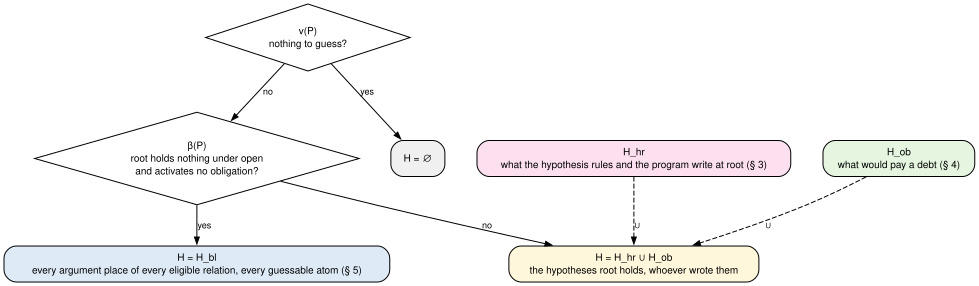
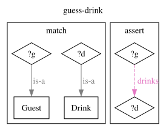
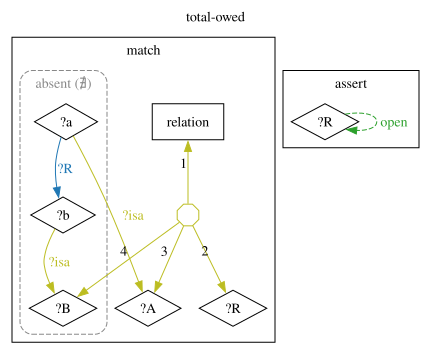
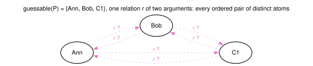

# Hypothesis generation: the writers that build H

Saturation decides what a program's facts and rules entail. What they leave undecided is guessed: a candidate, also
called a **hypothesis**, is a fact that a commitment may add, and the candidate set $H$, also called the
**universe**, is the set of them ([firing a rule](01-firing.md#two-layers) names both). Every node of the
answer's lattice is root with a subset of $H$ committed, so $H$ fixes what the answer can contain
([Solution semantics](06-solution-semantics.md) defines $R$ over it; [Finding R](07-finding-r.md) says why every
computation over it agrees).

This page defines $H$: a function of the program and of root's fixpoint. Root holds, under the relation
$\mathsf{open}$, what it owes and the facts it supposes, each written there by one of three **writers**, and $H$ is
the facts root supposes, whoever wrote them, less what root settles. How a program spells what the writers read is
[hypotheses](../../user/03-syntax-and-semantics/09-hypotheses.md) and
[obligations](../../user/03-syntax-and-semantics/08-obligations.md); how the engine that ships computes $H$, and
what holds it to this page, is [hypotheses and the answer, in code](../../ein.rs/08-reasoning-in-code/03-hypotheses-and-the-answer.md).

**The symbols.** $P$ is the program, $K_0$ its knowledge base as loaded, $\mathrm{root} = \operatorname{sat}(K_0)$,
and $\operatorname{st}(C) = \operatorname{sat}(\mathrm{root} \cup C)$ the state of a commitment $C \subseteq H$
([Solution semantics § 1](06-solution-semantics.md#1-the-vocabulary)). The stored negation $\lnot f$ of a fact $f$,
its relation $\operatorname{rel}(f)$, and the **held extent** of a relation $r$, the facts of $r$ that a state holds,
are [the knowledge base](../01-static-ir/01-knowledge-base.md#the-relation-its-extent-a-fact-of-it)'s;
$\operatorname{rels}(X)$ is the relations of the facts in $X$ ([saturation](02-saturation.md)). A rule's pattern
$\varphi$, its conclusion $\psi$ and its activators at root, $\operatorname{Act}_{\mathrm{root}}(\rho)$, are
[the rules](../01-static-ir/02-rewriting-rules.md#a-rule-declared)'.

## 1. When H is built

$$
\begin{aligned}
H &= \operatorname{gen}(P, \mathrm{root}) \\
\mathrm{root} &= \operatorname{sat}(K_0)
\end{aligned}
$$

**$H$ is proposed at root's fixpoint**: the program's facts saturated to quiescence by its rules, with nothing
hypothesised ([Q19](../../../decisions/hypotheses/Q19-hypotheses-are-proposed-at-a-fixpoint-after.md)). It is one
set, and every node is a subset of that one set: $\operatorname{gen}$ is applied to root and to no other state, so
nothing a node derives adds a candidate, and nothing is proposed before saturation has decided everything it can.
Every state holds the facts its own fixpoint supposes (§ 2); one that a state above root holds and root does not is
held there and proposed nowhere, and a program in which a state holds one is not monotone
([Q-M1f.573](../../../decisions/hypotheses/Q-M1f.573-under-open-a-relation-is-owed-and-a-fact.md),
[Q-M1f.574](../../../decisions/answer/Q-M1f.574-a-hypothesis-first-held-above-root-makes-its.md),
[Monotone and non-monotone programs § 3.1](08-monotonicity.md#31-what-it-reads)).

**No option changes $H$.** $\operatorname{gen}$ has two arguments, the program and root's fixpoint. Nothing a
computation is configured with is a third, so none reaches $H$, and with it none reaches $R$
([Q-M1e2.30](../../../decisions/answer/Q-M1e2.30-no-configuration-option-lever-or-flag-changes-r.md)).

**A program may state that there is nothing to guess.** Write $\nu(P)$ for that statement. It says the lattice is
root alone:

$$
\begin{aligned}
\nu(P) &\implies H = \emptyset \\
\nu(P) &\implies R =
\begin{cases}
\lbrace \emptyset \rbrace & \text{if } \operatorname{alive}(\mathrm{root}) \land \operatorname{discharged}(\mathrm{root}) \\
\emptyset & \text{otherwise}
\end{cases}
\end{aligned}
$$

It relaxes no conflict between the mechanisms of § 6
([Q-M1f.254](../../../decisions/hypotheses/Q-M1f.254-solve-no-search-relaxes-no-conflict.md)).

## 2. The union

**What a state holds under $\mathsf{open}$.** A state, root or a node, holds two kinds of fact under the relation
$\mathsf{open}$, read off its own fixpoint
([Q-M1f.566](../../../decisions/hypotheses/Q-M1f.566-what-a-state-owes-is-open-r-a-fact-and-open-f.md)):

- $\operatorname{open}(r)$, $r$ a relation, once, where the state owes an instance of an obligation that owes $r$
  (§ 4); a state that owes nothing holds none;
- $\operatorname{open}(f)$, $f$ a fact, a **hypothesis**: a fact the state supposes, which a commitment may add.

They are a part of the state that no extension inherits: a node's are those of its own fixpoint, so an
$\operatorname{open}(r)$ that a commitment pays is not held by the state that pays it, and no rule removes a fact.
Under $\mathsf{open}$ a relation is what is owed and a fact is a hypothesis
([Q-M1f.573](../../../decisions/hypotheses/Q-M1f.573-under-open-a-relation-is-owed-and-a-fact.md)). Write

$$
\operatorname{hyp}(S) = \lbrace\, f \;:\; \operatorname{open}(f) \in S,\ f \text{ a fact} \,\rbrace
$$

for the hypotheses a state $S$ holds. Three **writers** write them:

| writer | where it writes | what it writes |
|---|---|---|
| the **hypothesis rules** (§ 3) | wherever a rule's pattern matches | for each match, the fact its conclusion supposes; beside them, at root alone, the hypotheses the program states |
| the **obligations** (§ 4) | where an obligation is activated | the facts that would pay what the state owes, and what a commitment can bring it to owe |
| the **blind enumerator** (§ 5) | where root holds nothing under $\mathsf{open}$ and activates no obligation | every argument place of every eligible relation filled with every guessable atom |

Three things are read off the program and root:

| symbol | what it is |
|---|---|
| $\nu(P)$ | the program states that there is nothing to guess |
| $\operatorname{ActOb}(P)$ | the obligations **activated** at root: the pairs $(o, a)$ of an obligation rule $o$ and an activator $a \in \operatorname{Act}_{\mathrm{root}}(o)$ of its parameters, and $(o, ())$ for each obligation rule with no parameter (§ 4) |
| $\beta(P)$ | the blind enumerator writes: root holds no fact under $\mathsf{open}$ that the program, a hypothesis rule or an obligation wrote, and $\operatorname{ActOb}(P) = \emptyset$ |

$$
\operatorname{gen}(P, \mathrm{root}) \;=\;
\begin{cases}
\emptyset & \text{if } \nu(P) \\
H_{\mathrm{bl}} & \text{else if } \beta(P) \\
H_{\mathrm{hr}} \cup H_{\mathrm{ob}} & \text{otherwise}
\end{cases}
$$

A diamond is a condition on the program and on root's fixpoint, a box a set of candidates, and an arrow into the
union box a writer's share of it. The diagram is the definition and no more: no arrow is a step taken on a state
other than root.

**$H$ is the hypotheses root holds**, whoever wrote them, identical ones one fact, less what root settles
([Q-M1f.570](../../../decisions/hypotheses/Q-M1f.570-h-is-the-union-of-the-hypotheses-root-holds.md)):

$$
\lnot \nu(P) \implies H = \operatorname{unsettled}(\operatorname{hyp}(\mathrm{root}))
$$

Three things about the union decide what it means:

- **Neither writer overrides the other.** A program that says what to guess and what it owes has both in $H$: what
  an obligation proposes joins what a hypothesis rule does, and the obligation judges every state, whichever
  writer's candidates it commits to.
- **It is about what the program activates, not what root owes or what it loads.** $\operatorname{ActOb}(P)$ is
  defined by root holding an obligation's activator, whether or not root owes anything under it
  ([Q-M1f.243](../../../decisions/hypotheses/Q-M1f.243-an-obligation-is-read-as-activated-and-judged.md),
  [Q-M1f.308](../../../decisions/hypotheses/Q-M1f.308-an-obligation-activated-at-root-writes.md)). Under an
  activated obligation a root that owes nothing proposes nothing from it, and is complete because it is discharged;
  letting $H_{\mathrm{bl}}$ write wherever nothing was owed would make exhaustion, not discharge, decide when a state
  is finished, at exactly the states the obligation exists to judge. Every import brings its module whole,
  obligation rules among it ([Q-M1f.247](../../../decisions/imports/Q-M1f.247-every-import-brings-its-module-whole.md)):
  an obligation rule with parameters and no activator at root is in no pair of $\operatorname{ActOb}(P)$, so a
  module imported for another of its names leaves the facts of the program's own eligible relations (§ 5) to
  $H_{\mathrm{bl}}$, and a module imported for one rule gives the $H$ of that rule written out
  ([Q-M1f.249](../../../decisions/imports/Q-M1f.249-the-answer-does-not-depend-on-the-import-form.md)).
- **The blind enumerator writes beside nothing.** $\beta(P)$ is read off what root holds: a hypothesis rule that
  matches nothing at root keeps the blind enumerator off no more than one the program lacks
  ([Q-M1f.576](../../../decisions/hypotheses/Q-M1f.576-the-blind-enumerator-writes-only-where-root.md)). $H$ is
  never part of the blind enumerator's set and part of another writer's.

**Every writer's candidate is a fact root does not settle.** Each writer first forms its **proposals**, a set
$\Pi$ of facts, and $H$ is what of them root leaves open:

$$
\operatorname{unsettled}(\Pi) = \lbrace\, f \in \Pi \;:\; f \notin \mathrm{root} \land \lnot \operatorname{denies}(\mathrm{root}, f) \,\rbrace
$$

where root **denies** $f$ when it holds a fact that holds $f$ as its one argument, beside which a rule of the program
refutes $f$: $\lnot f$, where the program takes the contradiction's rules
([saturation](02-saturation.md#the-agenda-the-order-rules-fire-in)). Where no rule refutes the pair, a stored
negation settles nothing.

$H$ is a set: a fact proposed twice is in it once, and what the answer depends on is which candidates it holds.

## 3. The hypothesis rules: what the program says to guess

A **hypothesis rule** $h$ is a rule whose conclusion holds a **hypothesis**: a fact pattern $\psi_h$ under
$\mathsf{open}$, which supposes the fact it makes rather than adding it to the knowledge base it matches in. Beside
its hypotheses the conclusion may hold facts, which are a rewriting rule's
([Q-M1f.575](../../../decisions/language/Q-M1f.575-open-r-is-a-rules-whole-assert-and-open-f-stands.md);
[the rules](../01-static-ir/02-rewriting-rules.md#the-kinds-of-rule) has the kinds of rule). A hypothesis is one
fact: $\mathsf{open}$ holds no conjunction, and a rule that supposes several facts holds several hypotheses
([Q-M1f.271](../../../decisions/language/Q-M1f.271-a-hypothesis-is-one-fact.md)). A hypothesis rule is a rule
like any other, and there is no other way to say what to guess
([Q-M1f.567](../../../decisions/hypotheses/Q-M1f.567-a-hypothesis-rule-is-a-rule-that-concludes-open.md)). Write
$\varphi_h$ for the pattern, and $\varphi_h(a, \theta)$ and $\psi_h(a, \theta)$ for $\varphi_h[a]\theta$ and
$\psi_h[a]\theta$. It is **active** under the activators $\operatorname{listed}(h)$, as any rule is: the empty one where $h$ has no
parameter, and otherwise each activator root holds, $\operatorname{Act}_{\mathrm{root}}(h)$, a fact the program
states or a rule derives. A conclusion may point at a fact, and then
so does the candidate; a commitment that holds such a candidate holds it and nothing it points at
([the knowledge base](../01-static-ir/01-knowledge-base.md#a-context-gives-a-fact-no-truth)). At root it
writes, for each activator $a$ and each match $\theta$ of its pattern, the fact its hypothesis makes, and beside them
root holds the hypotheses the program states, $\Pi_P$, which no other state holds:

$$
\begin{aligned}
\Pi_{\mathrm{hr}} &= \lbrace\, \psi_h(a, \theta) \;:\; h \in \operatorname{Hr}(P), \ a \in \operatorname{listed}(h), \ \mathrm{root} \models \varphi_h(a, \theta) \,\rbrace \ \cup\ \Pi_P \\
H_{\mathrm{hr}} &= \operatorname{unsettled} \big( \lbrace\, f \in \Pi_{\mathrm{hr}} \;:\; \operatorname{rel}(f) \notin \lbrace \operatorname{eq}, \operatorname{neq} \rbrace \,\rbrace \big)
\end{aligned}
$$

with $\operatorname{Hr}(P)$ the hypothesis rules of the program.

An instance of equality or of inequality is no candidate, since a state stores neither
([Q-M1f.32](../../../decisions/hypotheses/Q-M1f.32-an-eq-or-neq-instance-is-no-hypothesis.md)), and a
hypothesis rule whose pattern reads a stored negation reads the state it is matched in, root's for $H$
([Q-M1f.129](../../../decisions/engine/Q-M1f.129-a-rule-that-concludes-a-hypothesis-and-reads-not.md)).

A hypothesis rule is drawn as any rule is, its pattern beside its conclusion. This one says *guess, for each guest
and each drink, that the guest drinks it*:

The drawing folds each fact pattern of three arrows into a labelled arrow
([the knowledge base](../01-static-ir/01-knowledge-base.md#drawn-with-labelled-arrows)): a diamond is a variable, a
box an atom, a solid arrow a premise, a fact the pattern must find. The fact the rule proposes is dashed, an
octagon with its arrows, in the frame of the fact of $\mathsf{open}$ that holds it, drawn as the dashed loop *open*:
the fact is pointed at and not asserted, as a fact under any other fact is. A root that holds one guest and two drinks gives

$$
\begin{aligned}
\varphi_h(g, d) &= \operatorname{is-a}(g, \mathsf{Guest}) \land \operatorname{is-a}(d, \mathsf{Drink}) \\
\psi_h(g, d) &= \operatorname{drinks}(g, d) \\
\Pi_{\mathrm{hr}} &= \lbrace \operatorname{drinks}(\mathsf{Ann}, \mathsf{Tea}), \ \operatorname{drinks}(\mathsf{Ann}, \mathsf{Milk}) \rbrace
\end{aligned}
$$

and these, with a second rule's $\operatorname{vegan}(\mathsf{Ann})$, are the universe of the first drawing of
[Solution semantics § 1.5](06-solution-semantics.md#15-commitment-node-state).

**The hypothesis rules write beside the obligations.** What a hypothesis rule proposes joins what an obligation
does (§ 2), and the scoping of § 6 filters none of it: a scoping that disagrees with it makes the text no program. A
program that says what to guess is never second-guessed by the blind enumerator, wherever a rule of it matches at
root.

**A hypothesis rule's hypotheses are each state's own**, read off its fixpoint, and what it proposes is what its
pattern finds at root:

$$
\operatorname{st}(C) \models \varphi_h(a, \theta) \ \land\ \mathrm{root} \not\models \varphi_h(a, \theta) \implies \psi_h(a, \theta) \text{ is in no candidate on this account}
$$

A match only a node's state would have is held there and proposes nothing, since $H$ is root's; a state that holds
a hypothesis root does not makes the program not monotone
([Q-M1f.574](../../../decisions/answer/Q-M1f.574-a-hypothesis-first-held-above-root-makes-its.md)), and a hypothesis
rule whose pattern reads a relation whose held extent a commitment can change, where growing it adds a match, is a
site of the static check ([Monotone and non-monotone programs § 3.1](08-monotonicity.md#31-what-it-reads)).

## 4. The obligations: what would pay a debt

### 4.1 An instance, and the facts that would pay it

An **obligation** is a declaration with a rule's parts that is no rewriting rule: it adds no fact to the knowledge
base it matches in during saturation ([the rules](../01-static-ir/02-rewriting-rules.md#by-its-conclusion)). Its
whole conclusion is $\operatorname{open}(r)$, the fact that the held extent of a relation is incomplete, and its
pattern is the requirement's guard
([Q-M1d.2](../../../decisions/hypotheses/Q-M1d.2-an-obligation-is-a-rule-that-concludes-open-r.md)). The relation the
fact names is the one the obligation **owes**: what is owed is a fact of it. A state that owes an instance of it
holds $\operatorname{open}(r)$ (§ 2), once however many instances over $r$ it owes, and a
state that owes nothing under it holds none: the count is of the instances, and the fact carries none of them
([satisfiability § 1.1](10-satisfiability.md#11-which-conclusion-a-fork-may-inherit)). The guard of $o$ under an activator
$a$ has two parts, a **trigger** $T_o$, which says who is owed, and one absence, over the **witness** $W_o$:

$$
\begin{aligned}
\operatorname{owes}(o, a, \theta, S) &\iff S \models T_o(a, \theta) \ \land\ \lnot \exists \bar{y}.\ S \models W_o(a, \theta, \bar{y}) \\
W_o(a, \theta, \bar{y}) &= \Delta_o(a, \theta, \bar{y}) \land w_o(a, \theta, \bar{y})
\end{aligned}
$$

$w_o$ is the **witness step**, the one premise that binds $\bar{y}$, a fact pattern of the owed relation, and
$\Delta_o$, the rest of the absence, is the **domain** of the debt. An **instance** is a triple $(o, a, \theta)$ with
$\mathrm{root} \models T_o(a, \theta)$, and it is **owed** at a state $S$ while $\operatorname{owes}(o, a, \theta, S)$
holds, that is, while no witness is there.

The obligation *every member of the first label has an image in the second* is drawn by the engine with its absence
as a dashed cluster:

It folds each fact pattern of three arrows as the drawing above does, and each of two into a labelled loop. Outside the dashed cluster is the trigger:
the octagon of four arrows, the first at $\mathsf{relation}$, declares $r$ with the labels $A$ and $B$, and $x$ is a
member of $A$. Inside it is the witness: the arrow labelled with the relation, a fact pattern of it, is the witness
step, and the membership of $y$ in $B$ beside it is the domain. The dashed loop in the lower panel is the
verdict, a fact of $\mathsf{open}$, on the relation whose facts would pay, which a state that owes holds. In formulas, with the rule's two parameters bound by the activator to a relation
$r$ and to a membership relation $\operatorname{isa}$:

$$
\begin{aligned}
T(x) &= \operatorname{relation}(r, A, B) \land \operatorname{isa}(x, A) \\
\Delta(x, y) &= \operatorname{isa}(y, B) \\
w(x, y) &= r(x, y)
\end{aligned}
$$

**The facts that would pay an owed instance are read off its own guard**, the domain kept and the witness step left
out:

$$
\operatorname{pay}(o, a, \theta) = \lbrace\, w_o(a, \theta, \bar{y}) \;:\; \mathrm{root} \models \Delta_o(a, \theta, \bar{y}) \,\rbrace
$$

For the obligation above, $\operatorname{pay} = \lbrace r(x, y) : \mathrm{root} \models \operatorname{isa}(y, B) \rbrace$. Nothing
restates the domain: the set of payments is the guard, read at root, and nothing stores it
([Q-M1d.3](../../../decisions/hypotheses/Q-M1d.3-an-obligation-needs-no-closed-domain.md)). An obligation whose guard
does not say which premise is the witness step, none or two of them, is no obligation where that does not depend on the
activator, and proposes nothing where it does (§ 4.3).

**Read off a root.** One guest, two chairs, two drinks; the guest is owed a chair and a drink, each of the two
relations is stated functional, and a stated fact says nobody at the first chair drinks milk. Root's facts are the
solid arrows below, each a fact of three arrows folded into a labelled arrow, and the dotted arrows are the four
payments:

A box is an atom, a solid arrow a stated fact, a fact of $\operatorname{is-a}$ as any other, and a dotted arrow a
payment, a fact root does not hold. Root
owes two instances, $I_{\mathrm{s}}$, *the guest has a chair*, and $I_{\mathrm{d}}$, *the guest has a drink*, and

$$
\begin{aligned}
\operatorname{pay}(I_{\mathrm{s}}) &= \lbrace \operatorname{seats}(\mathsf{Ann}, \mathsf{C1}), \ \operatorname{seats}(\mathsf{Ann}, \mathsf{C2}) \rbrace \\
\operatorname{pay}(I_{\mathrm{d}}) &= \lbrace \operatorname{drinks}(\mathsf{Ann}, \mathsf{Tea}), \ \operatorname{drinks}(\mathsf{Ann}, \mathsf{Milk}) \rbrace
\end{aligned}
$$

No dotted arrow joins a chair to a drink or the guest to a label: a payment is a fact the guard admits, and the guard
admits a chair for the guest and nothing else.

### 4.2 H is the union

$$
\begin{aligned}
\Pi_{\mathrm{ob}} &= \bigcup_{(o, a, \theta) \,\in\, \operatorname{Owed}(\mathrm{root})} \operatorname{pay}(o, a, \theta) \ \cup\ \Pi^{+} \\
H_{\mathrm{ob}} &= \operatorname{unsettled}(\Pi_{\mathrm{ob}})
\end{aligned}
$$

**What the obligations write is the union, over the owed instances, of the facts that would pay each**, with the
payments $\Pi^{+}$ of the debts root is not told of (§ 4.4). The scoping of § 6 filters none of it: a scoping that
disagrees with what root holds under $\mathsf{open}$ makes the text no program. In the drawing above $H_{\mathrm{ob}}$
is the four dotted arrows.

One instance's payments are jointly exhaustive: the obligation says some witness must hold, so every member of $R$
above a state that owes the instance holds one of them,

$$
C \in R \ \land\ \operatorname{owes}(o, a, \theta, \mathrm{root}) \ \implies\ \operatorname{cl}(C) \cap \operatorname{pay}(o, a, \theta) \neq \emptyset
$$

under the conditions [Satisfiability § 4](10-satisfiability.md) states. But $H$ is one set, the lattice's, so the
obligations propose every instance's payments together, of which each instance's own set is a subset. A
computation that branches on one instance at a time reads that instance's alternatives inside $H$
([Finding R § 4](07-finding-r.md#4-a-monotone-program-three-properties-and-the-licences)); nothing is lost by the
union, and nothing outside it is proposed.

### 4.3 Where the payments can grow

A choice among an instance's payments is exhaustive only while the set of them cannot grow beneath it. Where it
could, **the obligation still writes what root's guard gives**, as every obligation does, and the program is not
monotone: nothing is claimed of its answer
([Q-M1e2.10](../../../decisions/hypotheses/Q-M1e2.10-an-obligation-whose-domain-can-grow-writes.md),
[Q-M1f.579](../../../decisions/hypotheses/Q-M1f.579-an-obligation-whose-guard-or-trigger-reads-what.md)).

**The relations whose held extent a commitment can change**, $D^{+}$, are read off the rules, with no state
consulted. For a set $X$ of relations, $D^{+}(X)$ is the fixpoint of
[absence](03-absent-and-naf.md#a-refutation-resting-on-an-absent) seeded with $X$, which is the least set that holds
$X$ and is closed under the rules that derive:

$$
D^{+}(X) = \text{the least } D \supseteq X \text{ such that } \ \forall \rho.\ \ \operatorname{reads}(\rho) \cap D \neq \emptyset \implies \operatorname{concludes}(\rho) \subseteq D
$$

where $\rho$ ranges over the rules that derive, $\operatorname{reads}(\rho)$ is the relations whose facts its pattern
reads, with the relation its activators are facts of, and $\operatorname{concludes}(\rho)$ the relations of the facts
it concludes. It is at relation grain: a relation is in or out whole, whatever its facts.

An obligation's payments can grow where its trigger, or its guard beside its witness step, reads facts of a
relation whose held extent a commitment can change, the relations of $H$ among them:

$$
\operatorname{grows}(o) \iff \big( \operatorname{rels}(T_o) \cup \operatorname{rels}(\Delta_o) \big) \cap D^{+}(\operatorname{rels}(H)) \neq \emptyset
$$

A member of a domain that only a commitment derives, or that a payment of another debt adds, is in no payment read
at root, and an $H$ built from root's reading can lack the model that member licenses. Such an obligation does not
step aside for another writer, since no writer reads a domain it cannot see. It is a site of the static check, by
its trigger or by its guard ([Monotone and non-monotone programs § 3.1](08-monotonicity.md#31-what-it-reads)), so
the program is answered and warned of, and nothing is claimed of its answer. The reading is at relation grain, so
a program whose root already has that member is flagged too.

**Where no payment can be formed.** An activated obligation whose witness step does not resolve under its activator
has no payment to propose. The obligations then propose nothing at root, and the blind enumerator does not write
beside an activated obligation (§ 2), so the instances stay owed, and are reported as owed:

$$
\lnot \nu(P) \ \land\ \text{every witness step resolves} \implies \forall I \in \operatorname{Owed}(\mathrm{root}). \ \operatorname{unsettled}(\operatorname{pay}(I)) \subseteq H
$$

and where $\operatorname{grows}(o)$ this is all that is claimed of $o$: a payment only a node's domain holds is in no
candidate, which is why such a program is flagged.

### 4.4 A debt root is not told of

An obligation's activator is an ordinary fact, so a rule can derive one at a node, and that node owes what root never
did. **The obligations also propose, at root, what such a debt would**, read off the rules alone
([Q-M1e.11](../../../decisions/hypotheses/Q-M1e.11-h-holds-what-a-debt-only-a-commitment-brings.md)). For a set $D$
of relations:

$$
\begin{aligned}
\operatorname{ActOb}^{+}_{D} = \lbrace\, (o, \alpha) \;:\;\ & \alpha \text{ is a conclusion with no variable, of a rule } \rho \text{ with } \operatorname{reads}(\rho) \cap D \neq \emptyset \\
\land\ & \alpha \text{ activates } o \\
\land\ & \alpha \notin \mathrm{root} \,\rbrace \\
\Pi^{+}_{D} = \bigcup \lbrace\, \operatorname{pay}(o, \alpha, \theta) \;:\;\ & (o, \alpha) \in \operatorname{ActOb}^{+}_{D} \\
\land\ & \mathrm{root} \models T_o(\alpha, \theta) \\
\land\ & \lnot \exists \bar{y}.\ \mathrm{root} \models W_o(\alpha, \theta, \bar{y}) \,\rbrace
\end{aligned}
$$

1. $\operatorname{ActOb}^{+}_{D}$ is the **activators a commitment can derive**: each conclusion that holds no
   variable and would activate an obligation rule, in a rule that reads facts of a relation whose held extent a
   commitment can change, or is activated by a fact of one;
2. $\Pi^{+}_{D}$ is, for each such activator root does not hold, **the obligation's own reading at root**: the instances
   the obligation would owe there were it activated, each paid as § 4.1 pays a debt root owes;
3. a candidate that is a fact of a new relation widens what a commitment can change, so **the two are taken to
   their least fixpoint**:

$$
\begin{aligned}
X_0 &= \operatorname{rels} \Big( \bigcup_{I \in \operatorname{Owed}(\mathrm{root})} \operatorname{pay}(I) \Big) \\
X_{i+1} &= X_i \cup \operatorname{rels} \big( \Pi^{+}_{D^{+}(X_i)} \big) \\
\Pi^{+} &= \Pi^{+}_{D^{+}(X_\infty)} \\
\operatorname{ActOb}^{+}(P) &= \operatorname{ActOb}^{+}_{D^{+}(X_\infty)}
\end{aligned}
$$

The sequence is increasing in a finite set of relations, so it is constant from some $i$ on.

The reading is **at relation grain and inexact both ways**:

- *over*: a rule that reads what a commitment can change need fire at no alive node, and $H$ then holds a candidate
  for a debt no node owes, which a state of $R$ holds wherever nothing refutes it;
- *under*: an activator its rule writes with a variable is not in $\operatorname{ActOb}^{+}$, and the node that derives
  it owes what no candidate pays.

A program this reading adds a candidate to derives an activator from a commitment, so it is not proved monotone
([Monotone and non-monotone programs](08-monotonicity.md)), and its answer is the whole lattice's.

### 4.5 Stuck: owing, with every payment settled

A payment root denies is settled, and is no candidate. A root is **stuck** where it owes an instance whose
payments can be formed and of which root leaves none open:

$$
\operatorname{stuck}(P) \iff \exists I \in \operatorname{Owed}(\mathrm{root}).\ \ \operatorname{unsettled}(\operatorname{pay}(I)) = \emptyset
$$

On a monotone program every witness a state above root holds is a payment read at root (§ 4.3), so a state that
paid such an instance would hold a payment beside what of root denies it, and be dead; no alive state discharges the
instance, whatever another writer proposes:

$$
\begin{aligned}
\operatorname{stuck}(P) &\implies R = \emptyset \\
\operatorname{stuck}(P) \land \operatorname{alive}(\mathrm{root}) &\implies \forall C.\ \operatorname{alive}(C) \implies \operatorname{owes}(C) > 0
\end{aligned}
$$

the kind of empty $R$ where alive states exist and every one owes. An empty $H_{\mathrm{ob}}$ is not that by itself:
where no payment of an owed instance can be formed (§ 4.3), a hypothesis rule's candidates may pay it, and $R$ is
what the union of § 2 gives. A scoping
that would take out the relation an obligation owes cannot make a state stuck: such a program is no program (§ 6,
[Q-M1f.244](../../../decisions/hypotheses/Q-M1f.244-an-obligated-relations-held-extent-is-not-closed.md),
[Q-M1f.578](../../../decisions/hypotheses/Q-M1f.578-the-two-lists-and-a-closure-configure-the-blind.md)).

### 4.6 What the obligations leave to saturation

**What the obligations propose is exhaustive where they and saturation between them decide every fact root leaves
undecided.** Let
$\operatorname{Elig}(P)$ be the relations the blind enumerator would propose facts of (§ 5). They split in two:

$$
\operatorname{Elig}(P) = \underbrace{ \lbrace\, r : \text{some obligation of } \operatorname{ActOb}(P) \text{ owes } r \,\rbrace }_{\text{covered}} \ \uplus\ \operatorname{Uncov}(P)
$$

Where $\operatorname{Uncov}(P) = \emptyset$ the obligations are exhaustive by construction: every fact a hypothesis could be
about is one some debt can be paid with. Where it is not, the claim rests on saturation deciding the facts of the
uncovered relations: a hypothesised fact of a relation of which no rule concludes a fact can never be confirmed, and
the facts of a relation that the program's rules derive from what the obligations settle are decided by them.

The Zebra puzzle is a program of the first kind. Stated with a hypothesis rule that guesses where each thing is, and
stated with no hypothesis rule and each of its attribute relations stated a bijection, which owes every arrow of
each, it has the same $H$ from either writer, and so the same $R$; the relations no obligation names are closed to
hypotheses (§ 6) or have their facts derived.
Whichever writers built $H$, the answer names the relations the program can conclude or ask about of which $H$ holds no
fact: $R$ holds of them only what the program states and saturation derives
([Satisfiability § 5](10-satisfiability.md)).

## 5. The blind enumerator

Where root holds nothing under $\mathsf{open}$ that the program, a hypothesis rule or an obligation wrote, and
activates no obligation, $\beta(P)$ (§ 2), **every argument place of every eligible relation is filled with every
guessable atom**, and the program's own rules prune what is wrong
([Q-M1f.576](../../../decisions/hypotheses/Q-M1f.576-the-blind-enumerator-writes-only-where-root.md)). Its guesses are
written under $\mathsf{open}$ as any writer's are.

**The guessable atoms**, $\operatorname{guessable}(P)$, are the names of the program
([the rules](../01-static-ir/02-rewriting-rules.md#the-program-and-its-names);
[Q-M1e.21](../../../decisions/hypotheses/Q-M1e.21-a-rule-brings-in-no-name.md),
[Q-M1e2.9](../../../decisions/language/Q-M1e2.9-a-programs-names-are-the-constants-its-facts.md)), less four
kinds of atom, each left out by its name
([Q-M1f.306](../../../decisions/hypotheses/Q-M1f.306-the-guessable-atoms-are-the-programs-names-never.md)):

$$
\operatorname{guessable}(P) = \operatorname{names}(P) \setminus \big( \operatorname{labels}(P) \cup \operatorname{Kw} \cup \operatorname{Res} \cup \operatorname{RelNames}(P) \big)
$$

- $\operatorname{names}(P)$ reads every depth, so an atom under an arrow of a fact that is only in a context
  ([the knowledge base](../01-static-ir/01-knowledge-base.md#the-global-context-and-the-context-of-a-fact)) is a
  name of the program and may be guessable. A fact is never one: every guessable object is an atom, so no
  candidate the enumerator proposes points at a fact. And a fact that root only points at has no place of its
  own for that: it is a candidate exactly where any fact of its relation over the guessable atoms is;
- $\operatorname{labels}(P)$ is the labels, the atoms a relation's declaration writes for its argument places
  ([the knowledge base](../01-static-ir/01-knowledge-base.md#what-is-where));
- $\operatorname{Kw}$ is the seven words of the rule language, *not*, *false*, *and*, *or*, *absent*, *equal* and
  *unequal*, whether or not a program writes one as an argument;
- $\operatorname{Res}$ is the reserved marker of the kernel, *closed*
  ([reserved names](../../user/04-reference/03-reserved-names.md) has its spelling): never guessable, neither where
  a rule derives a fact of it nor where a program writes it as an argument, which stays legal and keeps it a name
  of the program. So a marker's fact stated by the program and the same fact derived by a rule give one $H$ and one
  $R$;
- $\operatorname{RelNames}(P)$ is $\operatorname{rels}(P)$, the relations of the program
  ([saturation](02-saturation.md#the-alive-set-invariant)): every atom it writes first in a tuple, at any depth,
  the relation of a fact, of a fact inside one, of a rule's premise or conclusion, and the atom an activator gives a
  parameter that stands first in a pattern, and every atom it declares as a relation
  ([Q-M1f.522](../../../decisions/language/Q-M1f.522-a-relation-of-the-program-is-any-atom-it-writes.md)); with
  them, every atom that names a rule or an obligation
  ([Q-M1f.226](../../../decisions/hypotheses/Q-M1f.226-an-obligations-name-is-no-guessable-atom.md)). So **no
  relation is a guessable atom**, a relation whose facts only a rule concludes among them, and no candidate has a
  relation as an argument ([solution semantics § 1.4](06-solution-semantics.md#14-candidate-and-universe)).

Since every atom a rule writes under an argument arrow is a name of the program, guessable unless it is of the four
kinds, no rule can bring a name into a state that the program and $H$ lack: the **alive-set invariant** holds of
every program by construction ([saturation](02-saturation.md#the-alive-set-invariant)).

**The eligible relations** are those the program declares with labels and does not scope out (§ 6);
$\operatorname{ar}(r)$ is the number of a declared relation's labels, the count of arguments of every fact of it
([the knowledge base](../01-static-ir/01-knowledge-base.md#the-count-of-arguments)):

$$
\operatorname{Elig}(P) = \lbrace\, r \;:\; r \text{ is declared with labels} \ \land\ \operatorname{inscope}(r) \,\rbrace
$$

**The candidates**:

$$
\begin{aligned}
\Pi_{\mathrm{bl}} =\ & \lbrace\, r(x) \;:\; r \in \operatorname{Elig}(P),\ \operatorname{ar}(r) = 1, \ x \in \operatorname{guessable}(P) \,\rbrace \\
\cup\ & \lbrace\, r(x, y) \;:\; r \in \operatorname{Elig}(P),\ \operatorname{ar}(r) = 2, \ x, y \in \operatorname{guessable}(P),\ x \neq y \,\rbrace \\
H_{\mathrm{bl}} =\ & \operatorname{unsettled}(\Pi_{\mathrm{bl}})
\end{aligned}
$$

| arguments | candidates |
|---|---|
| 1 | $r(x)$ for every guessable atom $x$ |
| 2 | $r(x, y)$ for every two distinct guessable atoms: no fact of an atom with itself |
| 3 or more | none: no fact of such a relation is in the universe, and the answer names the relation |

For $k$ guessable atoms, $p$ eligible relations of one argument and $q$ of two,
$\lvert \Pi_{\mathrm{bl}} \rvert = p\,k + q\,k\,(k - 1)$.

Three guessable atoms and one relation of two arguments give the six dotted arrows, each a candidate of three arrows
folded into an arrow labelled with its relation: both directions between every two, whatever the labels the
relation's declaration writes.

**The enumerator holds no argument to a label**
([Q-M1e.12](../../../decisions/hypotheses/Q-M1e.12-the-blind-enumerator-is-untyped.md)). No object has a
type ([the knowledge base](../01-static-ir/01-knowledge-base.md#the-relation-its-extent-a-fact-of-it)), and the
enumerator gives a label no meaning of its own: a candidate the program's labels would speak against is killed by the
program's own rules, or stays in $R$ where none rejects it. An atom a declaration writes as a label is not guessable,
so a program whose facts use an atom as a label and whose declarations write it nowhere is under-specified, and it is
answered as written: beside $\operatorname{is-a}(\mathsf{Red}, \mathsf{Color})$ and a relation
$\operatorname{co-located}$ of two arguments with one label, $\operatorname{co-located}(\mathsf{Blue}, \mathsf{Color})$
is a candidate. The program's way out is its declaration.

## 6. Scoping, and the mechanisms judged together

A program steers what a commitment may be about by five declarations: a hypothesis rule, an obligation, two lists of
relations, $L^{+}$ (*only these*, where the program states one) and $L^{-}$ (*never these*), and a **closure** of a
relation $r$: a fact about $r$ under the reserved marker of closure
([the reserved atoms](../01-static-ir/01-knowledge-base.md#the-reserved-atoms)), stated or derived, which **closes
the held extent of $r$ to hypotheses**: no commitment adds a hypothesised fact of $r$. A relation root's fixpoint
holds a closure of is **closed to hypotheses**, and $\operatorname{Closed}$ is the set of them. **The three scopings
configure the blind enumerator alone**, a white list, a black list and the closures
([Q-M1f.578](../../../decisions/hypotheses/Q-M1f.578-the-two-lists-and-a-closure-configure-the-blind.md)):

$$
\begin{aligned}
\operatorname{inscope}(r) \iff\ & \big( L^{+} \text{ is not stated} \lor r \in L^{+} \big) \\
\land\ & r \notin L^{-} \\
\land\ & r \notin \operatorname{Closed}
\end{aligned}
$$

and no fact of a relation out of scope is one of its candidates. They filter nothing a hypothesis rule or an
obligation writes: beside what root holds under $\mathsf{open}$ a scoping either agrees with it, and says nothing,
or disagrees with it, and the text is no program.

**The declarations do not contradict what root holds, nor one another**, judged on root's fixpoint
([Q-M1f.245](../../../decisions/hypotheses/Q-M1f.245-the-hypothesis-mechanisms-are-judged-at-load-on.md)). A fact
under $\mathsf{open}$ is **of** the relation it owes, $\operatorname{open}(r)$, or of its hypothesis's,
$\operatorname{open}(f)$; let $\operatorname{Op}$ be the relations the facts root holds under $\mathsf{open}$ are of:

$$
\operatorname{Op} = \lbrace\, r \;:\; \operatorname{open}(r) \in \mathrm{root} \,\rbrace \ \cup\ \operatorname{rels}(\operatorname{hyp}(\mathrm{root}))
$$

An obligation that owes nothing at root writes nothing there, and disagrees with nothing
([Q-M1f.243](../../../decisions/hypotheses/Q-M1f.243-an-obligation-is-read-as-activated-and-judged.md)). A text is a
program only if none of these holds:

| a declaration that says the opposite of what root holds, or of another | as a condition |
|---|---|
| a closure of a relation root holds a fact under $\mathsf{open}$ of ([Q-M1f.244](../../../decisions/hypotheses/Q-M1f.244-an-obligated-relations-held-extent-is-not-closed.md)) | $\operatorname{Op} \cap \operatorname{Closed} \neq \emptyset$ |
| $L^{-}$ names a relation root holds a fact under $\mathsf{open}$ of | $\operatorname{Op} \cap L^{-} \neq \emptyset$ |
| $L^{+}$, beside the facts root holds under $\mathsf{open}$, names other relations than theirs | $\operatorname{Op} \neq \emptyset$, $L^{+}$ is stated, and $L^{+} \neq \operatorname{Op}$ |
| a relation is in both lists, or in $L^{+}$ and closed to hypotheses | $L^{+} \cap L^{-} \neq \emptyset$, or $L^{+} \cap \operatorname{Closed} \neq \emptyset$ |

The first three are about a generator that does not run beside what root holds under $\mathsf{open}$: a list or a
closure that says otherwise of those facts says what the program does not do. A hypothesis rule beside an obligation
is no conflict: both write, and the obligation judges. Where root holds nothing under $\mathsf{open}$, a name of
$L^{-}$ that another declaration already takes out contradicts nothing and filters nothing: it is remarked on and
changes nothing
([Q-M1f.242](../../../decisions/hypotheses/Q-M1f.242-a-list-that-only-repeats-what-another.md)). The
refusals and the remarks, each worded, are the [diagnostics](../../user/04-reference/07-diagnostics.md)'.

## 7. What H does not depend on

- **The import form.** A program has the same $H$ with its imports selective, whole or aliased, written by the
  same writers
  ([Q-M1f.249](../../../decisions/imports/Q-M1f.249-the-answer-does-not-depend-on-the-import-form.md)).
- **How a closure is stated.** A closure a rule derives and one a program states close the held extent of the same
  relation to hypotheses and give one $H$ and one $R$: $\operatorname{Closed}$ is read on root's fixpoint.
- **Any option** (§ 1).
