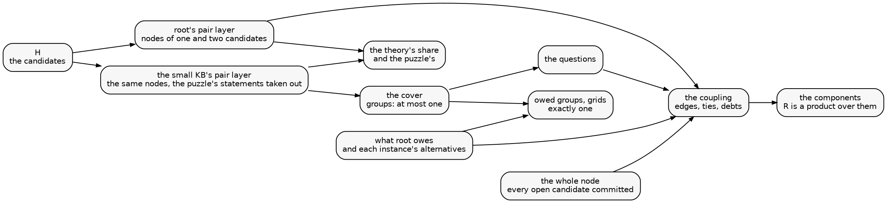
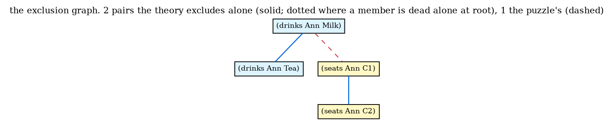
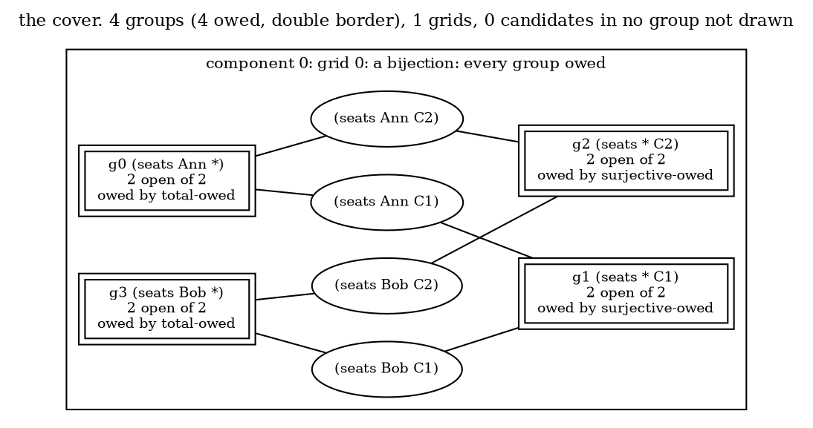
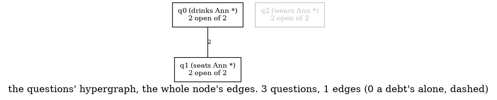

# The hypothesis space and its structure

A program's **hypothesis space** is the lattice of its commitments with the function that gives each its state,

$$
\big( 2^{H}, \subseteq \big), \qquad \operatorname{st} : 2^{H} \to \text{states}, \quad \operatorname{st}(C) = \operatorname{sat}(\mathrm{root} \cup C)
$$

together with the **structure** of the candidate set $H$: what $H$ looks like from inside. This page defines the
structure: which candidates rule each other out, which of that the rules alone decide, which candidates answer one
question, where exactly one of them must hold, and which questions bear on each other. Every object is a statement
about nodes of the lattice, by the one node function every computation of the answer uses, so none is a second
semantics. **Nobody declares it**: no object below is read off a relation's name, its arguments or a declaration of
it.

The answer the structure is *of* is the region $R$ ([Solution semantics](06-solution-semantics.md)), and the set it
is the structure of is built by the ladder ([Hypothesis generation](04-hypothesis-generation.md)). The structure
moves no answer ([Q-M1f.309](../../../decisions/cli/Q-M1f.309-ein-render-h-space-shows-the-hypothesis-space.md)): it
is a set of true statements about $R$'s lattice, and $R$ is defined without it.

**The symbols.** $\operatorname{dead}$, $\operatorname{alive}$, $\operatorname{cl}$, $N$ and $\operatorname{Owed}$
are those of [Solution semantics § 1.5](06-solution-semantics.md#15-commitment-node-state) and § 2.4, each read on a
commitment through $\operatorname{st}$. $H$ is listed in the order of its candidates as written, so no object below
depends on how an implementation numbers them.

An arrow reads *is defined from*. The sections below follow the picture from left to right.

---

## The objects

### One candidate, and two: the pair layer

What the nodes of one candidate and of two decide. For $a, b \in H$, $a \neq b$:

$$
\begin{aligned}
\operatorname{atroot}(a) &\iff a \in \mathrm{root} \\
\operatorname{deadalone}(a) &\iff \operatorname{dead}(\lbrace a \rbrace) \\
a \rightarrow b &\iff \operatorname{alive}(\lbrace a \rbrace) \,\land\, b \in \operatorname{cl}(\lbrace a \rbrace) \\
a \leftrightarrow b &\iff \operatorname{alive}(\lbrace a \rbrace) \,\land\, \operatorname{alive}(\lbrace b \rbrace) \,\land\, \operatorname{cl}(\lbrace a \rbrace) = \operatorname{cl}(\lbrace b \rbrace) \\
a \mathrel{\#} b &\iff \operatorname{alive}(\lbrace a \rbrace) \,\land\, \operatorname{alive}(\lbrace b \rbrace) \,\land\, a \not\rightarrow b \,\land\, b \not\rightarrow a \,\land\, \operatorname{dead}(\lbrace a, b \rbrace) \\
a \bowtie b &\iff \operatorname{alive}(\lbrace a, b \rbrace) \,\land\, \operatorname{st}(\lbrace a, b \rbrace) \not\subseteq \operatorname{st}(\lbrace a \rbrace) \cup \operatorname{st}(\lbrace b \rbrace)
\end{aligned}
$$

| object | read from | in words |
|---|---|---|
| **at root** | root's fixpoint | root already holds the candidate: committing it commits nothing |
| **dead alone** | the node $\lbrace a \rbrace$ | it is dead |
| **implies**, $a \rightarrow b$ | the node $\lbrace a \rbrace$, alive | $b$ is in its closure: committing $a$ brings $b$ |
| **equivalent**, $a \leftrightarrow b$ | two alive single nodes | one closure |
| **excludes**, $a \mathrel{\#} b$ | the node $\lbrace a, b \rbrace$, each alive alone, neither implying the other | it is dead |
| **interacts**, $a \bowtie b$ | the same node, alive | its state holds a fact that neither $\lbrace a \rbrace$'s nor $\lbrace b \rbrace$'s does |

The excluded pairs are the minimal dead sets of two candidates:

$$
X \;=\; \lbrace\, \lbrace a, b \rbrace : a \mathrel{\#} b \,\rbrace \;=\; \lbrace\, D \in N : \lvert D \rvert = 2 \,\rbrace
$$

**A candidate's mark** is what root says of it alone: *at root*, *dead alone*, or *alive alone*. A candidate alive
alone is **open**, and $H^{\mathrm{o}} = \lbrace a \in H : \operatorname{alive}(\lbrace a \rbrace) \rbrace$.

On a monotone program two lemmas decide a pair without its node. *Dead is upward-closed*: a pair with a member dead
alone is dead, and is **not** an exclusion, since its dead member says all there is to say. *A commitment's state is
its closure's*: a pair one of whose members implies the other is that member's node.

$$
\operatorname{deadalone}(a) \implies \operatorname{dead}(\lbrace a, b \rbrace), \qquad
a \rightarrow b \implies \operatorname{st}(\lbrace a, b \rbrace) = \operatorname{st}(\lbrace a \rbrace)
$$

Under a dead root every candidate is dead alone and no pair says anything.

**The running example.** One guest; she is owed a chair, of two, and a drink, of two; each relation is functional;
and a stated fact says nobody at the first chair drinks milk
([Hypothesis generation § 4.1](04-hypothesis-generation.md#41-an-instance-and-the-facts-that-would-pay-it) draws its
root). Its four candidates are

$$
c_1 = \operatorname{seats}(\mathsf{Ann}, \mathsf{C1}), \quad
c_2 = \operatorname{seats}(\mathsf{Ann}, \mathsf{C2}), \quad
t = \operatorname{drinks}(\mathsf{Ann}, \mathsf{Tea}), \quad
m = \operatorname{drinks}(\mathsf{Ann}, \mathsf{Milk})
$$

and its pair layer is $X = \lbrace \lbrace c_1, c_2 \rbrace, \lbrace t, m \rbrace, \lbrace c_1, m \rbrace \rbrace$,
with no implication, no interaction and no candidate dead alone. The engine draws $X$ as a graph, a candidate a box
and an excluded pair a line:

The two strokes are the next section's: a solid line is a pair the theory excludes alone, the dashed line the pair
the puzzle's one statement excludes. A box's fill is its component of the solid lines.

### The theory's share, and the puzzle's

At root, a pair two declarations exclude and a pair two clues exclude are the same thing, a dead node. They are told
apart by reading the same universe a second time in **the small KB**: the program with the puzzle's statements taken
out, every rule, declaration and import kept.

$$
K_0^{\circ} \;=\; K_0 \setminus \operatorname{Puz}(P), \qquad
\mathrm{root}^{\circ} = \operatorname{sat}(K_0^{\circ}), \qquad
\operatorname{st}^{\circ}(C) = \operatorname{sat}(\mathrm{root}^{\circ} \cup C), \quad C \subseteq H
$$

The commitments are over the same $H$, root's: the small KB's own candidate set would be another program's. Every
object of the pair layer has its twin there, written with the same mark: $\operatorname{dead}^{\circ}$,
$\mathrel{\#}^{\circ}$, $X^{\circ}$.

$$
\operatorname{theory}(\lbrace a, b \rbrace) \iff \operatorname{dead}^{\circ}(\lbrace a, b \rbrace), \qquad
\operatorname{puzzle}(\lbrace a, b \rbrace) \iff \lbrace a, b \rbrace \in X \,\land\, \operatorname{alive}^{\circ}(\lbrace a, b \rbrace)
$$

A pair dead in the small KB is **of the theory**; a pair root excludes that is alive there is **of the puzzle**.

$X^{\circ}$ is over all of $H$. A candidate dead alone at root is alive alone in a small KB that drops what killed
it, and has its pairs there like any other. So the theory may exclude more pairs than $X$ lists: the rest have a
member dead alone at root.

**Which statements are the puzzle's** nothing declares; $\operatorname{Puz}(P)$ is read off the candidates. Let
$F \subseteq K_0$ be the facts the program states, $\operatorname{Rel}(H)$ the candidates' relations,
$O_H$ the names the candidates hold as arguments, and $\operatorname{Rd}$ the relations the rung that built $H$
reads at root. A stated fact $f$ is in $\operatorname{Puz}(P)$ when

$$
\begin{aligned}
& \operatorname{rel}(f) \in \operatorname{Rel}(H) && \text{a given, stated or denied} \\
\text{or, where the program's own rules or obligations built } H:\quad & \operatorname{names}(f) \cap O_H \neq \emptyset \,\land\, \operatorname{rel}(f) \notin \operatorname{Rd} \\
\text{or, where the blind enumerator built } H:\quad & f \text{ names a relation of } \operatorname{Rel}(H) \text{ and a name of } O_H \text{, or two names of } O_H
\end{aligned}
$$

A fact that names none of them is kept: a declaration that names a relation and no object speaks of the relation
whole. A fact of a relation the rung reads says what the universe is made of, and is kept. What loading records of a
stated fact goes with the fact. The rule reads no relation by what it is called. It is held by what must be true of
any right one:

- a declared bijection's rows and columns are exactly the theory's pairs;
- two programs one clue apart have one theory;
- one puzzle in two encodings has one theory;
- the small KB derives no more than the program: $\mathrm{root}^{\circ} \subseteq \mathrm{root}$, and
  $\operatorname{dead}^{\circ}(C) \implies \operatorname{dead}(C)$.

In the running example $\operatorname{Puz}(P)$ is the one fact about the first chair and milk; the two solid lines
of the drawing are $X^{\circ}$, and the dashed line is $X \setminus X^{\circ}$.

**The support of a death** is a second reading of the same question, and asks no definition. The node of a pair
root excludes is dead by a derivation, and its **support** grounds that derivation out on the facts the program
states. A pair whose support lies inside $K_0^{\circ}$ is the theory's; otherwise the support names the statements
it is the puzzle's by. A support is an explanation, as a [core](09-cores.md) is: sufficient, not least.

### The group, and the cover

**A group is a maximal set of two or more candidates that pairwise exclude by the theory alone**: a maximal clique
of the graph whose vertices are all the candidates of $H$ and whose edges are $X^{\circ}$.

$$
\mathcal{G} \;=\; \lbrace\, g \subseteq H \;:\; \lvert g \rvert \ge 2,\;\; \forall a \neq b \in g.\; \lbrace a, b \rbrace \in X^{\circ},\;\; g \text{ maximal} \,\rbrace,
\qquad
\forall g \in \mathcal{G}.\; \forall C \in R.\;\; \lvert \operatorname{cl}(C) \cap g \rvert \le 1
$$

A state holds **at most one** member of a group.

- **The cover.** Groups overlap: a candidate of a bijection is in a row and in a column. So the groups are a cover of
  the candidates they hold, $\bigcup \mathcal{G}$, and no partition.
- **In no group.** A candidate in no pair of $X^{\circ}$ is in no group, and no group says anything of it. A
  candidate the theory itself kills alone is among them.
- **An open member** of a group is a member alive alone at root, $g \cap H^{\mathrm{o}}$. A candidate dead alone at
  root is a member like any other.
- **The graph is the theory's and not root's.** Once the clues have decided part of a puzzle, some candidate outside
  a row excludes every member of it, and the row is a clique of $(H, X)$ that is no longer maximal. The maximal
  cliques of root's own graph are kept beside the groups, as what the clues add, and are not called groups.

What *at most one* rests on: a group's pairs are dead in the small KB, and dead at root wherever the small KB derives
no more than the program, and so, on a monotone program, at every node above. The pairs of the theory whose node is
alive at root are the measure of that premise, and there are none where the small KB's rule fits the program.

Two people and two chairs, each person owed a chair and each chair a person, the relation a bijection: the engine
draws the cover with a group a box and a candidate an oval joined to each group it is in.

Each of the four candidates stands between its row, a person's chairs, and its column, a chair's people. A group's
name is the pattern its members share; a double border is the next section's.

### Exactly one: owed groups, and grids

A group says *at most one*. *Exactly one* needs a *must*, and Ein has one source of it, an **obligation**: a state
that owes an instance is not in $R$ until a fact witnesses it. For an instance $I$ root owes, the lemma of the
exhaustive alternatives ([Finding R § 4](07-finding-r.md#4-a-monotone-program-three-properties-and-the-licences))
gives, where its premise holds of $I$, the candidates that can witness it: $I$ is then **licensed**, and those
candidates are its **alternatives** $A(I) \subseteq H$. Read against the cover:

| object | what it is | what every $C \in R$ holds |
|---|---|---|
| **owed group** | $g \in \mathcal{G}$ with $g = A(I)$ for a licensed $I$ | $\lvert \operatorname{cl}(C) \cap g \cap H^{\mathrm{o}} \rvert = 1$: exactly one of its open members |
| **owed set that is no group** | a licensed $I$ whose alternatives do not pairwise exclude | $\lvert \operatorname{cl}(C) \cap A(I) \rvert \ge 1$: at least one |
| **group nothing owes** | $g \in \mathcal{G}$ with no such instance | $\lvert \operatorname{cl}(C) \cap g \rvert \le 1$: at most one, and nothing says a member must hold |
| **unlicensed instance** | an instance the lemma does not license: no alternatives, only the reason | nothing is concluded |

*Exactly one* is the conjunction of the two bounds: a state of $R$ has paid $I$, so it holds a member of $A(I) = g$,
and it holds no two members of a group. A member dead alone is an alternative like any other and is in no alive
state, so the one member is an open one.

An unlicensed instance's witnesses are read all the same: which is a candidate, which root denies, and for each the
candidates whose own node holds it, at root and in the small KB. Where the candidates that bring a witness by the
theory alone are exactly a group's members, and every witness root does not deny is so brought, the instance is
**about** that group. **The group is not owed by it**: nothing is concluded from a witness a candidate brings.

**A grid** is found from the groups and their members alone. It is a connected component $K$ of the graph
$(H, X^{\circ})$, with $\mathcal{G}_K$ the groups inside it, such that

$$
\begin{aligned}
& \forall a \in K.\;\; \lvert \lbrace g \in \mathcal{G}_K : a \in g \rbrace \rvert = 2 \\
& \mathcal{G}_K = \mathcal{F}_1 \uplus \mathcal{F}_2, \qquad \forall g \neq g' \in \mathcal{F}_i.\;\; g \cap g' = \emptyset \\
& \forall g \neq g' \in \mathcal{G}_K.\;\; \lvert g \cap g' \rvert \le 1
\end{aligned}
$$

every candidate in exactly two groups, the groups in two families no two groups of one of which share a member, and
two groups sharing at most one member. A member is one cell, between its row and its column. One relation's
candidates may be several grids, and a component that is no grid says which of the three conditions fails.

**A bijection** is a grid with $\lvert \mathcal{F}_1 \rvert = \lvert \mathcal{F}_2 \rvert$ and every group owed, as
in the drawing above: two rows, two columns, four owed groups. **Nothing is concluded from a count**: where one
family is owed and the other is not, the grid says how many groups of each are owed and stops there.

Nothing is synthesised. No rule, obligation or closure is added, and where the *must* is missing the structure says
what is missing, not what would fill it.

### Coupling: questions, edges, ties and debts

A group says which candidates answer one question. The coupling says which questions bear on each other.

$$
Q \;=\; \mathcal{G} \;\cup\; \lbrace\, \lbrace a \rbrace : a \in H \setminus \textstyle\bigcup \mathcal{G} \,\rbrace
$$

- **A question** is a group, *which of these, if any*, or a candidate in no group, *this one, or not*.
- **An edge** is a set $e \subseteq Q$ of two or more questions that bear on each other: a hyperedge of the
  questions' hypergraph $(Q, \mathcal{E})$. It says which of two kinds it is, or both.
- **A tie** is of the first kind: some conflict or some derivation needs a member of each of the edge's questions.
- **A debt** is of the second: an instance root owes whose payers lie in two questions or more. A state of $R$ holds
  one of its payers, so $R$ is no product across them. One whose payers are all in one question is no edge: it is
  that question's own, which is what makes an owed group *exactly one*. **Whether the instance is licensed does not
  decide it**, and every debt says which it is. A licensed instance's payers are its alternatives. An unlicensed
  one's are *the payers read*: the candidates whose own node holds one of its witnesses.

**Two things are read.** From root's pair layer, the pairs of two open candidates in no question together that root
excludes, of which one implies the other, or that interact:

$$
\operatorname{Ties} \;=\; \lbrace\, \lbrace a, b \rbrace \subseteq H^{\mathrm{o}} \;:\; \nexists q \in Q.\; \lbrace a, b \rbrace \subseteq q,\;\;
a \mathrel{\#} b \,\lor\, a \rightarrow b \,\lor\, b \rightarrow a \,\lor\, a \bowtie b \,\rbrace
$$

And **the whole node**, root with every open candidate committed, with every rule application of its saturation:

$$
W \;=\; \operatorname{st}(H^{\mathrm{o}})
$$

On a monotone program an application made at a node of open candidates is made at $W$ too, so every derivation of
every node is there. A **way** to a conclusion of $W$ is the set of candidates one derivation of it rests on, each
premise beyond root being a candidate or followed back through its own derivation. A way has several
**descriptions**, a question for each of its candidates, since a candidate of a grid is in two groups. The edges of
the node are a cover of its ways by descriptions, the class of questions that describes the most ways taken first:
the ways to a contradiction, the ways to each committed candidate, and every other derived fact's own class. A way
that holds two candidates no alive state holds together is no state's, and is not read.

**The two readings of the whole node.** A derived fact's class is the union of the classes its ways need, so on a
program whose derivations go round, a grid of bijections for one, the node's edges come to one edge of every question
the clues reach. So two sets of edges are kept, off the same node: **the whole node's**, each derived premise
followed back to the candidates, and **the edges one application back**, the finer ones the first absorbs. Neither
replaces the other.

**The two sets of components** are of the open candidates. Two are together where they share a question or an edge
holds a question of each.

- **Over every edge**: these are what **$R$ is the product of its parts over**. With components
  $H^{\mathrm{o}} = K_1 \uplus \dots \uplus K_p$ and $R_i$ the region of the commitments inside $K_i$:

$$
R \;=\; \lbrace\, C_1 \cup \dots \cup C_p \;:\; C_i \in R_i \,\rbrace, \qquad
k_c = \prod_{i=1}^{p} \lvert R_i \rvert
$$

- **Over the conflicts' and the derivations' edges alone**, the debts' left out: what no debt joins. Where a debt's
  payers lie in two of them, $R$ is no product over those.

Wherever all of $R$ is known, every member of $N$ lies inside one edge of a conflict or a derivation, and $R$ is the
product over the first set.

The running example with a third question, which of two hats the guest wears, owed and functional like the other
two and named by no other statement, has three questions and one edge:

A box is a question, named by the pattern of its members, and a line an edge of two questions, labelled with how
much it covers: here one tie, $\lbrace c_1, m \rbrace$, and the one conflict of the whole node that rests on it.
The grey question is in no edge. The components are the chair with the drink, and the hat, and

$$
R_1 = \lbrace \lbrace c_1, t \rbrace, \lbrace c_2, t \rbrace, \lbrace c_2, m \rbrace \rbrace, \qquad
R_2 = \lbrace \lbrace h_1 \rbrace, \lbrace h_2 \rbrace \rbrace, \qquad
R = \lbrace\, C_1 \cup C_2 : C_1 \in R_1,\, C_2 \in R_2 \,\rbrace, \qquad k_c = 3 \cdot 2 = 6
$$

with $h_1$ and $h_2$ the two hats' candidates.

### The coupling a route reads: the whole node alone

The coupling above takes its questions from the cover and drops, by root's pair layer, the ways no alive state has.
Both layers are statements about many more nodes than a search for $R$ needs to evaluate (§ What it reads), so a
computation of $R$ that wants to know which questions bear on each other cannot afford them. One reading takes
neither, and is a statement about **one node**:

- **a question is what root owes**: the alternatives $A(I)$ of a licensed instance, *which of these*. Every other
  candidate is a question alone;
- **the node** is $\operatorname{st}(H)$, the whole node with **every** candidate of $H$ committed, since which are
  alive alone is a layer's to say, read as above: every application, every derived premise followed back to the
  candidates;
- **an edge** is a set of two or more questions a conflict or a derivation of that node needs a member of each of.
  The edges one application back are kept beside, as above.

$$
Q' \;=\; \lbrace\, A(I) : I \in \operatorname{Owed}(\mathrm{root}),\; I \text{ licensed} \,\rbrace \;\cup\; \lbrace\, \lbrace a \rbrace : a \text{ in no such } A(I) \,\rbrace, \qquad W' = \operatorname{st}(H)
$$

**What it does not see:**

- **a conflict of exactly two candidates is no edge.** With no cover, a pair two candidates of one group make cannot
  be told from a pair the puzzle's statements make: both are one application over two candidates. The pairs are
  counted and join the components, and the edges are of what no pair shows;
- **a way no alive state has is read**, since no pair layer says which those are, so an edge may be coarser than the
  coupling's and is never finer for that reason;
- **a candidate dead alone is committed**, and read like any other;
- **a group nothing owes is no question**: where only the letters of a sum owe a digit, *which letter is 5* is none,
  and each candidate is read under the letter it is a digit of.

On the cryptarithm $\mathsf{SEND} + \mathsf{MORE} = \mathsf{MONEY}$, each letter owed a digit, the questions are the
letters, and an edge is a column of the sum: the letters it adds, with the letters its carry comes from. A column is
an edge of letters and not of the digits they may be, because every way to a column's contradiction reads a digit of
each of its letters, and no two ways the same digits.

**What it is for.** Where a computation of $R$ may choose which owed instance to decide next, this reading can
order the choice. The choice decides how much is computed and never the answer
([Finding R § 6](07-finding-r.md#6-the-routes-question-by-question)): every order reaches the same $R$.

---

## The domain

**The structure is of $H$ as root builds it, on a monotone program.** There a pair dead at root is dead at every
node above it, and a closure read at root is a subset of every closure above it,

$$
\operatorname{dead}(\lbrace a, b \rbrace) \implies \forall C \supseteq \lbrace a, b \rbrace.\; \operatorname{dead}(C), \qquad
a \rightarrow b \implies \forall C \ni a.\; b \in \operatorname{cl}(C)
$$

so what the pair layer says of root's nodes holds of the lattice.

**On a program not proved monotone** neither holds. Every pair is read from its own node, each statement is still
true of the node it was read from, and **nothing above root follows**. The structure says so in its own words, no
alternatives are read, and so no group is owed.

**Which rung built $H$** is part of every structure: the hypothesis rules, the obligations, the blind enumerator,
the obligations rung declined, a stuck root, or nothing to guess. The small KB's rule has one branch for the first
two and another for the blind enumerator.

**$H$ does not grow, of debts**: on a monotone program a node owes no instance root does not
([Finding R § 4](07-finding-r.md#4-a-monotone-program-three-properties-and-the-licences)). Of a hypothesis rule's
proposals nothing guarantees it: one whose premise reads a relation a commitment can change would propose more at a
node than at root. The structure is of $H$ as root builds it either way.

**The programs the small KB's rule does not fit.** It reads the puzzle off the candidates, and four kinds of program
defeat that reading. On each the structure is still a set of true statements; what it does not do is separate the
theory from the puzzle the way a reader would.

| class | what happens |
|---|---|
| **a clue written as a rule** | $K_0^{\circ}$ keeps every rule, so what such a rule says is the theory's. The rules that name one of the candidates' objects are the ones to suspect |
| **a clue that names none of the candidates' objects** | kept, as a declaration is: a gate between two wires no candidate holds |
| **the blind enumerator's universe** | $H$ holds facts of every open relation over every object, so a role's name and a relation's are among $O_H$, and the statements that say what an object is go with the clues. A cover there can be all of candidates nobody would propose, every member of every group dead alone at root: its groups are true and say nothing of the search |
| **a table a module states over the candidates' objects** | dropped with the clues. Nothing in a loaded fact says which text stated it |

And one more can show in the structure itself: a program not proved monotone whose small KB is. The small KB's layer
then has the two lemmas where root's has not, and it is still no more than a set of statements about another
program's nodes.

A smaller program derives no more, unless a rule reads the absence of a statement it dropped. So what is dead in the
small KB and alive at root, and what the small KB's fixpoint holds that root's does not,

$$
\lbrace\, C : \operatorname{dead}^{\circ}(C) \land \operatorname{alive}(C) \,\rbrace, \qquad \mathrm{root}^{\circ} \setminus \mathrm{root}
$$

are both empty where the rule fits a program and name the program where it does not.

---

## What it reads

Each object is a statement about a number of nodes, which is the least any way of knowing it evaluates. With
$n = \lvert H \rvert$:

| object | the nodes it is a statement about |
|---|---|
| $H$ itself | root, and no other node |
| root's pair layer | root, the $n$ single nodes, and each pair the two lemmas do not decide: at most $1 + n + \binom{n}{2}$ |
| the small KB's pair layer | the same, over $\mathrm{root}^{\circ}$ |
| the cover, *exactly one*, the grids | no node of their own: they are read off the small KB's layer and what root owes |
| the coupling | one more node, $W$ |
| the coupling a route reads | one node, $\operatorname{st}(H)$, and neither pair layer |
| a support | its pair's node |

The two layers are quadratic in $n$, and $R$ can be known from far fewer nodes than that
([Finding R](07-finding-r.md)). That is why no computation of $R$ rests on a pair layer, the cover or the full
coupling, and why the one-node reading exists.

---

## What each reading does not tell

- **The pair layer does not see a conflict of three.** Where three candidates are needed for a contradiction and no
  two of them make one ([Solution semantics § 2.5](06-solution-semantics.md)), no pair excludes, no group forms, and
  the one edge is the coupling's.
- **The theory's share is one rule's reading**, with the classes of [§ The domain](#the-domain) that it does not fit.
- **A support is an explanation**, as a core is: sufficient, not least, and it may vary with the order rules fire in
  ([Q-M1f.6](../../../decisions/answer/Q-M1f.6-a-core-is-an-explanation.md)). It names what one derivation rests on.
- **A group nothing owes says *at most one* and no more.** A count that would suggest *exactly one* concludes nothing.
- **An unlicensed debt's edge may be too small.** Its payers are only those a single candidate's node shows: a witness
  that needs two candidates together is not seen. Nothing follows from such an edge beyond *do not take these
  questions for independent*.
- **The coupling may tie more than any state does.** A way through a derived fact does not know which members of a
  question the fact was derived from. And it is coarse where a fact has ways of two kinds, which is what the edges one
  application back are kept for.
- **A tie is of root as the clues leave it.** Where root has applied them, the pairs it excludes are their joint
  consequences, and a tie is no one statement's.
- **On a program not proved monotone nothing above the nodes read follows.**
