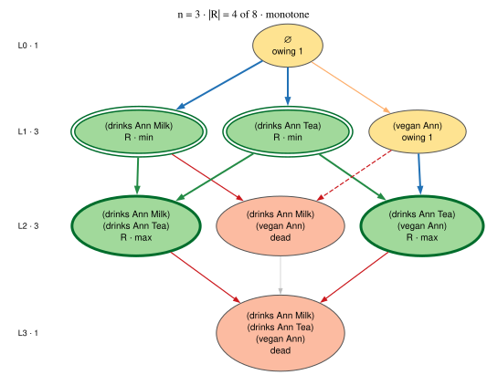
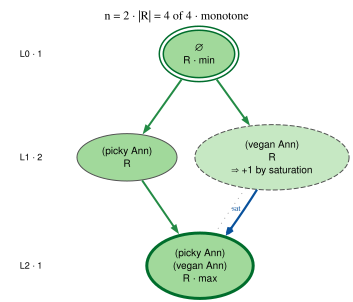
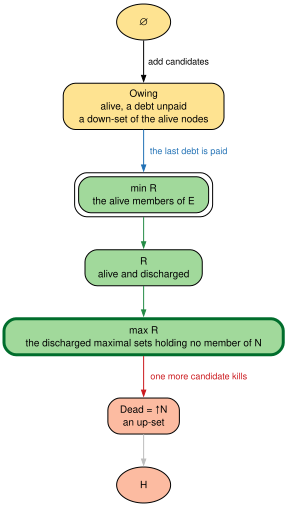

# Solution semantics: the region R

The answer to a program is a **region** $R$ of its hypothesis lattice: the commitments whose saturated state is alive
and discharged ([Q-M1e2.7](../../../decisions/answer/Q-M1e2.7-the-answer-is-a-region-r-of-the-hypothesis.md)).

$$
\begin{aligned}
R &= \lbrace\, C \subseteq H \;:\; \operatorname{alive}(\operatorname{st}(C)) \land \operatorname{discharged}(\operatorname{st}(C)) \,\rbrace \\
\operatorname{st}(C) &= \operatorname{sat}(\mathrm{root} \cup C)
\end{aligned}
$$

This page defines every symbol of that line, each in terms of the ones before it, then the shape of $R$, what a
shorter description of $R$ can rest on, and the questions a reader can ask of it. Why every way of finding $R$ gives
this $R$ is [Finding R](07-finding-r.md); how a program spells each notion is
[solutions and models](../../user/03-syntax-and-semantics/13-solutions-and-models.md), what is printed of $R$ is
the [read-out](../../user/04-reference/08-read-out.md), and where each notion lives in the engine that ships, with
what holds it to this page, is [hypotheses and the answer, in code](../../ein.rs/08-reasoning-in-code/03-hypotheses-and-the-answer.md).

**Scope.** Every definition holds of every program. Where a statement needs the program to be **monotone** (§ 1.6),
it says so. On a program that is not proved monotone every node is still built one way, by fork from root, and $R$ is
the region of that construction; nothing more is claimed of the program's solutions
([Q-M1e2.2](../../../decisions/answer/Q-M1e2.2-a-node-is-a-fork-of-root-an-assumption-on.md);
[Monotone and non-monotone programs](08-monotonicity.md) sets the two kinds side by side).

**The symbols**, in the order they are defined:

| symbol | what it is | where |
|---|---|---|
| $K_0$ | the knowledge base as loaded, before any saturation | § 1.1 |
| $\operatorname{names}(P)$, $\operatorname{guessable}(P)$ | the names of the program $P$; the guessable atoms | § 1.2 |
| $\operatorname{sat}$, $\mathrm{root}$ | saturation; root's fixpoint $\operatorname{sat}(K_0)$ | § 1.3 |
| $H$, $n$ | the candidate set, and $n = \lvert H \rvert$ | § 1.4 |
| $C$, $\operatorname{st}(C)$, $S$ | a commitment $C \subseteq H$; its state; a state | § 1.5 |
| $\operatorname{dead}$, $\operatorname{alive}$, $\operatorname{owes}$, $\operatorname{discharged}$ | the status of a state | § 1.5 |
| $\operatorname{cl}(C)$, $[C]$ | the closure of a commitment; its state class | § 1.5 |
| $R$, $k_c$, $k_s$ | the region, and its two counts | § 2 |
| $\min R$, $\max R$, $N$, $E$ | the two lines; the minimal dead sets; the minimal discharging sets | § 2.4 |
| $\operatorname{model}(C)$, $\pi_g$ | a solution's model; its projection on a goal $g$ | § 3 |

---

## 1. The vocabulary

### 1.1 Context and problem

A program $P$ is loaded as a knowledge base $K_0$ of facts, with its rules. A reader splits it in two, and each half
in two again:

$$
K_0 \;=\; \underbrace{\Theta \,\cup\, \Omega}_{\text{context}} \;\cup\; \underbrace{\Phi}_{\text{problem}}
$$

| term | what it is | in the Zebra puzzle |
|---|---|---|
| **theory** $\Theta$ | relations, their properties, and the rules that give them meaning | *a drink is drunk in a house*, *that relation is a bijection*, the rules that say what *lives beside* means |
| **ontology** $\Omega$ | facts a solution needs that the problem does not state, because they are obvious | *tea is a drink* |
| **context** | $\Theta \cup \Omega$ | everything that is not a clue, a hint or the query |
| **problem** $\Phi$ | the stated facts, the query, and the hints about what to guess, all in a context | the clues, *who owns the zebra?*, *guess where each thing is* |
| **program** | context and problem together, as one text; what it imports brings context in | one file and what it imports |

**The boundary is not in the language.** One text can mix all four, and nothing but a reader's eye says which part is
which. An import carries either half of a context: it brings a module's facts as it brings its rules, and an imported
fact's constants are names of the program like any other
([Q-M1f.137](../../../decisions/imports/Q-M1f.137-an-imported-facts-constants-are-names.md)). **$R$ is a property of a
problem in a context**: the same problem in another context has another region.

### 1.2 Names

The **names of the program**, $\operatorname{names}(P)$, are those of
[the rules](../01-static-ir/02-rewriting-rules.md#the-program-and-its-names): the names of $K_0$ and of the rules
of $P$ ([Q-M1e2.9](../../../decisions/language/Q-M1e2.9-a-programs-names-are-the-constants-its-facts.md)). A
rule's names are those of its pattern and of its conclusion alike, whether the rule derives, proposes or owes.
**An atom written only in a query is not among them**: $R$ is the program's, and a query asks about it, so adding a
query never changes $R$. A rewriting brings in no name
([Q-M1e.21](../../../decisions/hypotheses/Q-M1e.21-a-rule-brings-in-no-name.md)), so no state names what root and
the program do not, which is the alive-set invariant of
[saturation](02-saturation.md#the-alive-set-invariant), and the lattice of § 1.5 is finite.

**The guessable atoms**, $\operatorname{guessable}(P)$, are what the blind enumerator fills the argument places of
a fact with. [Hypothesis generation § 5](04-hypothesis-generation.md#5-the-blind-enumerator) defines them: the
names of the program less four kinds of atom, each left out by its name. Ein has no types, and none decides this
([Q-M1f.306](../../../decisions/hypotheses/Q-M1f.306-the-guessable-atoms-are-the-programs-names-never.md)). A
relation is never one: an atom the program writes first in a tuple is a relation of the program, whichever way it
is written, and no candidate has a relation as an argument
([Q-M1f.522](../../../decisions/language/Q-M1f.522-a-relation-of-the-program-is-any-atom-it-writes.md)).

### 1.3 Root

$$
\mathrm{root} \;=\; \operatorname{sat}(K_0)
$$

Root ([firing a rule](01-firing.md#two-layers)) is the program's facts saturated to quiescence by its rules, with
nothing hypothesised
([Saturation](02-saturation.md) defines $\operatorname{sat}$). It is a node like any other, the node $\emptyset$ of
§ 1.5. **Nothing a computation of $R$ does is written into root**: every answer is the one the definition gives
([Q-M1e2.32](../../../decisions/answer/Q-M1e2.32-no-two-commands-disagree-and-the-oracle-is.md)), and the definition
reads root and never writes it, so every node is a fork of the one root. What a computation learns of a refuted
candidate is a constraint on the commitments it considers, never a fact of root
([Finding R § 5](07-finding-r.md) says why).

### 1.4 Candidate and universe

A candidate, or **hypothesis**, is a fact proposed at root, and the candidate set $H$, the **universe**, is the set
of them ([firing a rule](01-firing.md#two-layers) names both, and this section states them exactly):

$$
\begin{aligned}
&H = \operatorname{gen}(P, \mathrm{root}) \\
&n = \lvert H \rvert \\
&\forall h \in H.\ \ h \notin \mathrm{root} \,\land\, \lnot\operatorname{denies}(\mathrm{root}, h)
\end{aligned}
$$

with root denying $h$ where it holds $\lnot h$ and a rule of the program refutes $h$ beside it
([hypothesis generation § 2](04-hypothesis-generation.md#2-the-ladder)).

$\operatorname{gen}$ is the **generation ladder** of [Hypothesis generation](04-hypothesis-generation.md), a function
of the program and of root's fixpoint and of nothing else. Nothing a computation is configured with moves which facts
those are: no option changes the lattice
([Q-M1e2.30](../../../decisions/answer/Q-M1e2.30-no-configuration-option-lever-or-flag-changes-r.md)). Every later
definition quantifies over $H$.

**The universe's order.** $H$ is a set, and where it is listed it is listed by the texts of its candidates
([the knowledge base](../01-static-ir/01-knowledge-base.md#the-text-of-an-object)):

$$
h \lt_{H} h' \iff \operatorname{text}(h) \lt_{\text{lex}} \operatorname{text}(h')
$$

$\lt_{H}$ is total, since a candidate is its text, and it is not the order $\prec$ of the objects: a space comes
before a closing parenthesis, so $\operatorname{q}(\mathsf{10}, \mathsf{10}) \lt_{H} \operatorname{q}(\mathsf{10})$
and $\operatorname{q}(\mathsf{10}) \prec \operatorname{q}(\mathsf{10}, \mathsf{10})$. Where an answer tabulates
the facts its states differ in, they are listed in $\prec$; a listing says which order it is in.

Three things decide $H$:

- **which rung of the ladder applies**: the program's own hypothesis rules if it declares one; else, where an
  obligation is activated at root, the facts that would pay what root owes and what a commitment can bring it to owe
  ([Q-M1f.308](../../../decisions/hypotheses/Q-M1f.308-the-ladders-second-rung-is-taken-where-root.md)); else every
  fact the blind enumerator can form. The middle rung reads each obligation's domain at root, so it **declines**, and
  the blind enumerator builds $H$, where a domain could grow under it
  ([Q-M1e2.10](../../../decisions/hypotheses/Q-M1e2.10-the-obligations-rung-declines-where-its-domain.md));
- **what the program scopes out**: a fact of a relation the program excludes from guessing is no candidate at all;
- **what root settles**: a fact root holds, or whose negation root stores, is no candidate.

**$H$ must contain every fact a model needs.** If it does not, either the program is wrong, a name it never writes,
or the generator is, a candidate it never proposes. $H$ is defined by the ladder, not declaratively: it is not every
fact of every relation whose
[held extent](../01-static-ir/01-knowledge-base.md#the-relation-its-extent-a-fact-of-it) a commitment may extend.

**On the obligations rung, $H$ holds what a debt root does not owe would propose**
([Q-M1e.11](../../../decisions/hypotheses/Q-M1e.11-h-holds-what-a-debt-only-a-commitment-brings.md)). $H$ is taken
once, at root, and what activates an obligation is an ordinary fact, so a rule can derive one at a node: that node
owes what root never did, and root proposed nothing that pays it. The rung therefore also proposes, at root, the
payments of every debt a commitment can bring, read off the rules alone
([Hypothesis generation § 4.4](04-hypothesis-generation.md) has the definition). The reading is at relation grain and
inexact both ways. *Over*: $H$ may hold a candidate for a debt no node owes, a member of a state of $R$ wherever
nothing refutes it. *Under*: an activator its rule writes with a variable is not read, and the node that derives it
owes what no candidate pays. So $H$ is not that of the program with the activator stated. A program this reading adds
a candidate to derives an obligation's activator from a commitment, so it is not proved monotone (§ 1.6), and its
answer is the whole cube's.

**What the universe leaves out, the answer names**
([Q-M1e2.3](../../../decisions/answer/Q-M1e2.3-r-is-over-the-universe-and-the-read-out-names.md)). $R$ is over $H$ as
the ladder scopes it, so a certificate that $R$ is exhausted certifies all of $R$ over $H$ and nothing beyond it. With
$\operatorname{rels}(X)$ the relations of the facts of $X$ ([saturation](02-saturation.md)), a relation $r$ is
**outside the universe** when

$$
\begin{aligned}
& r \notin \operatorname{rels}(H) \\
\land\ & \big( \text{a rule concludes a fact of } r \;\lor\; \text{a query's goal reads facts of } r \big) \\
\land\ & \text{the program does not scope } r \text{ out}
\end{aligned}
$$

and the held extent of such a relation, in every state of $R$, is only what the program states and saturation
derives. It is said at relation grain: the facts of a covered relation that the rung does not propose are not named.

**The universe is untyped**
([Q-M1e.12](../../../decisions/hypotheses/Q-M1e.12-the-blind-enumerator-is-untyped.md)). The blind
enumerator holds no argument to its label: every guessable atom fills every argument place. Where a program states
$\operatorname{is-a}(\mathsf{Red}, \mathsf{Color})$ and declares a relation $\operatorname{co-located}$ of two
arguments with the same label, $\operatorname{co-located}(\mathsf{Blue}, \mathsf{Color})$ is a candidate and a state
of $R$ may hold it. $R$ is right for the program as written, and a declaration that writes $\mathsf{Color}$ as a
label keeps it out of $H$. A membership relation is a relation like any other.

**No relation is guessed about** (§ 1.2). Where a rule derives $\operatorname{liquid}(\mathsf{Tea})$, nothing
declares $\operatorname{liquid}$, and the blind enumerator fills a declared relation $\operatorname{tasty}$ of one
argument, $\operatorname{tasty}(\mathsf{liquid})$ is no candidate: the rule writes $\operatorname{liquid}$ first in a
tuple, so it is a relation of the program whether or not a declaration names it.

### 1.5 Commitment, node, state

A commitment $C$ is a subset of $H$ ([firing a rule](01-firing.md#two-layers)). Seen as a point of the lattice it
is a **node**, and the lattice is the
Boolean lattice of all of them:

$$
\begin{aligned}
\mathcal{L} &= (2^{H}, \subseteq) \\
\lvert \mathcal{L} \rvert &= 2^{n} \\
L_k &= \lbrace\, C \subseteq H : \lvert C \rvert = k \,\rbrace \\
\lvert L_k \rvert &= \binom{n}{k}
\end{aligned}
$$

It is the **$n$-cube**: a node is an $n$-bit word, an edge joins $C$ and $C \cup \lbrace h \rbrace$ for $h \notin C$,
and layer $L_k$ holds the commitments of $k$ candidates. A node $C$ has an **up-set** and a **down-set**:

$$
\begin{aligned}
\uparrow C &= \lbrace\, C' \subseteq H : C \subseteq C' \,\rbrace \\
\downarrow C &= \lbrace\, C' : C' \subseteq C \,\rbrace
\end{aligned}
$$

**The node function** gives each node its **state**:

$$
\begin{aligned}
\operatorname{st} &: 2^{H} \to \text{states} \\
\operatorname{st}(C) &= \operatorname{sat}(\mathrm{root} \cup C)
\end{aligned}
$$

root's fixpoint, with the facts of $C$ added and the saturation resumed to quiescence. A state is a set of held
facts, its global context: a fact that a fact of the state points at is in the state's graph and is a member of
the state only where it is held too
([the knowledge base](../01-static-ir/01-knowledge-base.md#the-global-context-and-the-context-of-a-fact)). The
definition never stops at
a first contradiction; what a computation of $R$ may stop at, and why stopping changes no answer, is
[Finding R § 1](07-finding-r.md#1-a-node).

**The state is the fork's.** Building a state from scratch, $\operatorname{sat}(K_0 \cup C)$, is another
construction, and on a program that reads an absence it need not give the fork's fact set even where the program is
monotone:

$$
\begin{aligned}
\operatorname{sat}(\operatorname{sat}(K_0) \cup C) &\neq \operatorname{sat}(K_0 \cup C) && \text{is possible}
\end{aligned}
$$

Inside a node built from scratch the saturation derives root's facts again, and a rule that reads the absence of one
of them can fire before that fact is derived again, leaving a fact the fork does not hold
([Monotone and non-monotone programs](08-monotonicity.md) has the case). The state defined here is the fork's.

**The status of a state** $S$ is four predicates. Two are those of any set of facts,
$\operatorname{dead}(S)$ and $\operatorname{alive}(S)$: $S$ holds a contradiction, or holds none
([the knowledge base](../01-static-ir/01-knowledge-base.md#a-fact-its-negation-both-or-neither)).

**Dead is a rule's doing, and alive is its absence.** A state is dead where a rule that states the engine's word
$\mathsf{inconsistent}$ was applied in its saturation
([the rules](../01-static-ir/02-rewriting-rules.md#by-its-conclusion)): the rule every program holds, on a held
$\bot$, or any other of $P_{\mathsf{inc}}$. Nothing else makes a state dead, and no fact stands for it: the
application is recorded with what it rests on, as a derivation is, and a core is taken over that record
([cores](09-cores.md#a-contradiction)). A fork starts from everything its parent holds and has recorded, the
application that ended it among them, so a dead state's forks are dead, and on a monotone program so is every state
above a dead one (§ 1.6):

$$
\operatorname{dead}(C) \;\land\; C \subseteq C' \implies \operatorname{dead}(C')
$$

*Alive* is the absence of any such application, read on the state once it is finished, as an absence is read on a
fixpoint ([absence](03-absent-and-naf.md#stratification)):

$$
\operatorname{alive}(S) \iff \lnot\, \exists\, \rho \in P_{\mathsf{inc}}.\;\; \exists\, a, \theta.\;\; S \models \varphi_\rho[a]\,\theta
$$

**Why alive is read on a state, and never inherited.** It is true of a state and may be false of a larger one, since
a commitment can add the facts a rule that ends a state reads. A fact that said *alive* would be held at a state,
inherited by every fork of it, and stale in a fork that dies: a rule that concluded it from the absence of $\bot$
would conclude a positive fact from an absence a commitment can fill, which is the shape the static check finds
([monotonicity § 3](08-monotonicity.md#3-the-static-check)). So *dead* is concluded and kept, by an application
every larger state of a monotone program makes too, and *alive* is a statement about the whole of one state, read
on that state alone.

The other two predicates read the obligations. An obligation $o$ under an activator $a$ has a trigger $T_o$ and a witness $W_o$, and a
state $S$ **owes** the instance $(o, a, \theta)$, written $\operatorname{owes}(o, a, \theta, S)$, where the trigger
holds in $S$ under $\theta$ and no witness does
([hypothesis generation § 4.1](04-hypothesis-generation.md#41-an-instance-and-the-facts-that-would-pay-it) defines
the four; the user's [obligations](../../user/03-syntax-and-semantics/08-obligations.md) page has the spelling).

The instances a state owes, their number, and the state that owes none:

$$
\begin{aligned}
\operatorname{Owed}(S) &= \lbrace\, (o, a, \theta) : \operatorname{owes}(o, a, \theta, S) \,\rbrace \\
\operatorname{owes}(S) &= \lvert \operatorname{Owed}(S) \rvert \\
\operatorname{discharged}(S) &\iff \operatorname{owes}(S) = 0
\end{aligned}
$$

A state that is not discharged is **owing**. What a state owes is read on a dead state too. Each predicate is lifted
to commitments through the node function: $\operatorname{dead}(C)$ means $\operatorname{dead}(\operatorname{st}(C))$,
and so on. The three sets a status cuts the lattice into are

$$
\begin{aligned}
\operatorname{Dead} &= \lbrace C : \operatorname{dead}(C) \rbrace \\
\operatorname{Owing} &= \lbrace C : \operatorname{alive}(C) \land \operatorname{owes}(C) > 0 \rbrace \\
R &= 2^{H} \setminus (\operatorname{Dead} \cup \operatorname{Owing})
\end{aligned}
$$

**The three sets, drawn.** One guest, $\mathsf{Ann}$, owes a drink: an obligation says she drinks something, and a
restriction, a rule that concludes $\bot$ (§ 4), says a vegan drinks no milk. The candidates are

$$
\begin{aligned}
t &= \operatorname{drinks}(\mathsf{Ann}, \mathsf{Tea}) \\
m &= \operatorname{drinks}(\mathsf{Ann}, \mathsf{Milk}) \\
v &= \operatorname{vegan}(\mathsf{Ann}) \\
H &= \lbrace t, m, v \rbrace
\end{aligned}
$$

and the eight nodes of $(2^{H}, \subseteq)$ are drawn below as the engine draws a region, with $\emptyset$ at the top
and one candidate added along each edge downward, so a node's supersets are below it.

A node is a commitment, labelled with its candidates. Its fill is its status: amber is owing, red is dead, green is
in $R$. A double border marks a minimal element of $R$ and a heavy green one a maximal element. An edge adds one
candidate, and its colour says what the addition does: blue pays the last debt, green stays inside $R$, red kills,
orange still owes, grey goes from dead to dead. Read off the picture:

$$
\begin{aligned}
\operatorname{Owing} &= \lbrace \emptyset, \lbrace v \rbrace \rbrace \\
\operatorname{Dead} &= \lbrace \lbrace m, v \rbrace, \lbrace t, m, v \rbrace \rbrace \\
&= \uparrow \lbrace m, v \rbrace \\
R &= \lbrace \lbrace t \rbrace, \lbrace m \rbrace, \lbrace t, m \rbrace, \lbrace t, v \rbrace \rbrace
\end{aligned}
$$

The owing nodes are a down-set near $\emptyset$, the dead nodes an up-set far from it, and $R$ is the band between
them. § 2.4 says when that picture is the general one.

**Closure.** The closure of a commitment is the set of candidates its state holds:

$$
\begin{aligned}
\operatorname{cl}(C) &= \operatorname{st}(C) \cap H \\
C &\subseteq \operatorname{cl}(C)
\end{aligned}
$$

A node with $\operatorname{cl}(C) \neq C$ is **transient**: saturation moves it to $\operatorname{cl}(C)$. A node with
$\operatorname{cl}(C) = C$ is **closed**.

**State class.** Two commitments are one **state** when their states hold the same facts. The identity of a
state is its set of facts, compared as a set,

$$
\operatorname{st}(C) = \operatorname{st}(C') \iff \forall f.\ \ f \in \operatorname{st}(C) \leftrightarrow f \in \operatorname{st}(C')
$$

and leaves out what a fact's identity leaves out: how each fact came to be held, and in which order. A digest
$d$ of a state may label it for a reader and never decides that two states are one: $d(K) = d(K')$ does not
imply $K = K'$, so a comparison of digests could count two states as one, and the comparison of sets cannot.
The commitments that reach one state are a **state class**:

$$
\begin{aligned}
C \sim C' &\iff \operatorname{st}(C) = \operatorname{st}(C') \\
[C] &= \lbrace\, C' \subseteq H : C' \sim C \,\rbrace
\end{aligned}
$$

On a monotone program $\operatorname{cl}$ is a closure operator on the cube,

$$
\begin{aligned}
&C \subseteq \operatorname{cl}(C) \\
&\operatorname{cl}(\operatorname{cl}(C)) = \operatorname{cl}(C) \\
&C \subseteq C' \implies \operatorname{cl}(C) \subseteq \operatorname{cl}(C')
\end{aligned}
$$

and $\operatorname{st}(C) = \operatorname{st}(\operatorname{cl}(C))$, so a class has

- a **top**, its closed set $s = \operatorname{cl}(C)$;
- **bottoms**, its **minimal generators**: the minimal commitments $g$ with $\operatorname{cl}(g) = s$. Their size is
  how many facts a solution needs guessed.

**The class is the union of the intervals from its minimal generators to its top**:

$$
[s] \;=\; \bigcup_{g \,\in\, \min [s]} \lbrace\, C : g \subseteq C \subseteq s \,\rbrace
$$

since $g \subseteq C \subseteq s$ and $\operatorname{cl}(g) = s$ give
$s = \operatorname{cl}(g) \subseteq \operatorname{cl}(C) \subseteq \operatorname{cl}(s) = s$.

A second small universe shows a class of two nodes. A rule says a vegan is picky, and the candidates are
$v = \operatorname{vegan}(\mathsf{Ann})$ and $p = \operatorname{picky}(\mathsf{Ann})$:

The dashed node $\lbrace v \rbrace$ is transient: $\operatorname{cl}(\lbrace v \rbrace) = \lbrace v, p \rbrace$, the
arrow labelled *sat*, and the dotted edge beside it adds a fact saturation has already derived. So
$[\lbrace v, p \rbrace] = \lbrace \lbrace v \rbrace, \lbrace v, p \rbrace \rbrace$, with top $\lbrace v, p \rbrace$
and one minimal generator $\lbrace v \rbrace$: four commitments, three states.

### 1.6 Monotone

A program is **monotone** when growth of a commitment can neither take a conclusion away nor add a debt: no rule
that derives reads, under an odd number of absences, facts of a relation whose held extent a commitment can change,
and no obligation's trigger reads facts of one. How that is decided for a program, and what a program that fails
the test is, is [Monotone and non-monotone programs](08-monotonicity.md). On a monotone program, for all
$C \subseteq C' \subseteq H$:

$$
\begin{aligned}
\operatorname{st}(C) &\subseteq \operatorname{st}(C') && \text{the state is monotone} \\
\operatorname{dead}(C) &\implies \operatorname{dead}(C') && \text{dead is upward-closed} \\
\operatorname{discharged}(C) &\implies \operatorname{discharged}(C') && \text{discharged is upward-closed}
\end{aligned}
$$

- a contradiction stays as facts are added;
- a witness stays, and no new debt arrives;
- so $R$ (§ 2) has no hole, and its two lines describe it;
- and $\operatorname{cl}$ is a closure operator (§ 1.5).

**Which property this is.** *Monotone* is a property of the **program**: its consequence operator is monotone on
every knowledge base. The lattice of commitments is the domain, and is never itself monotone or not. What a monotone
program guarantees is two properties of the functions on its nodes, which a non-monotone program can lose separately:
the **state** is monotone in $C$, which, where saturation is cumulative, is the same as being independent of the path
that built the node; and the **status** is monotone, *dead* and *discharged* both upward-closed. An absence read
over a held extent that a commitment can change can break the first; an obligation's trigger breaks the second with
no absence at all.

The test is a sufficient condition, stated at **relation grain**: a read is of something a commitment can change
when its relation is one whose held extent a commitment can change, whatever its pattern. A program it does not
prove monotone may still have node functions with both properties: the test is *conservative*, and the full
lattice is what shows whether a program it flags has a dead node with an alive superset or a discharged node with an
owing one.

---

## 2. The answer: the region R

$$
R = \lbrace\, C \subseteq H \;:\; \operatorname{alive}(\operatorname{st}(C)) \land \operatorname{discharged}(\operatorname{st}(C)) \,\rbrace
$$

A **solution** is a node of $R$.

### 2.1 In general, R is its node set

On a monotone program that set is exact. **On a non-monotone program it is not**, and nothing is claimed of the
answer there: not soundness, correctness or completeness. A node's state can depend on the path it is built by,

$$
\begin{aligned}
\operatorname{sat}(\mathrm{root} \cup C_1 \cup C_2) &\neq \operatorname{sat}(\operatorname{sat}(\mathrm{root} \cup C_1) \cup C_2) && \text{is possible}
\end{aligned}
$$

and on the order rules fire in
([Q-M1f.313](../../../decisions/engine/Q-M1f.313-the-agenda-fires-first-what-leads-to-false.md)), so *the full set of
nodes* is not one thing. Every node is built one way, the fork of § 1.5, and $R$ on such a program is the region of
that construction: every computation agrees on it, and nothing more is claimed.

A non-monotone program can have almost any subset of the cube as its region. The one exception is a non-empty $R$
under a dead root: a fork only adds, so

$$
\begin{aligned}
\operatorname{dead}(\emptyset) &\implies \forall C \subseteq H.\; \operatorname{dead}(C) \\
\operatorname{dead}(\emptyset) &\implies R = \emptyset
\end{aligned}
$$

There are $2^{2^{n}}$ subsets of the cube, so nothing shorter than the set describes every region; the shortest exact
form of any one is the union of its maximal sub-cubes (§ 2.4).

What makes a shorter description exact is a property of the program, in order:

| property | what it licenses |
|---|---|
| **convex** (no hole) | the two lines describe $R$ exactly: $R = \bigcup \lbrace [a, b] : a \in \min R,\ b \in \max R,\ a \subseteq b \rbrace$ |
| **monotone** (§ 1.6) | convex, and the lines follow from $N$ and $E$ without evaluating the cube (§ 2.4), with $N$, $E$ and the proof of monotonicity as a certificate |
| **shape** | restrictions only: $\min R = \lbrace \emptyset \rbrace$. Obligations only: $\max R = \lbrace H \rbrace$, every candidate (§ 4) |

[Monotone and non-monotone programs](08-monotonicity.md) writes the same ladder from the non-monotone side.

### 2.2 The empty commitment

$$
\emptyset \in R \iff \operatorname{alive}(\mathrm{root}) \land \operatorname{discharged}(\mathrm{root})
$$

**whatever the generator proposes**, including when it proposes nothing. A program that states no obligation and
whose root is consistent always has $\emptyset$ in $R$. That is no defect: a puzzle that does not say what it requires
is solved by saying nothing more.

### 2.3 How many: k_s and k_c

$R$ is counted twice:

$$
\begin{aligned}
k_c &= \lvert R \rvert \\
k_s &= \lvert R / {\sim} \rvert \;=\; \lvert \lbrace\, \operatorname{st}(C) : C \in R \,\rbrace \rvert \\
k_s &\le k_c
\end{aligned}
$$

| | counts | |
|---|---|---|
| $k_c$ | $R$ in **commitments** | the ways to guess a solution |
| $k_s$ | $R$ in **states** (state classes, § 1.5) | the different solutions |

They differ exactly where saturation derives a candidate at a node of $R$: there the node and its closure are two
commitments with one state, as $\lbrace v \rbrace$ and $\lbrace v, p \rbrace$ in § 1.5, where $k_c = 4$ and
$k_s = 3$. A discharged superset of a discharged state is a node of $R$ in its own right, counted in $k_c$ and, where
its state differs, in $k_s$
([Q-M1e2.1](../../../decisions/answer/Q-M1e2.1-a-discharged-superset-of-a-discharged-state-is.md)). A count is exact,
and reported up to a fixed bound past which it reads *this many or more*
([Q-M1f.218](../../../decisions/answer/Q-M1f.218-a-count-is-exact-and-reported-up-to-2-63-1.md)).

**One solution** has two readings, and an expectation of exactly one has to say which:

- $k_s = 1$: what a program that states what it requires can mean;
- $\lvert \max R / {\sim} \rvert = 1$, one maximal state: what a program with restrictions only can mean, since there
  $\emptyset \in R$ and $k_s = 1$ only when nothing can be added at all.

### 2.4 Shape

**The two lines** are the minimal and the maximal elements of $R$:

$$
\begin{aligned}
\min R &= \lbrace\, C \in R : \nexists C' \in R.\; C' \subsetneq C \,\rbrace \\
\max R &= \lbrace\, C \in R : \nexists C' \in R.\; C \subsetneq C' \,\rbrace
\end{aligned}
$$

With restrictions only the minimal line is $\lbrace \emptyset \rbrace$; with obligations only, on a monotone program,
the maximal line is $\lbrace H \rbrace$. These are the **trivial lines**, visible from the program's shape and never
in need of enumeration.

| term | definition |
|---|---|
| **hole** | a node outside $R$ between two members: $C \notin R$ with $a \subseteq C \subseteq b$ for some $a, b \in R$ |
| **convex** | no hole. A monotone program is convex |
| **sub-cube** $[a, b]$ | $\lbrace C : a \subseteq C \subseteq b \rbrace$, every commitment between $a$ and $b$. Its **dimension** $\lvert b \rvert - \lvert a \rvert$ is its number of free facts. $R$ is the union of its maximal sub-cubes |
| **component** | a maximal part of $R$ connected by one-candidate edges inside $R$. **Not a model**: a set of models. A well-posed puzzle is one where every component is a point |
| $N$ | the minimal dead sets, the minimal nogoods: $N = \min \operatorname{Dead}$ |
| $E$ | the minimal discharging sets, dead or not: $E = \min \lbrace C : \operatorname{discharged}(C) \rbrace$ |

In the drawing of § 1.5:

$$
\begin{aligned}
\min R &= \lbrace \lbrace t \rbrace, \lbrace m \rbrace \rbrace \\
\max R &= \lbrace \lbrace t, m \rbrace, \lbrace t, v \rbrace \rbrace \\
N &= \lbrace \lbrace m, v \rbrace \rbrace \\
E &= \lbrace \lbrace t \rbrace, \lbrace m \rbrace \rbrace
\end{aligned}
$$

and $R$ is one component, the union of the three sub-cubes
$[\lbrace t \rbrace, \lbrace t, m \rbrace]$, $[\lbrace m \rbrace, \lbrace t, m \rbrace]$ and
$[\lbrace t \rbrace, \lbrace t, v \rbrace]$, each of dimension 1.

**The band.** On a monotone program the dead nodes are the up-set of $N$, the discharged nodes the up-set of $E$,
and $R$ is what lies in the second and outside the first:

$$
\begin{aligned}
\operatorname{Dead} &= \bigcup_{D \in N} \uparrow D \\
\lbrace C : \operatorname{discharged}(C) \rbrace &= \bigcup_{e \in E} \uparrow e \\
R &= \bigcup_{e \in E} \uparrow e \;\setminus\; \bigcup_{D \in N} \uparrow D
\end{aligned}
$$

The schematic reads from $\emptyset$ at the top to $H$ at the bottom, as the region drawings do. Obligations cut $R$
off from $\emptyset$, restrictions cut it off from $H$, and where a program states only one of the two the other
border is the trivial line.

**The duality.** On a monotone program each line is computed from one of the two families, and $N$ from the maximal
alive sets. Write $\operatorname{MinTr}(\mathcal{F})$ for the minimal transversals of a family $\mathcal{F}$ of sets,
the minimal sets that meet every member:

$$
\begin{aligned}
\min R &= \lbrace\, e \in E : \operatorname{alive}(e) \,\rbrace \\
\max R &= \lbrace\, b \in \max \operatorname{Alive} : \operatorname{discharged}(b) \,\rbrace \\
\max \operatorname{Alive} &= \max \lbrace\, C : \nexists D \in N.\; D \subseteq C \,\rbrace \\
N &= \operatorname{MinTr} \lbrace\, H \setminus b : b \in \max \operatorname{Alive} \,\rbrace
\end{aligned}
$$

*Argument.* A minimal element of $R$ is discharged, and no proper subset of it is discharged: such a subset would be
alive, dead being upward-closed, and so in $R$. So it is in $E$, and alive. Conversely an alive member of $E$ is in
$R$, and nothing below it is discharged. For the maximal line: an alive superset of a member of $R$ is in $R$,
discharged being upward-closed, so a maximal element of $R$ is a maximal alive set; and a maximal alive set that is
discharged is in $R$ with nothing alive above it. For $N$: a set is dead exactly when it lies inside no maximal alive
set, that is, when it meets the complement of each, and the minimal such sets are the minimal transversals. This is
the duality between conflicts and diagnoses, and between minimal unsatisfiable and maximal satisfiable sets. In the
drawing of § 1.5 the maximal alive sets are $\lbrace t, m \rbrace$ and $\lbrace t, v \rbrace$, their complements
$\lbrace v \rbrace$ and $\lbrace m \rbrace$, and the one minimal transversal is $\lbrace m, v \rbrace$, which is $N$.

On a non-monotone program neither direction is guaranteed, with a hole or without one: a program with obligations
whose debts grow with the commitment can have nothing dead, so that the dual's maximal set is $H$, while $H$ owes.

**Locally.** On a convex $R$ the two lines are decided one edge at a time:

$$
\begin{aligned}
C \in \max R &\iff C \in R \,\land\, \forall h \notin C.\; C \cup \lbrace h \rbrace \notin R \\
C \in \min R &\iff C \in R \,\land\, \forall h \in C.\; C \setminus \lbrace h \rbrace \notin R
\end{aligned}
$$

since a member above $C$ would put a one-candidate extension of $C$ between two members. On a monotone program the
edge up leaves $R$ only into a dead node and the edge down only into an owing one. Across a hole the local test and
the lattice can disagree: where two candidates are in $R$ together or not at all, the local test calls $\emptyset$
maximal and the pair minimal, and neither is.

### 2.5 Worked: a conflict of three

Three candidates $a$, $b$, $c$, one a fact of each of three relations about one atom; one restriction, which
concludes $\bot$ when all three hold; no obligation.

| commitment | alive | owes | in $R$ |
|---|---|---|---|
| $\emptyset$ | yes | 0 | **yes**: minimal |
| $\lbrace a \rbrace$, $\lbrace b \rbrace$, $\lbrace c \rbrace$ | yes | 0 | **yes** |
| $\lbrace a, b \rbrace$, $\lbrace a, c \rbrace$, $\lbrace b, c \rbrace$ | yes | 0 | **yes**: maximal |
| $\lbrace a, b, c \rbrace$ | **no** | 0 | no |

$$
\begin{aligned}
k_c &= k_s = 7 \\
\min R &= \lbrace \emptyset \rbrace \\
\max R &= \lbrace \lbrace a, b \rbrace, \lbrace a, c \rbrace, \lbrace b, c \rbrace \rbrace \\
N &= \lbrace \lbrace a, b, c \rbrace \rbrace \\
E &= \lbrace \emptyset \rbrace
\end{aligned}
$$

No rule derives a candidate, so every class is a point. The minimal line is the trivial line of a program with
restrictions only. $R$ is one component, the union of three sub-cubes $[\emptyset, \text{pair}]$ of dimension 2, and
the duality gives both lines: the complements of the three maximal alive sets are the three singletons, whose one
minimal transversal is the triple. The conflict is of three and of no two: no pair is dead, and nothing smaller than
the whole triple decides it.

The picture is the engine's drawing of this region ([its source](diagrams/06-region-02-genuine-3set-death.dot);
[rendering](../../user/04-reference/12-rendering.md) is the legend). Fill is the node's status in the lattice and
border is the lines, as in § 1.5. This drawing also overlays one computation of $R$ on the lattice, by a node's
shape: an octagon is a state the computation reported and a rounded box a node it evaluated. It reported the seven
states of $R$ and evaluated all eight nodes, the dead triple among them, since no smaller dead set decides it.

---

## 3. Model

A **model** is the positive part of a solution's state, less the positive part of the knowledge base as loaded
([Q-M1e.6](../../../decisions/answer/Q-M1e.6-a-model-is-what-a-solutions-state-adds.md)). With $X^{+}$ the facts of
$X$ that are not stored negations:

$$
\begin{aligned}
\operatorname{model}(C) &= \operatorname{st}(C)^{+} \setminus K_0^{+} && \text{for } C \in R
\end{aligned}
$$

$K_0$ is the program as loaded, *before the first saturation*: the problem's statements, the declarations of
relations and of membership, no derived fact. So a model carries no stored negation, nothing the program itself
states, and nothing loading writes down. It is **what the puzzle did not say and the solution established**: what a
node of $R$ adds.

The state is what is judged, and the model is a projection of it
([Q-M1e.7](../../../decisions/answer/Q-M1e.7-a-state-is-what-the-engine-judges-and-a-model-is.md)): dead, alive, owing
and discharged are each read on the whole state, its negations included, and no computation of $R$ writes into a state
anything its own fixpoint does not derive. Two computations can agree on every model and differ in what else a state
holds; the model is the part of a solution that answers the puzzle.

**Projection.** A query's goal $g$, with variables $\bar{x}$, cuts a model down to the goal's rows, and solutions
with the same rows are one **projection class**:

$$
\begin{aligned}
\pi_g(C) &= \lbrace\, \theta : \operatorname{st}(C) \models g(\theta) \,\rbrace \\
C \sim_g C' &\iff \pi_g(C) = \pi_g(C')
\end{aligned}
$$

Models that differ only in facts the goal does not name give one row set, so a query answers with the classes of
$R / {\sim_g}$. Two groups of friends choosing between two tables have one projection class per choice of table, and
the seats inside it are hidden information. In a program with restrictions only, the goal has no row at $\emptyset$,
so a query over $R$ has to say *undetermined in these solutions*.

---

## 4. Restrictions and obligations: the two lines

A **restriction** is a rule that concludes $\bot$, the kind
[the rules](../01-static-ir/02-rewriting-rules.md#by-its-conclusion) call a constraint. It kills nodes, and sets the
**maximal line**: $R$'s border on
the side of $H$ is where restrictions bite.

An obligation
([hypothesis generation § 4.1](04-hypothesis-generation.md#41-an-instance-and-the-facts-that-would-pay-it)) has the
verdict that the held extent of a relation is incomplete, and it owes while a witness is missing
([Q-M1d.2](../../../decisions/hypotheses/Q-M1d.2-an-obligation-is-a-rule-that-concludes-open-r.md)). What a
state **owes** is its unwitnessed instances, $\operatorname{Owed}(S)$ of § 1.5, and a state that owes none is
**discharged**. It sets the **minimal line**: $R$'s border on the side of $\emptyset$ is where the debts are paid.

| the program states | $R$ | $\min R$ | $\max R$ |
|---|---|---|---|
| neither | the whole cube $[\emptyset, H]$ | $\lbrace \emptyset \rbrace$ | $\lbrace H \rbrace$ |
| restrictions only | every alive node | $\lbrace \emptyset \rbrace$, while root is alive | where restrictions bite |
| obligations only | every discharged node | where the debts are paid | $\lbrace H \rbrace$, on a monotone program |
| both | between the two | where the debts are paid | where restrictions bite. A well-posed puzzle has the two meet in one state |

There is one definition for every program: a program that states no obligation simply has $\emptyset$ in $R$ when its
root is consistent. What an obligation quantifies over is its domain contract
([obligations](../../user/03-syntax-and-semantics/08-obligations.md)); why an owed instance's alternatives are jointly
exhaustive is [Satisfiability](10-satisfiability.md).

---

## 5. The questions asked of R

$R$ is one thing, and a reader asks for a part of it. Each question below has one answer, a function of $R$ alone,
so two computations of the same question cannot differ ([Finding R](07-finding-r.md)), and each needs only as much of
the lattice as decides it
([Q-M1e2.31](../../../decisions/answer/Q-M1e2.31-each-question-about-r-does-the-least-work-it.md)). How a question
is spelt is the [command line](../../user/04-reference/05-cli.md)'s.

| the question | its answer |
|---|---|
| **describe $R$** | the states of $R$, $\min R$, $\max R$, $k_s$, $k_c$, the components, the sub-cubes, $N$, and whether $\emptyset \in R$ |
| **the minimal elements** | $\min R$, as states |
| **the maximal elements** | $\max R$, as states |
| **$j$ elements** | some $j$ distinct states of $R$, or all of them where $k_s < j$ |
| **is $R$ one state?** | the verdict below |
| **the cardinalities** | $k_s$ and $k_c$, no state listed |
| **a query**, with goal $g$ | the classes of $R / {\sim_g}$, or of one line's states, each with its rows $\pi_g$ |

$$
\operatorname{verdict}(R) \;=\;
\begin{cases}
\text{one solution} & k_s = 1 \\
\text{several} & k_s \ge 2 \\
\text{contradiction} & k_s = 0 \,\land\, \forall C.\; \operatorname{dead}(C) \\
\text{open} & k_s = 0 \,\land\, \exists C.\; \operatorname{alive}(C)
\end{cases}
$$

The last two are the two kinds of empty $R$: no node is alive, or nodes are alive and every one of them owes. A
question about a line is the same question over $\min R$ or $\max R$ in place of $R$. Where $\emptyset \in R$ every
question about the minimal line is answered by root alone, since $\min R = \lbrace \emptyset \rbrace$.

**A claim** is a statement of the answer to one of these questions, made by the program about itself and compared
with $R$: it holds, fails, or is not decided by the part of $R$ that was computed
([Satisfiability § 3](10-satisfiability.md)).
