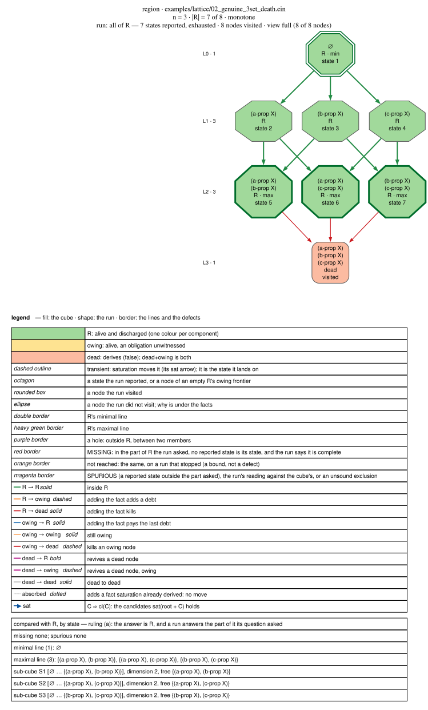

# Solution semantics: the region R

The answer to a program is a **region R** of its hypothesis lattice: the commitments whose saturated state is alive
and discharged ([Q-M1e2.7](../../../decisions/answer/Q-M1e2.7-the-answer-is-a-region-r-of-the-hypothesis.md)). This
page defines it, every term in terms of the ones before it, and says what a shorter description of R can rest on.
How R is computed, and why every way of computing it gives this R, is [Finding R](07-finding-r.md); what the user reads
of it is the read-out's.

**Scope.** Every definition holds of every program. Where a statement needs the program to be **monotone** (§ 1.6),
it says so. On a program the static check flags, every node is still built one way, by fork from root, and R is the
region of that construction; every command agrees on it, and nothing more is claimed of the program's solutions
([Q-M1e2.2](../../../decisions/answer/Q-M1e2.2-a-node-is-a-fork-of-root-an-assumption-on.md);
[Monotone and non-monotone programs](08-monotonicity.md) sets the two kinds side by side).

---

## 1. The vocabulary

### 1.1 Context and problem

| term | what it is | in [`zebra2.ein`](../../../../examples/zebra2.ein) |
|---|---|---|
| **theory** | relations, their properties, and the rules that give them meaning | `(relation drink-loc Drink House)`, `(bijective drink-loc)`, the `co-located` rules, and the stdlib rules behind them |
| **ontology** | facts a solution needs that the problem does not state, because they are obvious | `(is-a Tea Drink)` |
| **context** | theory + ontology | everything that is not a clue, a hint or the query |
| **problem** | facts + query + hypothesis hints, stated in a context | the clue facts, each with `:source "condition (n)"`, the `(query …)`, the `(hrule guess …)` |
| **program** | context + problem, as Ein text. Its imports bring context in: theory from the [stdlib](../../../../stdlib/), ontology from a library of facts | one `.ein` file and what it imports |

**The boundary is not in the language.** One file can mix all four, and nothing but a reader's eye (and zebra2's
`:source` strings) says which part is which. An import carries either half of a context: it brings a module's facts
as it brings its rules, and an imported fact's constants are names of the program like any other
([Q-M1f.137](../../../decisions/imports/Q-M1f.137-an-imported-facts-constants-are-names.md)). **R is a property of a
problem in a context**: the same problem in another context has another region.

### 1.2 Names

A **name** is a constant the program writes: every constant in an argument position of a fact, at any depth, a
nested fact's arguments included, and every constant anywhere in a rule, an hrule or an obligation, its `:match` as
well as its `:assert` ([Q-M1e2.9](../../../decisions/language/Q-M1e2.9-a-programs-names-are-the-constants-its-facts.md)).
**A constant written only in a `(query …)` is not a name**: R is the program's, and a query asks about it, so adding
a query never changes R. No rule brings in a name of its own and nothing makes a name at run time
([Q-M1e.21](../../../decisions/hypotheses/Q-M1e.21-a-rule-brings-in-no-name.md)), so the lattice below is finite.

**What the blind enumerator takes for an object** is narrower than *a name*, by four exclusions, each by name and
none a type system ([Q-M1f.306](../../../decisions/hypotheses/Q-M1f.306-the-blind-enumerators-objects-are-the-programs.md)).
Its objects are every name of the program and every name root's fixpoint holds, a fact's head beside its top-level
arguments, less:

- the names a relation's signature declares, its type roles;
- the kernel's words `not`, `false`, `and`, `or`, `absent`, `eq` and `neq`, whether or not a program writes one as
  a value;
- **the kernel's two dunders, `__closed__` and `__symmetric__`**: never an object, neither where a rule derives the
  fact one heads nor where a program writes one in an argument position, which stays legal and keeps it a name of
  the program. So a closure or a symmetry stated by a fact and the same one derived by a rule give one H and one R;
- every name the program declares as a relation, or writes as the head of a fact, or names a rule by. The head of a
  fact that only a rule concludes is none of these, so **a relation only a rule concludes is an object**, and a
  candidate can name it. The candidate stays, and the read-out names it (§ 1.4); declaring the relation takes its
  name out.

### 1.3 Root

**Root** is `sat(program)`: the program's facts saturated to quiescence by its rules, with nothing hypothesised. It
is a node like any other, the node ∅ of § 1.5. **Nothing a computation of R does is written into root**: every answer
is the oracle's ([Q-M1e2.32](../../../decisions/answer/Q-M1e2.32-no-two-commands-disagree-and-the-oracle-is.md)), and
the oracle never writes, so every node is a fork of the one root. What a run learns of a refuted candidate is a
constraint on the commitments it visits, never a fact of root ([Finding R](07-finding-r.md) says why).

### 1.4 Candidate and universe

A **candidate** (a hypothesis) is a fact the generator proposes at root. Nothing a run is configured with moves
which facts those are: no option, lever or flag changes the lattice
([Q-M1e2.30](../../../decisions/answer/Q-M1e2.30-no-configuration-option-lever-or-flag-changes-r.md)). Which facts can
be proposed at all is decided by:

- **the generation ladder** ([Hypothesis generation](04-hypothesis-generation.md)): the program's own `(hrule …)` if it
  declares one; else, where an obligation is **activated** at root, the facts that would discharge what root owes and
  what a commitment can bring it to owe
  ([Q-M1f.308](../../../decisions/hypotheses/Q-M1f.308-the-ladders-second-rung-is-taken-where-root.md)), so a root
  that owes nothing under an activated obligation proposes nothing; else the blind combinatorial enumerator. An
  obligation rule a program loads and nothing activates chooses no rung: an import brings its module whole, and a
  module imported for another of its names leaves the program's own open relations to the blind enumerator. The
  middle rung reads each obligation's domain at root, so it **declines**, and the blind enumerator builds H, where a
  domain could grow under it: a guard over a relation the rung proposes, or a trigger or a guard over a relation a
  commitment can change, read at relation grain
  ([Q-M1e2.10](../../../decisions/hypotheses/Q-M1e2.10-the-obligations-rung-declines-where-its-domain.md));
- **the scoping a `(solve …)` states**: `:hypothesis-relations`, `:no-hypothesis`, and a `(__closed__ R)` fact. A
  fact of an excluded relation is no candidate at all.

The **universe** H is the candidate list, and n = |H|. Every later definition quantifies over it.

**H must contain every fact a model needs.** If it does not, either the program is wrong, a name it never writes, or
the generator is, a candidate it never proposes. H is defined by the ladder, not declaratively: it is not every
type-correct ground atom of every relation a commitment may extend.

**On the obligations rung, H holds what a debt root does not owe would propose**
([Q-M1e.11](../../../decisions/hypotheses/Q-M1e.11-h-holds-what-a-debt-only-a-commitment-brings.md)). H is taken once,
at root, and an obligation's activator is an ordinary fact, so a rule can derive one at a node: that node owes what
the activator's plan matches, and root, which never held the activator, proposed nothing that pays it. The rung
therefore reads, from the rules and root's plans and with no saturation:

1. **the activators a commitment can derive**: every conclusion that holds no variable and would activate an
   obligation rule, in the `:assert` of a rule that reads a relation of D⁺ or is activated by one. D⁺ is the
   relations a commitment can change (D of § 1.6), followed through the rules root has no plan of, seeded with the
   relations of the rung's own candidates; *forbid* reads the same set;
2. for each such activator root's fixpoint does not hold, **the rung's own scan, at root**: the instances the
   activator's plan matches there, each one's guard read as the rung reads a guard of a debt root owes;
3. a candidate that adds a relation extends D⁺, so both steps are **repeated until they add nothing**.

A plan read this way is held to every decline of the rung beside root's own: where its guard scans a relation a
commitment can change, the rung declines and the blind enumerator builds H. The scoping a `(solve …)` states binds
it as it binds any plan, and the read-out names what H holds for each such debt.

The reading is **at relation grain and inexact both ways**. *Over*: a rule that reads what a commitment can change
need fire at no alive node, and H then holds a candidate for a debt no node owes, a member of a state of R wherever
nothing refutes it. *Under*: an activator its rule writes with a variable is not read, whatever binds the variable,
and the node that derives it owes what no candidate pays. So H is not *the program with the activator stated*: where
one choice switches a second debt on and another does not, R holds a state that makes the other choice and pays
nothing, which the program that states the activator does not have. The reading is the obligations rung's alone. An
hrule proposes at root what its `:match` finds there, and one whose `:match` reads a relation a commitment can change
would propose at a node what it did not at root: H does not hold that. The blind enumerator reads no state and has no
such case. A program this reading adds a candidate to derives an obligation's activator from a commitment, so the
static check flags it (§ 1.6) and the cube answers it.

**What the universe leaves out, the read-out names**
([Q-M1e2.3](../../../decisions/answer/Q-M1e2.3-r-is-over-the-universe-and-the-read-out-names.md)). R is over H as the
ladder scopes it, so a certificate that R is exhausted certifies all of R over H and nothing beyond it. Where the
rung that built H proposes no fact of a relation the program can conclude or ask about (a saturation rule writes it,
or a query's `:goal` reads it), and the program does not scope the relation out itself, every surface says the
relation is outside the universe, and that R holds of it only what the program states and saturation derives. It is
said at relation grain: the facts of a covered relation the rung does not propose (the blind enumerator's
self-edges, an obligation's typed candidates) are not named.

**What the universe binds as an object, the read-out names too**
([Q-M1e.12](../../../decisions/hypotheses/Q-M1e.12-the-blind-enumerator-is-untyped-and-a-type-it.md)). The blind
enumerator is untyped: every name of the program that no signature declares is a candidate object, so where a
program writes `(is-a Red Color)` and declares `(relation co-located T T)`, `(co-located Blue Color)` is a candidate
and a state of R may hold it. R is right for the program as written, and a signature that names the type keeps it
out of H. Where the blind enumerator built H and a candidate names the second argument of an `is-a` fact at root's
fixpoint, every surface names that type. The row reads `is-a` by its name and decides nothing: H, R, every count and
every exit code are the same without it.

**A relation's name bound as an object is named as well** (§ 1.2). Where a program derives `(liquid Tea)` by a rule,
declares `liquid` nowhere and leaves `(relation tasty Thing)` open, `(tasty liquid)` is a candidate and a state of R
may hold it. The candidate stays, R is right for the program as written, and declaring the relation takes its name
out of H. Where the blind enumerator built H and a candidate names the head of a fact root's fixpoint holds, or a
relation a rule's `:assert` names, every surface names it. A relation a rule writes through a parameter, `(?Q ?r)`, is
named only where root holds a fact of it, and a kernel dunder never is, being no object. It decides nothing either.

### 1.5 Commitment, node, state

A **commitment** C is a subset of H. Seen as a point of the lattice, it is a **node**. Without merging, the lattice
is the **n-cube**: a node is an n-bit word, an edge adds or removes one candidate, and layer L*k* holds the C(n, k)
commitments of k candidates.

A node's **state** is `sat(root + C)`: root's fixpoint, forked, with C's facts written in and the saturation resumed
to quiescence. The definition never stops at a first contradiction; what a computation of R may stop at, and why
stopping changes no answer, is [Finding R § 1](07-finding-r.md#1-a-node).

**The state is the fork's.** Building a state from scratch, `sat(program + C)`, is another construction, and on a
program with an `absent` it need not give the fork's fact set even where the program is monotone: inside a node built
from scratch the saturation re-derives root's facts, and a rule that reads an `absent` over one of them can fire
before that fact is derived again, leaving a fact the fork does not hold.
[`examples/lattice/11_fifo_gap_static.ein`](../../../../examples/lattice/11_fifo_gap_static.ein) is written for that
case. The state defined here is the fork's, and it is the one every computation of R builds.

| | the state |
|---|---|
| **dead** | holds `(false)` |
| **alive** | is not dead |
| **owing n** | has n obligation instances with no witness (§ 4). Read on a dead state too |
| **discharged** | owes nothing |

**Closure.** cl(C) is the set of candidates the state holds. Always C ⊆ cl(C). A node with cl(C) ≠ C is
**transient**: saturation moves it, `C ⇒ cl(C)`.

**State class.** The commitments that reach one state. For a monotone program saturation is a closure operator on
the cube (extensive, idempotent, monotone), so a state s has:

- a **top**, s itself, the closed set;
- **bottoms**, its **minimal generators**: the smallest commitments that force it. Their size is how many facts a
  solution needs guessed.

The class is the union of the intervals [g … s] over its minimal generators: if g ⊆ C ⊆ s and cl(g) = s, then
s = cl(g) ⊆ cl(C) ⊆ cl(s) = s.

### 1.6 Monotone

A program is **monotone** when no read of its compiled plans can take a conclusion away or add a debt as the
commitment grows: no `absent` at odd depth in a saturation rule over a relation a commitment can change, and no
obligation trigger over one. How a program is checked, and what a flagged one is, is
[Monotone and non-monotone programs](08-monotonicity.md). On a monotone program:

- **dead is upward-closed**: a contradiction stays as facts are added;
- **discharged is upward-closed**: a witness stays, and no new debt arrives;
- so R (§ 2) has no holes, and its two lines describe it;
- and cl is a closure operator (§ 1.5).

**Which property this is.** *Monotone* is a property of the **program**: its consequence operator is monotone on
every knowledge base. The lattice of commitments is the domain, and is never itself monotone or not. What a monotone
program guarantees is two properties of the functions on its nodes, which a non-monotone program can lose
separately: the **state** is monotone in C, which, where saturation is cumulative, is the same as being independent
of the path that built the node; and the **status** is monotone, `dead` and *discharged* both upward-closed. An
`absent` over a relation a commitment can change can break the first; an obligation's trigger breaks the second with
no `absent` at all. The static check flags the program, so it also flags programs whose node functions keep both
properties: its flags are *conservative*.

The static check is a sufficient condition, and the cube is its check: on a monotone program no dead node has an
alive superset and no discharged node has an owing one. It reads at **relation grain**: a read is dynamic when its
relation is one a commitment can change, whatever its pattern, and the theorem is stated at that grain.

---

## 2. The answer: the region R

> **R = { C ⊆ H : sat(root + C) is alive and discharged }.**
> A **solution** is a node of R.

### 2.1 In general, R is its node set

On a monotone program that set is exact. **On a non-monotone program it is not**, and the engine claims nothing of
its answer there: not soundness, correctness or completeness. A node's state can depend on the path it is built by,
`sat(root + C₁ + C₂) ≠ sat(sat(root + C₁) + C₂)`, and on the order rules fire in
([Q-M1f.313](../../../decisions/engine/Q-M1f.313-the-agenda-fires-first-what-leads-to-false.md)), so *the full set of
nodes* is not one object. Every node is built one way, the fork of § 1.5, and R on a flagged program is the region
of that construction: every command agrees on it, and nothing more is claimed.

A non-monotone program can have almost any subset of the cube as its region; the one exception is a dead root under
a non-empty R, since a fork only adds and a dead root makes every node dead. The programs under
[`examples/lattice/synth/`](../../../../examples/lattice/synth/) are each written for a chosen region. There are
2^(2ⁿ) subsets of the cube, so nothing shorter describes every region; the shortest exact form of any one is the
union of its maximal sub-cubes (§ 2.4).

What makes a shorter description exact is a property of the program, in order:

| property | what it licenses |
|---|---|
| **convex** (no hole) | the two lines describe R exactly: R = ⋃ [a … b] over minimal a ⊆ maximal b |
| **monotone** (§ 1.6) | convex, and the lines follow from N and E without visiting the cube (§ 2.4), with N, E and the static verdict as a certificate |
| **shape** | restrictions only: the minimal line is {∅}. Obligations only: the maximal line is {⊤}, every candidate (§ 4) |

[Monotone and non-monotone programs](08-monotonicity.md) writes the same ladder from the non-monotone side.

### 2.2 ∅

**∅ ∈ R exactly when root is alive and discharged, whatever the generator proposes**, including when it proposes
nothing. A program that states no obligation and whose root is consistent always has ∅ in R. That is no defect: a
puzzle that does not say what it requires is solved by saying nothing more.

### 2.3 How many: k_s and k_c

R is counted twice.

| | counts | |
|---|---|---|
| **k_c** | \|R\| in **commitments** | the ways to guess a solution |
| **k_s** | \|R\| in **states** (state classes, § 1.5) | the different solutions |

They differ exactly where saturation derives a candidate at a node of R: there the node and its closure are two
commitments with one state.
[`examples/features/02_star_in_identifiers.ein`](../../../../examples/features/02_star_in_identifiers.ein) is a
program whose region has far more commitments than states. A discharged superset of a discharged state is a node of
R in its own right, counted in k_c and, where its state differs, in k_s
([Q-M1e2.1](../../../decisions/answer/Q-M1e2.1-a-discharged-superset-of-a-discharged-state-is.md)). A count is exact,
and reported up to a fixed bound past which it reads *this many or more*
([Q-M1f.218](../../../decisions/answer/Q-M1f.218-a-count-is-exact-and-reported-up-to-2-63-1.md)).

**One solution** has two readings, and an expectation of exactly one has to say which:

- **k_s = 1**: what a program that states what it requires can mean;
- **one maximal state**: what a program with restrictions only can mean, since there ∅ ∈ R and k_s = 1 only when
  nothing can be added at all.

### 2.4 Shape

| term | what it is |
|---|---|
| **minimal line** / **maximal line** | R's minimal and maximal elements. With restrictions only the minimal line is {∅}; with obligations only the maximal line is {⊤}. These are the **trivial lines**, visible from the program's shape, never to be enumerated (on a monotone program) |
| **convex** | no **hole**: no node outside R between two members of R. A monotone program is convex |
| **sub-cube** [a … b] | every commitment between a and b. Its **dimension** \|b\| − \|a\| is its number of free facts. R is the union of its maximal sub-cubes |
| **component** | a maximal part of R connected by one-fact edges inside R. **Not a model**: a set of models. A well-posed puzzle is one where every component is a point |
| **N** | the minimal dead sets: the minimal nogoods |
| **E** | the minimal discharging sets, dead or not |

**The duality.** Without holes, the minimal line is E's alive members, and the maximal line is the largest sets
containing no member of N, kept where discharged: Reiter's diagnosis duality, and MUS/MCS enumeration's. Read the
other way, N is the minimal transversals of the complements of the maximal alive states, which is how a computation
that meets only states obtains it ([Finding R § 6](07-finding-r.md#6-the-routes-question-by-question)). On a monotone
program both directions hold. On a non-monotone one they are not guaranteed, with a hole or without one:
[`synth/maximal_not_top.ein`](../../../../examples/lattice/synth/maximal_not_top.ein) has no hole, and its top owes.

**Locally.** Without holes, a node of R is maximal exactly when every edge up leads to a dead node, and minimal
exactly when every edge down leads to an owing one. Across a hole the local test and the cube can disagree:
[`synth/local_not_global.ein`](../../../../examples/lattice/synth/local_not_global.ein) is a program written to make
them disagree.

### 2.5 Worked: `examples/lattice/02_genuine_3set_death.ein`

Three candidates `a = (a-prop X)`, `b = (b-prop X)`, `c = (c-prop X)`; one rule asserting `(false)` when all three
hold; no obligation ([the program](../../../../examples/lattice/02_genuine_3set_death.ein)).

| commitment | alive? | owes? | in R? |
|---|---|---|---|
| `∅` | yes | no | **yes**: minimal |
| `{a}`, `{b}`, `{c}` | yes | no | **yes** |
| `{a,b}`, `{a,c}`, `{b,c}` | yes | no | **yes**: maximal |
| `{a,b,c}` | **no** | no | no |

**R has 7 nodes and 7 states** (k_c = k_s = 7; no rule derives a candidate). Its minimal line is {∅}, the trivial
line of a program with restrictions only. Its maximal line is the three pairs. It is one component, the union of
three sub-cubes [∅ … pair] of dimension 2. N = {{a,b,c}}, E = {∅}, and the duality gives both lines. The conflict is
genuinely three-way, which is what the program is named for.



Drawn by [`ein render region`](../../user/04-reference/12-rendering.md#the-region--ein-render-region)
([`.dot`](diagrams/region_02_genuine_3set_death.dot)), with a bare `ein solve` on the cube. Re-made with:

```sh
ein oracle examples/lattice/02_genuine_3set_death.ein --dump cube/
ein solve  examples/lattice/02_genuine_3set_death.ein --dump-lattice run/lattice --dump-answer run/answer
ein render region cube/ --visited run/lattice --answer run/answer \
    > docs/ein/reasoning/02-kb-evolution/diagrams/region_02_genuine_3set_death.dot
dot -Tsvg docs/ein/reasoning/02-kb-evolution/diagrams/region_02_genuine_3set_death.dot \
    -o docs/ein/reasoning/02-kb-evolution/diagrams/region_02_genuine_3set_death.svg
```

Fill is the node's status in the cube, shape is what the run did there, and border is the lines and the defects. The
run describes all of R, so it is compared with all of R: the seven octagons are the seven states it reported, the
dead triple is a box because the run visited all eight nodes, and nothing is *MISSING* or *SPURIOUS*.

---

## 3. Model

> A **model** is the **positive part of a solution's state, minus the positive part of the initial knowledge base**
> ([Q-M1e.6](../../../decisions/answer/Q-M1e.6-a-model-is-what-a-solutions-state-adds.md)).

The **initial knowledge base** is the program as loaded, *before the first saturation*: problem statements,
`(relation …)` signatures, `(is-a …)` declarations, rules, no derived facts. So a model carries no `(not …)`, nothing
the file itself states, and nothing the loader writes down. It is **what the puzzle did not say and the solution
established**: what a node of R adds.

The state is what is judged, and the model is a projection of it
([Q-M1e.7](../../../decisions/answer/Q-M1e.7-a-state-is-what-the-engine-judges-and-a-model-is.md)): dead, alive,
owing and discharged are each read on the whole state, its negations included, and no computation of R writes into a
state anything its own fixpoint does not derive. Two computations can agree on every model and differ in what else a
state holds; the model is the part of a solution that answers the puzzle.

**Projection.** A query's goal cuts a model down to the goal's rows. Models that differ only in facts the goal does
not name give one row set, so a query answers with **projection classes**: the models with one projection. Two
friends' groups choosing between two tables have one projection class per choice of table, and the seats inside it
are hidden information. In a program with restrictions only, the goal has no row at ∅, so a query over R has to say
*undetermined in these solutions*.

---

## 4. Restrictions and obligations: the two lines

A **restriction** is a rule that asserts `(false)`. It kills nodes, and sets the **maximal line**: R's upper bound is
where restrictions bite.

An **obligation** is a rule that asserts the verdict atom `(open ?R)` while a witness is missing
([Q-M1d.2](../../../decisions/hypotheses/Q-M1d.2-an-obligation-is-a-rule-that-concludes-open-r.md)). What a state
**owes** is its undischarged instances, and a state that owes none is **discharged**. It sets the **minimal line**:
R's lower bound is where the debts are paid.

| program states | R | minimal line | maximal line |
|---|---|---|---|
| neither | the whole cube [∅ … ⊤] | {∅} | {⊤} |
| restrictions only | every alive node | {∅}, while root is alive | where restrictions bite |
| obligations only | every discharged node | where the debts are paid | {⊤}, on a monotone program |
| both | between the two | where the debts are paid | where restrictions bite. A well-posed puzzle has the two meet in one state |

There is one definition for every program: a program that states no obligation simply has ∅ in R when its root is
consistent. What an obligation quantifies over is its domain contract,
[C1–C4](../../user/03-syntax-and-semantics/08-obligations.md#what-an-obligation-quantifies-over); why an owed instance's alternatives are jointly
exhaustive, which the obligation tree rests on, is [Satisfiability](10-satisfiability.md).

---

## What holds it

| claim | test |
|---|---|
| R as defined: every node's status and R on the fixtures, `lattice/02_genuine_3set_death.ein` and `owed-seats.ein` among them, the latter with its seven nodes | `ein-infer/tests/region.rs`: `the_seven_programs_have_the_tables_regions` |
| every way of computing R gives the oracle's, which computes every node of § 1.5 whole | `ein-infer/tests/explore.rs`: `every_mode_is_the_oracle` |
| a node's state is root's fork with the commitment written in, and owes what its fixpoint owes and nothing the computation wrote | `ein-infer/tests/region.rs`: `a_commitment_owes_what_its_fixpoint_owes_and_nothing_the_search_wrote`, `a_dead_node_still_says_what_it_owes` |
| a node and its closure are one state; on a monotone program saturation is a closure operator on every cube within the oracle's limit | `ein-infer/tests/region.rs`: `a_node_and_its_closure_are_one_state`, `a_monotone_verdict_makes_saturation_a_closure_operator` |
| a monotone program's cube shows no dead node with an alive superset and no discharged node with an owing one; the static check flags the non-monotone fixtures | `ein-infer/tests/region.rs`: `monotone_programs_show_no_violation_and_the_non_monotone_three_are_flagged` |
| the duality holds without holes and fails on the hole; across a hole the local test misreads the lines | `ein-infer/tests/region.rs`: `the_duality_holds_without_holes_and_fails_on_the_hole`, `across_a_hole_the_one_fact_test_misreads_the_lines` |
| each `synth/` program has the region it was written for | `ein-infer/tests/region.rs`: `every_synthetic_program_has_the_region_it_was_written_for` |
| every name of the program is a candidate object, and no run reaches a name the program does not have | `ein-infer/tests/alive_invariant.rs`: `every_name_of_the_program_is_a_candidate_object`, `no_run_reaches_a_name_the_program_does_not_have` |
| a dunder is no object, and a closure stated by a rule answers what one stated by a fact answers | `ein-infer/tests/dunder_objects.rs` |
| the obligations rung's reading of later debts, and R over its universe is the oracle's | `ein-infer/tests/later_debts.rs`: `the_universe_is_the_static_readings_on_every_probe`, `r_over_the_readings_universe_is_the_oracles` |
| what the universe leaves out, a type bound as an object and a relation's name bound as an object are each one sentence on every surface | `ein-cli/tests/read_out.rs`: `the_universes_scope_is_one_sentence_on_every_surface`, `a_type_bound_as_an_object_is_one_sentence_on_every_surface`; `ein-cli/tests/relation_names_row.rs` |
| no option, lever or flag changes R | `ein-cli/tests/lever_invariance.rs` |
| on a monotone program the order rules fire in decides no answer | `ein-infer/tests/agenda.rs` |
