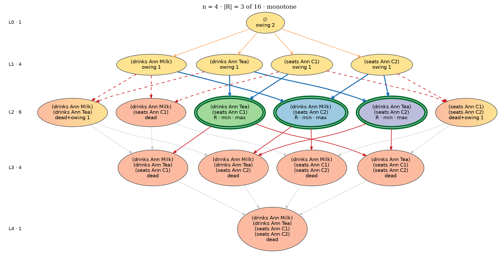
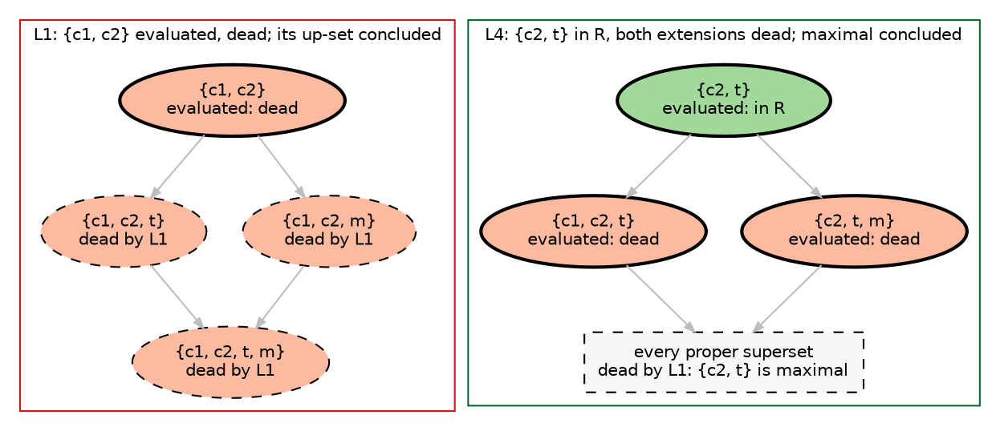
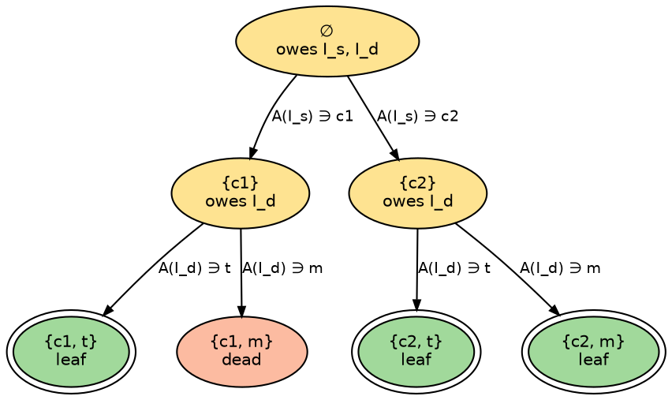

# Finding R: the oracle and the routes

The answer to a program is the region $R$ of its commitments ([Solution semantics § 2](06-solution-semantics.md)).
There are two ways to know it:

- **the oracle** is the definition evaluated: the state of every node of the lattice, $2^{n}$ of them;
- **a route** is any computation that evaluates the node function on fewer nodes and concludes the rest, or a
  statement about $R$, through **licences**: propositions that say what the value at one node decides about others.

The oracle is the reference: every answer a route gives is the oracle's
([Q-M1e2.32](../../../decisions/answer/Q-M1e2.32-no-two-commands-disagree-and-the-oracle-is.md)), and a question about
$R$ needs only as much of the lattice as decides it
([Q-M1e2.31](../../../decisions/answer/Q-M1e2.31-each-question-about-r-does-the-least-work-it.md)). This page states
the reference, each licence as a lemma with its condition and its argument, and the theorem that a computation which
concludes only through licences returns the oracle's answer. It names no procedure: in which order nodes are
evaluated, and what is done when a bound on the work is reached, is an implementation's, and an implementation is
right exactly when each of its conclusions is an instance of a lemma below. The routes of the engine that ships, as
procedures, and the tests that hold them to the oracle are
[hypotheses and the answer, in code](../../ein.rs/08-reasoning-in-code/03-hypotheses-and-the-answer.md).

**The symbols** are those of [Solution semantics](06-solution-semantics.md): $H$ and $n = \lvert H \rvert$;
$\operatorname{st}(C) = \operatorname{sat}(\mathrm{root} \cup C)$; $\operatorname{dead}$, $\operatorname{alive}$,
$\operatorname{Owed}$, $\operatorname{owes}$ and $\operatorname{discharged}$, read on a commitment through
$\operatorname{st}$; $\operatorname{cl}(C) = \operatorname{st}(C) \cap H$; $\uparrow C$ and $\downarrow C$; $N$, $E$,
$\min R$, $\max R$, $k_s$ and $k_c$. A commitment is **closed** when $\operatorname{cl}(C) = C$, and
$\operatorname{MinTr}(\mathcal{F})$ is the minimal transversals of a family $\mathcal{F}$ of sets.

## 1. A node

$$
\mathrm{root} = \operatorname{sat}(K_0), \qquad
\operatorname{st}(C) = \operatorname{sat}(\mathrm{root} \cup C) \quad (C \subseteq H), \qquad
R = \lbrace\, C \subseteq H : \operatorname{alive}(C) \land \operatorname{owes}(C) = 0 \,\rbrace
$$

Root is the program's own knowledge base saturated once, and it is never changed: a node's state is computed from a
copy of it, so nothing a node derives reaches root or another node. $H$ is built once, at root
([Hypothesis generation](04-hypothesis-generation.md)), and its structure is
[the hypothesis space](05-hypothesis-space.md)'s.

**One node function.** $\operatorname{st}$ is a function of the commitment alone. So two computations that evaluate
one node read the same state there, and can differ only in **which nodes they evaluate**:

$$
\forall C \subseteq H:\quad \big( \operatorname{dead}(C),\; \operatorname{Owed}(C),\; \operatorname{cl}(C) \big) \text{ is one value, whoever asks}
$$

$\operatorname{sat}$ fires its rules in one order, the same at root and at every node
([Saturation](02-saturation.md)); on a monotone program the order decides no node's fixpoint beyond what it decides
of root's ([Monotone and non-monotone programs § 3.4](08-monotonicity.md#34-the-verdict-is-relative-to-root)). A node's
**core**, the facts its contradiction rests on, is an explanation and no part of the answer ([Cores](09-cores.md)).

**A dead node is decided by its first contradiction.** Saturation only adds, so every knowledge base $K'$ it passes
through on the way to $\operatorname{st}(C)$ is a subset of it:

$$
\mathrm{root} \cup C \;\subseteq\; K' \;\subseteq\; \operatorname{st}(C) \;\;\land\;\; \operatorname{dead}(K') \;\implies\; \operatorname{dead}(C)
$$

A contradiction once derived is never retracted. So where a computation needs of a dead node only that it is dead,
any such $K'$ decides it. On a monotone program that is all any question needs of a dead node: $R$, $N$ and every
count are functions of the alive nodes' states and the dead nodes' being dead. What a dead node owes, its closure,
and its core are properties of the whole $\operatorname{st}(C)$, and a computation that reads one of them reads the
whole state; so does the oracle, and so does every computation on a program that is not proved monotone, where
nothing is known of a node but its own fixpoint.

## 2. The oracle: the cube

**The oracle is the table of the node function**, and $R$ read off it:

$$
\mathcal{O} \;=\; \big\lbrace\, \big( C,\; \operatorname{dead}(C),\; \operatorname{Owed}(C),\; \operatorname{cl}(C) \big) \;:\; C \subseteq H \,\big\rbrace,
\qquad \lvert \mathcal{O} \rvert = 2^{n},
\qquad R = \lbrace\, C : \lnot \operatorname{dead}(C) \land \operatorname{Owed}(C) = \emptyset \,\rbrace
$$

It concludes nothing it has not evaluated, so on a monotone program it is $R$ by definition, and on any other it is
the region of the one construction of a node, and no more (§ 3). Everything a description of $R$ needs is a function
of the table:

- $N$, the minimal dead sets, and $E$, the minimal discharging sets;
- the two lines, $\min R$ and $\max R$;
- the components, the maximal sub-cubes, the holes, and the counts $k_s$ and $k_c$.

Its cost is $2^{n}$ evaluations of $\operatorname{st}$, so it exists as a computation only for small $n$; as a
definition it exists for every program.

The running example of [the hypothesis space](05-hypothesis-space.md): one guest owed a chair, $c_1$ or $c_2$, and a
drink, $t$ or $m$, each relation functional, and nobody at the first chair drinks milk. Its table has sixteen rows,
drawn by the engine as the lattice, $\emptyset$ at the top:

Amber is owing, red dead, a red and amber node dead and owing at once, and a filled node with a double heavy border
a member of $R$, each a component of its own and so each a colour of its own
([Solution semantics § 1.5](06-solution-semantics.md#15-commitment-node-state) has the legend). Read off the table:

$$
R = \lbrace \lbrace c_1, t \rbrace, \lbrace c_2, t \rbrace, \lbrace c_2, m \rbrace \rbrace, \qquad
N = \lbrace \lbrace c_1, c_2 \rbrace, \lbrace t, m \rbrace, \lbrace c_1, m \rbrace \rbrace, \qquad
\operatorname{Dead} = \bigcup_{D \in N} \uparrow D \;\; (8 \text{ nodes})
$$

The sections below say how much of this table a computation may leave unevaluated.

**What the oracle is not.** It evaluates each node by saturation and takes $H$ from the ladder, so it is the
reference every route is held to, not a check of those two: a derivation saturation would miss, or a candidate the
ladder never proposes, is missing from the oracle's $R$ as from every route's. A relation the ladder leaves out is
named in every answer
([Solution semantics § 1.4](06-solution-semantics.md#14-candidate-and-universe)).

## 3. A program the static check flags

A program is **flagged** when it is not proved monotone
([Monotone and non-monotone programs](08-monotonicity.md)). On such a program a dead set can have an alive superset,
and an alive superset of a member of $R$ can owe:

$$
\operatorname{dead}(D) \land D \subseteq C \;\not\Rightarrow\; \operatorname{dead}(C), \qquad
C \in R \land C \subseteq C' \land \operatorname{alive}(C') \;\not\Rightarrow\; C' \in R
$$

No conclusion from one node about another is sound, and every question needs the table of § 2. A computation that
evaluates the layers $L_0, L_1, \dots$ in order can still stop where its question is decided.

Two things a flagged program keeps. The licence **L0**, which holds of every program: a fork only adds, so

$$
\operatorname{dead}(\emptyset) \implies \forall C \subseteq H.\; \operatorname{dead}(C)
$$

And one question needs no licence: **where $\emptyset \in R$, the minimal line is $\lbrace \emptyset \rbrace$**,
since $\emptyset$ is below every commitment, and whether $\emptyset$ is in $R$ is root's fixpoint alone. So every
question about the minimal line is decided by root, one evaluation, on a flagged program as on any other
([Q-M1f.23](../../../decisions/read-out/Q-M1f.23-where-root-decides-a-flagged-programs-minimal.md)).

**What a part of the table certifies.** Suppose the layers $L_0, \dots, L_k$ have been evaluated, and no other
node.

| the question | what the part certifies |
|---|---|
| $j$ elements of $R$ | each member of $R$ met is a member of $R$, as the oracle's node is. *There are only $i < j$* needs $k = n$ |
| is $R$ one state? | *several* is certified at the second state met. *One* and *none* need $k = n$ |
| $\min R$ | a member met with no member of $R$ below it is minimal, every subset of it having been evaluated first; so the minimal elements of size at most $k$ are certified, and where $\emptyset \in R$ the whole line |
| $\max R$, and a description of $R$ | $k = n$: a maximal element is known only when everything above it is |

Short of the whole table a question about a line certifies what a description certifies, no more
([Q-M1e2.19](../../../decisions/answer/Q-M1e2.19-past-the-limit-a-line-mode-certifies-what.md)).

**On a flagged program nothing is claimed of the answer**: not soundness, not correctness, not completeness.
Saturation there can depend on the path a node is built by,

$$
\operatorname{sat}(\mathrm{root} \cup C_1 \cup C_2) \;\neq\; \operatorname{sat}(\operatorname{sat}(\mathrm{root} \cup C_1) \cup C_2) \quad \text{is possible}
$$

and on the order rules fire in, so *the set of nodes* is not one object. Every node is built one way,
$\operatorname{st}(C)$ with all of $C$ added to root's fixpoint at once, and the oracle and every question are about
the region of that construction
([Q-M1e2.2](../../../decisions/answer/Q-M1e2.2-a-node-is-a-fork-of-root-an-assumption-on.md)). They agree with each
other; that the region is the program's meaning is not claimed.

## 4. A monotone program: three properties and the licences

Where growth of a commitment can neither take a conclusion away nor add a debt, three properties hold, for all
$D \subseteq C \subseteq H$:

$$
\begin{aligned}
\operatorname{dead}(D) &\implies \operatorname{dead}(C) && \text{dead is upward-closed} \\
\operatorname{owes}(D) = 0 &\implies \operatorname{owes}(C) = 0 && \text{discharged is upward-closed} \\
\operatorname{st}(C) &= \operatorname{st}(\operatorname{cl}(C)) && \operatorname{cl} \text{ is a closure operator}
\end{aligned}
$$

A **licence** is a proposition of the form *the values of the node function on these nodes decide this statement
about other nodes, or about $R$*. Each holds of a class of program. A computation skips a node, or concludes a line,
only through a licence.

| licence | statement | what it decides without evaluation |
|---|---|---|
| **L0** a fork only adds | $\operatorname{dead}(\emptyset) \implies \forall C.\; \operatorname{dead}(C)$ | every node, on every program |
| **L1** dead is upward-closed | $\operatorname{dead}(D) \land D \subseteq C \implies \operatorname{dead}(C)$ | every superset of a set known dead. A candidate dead alone is in no member of $R$ |
| **L2** discharged is upward-closed | $C \in R \land C \subseteq C' \land \operatorname{alive}(C') \implies C' \in R$ | what an alive node above a member of $R$ owes: nothing. Where $\emptyset \in R$, $R$ is the whole alive set |
| **L3** a commitment's state is its closure's | $\operatorname{st}(C) = \operatorname{st}(\operatorname{cl}(C))$ | every commitment of a class but its closed set: closed **states** are evaluated, not commitments, and $k_c$ is counted (§ 6) |
| **L4** the lines are local | $s \in R \land \forall b \notin s.\; \operatorname{dead}(s \cup \lbrace b \rbrace) \implies s \in \max R$; and $s \in R \land \forall b \in s.\; \operatorname{owes}(s \setminus \lbrace b \rbrace) > 0 \implies s \in \min R$ | everything above, or below, a member of a line: a member is certified from at most $n$ nodes |
| **L5** an owed instance's alternatives are exhaustive | for $C$ alive, owing a licensed instance $I$ with alternatives $\operatorname{alt}(I)$: $\;D \in R \land C \subseteq D \implies \exists a \in \operatorname{alt}(I).\; a \in \operatorname{cl}(D)$ | every extension of $C$ by a candidate that is not an alternative of $I$. An alive node owing an instance whose every alternative is dead has no member of $R$ above it |
| **L7** the cube | the definition | nothing: $2^{n}$ evaluations decide everything. The oracle, and every question on a flagged program |
| **L8** what a state denies is dead above it | $\lnot b \in \operatorname{st}(s) \implies \operatorname{dead}(s \cup \lbrace b \rbrace)$ | the extension of a state by a candidate the state's own rules have already denied |
| **L9** a fact nothing proposes and nothing writes is in no state | a witness $w$ of $I$ with $w \notin H$, $w \notin \mathrm{root}$, of a relation no rule concludes and no symmetry mirrors, is in no $\operatorname{st}(C)$; so where every other witness of $I$ is a candidate or denied at root, L5 holds of $I$ with $\operatorname{alt}(I) = H \cap \operatorname{witnesses}(I)$ | what L5 decides, for an instance L5 alone does not license |

There is no licence numbered six.

**The arguments.**

*L0.* $\operatorname{st}(C) \supseteq \mathrm{root}$ for every $C$, and a contradiction is facts.

*L1, L2, L3* are the three properties. L2 follows from the second: $C$ is discharged, so $C'$ is, and $C'$ is alive
by assumption. L3 is the third: $\operatorname{cl}(C)$ adds to $C$ only facts $\operatorname{st}(C)$ already holds,
so saturating with them added derives nothing more and, the state being monotone in the commitment, nothing less.

*L4.* If some $C' \in R$ had $C' \supsetneq s$, then for $b \in C' \setminus s$ the node
$s \cup \lbrace b \rbrace \subseteq C'$ would be alive, by L1 read downward, and the premise says it is dead. If
some $C' \in R$ had $C' \subsetneq s$, then for $b \in s \setminus C'$ the node
$s \setminus \lbrace b \rbrace \supseteq C'$ would be alive, being below $s$, and discharged, by L2, and the premise
says it owes.

*L5.* Let $C$ owe $I$ and let $D \supseteq C$ be a member of $R$. On a monotone program the trigger of $I$ reads only
relations no commitment changes, so $I$ is an instance at $D$ too, and $D$ is discharged, so the witness of $I$ holds
there. **The premise**, which is what *licensed* means: every read of the witness beside its witness step reads a
relation no commitment changes, so the witness holds at $D$ exactly when a witness fact $w$ is in
$\operatorname{st}(D)$, and $w$ is one of the payments the guard admits at root
([Hypothesis generation § 4.1](04-hypothesis-generation.md#41-an-instance-and-the-facts-that-would-pay-it)); and
each payment is a candidate, or has its negation stored at root, which no alive state can hold beside it. So $w$ is a
candidate, $w \in \operatorname{cl}(D)$, and $w \notin \operatorname{cl}(C)$ since $C$ owes $I$. The alternatives are
the payments that are candidates:

$$
\operatorname{alt}(I) \;=\; \operatorname{pay}(I) \cap H
$$

The premise is needed: a guard that read a relation a commitment can grow could be paid by a fact already in $C$.
Why an obligation's alternatives are jointly exhaustive in general is [Satisfiability § 4](10-satisfiability.md).

*L8.* $\operatorname{st}(s \cup \lbrace b \rbrace) \supseteq \operatorname{st}(s) \ni \lnot b$, and it holds $b$: a
fact beside its stored negation.

*L9.* A fact enters a state only by being committed, by being in root, by a rule concluding it, or as the mirror of
a fact of a symmetric relation. A witness that is no candidate, is not in root, and is of a relation no rule
concludes and no symmetry mirrors enters none, so the alternatives of the instance are its witnesses in $H$.

**The trivial lines.** On a program with restrictions only, root alive gives $\emptyset \in R$, so
$\min R = \lbrace \emptyset \rbrace$ from one evaluation; with obligations only, $\max R = \lbrace H \rbrace$: both
are read off the program's shape and need no enumeration
([Solution semantics § 2.4](06-solution-semantics.md#24-shape)).

**Each licence's premise is a condition, and a computation is held to it.**

- The premises of L5 and L9 are conditions on an instance that root decides: an instance root owes is licensed only
  where its premise holds, and the reason is known where it does not. On a monotone program a node owes no instance
  root does not, so the instances of root are all there are.
- The three properties are consequences of the program being monotone. A node that contradicts one of them, an alive
  set above a dead one, a member of $R$ with an owing alive extension, a node owing an instance root did not, is a
  counterexample to the proof of monotonicity, never an answer: a computation that meets one has no $R$ to report.

**The licences on the lattice.** Two of them, on the table of § 2:

A heavy outline is a node whose state was evaluated, a dashed outline a conclusion no evaluation was needed for.

## 5. What is known dead, and what happens to a refuted candidate

On a monotone program everything a computation has learnt about death is one family of sets, and its up-set:

$$
\mathcal{K} \;=\; \lbrace\, D : D \text{ was evaluated and found dead} \,\rbrace \;\cup\; \lbrace\, s \cup \lbrace b \rbrace : s \text{ an alive state met},\; \lnot b \in \operatorname{st}(s) \,\rbrace,
\qquad
\bigcup_{D \in \mathcal{K}} \uparrow D \;\subseteq\; \operatorname{Dead}
$$

by L1 and L8. A node above a member of $\mathcal{K}$ needs no evaluation: it is dead.

**A refuted candidate.** Suppose $\lbrace h \rbrace$ is evaluated and found dead.

- **Nothing is added to root.** Root holds no $\lnot h$ on that account.
- **$\lbrace h \rbrace \in \mathcal{K}$.** Every commitment that holds $h$ is above $\lbrace h \rbrace$, so it is dead
  by L1, and no state is ever extended by $h$: $R$ lies inside the lattice over $H \setminus \lbrace h \rbrace$.
- **In general, a dead set $D$ takes all of $\uparrow D$ out of where $R$ can be.**

$$
\operatorname{dead}(\lbrace h \rbrace) \implies R \subseteq 2^{H \setminus \lbrace h \rbrace}, \qquad
\operatorname{dead}(D) \implies R \cap \uparrow D = \emptyset
$$

**Why a refutation is a constraint on commitments and not a fact of root.** Were $\lnot h$ added to root, every node
would be computed from another root:

$$
\operatorname{sat}(\mathrm{root} \cup \lbrace \lnot h \rbrace \cup C) \;\neq\; \operatorname{sat}(\mathrm{root} \cup C) \quad \text{is possible}
$$

1. **It would change the answer.** $R$ is defined over $\operatorname{st}(C)$, root's fixpoint with $C$ added and
   nothing else. With $\lnot h$ in root, every rule that reads the negation could fire in every other node, so
   states, and with them $R$, could differ from the definition.
2. **It is sound only on a monotone program.** On a flagged program $\lbrace h \rbrace$ dead says nothing about the
   sets above it.
3. **Every computation must read the same node.** They can only if every node is built from one root that nothing
   changes (§ 1).

**What is kept of a death** is the set that was evaluated and found dead, not the smaller set its contradiction
rests on, which is a core's to say. A denial is the other source: a state's own rules store $\lnot b$, by
elimination within a domain for instance, and L8 reads it. It is a refutation of $b$ *relative to that state*.

## 6. The routes, question by question

A **route** for a question is a set $V \subseteq 2^{H}$ of evaluated nodes together with a derivation of the
question's answer from the values of the node function on $V$, each step of which is an instance of a licence. The
propositions below are what such derivations are made of, one group per question of
[Solution semantics § 5](06-solution-semantics.md). Each holds on a monotone program; none says in which order
anything is evaluated.

### 6.1 All of R: the alive states

**The alive states are generated by one-candidate extensions.** Let $\mathcal{C}$ be the alive closed sets. By L3
every alive commitment's state is a member's, and

$$
T \in \mathcal{C},\; T \neq \operatorname{cl}(\emptyset) \;\implies\; \exists s \in \mathcal{C},\; b \in T \setminus s.\quad s \subsetneq T \,\land\, T = \operatorname{cl}(s \cup \lbrace b \rbrace)
$$

*Argument.* Take $s$ a maximal closed proper subset of $T$; one exists, since
$\operatorname{cl}(\emptyset) \subsetneq T$ is closed. For $b \in T \setminus s$, the set
$\operatorname{cl}(s \cup \lbrace b \rbrace)$ is closed, lies inside $T$, and is strictly larger than $s$, so it is
$T$. And $s$ is alive, being below $T$ (L1).

So the nodes $s \cup \lbrace b \rbrace$, $s \in \mathcal{C}$, $b \in H \setminus s$, decide everything: at most
$\lvert \mathcal{C} \rvert \cdot n$ evaluations, where the table has $2^{n}$ rows. Of those, a node above a member
of $\mathcal{K}$ needs none (§ 5), and a node whose closure is a state already known adds none. Everything a
description needs follows:

$$
\begin{aligned}
R / {\sim} &= \lbrace\, T \in \mathcal{C} : \operatorname{owes}(T) = 0 \,\rbrace \\
N &= \operatorname{MinTr} \lbrace\, H \setminus b : b \in \max \mathcal{C} \,\rbrace \\
\max R &= \lbrace\, b \in \max \mathcal{C} : \operatorname{owes}(b) = 0 \,\rbrace
\end{aligned}
$$

and where $R = \emptyset$ with root alive, $\max \mathcal{C}$ is the **owing frontier**: the maximal alive states,
each owing.

**A class is counted from the closed sets inside it.** For a closed alive $T$, let $M(T)$ be its maximal closed
proper subsets. A commitment $C \subseteq T$ generates $T$ exactly when it lies inside none of them:

$$
[T] \;=\; \lbrace\, C \subseteq T \;:\; \forall m \in M(T).\; C \not\subseteq m \,\rbrace, \qquad
\min\, [T] \;=\; \operatorname{MinTr} \lbrace\, T \setminus m : m \in M(T) \,\rbrace
$$

since $\operatorname{cl}(C) \neq T$ puts the closed set $\operatorname{cl}(C)$, and $C$ with it, inside some
$m \in M(T)$, and $C \subseteq m$ gives $\operatorname{cl}(C) \subseteq m \neq T$. Every subset of $T$ has its
closure among the closed subsets of $T$, so the classes of those partition $2^{T}$, and

$$
\lvert [T] \rvert \;=\; 2^{\lvert T \rvert} \;-\; \sum_{S \,\in\, \mathcal{C},\; s \subsetneq T} \lvert [s] \rvert, \qquad
k_c \;=\; \sum_{T \,\in\, R / {\sim}} \lvert [T] \rvert, \qquad
\min R \;=\; \min \bigcup_{T \,\in\, R / {\sim}} \min\, [T]
$$

$k_c$ is counted, and the minimal line found, without one commitment of a class being evaluated beyond what decides
$M(T)$.

**Which $M(T)$ is complete.** Let $M \subseteq M(T)$ be the maximal closed proper subsets known. Then

$$
M = M(T) \iff \forall X \in \operatorname{MinTr} \lbrace\, T \setminus m : m \in M \,\rbrace.\;\; \operatorname{cl}(X) = T
$$

*Argument.* A missing $m' \in M(T) \setminus M$ lies inside no member of $M$, so it meets every $T \setminus m$ and
holds a minimal transversal $X$, with $\operatorname{cl}(X) \subseteq m' \neq T$. Conversely a transversal $X$ with
$\operatorname{cl}(X) \neq T$ lies inside some member of $M(T)$, which is no member of $M$, since $X$ lies inside none
of those.

### 6.2 Members of R: the leaves

Where root owes, the members of $R$ are far from $\emptyset$ and L5 says where. For a closed $C$, define by
recursion on the lattice, from $C$ upward:

$$
\operatorname{Leaves}(C) \;=\;
\begin{cases}
\emptyset & \text{if } \operatorname{dead}(C) \\
\lbrace C \rbrace & \text{if } \operatorname{alive}(C) \land \operatorname{owes}(C) = 0 \\
\displaystyle\bigcup_{a \in \operatorname{alt}(I)} \operatorname{Leaves}\big( \operatorname{cl}(C \cup \lbrace a \rbrace) \big) & \text{if } C \text{ is alive and owes a licensed instance } I \\
\displaystyle\bigcup_{b \in H \setminus C} \operatorname{Leaves}\big( \operatorname{cl}(C \cup \lbrace b \rbrace) \big) & \text{if } C \text{ is alive and owes, and no instance it owes is licensed}
\end{cases}
$$

In the third case $I$ is any one licensed instance $C$ owes. Each argument on the right is a strictly larger closed
set, so the recursion ends.

**Covering.** Every leaf is a member of $R$, and every member of $R$ above $C$ has a leaf inside its closure:

$$
\operatorname{Leaves}(C) \subseteq R, \qquad
D \in R \,\land\, C \subseteq D \;\implies\; \exists \ell \in \operatorname{Leaves}(C).\;\; \ell \subseteq \operatorname{cl}(D)
$$

*Argument*, by induction from the top of the lattice down. If $C$ is dead nothing above it is in $R$ (L1). If $C$ is
in $R$ it is its own leaf. If $C$ owes a licensed $I$, then $\operatorname{cl}(D)$ holds some $a \in \operatorname{alt}(I)$ (L5), so
$\operatorname{cl}(D) \supseteq \operatorname{cl}(C \cup \lbrace a \rbrace)$, and the induction applies to that set
and $\operatorname{cl}(D)$, which is in $R$ (L3). Otherwise $D \neq C$, since $C$ owes, so some $b \in D \setminus C$
gives $\operatorname{cl}(D) \supseteq \operatorname{cl}(C \cup \lbrace b \rbrace)$.

With $C = \operatorname{cl}(\emptyset)$, which is below every closure:

$$
R \;=\; \lbrace\, D \subseteq H \;:\; \operatorname{alive}(D) \,\land\, \exists \ell \in \operatorname{Leaves}(\operatorname{cl}(\emptyset)).\; \ell \subseteq \operatorname{cl}(D) \,\rbrace
$$

by L2: an alive set whose closure is above a member of $R$ is a member. **Every minimal state of $R$ is a leaf**: it
has a leaf inside it, and the leaf is a state of $R$. **Which instance is chosen in the third case decides how many
nodes are evaluated and never the set $R$**, since the covering holds for every choice; a choice may be guided by
the coupling of [the hypothesis space](05-hypothesis-space.md#the-coupling-a-route-reads-the-whole-node-alone).

For the table of § 2, with $I_{\mathrm{s}}$ the chair owed and $I_{\mathrm{d}}$ the drink, choosing $I_{\mathrm{s}}$
first:

An arrow adds one alternative of the instance its tail owes. Seven nodes are evaluated, and
$\operatorname{Leaves}(\emptyset)$ is the three members of $R$. The nine other rows of the table are not needed to
know that: no member of $R$ lies anywhere but above a leaf.

### 6.3 The maximal line

From a member $s$ of $R$, a maximal member above it exists, and L4 certifies one from its one-candidate extensions:
a chain $s = s_0 \subsetneq s_1 \subsetneq \dots$ of alive closed sets, each
$s_{i+1} = \operatorname{cl}(s_i \cup \lbrace b \rbrace)$ for an alive extension, ends at a member of $R$ (L2) every
extension of which is dead, which is maximal (L4).

**Which set of maximal elements is all of them.** Let $C_0$ be an alive set and $M$ a set of maximal alive sets
above $C_0$. Then

$$
M \;=\; \max \operatorname{Alive} \cap \uparrow C_0
\iff
\forall X \in \operatorname{MinTr} \lbrace\, H \setminus b : b \in M \,\rbrace.\;\; \operatorname{dead}(C_0 \cup X)
$$

*Argument.* A maximal alive $b' \supseteq C_0$ outside $M$ lies inside no member of $M$, so it meets each
complement and holds a minimal transversal $X$, and $C_0 \cup X \subseteq b'$ is alive (L1). Conversely an alive
$C_0 \cup X$ lies inside a maximal alive set, which holds $X$ and so is inside no member of $M$. This is the
criterion by which an enumeration of maximal sets knows it has ended: every transversal is either dead, or the seed
of a maximal set not yet known. With it,

$$
\max R \;=\; \lbrace\, b \in \max \operatorname{Alive} : \operatorname{owes}(b) = 0 \,\rbrace
$$

and every maximal state of $R$ lies above a minimal one, so taking $C_0$ over the leaves of § 6.2 reaches all of
them.

### 6.4 The minimal line

**A member of $R$ shrinks to a minimal one, one candidate at a time.** For $C \in R$ and $x \in C$:

$$
C \setminus \lbrace x \rbrace \notin R \;\implies\; \forall C' \in R.\;\; C' \subseteq C \implies x \in C'
$$

*Argument.* $C \setminus \lbrace x \rbrace$ is alive, being below $C$ (L1), so it owes; then every subset of it owes,
by L2 read downward. So a candidate that cannot be dropped once can never be dropped below, and a set from which no
candidate can be dropped is minimal (L4): each candidate of $C$ needs to be tried once.

**The whole line, by duality.** An alive set is outside $R$ exactly when an owing alive state holds it (L2), so with
$\mathcal{W}$ the maximal owing alive sets:

$$
\min R \;=\; \lbrace\, X \in \operatorname{MinTr} \lbrace\, H \setminus w : w \in \mathcal{W} \,\rbrace \;:\; \operatorname{alive}(X) \,\rbrace
$$

*Argument.* An alive $C$ is in $R$ exactly when it lies inside no member of $\mathcal{W}$, that is, when it meets
every complement. A minimal member of $R$ is then a transversal, and a minimal one: a proper subset that was still a
transversal would be alive and in $R$.

### 6.5 A part of the answer

Every proposition above concludes from the nodes it names, whatever else has or has not been evaluated. So a
computation that ends before its question is decided has still derived only true statements: the members of $R$ it
has found are members, a line member it has certified is one, and what it has not decided it has not claimed. **It
reports a part of $R$, never a different $R$**
([Q-M1d.1](../../../decisions/answer/Q-M1d.1-a-search-stops-early-only-on-a-decided-question.md)).

## 7. Proving that R is one state without the lattice

*Is $R$ one state?* is decided from the leaves and one layer of extensions. Let
$\Lambda = \operatorname{Leaves}(\operatorname{cl}(\emptyset))$, which is
$\lbrace \operatorname{cl}(\emptyset) \rbrace$ where $\emptyset \in R$.

$$
\begin{aligned}
\Lambda = \emptyset &\implies R = \emptyset \\
\lvert \Lambda \rvert \ge 2 &\implies k_s \ge 2 \\
\Lambda = \lbrace s \rbrace \,\land\, \exists b \notin s.\; \operatorname{alive}(s \cup \lbrace b \rbrace) &\implies k_s \ge 2 \\
\Lambda = \lbrace s \rbrace \,\land\, \forall b \notin s.\; \operatorname{dead}(s \cup \lbrace b \rbrace) &\implies R = [s], \quad k_s = 1
\end{aligned}
$$

*Argument.* The first is the covering of § 6.2. Two leaves are two closed sets, so two states of $R$. With one leaf
$s$, every member of $R$ has $s$ inside its closure; an alive $s \cup \lbrace b \rbrace$ is in $R$ (L2) with a
closure other than $s$, a second state; and where every $s \cup \lbrace b \rbrace$ is dead, every proper superset of
$s$ is (L1), so every member's closure is $s$ itself.

**What the proof rests on** is the nodes that decide $\Lambda$ and the at most $n - \lvert s \rvert$ extensions of
$s$, less every one of them that § 5 decides: a number of evaluations of the order of the leaves' derivation, not of
$2^{n}$. In the example of § 6.2 it is the seven nodes of the drawing, and the verdict is *several*, at the second
leaf. On a flagged program none of this holds: a dead set can have an alive superset, so the only proof is the
table.

## 8. Why two routes cannot disagree

**Theorem.** Let a computation evaluate the node function on some nodes and derive statements about other nodes and
about $R$. If every step of every derivation is an instance of a licence whose premise holds of the program, then
every statement it derives is true of the oracle's table: every commitment it calls a member of $R$ is one, and a
line, a count or a verdict it gives as certified is the oracle's.

*Argument.* Three facts, by construction:

1. **There is one node function** (§ 1). A computation and the oracle cannot disagree about a node they both
   evaluate; they can only evaluate different nodes.
2. **Each licence is a true proposition about that function** on the class of program it is stated for (§ 4), and
   each proposition of § 6 and § 7 follows from licences. A derivation made of true steps from true values ends in a
   true statement. A flagged program has L0 and the table and nothing else, so on it a computation certifies what
   the part of the table it evaluated certifies (§ 3).
3. **Nothing else is an input.** $R$ is a function of the program
   ([Q-M1e2.30](../../../decisions/answer/Q-M1e2.30-no-configuration-option-lever-or-flag-changes-r.md)): an option
   chooses how much is evaluated and which propositions are used, never which nodes are in $R$.

**Corollary.** Two routes cannot disagree: each agrees with the oracle on what it certifies. They can differ in how
much they certify, and in nothing else.

The theorem is about propositions. That an implementation's steps *are* instances of them is a claim about that
implementation, held by comparing its answers with the table on every program whose table can be computed.
