# Monotone and non-monotone programs

**What the answer is when adding a fact can take one away.** The answer to a program is the region $R$ of its
hypothesis lattice, the commitments whose state is alive and discharged
([solution semantics](06-solution-semantics.md),
[Q-M1e2.7](../../../decisions/answer/Q-M1e2.7-the-answer-is-a-region-r-of-the-hypothesis.md)). The lattice is the
domain, and it is never itself monotone or not: what can be are the functions on its nodes, a node's state and
its status (§ 2). A **monotone** program is one where growth never takes a conclusion away and never adds a debt;
there $R$ has no hole, two lines describe it, and a computation of $R$ may skip every node a licence decides
([finding R](07-finding-r.md)). This page sets the two kinds side by side: what each means, what causes the
second, how it is detected, how each looks on the lattice, what each lets a computation of $R$ simplify, and what
is claimed of a program that cannot be proved monotone. The symbols are those of [firing a rule](01-firing.md)
and [saturation](02-saturation.md).

**What is claimed of a flagged program.** A program the static check cannot prove monotone is **flagged**. It
is read as any other program is, detected, warned of, and answered under one stated reading: every node is a fork
of root, $\operatorname{st}(C) = \operatorname{sat}(\mathrm{root} \cup C)$, the answer says so, every way of
asking gives the same $R$ under that reading, and nothing is claimed of that answer
([Q-M1f.564](../../../decisions/answer/Q-M1f.564-a-non-monotone-program-loads-with-a-warning.md),
[Q-M1e2.2](../../../decisions/answer/Q-M1e2.2-a-node-is-a-fork-of-root-an-assumption-on.md)). Which reading of a
node a non-monotone program should have is not decided, and nothing below decides it.

---

## 1. R is its node set

$$
\begin{aligned}
R &= \lbrace\, C \subseteq H \;:\; \lnot\operatorname{dead}(C) \land \operatorname{discharged}(C) \,\rbrace \\
n &= \lvert H \rvert
\end{aligned}
$$

In general nothing shorter than the set describes $R$:

- **Every subset of the cube $2^H$ is the region of some program**, but one kind: a non-empty $R$ beside a dead
  $\emptyset$. Every node is a fork of root, so a dead root makes every node dead,

$$
\begin{aligned}
\operatorname{dead}(\emptyset) &\implies \forall C \subseteq H.\; \operatorname{dead}(C) \\
&\implies R = \emptyset
\end{aligned}
$$

  For any other target a program can be written whose region it is, its holes written as owing nodes.
- **There are $2^{2^n}$ subsets of the cube**, so no description shorter than the set covers all of them. The
  shortest exact form of one region is the union of its maximal sub-cubes,

$$
\begin{aligned}
{[a, b]} &= \lbrace\, C : a \subseteq C \subseteq b \,\rbrace \\
R &= \bigcup \lbrace\, [a, b] \subseteq R \ \text{maximal} \,\rbrace
\end{aligned}
$$

  It is small when $R$ is regular, and it reaches $2^{n-1}$ isolated points on parity,
  $R = \lbrace C : \lvert C \rvert \text{ even} \rbrace$.

Each shorter description is licensed by a property of the program, and § 5 orders them.

## 2. The state, the status and the program

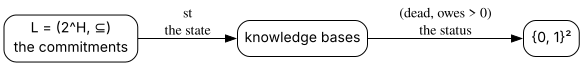

- **The lattice** $L = (2^H, \subseteq)$, the commitments over the candidate set $H$, is the domain: a Boolean
  lattice, neither monotone nor not.
- **The state**, $\operatorname{st}(C)$, is the knowledge base a node holds.
- **The status** is two functions of the state, $\operatorname{dead}$ and $\operatorname{owes}$, and
  $C \in R \iff \lnot\operatorname{dead}(C) \land \operatorname{owes}(C) = 0$.

So *monotone* is asked of an arrow, and of three of them:

| property | of | holds when | broken by | what it decides |
|---|---|---|---|---|
| **state monotone** ($\iff$ path-independent, given cumulativity, § 8.2) | $\operatorname{st} : L \to$ knowledge bases | $C \subseteq C' \implies \operatorname{st}(C) \subseteq \operatorname{st}(C')$ | an absence at odd depth over the [held extent](../01-static-ir/01-knowledge-base.md#the-relation-its-extent-a-fact-of-it) of a relation that a commitment can change; the FIFO gap (§ 8.3) | which knowledge base a node holds, and whether a node built from a parent's fixpoint is the node built from root |
| **status monotone** | $(\operatorname{dead}, \operatorname{owes})$ on states | $\operatorname{dead}$ and $\operatorname{discharged}$ are both upward-closed: $C \subseteq C'$ carries each from $C$ to $C'$ | $\operatorname{dead}$: as the state. $\operatorname{owes}$: an obligation's trigger, or an activator that applies an obligation | whether $R$ has holes, and so whether two lines describe it |
| **monotone program** | the consequence operator $T_P$, on every knowledge base | $K \subseteq K' \implies T_P(K) \subseteq T_P(K')$ | any site (§ 3) | the static check's verdict, and the licences a computation of $R$ may take |

A **monotone program** in the logic-programming sense has a consequence operator monotone on every knowledge
base. Then saturation is a closure operator ([saturation](02-saturation.md)), both arrows are monotone, and $R$
has no hole. The static check (§ 3) approximates this third property: a site says the operator is not monotone
over the relations whose held extent a commitment can change. The node functions can still be monotone on the
program's own lattice, and those programs are the check's conservative flags (§ 4).

## 3. The static check

### 3.1 What it reads

The check is read off the program's rules as root applies them, before any node is built. A **read** of a rule
is a fact pattern in its match, a premise or a part of an absence, and it reads the facts of its relation that a
state holds, the relation's held extent there. Let $\operatorname{rels}(H)$ be the relations of the candidates,
those of which a commitment can add a fact, and $D$ the relations whose held extent a commitment can **change**,
the least set with

$$
D = \operatorname{rels}(H) \cup \lbrace\, r \in \operatorname{rels}(\psi_\rho) \;:\; \rho \text{ a saturation rule with a read of a relation of } D \,\rbrace
$$

A stored negation $\lnot r(\dots)$ is counted under a pseudo-relation of its own, $\lnot r$, and not under $r$:
what a commitment proposes is a fact of $r$, and the stored negations of the facts of $r$ change only where a
rule derives one. $D$ lies inside $D^{+}$ of [absence](03-absent-and-naf.md), which also follows a rule with
parameters through its activators' relation.

Write $\operatorname{depth}$ for the number of absences a read stands inside. Every read of a rule, of a
relation $q$ at some depth, is then one of three:

| class | condition | growth of the held extent of $q$ can… |
|---|---|---|
| **static** | $q \notin D$ | nothing: it is complete at root and the same at every node |
| **dynamic, monotone polarity** | $q \in D$, monotone polarity | only add a conclusion, or only pay a debt |
| **dynamic, non-monotone polarity** | $q \in D$, non-monotone polarity | take a conclusion away, or add a debt |

The polarity is the depth's parity, read differently by the two kinds of rule. In a **saturation** rule a match
is a conclusion, and a read at odd depth, inside one absence, is non-monotone. In an **obligation** rule a match
is a *debt*, the rule being the negation of its witness, and a read at even depth is non-monotone: its
**trigger**, the positive steps that say who owes. An obligation's witness is read at odd depth there, and a
commitment that grows it can only pay.

$$
\begin{aligned}
\operatorname{site}(\rho, q) &\iff q \in D \;\land\;
\begin{cases}
\operatorname{depth}(q) \text{ odd} & \rho \text{ a saturation rule} \\
\operatorname{depth}(q) \text{ even} & \rho \text{ an obligation}
\end{cases} \\
\operatorname{site}(\rho) &\iff \rho \text{ has parameters, and } \operatorname{name}(\rho) \in D
\end{aligned}
$$

A **site** is a dynamic read at non-monotone polarity, or a rule with parameters whose name is a relation in
$D$, the relation its **activators** are facts of: a commitment can then make a node apply the rule in a way root
never did, which a check of root's applications cannot see. A program with no site is **monotone** by the check;
one with a site is **flagged**. The check costs root's saturation and builds no node.

The rule that gives a seated guest the soup unless the guest is allergic ([absence](03-absent-and-naf.md)), with
seatings and allergies as candidates, has one site:

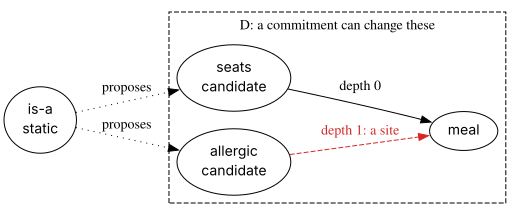

A node is a relation; a black arrow is a read at even depth into what the rule concludes, a red dashed arrow a
read under one absence. The red arrow starts inside $D$, so growing the commitment can take a meal away.

### 3.2 The theorem

**Theorem.** A program with no site has a monotone state and a monotone status, on nodes built by fork from
root:

$$
\begin{aligned}
C \subseteq C' \;\implies\;\ & \operatorname{st}(C) \subseteq \operatorname{st}(C') \\
\land\ & \bigl( \operatorname{dead}(C) \implies \operatorname{dead}(C') \bigr) \\
\land\ & \bigl( \operatorname{discharged}(C) \implies \operatorname{discharged}(C') \bigr)
\end{aligned}
$$

*Argument.* Every fact of a relation in $D$ is derived only through positive reads of relations of $D$ and reads
of static relations, whose held extent is the same at every node; so each node's fixpoint contains its subsets'
fixpoints, and
$\operatorname{dead}$ is upward-closed, a rule that ends a state matching in every larger fixpoint what it matched in
a smaller one, $\bot$ and both sides of a pair being facts. Every obligation's set of
triggered instances is fixed while its witnesses only grow, so $\operatorname{discharged}$ is upward-closed.
$\square$

Both closures together leave $R$ no hole, and its two lines describe it.

The condition is **sufficient, not necessary**. A site can be harmless on a program's own cube, and the cube is
what says whether one was (§ 4). A *monotone* verdict beside a violation the cube shows would be a defect of the
check.

### 3.3 The grain

The check reads at **relation grain**: a read is dynamic when its *relation* is in $D$, whatever its pattern.
The theorem above is stated at that grain, and the same $D$ is the one the obligations rung
of [hypothesis generation](04-hypothesis-generation.md) reads.

A finer reading, **fact grain**, calls a read dynamic only when its pattern can match a fact a commitment can
add. It builds an over-approximation of every fact some node holds beyond root, as a closure over **shapes**,
facts with some arguments replaced by a wildcard $\ast$:

$$
\mathit{Sh} = \mu X.\;\; H \cup \lbrace\, \psi_\rho\eta \;:\; \text{a read of } \rho \text{ at even depth unifies with a shape of } X \text{ under } \eta \,\rbrace
$$

where a read at depth $0$ passes its bindings to the conclusion and every other variable becomes $\ast$. Only
even depth counts, because a fork only adds: a firing a node makes and root did not had a match that was false at
root's fixpoint and true later, and growth makes a match true only through a read at even depth. Where a
commitment can derive an activator, a node can apply a rule root never applied, the closure is incomplete, and
the program stays flagged.

Fact grain is sufficient too. It would unflag a program whose dynamic reads no commitment can ever match: a
read that asks for membership under a label, $\operatorname{is-a}(a, \mathsf{House})$, where every candidate is a
membership between atoms. Ein's check does not read at it: the check and the obligations
rung read one $D$ at relation grain, so a program with a read whose relation is in $D$ is flagged whatever the
read's pattern.

### 3.4 The verdict is relative to root

A read whose relation is outside $D$ is static because root's fixpoint completes the relation's held extent and a
fork never derives a fact of it again. So *monotone* says that the operator is monotone on root's fixpoint
extended by commitments,

$$
\begin{aligned}
& K \mapsto \operatorname{sat}(\mathrm{root} \cup K) && \text{for } K \subseteq H
\end{aligned}
$$

which is what the theorem and every computation of $R$ need, and not on every knowledge base. What root itself
is, where two of its own guards chain over static relations, is the boundary's order's to say
([absence](03-absent-and-naf.md#what-is-not-provided)); the verdict takes root as given.

A node built **from scratch**, $\operatorname{sat}(K_0 \cup C)$, derives root again inside itself, and there the
FIFO gap (§ 8.3) can still reach a static read. Take the two rules of § 8.3 with $a$ given and only $b$ a
candidate:

$$
\begin{aligned}
\rho_2 &:\; a \land b \land \operatorname{absent}(q) \implies p \\
\rho_1 &:\; a \land \operatorname{absent}(z) \implies q \\
a &\in K_0 \\
H &= \lbrace b \rbrace
\end{aligned}
$$

$q$ is derived from a given fact under an absence over a relation of which nothing derives a fact, so
$q \notin D$ and the
program has no site. Built by fork, $\lbrace b \rbrace$ inherits root's $q$ and holds no $p$; built from scratch,
$\rho_2$ is admitted before $q$ exists and $\lbrace b \rbrace$ holds a stale $p$:

$$
\begin{aligned}
p &\notin \operatorname{sat}(\operatorname{sat}(K_0) \cup \lbrace b \rbrace) \\
p &\in \operatorname{sat}(K_0 \cup \lbrace b \rbrace)
\end{aligned}
$$

Every node is built by fork, so the verdict is sound for every answer given, and this program is the reason the
scope is stated.

### 3.5 What is not a site

- an absence over the held extent of a static relation: a guard over positions no commitment changes, the
  spatial reads of the Zebra puzzle;
- an obligation's witness: the absence inside *every guest owes a seat* is at odd depth of an obligation, and
  growing the seats can only pay;
- a read of a stored negation of a fact of a candidates' relation $r$: $\lnot r \in D$ only where a rule derives
  such a negation.

## 4. What the cube shows

Where the cube is small enough to enumerate, every node of it can be classified, and three counts say what a
site did:

| count | the nodes counted |
|---|---|
| **holes** | $\lbrace\, C \notin R \;:\; \exists A, B \in R.\;\; A \subset C \subset B \,\rbrace$ |
| **dead with an alive superset** | $\lbrace\, C \;:\; \operatorname{dead}(C) \;\land\; \exists C' \supset C.\; \lnot\operatorname{dead}(C') \,\rbrace$ |
| **discharged with an owing superset** | $\lbrace\, C \;:\; \operatorname{discharged}(C) \;\land\; \exists C' \supset C.\; \lnot\operatorname{discharged}(C') \,\rbrace$ |

A flagged program whose cube shows one is **exercised**, and one whose cube shows none is **conservative**. Both
are words about the **status**, which is what the cube reads. A conservative program can still have a broken
**state**: a stale fact in a node, or a parent path that reaches another state (§ 8, § 10). Where the cube is
too large to enumerate ([the region dump](../../user/04-reference/11-region-dump.md) states the limit), whether a
site bit is *not known*.

## 5. The ladder

Each step down is licensed by a property the step above does not have, and each makes a shorter description
exact:

| step | licensed by | $R$ is described by | a claimed $R$ is certified by |
|---|---|---|---|
| **general** | nothing | the node set, or its maximal sub-cubes | every node classified: $2^n$ saturations |
| **convex** | **no hole**, observed on the cube | the two lines: $R = \bigcup [a, b]$ over minimal $a \subseteq$ maximal $b$ | as above: a hole is known only once the cube is enumerated |
| **monotone** | the **static check** says *monotone*, before any search (§ 3) | the two lines, computed from the alive down-set and $N$, or from $N$ and $E$, without visiting $2^n$ nodes | $N$, $E$ and the static verdict |
| **shape** | which constraints the program states | restrictions only: the minimal line is $\lbrace \emptyset \rbrace$. Obligations only: the maximal line is $\lbrace \top \rbrace$, $\top = H$. Both, and well-posed: every component a point | as monotone |

$N$ is the set of minimal dead sets and $E$ the set of minimal discharging sets
([solution semantics](06-solution-semantics.md)):

$$
\begin{aligned}
N &= \min_{\subseteq} \lbrace\, C : \operatorname{dead}(C) \,\rbrace \\
E &= \min_{\subseteq} \lbrace\, C : \operatorname{discharged}(C) \,\rbrace
\end{aligned}
$$

**A conditional obligation makes holes as a matter of course.** *A group that sits owes its members' seats*, the
way a person writes *if you come, you all sit*: seating one member makes the group owe the others' seats, so a
node between two members of $R$ owes, and $R$ is isolated nodes among holes. Its monotone twin, *everyone must
sit*, owes every seat from root, where a seat can only pay, and its region has no hole.

## 6. The two kinds compared

Two cubes of two candidates each, one of each kind. On the left, *a guest owes a seat, and has at most one*: the
empty commitment owes, both seatings together are dead, and $R$ is the two points between. On the right, *a
seated guest dines, and a diner owes a meal*: seating the guest adds a debt the empty commitment did not have,
and the node that only seats is a hole, with the fact that repairs it on the edge above.

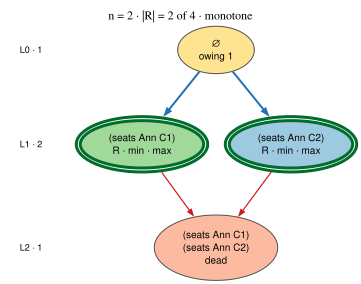

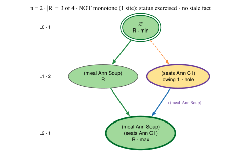

A node is a commitment, the empty one on top and each layer one candidate larger; an edge adds one candidate.
Green and blue fill is $R$, one colour a component; amber is owing, red is dead. A double border is $R$'s minimal
line, a heavy green one its maximal line, a purple one a hole.

| | monotone | non-monotone |
|---|---|---|
| **what it means** | adding a commitment never takes a conclusion away and never adds a debt | some commitment does one or the other |
| **what causes it** | nothing: no site (§ 3) | a **site**, from one of three sources: an absence at odd depth in a saturation rule over the held extent of a relation of $D$; an obligation's **trigger** over one; a rule whose **activators** are facts of a relation of $D$ (§ 9: c4, c5, c6, each a program's only site, each with the hole its cause makes) |
| **how it looks** | a **band**. Dead is an up-set, drawn at the bottom; owing is a down-set among the alive nodes, near the empty commitment; $R$ lies between, and components separate where dead and owing meet | **islands**: a node outside $R$ between two members, joined to $R$ above it by a repair edge; a dead node with an alive superset; a discharged node with an owing superset |
| **dead** | upward-closed | not, where a refutation rests on an absence over a relation whose held extent a commitment can extend, directly, through a fact derived under it, or through a rule a node applies ([absence](03-absent-and-naf.md#a-refutation-resting-on-an-absent); § 9: c2, c3, c7, c9, c11) |
| **discharged** | upward-closed | not, where a trigger grows (c5), an absence takes a witness away (c4), or a commitment applies an obligation (c6) |
| **$R$'s shape** | convex | any subset of the cube (§ 1) |
| **the lines, decided** | locally: a node of $R$ is maximal iff every edge up leaves $R$, minimal iff every edge down does | globally only. Across a hole the one-fact test calls a node a line node that is not one: on $R = \lbrace \emptyset, \lbrace A, B \rbrace \rbrace$, *$A$ and $B$ together or not at all*, the one-fact test calls $\emptyset$ maximal and $\lbrace A, B \rbrace$ minimal, and neither is |
| **$N$/$E$ duality** | holds: the minimal line is $E$'s alive members, the maximal line the discharged maximal sets that contain no member of $N$ | not guaranteed. It fails where a hole lies between the lines, and it can fail with no hole: where nothing is dead and one candidate brings a debt nothing pays, the dual's maximal set is $\top$, and $\top$ owes |
| **trivial lines** | restrictions only: the minimal line is $\lbrace \emptyset \rbrace$. Obligations only: the maximal line is $\lbrace \top \rbrace$, so it says nothing | the maximal line can differ from $\lbrace \top \rbrace$ where a trigger grows: obligations, nothing dead, and over $H = \lbrace A, B, C \rbrace$ a maximal line $\lbrace \lbrace A, B \rbrace \rbrace$ |
| **what a computation may learn from a node** | every superset of a dead set is dead, and the extension of an alive state by a candidate it denies is dead; both are remembered and cost no saturation | nothing: a dead set can have an alive superset, and a denial can be lifted by growth, so every node is classified |
| **saturation on the cube** | a **closure operator** $\operatorname{cl}(C) = \operatorname{st}(C) \cap H$: $C \subseteq \operatorname{cl}(C)$, $\operatorname{cl}(\operatorname{cl}(C)) = \operatorname{cl}(C)$, $C \subseteq C' \implies \operatorname{cl}(C) \subseteq \operatorname{cl}(C')$. $R$'s states are closed sets, each the union of the intervals $[g, \operatorname{cl}(g)]$ over its minimal generators $g$ | $\operatorname{cl}$ need not be monotone. States still partition the commitments, but not as the closed sets of a closure system |
| **a node's state** | unique, the least fixpoint: built by fork from root or by any split from a fixpoint that holds root's, the same set of facts | depends on the construction (§ 8). $R$ is defined over the fork, on a flagged program as an assumption the answer states ([Q-M1e2.2](../../../decisions/answer/Q-M1e2.2-a-node-is-a-fork-of-root-an-assumption-on.md)) |
| **holes, reported** | there are none | the minimal holes the cube shows are named, each with why it is out of $R$: dead, with its core, or what it owes |
| **certificate** | $N$, $E$ and the static verdict: polynomial in $\lvert N \rvert + \lvert E \rvert$ | the full classification of the cube |
| **detection** | static, before any search (§ 3) | the static check flags a site; only the cube says whether it bit (§ 4) |

## 7. The drawings

Seven regions, each the cube of its program, or the part of it around $R$ where the cube is large, with the
nodes a description of $R$ computed marked on it
([rendering](../../user/04-reference/12-rendering.md) is the legend). Fill is the node's status, shape is what
the computation did there, and border is the lines and the defects; a purple border is a hole, and an edge
labelled with a fact is the repair that takes the hole back into $R$. On a monotone program the computation
reads the alive states and their extensions; on a flagged one it classifies every node
([finding R](07-finding-r.md)).

**Monotone.**

| region | what it shows |
|---|---|
| restrictions only | dead is an up-set, the minimal line is $\lbrace \emptyset \rbrace$, and $R$ is the band above it |
| restrictions and obligations | owing from above, dead from below, and $R$ squeezed to isolated points, the shape of a well-posed puzzle |
| merged states | saturation moves nodes: an arrow from each transient commitment to its closure, $C \mapsto \operatorname{cl}(C)$, and several commitments to a state |

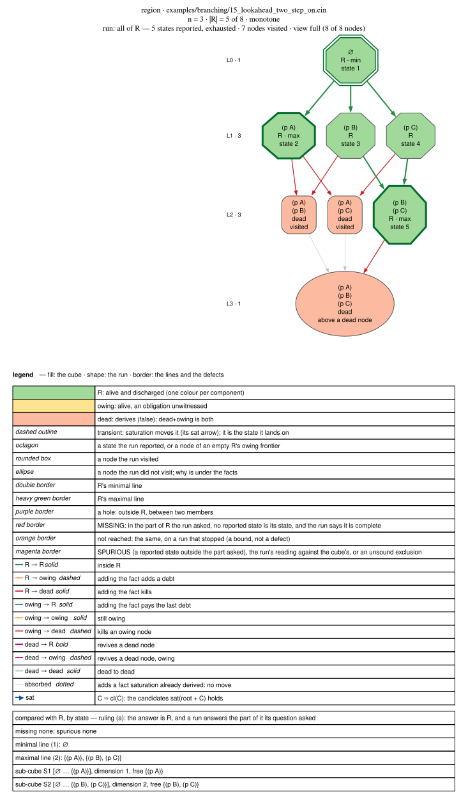

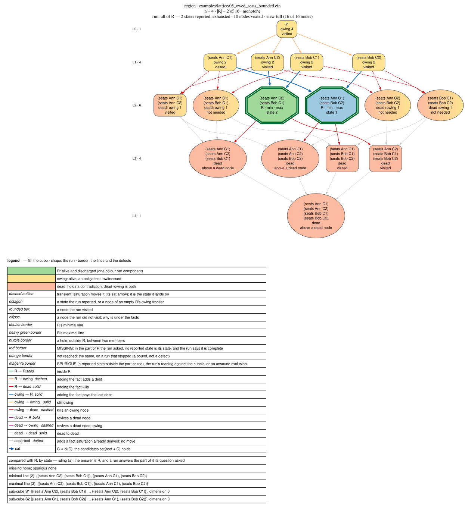

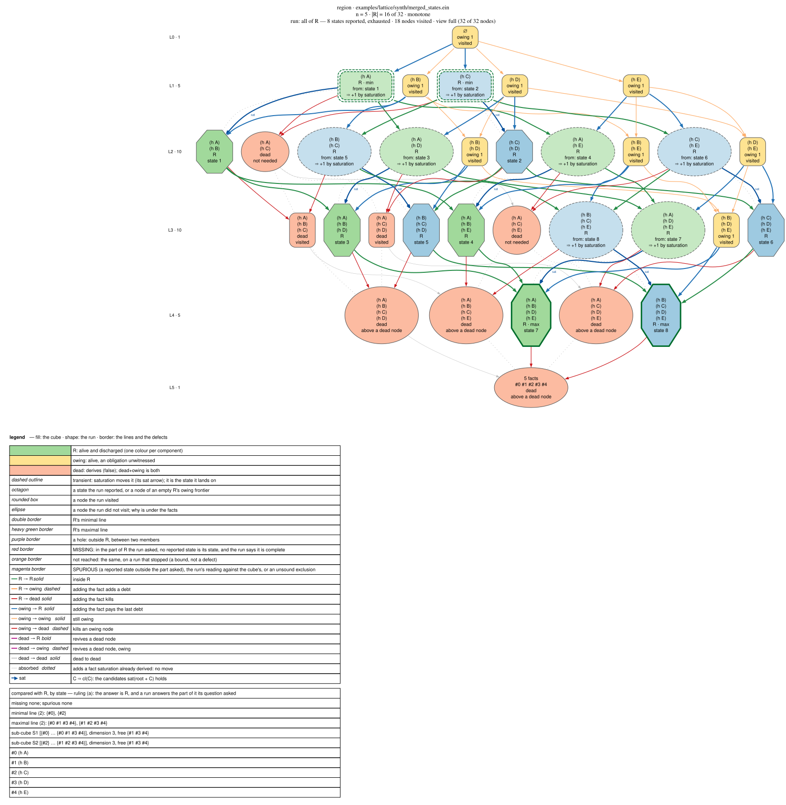

**Non-monotone**, one per cause, and one for dead holes.

| region | cause | what it shows |
|---|---|---|
| the soup and the allergy | an absence (c4) | an owing hole: being allergic takes away the soup that paid the guest's meal |
| the seated guest dines | a trigger (c5) | an owing hole: seating the guest makes her a diner, and a diner owes a meal |
| the kitchen opens | an activator (c6) | the same cube as the trigger's, by another mechanism: opening the kitchen declares that every guest owes a meal. The picture cannot tell the causes apart; the static check can |
| three components | absences that refute (c2) | three components, two of them with dead holes, each revived by a repair edge. Its refutations rest on an absence over a relation whose held extent a commitment extends, so dead is not upward-closed on it |

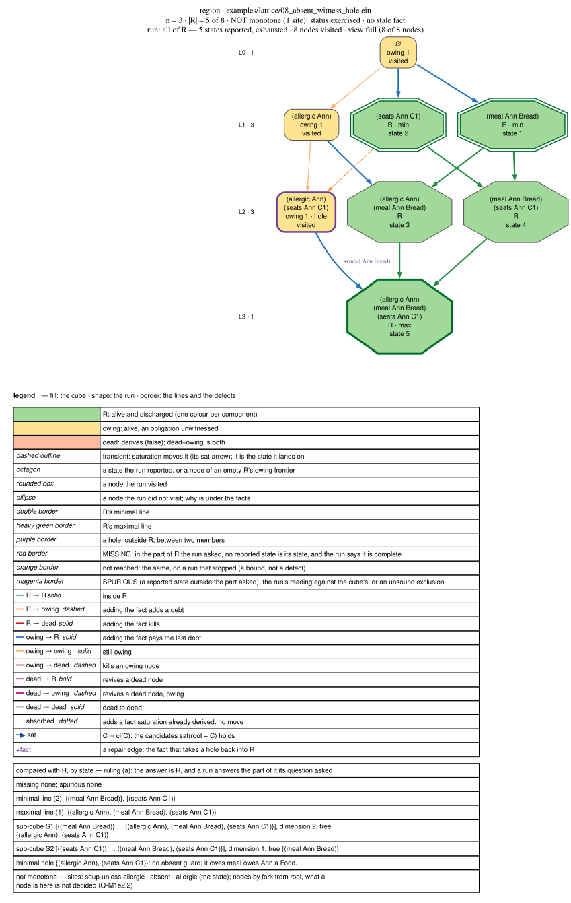

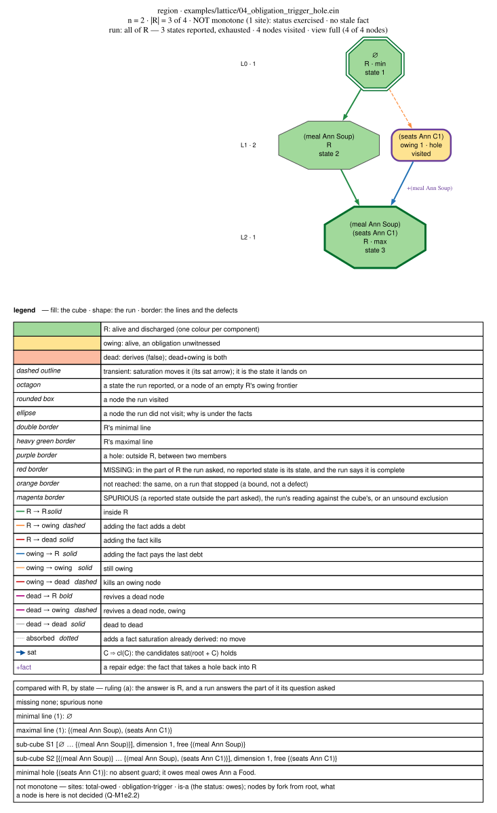

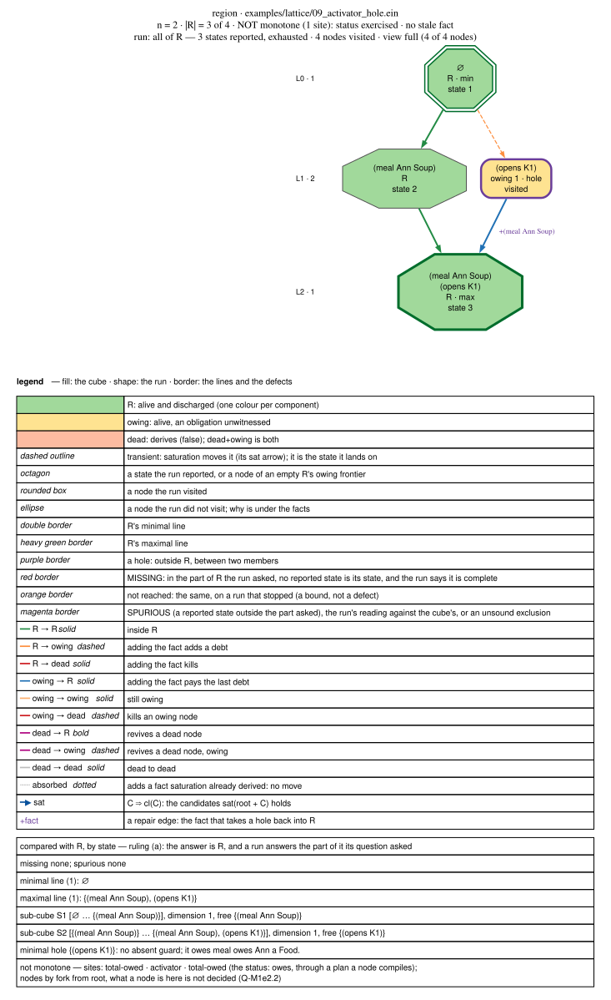

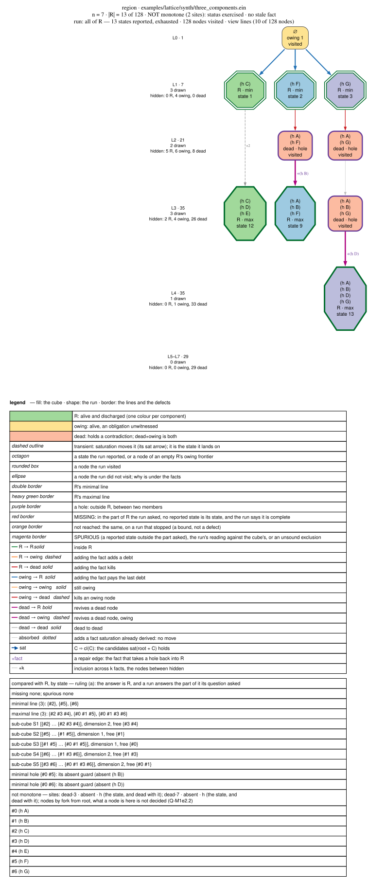

## 8. Paths and the state

### 8.1 Three constructions of a node

A node's state can be built along a path, each step taking the last fixpoint, adding the next facts and
saturating. The general question is whether

$$
\operatorname{sat}(K_0 \cup C_1 \cup C_2) = \operatorname{sat}\bigl(\operatorname{sat}(K_0 \cup C_1) \cup C_2\bigr)
$$

| construction | form |
|---|---|
| **scratch** | $\operatorname{sat}(K_0 \cup C)$ |
| **fork from root** | $\operatorname{sat}(\operatorname{sat}(K_0) \cup C)$, the case $C_1 = \emptyset$ |
| **a parent path** | $\operatorname{sat}\bigl(\operatorname{sat}(\operatorname{sat}(K_0) \cup C \setminus \lbrace h \rbrace) \cup \lbrace h \rbrace\bigr)$, and longer chains |

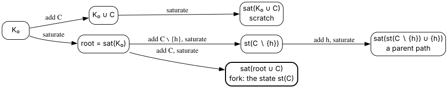

On a monotone program the three boxes on the right hold one set of facts. Every node is built from root with all
of $C$ at once, so $C_1 = \emptyset$ is the only case a computation of $R$ meets, and the definition of
$\operatorname{st}$ is the heavy box. On a flagged program the three need not agree. Take the soup and the
allergy (§ 7) with a second meal as a candidate: built at once,
$\lbrace \operatorname{seats}(\mathsf{Ann}, \mathsf{C1}), \operatorname{allergic}(\mathsf{Ann}) \rbrace$ never
serves the soup and owes Ann's meal; by way of its parent
$\lbrace \operatorname{seats}(\mathsf{Ann}, \mathsf{C1}) \rbrace$ the soup is served before the allergy arrives,
nothing takes it away, and the meal is paid. The owing hole of the fork is in $R$ by way of its parent. A
computation that extended a parent's fixpoint would build a node other than the definition's, which is why every
node is built from root.

### 8.2 Path-independent if and only if monotone, given cumulativity

Three properties of the construction, for commitments $C \subseteq C'$ and knowledge bases $X \subseteq Y$:

| property | what it says |
|---|---|
| **path-independent** | every path to $C$ gives one set of facts, $\operatorname{st}(C)$ |
| **monotone** | $C \subseteq C' \implies \operatorname{st}(C) \subseteq \operatorname{st}(C')$ |
| **cumulative** | $X \subseteq Y \subseteq \operatorname{sat}(X) \implies \operatorname{sat}(Y) = \operatorname{sat}(X)$ |

**Proposition ($\Rightarrow$ holds always).** Path-independent implies monotone.

*Argument.* Construction is append-only: a knowledge base never retracts a fact
([absence](03-absent-and-naf.md)). Take $C \subseteq C'$ and build $C'$ by way of $C$: the result holds
$\operatorname{st}(C)$, and by path independence it is $\operatorname{st}(C')$. $\square$

**Proposition ($\Leftarrow$ needs cumulativity).** If saturation is cumulative, monotone implies
path-independent.

*Argument.* Take a path $\emptyset = C_0 \subseteq C_1 \subseteq \dots \subseteq C_k = C$, with
$S_0 = \operatorname{sat}(K_0)$ and each step $S_i = \operatorname{sat}(S_{i-1} \cup C_i)$, and suppose
$S_{i-1} = \operatorname{sat}(K_0 \cup C_{i-1})$. By monotonicity $S_{i-1} \subseteq \operatorname{sat}(K_0 \cup
C_i)$, so

$$
K_0 \cup C_i \;\subseteq\; S_{i-1} \cup C_i \;\subseteq\; \operatorname{sat}(K_0 \cup C_i),
$$

and by cumulativity $S_i = \operatorname{sat}(K_0 \cup C_i)$. By induction every path ends at
$\operatorname{sat}(K_0 \cup C)$. $\square$

A monotone program is cumulative by fork, its saturation being a closure operator. A stratified program
evaluated stratum by stratum is cumulative, since its fixpoint is its perfect model. So the state has **one
property**, monotone $\iff$ path-independent, wherever saturation is cumulative, and it is broken by an absence
at odd depth over $D$ (§ 8.4) and by the FIFO gap (§ 8.3).

### 8.3 The FIFO gap

An absence is decided at the boundary of a saturation: when the positive closure quiesces, the candidates parked
on an absence are admitted one at a time, each against the knowledge base as it stands, in the agenda's order,
first in, first out within each half
([Q-M1f.313](../../../decisions/engine/Q-M1f.313-the-agenda-fires-first-what-leads-to-false.md),
[absence](03-absent-and-naf.md)). That order is not the order of the program's strata, and it breaks
cumulativity.

Take two rules, the reader written before the producer, with $a$ and $b$ the candidates:

$$
\begin{aligned}
\rho_2 &:\; a \land b \land \operatorname{absent}(q) \implies p \\
\rho_1 &:\; a \land \operatorname{absent}(z) \implies q \\
H &= \lbrace a, b \rbrace
\end{aligned}
$$

The program is stratified, $\sigma(z) < \sigma(q) < \sigma(p)$, and its perfect model at $\lbrace a, b \rbrace$
is $\lbrace a, b, q \rbrace$.

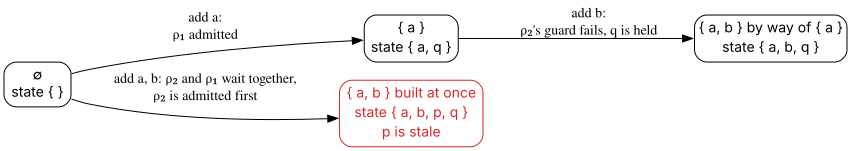

Built at once, $\rho_2$'s and $\rho_1$'s candidates wait at the same boundary and $\rho_2$ is admitted first, so
$\lbrace a, b \rbrace$ gives $\lbrace a, b, p, q \rbrace$ with $p$ **stale**: $q$ falsifies the guard it was
derived under. By way of $\lbrace a \rbrace$, $\rho_1$ has already derived $q$, $\rho_2$'s guard fails, and
$\lbrace a, b \rbrace$ gives $\lbrace a, b, q \rbrace$. The state function is monotone and the state is
path-dependent:

$$
\begin{aligned}
\lbrace a, b, q \rbrace &\subseteq \operatorname{sat}(\lbrace a, b \rbrace) \\
\operatorname{sat}(\lbrace a, b, q \rbrace) &\neq \operatorname{sat}(\lbrace a, b \rbrace)
\end{aligned}
$$

which is cumulativity failing. Every node is in $R$, so the status never shows it, and the cube calls the
program conservative. Written in the other order, or admitted in stratum order, $\lbrace a, b \rbrace$ holds
$\lbrace a, b, q \rbrace$ built at once.

### 8.4 A state difference needs an absent

**Proposition.** If two constructions of a node differ, some fact was admitted under a read that a later fact
falsifies, and that read is an absence at odd depth in a saturation rule.

*Argument.* A positive read, or one at even depth, only becomes true as facts grow, and a stored negation read
positively only grows. An activator only adds applications as facts grow, and an obligation derives nothing.
What is left is an absence at odd depth in a saturation rule, an absence site. $\square$

**An activator can hide the absence.** A rule with parameters that a node applies can read an absence over the
held extent of the relation its parameter names, $\operatorname{absent}(R(x))$ with $R$ a parameter; the program's
only site is then
the activator, and a check of root's applications does not see the absence. And an activator can hide the
absence from a refutation's derivation as well: where a rule derives an activator
$\operatorname{watch}(r)$ under $\operatorname{absent}(q(x))$, and the rule it applies refutes
$r(\mathsf{A})$ reading no absence, the dead node's derivation has no absence among its premises, because a
derivation does not record the activator its rule was applied with. So a reading of what a death rests on
follows each rule's activator, and is not read off a derivation's premises alone.

### 8.5 The status: dead follows the state, owes does not

- **$\operatorname{dead}$** inherits monotonicity from the state: a contradiction is facts, and on a monotone
  state they stay.
- **$\operatorname{owes}$** does not. An instance is owed when its trigger holds and no witness does,

$$
\operatorname{owes}(o, a, \theta, S) \iff S \models T_o(a, \theta) \;\land\; \lnot \exists \bar y.\; S \models W_o(a, \theta, \bar y)
$$

  so a trigger $T_o$ with a read of a relation of $D$, or an activator $a$ a commitment can derive, adds a debt
  over a monotone,
  path-independent state. The seated guest who dines (a trigger) and the kitchen that opens (an activator) have
  no absence site, so by § 8.4 one state per node by every construction, and each has an owing hole. **A hole
  needs no path dependence.** Holes are a question about the status, not about the state.

### 8.6 What a traversal may memoize by

- **The general structure is the path tree.** A node is an ordered sequence of distinct candidates, and a step is
  $s \mapsto \operatorname{sat}(s \cup \lbrace h \rbrace)$. It has

$$
\begin{aligned}
\sum_{k=0}^{n} \frac{n!}{(n-k)!} &= \lfloor e \cdot n! \rfloor && \text{for } n \geq 1
\end{aligned}
$$

  nodes against the cube's $2^n$.
- **Identifying nodes by $C$** is sound exactly when the state is path-independent, and it collapses the tree
  onto the cube.
- **Identifying nodes by the state** is sound whenever a step is a function of the knowledge base's contents,
  not of the order they were added in. It collapses the tree onto a directed acyclic graph of reachable states,
  acyclic because a step only adds.
- **On a path-independent program** the reachable states are the image of $C \mapsto \operatorname{sat}(K_0 \cup
  C)$. Ordered by $\subseteq$ they form a lattice whose join is
  $\operatorname{sat}(K_0 \cup C_1 \cup C_2)$ and whose meet is not the intersection: $R$'s states, with $k_c$
  commitments onto $k_s$ states.
- **On a path-dependent program** only the state is a sound identity. The graph is not a lattice, since one $C$
  reaches several states, and it can be larger than the cube.

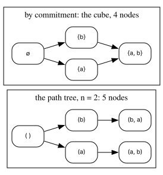

The two paths $(a, b)$ and $(b, a)$ are one node of the cube exactly when they reach one state.

## 9. The causes

One row per cause, each with the shape of a program that shows it. **Path dependence is not a row**: it is a
consequence, and § 8 says which causes produce it.

| | cause | its shape | breaks | the static check sees it as |
|---|---|---|---|---|
| c1 | an absence that concludes a positive fact | $t(x) \land \operatorname{absent}(q(x)) \implies p(x)$, with $q$ a candidate's relation | **the state**: a fact derived under a guard the commitment falsifies is kept | an absence site |
| c2 | an absence that refutes | $p(x) \land \operatorname{absent}(q(x)) \implies \bot$ | **the state, and dead with it**: $\bot$ is a fact | an absence site concluding $\bot$ |
| c3 | a refutation through a fact derived under an absence | $t(x) \land \operatorname{absent}(q(x)) \implies p(x)$ and $p(x) \land q(x) \implies \bot$ | **the state, and dead**; the refuting rule reads no absence | an absence site on the deriving rule; the refuting rule is no site |
| c4 | an absence that takes a witness away | the soup and the allergy of § 7 | **the state, and owes with it** | an absence site |
| c5 | an obligation's trigger | a seated guest dines and a diner owes a meal; a group that sits owes its members' seats | **the status alone**: owes | a trigger site |
| c6 | an activator that applies an obligation | opening the kitchen states that every guest owes a meal | **the status alone**: owes | an activator site |
| c7 | an activator that applies a refutation, hiding its absence | a rule with a parameter $R$ whose application at a node concludes $\bot$ from $\operatorname{absent}(R(x))$ | **the state, and dead** | an activator site only: root applied the rule to nothing |
| c8 | an even cycle through an absence | $t(x) \land \operatorname{absent}(q(x)) \implies p(x)$ and $t(x) \land \operatorname{absent}(p(x)) \implies q(x)$, in either written order | **the state**, and stability: the written order of the two rules moves which fixpoint root reaches, and with it the candidate set | two absence sites, and a cycle |
| c9 | an odd cycle through an absence | a rule derives $r(v, v)$ under $\operatorname{absent}(\lnot r(\dots))$, and another derives $\lnot r(v, v)$ from a fact of $r$ | **the state**: a parent path keeps a fact derived under an absence the commitment falsifies | an absence site, and a cycle |
| c10 | the FIFO gap | the two rules of § 8.3 | **the state**: cumulativity, on a stratified program | an absence site on the reader |
| c11 | an activator derived under an absence | a rule deriving $\operatorname{watch}(r)$ under $\operatorname{absent}(q(x))$, whose applied rule refutes reading no absence (§ 8.4) | **the state, and dead**: the absence is in the activator's derivation, which no premise records | an absence site on the deriving rule and an activator site |
| c12 | a FIFO race over a static read | the two rules of § 3.4, $a$ given | **the state built from scratch**, under a *monotone* verdict; a fork never meets it | nothing: no site |

**The status and the state are apart.** *Exercised* and *conservative* are words about the status. c1, c8, c9,
c10 and c12 break the state where the cube can say *conservative*, so what is reported of a flagged program
(§ 10) keeps the state's evidence beside the status's and never folds one into the other.

## 10. The detector

Of a flagged program, and only of one, more can be said than *not monotone*. What follows decides nothing: no
finding chooses a node, refuses a program or moves $R$. Where each finding is printed is the user's
[read-out](../../user/04-reference/08-read-out.md).

### 10.1 The static half

Read off root's applications, before any node:

- **each site**, with what its rule concludes and which property it puts at stake: an absence site the state,
  and $\operatorname{dead}$ with it when it concludes $\bot$; a trigger the status, $\operatorname{owes}$; an
  activator either, through the rule a node applies;
- **each cycle through an absence** over $D$, with its parity: a negative cycle of the rule dependency graph
  ([analysis of rules](../03-rule-evolution/02-analysis-of-rules.md)), restricted to the relations of $D$. An
  even cycle can have several states with no stale fact, two stable models; an odd one need not
  have any;
- **each order finding**: a rule with an absence that has, under an absence, a read of a relation in $D$ of which
  another rule with an absence concludes a fact. The written order then decides which of the two the boundary
  admits first (§ 8.3).

### 10.2 The dynamic half

Whether a site bit, read only from the nodes a description of $R$ computes anyway, with **the status and the
state apart**, because the cube reads only the status:

- **the status**: the cube's violations (§ 4), each attributed to the sites that made it: a dead node by its
  refutation, an owing node by the debt new against the node of $R$ below it, and where that names none, the
  violation's derivation followed through each rule's activator. *Exercised* or *conservative*, and *not known*
  where the cube was not read;
- **the state**: a **stale fact** of a node is a fact whose guard the node's own fixpoint falsifies,

$$
\begin{aligned}
\operatorname{stale}(f, C) \iff\ & f \in \operatorname{st}(C) \\
\land\ & \operatorname{absent}(G)\theta \in \operatorname{abs}(\delta_f) \\
\land\ & \operatorname{st}(C) \not\models \operatorname{absent}(G)\theta
\end{aligned}
$$

  read on every node computed, dead nodes included, since a stale fact can sit in a dead node no answer lists;
- **the paths**: a state is **path-dependent at one step** when one of its one-step parents reaches another
  state,

$$
\exists h \in C.\;\; \operatorname{st}(C) \neq \operatorname{sat}\bigl(\operatorname{st}(C \setminus \lbrace h \rbrace) \cup \lbrace h \rbrace\bigr)
$$

  Its reach is one step: a node can be dead along a two-step chain through an alive parent that one-step parents
  do not show. A check of some parents says what was checked and claims nothing more.

### 10.3 Why it finds nothing on an unflagged program

**Proposition.** On a program with no site there is nothing to find, on every node built by fork from root and
on every split $\operatorname{sat}(\operatorname{sat}(\mathrm{root} \cup C_1) \cup (C \setminus C_1))$ from
a fixpoint that holds root's.

*Argument.* No site means no read whose relation is in $D$ under an odd number of absences. So there is no
negative edge over $D$, and no cycle; no rule with an absence has under an absence a read of a relation in $D$ of
which another concludes a fact, and no order finding; the held extent of every relation in $D$ grows with the
commitment, so no guard is falsified, and no fact is stale; and every static read is settled at root, where every
fork inherits its result, so no path differs.
$\square$

It does not hold from scratch (§ 3.4). No node is built from scratch, so the claim is sound for what is
answered, and the scope is the claim. An argument of this kind holds only while its premise is enforced by
something that fails when it stops being true
([Q-M1e.2](../../../decisions/docs/Q-M1e.2-an-argument-is-enough-only-when-its-premise-is.md)).

## 11. How each kind is solved

### 11.1 Three words

- **stable**: the answer is a function of the program alone. It does not depend on any option of a run, on how
  objects were numbered, on rule order or on how many workers shared the work
  ([Q-M1e2.30](../../../decisions/answer/Q-M1e2.30-no-configuration-option-lever-or-flag-changes-r.md)).
- **proved**: the answer comes with a certificate that a second, simpler check accepts.
- **effective**: the cost grows with the size of the answer's description, not with $2^n$, wherever the case
  allows.

### 11.2 Per question

| question | monotone | flagged |
|---|---|---|
| **is $R$ non-empty** (a first solution) | any sound search: a node found is proved by one saturation, and what is learned from a dead node is sound | a node found is proved the same way. A *no* needs every node classified: a refutation across a hole learned from would prune members of $R$ |
| **the lines** | grow the alive down-set layer by layer, or enumerate $N$ and $E$ and dualise: the minimal line is $E$'s alive members, the maximal line the discharged complements of the minimal transversals of $N$. Prior art: MARCO-style MUS/MSS enumeration (Liffiton et al., *Constraints* 2016); incremental monotone dualisation is quasi-polynomial in input plus output (Fredman & Khachiyan, *J. Algorithms* 1996) | no duality: from the classified cube |
| **$\lvert R \rvert$, components, sub-cubes** | from the lines: the sub-cubes, then inclusion–exclusion | from the classified cube |
| **states, not commitments** | the closed sets in $R$ and their minimal generators, formal concept analysis's closed sets and minimal generators (Ganter & Wille 1999) | classes by state, read node by node |
| **stable, how** | a node's state is unique; what is listed is ordered by the objects' content; the candidate set does not depend on a run's options; an option may only reorder or prune soundly | under the one stated reading of a node (§ 11.3); rule order can still move the candidate set (c8) |
| **proved, how** | $N$, $E$ and the static verdict | the full classification |
| **effective, how** | the alive states are visited and never a node a licence decides, and saturation jumps over transient nodes ([finding R](07-finding-r.md)) | the cube, $2^n$ nodes, where it can be enumerated; past that a partial answer that says so, a line certified only as far as the members met certify it ([Q-M1e2.19](../../../decisions/answer/Q-M1e2.19-past-the-limit-a-line-mode-certifies-what.md)) |

### 11.3 What is claimed of a flagged program

On a flagged program every computation of $R$ takes the cube: no licence holds, and nothing is learned from a
dead node or from a denial. $R$ is the region of the one construction of each node, a fork of root; every way of
asking gives that $R$
([Q-M1e2.32](../../../decisions/answer/Q-M1e2.32-no-two-commands-disagree-and-the-oracle-is.md)); the answer
states the assumption, warns that the program is not monotone, and reports what § 10 finds. Whether that $R$ is
the program's meaning is not claimed
([Q-M1e2.2](../../../decisions/answer/Q-M1e2.2-a-node-is-a-fork-of-root-an-assumption-on.md)), and under any
order of the agenda nothing is claimed of such a program
([Q-M1f.313](../../../decisions/engine/Q-M1f.313-the-agenda-fires-first-what-leads-to-false.md)).
