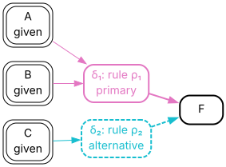
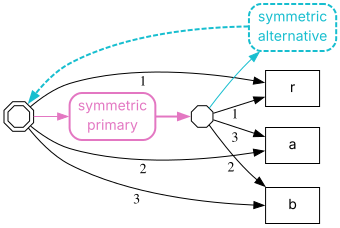
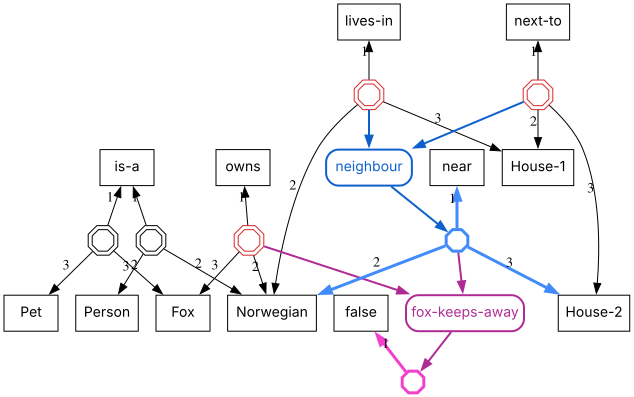
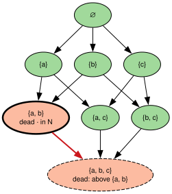

# Cores: what a contradiction rests on

A dead node's **core** is a set of facts its contradiction rests on: the givens and the commitments from which,
through the derivations the node recorded, its contradiction follows. It is an explanation of why the node is
dead, not part of the answer. This page states what a contradiction is, what a fact records about how it came
to be, the proof graph those records form, what a core is over that graph and how far its minimality goes, and
what a refutation tells a search. The symbols are those of [firing a rule](01-firing.md).

## A contradiction

A contradiction, and *dead* and *alive*, are those of
[the knowledge base](../01-static-ir/01-knowledge-base.md#a-fact-its-negation-both-or-neither): a world $K$ holds a
contradiction when it holds $\bot$, which a rule concludes to say a state is impossible, or a fact beside its
stored negation. This page needs the contradictions of $K$ as sets of facts,

$$
\operatorname{contr}(K) \;=\; \lbrace\, \lbrace \bot \rbrace \;:\; \bot \in K \,\rbrace \;\cup\; \lbrace\, \lbrace f, \lnot f \rbrace \;:\; f \in K \land \lnot f \in K \,\rbrace
$$

so a world is dead exactly where it has one:

$$
\operatorname{dead}(K) \iff \operatorname{contr}(K) \neq \emptyset
$$

A fact's origin plays no part: $f$ and $\lnot f$ are a contradiction whether each was given, derived or
committed.

A world never loses a fact, so a contradiction once derived is never retracted,

$$
K \subseteq K' \implies \operatorname{contr}(K) \subseteq \operatorname{contr}(K'),
$$

and a dead world stays dead however far its saturation runs. That is what lets a contradiction be detected as
each fact is added rather than at quiescence, and lets a dead node's saturation stop at its first contradiction
on a monotone program ([saturation](02-saturation.md#a-node-resumes-roots-saturation)).

## A derivation record

Every fact a world holds records how it came to be there
([Q18](../../../decisions/engine/Q18-provenance-is-per-fact-an-or-of-derivations-over.md)). A **derivation
record** $\delta$ is one of three kinds:

| kind | $\delta$ | what it records |
|---|---|---|
| **given** | $\operatorname{given}(s)$ | the fact as the program states it, with its source sentence $s$ where the program writes one |
| **a rule's firing** | $\operatorname{fired}(\rho, a, \theta, \operatorname{prem}, \operatorname{all}, \operatorname{abs})$ | the rule, the activator it was applied with, its bindings, the positive premises it read, the facts a universal it read ranged over, and the absences that had to hold for it |
| **a commitment** | $\operatorname{committed}(h)$ | the hypothesis $h \in C$ a node assumed |

A fact's identity is its relation and its arguments
([the knowledge base](../01-static-ir/01-knowledge-base.md#identity)), so a fact derived twice is one fact; the
second derivation is recorded beside the first, as an **alternative**. The records of a world are its
**provenance** $J$: for each fact $f \in K$ a non-empty finite sequence,

$$
\begin{aligned}
J_K(f) &= (\delta_1, \delta_2, \dots, \delta_k) \\
k &\ge 1
\end{aligned}
$$

the records of $f$ in $K$, in the order they were made: $\delta_1$ is the **primary** derivation and the others
are alternatives. What is true of $J$ in every implementation:

- **The primary derivation is the first one recorded.** Deriving the fact again never changes it, so everything
  that reads one derivation of a fact reads one stable story.
- **A given and a commitment take no other derivation**, $J_K(f) = (\delta_1)$: a clue that happens to be
  derivable again is still a clue.
- **Two firings of one rule over the same premises under the same activator are one record**:
  $(\rho, a, \operatorname{prem}(\delta))$ is what tells two records apart. The substitution $\theta$ is recorded to
  be shown, and is no part of a record's identity.
- **What is recorded is what saturation attempted.** A derivation no firing reached is in no $J_K(f)$.
- **A record made in a node is the node's.** A node is a fork of root ([firing a rule](01-firing.md#two-layers)),
  and with $J$ root's records and $J'$ the node's, $J'(f) \setminus J(f)$ never reaches root. That keeps
  explanations honest: a derivation recorded under a commitment may rest on the commitment, which root never
  assumed, and would otherwise be named in an explanation of root.

**What the program states of a fact it writes is its record.** A written fact's record is read off what the
text says of it, and an imported fact keeps the record its module writes, as if the program had written it in
place ([Q-M1f.138](../../../decisions/imports/Q-M1f.138-an-imported-fact-keeps-its-own-provenance.md)):

| the text writes $f$ | its record | its origin |
|---|---|---|
| with a source sentence | given, with that sentence | given |
| with a rule's name and a list of premises | a firing, as the text says, of that rule from those premises | derived |
| with neither | given, with no source | background |

A fact stated twice is one fact, and the record of its first statement is the one kept, whether the two
statements are in one file, in a module and the program, or in two modules
([Q-M1f.139](../../../decisions/imports/Q-M1f.139-a-fact-stated-twice-keeps-its-first-statement.md)).

**Where a fact came from is not what it is.** The primary record sorts the facts of a world into three classes,

$$
\operatorname{origin} : K \to \{\text{given},\ \text{background},\ \text{derived}\}
$$

a fact given with a source sentence; a fact given with none, or stated by reading a declaration; and a fact a
rule concluded or a commitment added. The partition is read off the records, never stored, and it is for
presentation alone: every rule, every check and every contradiction treats a fact alike whatever its origin. An
origin is not a kind of fact either: a fact of any relation, a property of a relation among them, may have any
of the three.

## The proof graph

The records of a world form a graph with two kinds of node.

- A **fact** is an **OR-node**: it holds if any of its recorded derivations holds.
- A **derivation** is an **AND-node** over its premises: it holds only if all of them do. Its premises are

$$
\operatorname{rests}(\delta) \;=\; \operatorname{prem}(\delta) \;\cup\; \operatorname{all}(\delta) \;\cup\; \begin{cases} \lbrace a \rbrace & a \notin \mathrm{root} \\ \emptyset & a \in \mathrm{root} \end{cases}
$$

  a derivation through a universal rests on each fact the universal read
  ([Q-M1e2.15](../../../decisions/answer/Q-M1e2.15-a-derivation-through-a-forall-rests-on-each-fact.md)); one
  made through an activator a node derived or committed rests on that activator too, while root's activators,
  stated or derived, are the program's and no core follows them
  ([Q-M1e2.12](../../../decisions/answer/Q-M1e2.12-a-dead-nodes-core-follows-an-activator-only.md)).
- The **terminals** $\mathcal{T}(K)$ are the givens and the commitments. Every walk over the graph grounds out
  on them.

A plain box is a fact, double-bordered where it is a terminal; a coloured box is a derivation, dashed where it
is an alternative. The arrows into a derivation are an AND, the arrows into a fact an OR. Following the primary
alone, $F$ rests on $\lbrace A, B \rbrace$; searching both, on $\lbrace C \rbrace$.

**What follows from a set of terminals.** For $Z \subseteq \mathcal{T}(K)$, the facts that follow from $Z$
through the recorded derivations are the least set

$$
\operatorname{der}_K(Z) \;=\; \mu X.\;\; Z \;\cup\; \lbrace\, f \in K \;:\; \exists\, \delta \in J_K(f).\;\; \operatorname{rests}(\delta) \subseteq X \,\rbrace
$$

and $Z$ is a **frontier** of a set of facts $G$ when $G \subseteq \operatorname{der}_K(Z)$.

The graph is legitimately **cyclic**: once alternatives are recorded, symmetric and transitive closure make
$r(a, b)$ and $r(b, a)$ justify each other in any ordinary puzzle.

$\operatorname{der}_K$ is a least fixpoint, built up from the terminals, so a cycle adds nothing to it: a fact
is never its own reason, and $r(b, a)$ rests on the given $r(a, b)$ and on nothing else. What a program's text
**states** is held to more than what a saturation records: among the facts a text writes with premises, the
relation *$g$ is a premise the text states for $f$* has no cycle, and a text in which it has one is no program.

**The terminals a fact reaches.** Following every recorded derivation of a fact down to the terminals gives the
widest set of terminals it can rest on, the least sets with

$$
\operatorname{front}(f) =
\begin{cases}
\{f\} & \delta_1 \text{ of } J_K(f) \text{ is a terminal} \\
\bigcup_{\delta \in J_K(f)}\ \bigcup_{g \in \operatorname{rests}(\delta)} \operatorname{front}(g) & \text{otherwise}
\end{cases}
$$

where a firing that rests on nothing counts as a terminal. An **explanation** of a set $X$ of facts is the set
$Z$ of terminals that a *witness* ends in, a witness being a choice of one recorded derivation for each fact
reached from $X$ along the derivations chosen.

**Proposition (what a fact reaches bounds every explanation).** For every explanation $Z$ of $X$,

$$
Z \subseteq \bigcup_{f \in X} \operatorname{front}(f)
$$

*Argument.* A witness follows, from each $f \in X$, one derivation of $J_K(f)$ and then one derivation of each
of its premises, down to terminals. $\operatorname{front}(f)$ follows every derivation of $J_K(f)$ and of every
premise. So each path of the witness is a path $\operatorname{front}$ follows, and the terminal it ends in is in
$\operatorname{front}(f)$. $\square$

So no core of a contradiction names a fact outside what the contradiction's facts reach. Choosing a *smallest*
explanation is a minimisation over the graph, which $\operatorname{front}$ does not solve.

## The core

**Which frontier.** Over an OR-node, which terminals a fact rests on is a choice, and two choices differ:

- *one derivation per fact*, the primary, unioned over the contradiction's facts: cheap, the shape a trace
  shows, but it overstates the conflict and moves with the order derivations happened to be recorded in;
- *a search across every recorded derivation*: the combination of derivations, one per fact, whose terminals
  are fewest. A saving can lie *between* facts, two facts that both derive from the same pair, which no per-fact
  choice sees.

**A core is the second**: a smallest frontier of a contradiction, over every derivation of it the node records
([Q-M1e2.11](../../../decisions/answer/Q-M1e2.11-a-core-is-the-smallest-over-every-derivation.md)):

$$
\operatorname{core}(K) \;\in\; \operatorname*{arg\,min}_{Z \subseteq \mathcal{T}(K)} \;\lbrace\, \lvert Z \rvert \;:\; \exists\, G \in \operatorname{contr}(K).\;\; G \subseteq \operatorname{der}_K(Z) \,\rbrace
$$

A contradiction's facts are explained together, a pair's two sides $\lbrace f, \lnot f \rbrace$ as one AND-node.

The derivation of [saturation](02-saturation.md), with its terminals marked. The core is the three filled
terminals; the two givens no derivation of $\bot$ reads are outside it, and the derived fact between them is no
terminal:

$$
\begin{aligned}
\operatorname{core}(K) = \lbrace\, & \operatorname{lives-in}(\mathsf{Norwegian}, \mathsf{House\text{-}1}), \\
& \operatorname{next-to}(\mathsf{House\text{-}1}, \mathsf{House\text{-}2}), \\
& \operatorname{owns}(\mathsf{Norwegian}, \mathsf{Fox}) \,\rbrace
\end{aligned}
$$

**A core of a node names its commitment.** On a program whose root is alive, root's facts refute nothing, so for
a dead node $C$

$$
\begin{aligned}
& \operatorname{core}(\operatorname{st}(C)) \cap C \neq \emptyset \\
& \operatorname{dead}\Bigl(\operatorname{sat}\bigl( \mathrm{root} \cup (\operatorname{core}(\operatorname{st}(C)) \cap C)\bigr)\Bigr)
\end{aligned}
$$

the core names a fact of the node's commitment, and root's fixpoint with the core's commitment facts added is
dead.

**An empty core and no core are two answers.** A dead node whose refutation rests on no fact, a rule with an
empty match that concludes $\bot$, has the empty core: the empty set suffices. A node that is not dead has no
core at all
([Q-M1e2.27](../../../decisions/read-out/Q-M1e2.27-in-eins-json-is-the-empty-set-and-null-what-does.md)):

$$
\begin{aligned}
&\operatorname{dead}(K) \;\land\; \operatorname{core}(K) = \emptyset && \text{the empty core} \\
&\lnot\operatorname{dead}(K) \;\land\; \operatorname{core}(K) \text{ undefined} && \text{no core}
\end{aligned}
$$

**A core names facts.** The absences a derivation rested on, $\operatorname{abs}(\delta)$, are recorded, and a
core does not count them: an absence is no fact a node could be shown. What reads them is the check of a program
that may not be monotone ([monotonicity](08-monotonicity.md)). A core is a set, and where its facts are drawn,
as the arrows into $\bot$ in the drawing of a refutation, they are in the order of their quoted forms
([the knowledge base](../01-static-ir/01-knowledge-base.md#the-text-of-an-object)), whatever order they were
found in.

**Refuted by.** Beside a core stands, for each fact of the contradiction, the rule of the last step of a
derivation from the core: the fact's first recorded derivation where the core derives it, else the first
alternative that it derives
([Q-M1e2.21](../../../decisions/read-out/Q-M1e2.21-refuted-by-names-the-first-recorded-derivation.md)):

$$
\begin{aligned}
\operatorname{by}(f) &= \rho_{\delta_i} \\
i &= \min \lbrace\, j \;:\; \operatorname{rests}(\delta_j) \subseteq \operatorname{der}_K(\operatorname{core}(K)),\ \ \delta_j \in J_K(f) \,\rbrace
\end{aligned}
$$

## How far the minimality goes

Every statement that a core is *smallest* carries three bounds.

1. **Not a subset-minimal unsatisfiable set.** No proper subset of a core is checked for satisfiability. The
   textbook way to get one, deleting a fact and saturating again, is unsound under absence: removing a fact can
   make a guard pass and fabricate a contradiction the full world never had
   ([absence](03-absent-and-naf.md#what-follows)). A core is found among the recorded derivations instead.
2. **Over the derivations recorded.** $J_K$ holds the firings the saturation made, so minimality is
   relative to the rule set and the order it fired in. A world may keep a bounded number of derivations per
   fact, those with the fewest premises and beside them the one with the smallest closure; no list of fixed
   length is every derivation, so a smaller core can lie among the derivations that were not kept. Keeping each
   fact's first derivation alone, $J_K(f) = (\delta_1)$, is the one choice of a run that may change a core,
   and it changes nothing else
   ([Q-M1e2.11](../../../decisions/answer/Q-M1e2.11-a-core-is-the-smallest-over-every-derivation.md)).
3. **Budgeted.** A smallest frontier over an AND/OR graph is exponential to find in the worst case, so the
   search for one is bounded. A bounded search that was cut is still sound, every frontier it returns a real set
   of terminals the contradiction follows from, $G \subseteq \operatorname{der}_K(Z)$, and a core from a cut
   search is always marked as one.

**A core is an explanation.** A dead node usually has many refutations, and which one a saturation meets first
is a matter of order. A core may vary with the rules' written order and with the agenda's, as long as it is a
valid core; $R$, every state and every count do not depend on it
([Q-M1f.6](../../../decisions/answer/Q-M1f.6-a-core-is-an-explanation.md)). Taking one is a search the
classification of a node does not need, so a core is taken only where it is shown, and which cores are taken
moves no answer
([Q-M1e2.15](../../../decisions/answer/Q-M1e2.15-a-derivation-through-a-forall-rests-on-each-fact.md)); every
core shown with one answer is taken against the one root every node of that answer comes from
([Q-M1f.25](../../../decisions/answer/Q-M1f.25-every-core-a-run-prints-is-taken-against-its-one.md)).

## What a refutation tells a search

On a **monotone** program $\operatorname{dead}$ is closed upward: a world only grows, so every superset of a
dead commitment is dead, and one dead node decides every node above it,

$$
\begin{aligned}
\operatorname{dead}(C) \;\land\; C \subseteq C' &\implies \operatorname{dead}(C') \\
\lbrace\, C : \operatorname{dead}(C) \,\rbrace &= \bigcup_{D \in N} \lbrace\, C : D \subseteq C \,\rbrace
\end{aligned}
$$

with $N$ the minimal dead sets.

The heavy node is a minimal dead set, with core $\lbrace a, b \rbrace$; the dashed node above it is dead with no
saturation of its own. A computation of $R$ may use that as a licence and conclude *dead* for a node it never
saturates ([finding R](07-finding-r.md)). The licence is exactly what an absence over the held extent of a
relation ([the knowledge base](../01-static-ir/01-knowledge-base.md#the-relation-its-extent-a-fact-of-it)) that a
commitment can still extend would break, $\lbrace p(\mathsf{A}) \rbrace$ dead and
$\lbrace p(\mathsf{A}), q(\mathsf{A}) \rbrace$ alive, which is why a refutation may not rest on one
([absence](03-absent-and-naf.md#a-refutation-resting-on-an-absent)). On a program that may not be monotone the
licence is not taken, and each node is computed ([monotonicity](08-monotonicity.md)).
