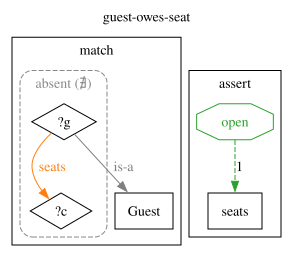
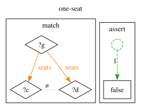
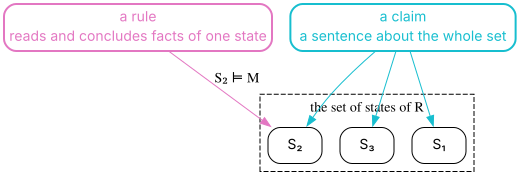
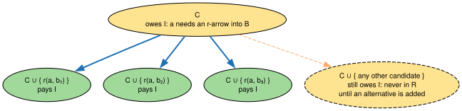
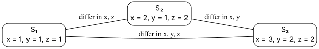

# Satisfiability: what a program can say of its answer

Saturation answers *what follows*. A puzzle also asks *which worlds are possible*: whether the program has a
model, and which. Ein's answer to the second is the region $R$, the commitments whose state is alive and
discharged ([solution semantics](06-solution-semantics.md)). This page states what a program can say about that
answer from the inside, in its rules, and where that stops:

- each rule is a sentence about the one state it fires in, and the two bounds on $R$ are made of such sentences
  (§ 1);
- a sentence about the set of states is not a rule, and why no form of the language can be one (§ 2);
- such a sentence is a claim, stated at the meta level and checked against $R$ (§ 3);
- an obligation's alternatives are jointly exhaustive, which is what lets a search branch on one debt (§ 4);
- a state of $R$ is a model of the program as $H$ scopes it, and the answer says where that scope ends (§ 5);
- a set of models has a compact exact form, and every count says what it guarantees (§ 6).

The symbols are those of [firing a rule](01-firing.md); $S$ is a state, $\mathcal{S}(R) = \lbrace
\operatorname{st}(C) : C \in R \rbrace$ the states of $R$.

## 1. Two bounds, each a sentence about one state

**A restriction** is a rule that concludes $\bot$. A state that derives it is **dead**:

$$
\operatorname{dead}(S) \iff \bot \in S \;\lor\; \exists f.\; f \in S \land \lnot f \in S
$$

Since a fork only adds facts, a dead state stays dead under any addition on a program the static check calls
monotone ([monotonicity](08-monotonicity.md)). Restrictions bound $R$ from above: they set its **maximal line**.

**An obligation** is a rule $o$ whose whole conclusion is the verdict $\operatorname{open}(r)$, and whose match
holds while a witness is missing
([Q-M1d.2](../../../decisions/hypotheses/Q-M1d.2-an-obligation-is-a-rule-that-concludes-open-r.md)). Its match
is a **trigger** $T_o$, the positive part that says who owes, and the absence of a **witness** $W_o$. A state at
which it matches **owes** that instance; a state that owes nothing is **discharged**:

$$
\operatorname{owes}(o, a, \theta, S) \iff S \models T_o(a, \theta) \;\land\; \lnot \exists \bar y.\; S \models W_o(a, \theta, \bar y)
$$

$$
\operatorname{Owed}(S) = \lbrace\, (o, a, \theta) : \operatorname{owes}(o, a, \theta, S) \,\rbrace,
\qquad
\operatorname{owes}(S) = \lvert \operatorname{Owed}(S) \rvert,
\qquad
\operatorname{discharged}(S) \iff \operatorname{owes}(S) = 0
$$

Obligations bound $R$ from below: they set its **minimal line**. The verdict is written nowhere else
([Q-M1f.66](../../../decisions/language/Q-M1f.66-open-is-written-only-as-a-rules-verdict.md); the user's
[obligations page](../../user/03-syntax-and-semantics/08-obligations.md) has the spelling).

One of each, over the same relation: *a guest with no seat owes one*, and *no guest has two seats*.

$$
\operatorname{is-a}(g, \mathsf{Guest}) \land \operatorname{absent}\bigl(\operatorname{seats}(g, c)\bigr) \implies \operatorname{open}(\operatorname{seats}),
\qquad
\operatorname{seats}(g, c) \land \operatorname{seats}(g, d) \land c \neq d \implies \bot
$$

In the first the trigger is the solid arrow and the witness the dashed cluster: the rule matches while the
cluster finds nothing. With one guest and two chairs their region is the first cube of
[monotonicity § 6](08-monotonicity.md#6-the-two-kinds-compared): the empty commitment owes, both seatings
together are dead, and $R$ is the two seatings between.

The two are not symmetric, and the asymmetry is why the debt is not a fact. $\bot$ can be stored, because a dead
state stays dead under any addition. A debt exists to be paid by an addition: a stored debt would survive its own
payment in the fork that paid it. So an obligation derives nothing and is no part of the agenda; it is read once
on each quiescent state, and $\operatorname{owes}(S)$ is a property of the node, beside
$\operatorname{dead}(S)$. Whether a state owes is therefore decided by that state alone, as whether it is dead
is.

## 2. The second-order boundary

### 2.1 The question

The same disjunction means two things in two places:

| where | $A \lor B$ means | quantifies over |
|---|---|---|
| a rule's match | $S \models A \lor B$: this state satisfies $A$ or $B$ | the facts of **one** state $S$ |
| a claim | $\mathcal{S}(R) = \lbrace A, B \rbrace$: the answer's states, or classes, are exactly those listed | the set of **states** |

A claim may say the second. May a program's rules: *there is exactly one answer*, *at most $k$*, *the same
answers as that other program*? **No**
([Q-M1d.7](../../../decisions/language/Q-M1d.7-a-rule-is-a-sentence-about-the-state-it-fires.md)). A rule reads
and concludes facts of the one state it fires in, and no form of the language reads another state, the number of
states, or the search's own progress. Three readings of the question show why, each refuted on different
grounds.

### 2.2 Three readings, and why each fails

**(a) A guard that is an absence over models: refuted by what a guard reads.** An absence asks whether this
state holds facts matching a pattern, $S \models \operatorname{absent}(G)\theta$, and every guard, present or
future, is evaluated against the facts of the state the rule fires in. *Another model exists* is a fact of no
state and cannot be one: another model is another state. Incompleteness of $r$ *in this state*, which
$\operatorname{open}(r)$ states, is decided by this state. Closure of the **set of states** is a property of no
state at all, only of the lattice of them.

**(b) A rule reading the search's own state: refuted on grounds, not on feasibility.** A reasoner could expose
how many states it has found, or whether it has finished, as facts. A rule that read one would make **what is
derived depend on how far the search went**: the same program and facts would derive one set under one budget
and another under a larger one, so a budget would change what is provable. The answer is a property of the
program, invariant under every option, every order of the search and every number of workers
([Q-M1e2.30](../../../decisions/answer/Q-M1e2.30-no-configuration-option-lever-or-flag-changes-r.md),
[Q-M1e2.32](../../../decisions/answer/Q-M1e2.32-no-two-commands-disagree-and-the-oracle-is.md)). Where the
search's state is read and reported is downstream of every derivation: what is said of an answer may say how
much of $R$ was classified. That separation is the design, and (b) would erase it.

**(c) A verdict of closure beside the verdict $\operatorname{open}(r)$: refuted on evaluability.** A verdict is
worth having only if the claim it makes can be evaluated. $\operatorname{open}(r)$ costs one reading of a
quiescent state per obligation instance. A verdict that the set of states is closed would cost all of $R$: the
whole search, which is the expensive thing the obligation exists to steer. The affordability is not downstream
of the vocabulary; it is the reason the vocabulary cannot exist.

### 2.3 The neighbours

Every system of this family puts the count of models at the meta level:

| system | what looks like a count in the program | what it quantifies over |
|---|---|---|
| answer set programming | aggregates over atoms, cardinality bounds on a choice, a minimisation statement | atoms **within** one answer set; optimisation ranks answer sets from outside the program's logic |
| Alloy | a scope on a run | a bound on the universe the analyser searches, given as a command, not a sentence of the model; a cardinality counts tuples **inside** one instance |
| SMT solving | the blocking-clause loop | a procedure **outside** the formula, which never mentions how many models it has |
| model counting, plain and projected | the count itself | an operation **on** a program |

Alloy is the nearest, and it is not a counterexample: its bound is written in the file the modeller writes, but
it is a search budget given to the analyser. Ein's analogue of Alloy's scope is a budget given to a run, not a
claim and not a rule.

### 2.4 The boundary, stated once

> **A rule is a sentence about the state it fires in.** A claim about the set of states is a sentence about the
> search, and the search is not a thing rules may read: a rule that read it would make derivation depend on the
> traversal, and the traversal is a budget. So claims about the set of states live at the **meta level**, where
> a claim already is, and the question is not *where to put the claim* but *what the meta level can afford to
> check*.

Three corollaries:

1. **It settles every second-order claim.** *Exactly one model*, *an even number*, *the models of that other
   program*, *at most $k$*: each is a sentence about $\mathcal{S}(R)$, none is a property of any $S \in
   \mathcal{S}(R)$, and (b) refutes each alike.
2. **It forbids no budget.** *How much to search* is not a claim about the answer at all; it is a budget, and it
   belongs with the run it bounds.
3. **It does not weaken a claim.** The meta level may state what cannot be verified within a budget, provided
   that is said: a claim that was not decided is **not checked**, and is never read as held (§ 3).

## 3. Claims about the set of states

A claim is the meta level's sentence. A question's claim lists the classes of the goal's rows over the states
the question asks about; a claim about the region lists the states of $R$ (the user's
[query page](../../user/03-syntax-and-semantics/12-query.md) and
[solutions page](../../user/03-syntax-and-semantics/13-solutions-and-models.md) have the spelling). A claim is
an answer, never a pattern: its facts are ground, and **naming a relation closes it**. Write $S|_r$ for the
facts of relation $r$ in $S$. A claim about the region is a set $\Gamma$ of listed models $\gamma$, and it holds
of a set of states $\mathcal{S}$ when the two correspond one to one and agree on every relation the claim
names; a question's claim is a set $\Gamma_g$ of sets of rows, and it holds when those are exactly the row sets
of the goal $g$ over the states:

$$
\operatorname{holds}(\Gamma, \mathcal{S}) \iff \exists \text{ a bijection } \beta : \Gamma \to \mathcal{S}.\;\;
\forall \gamma \in \Gamma.\; \forall r \in \operatorname{rels}(\Gamma).\;\; \beta(\gamma)|_r = \gamma|_r
$$

$$
\operatorname{holds}(\Gamma_g, \mathcal{S}) \iff \Gamma_g = \lbrace\, \operatorname{rows}_g(S) : S \in \mathcal{S} \,\rbrace
$$

So every relation a claim names is listed at its complete extent in every state, and a relation it never names
is unconstrained
([Q-M1c.2](../../../decisions/language/Q-M1c.2-an-expectation-is-ground-and-naming-a-relation.md)). A claim lists
all of what it is about: there is no form for *at least these*.

A claim is checked against $R$, and its outcome is one of three:

$$
\operatorname{verdict}(\Gamma) =
\begin{cases}
\textbf{held} & \text{the states were all computed, and } \operatorname{holds}(\Gamma, \mathcal{S}) \\
\textbf{failed} & \text{a computed state refutes it: } \lnot\operatorname{holds}(\Gamma, \mathcal{S}) \\
\textbf{not checked} & \text{neither was decided: another question was asked of } R \text{, or a budget stopped the search first}
\end{cases}
$$

A false claim is a result, not a refusal of the program. A claim not checked is never read as held: it counts
against the run as a failed one does, so that a claim too costly to check is not mistaken for one that holds;
where root alone is asked, and so nothing is asked of $R$, it counts for nothing
([Q-M1f.257](../../../decisions/cli/Q-M1f.257-under-no-search-a-claim-not-checked-moves-no.md)).

## 4. Why an obligation's alternatives are jointly exhaustive

A search need not enumerate the subsets of $H$ to find $R$. Where a state owes an instance, it can **branch on
the instance's alternatives alone**, the candidates that would pay it, and lose nothing. This section is why.

**The branch.** An owed instance $I$ of totality says *$a$ has an $r$-arrow to some member of $B$*. Its
alternatives at a state $S$ are the witnesses not already refuted; where the instance is licensed they are
$\operatorname{alt}(I)$ of [finding R](07-finding-r.md#4-a-monotone-program-three-properties-and-the-licences) less
those $S$ denies:

$$
\operatorname{alt}(I, S) \;=\; \lbrace\, r(a, b) \;:\; b \in \operatorname{ext}(B) \,\rbrace \;\setminus\; \lbrace\, h : \lnot h \in S \,\rbrace
$$

**Proposition (jointly exhaustive).** Let $C$ owe $I$, and write ${\uparrow} C = \lbrace C' : C \subseteq C'
\subseteq H \rbrace$ and $\mathcal{S}(X) = \lbrace \operatorname{st}(C') : C' \in X \rbrace$. Every state of $R$
above $C$ holds one of the alternatives, and is a state of $R$ above one of the branches:

$$
\mathcal{S}\bigl( R \cap {\uparrow} C \bigr) \;=\; \bigcup_{h \,\in\, \operatorname{alt}(I, \operatorname{st}(C))} \mathcal{S}\bigl( R \cap {\uparrow}( C \cup \lbrace h \rbrace ) \bigr)
$$

*Argument.* Let $C' \in R$ with $C \subseteq C'$. $C'$ is discharged, so it pays $I$: $\operatorname{st}(C')$
holds a witness $h = r(a, b)$, $b \in \operatorname{ext}(B)$. $C'$ is alive, so $h$ is not refuted there, and
under the two conditions below $h$ is a candidate and an alternative,
$h \in \operatorname{alt}(I, \operatorname{st}(C))$. Adding to a commitment a candidate its state already holds
changes nothing, $\operatorname{st}(C' \cup \lbrace h \rbrace) = \operatorname{st}(C')$, so
$C' \cup \lbrace h \rbrace$ is a member of $R$ above $C \cup \lbrace h \rbrace$ with the state of $C'$. No death,
no depth and no ordering enters the argument. $\square$

The three solid arrows are the branch; every state of $R$ above $C$ is reached above one of their heads. The dashed
arrow is what the branch does not take, and loses nothing by: a node above $C$ that holds no alternative still
owes $I$. The surjective obligation is the same statement read from the other argument.

**Mutual exclusivity is not needed.** Where $r$ is also functional, the alternatives exclude one another and the
branch is a partition. Where it is not, one state may hold two alternatives and be reached by two branches: that
is a duplicate, not a gap, and $R$ is a set, so it holds the state once.

**It holds under two conditions**, each checked rather than assumed:

1. **The alternatives cannot grow beneath the branch.** They are read at root; a domain a commitment could
   extend would hold, at some state, a witness root never saw. $H$ is not built from obligations wherever that
   could happen ([hypothesis generation](04-hypothesis-generation.md),
   [Q-M1e2.10](../../../decisions/hypotheses/Q-M1e2.10-the-obligations-rung-declines-where-its-domain.md)).
2. **Every witness is a candidate, or refuted at root.** A witness that is neither could pay the instance at a
   state no branch reaches. The branch is taken only for an instance of which this is checked, on the program
   and on every node computed, and a node that breaks it stops the computation rather than give an answer
   ([finding R](07-finding-r.md) states the licence).

**Proposition (on a monotone program the branching ends).** Along every branch the owed set shrinks strictly,
so no branch is longer than the number of instances root owes:

$$
h \in \operatorname{alt}(I, \operatorname{st}(C)) \;\implies\; \operatorname{Owed}(C \cup \lbrace h \rbrace) \subsetneq \operatorname{Owed}(C),
\qquad
\text{depth} \;\leq\; \operatorname{owes}(\emptyset)
$$

*Argument.* An instance's trigger reads only relations no commitment changes, so a state above root owes only
instances root owes. Discharged is upward-closed, so each child pays the instance it branched on and every
instance its parent had paid. $\square$

## 5. A state of R is a model of the program as H scopes it

A state of $R$ decides every candidate of $H$: each is in it or not. It need not decide a fact outside $H$. So
**$R$ is over $H$**, and an answer in which every commitment was classified certifies all of $R$ over $H$ and
nothing beyond it
([Q-M1e2.3](../../../decisions/answer/Q-M1e2.3-r-is-over-the-universe-and-the-read-out-names.md)).

A state of $R$ is a model of the **program**, and not only of the program as $H$ scopes it, when every relation
$r$ a hypothesis could be about, with $\operatorname{rels}(H) \not\ni r$, is either

$$
\textbf{closed:}\;\; \text{no rule concludes } r \text{ positively}
\qquad\text{or}\qquad
\textbf{decided:}\;\; \text{saturation fixes every fact of } r \text{ from what the commitment settles}
$$

A closed relation is one no hypothesis about could be confirmed.

**A program for which neither holds.** Its obligations owe a seating from both ends, and $H$ holds the
seating candidates alone. A second relation, who knows whom, is owed by nobody and is not closed, since a rule
concludes it, and nothing decides whether anyone knows anyone: $R$'s states mention no such fact, and the same
program with one acquaintance added has further consistent states. $R$ is right over $H$, and the certificate is
true of $H$. **What it leaves out, every answer names**: wherever $H$ holds no fact of a relation the program
can conclude or ask about, and the program does not scope that relation out itself, the answer names the
relation and says that $R$ holds of it only what the program states and saturation derives. That sentence is
the certificate's scope, stated beside the certificate.

How much a listed state leaves open can be asked as well: the facts the blind enumerator of
[hypothesis generation](04-hypothesis-generation.md) would still propose there, outside $H$. It is read on a copy of the state, so asking it changes nothing else
that is answered.

## 6. A set of models, and what its count claims

**A model** is what a state of $R$ adds to the program: the positive part of the state, less the positive part
of the program as stated
([Q-M1e.6](../../../decisions/answer/Q-M1e.6-a-model-is-what-a-solutions-state-adds.md)). With $X^{+}$ the facts
of $X$ that are not stored negations:

$$
\operatorname{model}(S) \;=\; S^{+} \setminus K_0^{+}
$$

The state is what is judged; the model is a projection of it, and decides nothing
([Q-M1e.7](../../../decisions/answer/Q-M1e.7-a-state-is-what-the-engine-judges-and-a-model-is.md)).

**What models differ in.** A set of states $\mathcal{S}$ varies in facts, and a compact description of it is
about variables, so facts are read as variables by two rules:

1. every positive fact that is in some listed state and not in another is a **Boolean** variable,
   $x_f(S) = [\, f \in S \,]$;
2. where the program states that a relation $r$ is functional (or bijective, which implies it), the facts
   $r(a, \cdot)$ exclude one another, so for each $a$ they are **one** variable whose values are the ones it
   takes, $x_{r,a}(S) = b \iff r(a, b) \in S$.

The properties are read from the states' own facts, so a program that states the bijection, one that states the
function and one that derives the property by a rule are read alike. A stored negation is no variable: where
the program stores $\lnot r(a, b)$ beside every excluded value, it mirrors the positive facts exactly.

**The determining key** is a smallest set of those variables, $X$, whose values tell every listed state apart,
with the table of the combinations that occur, one row per state:

$$
\operatorname{key}(\mathcal{S}) \;\in\; \operatorname*{arg\,min}_{Y \subseteq X} \;\lbrace\, \lvert Y \rvert \;:\; \forall S \neq S' \in \mathcal{S}.\;\; \exists x \in Y.\;\; x(S) \neq x(S') \,\rbrace
$$

A node is a state and an edge a pair of states, labelled with the variables the two differ in. A key is a set
of variables that meets every edge's label: here $\lbrace x \rbrace$ is the smallest, and $\lbrace y, z \rbrace$
is another. By construction a row's values pick out its state among those listed, and each row is read off a
state that exists, so a state that was not found could add a row but never contradict one. Finding a smallest
such set is a minimum hitting set over the pairs of states, which is NP-hard, so the key is offered within a
bound and, where it is unaffordable, declined with the reason, leaving the listing as the form. It is a form
asked for after the answer and never a second answer: no count, state or claim moves with it
([Q-M1d.5](../../../decisions/read-out/Q-M1d.5-the-read-out-lists-the-states-each-count.md)).

**Every count says what it guarantees.** An answer in which all of what was asked was classified reports *the*
states, of $R$ or of the line asked; one that a budget stopped reports the states *found*, a part, complete up
to where it says
([Q-M1d.5](../../../decisions/read-out/Q-M1d.5-the-read-out-lists-the-states-each-count.md),
[Q-M1d.1](../../../decisions/answer/Q-M1d.1-a-search-stops-early-only-on-a-decided-question.md)):

$$
\text{classified everything asked} \implies \text{the listing} = \mathcal{S}, \qquad
\text{stopped by a budget} \implies \text{the listing} \subseteq \mathcal{S}
$$

An unqualified count would claim a completeness that was not established: on a set of states that is not the
whole, *these are the models* and *these are models found* are different statements, and only the first licenses
a count.
