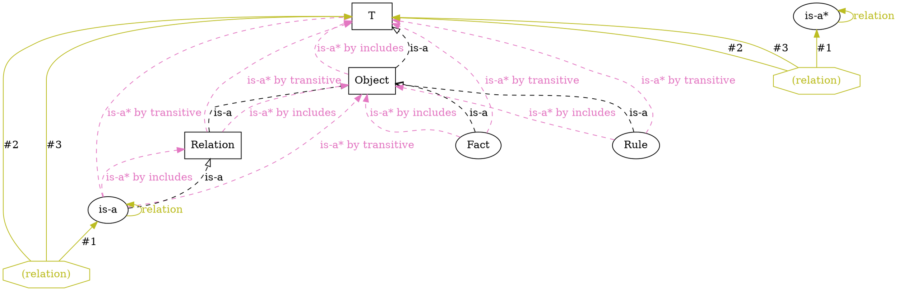
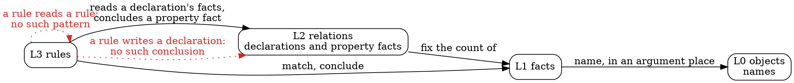

# Rules as data — what of Ein describes itself in Ein

How much of Ein can be stated in Ein, with only the forms a program may already write, and reasoned about by
Ein's own rules? The constraint is the point: a self-description that needs a second language beside Ein is no
longer Ein describing itself, as a grammar of EBNF written in EBNF needs nothing but EBNF.

The answer is a line through the four levels a knowledge base is read at
([rules as statements](../01-static-ir/04-rules-as-statements.md#the-four-levels-a-knowledge-base-describes-itself-in)):
objects, facts and relations are data that rules read and write, and a rule is not. This page states what is on
each side of the line.

## 1. The toolbox: declarations and facts

A program is a finite sequence of forms, and each form is of one of two kinds, decided by its first word:

$$
\text{Form} = \text{Decl} \;\sqcup\; F, \qquad \text{a form headed by } w \text{ is a declaration} \iff w \in W_{\!d}
$$

where $W_{\!d} \subset W$ is the closed set of words that head a declaration: of a relation, a rule, a hypothesis
rule, a macro, an import, and of a program's questions
([the reserved names](../../user/04-reference/03-reserved-names.md) lists them). **Every other form is a fact.**
Each kind of form takes a closed list of clauses, a fact takes only the clauses that say where it came from
([Q-M1e2.28](../../../decisions/language/Q-M1e2.28-each-form-takes-a-closed-list-of-keywords.md)), and a clause is
only ever a form's own, never part of a value
([Q-M1f.14](../../../decisions/engine/Q-M1f.14-a-keyword-pair-is-only-ever-a-forms-clause.md)).

So there is no schema sub-language to describe Ein with. A form that tried to give a fact named slots would be a
fact with a clause a fact does not take, which is no form. To describe Ein in Ein there are exactly **the
declarations** and **facts over relations a program names**, and they are enough for three of the four levels.

## 2. The four levels, stated in Ein

### Objects: the kinds are names in a membership relation

Ein has no form that declares an object. An object is any name that fills an argument place, and *this is one of
those* is a fact of a membership relation the program declares like any other
([Q23](../../../decisions/language/Q23-a-premise-types-a-variable-and-no-entity-has.md)). Ein's own kinds are then
four names under a common top, as every node of the knowledge base is a vertex of one graph:

$$
\operatorname{is-a}(\mathsf{Object}, \mathsf{T}), \qquad \operatorname{is-a}(\mathsf{Relation}, \mathsf{Object}), \qquad \operatorname{is-a}(\mathsf{Fact}, \mathsf{Object}), \qquad \operatorname{is-a}(\mathsf{Rule}, \mathsf{Object})
$$

### The homoiconic line

The membership relation is a declared relation and not a reserved word, so a program may say that it is one:

$$
\operatorname{is-a}(\operatorname{is-a}, \mathsf{Relation})
$$

Let $\operatorname{is-a}^{*}$ be a second relation, and let the program state two properties, each applied by a
rule of the standard library's relation algebra (§ 3):
$\operatorname{includes}(\operatorname{is-a}, \operatorname{is-a}^{*})$ and
$\operatorname{transitive}(\operatorname{is-a}^{*})$. Then the membership relation is, by the program's own
rules, an object:

$$
\dfrac{
  \dfrac{\operatorname{is-a}(\operatorname{is-a}, \mathsf{Relation})}{\operatorname{is-a}^{*}(\operatorname{is-a}, \mathsf{Relation})}\ \text{includes}
  \qquad
  \dfrac{\operatorname{is-a}(\mathsf{Relation}, \mathsf{Object})}{\operatorname{is-a}^{*}(\mathsf{Relation}, \mathsf{Object})}\ \text{includes}
}{
  \operatorname{is-a}^{*}(\operatorname{is-a}, \mathsf{Object})
}\ \text{transitive}
$$

That is the fixed point of Ein's model, *an instance is an instance of instance*, reached with two membership
facts, two property facts and two rules, and it is inference about Ein performed by Ein. The saturated state, with the two
declarations' facts kept:

The node of the membership relation appears three ways in one drawing: as the first argument of the fact its
declaration is held as (the octagon's arrow numbered 1), as the label of the dashed arrows with an empty head,
and as an oval with such an arrow of its own to $\mathsf{Relation}$. The pink arrows are the derived facts; the
one from the membership relation to $\mathsf{Object}$ is the conclusion of the derivation above.

### Facts, relations, properties and rules

| level | what it is | as a formula |
|---|---|---|
| a fact | a relation applied to values | $\operatorname{left-of}(\mathsf{House\text{-}1}, \mathsf{House\text{-}2})$ |
| a relation | a name and its slot names | $\operatorname{decl}(\operatorname{left-of};\ \mathsf{House}, \mathsf{House})$ |
| a relation's property | a fact whose argument is the relation's name | $\operatorname{transitive}(\operatorname{left-of})$ |
| a rule | parameters, a pattern and a conclusion | $\operatorname{transitive}[r]:\ r(a, b) \land r(b, c) \land a \ne c \implies r(a, c)$ |

How each is spelt is the user's pages on [facts](../../user/03-syntax-and-semantics/03-facts.md),
[relations](../../user/03-syntax-and-semantics/02-relations.md),
[properties](../../user/03-syntax-and-semantics/07-properties-and-operators.md) and
[rules](../../user/03-syntax-and-semantics/05-rules.md).

### A declaration is a fact a rule can read

Reading a program holds each declaration as facts of the relation $\operatorname{relation}$
([names and atoms](../01-static-ir/01-names-and-atoms.md#a-relation-is-an-object)):

$$
\operatorname{decl}(r;\ T_1, \dots, T_n) \;\longmapsto\; \{\ \operatorname{relation}(r, T_1, \dots, T_n),\ \ \operatorname{relation}(r)\ \}
$$

A pattern matches a fact only of its own count of arguments, so

$$
\begin{aligned}
x\theta \text{ is declared with the two slot names } y\theta,\ z\theta \ &\implies\ S \models \operatorname{relation}(x, y, z)\theta \\
x\theta \text{ is declared, with any count} \ &\implies\ S \models \operatorname{relation}(x)\theta
\end{aligned}
$$

A pattern over $\operatorname{relation}$ is an ordinary premise, so **a relation is data the rules read**. Each
line is an implication one way only: a rule may conclude a fact $\operatorname{relation}(\mathsf{a})$, which is a
fact like any other and declares nothing. The relations of a program are fixed when it is read.

## 3. What already describes itself

**Slot names are data rules consume.** Because a declaration is a fact, rules read the schema and act on it. The
standard library's check of a converse reads two declarations and refuses a pair whose slot names do not fit,
with $m^{*}$ the program's membership closure as a parameter:

$$
\begin{aligned}
&\operatorname{converse}(r_1, r_2) \;\land\; \operatorname{relation}(r_1, D_1, E_1) \;\land\; \operatorname{relation}(r_2, D_2, E_2) \;\land\; E_1 \ne D_2 \\
&\quad \land\; \operatorname{absent}(m^{*}(E_1, D_2)) \;\land\; \operatorname{absent}(m^{*}(D_2, E_1)) \;\implies\; \bot
\end{aligned}
$$

and its rule of domain elimination reads a declaration's slot names to know which values to range over
([rules as statements](../01-static-ir/04-rules-as-statements.md#structural)). The theory itself reads of a
declaration only how many slot names it has; it never reads a name as a type
([Q23](../../../decisions/language/Q23-a-premise-types-a-variable-and-no-entity-has.md)). What a program calls its
type system is this: membership is a relation, and what a type check concludes, a rule concludes.

**The property algebra is Ein in Ein.** No property of a relation is a primitive. Each is a fact written beside
a declaration, and its meaning is an ordinary rule the fact applies
([Q27](../../../decisions/language/Q27-a-relations-properties-are-facts-beside.md),
[Q16](../../../decisions/stdlib/Q16-general-rule-families-are-stdlib-modules.md)). With
$\operatorname{ext}_S(r) = \lbrace (u, v) : r(u, v) \in S \rbrace$ the extent of a relation of two arguments, the rules of
the standard library's relation algebra make these true of every saturated state $S$ of a program that brings
them in:

| the property fact in $S$ | what its rule makes true of $S$ |
|---|---|
| $\operatorname{symmetric}(r)$ | $\operatorname{ext}_S(r)^{-1} \subseteq \operatorname{ext}_S(r)$ |
| $\operatorname{transitive}(r)$ | $(a, b), (b, c) \in \operatorname{ext}_S(r) \land a \ne c \implies (a, c) \in \operatorname{ext}_S(r)$ |
| $\operatorname{includes}(r, s)$ | $\operatorname{ext}_S(r) \subseteq \operatorname{ext}_S(s)$ |
| $\operatorname{converse}(r, s)$ | $\operatorname{ext}_S(r)^{-1} \subseteq \operatorname{ext}_S(s)$ |
| $\operatorname{compose}(r, s, t)$ | $\operatorname{ext}_S(r) \mathbin{;} \operatorname{ext}_S(s) \subseteq \operatorname{ext}_S(t)$ |
| $\operatorname{meet}(r, s, t)$ | $\operatorname{ext}_S(r) \cap \operatorname{ext}_S(s) \subseteq \operatorname{ext}_S(t)$ |
| $\operatorname{join}(r, s, t)$ | $\operatorname{ext}_S(r) \cup \operatorname{ext}_S(s) \subseteq \operatorname{ext}_S(t)$ |
| $\operatorname{functional}(r)$ | $(a, b), (a, c) \in \operatorname{ext}_S(r) \land b \ne c \implies \bot \in S$ |
| $\operatorname{injective}(r)$ | $(a, c), (b, c) \in \operatorname{ext}_S(r) \land a \ne b \implies \bot \in S$ |

Union, intersection, composition, converse and inclusion are one rule each over the one notion of a match, and
the cardinality properties are rules that conclude $\bot$. The one kernel counterpart is the marker that closes a
relation under the swap of its arguments, as the rule of symmetry does, without the rule
([names and atoms](../01-static-ir/01-names-and-atoms.md#names)).

**The quantifiers are Ein in Ein.** The bounded universal and the undecided fact are not forms of the pattern
language. Each is a macro, a named pattern with parameters that is replaced by its body where it is written:

$$
\operatorname{forall}(x;\ \gamma,\ \beta) \;\longmapsto\; \operatorname{absent}\big(\gamma \land \operatorname{absent}(\beta)\big), \qquad\qquad
\operatorname{unknown}(\alpha) \;\longmapsto\; \operatorname{absent}(\alpha) \land \operatorname{absent}(\lnot\alpha)
$$

The first is the classical equivalence $\forall x.\,(\gamma \rightarrow \beta) \equiv \lnot\exists x.\,(\gamma \land \lnot\beta)$
with both negations read as absence. How a macro is written is
[the user's page on macros](../../user/03-syntax-and-semantics/11-macros.md).

## 4. Where it stops: a rule is not data

**Objects, facts and relations reify; rules do not.** A pattern has an atom for each of the first three,

$$
r(a, b) \quad \text{a fact}, \qquad \operatorname{relation}(r, x, y) \quad \text{a declaration}, \qquad \operatorname{symmetric}(r) \quad \text{a property}
$$

and none for a rule. Three statements make the line exact. For every program $P$ and every state $S$ any
computation over it reaches:

$$
\begin{aligned}
&\rho \notin S \quad \text{for every rule } \rho \in P && \text{a state holds facts, and a rule is no fact;} \\
&S \models \varphi\theta \ \text{ depends on } S \text{ alone} && \text{no atom of a pattern is satisfied by a member of } P; \\
&\psi\theta \subseteq F && \text{a conclusion is facts, and a declaration is a form of the text.}
\end{aligned}
$$

The word that heads a rule's declaration is in $W_{\!d}$, so a pattern headed by it is no pattern. A conclusion
may hold the fact $\operatorname{relation}(\mathsf{a})$, and that fact declares nothing (§ 2). Therefore

$$
P \text{ is the same in every state a computation reaches}
$$

Saturation and search change a program's facts and never its rules, and no rule brings in a name the program
does not have ([Q-M1e.21](../../../decisions/hypotheses/Q-M1e.21-a-rule-brings-in-no-name.md)). That is why the
four levels form a stack in which each level is read only by the levels above it: two arrows do not exist.

The solid arrows are what a level reads or writes of the levels below it; the two dotted red arrows are the ones
that are missing.

The relation $\operatorname{relation}$ describes itself only in part. It is a reserved word that no declaration
binds, so its own slot names are nothing a program can declare; the facts $\operatorname{relation}(r)$ of § 2 are
its whole description in Ein.

What lies past this line, rules that match or generate rules, is a change to the language and not a property of
Ein as it is. [Analysis of rules](02-analysis-of-rules.md) states what is computed about a rule set, and
[transformations of a rule set](03-transformations.md) which rewrites of one leave the answer unchanged.
