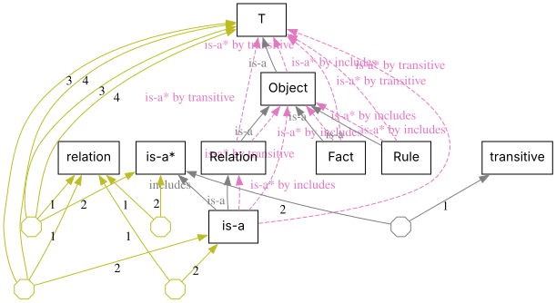
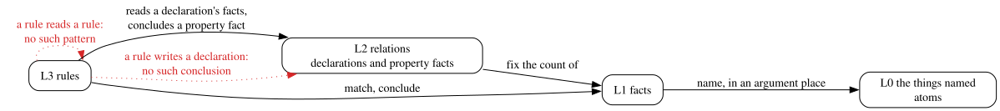

# Rules as data — what of Ein describes itself in Ein

How much of Ein can be stated in Ein, with only the forms a program may already write, and reasoned about by
Ein's own rules? The constraint is the point: a self-description that needs a second language beside Ein is no
longer Ein describing itself, as a grammar of EBNF written in EBNF needs nothing but EBNF.

The answer is a line through the four levels a knowledge base is read at
([the rules](../01-static-ir/02-rewriting-rules.md#the-four-levels-a-knowledge-base-describes-itself-in)):
atoms, facts and relations are data that rules read and write, and a rule is not. This page states what is on
each side of the line.

## 1. The toolbox: declarations and facts

A program is a finite sequence of forms, and each form is of one of two kinds, decided by its first word:

$$
\begin{aligned}
\text{Form} &= \text{Decl} \;\sqcup\; F \\
\text{a form headed by } w \text{ is a declaration} &\iff w \in W_{\!d}
\end{aligned}
$$

where $W_{\!d} \subset W$ is the closed set of words that head a declaration: of a relation, a rule, a hypothesis
rule, a macro, an import, and of a program's questions
([the reserved names](../../user/04-reference/03-reserved-names.md) lists them). **Every other form is a fact.**
The two kinds are told apart as forms, by the first word: what reading makes of a relation's declaration is
again facts, of the relation $\mathsf{relation}$ (§ 2).
Each kind of form takes a closed list of clauses, a fact takes only the clauses that say where it came from
([Q-M1e2.28](../../../decisions/language/Q-M1e2.28-each-form-takes-a-closed-list-of-keywords.md)), and a clause is
only ever a form's own, never part of an object
([Q-M1f.14](../../../decisions/engine/Q-M1f.14-a-keyword-pair-is-only-ever-a-forms-clause.md)).

So there is no schema sub-language to describe Ein with. A form that tried to give a fact named argument places
would be a fact with a clause a fact does not take, which is no form. To describe Ein in Ein there are exactly
**the declarations** and **facts of the relations a program names**, and they are enough for three of the four
levels.

## 2. The four levels, stated in Ein

### The things named: the kinds are atoms, and membership is facts

Ein has no form that declares an atom. A thing a program names is any atom under an argument arrow, and *this is
one of those* is a fact of a membership relation the program declares like any other
([Q23](../../../decisions/language/Q23-a-premise-types-a-variable-and-no-entity-has.md)). A program can so name
Ein's own kinds: four atoms under a common top, each a member by a fact of that relation:

$$
\begin{aligned}
&\operatorname{is-a}(\mathsf{Object}, \mathsf{T}) \\
&\operatorname{is-a}(\mathsf{Relation}, \mathsf{Object}) \\
&\operatorname{is-a}(\mathsf{Fact}, \mathsf{Object}) \\
&\operatorname{is-a}(\mathsf{Rule}, \mathsf{Object})
\end{aligned}
$$

The four are the program's atoms, and mean what its rules make of them. $\mathsf{Object}$ is the program's top
kind, with $\mathsf{Rule}$ under it; on these pages an object is a node of the graph, and a rule is none (§ 4).

### The homoiconic line

The membership relation is a declared relation and no reserved atom, so a program may state a fact about it,
that it is a relation:

$$
\operatorname{is-a}(\operatorname{is-a}, \mathsf{Relation})
$$

Let $\operatorname{is-a}^{*}$ be a second relation, and let the program state two properties, each applied by a
rule of the standard library's relation algebra (§ 3):
$\operatorname{includes}(\operatorname{is-a}, \operatorname{is-a}^{*})$ and
$\operatorname{transitive}(\operatorname{is-a}^{*})$. Then the membership relation is, by the program's own
rules, a member of $\mathsf{Object}$. With $m_1$ and $m_2$ two of the membership facts written, the derivation
is three firings:

$$
\begin{aligned}
m_1 &= \operatorname{is-a}(\operatorname{is-a}, \mathsf{Relation}) \\
m_2 &= \operatorname{is-a}(\mathsf{Relation}, \mathsf{Object}) \\
e_1 &= \operatorname{is-a}^{*}(\operatorname{is-a}, \mathsf{Relation}) && \text{by includes, from } m_1 \\
e_2 &= \operatorname{is-a}^{*}(\mathsf{Relation}, \mathsf{Object}) && \text{by includes, from } m_2 \\
e_3 &= \operatorname{is-a}^{*}(\operatorname{is-a}, \mathsf{Object}) && \text{by transitive, from } e_1, e_2
\end{aligned}
$$

That is the fixed point of Ein's model, *an instance is an instance of instance*, reached with two membership
facts, two property facts and two rules, and it is inference about Ein performed by Ein. The saturated state,
with the two declarations' facts kept:

The drawing is with labelled arrows
([the knowledge base](../01-static-ir/01-knowledge-base.md#drawn-with-labelled-arrows)), and the membership
relation appears in it three ways: as the first argument of the fact its declaration is (the octagon's arrow
numbered 1), as the label of the dashed arrows with an empty head, which are its facts, and as an oval, the
atom, with such an arrow of its own to $\mathsf{Relation}$. The pink arrows are the derived facts; the one from
the membership relation to $\mathsf{Object}$ is $e_3$, the conclusion of the derivation above.

### Facts, relations, properties and rules

The levels above the things named are those of
[the rules](../01-static-ir/02-rewriting-rules.md#the-four-levels-a-knowledge-base-describes-itself-in), each
with one thing of the three-house example at it:

| level | what is there | as a formula |
|---|---|---|
| a fact | an object with arrows: at its relation, then at its arguments | $\operatorname{left-of}(\mathsf{House\text{-}1}, \mathsf{House\text{-}2})$ |
| a relation | an atom; its declaration is a fact that carries its labels | $\operatorname{decl}(\operatorname{left-of};\ \mathsf{House}, \mathsf{House})$ |
| a relation's property | a fact whose argument is the relation | $\operatorname{transitive}(\operatorname{left-of})$ |
| a rule | parameters, a pattern and a conclusion, under a name | $\operatorname{transitive}[r]:\ r(a, b) \land r(b, c) \land a \ne c \implies r(a, c)$ |

How each is spelt is the user's pages on [facts](../../user/03-syntax-and-semantics/03-facts.md),
[relations](../../user/03-syntax-and-semantics/02-relations.md),
[properties](../../user/03-syntax-and-semantics/07-properties-and-operators.md) and
[rules](../../user/03-syntax-and-semantics/05-rules.md).

### A declaration is a fact a rule can read

A relation's declaration is a fact of the relation $\mathsf{relation}$,
$\operatorname{decl}(r;\ T_1, \dots, T_n)$, and beside it the knowledge base holds the fact that says $r$ is
declared whatever its count ([the knowledge base](../01-static-ir/01-knowledge-base.md#what-is-where)). So
where a program declares $r$ with the labels $T_1, \dots, T_n$:

$$
\begin{aligned}
\operatorname{relation}(r, T_1, \dots, T_n) &\in K_0 \\
\operatorname{relation}(r) &\in K_0
\end{aligned}
$$

A pattern matches a fact only of its own count of arguments. So where $r$ is declared with the two labels
$T_1$ and $T_2$, and $\theta$ sends $x$, $y$ and $z$ to $r$, $T_1$ and $T_2$,

$$
\begin{aligned}
K &\models \operatorname{relation}(x, y, z)\theta \\
K &\models \operatorname{relation}(x)\theta
\end{aligned}
$$

and the second holds where $r$ is declared with any count of labels. A pattern over $\mathsf{relation}$ is an
ordinary premise, so **a relation is data the rules read**. Each line follows from a declaration, and neither
implies one: a rule may conclude a fact $\operatorname{relation}(\mathsf{a})$, which a pattern reads as it
reads any fact of $\mathsf{relation}$ and which declares nothing. The declared relations of a program are fixed
when it is read.

## 3. What already describes itself

**Labels are data rules consume.** Because a declaration is a fact, rules read the schema and act on it. The
standard library's check of a converse reads two declarations and refuses a pair whose labels do not fit,
with $m^{*}$ the program's membership closure as a parameter:

$$
\begin{aligned}
&\operatorname{converse}(r_1, r_2) \\
&\land\ \operatorname{relation}(r_1, D_1, E_1) \land \operatorname{relation}(r_2, D_2, E_2) \\
&\land\ E_1 \ne D_2 \\
&\land\ \operatorname{absent}(m^{*}(E_1, D_2)) \land \operatorname{absent}(m^{*}(D_2, E_1)) \\
&\implies\ \bot
\end{aligned}
$$

and its rule of domain elimination reads a declaration's labels to know which atoms to range over
([the rules](../01-static-ir/02-rewriting-rules.md#structural)). The theory itself reads of a
declaration only how many labels it has; it never reads a label as a type, and Ein has none
([Q23](../../../decisions/language/Q23-a-premise-types-a-variable-and-no-entity-has.md),
[Q-M1f.372](../../../decisions/language/Q-M1f.372-ein-has-no-types-a-declarations-slot-names-are.md)). What a
program calls its type system is this: membership is facts of a relation it declares, and what a type check
concludes, a rule concludes.

**The property algebra is Ein in Ein.** No property of a relation is a primitive. Each is a fact written beside
a declaration, and its meaning is an ordinary rule the fact applies
([Q27](../../../decisions/language/Q27-a-relations-properties-are-facts-beside.md),
[Q16](../../../decisions/stdlib/Q16-general-rule-families-are-stdlib-modules.md)). With
$\operatorname{ext}_K(r)$ the held extent of a relation of two arguments
([the knowledge base](../01-static-ir/01-knowledge-base.md#the-relation-its-extent-a-fact-of-it)), each fact
$r(u, v)$ of it written as the pair $(u, v)$, the rules of
the standard library's relation algebra make these true of every saturated state $K$ of a program that brings
them in:

| the property fact in $K$ | what its rule makes true of $K$ |
|---|---|
| $\operatorname{symmetric}(r)$ | $\operatorname{ext}_K(r)^{-1} \subseteq \operatorname{ext}_K(r)$ |
| $\operatorname{transitive}(r)$ | $(a, b), (b, c) \in \operatorname{ext}_K(r) \land a \ne c \implies (a, c) \in \operatorname{ext}_K(r)$ |
| $\operatorname{includes}(r, s)$ | $\operatorname{ext}_K(r) \subseteq \operatorname{ext}_K(s)$ |
| $\operatorname{converse}(r, s)$ | $\operatorname{ext}_K(r)^{-1} \subseteq \operatorname{ext}_K(s)$ |
| $\operatorname{compose}(r, s, t)$ | $\operatorname{ext}_K(r) \mathbin{;} \operatorname{ext}_K(s) \subseteq \operatorname{ext}_K(t)$ |
| $\operatorname{meet}(r, s, t)$ | $\operatorname{ext}_K(r) \cap \operatorname{ext}_K(s) \subseteq \operatorname{ext}_K(t)$ |
| $\operatorname{join}(r, s, t)$ | $\operatorname{ext}_K(r) \cup \operatorname{ext}_K(s) \subseteq \operatorname{ext}_K(t)$ |
| $\operatorname{functional}(r)$ | $(a, b), (a, c) \in \operatorname{ext}_K(r) \land b \ne c \implies \bot \in K$ |
| $\operatorname{injective}(r)$ | $(a, c), (b, c) \in \operatorname{ext}_K(r) \land a \ne b \implies \bot \in K$ |

Union, intersection, composition, converse and inclusion are one rule each over the one notion of a match, and
the cardinality properties are rules that conclude $\bot$. The one kernel counterpart is the marker that closes the
held extent of a relation under the swap of its arguments, as the rule of symmetry does, without the rule
([the knowledge base](../01-static-ir/01-knowledge-base.md#the-reserved-atoms)).

**The quantifiers are Ein in Ein.** The bounded universal and the open fact
([the rules](../01-static-ir/02-rewriting-rules.md#the-conditions-on-a-match)) are not forms of the pattern
language. Each is a macro, a named pattern with parameters that is replaced by its body where it is written:

$$
\begin{aligned}
\operatorname{forall}(x;\ G,\ B) &\mapsto \operatorname{absent}\big(G \land \operatorname{absent}(B)\big) \\
\operatorname{unknown}(t) &\mapsto \operatorname{absent}(t) \land \operatorname{absent}(\lnot t)
\end{aligned}
$$

The first is the classical equivalence $\forall x.\,(G \rightarrow B) \equiv \lnot\exists x.\,(G \land \lnot B)$
with both negations read as absence. How a macro is written is
[the user's page on macros](../../user/03-syntax-and-semantics/11-macros.md).

## 4. Where it stops: a rule is not data

**Atoms, facts and relations reify; rules do not.** A pattern has a premise for each of the first three,

$$
\begin{aligned}
&r(a, b) && \text{a fact} \\
&\operatorname{relation}(r, x, y) && \text{a declaration} \\
&\operatorname{symmetric}(r) && \text{a property}
\end{aligned}
$$

and none for a rule. Three statements make the line exact. For every program $P$ and every state $K$ any
computation over it reaches:

$$
\begin{aligned}
&\forall \rho \in P.\ \ \rho \notin K && \text{a state holds facts, and a rule is no fact} \\
&K \models \varphi\theta \text{ depends on } K \text{ alone} && \text{no rule satisfies part of a pattern} \\
&\psi\theta \subseteq F && \text{a conclusion is facts, and a declaring form is of the text}
\end{aligned}
$$

The word that heads a rule's declaration is in $W_{\!d}$, so a pattern headed by it is no pattern. A conclusion
may hold the fact $\operatorname{relation}(\mathsf{a})$, and that fact declares nothing (§ 2). Therefore

$$
P \text{ is the same in every state a computation reaches}
$$

Saturation and search change a program's facts and never its rules, and no rule brings in a name the program
does not have ([Q-M1e.21](../../../decisions/hypotheses/Q-M1e.21-a-rule-brings-in-no-name.md)). That is why the
four levels form a stack in which each level is read only by the levels above it: two arrows do not exist.

The solid arrows are what a level reads or writes of the levels below it; the two dotted red arrows are the ones
that are missing.

The relation $\mathsf{relation}$ describes itself only in part. It is a reserved atom whose name no declaration
takes ([the knowledge base](../01-static-ir/01-knowledge-base.md#the-reserved-atoms)), so its own labels are
nothing a program can declare; the facts $\operatorname{relation}(r)$ of § 2 are
its whole description in Ein.

What lies past this line, rules that match or generate rules, is a change to the language and not a property of
Ein as it is. [Analysis of rules](02-analysis-of-rules.md) states what is computed about a rule set, and
[transformations of a rule set](03-transformations.md) which rewrites of one leave the answer unchanged.
