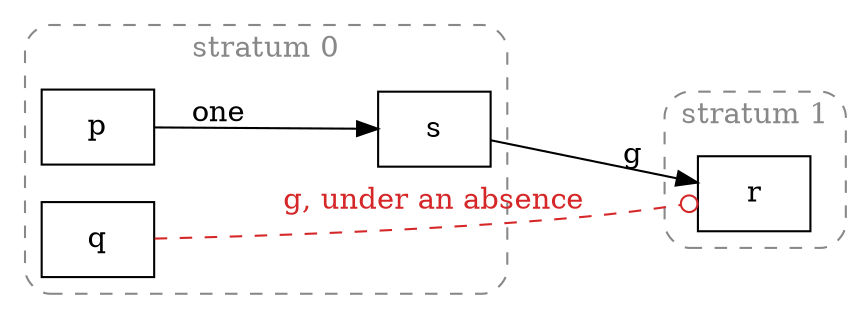
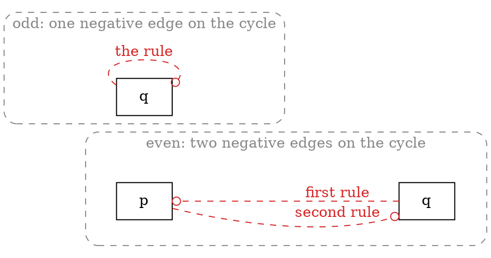

# Analysis of rules — the dependency graph and its strata

A rule set has a structure before any fact is derived from it: which relations each rule reads, which it writes,
and which of its reads stand under an absence. One such structure is defined for every program, the
**dependency graph** of its rules, and from the graph the **strata** and the **negative cycles**. What the graph
decides is whether a stratification exists. It is a diagnostic: it orders nothing and refuses nothing.

## 1. The dependency graph

The graph is a signed directed graph

$$
G_P = (\mathcal{V},\ E), \qquad E \subseteq \mathcal{V} \times \mathcal{V} \times \{+, -\}
$$

**Its vertices** $\mathcal{V}$ are relations. The stored negations of a relation are a vertex of their own,
$\lnot r$ beside $r$, and $\bot$ is the vertex a rule that concludes falsity writes.

**Its edges** are read off the rules as the root applies them. A rule with parameters names no relation until a
fact applies it: the rule of symmetry reads and writes its parameter, and
$\operatorname{symmetric}(\operatorname{next-to})$ makes it a rule over $\operatorname{next-to}$. So the graph is
over the instances

$$
\{\, \rho[\bar{a}] \;:\; \rho \in P,\ \bar{a} \in \operatorname{Act}_{\operatorname{root}}(\rho) \,\}
$$

each rule once per activator the root holds, and a rule nothing applies adds no edge. For an instance with
pattern $\varphi$ and conclusion $\psi$, let $\operatorname{writes}(\psi) \subseteq \mathcal{V}$ be the vertices of
its literals, and let $\operatorname{reads}(\varphi)$ be the pairs $(u, d)$ of a vertex $u$ an atom of $\varphi$
is of and the number $d$ of absences that atom stands under. Then

$$
E = \bigcup_{\rho[\bar{a}]}\ \Big( \big\{\, (u,\ w,\ \operatorname{sgn}(d)) \;:\; (u, d) \in \operatorname{reads}(\varphi),\ w \in \operatorname{writes}(\psi) \,\big\} \;\cup\; \big\{\, (\operatorname{name}(\rho),\ w,\ +) \;:\; w \in \operatorname{writes}(\psi),\ \bar{p} \ne \varepsilon \,\big\} \Big)
$$

$$
\operatorname{sgn}(d) = \begin{cases} - & d \text{ odd} \\ + & d \text{ even} \end{cases}
$$

In words:

- an edge from each relation the pattern reads to each relation the conclusion writes, **negative** where the
  read stands under an odd number of absences and positive otherwise; a read under a universal premise stands
  under two, and is positive again;
- a read of a stored negation whose relation is a variable reads every vertex $\lnot r$ of the graph;
- a positive edge from the rule's own name, the relation whose facts apply it, to each relation it writes;
- an equality or an inequality is computed and never stored, and adds no edge.

**An example.** Four relations of one argument, one written fact $\operatorname{p}(\mathsf{a})$, and two rules:

$$
\operatorname{one}:\ \ \operatorname{p}(x) \implies \operatorname{s}(x), \qquad\qquad
\operatorname{g}:\ \ \operatorname{s}(x) \land \operatorname{absent}(\operatorname{q}(x)) \implies \operatorname{r}(x)
$$

A rectangle is a relation, an arrow an edge labelled by the rule it comes from; the dashed red arrow with a
round head is the negative edge. The graph has three edges: $(\operatorname{p}, \operatorname{s}, +)$ from the
first rule, and $(\operatorname{s}, \operatorname{r}, +)$ and $(\operatorname{q}, \operatorname{r}, -)$ from the
second.

## 2. Strata

A **stratification** of $G_P$ is a map $\sigma : \mathcal{V} \to \mathbb{N}$ that never falls along an edge and
rises along a negative one:

$$
(u, w, +) \in E \implies \sigma(u) \le \sigma(w), \qquad\qquad (u, w, -) \in E \implies \sigma(u) < \sigma(w)
$$

The **stratum** of a relation is the greatest number of negative edges on a path into it, counted over the
strongly connected components of the graph: the relations of one component $c$ share a stratum, and only the
edges between components are counted,

$$
\sigma(c) = \max\Big( \{0\} \;\cup\; \big\{\, \sigma(c') + [\,\pm = -\,] \;:\; (u, w, \pm) \in E,\ u \in c' \ne c,\ w \in c \,\big\} \Big)
$$

with $[\,\pm = -\,]$ one for a negative edge and zero for a positive one. The recursion is well founded because
the components form an acyclic graph, and where a stratification exists this $\sigma$ is the least one. A **rule's stratum** is the highest stratum of what it writes, and a program
has one more stratum than its highest:

$$
\sigma(\rho) = \max\{\, \sigma(w) \;:\; w \in \operatorname{writes}(\rho) \,\}, \qquad\qquad \text{the number of strata} = 1 + \max_{v \in \mathcal{V}} \sigma(v)
$$

In the example $\sigma(\operatorname{p}) = \sigma(\operatorname{s}) = \sigma(\operatorname{q}) = 0$ and
$\sigma(\operatorname{r}) = 1$, so the first rule is in stratum 0, the second in stratum 1, and the program has
two strata, the two boxes of the drawing. A stratum says that everything a rule reads under an absence can be
complete before the rule's conclusions are needed: $\operatorname{q}$ is complete before $\operatorname{r}$ is
derived from its absence.

## 3. Negative cycles, and their parity

A strongly connected component with a negative edge inside it is a **negative cycle**.

**Proposition.** A program has a stratification exactly when its graph has no negative cycle.

*Argument.* Let $(u, w, -)$ be an edge inside a component. There is a path from $w$ back to $u$, along which a
stratification never falls, so $\sigma(w) \le \sigma(u)$; the edge itself asks $\sigma(u) < \sigma(w)$. No map
satisfies both. Conversely, if no component holds a negative edge, the $\sigma$ of § 2 is constant on each
component, never falls along an edge between components, and rises along each negative one, all of which lie
between components. $\square$

Across a negative cycle a stratum is still assigned by the formula of § 2, from the edges into the component, and
the cycle is reported beside it.

A cycle's **parity** is *odd* when some directed cycle inside the component passes an odd number of negative
edges, and *even* otherwise. A component is even exactly when it is **balanced**: its relations split in two
sets so that every negative edge crosses the split and every positive edge stays on one side,

$$
\operatorname{even}(c) \iff \exists\, \chi : c \to \{0, 1\}.\ \ \forall (u, w, \pm) \in E \cap c^2.\ \ \big(\chi(u) \ne \chi(w)\big) \leftrightarrow (\pm = -)
$$

The parity says what the graph allows of the root's fixpoint:

- **even**: several fixpoints may exist, and which one the root reaches may depend on the order in which
  absences are admitted. The shortest has two rules, each reading the other's relation under an absence:

$$
\operatorname{thing}(x) \land \operatorname{absent}(\operatorname{q}(x)) \implies \operatorname{p}(x), \qquad\qquad
\operatorname{thing}(x) \land \operatorname{absent}(\operatorname{p}(x)) \implies \operatorname{q}(x)
$$

- **odd**: a fixpoint in which every admitted absence still holds need not exist, and the one the root reaches
  may depend on that order. The shortest is one rule that reads under an absence the relation it writes:

$$
\operatorname{p}(x) \land \operatorname{absent}(\operatorname{q}(x)) \implies \operatorname{q}(x)
$$

In the even one, the state with $\operatorname{p}$ and without $\operatorname{q}$ is a fixpoint, and so is the
state with $\operatorname{q}$ and without $\operatorname{p}$. In the odd one, the rule concludes the very fact
whose absence it read. What is computed on such a program, and at which moment an absence is admitted, are
[negation as failure](../02-kb-evolution/03-absent-and-naf.md)'s subject.

## 4. What the graph decides, and what it does not

**It is a diagnostic, not a refusal.** A program with a negative cycle is read, is answered, and its answer is
reported as any other is.

**It says what the graph allows, never what a computation did.** A cycle whose rules never fire changes nothing:
where no fact matches the positive part of their patterns, the root's fixpoint is the one it would be without
them, and the graph has the cycle all the same. The diagnostic's words are *may* and *need not*.

**It orders nothing.** No stratum, and no class of rule derived from a rule's shape, orders what fires first:
that order is [saturation](../02-kb-evolution/02-saturation.md)'s, first what leads to falsity and then the
written and arrival order
([Q-M1f.313](../../../decisions/engine/Q-M1f.313-the-agenda-fires-first-what-leads-to-false.md)). On a monotone
program the order decides no answer, and a dead node's core, which it may decide, is an explanation
([Q-M1f.6](../../../decisions/answer/Q-M1f.6-a-core-is-an-explanation.md)).

**It is read at the root, on every program.** The monotonicity check asks another question
([monotone and non-monotone programs](../02-kb-evolution/08-monotonicity.md)): whether a commitment can change what
an absence reads. Its cycles are the cycles of $G_P$ restricted to the relations a commitment can change,

$$
G_P \big|_{D} = \big(\mathcal{V} \cap D,\ \ E \cap (D \times D \times \{+, -\})\big)
$$

with $D$ that set of relations. A negative cycle among relations no commitment changes leaves a program monotone
by that check, since every node reads it alike, and still makes the root's own fixpoint possibly one of several;
the diagnostic of this page is the one that sees it.

## 5. The other readings of a rule set

The graph is one of several things read off a program's rules without deriving a fact. Each is stated on the
page of what it serves:

- **the monotonicity check**, whether a commitment can change what an absence reads, and the refusal of a
  refutation that could rest on such a read:
  [monotone and non-monotone programs](../02-kb-evolution/08-monotonicity.md) and
  [negation as failure](../02-kb-evolution/03-absent-and-naf.md);
- **the alive-set invariant**, that no rule asserts a name the program lacks:
  [saturation](../02-kb-evolution/02-saturation.md);
- **what a rule can bring a commitment to owe**, read off the obligation rules, the second rung of the
  hypothesis ladder: [hypothesis generation](../02-kb-evolution/04-hypothesis-generation.md);
- **the hypothesis mechanisms judged against one another**, a hypothesis rule, an obligation, the scoping a
  program states and a relation closed to hypotheses
  ([Q-M1f.245](../../../decisions/hypotheses/Q-M1f.245-the-hypothesis-mechanisms-are-judged-at-load-on.md));
- **the rule shapes that are no program**, a conclusion's variable nothing binds, a rule that reads nothing, a
  rule that could derive an activator binding a relation's place to a fact:
  [the diagnostics](../../user/04-reference/07-diagnostics.md).

Which rewrites of a rule set leave the answer unchanged is
[transformations of a rule set](03-transformations.md)'s subject.
