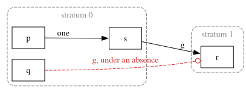
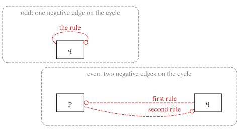

# Analysis of rules — the dependency graph and its strata

A rule set has a structure before any fact is derived from it: which relations each rule reads facts of, which
it writes facts of, and which of its reads stand under an absence. One such structure is defined for every
program, the **dependency graph** of its rules, and from the graph the **strata** and the **negative cycles**.
What the graph decides is whether a stratification exists. It is a diagnostic: it orders nothing and refuses
nothing.

## 1. The dependency graph

The graph is a signed directed graph

$$
\begin{aligned}
G_P &= (\mathcal{V},\ \mathcal{E}) \\
\mathcal{E} &\subseteq \mathcal{V} \times \mathcal{V} \times \lbrace +, - \rbrace
\end{aligned}
$$

**Its vertices** $\mathcal{V}$ are named by relations. The vertex $r$ stands for the facts of the relation $r$,
as a rule reads or writes them; the stored negations of those facts are a vertex of their own, $\lnot r$ beside
$r$; and $\bot$ is the vertex a rule that concludes falsity writes.

**Its edges** are read off the rules as the root applies them. A rule with parameters names no relation until a
fact applies it: the rule of symmetry reads and writes facts of whatever relation its parameter stands for, and
the activator $\operatorname{symmetric}(\operatorname{next-to})$ makes it a rule over the facts of
$\operatorname{next-to}$. So the graph is over the instances

$$
\lbrace\, \rho[a] \;:\; \rho \in P,\ a \in \operatorname{Act}_{\mathrm{root}}(\rho) \,\rbrace
$$

each rule once per activator the root holds, and a rule nothing applies adds no edge. An instance with pattern
$\varphi$ and conclusion $\psi$ **writes** the vertices of the literals of $\psi$,
$\operatorname{writes}(\psi) \subseteq \mathcal{V}$: firing it adds a fact of that relation, a stored negation of
one, or $\bot$. It **reads** the vertices its premises are of: a premise of the vertex $r$ is matched in the
held extent of $r$
([the knowledge base](../01-static-ir/01-knowledge-base.md#the-relation-its-extent-a-fact-of-it)), and one of
$\lnot r$ among the stored negations held of its facts. $\operatorname{reads}(\varphi)$ is the pairs $(u, d)$ of
a vertex $u$ a premise of $\varphi$ is of and the number $d$ of absences that premise stands under. Then

$$
\begin{aligned}
\mathcal{E} = \bigcup_{\rho[a]}\ \Big(\ & \big\lbrace\, (u, w, \operatorname{sgn}(d)) \;:\; (u, d) \in \operatorname{reads}(\varphi),\ w \in \operatorname{writes}(\psi) \,\big\rbrace \\
\cup\ & \big\lbrace\, (\operatorname{name}(\rho), w, +) \;:\; w \in \operatorname{writes}(\psi),\ \bar{p} \ne \varepsilon \,\big\rbrace \ \Big)
\end{aligned}
$$

where

$$
\operatorname{sgn}(d) = \begin{cases} - & d \text{ odd} \\ + & d \text{ even} \end{cases}
$$

In words:

- an edge from each vertex the pattern reads to each vertex the conclusion writes, **negative** where the read
  stands under an odd number of absences and positive otherwise; a read under a universal premise stands under
  two, and is positive again;
- a premise that reads the stored negation of whatever fact a variable stands for reads every vertex $\lnot r$
  of the graph;
- a positive edge from the rule's own name, the relation whose facts apply it, to each vertex it writes;
- an equality or an inequality is computed and never stored, and adds no edge.

**An example.** Four relations of one argument, one written fact $\operatorname{p}(\mathsf{a})$, and two rules:

$$
\begin{aligned}
\operatorname{one} &:\ \ \operatorname{p}(x) \implies \operatorname{s}(x) \\
\operatorname{g} &:\ \ \operatorname{s}(x) \land \operatorname{absent}(\operatorname{q}(x)) \implies \operatorname{r}(x)
\end{aligned}
$$

A rectangle is the vertex of a relation, an arrow an edge labelled by the rule it comes from; the dashed red
arrow with a round head is the negative edge. The graph has three edges:
$(\operatorname{p}, \operatorname{s}, +)$ from the first rule, and $(\operatorname{s}, \operatorname{r}, +)$ and
$(\operatorname{q}, \operatorname{r}, -)$ from the second.

## 2. Strata

A **stratification** of $G_P$ is a map $\sigma : \mathcal{V} \to \mathbb{N}$ that never falls along an edge and
rises along a negative one:

$$
\begin{aligned}
(u, w, +) \in \mathcal{E} &\implies \sigma(u) \le \sigma(w) \\
(u, w, -) \in \mathcal{E} &\implies \sigma(u) < \sigma(w)
\end{aligned}
$$

The **stratum** of a vertex, and so of a relation, is the greatest number of negative edges on a path into it,
counted over the strongly connected components of the graph: the vertices of one component $c$ share a stratum,
and only the edges between components are counted,

$$
\sigma(c) = \max\Big( \lbrace 0 \rbrace \cup \big\lbrace\, \sigma(c') + [\,\pm = -\,] \;:\; (u, w, \pm) \in \mathcal{E},\ u \in c' \ne c,\ w \in c \,\big\rbrace \Big)
$$

with $[\,\pm = -\,]$ one for a negative edge and zero for a positive one. The recursion is well founded because
the components form an acyclic graph, and where a stratification exists this $\sigma$ is the least one. A
**rule's stratum** is the highest stratum of what it writes, and a program has one more stratum than its
highest:

$$
\begin{aligned}
\sigma(\rho) &= \max\lbrace\, \sigma(w) \;:\; w \in \operatorname{writes}(\rho) \,\rbrace \\
\text{the number of strata} &= 1 + \max_{v \in \mathcal{V}} \sigma(v)
\end{aligned}
$$

In the example $\sigma(\operatorname{p}) = \sigma(\operatorname{s}) = \sigma(\operatorname{q}) = 0$ and
$\sigma(\operatorname{r}) = 1$, so the first rule is in stratum 0, the second in stratum 1, and the program has
two strata, the two boxes of the drawing. A stratum says that the held extent of everything a rule reads under
an absence can be complete before the rule's conclusions are needed: the held extent of $\operatorname{q}$ is
complete before a fact of $\operatorname{r}$ is derived from the absence of a fact of $\operatorname{q}$.

## 3. Negative cycles, and their parity

A strongly connected component with a negative edge inside it is a **negative cycle**.

**Proposition.** A program has a stratification exactly when its graph has no negative cycle.

*Argument.* Let $(u, w, -)$ be an edge inside a component. There is a path from $w$ back to $u$, along which a
stratification never falls, so $\sigma(w) \le \sigma(u)$; the edge itself asks $\sigma(u) < \sigma(w)$. No map
satisfies both. Conversely, if no component holds a negative edge, the $\sigma$ of § 2 is constant on each
component, never falls along an edge between components, and rises along each negative one, all of which lie
between components. $\square$

Across a negative cycle a stratum is still assigned by the formula of § 2, from the edges into the component, and
the cycle is reported beside it.

A cycle's **parity** is *odd* when some directed cycle inside the component passes an odd number of negative
edges, and *even* otherwise. A component is even exactly when it is **balanced**: its vertices split in two
sets so that every negative edge crosses the split and every positive edge stays on one side,

$$
\begin{aligned}
\operatorname{even}(c) \iff\ & \exists\, \chi : c \to \lbrace 0, 1 \rbrace. \\
& \forall (u, w, \pm) \in \mathcal{E} \cap c^2.\ \ \big(\chi(u) \ne \chi(w)\big) \leftrightarrow (\pm = -)
\end{aligned}
$$

The parity says what the graph allows of the root's fixpoint:

- **even**: several fixpoints may exist, and which one the root reaches may depend on the order in which
  absences are admitted. The shortest has two rules, each reading under an absence a fact of the relation the
  other writes facts of:

$$
\begin{aligned}
\operatorname{thing}(x) \land \operatorname{absent}(\operatorname{q}(x)) &\implies \operatorname{p}(x) \\
\operatorname{thing}(x) \land \operatorname{absent}(\operatorname{p}(x)) &\implies \operatorname{q}(x)
\end{aligned}
$$

- **odd**: a fixpoint in which every admitted absence still holds need not exist, and the one the root reaches
  may depend on that order. The shortest is one rule that reads under an absence a fact of the relation it
  writes facts of:

$$
\operatorname{p}(x) \land \operatorname{absent}(\operatorname{q}(x)) \implies \operatorname{q}(x)
$$

In the even one, the state that holds the facts of $\operatorname{p}$ and none of $\operatorname{q}$ is a
fixpoint, and so is the state that holds those of $\operatorname{q}$ and none of $\operatorname{p}$. In the odd
one, the rule concludes the very fact whose absence it read. What is computed on such a program, and at which
moment an absence is admitted, are [negation as failure](../02-kb-evolution/03-absent-and-naf.md)'s subject.

## 4. What the graph decides, and what it does not

**It is a diagnostic, not a refusal.** A program with a negative cycle is read, is answered, and its answer is
reported as any other is.

**It says what the graph allows, never what a computation did.** A cycle whose rules never fire changes nothing:
where no fact matches the positive part of their patterns, the root's fixpoint is the one it would be without
them, and the graph has the cycle all the same. The diagnostic's words are *may* and *need not*.

**It orders nothing.** No stratum, and no class of rule derived from a rule's shape, orders what fires first:
that order is [saturation](../02-kb-evolution/02-saturation.md)'s, first what leads to falsity and then the
written and arrival order
([Q-M1f.313](../../../decisions/engine/Q-M1f.313-the-agenda-fires-first-what-leads-to-false.md)). On a monotone
program that is order-free at the boundary ([transformations](03-transformations.md#3-what-leaves-r-unchanged))
the order decides no answer, and a dead node's core, which it may decide, is an explanation
([Q-M1f.6](../../../decisions/answer/Q-M1f.6-a-core-is-an-explanation.md)).

**It is read at the root, on every program.** The monotonicity check asks another question
([monotone and non-monotone programs](../02-kb-evolution/08-monotonicity.md)): whether a commitment can change
what an absence reads. Its cycles are the cycles of $G_P$ restricted to the relations whose held extent a
commitment can change,

$$
G_P \big|_{D} = \big(\mathcal{V} \cap D,\ \ \mathcal{E} \cap (D \times D \times \lbrace +, - \rbrace)\big)
$$

with $D$ that set of relations. A negative cycle among relations whose held extent no commitment changes leaves
a program monotone by that check, since every node reads it alike, and still makes the root's own fixpoint
possibly one of several; the diagnostic of this page is the one that sees it.

## 5. The other readings of a rule set

The graph is one of several things read off a program's rules without deriving a fact. Each is stated on the
page of what it serves:

- **the monotonicity check**, whether a commitment can change what an absence reads, and the refusal of a
  refutation that could rest on such a read:
  [monotone and non-monotone programs](../02-kb-evolution/08-monotonicity.md) and
  [negation as failure](../02-kb-evolution/03-absent-and-naf.md);
- **the alive-set invariant**, that no rule asserts a name the program lacks:
  [saturation](../02-kb-evolution/02-saturation.md);
- **what a rule can bring a commitment to owe**, read off the obligation rules, the second rung of the
  hypothesis ladder: [hypothesis generation](../02-kb-evolution/04-hypothesis-generation.md);
- **the hypothesis mechanisms judged against one another**, a hypothesis rule, an obligation, the scoping a
  program states and a relation closed to hypotheses
  ([Q-M1f.245](../../../decisions/hypotheses/Q-M1f.245-the-hypothesis-mechanisms-are-judged-at-load-on.md));
- **the rule shapes that are no program**, a conclusion's variable nothing binds, a rule that reads nothing, a
  rule that could derive an activator binding a relation's place to a fact:
  [the diagnostics](../../user/04-reference/07-diagnostics.md).

Which rewrites of a rule set leave the answer unchanged is
[transformations of a rule set](03-transformations.md)'s subject.
