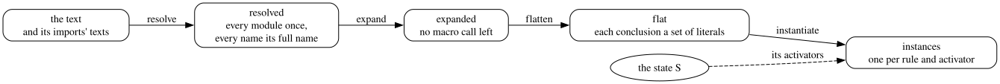

# Transformations of a rule set

A rule set is a thing that can be rewritten: an import written another way, a macro written out, a rule's
conclusion flattened, the rules written in another order, a rule split in two or two fused. This page defines what
it is for a rewrite to leave the answer unchanged, states the rewrites that reading a program performs, and proves
of three of them that they do.

## 1. A transformation, and what it preserves

A **transformation** is a map $\tau$ from programs to programs. The **answer** of a program $P$ is everything the
region determines ([solution semantics](../02-kb-evolution/06-solution-semantics.md)):

$$
\begin{aligned}
\operatorname{Ans}(P) = \Big(\ & R, \\
& \big(\operatorname{st}(C)\big)_{C \in R}, \\
& k_s,\ k_c, \\
& \text{what the root holds and owes}, \\
& \text{each query's classes and each claim's outcome} \ \Big)
\end{aligned}
$$

A transformation **preserves the answer** up to a renaming when there is a bijection $\beta$ of names, the
identity on every name the transformation does not respell, with

$$
\operatorname{Ans}(\tau(P)) = \beta \cdot \operatorname{Ans}(P)
$$

where $\beta$ acts on a fact argument by argument, on a state fact by fact, and on a commitment as on a state. An
implementation that rewrites a rule set for speed may use only transformations that preserve the answer.

**When rewriting happens.** The rules of a program are fixed when it is read
([rules as data](01-rules-as-data.md#4-where-it-stops-a-rule-is-not-data)): every transformation of this page is
applied by reading, none while a state is saturated or a region searched.

## 2. What reading does to a rule set

Reading composes four maps, the first three on the text and the fourth on the rules and a state:

A box is the rule set at a stage and an arrow a map; the dashed arrow says that the last map reads the state, and
so is applied again as the state grows.

**Resolve.** An import brings its module whole, with the module's own imports, and a module reached along several
paths is brought once. With $\operatorname{imp}^{*}(P)$ the modules reachable from $P$ by imports,

$$
\operatorname{resolve}(P) = \alpha\Big( P \;\cup \bigcup_{m \in \operatorname{imp}^{*}(P)} m \Big)
$$

a union of sets of declarations and facts, in which $\alpha$ replaces each short name a file writes by the full
name it stands for
([the knowledge base](../01-static-ir/01-knowledge-base.md#the-knowledge-base-of-a-program)). The ways an import
may be written differ only in which names the file may write short, that is, in $\alpha$ before it is applied.

**Expand.** A macro $\mu$ with parameters $\bar{x}$ and body $\beta_\mu$ is called by a form
$\mu(\bar{t})$ in a pattern, a conclusion or a goal, and expansion replaces the call by the body with the
arguments put in:

$$
\operatorname{expand}:\ \ \mu(\bar{t}) \;\longmapsto\; \beta_\mu[\bar{t} / \bar{x}]
$$

repeated until no call is left, a body's own calls included
([Q-M1f.130](../../../decisions/language/Q-M1f.130-a-macros-call-in-a-conclusion-is-expanded.md)). What must be a
well-formed pattern or conclusion is the result, so a body is judged where it is called and not where it is
defined ([Q-M1f.67](../../../decisions/language/Q-M1f.67-a-macros-body-is-checked-where-it-is-called.md)). The
bounded universal and the open fact are such macros, so a program that writes them is a program of absences
before any rule fires ([rules as data](01-rules-as-data.md#3-what-already-describes-itself)).

**Flatten.** A conclusion's conjunction is read as the set of its literals, at any depth of nesting:

$$
\begin{aligned}
\operatorname{lits}(\psi_1 \land \psi_2) &= \operatorname{lits}(\psi_1) \cup \operatorname{lits}(\psi_2) \\
\operatorname{lits}(\ell) &= \lbrace \ell \rbrace && \text{for a literal } \ell
\end{aligned}
$$

A rule concludes a conjunction of literals, or states the engine's word, and nesting adds nothing.

**Instantiate.** A rule with parameters stands for one rule per activator
([the rules](../01-static-ir/02-rewriting-rules.md#a-rule-declared)):

$$
\begin{aligned}
\operatorname{inst}_K(P) &= \lbrace\, \rho[a] \;:\; \rho \in P,\ a \in \operatorname{Act}_K(\rho) \,\rbrace \\
K \subseteq K' &\implies \operatorname{inst}_K(P) \subseteq \operatorname{inst}_{K'}(P)
\end{aligned}
$$

the objects an activator supplies written into the rule before it matches anything. The set is monotone in the
state: an activator derived later, at the root or in a node, gives its instance when it arrives
([Q29](../../../decisions/engine/Q29-a-rule-compiles-once-per-activator.md)).

## 3. What leaves R unchanged

**Proposition 1 (the form of an import).** Let $P$ and $P'$ differ only in how their imports are written:
selectively, whole, or under an alias, each name spelt as its form allows. Then $P'$ has the answer of $P$ up to
the renaming that takes one spelling of each name to the other
([Q-M1f.249](../../../decisions/imports/Q-M1f.249-the-answer-does-not-depend-on-the-import-form.md)).

*Argument.* The three forms bring the same modules, since an import brings its module whole, and differ only in
the short names a file may write. $\alpha$ sends each spelling to the one full name it stands for, so
$\operatorname{resolve}(P) = \operatorname{resolve}(P')$ as sets of declarations and facts over full names.
Identity is by full name, and every later map and every definition of the answer reads the resolved program
alone. What is left of the difference is how a name is printed, which is the renaming. $\square$

**A program is order-free at the boundary** when no rule reads, under an absence, a fact of a relation of which
a rule that itself reads an absence concludes a fact, directly or through the rules its conclusion sets off. Where two such rules
wait at one boundary the one written first is admitted first, and that order can decide the fixpoint: of root's
as of a node's, and of a program the monotonicity check passes as of one it flags, since the check takes root as
given ([monotone and non-monotone programs](../02-kb-evolution/08-monotonicity.md#34-the-verdict-is-relative-to-root)).

**Proposition 2 (the written order).** Let $P$ be monotone
([monotone and non-monotone programs](../02-kb-evolution/08-monotonicity.md)) and order-free at the boundary, and
let $P'$ be $P$ with its facts and its rules written in another order. Then
$\operatorname{Ans}(P') = \operatorname{Ans}(P)$.

*Argument.* Take first a program whose rules read no absence. One step of every rule at once is the consequence
operator of [saturation](../02-kb-evolution/02-saturation.md),

$$
T_P(K) = K \;\cup\; \big\lbrace\, f \in \psi_\rho[a]\theta \;:\; \rho \in P,\ a \in \operatorname{Act}_K(\rho),\ K \models \varphi_\rho[a]\theta \,\big\rbrace
$$

Without an absence, satisfaction is preserved when a state grows, so $T_P$ is monotone, $K \subseteq K'$ implies
$T_P(K) \subseteq T_P(K')$, and it is inflationary. The chain
$K_0 \subseteq T_P(K_0) \subseteq T_P^2(K_0) \subseteq \cdots$ is increasing, and its union is the least set of
facts above $K_0$ closed under $T_P$, since a match reads finitely many facts and so whatever fires in the union
fires at some stage of the chain:

$$
\operatorname{sat}(K_0) = \bigcup_{k \ge 0} T_P^{\,k}(K_0)
$$

Any order of single firings adds only facts of this union, and one that stops has reached a closed set above
$K_0$, so it has reached the union. $T_P$ and $K_0$ are defined from the *sets* of rules and of written facts, so
the union does not depend on the order they are written in; neither does the state of any node, nor which nodes
are alive and discharged, which is $R$. With absences, the positive closure between two boundaries is such a
union, and the written order enters only as the order the boundary admits in
([saturation](../02-kb-evolution/02-saturation.md)). On a program order-free at the boundary no admission changes
what another waiting rule's absence reads, so a rule that passes at one quiescence passes at every later one, and
the set admitted is the same in every order; on a monotone program no commitment changes it either. $\square$

**Proposition 3 (the order of firing).** On a monotone program order-free at the boundary, taking first the
firings that can lead to
falsity, and the rest in the written and arrival order, gives every question and every claim the answer that the
written order alone gives
([Q-M1f.313](../../../decisions/engine/Q-M1f.313-the-agenda-fires-first-what-leads-to-false.md)).

*Argument.* Both are orders of single firings of one rule set from one set of facts, and by Proposition 2 the
state reached at every node is the same. The answer is a function of those states. $\square$

What an order of firing may change is which derivation of a fact is recorded first, and so a dead node's core. A
core is an explanation and not part of the answer
([Q-M1f.6](../../../decisions/answer/Q-M1f.6-a-core-is-an-explanation.md)).

| transformation | the answer | by |
|---|---|---|
| an import written selectively, whole, or under an alias | unchanged, up to how names are spelt | Proposition 1 |
| the order the facts and rules of a monotone program, order-free at the boundary, are written in | unchanged | Proposition 2 |
| the order of firing, on such a program | unchanged; a dead node's core may differ | Proposition 3 |

**Where nothing is claimed.** Of a program the monotonicity check flags, and of one that is not order-free at the
boundary, no transformation is claimed to preserve the answer: there the state of a node can depend on the order
facts arrive in, and Propositions 2 and 3 have no premise to stand on ([monotone and non-monotone programs](../02-kb-evolution/08-monotonicity.md)).

**What is not performed.** Resolving, expanding, flattening and instantiating are the only rewrites reading
applies. Splitting a rule, fusing two, specialising a rule to a relation ahead of its activator, or generalising
one over a relation are transformations in the sense of § 1 that no part of the theory applies. Whether one of
them preserves the answer is a property of the rule set it is applied to, to be shown as the three propositions
above are shown: by an argument that the saturated state of every node is the same.
