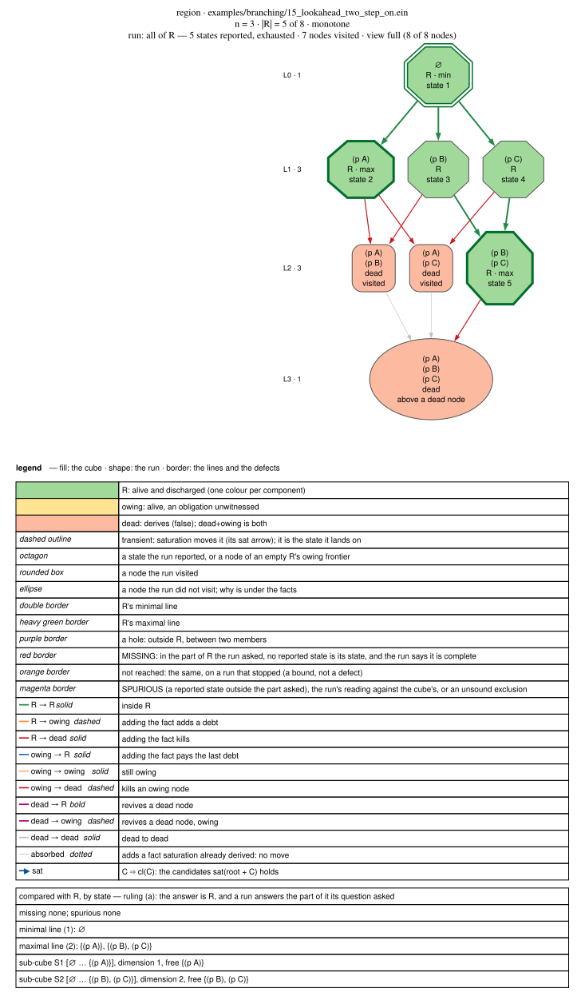
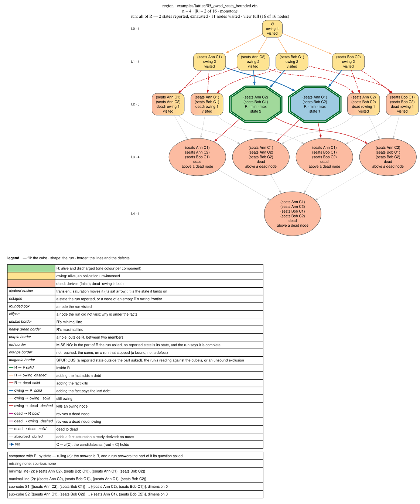
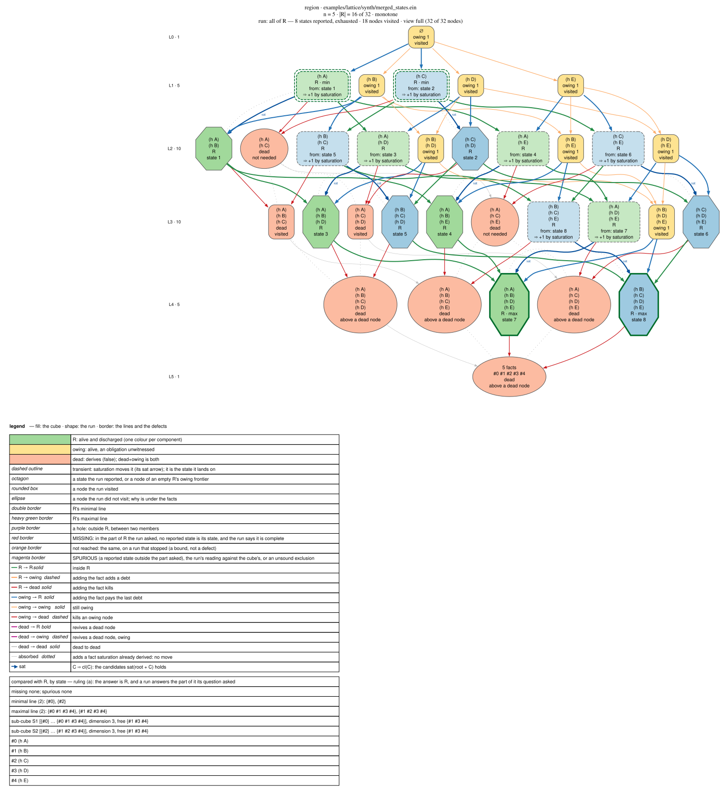
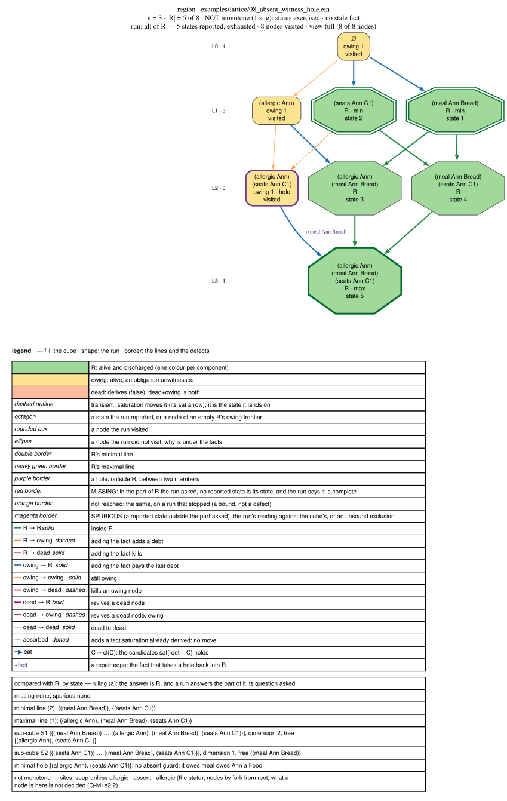
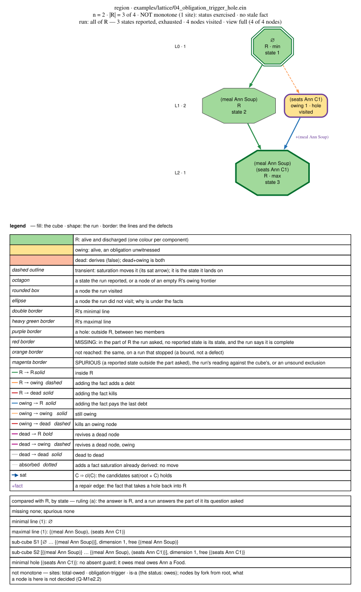
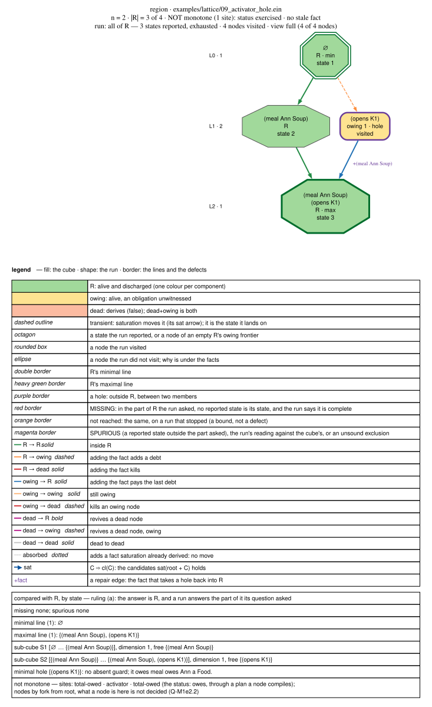
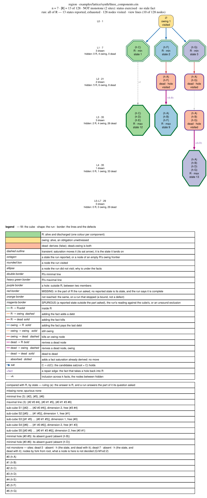

# Monotone and non-monotone programs

**What the answer is when adding a fact can take one away.** The answer to a program is the region R of its
hypothesis lattice, the commitments whose state is alive and discharged ([solution semantics](solution-semantics.md),
[Q-M1e2.7](../../../decisions/answer/Q-M1e2.7-the-answer-is-a-region-r-of-the-hypothesis.md)). The lattice is the
domain, and it is never itself monotone or not: what can be are the functions on its nodes, a node's state and its
status (§ 2). A **monotone** program is one where growth never takes a conclusion away and never adds a debt; there
R has no hole, two lines describe it, and the routes that find it may skip every node a licence decides
([finding R](finding-r.md)). This page sets the two kinds side by side: what each means, what causes the second,
how it is detected, how each looks on the lattice, what each lets a computation of R simplify, and what Ein claims
of a program it cannot prove monotone.

**What is claimed of a flagged program.** A program the static check cannot prove monotone is **flagged**. Ein
detects it, warns of it, and answers it under one stated reading: every node is a fork of root, the read-out says
so, every command gives the same R under that reading, and nothing more is claimed about the program's solutions
([Q-M1e2.2](../../../decisions/answer/Q-M1e2.2-a-node-is-a-fork-of-root-an-assumption-on.md)). Which reading of a
node a non-monotone program should have is not decided, and nothing below decides it.

---

## 1. R is its node set

> **R = { C ⊆ H : sat(root + C) is alive and discharged }.**

In general nothing shorter than the set describes R:

- **Every subset of the cube is the region of some program**, but one: a non-empty R beside a dead ∅. Every node is
  a fork of root, so a dead root makes every node dead. For any other target a program can be written whose region
  it is, its holes written as owing nodes, and the oracle gives the target back node for node.
- **There are 2^(2ⁿ) regions** over n candidates, so no description shorter than the set covers all of them. The
  shortest exact form of one is the union of its maximal sub-cubes, which the oracle computes. It is small when R is
  regular, and it reaches 2ⁿ⁻¹ isolated points on parity.

Each shorter description is licensed by a property of the program, and § 5 orders them.

## 2. The state, the status and the program

```text
L ──state──▶ KB ──(dead, owes)──▶ {0,1}²
```

- **The lattice** L = (2^H, ⊆), the commitments over the candidate universe H, is the domain: a Boolean lattice,
  neither monotone nor not.
- **The state**, `state(C)`, is the knowledge base a node holds.
- **The status** is two binary functions of the state, `dead` and `owes`. R = alive ∧ discharged.

So *monotone* is asked of an arrow, and of three of them:

| property | of | holds when | broken by | what it decides |
|---|---|---|---|---|
| **state monotone** (⇔ path-independent, given cumulativity, § 8.2) | `state`: L → KB | C ⊆ C′ ⇒ `state(C)` ⊆ `state(C′)` | an odd-depth `absent` over a relation a commitment can change; the FIFO gap (§ 8.3) | which knowledge base a node holds, and whether a node built from a parent's fixpoint is the node built from root |
| **status monotone** | `(dead, owes)`: KB → {0,1}² | `dead` and *discharged* are both upward-closed | `dead`: as the state. `owes`: an obligation's trigger, or an activator that compiles an obligation | whether R has holes, and so whether two lines describe it |
| **monotone program** | the consequence operator, on every KB | the operator is monotone | any site (§ 3) | the static check's verdict, and the licences of a monotone program's routes |

A **monotone program** in the logic-programming sense has a consequence operator monotone on every knowledge base.
Then saturation is a closure operator, both arrows are monotone, and R has no hole. The static check (§ 3)
approximates this third property: a site says the operator is not monotone over the relations a commitment can
change. The node functions can still be monotone on the program's own lattice, and those programs are the check's
conservative flags (§ 4).

## 3. The static check

### 3.1 What it reads

The check is read off the program's rules as root compiles them, before any node is built. Let **H** be the
relations of the candidate list, what a commitment can add, and **D** the relations a commitment can **change**: H,
closed under *a saturation rule that reads a relation of D concludes into D*. A stored negative `(not (R …))` is its
own pseudo-relation ¬R, since what a commitment proposes is `R`, and ¬R changes only where a rule derives it.

Every relation a rule reads, at every `absent` depth, is then one of three:

| class | condition | growth of the relation can… |
|---|---|---|
| **static** | not in D | nothing: it is complete at root and the same at every node |
| **dynamic, monotone polarity** | in D, monotone polarity | only add a conclusion, or only pay a debt |
| **dynamic, non-monotone polarity** | in D, non-monotone polarity | take a conclusion away, or add a debt |

The polarity is the depth's parity, read differently by the two kinds of rule. In a **saturation** rule a match is
a conclusion, and a read at odd depth, inside one `absent`, is non-monotone. In an **obligation** rule a match is a
*debt*, the rule being the negation of its witness, and a read at even depth is non-monotone: its **trigger**, the
positive steps that say who owes. An obligation's witness `absent` is at odd depth there, and a commitment that grows
it can only pay.

A **site** is a dynamic read at non-monotone polarity, or a rule with parameters whose **activator** relation is in
D: a commitment can then make a node compile an instance of the rule that root never compiled, which a check of
root's rules cannot see. A program with no site is **monotone** by the check; one with a site is **flagged**. `ein
solve FILE --monotone` asks the check alone, at the cost of root's saturation.

### 3.2 The theorem

**A program with no site has a monotone state and a monotone status, on nodes built by fork from root.** Every
relation in D is then derived only through positive reads of D and reads of static relations, which have the same
extension at every node; so each node's fixpoint contains its subsets' fixpoints, and `dead` is upward-closed,
`(false)` being a fact. Every obligation's set of matches is fixed while its witnesses only grow, so *discharged* is
upward-closed. Both closures together leave R no hole, and its two lines describe it.

The condition is **sufficient, not necessary**. A site can be harmless on a program's own cube, and the cube is what
says whether one was (§ 4). A *monotone* verdict beside a violation the cube observes is a defect of the check.

### 3.3 The grain

The check reads at **relation grain**: a read is dynamic when its *relation* is in D, whatever its pattern. The
theorem above is stated at that grain, and the same D is the one *forbid* (§ 10) and the obligations rung of
[hypothesis generation](hypothesis-generation.md) read.

A finer reading, **fact grain**, calls a read dynamic only when its pattern can match a fact a commitment can add. It
builds an over-approximation of every fact some node holds beyond root, as a closure over **shapes**, facts with some
arguments *any*: the seeds are the candidates, and a saturation rule adds its conclusions when a read at **even**
`absent` depth unifies with a shape already in the closure, a depth-0 read passing its bindings to the conclusions
and every other variable becoming *any*. Only even depth counts, because a fork only adds: a firing a node makes and
root did not had a match that was false at root's fixpoint and true later, and growth makes a match true only through
an even-depth read. Where a commitment can derive an activator, a node can compile a rule root never had, the
closure is incomplete, and the program stays flagged.

Fact grain is sufficient too, and that claim is held to every corpus cube within the oracle's limit. It would unflag a program
whose dynamic reads no commitment can ever match: a read that asks for membership in a type, `(is-a ?a House)`, where
every candidate is a membership between objects. Ein's check does not read at it: the check, *forbid* and the
obligations rung read one D at relation grain, so a program with a read of a relation in D is flagged whatever the
read's pattern, and fact grain is a reading held to the cube, which no route takes.

### 3.4 The verdict is relative to root

A read of a relation outside D is static because root's fixpoint completes it and a fork never re-derives it. So
*monotone* says that the operator is monotone on root's fixpoint extended by commitments, which is what the theorem
and every route need, and not on every knowledge base.

A node built **from scratch**, the program with the commitment written in, re-derives root inside itself, and there
the FIFO gap (§ 8.3) can still reach a static read.
[`lattice/11_fifo_gap_static.ein`](../../../../examples/lattice/11_fifo_gap_static.ein) is the gap's program with
`a` given and only `b` a candidate: `q` is derived from a given fact under an `absent` over a relation nothing
derives, so `q` is outside D and the program has no site. Built by fork, `{b}` inherits root's `q`; built from
scratch, `r2` is admitted before `q` exists and `{b}` holds a stale `p`. Every route builds by fork, so the verdict is
sound for every answer Ein gives, and this program is the reason the scope is stated.

### 3.5 What is not a site

- an `absent` over a static relation:
  [`zebra2.ein`](../../../../examples/zebra2.ein)'s spatial reads, of positions no commitment changes;
- an obligation's witness `absent`: `total-owed`'s, in
  [`lattice/05_owed_seats_bounded.ein`](../../../../examples/lattice/05_owed_seats_bounded.ein);
- a read of a stored negative of a hypothesised relation, which is in D only where a rule derives it:
  [`complete-records-stale.ein`](../../../../examples/ein-bugs/complete-records-stale.ein).

## 4. What the cube shows

The oracle, `ein oracle FILE --dump DIR`, enumerates every node of a cube within its limit
([`region-dump.md` § The limit](../../user/reference/region-dump.md#the-limit)) and counts what a site did:

- **holes**, nodes outside R between two members of R;
- **dead nodes with an alive superset**;
- **discharged nodes with an owing superset**.

A flagged program whose cube shows one is **exercised**, and one whose cube shows none is **conservative**. Both are
words about the **status**, which is what the cube reads. A conservative program can still have a broken **state**:
a stale fact in a node, or a parent path that reaches another state (§ 8, § 11). Past the limit the cube is not
enumerated, and whether a site bit is *not known*.

## 5. The ladder

Each step down is licensed by a property the step above does not have, and each makes a shorter description exact:

| step | licensed by | R is described by | a claimed R is certified by |
|---|---|---|---|
| **general** | nothing | the node set, or its maximal sub-cubes | every node classified: 2ⁿ saturations |
| **convex** | **no hole**, observed on the cube | the two lines: R = ⋃ [a … b] over minimal a ⊆ maximal b | as above: a hole is known only once the cube is enumerated |
| **monotone** | the **static check** says *monotone*, before any search (§ 3) | the two lines, computed from the alive down-set and N, or from N and E, without visiting 2ⁿ nodes | N, E and the static verdict |
| **shape** | which constraints the program states | restrictions only: the minimal line is {∅}. Obligations only: the maximal line is {⊤}. Both, and well-posed: every component a point | as monotone |

N is the set of minimal dead sets, E the set of minimal discharging sets
([solution semantics](solution-semantics.md)).

**A conditional obligation makes holes as a matter of course.**
[`lattice/06_friends_tables.ein`](../../../../examples/lattice/06_friends_tables.ein) says *a group that sits owes
its members' seats*, the way a person writes *if you come, you all sit*: seating one member makes the group owe the
others' seats, so a node between two members of R owes, and R is isolated nodes among holes. Its monotone twin
[`06_friends_tables_everyone_sits.ein`](../../../../examples/lattice/06_friends_tables_everyone_sits.ein), *everyone
must sit*, owes every seat from root, where a seat can only pay, and its region has no hole.

## 6. The two kinds compared

| | monotone | non-monotone |
|---|---|---|
| **what it means** | adding a commitment never takes a conclusion away and never adds a debt | some commitment does one or the other |
| **what causes it** | nothing: no site (§ 3) | a **site**, from one of three sources: an `absent` at odd depth in a saturation rule over a relation a commitment can change; an obligation's **trigger** over one; a rule whose **activator** relation a commitment can change. One witness each, each its program's only site, each with the hole its cause makes: [`lattice/08`](../../../../examples/lattice/08_absent_witness_hole.ein), [`lattice/04`](../../../../examples/lattice/04_obligation_trigger_hole.ein), [`lattice/09`](../../../../examples/lattice/09_activator_hole.ein) |
| **how it looks** | a **band**. Dead is an up-set, drawn at the bottom; owing is a down-set among the alive nodes, near the empty commitment; R lies between, and components separate where dead and owing meet | **islands**: a node outside R between two members, joined to R above it by a repair edge; a dead node with an alive superset; a discharged node with an owing superset |
| **dead** | upward-closed | not, where a refutation rests on an `absent` over a relation a commitment can extend, directly, through a fact derived under it, or through a rule a node compiles. *Forbid* refuses each such rule at load (§ 10), and a death that rests on no such `absent` is dead in every superset |
| **discharged** | upward-closed | not, where a trigger grows (`lattice/04`), an `absent` takes a witness away (`lattice/08`), or a commitment compiles an obligation (`lattice/09`) |
| **R's shape** | convex | any subset of the cube (§ 1) |
| **the lines, decided** | locally: a node of R is maximal iff every edge up leaves R, minimal iff every edge down does | globally only. Across a hole the one-fact test calls a node a line node that is not one: on [`synth/local_not_global.ein`](../../../../examples/lattice/synth/local_not_global.ein), *A and B together or not at all*, the one-fact test calls ∅ maximal and {A,B} minimal, and neither is |
| **N/E duality** | holds: the minimal line is E's alive members, the maximal line the discharged maximal sets that contain no member of N | not guaranteed. It fails where a hole lies between the lines, and it can fail with no hole: on [`synth/maximal_not_top.ein`](../../../../examples/lattice/synth/maximal_not_top.ein) nothing is dead, so the dual's maximal set is ⊤, and ⊤ owes |
| **trivial lines** | restrictions only: min = {∅}. Obligations only: max = {⊤}, so the maximal line says nothing | max ≠ {⊤} where a trigger grows: `synth/maximal_not_top.ein` states obligations and nothing dead, and its maximal line is {A,B} |
| **what a route may learn from a node** | every superset of a dead set is dead, and the extension of an alive state by a candidate it denies is dead; both are remembered and spend no saturation | nothing: a dead set can have an alive superset, and a denial can be lifted by growth, so every node is classified |
| **saturation on the cube** | a **closure operator**: C ⊆ cl(C), cl(cl(C)) = cl(C), C ⊆ D ⇒ cl(C) ⊆ cl(D). R's states are closed sets, each the union of the intervals [g … cl] over its minimal generators g | cl need not be monotone. States still partition the commitments, but not as the closed sets of a closure system |
| **a node's state** | unique, the least fixpoint: built by fork from root or by any split from a fixpoint that holds root's, the same fact set | depends on the construction (§ 8). R is defined over the fork, on a flagged program as an assumption the read-out states ([Q-M1e2.2](../../../decisions/answer/Q-M1e2.2-a-node-is-a-fork-of-root-an-assumption-on.md)) |
| **holes, reported** | there are none | the read-out names the minimal holes the cube shows, each with why it is out of R: dead, with its core, or what it owes |
| **certificate** | N, E and the static verdict: polynomial in \|N\| + \|E\| | the full classification of the cube |
| **detection** | static, before any search (§ 3) | the static check flags a site; only the cube says whether it bit (§ 4) |

## 7. The drawings

Seven regions drawn by `ein render region`
([`rendering.md` § Region rendering](../../user/reference/rendering.md#the-region--ein-render-region)),
each with a bare `ein solve` on its cube. Fill is the node's status, shape is what the run did there, and border is
the lines and the defects; a purple border is a hole, and a `+fact` edge is the repair that takes it back into R. On a
monotone program the run reads the alive states and their extensions; on a flagged one it classifies every node
([finding R](finding-r.md)).

**Monotone.**

| program | what it shows |
|---|---|
| [`branching/15_lookahead_two_step_on.ein`](../../../../examples/branching/15_lookahead_two_step_on.ein) | restrictions only: dead is an up-set, the minimal line is {∅}, and R is the band above it |
| [`lattice/05_owed_seats_bounded.ein`](../../../../examples/lattice/05_owed_seats_bounded.ein) | restrictions and obligations: owing from above, dead from below, and R squeezed to isolated points, the shape of a well-posed puzzle |
| [`lattice/synth/merged_states.ein`](../../../../examples/lattice/synth/merged_states.ein) | saturation moves nodes: a `sat` arrow from each transient commitment to its closure, and several commitments to a state |







**Non-monotone**, one per cause, and one for dead holes.

| program | cause | what it shows |
|---|---|---|
| [`lattice/08_absent_witness_hole.ein`](../../../../examples/lattice/08_absent_witness_hole.ein) | an `absent` | an owing hole: being allergic takes away the soup that paid Ann's meal |
| [`lattice/04_obligation_trigger_hole.ein`](../../../../examples/lattice/04_obligation_trigger_hole.ein) | a trigger | an owing hole: seating Ann makes her a Diner, and a Diner owes a meal |
| [`lattice/09_activator_hole.ein`](../../../../examples/lattice/09_activator_hole.ein) | an activator | the same cube as `lattice/04`, by another mechanism: opening the kitchen declares that every guest owes a meal. The picture cannot tell the causes apart; the static check can |
| [`lattice/synth/three_components.ein`](../../../../examples/lattice/synth/three_components.ein) | `absent`s that refute | three components, two of them with dead holes, each revived by a repair edge. Its refutations rest on an `absent` over a relation a commitment extends, so Ein refuses the program at load (§ 10): the drawing is the cube with that refusal set aside, the shape the refusal exists to rule out |









The six of them that load are re-drawn with one command, from the repository root with `ein` on `PATH`:

```sh
for p in branching/15_lookahead_two_step_on lattice/05_owed_seats_bounded lattice/synth/merged_states \
         lattice/08_absent_witness_hole lattice/04_obligation_trigger_hole lattice/09_activator_hole; do
  f=examples/$p.ein; o=$(mktemp -d); d=docs/ein/reasoning/kb-evolution/diagrams/monotonicity_$(basename $p)
  ein oracle $f --dump $o/cube > /dev/null && ein solve $f --dump-lattice $o/lattice --dump-answer $o/answer > /dev/null &&
  ein render region $o/cube --visited $o/lattice --answer $o/answer > $d.dot && dot -Tsvg $d.dot -o $d.svg && rm -r $o
done
```

## 8. Paths and the state

### 8.1 Three constructions of a node

A node's state can be built along a path, each step forking the last fixpoint, writing the next facts and
saturating. The general question is whether sat(P ∪ C1 ∪ C2) = sat(sat(P ∪ C1) ∪ C2):

| construction | form |
|---|---|
| **scratch** | sat(P ∪ C) |
| **fork from root** | sat(sat(P) ∪ C), the case C1 = ∅ |
| **a parent path** | sat(sat(P ∪ C ∖ {h}) ∪ {h}), and longer chains |

Every route builds a node from root with all of C at once, so C1 = ∅ is the only case a route meets, and the oracle
builds every node the same way. On a monotone program the three agree. On a flagged program they need not: on
[`lattice/08_absent_witness_hole.ein`](../../../../examples/lattice/08_absent_witness_hole.ein), built at once,
`{(seats Ann C1), (allergic Ann)}` never fires `soup-unless-allergic` and owes Ann's meal; by way of its parent
`{(seats Ann C1)}` the soup is served before the allergy arrives, nothing takes it away, and the meal is paid. The
owing hole of the fork is in R by way of its parent. A route that extended a parent's fixpoint would build a node
other than the oracle's, which is why every route builds from root.

### 8.2 Path-independent ⇔ monotone, given cumulativity

- **Path-independent**: every path to C gives one fact set, `state(C)`.
- **Monotone**: C ⊆ C′ ⇒ `state(C)` ⊆ `state(C′)`.
- **Cumulative** saturation: X ⊆ Y ⊆ sat(X) ⇒ sat(Y) = sat(X).

**⇒ holds always.** Construction is append-only: a knowledge base never retracts a fact
([`absent`](absent-and-naf.md)). Take C ⊆ C′ and build C′ by way of C: the result holds `state(C)`, and by path
independence it is `state(C′)`.

**⇐ needs cumulativity.** Take a path ∅ = K_0 ⊆ K_1 ⊆ … ⊆ K_k = C, with S_0 = sat(P) and each step
S_i = sat(S_{i−1} ∪ K_i), and suppose S_{i−1} = sat(P ∪ K_{i−1}). By monotonicity S_{i−1} ⊆ sat(P ∪ K_i), so
P ∪ K_i ⊆ S_{i−1} ∪ K_i ⊆ sat(P ∪ K_i), and by cumulativity S_i = sat(P ∪ K_i). By induction every path ends at
sat(P ∪ C).

A monotone program is cumulative by fork, its saturation being a closure operator. A stratified program evaluated
stratum by stratum is cumulative, since its fixpoint is its perfect model. So the state has **one property**,
monotone ⇔ path-independent, wherever saturation is cumulative, and it is broken by an odd-depth `absent` over D
(§ 8.4) and by the FIFO gap (§ 8.3).

### 8.3 The FIFO gap

An `absent` is decided at the boundary of a saturation: when the positive closure quiesces, the candidates parked on
an `absent` are admitted one at a time, each against the knowledge base as it stands, in the agenda's order
([Q-M1f.313](../../../decisions/engine/Q-M1f.313-the-agenda-fires-first-what-leads-to-false.md),
[`absent`](absent-and-naf.md)). That order is not the order of the program's strata, and it breaks cumulativity.

Take r2 `a ∧ b ∧ absent(q) → p`, written before r1 `a ∧ absent(z) → q`, with `a` and `b` the candidates. The program
is stratified, and its perfect model at {a, b} is {a, b, q}. Built at once, r2's and r1's candidates wait at the same
boundary and r2 is admitted first, so {a, b} gives {a, b, p, q} with `p` **stale**: `q` falsifies the guard it was
derived under. By way of {a}, r1 has already derived `q`, r2's guard fails, and {a, b} gives {a, b, q}. The state
function is monotone and the state is path-dependent: {a, b, q} ⊆ sat({a, b}), and sat({a, b, q}) ≠ sat({a, b}).
Every node is in R, so the status never shows it, and the cube calls the program conservative. The program is
[`lattice/10_fifo_gap.ein`](../../../../examples/lattice/10_fifo_gap.ein). Written in the other order, or admitted
in stratum order, {a, b} holds {a, b, q} built at once.

### 8.4 A state difference needs an `absent`

**Argued.** A path or scratch difference needs a fact admitted under a read that a later fact falsifies. A positive
read, or one at even `absent` depth, only becomes true as facts grow, and a stored negative read positively only
grows. An activator only adds rules as facts grow, and an obligation rule asserts `(open …)` and derives nothing.
What is left is an odd-depth `absent` in a saturation rule, an `absent` site.

**An activator can hide the `absent`.** A rule with parameters that a node compiles can read `(absent (?R ?x))`; the
program's only site is then the activator, and a check of root's rules does not see the `absent`. And an activator
can hide the `absent` from a refutation's derivation as well: where a rule derives the activator `(watch r)` under
`(absent (q ?x))` and the rule it compiles refutes `(r A)` reading no `absent`, the dead node has no `absent`
premise, because a derivation does not record the activator its rule was compiled from. So a reading of what a death
rests on follows each rule's activator, and is not read off a derivation's premises alone.

### 8.5 The status: `dead` follows the state, `owes` does not

- **`dead`** inherits monotonicity from the state: a contradiction is facts, and on a monotone state they stay.
- **`owes`** does not. An instance is owed when its trigger holds and no witness does, so a trigger, or an activator
  that compiles an obligation, adds a debt over a monotone, path-independent state. `lattice/04` (a trigger) and
  `lattice/09` (an activator) have no `absent` site, so by § 8.4 one state per node by every construction, and each
  has an owing hole. **A hole needs no path dependence.** Holes are a question about the status, not about the state.

### 8.6 What a traversal may memoize by

- **The general object is the path tree.** A node is an ordered sequence of distinct candidates, and a step is
  `s → sat(s ∪ {h})`. Unmemoized it has ⌊e·n!⌋ nodes against the cube's 2ⁿ.
- **Memoizing by C** is sound exactly when the state is path-independent, and it collapses the tree onto the cube.
- **Memoizing by the state** is sound whenever a step is a function of the knowledge base's contents, not of its
  insertion history. It collapses the tree onto a DAG of reachable states, acyclic because a step only adds.
- **On a path-independent program** the reachable states are the image of C ↦ sat(P ∪ C). Ordered by ⊆ they form a
  lattice whose join is sat(P ∪ C1 ∪ C2) and whose meet is not the intersection: R's states, with k_c commitments
  onto k_s states.
- **On a path-dependent program** only the state key is sound. The DAG is not a lattice, since one C reaches several
  states, and it can be larger than the cube.

## 9. The causes

One row per cause, each with a witness. **Path dependence is not a row**: it is a consequence, and § 8 says which
causes produce it.

| | cause | witness | breaks | the static check sees it as | refused at load (§ 10) |
|---|---|---|---|---|---|
| c1 | an `absent` that concludes a positive fact | [`features/07`](../../../../examples/features/07_unstratifiable.ein)'s `derive-p` | **the state**: a fact derived under a guard the commitment falsifies is kept | an `absent` site | no |
| c2 | an `absent` that refutes | [`naf-upward-closure`](../../../../examples/ein-bugs/naf-upward-closure.ein)'s `bad` | **the state, and `dead` with it**: `(false)` is a fact | an `absent` site concluding `(false)` | yes |
| c3 | a refutation through a fact derived under an `absent` | [`stale-naf-fork`](../../../../examples/ein-bugs/wrong-answers/stale-naf-fork.ein)'s `p-and-q-clash`, reading the `p` that `derive-p` derives under `(absent (q ?x))` | **the state, and `dead`**; the refuting rule reads no `absent` | an `absent` site on the deriving rule; the refuting rule is no site | yes |
| c4 | an `absent` that takes a witness away | [`lattice/08`](../../../../examples/lattice/08_absent_witness_hole.ein) | **the state, and `owes` with it** | an `absent` site | no |
| c5 | an obligation's trigger | [`lattice/04`](../../../../examples/lattice/04_obligation_trigger_hole.ein), [`06_friends_tables`](../../../../examples/lattice/06_friends_tables.ein) | **the status alone**: `owes` | a trigger site | no: it refutes nothing |
| c6 | an activator that compiles an obligation | [`lattice/09`](../../../../examples/lattice/09_activator_hole.ein) | **the status alone**: `owes` | an activator site | no |
| c7 | an activator that compiles a refutation, hiding its `absent` | a rule with parameters whose instance, compiled at a node, concludes `(false)` from `(absent (?R ?x))` | **the state, and `dead`** | an activator site only: root compiled no instance of the rule | yes |
| c8 | an even cycle through an `absent` | `features/07`, and [`f07-rules-swapped`](../../../../examples/ein-bugs/wrong-answers/f07-rules-swapped.ein), the same program with its two rules written in the other order | **the state**, and stability: the written order of the two rules moves the universe | two `absent` sites, and a cycle | no |
| c9 | an odd cycle through an `absent` | [`d3-unsat-core`](../../../../examples/ein-bugs/d3-unsat-core.ein) | **the state**: a parent path keeps a fact derived under an `absent` the commitment falsifies | an `absent` site, and a cycle | yes, through the fact its refutation reads |
| c10 | the FIFO gap | [`lattice/10_fifo_gap`](../../../../examples/lattice/10_fifo_gap.ein) (§ 8.3) | **the state**: cumulativity, on a stratified program | an `absent` site on the reader | no |
| c11 | an activator derived under an `absent` | a rule deriving `(watch r)` under `(absent (q ?x))`, whose compiled rule refutes reading no `absent` (§ 8.4) | **the state, and `dead`**: the `absent` is in the activator's derivation, which no premise records | an `absent` site on the deriving rule and an activator site | yes |
| c12 | a FIFO race over a static read | [`lattice/11_fifo_gap_static`](../../../../examples/lattice/11_fifo_gap_static.ein) (§ 3.4) | **the state built from scratch**, under a *monotone* verdict; a fork never meets it | nothing: no site | no |

**The status and the state are apart.** *Exercised* and *conservative* are words about the status. c1, c8, c9, c10
and c12 break the state where the cube can say *conservative*, so the detector (§ 11) reports the state's evidence
beside the status's and never folds one into the other.

## 10. *Forbid*: what is refused at load

A rule that concludes `(false)` or a stored negation may not rest on an `(absent P)` over a relation a commitment can
still extend: directly, through a fact a rule derives resting on such an `absent`, or through its activator
([Q-M1e2.5](../../../decisions/language/Q-M1e2.5-a-refutation-may-not-rest-on-an-absent.md), the refusal and its
message in [`diagnostics.md`](../../user/reference/diagnostics.md#27-a-refutation-resting-on-an-absent-a-commitment-can-fill) § 2.7). *Extendable* is D followed through
every rule with parameters whose activator relation it holds, each such rule read from its pattern, so that a chain
of activators that first appears at a node is covered too
([`forbid-chain-1.ein`](../../../../examples/ein-bugs/wrong-answers/forbid-chain-1.ein) and its siblings). Over such a relation the shape judges a state that has not
yet decided `P` as if `P` were false: it says *contradiction* where the truth is *not yet*, and `dead` stops being
upward-closed.

Of the causes of § 9 it refuses c2, c3, c7, c9 and c11, every one that puts `dead` at stake. It does not refuse:

- an `absent` that concludes a **positive** fact (c1, c4, c8), every state difference of § 8.4 among them;
- obligation **triggers and activators**, which refute nothing (c5, c6);
- the **FIFO gap** (c10, c12).

Over a relation no commitment can extend, the same shape is closed-world reasoning, and loads.

## 11. The detector

On a flagged program, and only there, the read-out says more than *not monotone*. No option turns this on or off, and
it decides nothing: no finding chooses a node, refuses a program or moves R. Where it is printed, row by row, is
[`read-out.md`](../../user/reference/read-out.md)'s `lattice` block; `ein solve FILE --monotone` prints its static
half alone.

### 11.1 The static half

Read off root's rules at load, before any node:

- **each site**, with what its rule concludes and which property it puts at stake: an `absent` site the state, and
  `dead` with it when it concludes `(false)`; a trigger the status, `owes`; an activator either, through the rule a
  node compiles;
- **each cycle through an `absent`** over D, with its parity: a negative cycle of the rule dependency graph
  ([analysis of rules](../rule-evolution/analysis-of-rules.md)), restricted to the relations a commitment can
  change. An even cycle can have several states with no stale fact, two stable models; an odd one need not have
  any;
- **each order finding**: an `absent` rule that reads under an `absent` a relation in D that another `absent` rule
  concludes. The written order then decides which of the two the boundary admits first (§ 8.3).

### 11.2 The dynamic half

Whether a site bit, read only from what the run computes anyway, with **the status and the state apart**, because the
cube reads only the status:

- **the status**: the cube's violations (§ 4), each attributed to the sites that made it: a dead node by its
  refutation, an owing node by the debt new against the node of R below it, and where that names none, the
  violation's derivation followed through each rule's activator. *Exercised* or *conservative*, and *not known* where
  the run did not read the cube;
- **the state**: every node the run computes is read for **stale facts**, a fact whose `absent` guard the node's own
  fixpoint falsifies, dead nodes included, since a stale fact can sit in a dead node no run lists;
- **the paths**: for each state the read-out prints of two commitments or more, up to three of its one-step parents
  `C ∖ {h}`, each built, `h` written, saturated, and compared with the state the route built. Its reach is one step:
  a node can be dead along a two-step chain through an alive parent that one-step parents do not show. The row says
  what was checked and claims nothing more.

### 11.3 Why it finds nothing on an unflagged program

On a program with no site there is nothing to find, on every node built by fork from root and on every split
sat(sat(P ∪ C1) ∪ (C ∖ C1)) from a fixpoint that holds root's. No site means no read of a relation in D under an odd
`absent`, so no negative edge over D (no cycle), no `absent` rule reading under an `absent` a relation in D another
concludes (no order finding), every relation in D growing with the commitment (no guard falsified, so no stale fact),
and every static read settled at root, where every fork inherits its result (no path differs). It does not hold from
scratch: `lattice/11_fifo_gap_static.ein` (§ 3.4). No route builds from scratch, so the gate is sound for what Ein
answers, and the scope is the claim. An argument of this kind holds only while its premise is enforced by something
that fails when it stops being true
([Q-M1e.2](../../../decisions/docs/Q-M1e.2-an-argument-is-enough-only-when-its-premise-is.md)), and § What holds it
names the tests that enforce this one.

## 12. How each kind is solved

### 12.1 Three words

- **stable**: the answer is a function of the program alone. It does not depend on a lever, on internal ids, on rule
  order or on the number of threads
  ([Q-M1e2.30](../../../decisions/answer/Q-M1e2.30-no-configuration-option-lever-or-flag-changes-r.md)).
- **proved**: the answer comes with a certificate that a second, simpler check accepts.
- **effective**: the cost grows with the size of the answer's description, not with 2ⁿ, wherever the case allows.

### 12.2 Per question

| question | monotone | flagged |
|---|---|---|
| **is R non-empty** (a first solution) | any sound search: a node found is proved by one saturation, and what a route learns from a dead node is sound | a node found is proved the same way. A *no* needs every node classified: a refutation across a hole learned from would prune members of R |
| **the lines** | grow the alive down-set layer by layer, or enumerate N and E and dualise: the minimal line is E's alive members, the maximal line the discharged complements of the minimal transversals of N. Prior art: MARCO-style MUS/MSS enumeration (Liffiton et al., *Constraints* 2016); incremental monotone dualisation is quasi-polynomial in input plus output (Fredman & Khachiyan, *J. Algorithms* 1996) | no duality: from the classified cube |
| **\|R\|, components, sub-cubes** | from the lines: the sub-cubes, then inclusion–exclusion | from the classified cube |
| **states, not commitments** | the closed sets in R and their minimal generators, formal concept analysis's closed sets and minimal generators (Ganter & Wille 1999) | classes by state, read node by node |
| **stable, how** | a node's state is unique; output is ordered by its rendered text; the candidate list is computed without the configuration; a lever may only reorder or prune soundly | under the one stated reading of a node (§ 12.3); rule order can still move the universe (c8) |
| **proved, how** | N, E and the static verdict | the full classification |
| **effective, how** | the routes visit the alive states and never a node a licence decides, and saturation jumps over transient nodes ([finding R](finding-r.md)) | the cube, 2ⁿ nodes, within the oracle's limit; past it a partial answer that says so, a line mode certifying only what the members met certify ([Q-M1e2.19](../../../decisions/answer/Q-M1e2.19-past-the-limit-a-line-mode-certifies-what.md)) |

### 12.3 What is claimed of a flagged program

On a flagged program every route takes the cube: no licence holds, and no route learns from a dead node or spends a
denial. R is the region of the one construction of each node every route and the oracle share, a fork of root; every
command gives that R ([Q-M1e2.32](../../../decisions/answer/Q-M1e2.32-no-two-commands-disagree-and-the-oracle-is.md));
the read-out states the assumption, warns that the program is not monotone, and reports what the detector found
(§ 11). Whether that R is the program's meaning is not claimed
([Q-M1e2.2](../../../decisions/answer/Q-M1e2.2-a-node-is-a-fork-of-root-an-assumption-on.md)), and under any order
of the agenda the engine claims nothing of such a program
([Q-M1f.313](../../../decisions/engine/Q-M1f.313-the-agenda-fires-first-what-leads-to-false.md)).

## What holds it

| claim | test |
|---|---|
| a program written for a random target region has that region, node for node, and the static check calls it monotone exactly when the target is (§ 1) | `ein-cli/tests/region_dump.rs`: `a_random_region_written_as_a_program_comes_back`; `ein-infer/tests/region.rs`: `every_synthetic_program_has_the_region_it_was_written_for` |
| `ein solve FILE --monotone` answers from root's fixpoint and the static check, and describes no region (§ 3.1) | `ein-cli/tests/region_modes.rs`: `the_monotone_question_is_about_the_program` |
| the theorem on the cube: a program the check calls monotone shows no violation of either upward closure; the non-monotone witnesses are flagged, each for its cause (§ 3.2) | `ein-infer/tests/region.rs`: `monotone_programs_show_no_violation_and_the_non_monotone_three_are_flagged` |
| a *monotone* verdict beside a cube violation fails, on every corpus program and register witness within the oracle's limit (§ 3.2, § 4) | `ein-infer/tests/region.rs`: `fact_grain_never_calls_a_violated_cube_monotone` |
| the check reads at relation grain: a program whose dynamic reads no commitment can match is flagged all the same (§ 3.3) | `ein-infer/tests/region.rs`: `fact_grain_on_programs_written_to_test_it` (*relation grain flags it*) |
| fact grain calls no violated cube monotone, and leaves the set only where no commitment can match a read (§ 3.3) | `ein-infer/tests/region.rs`: `fact_grain_never_calls_a_violated_cube_monotone`, `fact_grain_on_programs_written_to_test_it` |
| a *monotone* verdict is one state per node by fork and by every split from a fixpoint that holds root's, with no stale fact; from scratch it departs on `11_fifo_gap_static`'s `{b}` alone (§ 3.4, § 11.3) | `ein-infer/tests/detector.rs`: `a_monotone_verdict_is_one_state_per_node_by_fork_and_by_every_split`, `a_monotone_verdict_is_one_state_per_node_on_random_programs` |
| zebra2's `absent`s read static relations, so the check calls it monotone (§ 3.5) | `ein-infer/tests/region.rs`: `zebra2_is_monotone_by_construction` |
| an obligation's witness `absent` is no site: `owed-seats` and `lattice/05` are monotone (§ 3.5) | `ein-infer/tests/region.rs`: `monotone_programs_show_no_violation_and_the_non_monotone_three_are_flagged` |
| one witness per cause, each its program's only site, with the hole its cause makes; an activator hides the refutation's `absent` from root's rules (§ 6, § 8.4, § 8.5, § 9) | `ein-infer/tests/region.rs`: `each_cause_has_a_fixture_whose_cube_shows_its_hole` |
| without holes the minimal and maximal lines are E's and N's, and across a dead hole the N side fails (§ 6) | `ein-infer/tests/region.rs`: `the_duality_holds_without_holes_and_fails_on_the_hole` |
| across a hole the one-fact test misreads the lines (§ 6) | `ein-infer/tests/region.rs`: `across_a_hole_the_one_fact_test_misreads_the_lines` |
| on a monotone cube saturation is a closure operator, and on a flagged program written for the test it is not (§ 6) | `ein-infer/tests/region.rs`: `a_monotone_verdict_makes_saturation_a_closure_operator` |
| a death that rests on no `absent` over an extendable relation, the activator of each rule followed, is dead in every superset, and read off premises alone it is not (§ 6, § 8.4) | `ein-infer/tests/region.rs`: `an_untainted_death_is_dead_in_every_superset` |
| what an alive state denies is dead above it on every monotone cube, and a flagged program spends no denial (§ 6, § 12.3) | `ein-infer/tests/known_dead.rs`: `what_an_alive_node_denies_is_dead_above_it_on_every_monotone_cube`, `a_flagged_program_spends_no_denial` |
| a one-step parent path reaches another state on `lattice/08` and `lattice/10_fifo_gap`, and on no node of `lattice/04` or `lattice/09` the spot check reads (§ 8.1, § 8.3, § 11.2) | `ein-infer/tests/detector.rs`: `the_spot_check_reads_three_parents_of_each_printed_state` |
| `lattice/10_fifo_gap`'s `{a, b}` holds a stale `p` and is in R; `features/07`'s `{(q one)}` and `stale-naf-fork`'s dead `{(q one)}` hold one (§ 8.3, § 9, § 11.2) | `ein-infer/tests/detector.rs`: `the_stale_check_reads_every_node_the_run_computes` |
| the rule order of `features/07` moves its universe (c8) | `ein-cli/tests/wrong_answers.rs`, which holds `f07-rules-swapped`'s register row to today's answer |
| *forbid* refuses exactly the corpus programs and register witnesses it names, c2's, c3's and c9's witnesses and the activator chains among them and none of the other causes' witnesses; it refuses the written programs of c7 and c11; its message names what to write instead (§ 9, § 10) | `ein-infer/tests/refutation_under_absent.rs`: `the_refused_set_is_exactly_these`, `the_written_activator_programs_are_refused`, `the_probe_is_refused_and_the_message_names_the_replacements` |
| the static half is empty on every monotone corpus program, and names each site's stake, each cycle with its parity and each order finding on a flagged one (§ 11.1) | `ein-infer/tests/detector.rs`: `the_static_half_is_empty_on_a_monotone_program_and_named_on_a_flagged_one`, `each_site_names_what_it_concludes_and_puts_at_stake`, `a_cycle_through_an_absent_is_found_with_its_parity`, `the_order_check_finds_every_fifo_race` |
| the status names the sites its violations are attributed to, and *not known* where the run did not read the cube (§ 11.2) | `ein-infer/tests/detector.rs`: `the_status_names_the_sites_its_violations_are_attributed_to` |
| every route on a flagged program gives the oracle's R, and every mode agrees with it (§ 12.3) | `ein-infer/tests/explore.rs`: `every_mode_is_the_oracle` |
| a line mode past the limit certifies what describe certifies (§ 12.2) | `ein-render/tests/line_modes_past_the_limit.rs`: `past_the_limit_a_line_mode_certifies_what_describe_does` |
