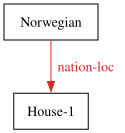
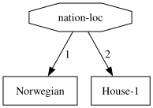
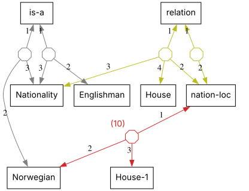

# 1 — Objects & relations

Every Ein model is a graph, and the nodes of that graph are its **objects**. There are two kinds of them: **atoms**,
the named things, and **facts**, which join them; and a **relation** is the atom a fact names first. This chapter
introduces each one *three ways at once*: in **ein-lang** (the text you write), as a **graph** (what Ein reasons
over), and in plain English (what the Ein says). That triad, ein-lang, graph and English, is the habit the rest of
the guide leans on.

We'll use a two-house slice of the Zebra puzzle.

## Atoms — the things

An **atom** is just a named thing: a house, a person, a colour. You don't declare atoms; one exists the moment you
write its name, and the same name is always the same atom.

- **ein-lang:** the bare names `Norwegian`, `House-1`.
- **graph:** each is a node with its name on it, a thing facts point *at*.
- **English:** "the Norwegian", "House-1".

An atom that groups other atoms is an atom too. `Nationality` is one more name, and that the Norwegian is a
nationality is something the program *says*, with an ordinary fact:

```lisp
(is-a Norwegian Nationality)
(is-a Englishman Nationality)
```


**Ein has no types.** Nothing in the language sets `Nationality` apart from `Norwegian`: both are atoms, nodes with
a name, and `is-a` is a relation like any other, one the puzzle chose to call that. When this guide says *the
Norwegian is a Nationality* it reads that fact aloud. Such a fact matters to the answer only as far as a rule reads
it, and the rules that do are the subject of [Chapter 3](03-rule-families.md).

(The precise model, the graph with its atoms and its facts, is
[objects](../03-syntax-and-semantics/01-objects.md); the [glossary](../04-reference/13-glossary.md) has each word,
and defines *Levi-bipartite*.)

## Relations — how things connect

A **relation** says *what kind of link* a fact is: it is the atom a fact names first, `nation-loc` in `(nation-loc
Norwegian House-1)`. You declare it once, with a name for each of its slots:

- **ein-lang:**
  ```lisp
  (relation nation-loc Nationality House :why "the {?1} lives in {?2}")
  ```
- **graph:** the declaration is itself stored as a fact, `(relation nation-loc Nationality House)`, a node with one
  arrow to the relation it declares and one to each slot's label. This is how `ein render kb` draws it:

  

  The loop on `nation-loc` is a second stored fact, `(relation nation-loc)`: *`nation-loc` is a declared relation*.
- **English:** "a nationality lives in a house."

The declaration does two things. It fixes **how many arguments** a `nation-loc` fact has, two, and Ein refuses a
program that writes one with another count. And it gives each slot a **label**, `Nationality` and `House`. A label
is an ordinary atom, the same node the `is-a` facts above point at, and Ein checks no argument against it:
`(nation-loc House-1 Norwegian)` loads. A label means what the rules that read the stored declaration make it
mean, and the standard library's rules in Chapter 3 read it to know which atoms a slot is filled from. Ein itself
reads the labels in one place only, where a program leaves it to guess facts and says nothing of which: it then
proposes no fact *about* an atom that some declaration uses as a label
([what the signature means](../04-reference/02-syntax.md#what-the-signature-means--labels-for-rules-a-shape-for-the-engine)).

`is-a` is declared the same way, `(relation is-a T T :why "{?1} is a {?2}")`, when a puzzle wants Ein to guess its
facts ([reserved names](../04-reference/03-reserved-names.md)); `T` there is a label that says nothing in
particular. Every relation carries its rendering text, a `:why`, which says what one of its facts reads as in
English; the loader refuses a relation, rule or hrule without one (`--no-require-why` loads it anyway).

## Facts — a relation and its arguments

A **fact** joins a relation to its arguments, in order. It has no name of its own: it *is* that list. It's the unit
of knowledge:

- **ein-lang:**
  ```lisp
  (nation-loc Norwegian House-1)
  ```
- **graph (compact):** an arrow between the two arguments with the relation's name on it, as `ein render program`
  draws it,

  

  which is the readable shorthand for what the fact is: a **node** of its own, with an arrow to its relation and
  one to each of its two arguments. The **Levi** view, `ein render program --levi`, draws that node, with the
  relation's name written in it and an arrow to each argument
  ([objects](../03-syntax-and-semantics/01-objects.md#as-a-graph) has the graph itself beside both drawings):

  

- **English:** "the Norwegian lives in House-1", which is the relation's `:why` with the fact's arguments in it.

A fact can record where it came from, which shows up in explanations:

```lisp
(nation-loc Norwegian House-1 :source "condition (10)")
```

## Three kinds of fact

Facts fall into three groups. You never declare which: the annotation you write (or don't) says it:

| annotation | what it holds |
|------------|---------------|
| *none* | background setup: the stored `(relation …)` declarations, the `is-a` facts |
| `:source "(N)"` | the puzzle's stated clues |
| `:rule` / `:using` | everything Ein *derives*: the subject of the next chapters, and Ein writes these itself |

The grouping is for *you*, not the engine: Ein reasons over every fact the same way, so a clue and a derivation
contradict each other exactly as readily as two derivations do.

That's the whole vocabulary. Put together, a tiny model reads:

```lisp
(relation nation-loc Nationality House :why "the {?1} lives in {?2}")   ; a relation, its two slots labelled
(is-a Norwegian Nationality)              ; two facts of the puzzle's grouping relation
(is-a Englishman Nationality)
(nation-loc Norwegian House-1 :source "condition (10)")   ; a clue
```

Save it as `tiny.ein`, and `ein render kb tiny.ein` draws all of it as one graph, every atom once:



The drawing puts `Nationality` in a box and the two atoms with an `is-a` arrow into it in ovals, and its comments
call them *types* and *instances*. That is a convention of the drawing, keyed on a relation named `is-a`
([rendering](../04-reference/12-rendering.md)): it changes no answer, and a puzzle that named its grouping relation
otherwise would see plain arrows. The clue's arrow carries its source, `(10)`.

So far nothing is *derived*: these are all things we stated. In [Chapter 2](02-first-rules.md) we add **rules**, and
Ein starts producing new facts on its own.

> **Reference:** every form, `relation`, `rule`, `query` and the rest, is
> [the syntax reference](../04-reference/02-syntax.md); the names the language reserves are
> [reserved names](../04-reference/03-reserved-names.md); atoms, relations and facts as concepts are
> [objects](../03-syntax-and-semantics/01-objects.md), [relations](../03-syntax-and-semantics/02-relations.md) and
> [facts](../03-syntax-and-semantics/03-facts.md).
