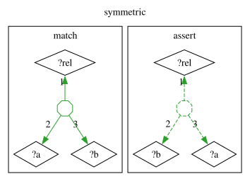
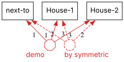
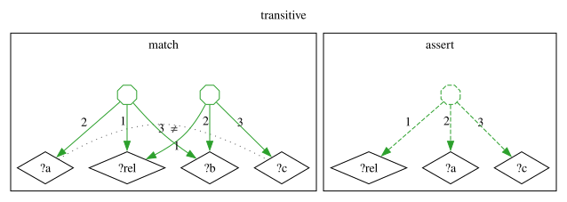
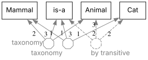
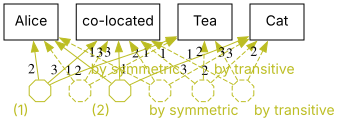

# 2 — First rules

A **rule** watches for a pattern of facts and, when it matches, asserts new
facts. That's the whole engine in one sentence: *rules rewrite the graph,
adding facts until nothing new can be added* (a fixpoint). This chapter
meets the two gentlest rules, each as Ein, as the graph of the rule, and as
the graph of the facts once it has fired, and then the relation they make
the puzzle's engine, each runnable in one command.

A rule has a `:match` (the pattern to find) and an `:assert` (what to add):

```lisp
(rule NAME (params…)
  :match  <pattern over existing facts>
  :assert <fact(s) to add>
  :why    "human-readable reason")
```

A rule has no priority. Ein fires first what can lead to a contradiction and
then the rest, in the order written, and on programs like these the order
decides nothing about the answer
([Q-M1f.313](../../../decisions/engine/Q-M1f.313-the-agenda-fires-first-what-leads-to-false.md)).

## `symmetric` — if A relates to B, then B relates to A

**ein-lang** (from [`examples/saturation/symmetric/neighbours.ein`](../../../../examples/saturation/symmetric/neighbours.ein)):

```lisp
(rule symmetric (?rel)
  :match  (?rel ?a ?b)
  :assert (?rel ?b ?a)
  :why    "{?rel} is symmetric: {?a} ↔ {?b}.")

(relation next-to T T :why "{?3} is next to {?4}")
(symmetric next-to)                       ; ← tag: "apply `symmetric` to next-to"
(next-to House-1 House-2 :source "demo")
(query :goal (next-to House-2 House-1))
```

**English:** "next-to works both ways: if House-1 is next to House-2, then
House-2 is next to House-1."

The `?rel` / `?a` / `?b` (a leading `?`) are **variables** the matcher
binds. `(symmetric next-to)` is the *activator* fact that turns the generic
rule on for `next-to`.

**graph** — the rule's own shape, what it matches above what it asserts,
from `ein render rule --name symmetric` on that file. A diamond is a
variable, and each pattern is drawn as a fact is, an octagon whose arrow `1`
is at its relation, here the variable `?rel`, and whose arrows `2` and `3`
are at its arguments; a dashed octagon is a fact the rule adds:



**The facts once it has fired**, the two `next-to` facts of `ein render kb`
on that file, cut to them: the solid one is the fact the program states,
its source beside it, and the dashed one the fact `symmetric` added, the
rule beside it.



**Run it:**

```sh
$ ein solve examples/saturation/symmetric/neighbours.ein
  states (k_s)      1
  …
  query             (next-to House-2 House-1)
  over              all of R — 1 state → 1 projection class
    class 1 of 1    1 state (1)
                      the goal holds: it has no variable
```

The goal fact wasn't stated — `symmetric` derived it. R, the set of states
the program allows, is one state here: nothing is guessed, so the only state
is the saturated facts themselves.

## `transitive` — chain links together

**ein-lang** (from [`examples/saturation/transitive/taxonomy.ein`](../../../../examples/saturation/transitive/taxonomy.ein)):

```lisp
(rule transitive (?rel)
  :match  (and (?rel ?a ?b) (?rel ?b ?c) (neq ?a ?c))
  :assert (?rel ?a ?c)
  :why    "{?rel} is transitive.")

(relation is-a T T :why "{?3} is a {?4}")
(transitive is-a)
(is-a Cat Mammal :source "taxonomy")
(is-a Mammal Animal :source "taxonomy")
(query :goal (is-a Cat Animal))
```

**English:** "is-a chains: a Cat is a Mammal, a Mammal is an Animal, so a
Cat is an Animal."

Two new pieces: `(and …)` matches *several* facts at once, and `(neq ?a ?c)`
is a **guard** — a built-in predicate that only matches when the two differ
(here, so nothing is concluded to be a kind of itself).

**graph** — `ein render rule --name transitive` on that file. The dotted
`≠` link is the guard:



**The facts once it has fired**, from `ein render kb` on that file, cut to
the facts of `is-a`. The program states the two facts of the chain; the
third, of `Cat` and `Animal`, dashed, is the one `transitive` added. `is-a`
is drawn as any relation is, and every name is a box:



**Run it:**

```sh
$ ein solve examples/saturation/transitive/taxonomy.ein
  states (k_s)      4
  …
  query             (is-a Cat Animal)
  over              all of R — 4 states → 1 projection class
    class 1 of 1    4 states (1, 2, 3, 4)
                      the goal holds: it has no variable
```

Four states, because Ein may also guess `is-a` facts the program does not
state, and none of the guesses breaks anything; the goal holds in all four.

## `co-located` — the first puzzle-shaped relation

The Zebra puzzle's engine is **co-located**: two attributes that share a
house imply each other's placement. It's the bridge from these toy rules to
the real puzzle.

**ein-lang** (from [`examples/branching/05_mini_zebra.ein`](../../../../examples/branching/05_mini_zebra.ein), a 3-attribute mini Zebra):

```lisp
(relation co-located T T :why "{?3} is co-located with {?4}")
(symmetric  co-located)        ; the two rules above, activated for co-located:
(transitive co-located)        ; it forms equivalence classes across attributes
(co-located Alice Tea :source "(1) Alice drinks Tea")
(co-located Alice Cat :source "(2) Alice has the Cat")
;; … with the two rules, the is-a tree, a `guess` rule that concludes (open …) and the query
```

**English:** "Alice drinks tea and Alice has the cat, so the tea and the cat
are in one house": if two things share a house, placing one places the
other.

No new rule: `co-located` is a relation, and the two rules you just met make
it an equivalence. Its symmetric and transitive closure links a nationality,
a drink and a pet into one equivalence class, and a `guess` *hypothesis
rule* proposes the cross-attribute pairings the facts don't pin directly.

**graph** — the `co-located` facts the knowledge base holds, from
`ein render kb` on that file, cut to them: the two the program states,
solid, with the number of their clue, and the four the two rules add,
dashed, each with the rule that added it.



**Run it** (its header documents the unique answer):

```sh
$ ein solve examples/branching/05_mini_zebra.ein --maximal
# → the Coffee-drinker is Bob, and Bob owns the Dog.
```

`--maximal` asks for the states nothing more can be guessed into — the
complete answers. A bare `ein solve` lists all five states of R, the four
partial ones included, and says the goal has no row in those four.

That `guess` step, proposing a fact and then checking it for contradictions,
is the **hypothesis** side of Ein: you don't write the search, you declare
what may be guessed, and Ein answers with every state the guesses can reach
without a contradiction. The full Zebra puzzle needs a few more rules to keep
the guessing rare. That's [Chapter 3](03-rule-families.md).

> **Reference:** what a rule means, in Ein, as a graph, in words and in
> mathematics: [rules](../03-syntax-and-semantics/05-rules.md); what may be guessed:
> [hypotheses](../03-syntax-and-semantics/09-hypotheses.md); drawing a rule:
> `ein render rule --name <R> <file>` ([rendering](../04-reference/12-rendering.md)).
