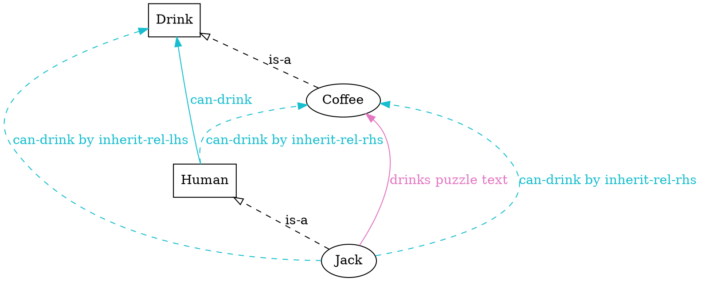

# 5 — Jack drinks coffee

One small inference, stated four ways: **in words**, **in Ein**, **as a graph** and **in mathematics**, the four
representations every [concept page](../03-syntax-and-semantics/README.md) uses. What it shows is how a type holds the
relations its instances share: an instance inherits the relations of its type
([ontology](../03-syntax-and-semantics/04-ontology.md)).

## In words

We want Ein to conclude

> *Jack can drink coffee.*

from these premises:

| # | claim |
|---|---|
| 1 | Humans can drink drinks. |
| 2 | Coffee is a drink. |
| 3 | Jack is a human. |
| 4 | Jack drinks coffee. *(the puzzle's explicit statement)* |

and, *without* using claim 4, also:

| # | claim | how it follows |
|---|---|---|
| 5a | Jack can drink drinks. | the left slot inherits: (1) and *Jack is a human* |
| 5b | Humans can drink coffee. | the right slot inherits: (1) and *coffee is a drink* |
| 6 | Jack can drink coffee. | chained: (5a) and *coffee is a drink*, or (5b) and *Jack is a human* |

(5a), (5b) and (6) follow from the ontology alone, the declared relations and the `is-a` facts. Claim (4) is a
separate assertion: *Jack drinks coffee* is not *Jack can drink coffee*; one is observed, the other is a possibility
the type structure entails.

(5a) and (5b) come from **two rules**, one per argument slot of the two-slot relation `can-drink`. (6) is no rule of
its own: it is what the two rules reach when they chain. For a relation of N slots the pattern takes N slot rules,
and the closure over every slot at once is always their chained fixpoint, never a separate rule.

## In Ein

The whole program; `ein solve` answers it as written:

```lisp
;; Inherit a relation through is-a, one rule per argument slot.
(rule inherit-rel-lhs (?r)
  :match  (and (?r ?t ?other)
               (is-a ?inst ?t))
  :assert (?r ?inst ?other)
  :why    "{?inst} is a {?t}, so {?inst} inherits {?r}'s left slot from {?t}.")

(rule inherit-rel-rhs (?r)
  :match  (and (?r ?other ?t)
               (is-a ?inst ?t))
  :assert (?r ?other ?inst)
  :why    "{?inst} is a {?t}, so {?inst} inherits {?r}'s right slot from {?t}.")

(relation is-a      T     T     :why "{?1} is a {?2}")
(relation can-drink Human Drink :why "{?1} can drink {?2}")
(relation drinks    Human Drink :why "{?1} drinks {?2}")

(is-a Jack   Human)                      ; (3)
(is-a Coffee Drink)                      ; (2)

(can-drink Human Drink)                  ; (1) humans can drink drinks

(inherit-rel-lhs can-drink)              ; turn both rules on for can-drink
(inherit-rel-rhs can-drink)

(drinks Jack Coffee :source "puzzle text")   ; (4) the puzzle's statement

(solve :no-search)
(query :goal (can-drink Jack Coffee))
```

Each rule takes the relation it acts on as its parameter `?r`, and the facts `(inherit-rel-lhs can-drink)` and
`(inherit-rel-rhs can-drink)` turn it on for `can-drink`: a rule written once, for any relation, and *activated* per
relation ([rules](../03-syntax-and-semantics/05-rules.md)). `(solve :no-search)` says that nothing is guessed, so the answer
is what saturation derives from the program as written. Without it, Ein would also guess `is-a`, `can-drink` and
`drinks` facts the program does not state, and the answer would list every state those guesses reach; the goal holds
in all of them.

Saved as `jack.ein`, `ein solve jack.ein` ends:

```text
  query             (can-drink Jack Coffee)
  over              all of R — 1 state → 1 projection class
    class 1 of 1    1 state (1)
                      the goal holds: it has no variable
  as :expect        (model (can-drink Jack Coffee))
```

and `ein saturate jack.ein --dump` lists what saturation added, each fact with the rule that derived it:

```text
;; ── DERIVED (3 facts) ──
;;   can-drink (3)
  (can-drink Jack Drink :rule inherit-rel-lhs)
  (can-drink Human Coffee :rule inherit-rel-rhs)
  (can-drink Jack Coffee :rule inherit-rel-rhs)
```

Claim (6) has two derivations, one through each slot. The dump names the one that came first; the other is real too,
and the trace below shows both.

## As a graph

`ein render kb jack.ein` draws the saturated knowledge base as one graph: types as boxes, instances as ovals, an
`is-a` fact as a dashed arrow with an open head, any other fact of two arguments as an arrow labelled by its relation,
a derived one dashed and labelled with the rule that derived it. Leaving out the `(relation …)` declarations it also
draws, it is:



The three dashed `can-drink` arrows are the *inheritance closure* of the type-level fact across the `is-a` arrows:
the product {Human, Jack} × {Drink, Coffee} less the fact it starts from. The compact view puts *two* relations,
`can-drink` and `drinks`, on the same pair Jack → Coffee; only the labels tell them apart.

The **detailed** view draws every fact as its own node, joined to its relation and to each argument by a numbered
edge, the way [facts](../03-syntax-and-semantics/03-facts.md) states a fact and the way `ein render kb` draws a fact of any
other number of arguments. It makes visible what the compact view hides: `(can-drink Human Drink)` and
`(can-drink Jack Coffee)` are distinct facts about different argument tuples of one relation.

```dot
digraph jack_levi {
  rankdir=BT;

  // relations
  rel_isa   [shape=box, style=rounded, label="is-a"];
  rel_can   [shape=box, style=rounded, label="can-drink"];
  rel_drink [shape=box, style=rounded, label="drinks"];

  // types and instances
  Human [shape=box];  Drink [shape=box];
  Jack [shape=oval];  Coffee [shape=oval];

  // stated facts
  isa_jack [shape=octagon, label="(is-a Jack Human)"];
  isa_jack -> rel_isa [style=dashed]; isa_jack -> Jack [label="#1"]; isa_jack -> Human [label="#2"];
  isa_coffee [shape=octagon, label="(is-a Coffee Drink)"];
  isa_coffee -> rel_isa [style=dashed]; isa_coffee -> Coffee [label="#1"]; isa_coffee -> Drink [label="#2"];
  can_HD [shape=octagon, label="(can-drink Human Drink)"];
  can_HD -> rel_can [style=dashed]; can_HD -> Human [label="#1"]; can_HD -> Drink [label="#2"];
  drinks_JC [shape=octagon, label="(drinks Jack Coffee)\n:source puzzle text"];
  drinks_JC -> rel_drink [style=dashed]; drinks_JC -> Jack [label="#1"]; drinks_JC -> Coffee [label="#2"];

  // derived facts
  can_JD [shape=octagon, style=dashed, label="(can-drink Jack Drink)\nby inherit-rel-lhs"];
  can_JD -> rel_can [style=dashed]; can_JD -> Jack [label="#1"]; can_JD -> Drink [label="#2"];
  can_HC [shape=octagon, style=dashed, label="(can-drink Human Coffee)\nby inherit-rel-rhs"];
  can_HC -> rel_can [style=dashed]; can_HC -> Human [label="#1"]; can_HC -> Coffee [label="#2"];
  can_JC [shape=octagon, style=dashed, label="(can-drink Jack Coffee)\nby either rule"];
  can_JC -> rel_can [style=dashed]; can_JC -> Jack [label="#1"]; can_JC -> Coffee [label="#2"];
}
```



## In mathematics

The program states a finite set *K* of ground atoms, and each rule, once activated for `can-drink`, is a Horn clause
over it:

```text
K = { is-a(Jack, Human), is-a(Coffee, Drink), can-drink(Human, Drink), drinks(Jack, Coffee) }

lhs:  ∀ t, o, i.  can-drink(t, o) ∧ is-a(i, t)  →  can-drink(i, o)
rhs:  ∀ o, t, i.  can-drink(o, t) ∧ is-a(i, t)  →  can-drink(o, i)
```

The answer is the least set *K\** ⊇ *K* closed under both clauses, the fixpoint saturation reaches:

```text
K* = K ∪ { can-drink(Jack, Drink), can-drink(Human, Coffee), can-drink(Jack, Coffee) }
```

and `can-drink(Jack, Coffee) ∈ K*` is the goal. Since `can-drink` has two slots and `is-a` is the only way into
either, *K\** holds `can-drink(x, y)` for exactly the pairs (x, y) ∈ {Human, Jack} × {Drink, Coffee}: each slot's
values are closed downward along `is-a`, independently of the other.

## What the example shows

Each claim is one fact, and the fact's origin is visible in the knowledge base:

| claim | the fact | where it came from |
|---|---|---|
| (1) Humans can drink drinks. | `(can-drink Human Drink)` | stated, background |
| (2) Coffee is a drink. | `(is-a Coffee Drink)` | stated, background |
| (3) Jack is a human. | `(is-a Jack Human)` | stated, background |
| (4) Jack drinks coffee. | `(drinks Jack Coffee :source "puzzle text")` | stated, a given: it has a `:source` |
| (5a) Jack can drink drinks. | `(can-drink Jack Drink)` | derived by `inherit-rel-lhs` |
| (5b) Humans can drink coffee. | `(can-drink Human Coffee)` | derived by `inherit-rel-rhs` |
| (6) Jack can drink coffee. | `(can-drink Jack Coffee)` | derived by either rule, chained |

`inherit-rel-lhs` and `inherit-rel-rhs` are **relation-polymorphic** rules: `?r` ranges over the relations a fact
activates them for ([rules](../03-syntax-and-semantics/05-rules.md)). The shape of each, a relation with a type in one slot
and an `is-a` arrow into that type, concluding the relation on the instance in the same slot, is the **inheritance
pattern**: the same shape as `transitive`, applied along `is-a` instead of along the relation itself. `ein solve
jack.ein --trace out.md` writes the derivation step by step, each step's `:why` filled in:

```text
### Step 1 — `inherit-rel-lhs`
> Jack is a Human, so Jack inherits can-drink's left slot from Human.
Premises: `can-drink(Human, Drink)`, `is-a(Jack, Human)`
Derives `can-drink(Jack, Drink)` — Jack can drink Drink
…
### Step 3 — `inherit-rel-rhs`
> Coffee is a Drink, so Coffee inherits can-drink's right slot from Drink.
Premises: `can-drink(Jack, Drink)`, `is-a(Coffee, Drink)`
Derives `can-drink(Jack, Coffee)` — Jack can drink Coffee
### Step 4 — `inherit-rel-lhs`
> Jack is a Human, so Jack inherits can-drink's left slot from Human.
Premises: `can-drink(Human, Coffee)`, `is-a(Jack, Human)`
Derives `can-drink(Jack, Coffee)` — Jack can drink Coffee
```

## What it leaves out

- **Another encoding of the types.** The types here are bare `is-a` targets. `zebra2.ein`'s encoding roots every type
  in one name, `T`, so that the types are themselves instances:

  ```lisp
  (relation is-a T T :why "{?1} is a {?2}")
  (is-a Human  T)
  (is-a Drink  T)
  (is-a Jack   Human)
  (is-a Coffee Drink)
  ```

  Both carry the same content for this example.
- **How `can-drink` and `drinks` relate.** The example keeps them apart. A puzzle that wants
  `(drinks Jack Coffee) ⇒ (can-drink Jack Coffee)` writes it as one more rule.
- **Negation.** *Jack doesn't drink tea* is the stored negation `(not (drinks Jack Tea))`
  ([constraints](../03-syntax-and-semantics/06-constraints.md)), and an inheritance rule over negations is one more rule of
  the same shape.

## See also

- [Ontology](../03-syntax-and-semantics/04-ontology.md): types as the holders of the relations their instances share.
- [Rules](../03-syntax-and-semantics/05-rules.md): a rule's parameters, its activation, and what a pattern matches.
- [Rendering](../04-reference/12-rendering.md): every view `ein render` draws.
